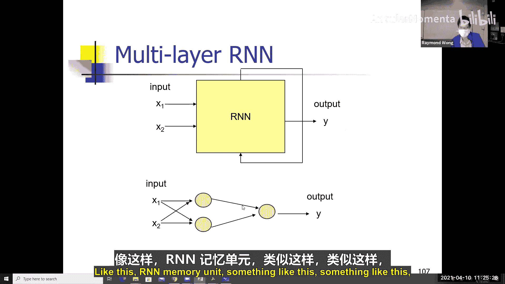
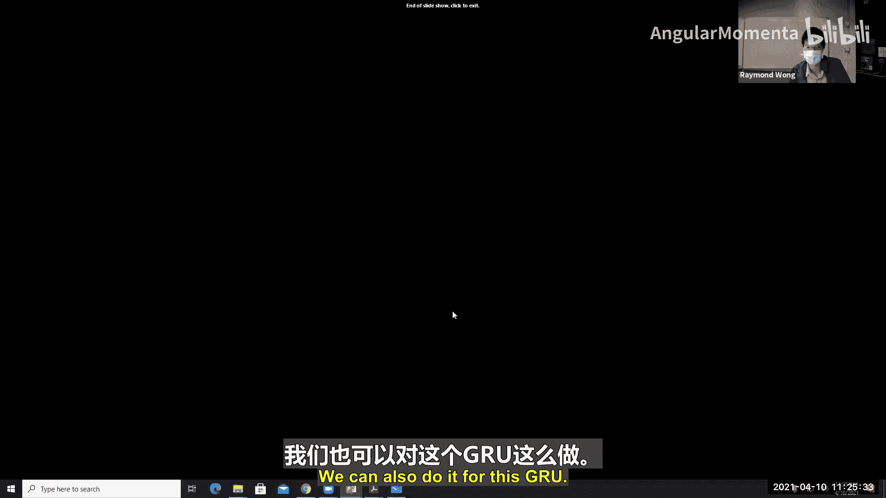

# 015：循环神经网络 (RNN) 概述

在本节课中，我们将要学习循环神经网络。这是一种特殊的神经网络，能够处理数据记录之间存在依赖关系的情况，例如时间序列数据。我们将从基本概念入手，逐步了解其工作原理，并介绍两种重要的变体：LSTM和GRU。

## 基本循环神经网络 (Basic RNN)

上一节我们介绍了传统神经网络假设数据记录之间是独立的。然而，在许多实际场景中，当前记录与之前的记录是相关的。例如，股票价格、温度读数等时间序列数据，当前值往往依赖于过去的值。为了捕捉这种依赖性，我们引入了循环神经网络。

循环神经网络的核心思想是在网络中引入一个“循环”或“记忆”机制。这使得网络在处理当前输入时，能够参考之前步骤的信息。

以下是RNN的基本结构和工作原理：

*   **结构**：一个基本的RNN单元包含一个内部状态变量 `S_t`，用于存储记忆。在每个时间步 `t`，它接收当前输入 `X_t` 和上一个时间步的内部状态 `S_{t-1}`，经过一个激活函数（如tanh或ReLU）处理后，产生当前输出 `Y_t` 和新的内部状态 `S_t`。
*   **公式**：基本RNN的核心计算可以表示为：
    *   `S_t = activation_function(W * [X_t, S_{t-1}] + b)`
    *   `Y_t = S_t` （有时会经过另一个线性变换）
    其中，`W` 是权重矩阵，`b` 是偏置项，`[X_t, S_{t-1}]` 表示将两个向量拼接起来。
*   **训练**：RNN的训练也分为前向传播和反向传播两个步骤。前向传播按时间顺序依次计算每个时间步的输出和状态。反向传播则通过时间（Backpropagation Through Time, BPTT）算法来更新权重，这与传统神经网络的反向传播类似，但需要考虑时间维度上的梯度流动。

基本RNN结构简单，但也存在一些局限性，例如难以学习长期依赖关系（梯度消失/爆炸问题），并且由于结构相对简单，模拟复杂记忆模式的能力有限。

## 长短期记忆网络 (LSTM)

上一节我们介绍了基本RNN及其局限性。为了解决这些问题，研究者提出了长短期记忆网络。LSTM通过引入更复杂的“门”结构，能够更有效地学习和记忆长期依赖关系。

LSTM的设计灵感来源于人脑的记忆过程。它主要包含三个关键特性，并通过六个组件来实现：

*   **遗忘特性**：决定从内部状态（记忆）中丢弃哪些旧信息。由“遗忘门”实现。
*   **输入特性**：决定将多少新信息存入内部状态。这分为两步：1) “输入门”决定更新哪些值；2) “输入激活门”（通常使用tanh）创建一个新的候选值向量。
*   **输出特性**：基于当前的内部状态，决定输出什么。这同样分为两步：1) “输出门”决定输出内部状态的哪些部分；2) 将内部状态通过tanh激活并与输出门相乘得到最终输出。

以下是LSTM在一个时间步 `t` 的计算公式：

*   **遗忘门**：`f_t = σ(W_f · [h_{t-1}, x_t] + b_f)`
*   **输入门**：`i_t = σ(W_i · [h_{t-1}, x_t] + b_i)`
*   **候选记忆**：`\tilde{C}_t = tanh(W_C · [h_{t-1}, x_t] + b_C)`
*   **更新细胞状态**：`C_t = f_t * C_{t-1} + i_t * \tilde{C}_t`
*   **输出门**：`o_t = σ(W_o · [h_{t-1}, x_t] + b_o)`
*   **最终输出**：`h_t = o_t * tanh(C_t)`

其中，`σ` 是sigmoid函数，`*` 表示逐元素相乘，`h_{t-1}` 是上一个时间步的输出（也作为当前输入的一部分），`C_t` 是细胞状态（长期记忆）。

LSTM的结构比基本RNN复杂，因此能捕捉数据中更复杂的模式，记忆更长的序列，但相应的训练时间也更长。

## 门控循环单元 (GRU)

上一节我们介绍了强大的LSTM。为了在保持性能的同时降低模型复杂性，研究者提出了门控循环单元。GRU可以看作是LSTM的一个简化变体，它将遗忘门和输入门合并为一个“更新门”，并混合了细胞状态和隐藏状态。

GRU同样模拟了记忆过程，但组件更少，主要包含：

*   **重置特性**：通过“重置门”来决定如何将新的输入与过去的记忆（以上一时刻的输出 `h_{t-1}` 为参考）结合。这决定了哪些过去信息需要被“忽略”。
*   **输入特性**：决定当前输入信息的重要性（相当于输入权重），通过“输入激活门”实现。注意，GRU没有单独的“输入比例门”。
*   **更新特性**：通过“更新门”来平衡过去记忆 `h_{t-1}` 和当前候选记忆 `\tilde{h}_t` 对当前输出 `h_t` 的贡献比例。这是GRU的核心，它决定了保留多少旧记忆和加入多少新记忆。

以下是GRU在一个时间步 `t` 的计算公式：

*   **重置门**：`r_t = σ(W_r · [h_{t-1}, x_t] + b_r)`
*   **更新门**：`z_t = σ(W_z · [h_{t-1}, x_t] + b_z)`
*   **候选激活**：`\tilde{h}_t = tanh(W · [r_t * h_{t-1}, x_t] + b)`
*   **最终输出**：`h_t = (1 - z_t) * h_{t-1} + z_t * \tilde{h}_t`

GRU由于参数更少，结构更简单，通常训练速度比LSTM更快，且在某些任务上能用更少的数据达到相近的效果。它和LSTM一样，也可以构建多层网络并在每层使用多个记忆单元。

## 总结

本节课中我们一起学习了循环神经网络。我们从基本RNN开始，了解了它如何通过内部状态处理序列依赖。接着，我们探讨了更强大的LSTM，它通过精细设计的遗忘门、输入门和输出门，有效地解决了长期依赖问题。最后，我们学习了GRU，它是LSTM的一种简化版本，通过合并门结构和参数，在保持性能的同时提高了计算效率。这三种模型是处理序列数据（如自然语言、时间序列预测）的基石，理解它们的原理对于深入学习深度学习至关重要。