# 017：基本概念 第一部分


在本节课中，我们将学习数据仓库中的一个核心概念：物化视图及其增益计算。我们将通过一个简单的销售数据表例子，理解如何通过SQL的`GROUP BY`和聚合操作生成不同粒度的汇总视图，并计算物化特定视图所带来的性能增益。

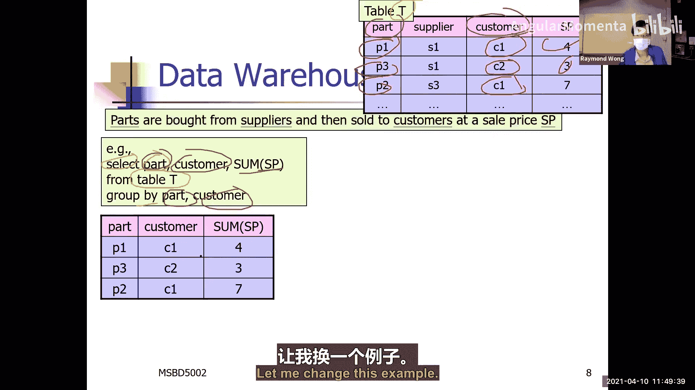

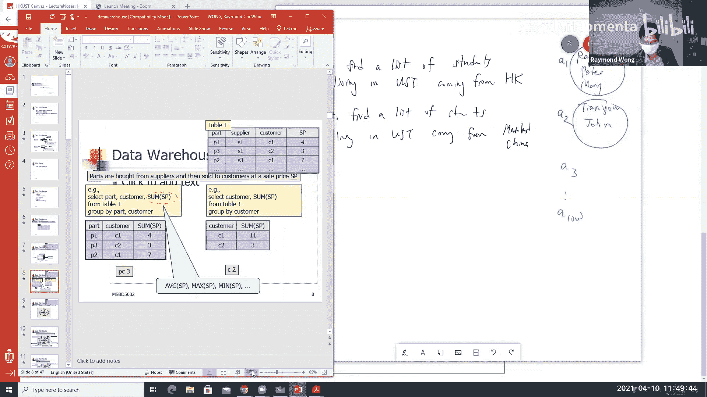

## 概述与背景

上一节我们介绍了数据仓库的基本背景，本节中我们来看看一个具体的例子。假设我们有一张销售记录表 **T**，包含以下字段：`part`（零件）、`customer`（客户）、`supplier`（供应商）和 `selling_price`（售价）。其内容如下：

| part | customer | supplier | selling_price |
| :--- | :--- | :--- | :--- |
| P1 | C1 | S1 | 4 |
| P3 | C2 | S1 | 3 |
| P2 | C1 | S3 | 7 |

## 理解基础查询与分组

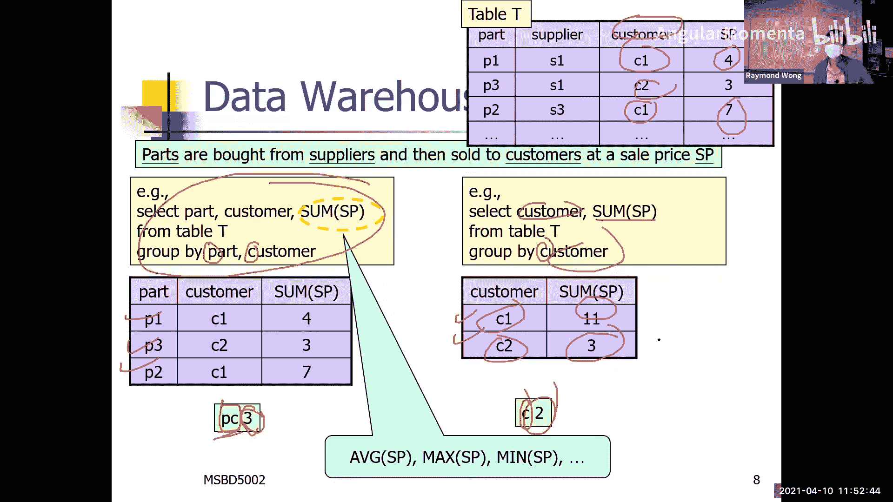

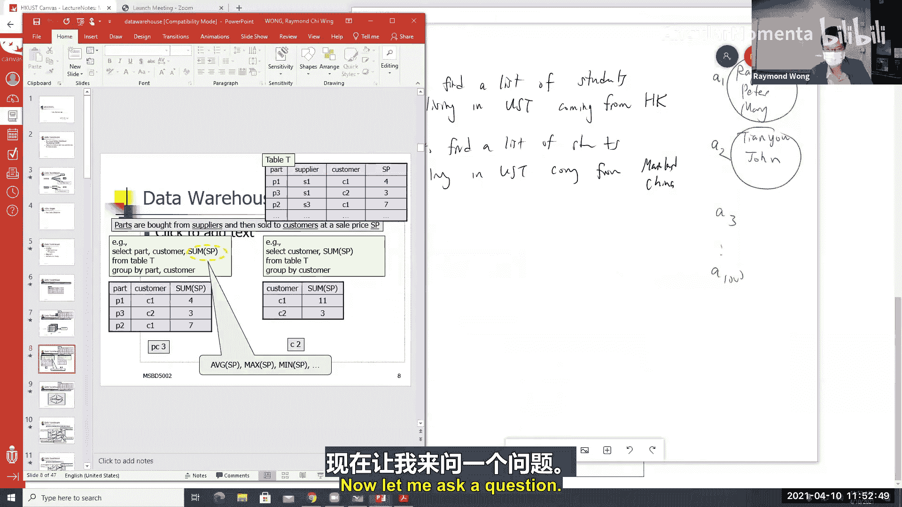

首先，我们执行一个基础的SQL查询。以下是按`part`和`customer`分组并计算总售价的语句：

```sql
SELECT part, customer, SUM(selling_price)
FROM T
GROUP BY part, customer;
```

这个查询的含义是：从表 **T** 中，按照`part`和`customer`的组合进行分组，并对每个组内的`selling_price`求和。对于我们的示例数据，分组和计算结果如下：

*   `(P1, C1)` 组：售价总和为 4。
*   `(P3, C2)` 组：售价总和为 3。
*   `(P2, C1)` 组：售价总和为 7。

因此，查询结果是一个包含3行数据的新视图，我们将其记为 **PC** 视图（代表Part-Customer），其大小为3。

接下来，我们看另一个查询，它只按`customer`分组：

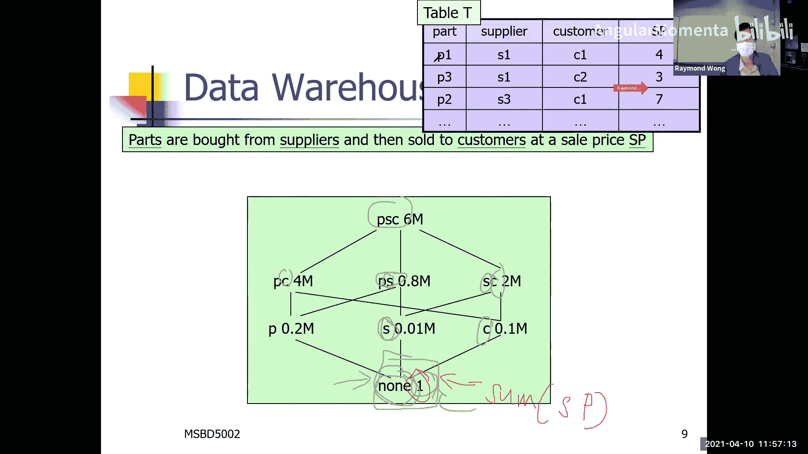

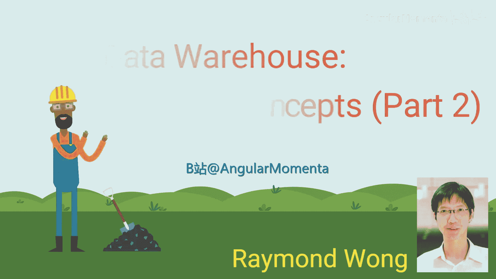

```sql
SELECT customer, SUM(selling_price)
FROM T
GROUP BY customer;
```

这个查询的结果是：

*   `C1` 组：售价总和为 4 + 7 = 11。
*   `C2` 组：售价总和为 3。

我们得到包含2行数据的 **C** 视图（代表Customer）。

一个重要的概念是：**高层级的视图可以从低层级的视图推导出来**。例如，要得到 **C** 视图，我们不仅可以从原始表 **T** 计算，也可以从已经计算好的 **PC** 视图推导（通过对相同的`customer`进行聚合）。显然，从数据量更小的 **PC** 视图（3行）进行计算，比从原始表 **T**（3行，本例中虽相同，但理论上原始表可能巨大）更高效。

## 数据立方体与物化视图

我们可以将不同分组组合的视图组织成一个**格结构**。顶点是包含所有维度的最详细视图（如 **PSC**），底部是没有任何维度的总计视图（如 **()**，表示所有售价的总和）。边表示“可以从哪个视图推导出哪个视图”。

假设我们有一个巨大的原始表 **PSC**，其记录数为 6M（6百万）。通过分组聚合，我们可以得到一系列其他视图及其预估大小：
*   **PC**: 4M
*   **PS**: 0.8M
*   **SC**: 2M
*   **P**: 0.2M
*   **S**: 0.01M
*   **C**: 0.1M
*   **()**: 1 (单行总计)

**物化视图** 是指将某个视图的查询结果实际存储在硬盘上。物化视图可以加速查询，因为查询可以直接读取物化好的结果，而无需重新扫描和计算原始数据。但是，物化所有视图会占用大量存储空间。

我们定义**回答一个查询的成本**为：为了得到该查询的答案，需要从硬盘读取的数据行数。

## 计算物化视图的增益

我们通过一个场景来理解“增益”的计算。

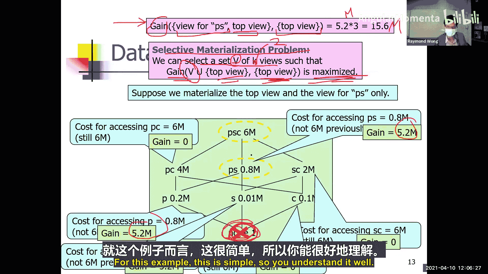

**场景一：只物化顶层视图（PSC）**
此时，所有其他视图都需要通过扫描原始的 **PSC**（6M行）来计算。
*   回答 **PC** 查询的成本：6M
*   回答 **P** 查询的成本：6M
*   ...（其他视图成本均为6M）

**场景二：物化顶层视图（PSC）和 PS 视图**
现在，**PS** 视图（0.8M行）已被物化并存储在硬盘上。
*   回答 **PC** 查询的成本：仍需扫描 **PSC**，成本为6M。
*   回答 **P** 查询的成本：现在有两种选择：1) 扫描 **PSC** (6M)；2) 扫描已物化的 **PS** (0.8M) 并从中聚合出 **P**。智能的系统会选择成本更小的方案，即0.8M。
*   回答 **S** 查询的成本：同样可以从 **PS** (0.8M) 中聚合得到，成本为0.8M。
*   回答 **C** 查询的成本：**PS** 视图中没有`customer`信息，因此仍需扫描 **PSC**，成本为6M。

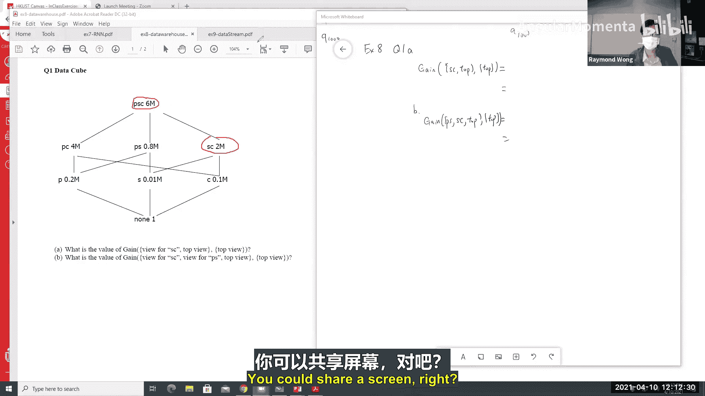

**增益** 定义为：**由于额外物化了某个（些）视图，使得回答所有查询的总成本降低的数值**。
比较场景二和场景一：
*   对于 **P** 查询，成本从 6M 降为 0.8M，增益为 5.2M。
*   对于 **S** 查询，成本从 6M 降为 0.8M，增益为 5.2M。
*   对于 **C** 查询，成本没有变化（6M），增益为 0。
*   对于 **PC** 等视图，成本没有变化，增益为 0。

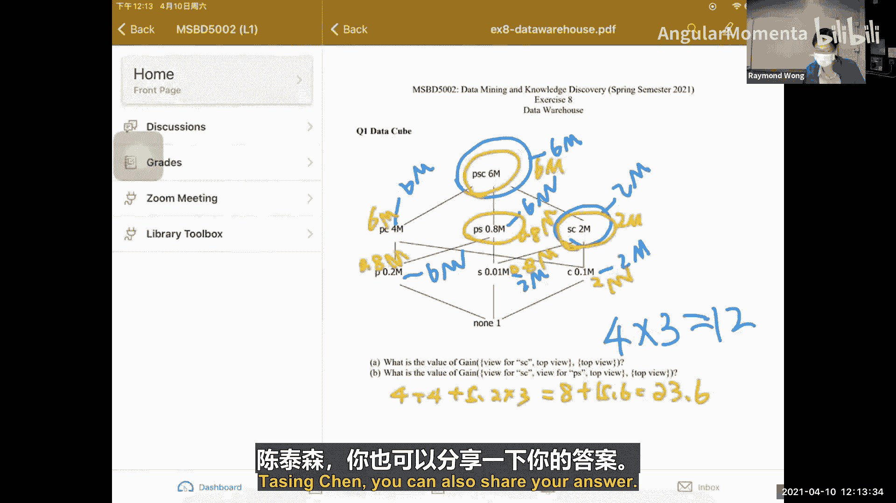


因此，物化 **PS** 视图带来的总增益是 5.2M + 5.2M + 0 + ... = 10.4M（此例中）。通常我们忽略对顶层视图和总计视图的增益计算。

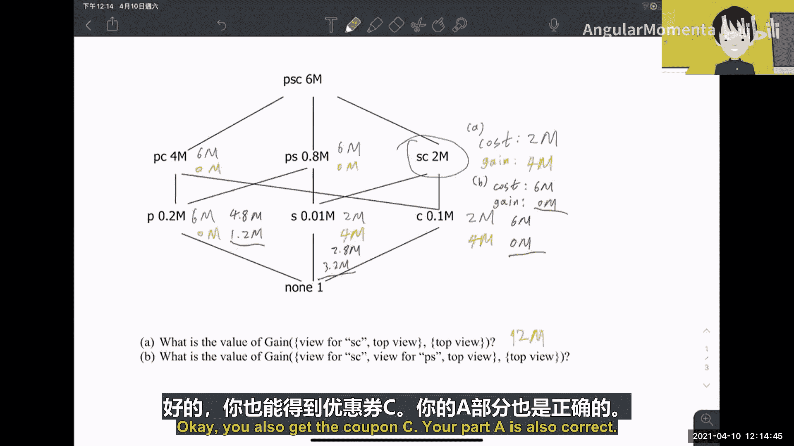

## 选择性物化问题

由此引出了**选择性物化问题**：在存储空间有限（即只能物化 K 个额外视图）的前提下，选择哪 K 个视图进行物化，才能使得到的总增益最大化？

这是一个需要优化算法来解决的问题。为了巩固理解，请尝试完成以下课堂练习。

**课堂练习**
假设原始视图 **PSC** 大小为 6M，其他视图大小如下：**PC=4M**, **PS=0.8M**, **SC=2M**, **P=0.2M**, **S=0.01M**, **C=0.1M**。
1.  如果只物化 **PSC**，回答所有查询（**PC**, **PS**, **SC**, **P**, **S**, **C**）的总成本是多少？
2.  如果物化 **PSC**, **PS** 和 **SC**，回答所有查询的总成本是多少？相比只物化 **PSC**，总增益是多少？

（练习解析：根据上述增益计算原理，第一问总成本为 6M * 6 = 36M。第二问中，**P**和**S**可从**PS**获得，成本为0.8M和0.01M；**C**可从**SC**获得，成本为0.1M；**PC**仍需扫描**PSC**，成本6M；**PS**和**SC**已物化，成本即其自身大小0.8M和2M。总成本为 6 + 0.8 + 2 + 0.2 + 0.01 + 0.1 = 9.11M。总增益为 36M - 9.11M = 26.89M。）

## 总结

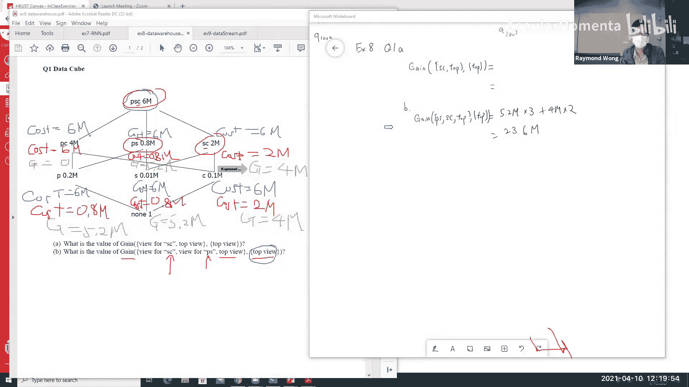


本节课中我们一起学习了数据仓库中物化视图的核心概念。我们通过SQL分组聚合的例子，理解了视图之间的推导关系。我们重点掌握了**物化视图**如何通过预计算和存储中间结果来提升查询性能，并定义了**查询成本**和**物化增益**。最后，我们引出了**选择性物化问题**，即在资源约束下如何最优选择要物化的视图集合以最大化性能增益。这是构建高效数据仓库系统的关键基础。