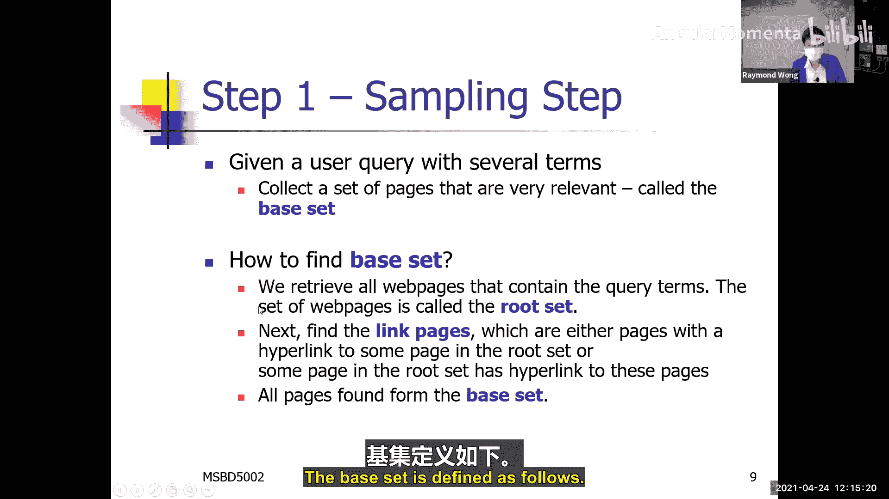
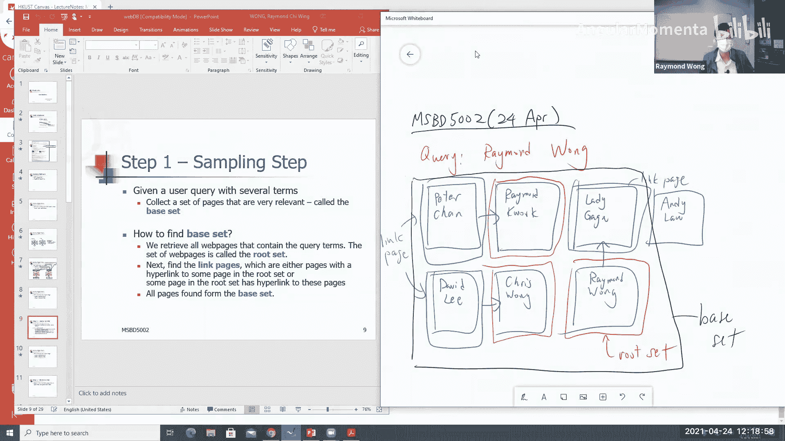
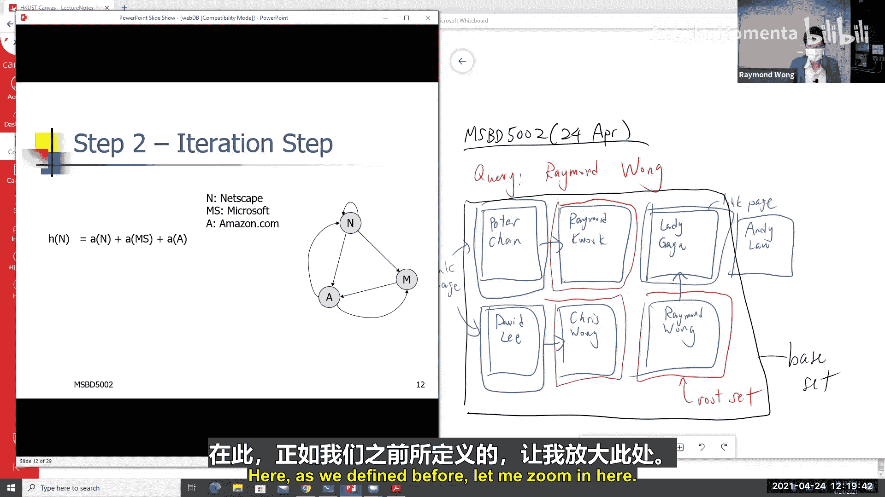
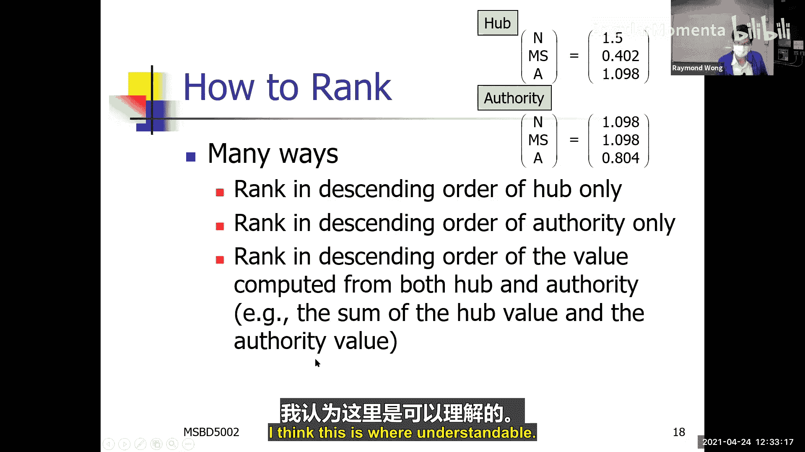

# 020：HITS算法第一部分


在本节课中，我们将要学习一种重要的网页排名算法——HITS算法。该算法通过分析网页之间的链接关系，来评估网页的重要性。我们将从基本概念入手，逐步理解其工作原理和计算步骤。

## 概述与背景

在互联网搜索中，如何快速准确地找到相关网页是一个核心问题。例如，在搜索引擎中输入“Raymond Wong”进行搜索，会返回大量相关网页。了解搜索引擎的排名机制，有助于我们优化网页，使其在搜索结果中获得更好的位置。

HITS算法是两种主要排名方法之一，另一种是Google目前使用的PageRank算法。HITS算法的核心思想是区分两种类型的网页：**枢纽（Hub）**和**权威（Authority）**。

## 核心概念：枢纽与权威



一个网页可以同时拥有枢纽权重和权威权重。

*   **权威（Authority）**：如果一个网页被许多其他网页链接，那么它就是一个好的权威。权威权重（A）衡量的是指向该网页的链接数量和质量。
    *   **公式**：对于一个网页 `v`，其权威权重 `A(v)` 是所有指向它的网页的枢纽权重之和。即：
        `A(v) = Σ H(u)`，其中 `u` 是所有指向 `v` 的网页。
*   **枢纽（Hub）**：如果一个网页包含许多指向其他高质量网页的链接，那么它就是一个好的枢纽。枢纽权重（H）衡量的是该网页指向外部的链接数量和质量。
    *   **公式**：对于一个网页 `v`，其枢纽权重 `H(v)` 是所有它指向的网页的权威权重之和。即：
        `H(v) = Σ A(u)`，其中 `u` 是所有被 `v` 指向的网页。

简单来说，好的权威被好的枢纽所链接，而好的枢纽则链接向好的权威。

## HITS算法步骤




HITS算法主要包含两个步骤：**采样（Sampling）**和**迭代（Iteration）**。



### 第一步：采样（构建基础集合）

给定一个包含若干关键词的用户查询（例如“Raymond Wong”），算法首先需要确定一个待分析的网页集合，称为**基础集合（Base Set）**。构建过程如下：

1.  **收集根集合（Root Set）**：检索并收集所有包含查询关键词的网页。这些网页构成了根集合。
2.  **扩展为基集（Base Set）**：
    *   将所有根集合中的网页加入基础集合。
    *   将所有**链接到**根集合中任一网页的网页加入基础集合。
    *   将所有被根集合中任一网页**链接到**的网页加入基础集合。

经过以上步骤，我们得到了一个围绕查询主题的、由相关网页及其紧密链接邻居构成的基础集合。后续的排名计算将仅在这个集合内进行。

### 第二步：迭代计算权重

在获得基础集合后，目标是为其中的每个网页计算其枢纽权重和权威权重。这通过一个迭代过程完成。

首先，我们需要用图来表示基础集合中网页的链接关系。每个网页是一个节点，每个超链接是一条有向边。

假设我们有一个简单的网络，包含三个网页：Netscape (N), Microsoft (MS), Amazon (A)。它们的链接关系如下图所示（假设N指向MS和A，MS指向A）：

```
N -> MS
N -> A
MS -> A
```

我们可以用邻接矩阵 `M` 来表示这个图。如果网页 `i` 链接到网页 `j`，则 `M[i][j] = 1`，否则为0。

根据之前的核心概念公式，我们可以将枢纽和权威权重的计算表示为矩阵运算。

*   令 `h` 为所有网页的枢纽权重向量。
*   令 `a` 为所有网页的权威权重向量。

那么，迭代公式可以写作：
1.  `a = M^T * h` （权威权重等于所有指向它的网页的枢纽权重之和）
2.  `h = M * a` （枢纽权重等于所有它指向的网页的权威权重之和）

将公式2代入公式1，可以得到 `a = M^T * M * a`。这意味着权威权重向量 `a` 是矩阵 `M^T * M` 的特征向量。同理，枢纽权重向量 `h` 是矩阵 `M * M^T` 的特征向量。

在实际计算中，我们采用迭代逼近法来求解：

1.  初始化：将所有网页的枢纽权重和权威权重设为1（或任何相同的正数）。
2.  进行以下迭代直到收敛：
    a.  根据当前 `h`，利用公式 `a = M^T * h` 更新所有 `a`。
    b.  对 `a` 进行标准化（例如，使其各分量之和为1或固定值），以防止数值过大。
    c.  根据更新后的 `a`，利用公式 `h = M * a` 更新所有 `h`。
    d.  对 `h` 进行标准化。
3.  当连续两次迭代的权重向量变化小于一个极小阈值时，认为算法已收敛，停止迭代。

最终，我们得到每个网页稳定的枢纽权重和权威权重。搜索引擎可以根据这些权重对结果进行排序，例如按权威权重降序排列，或按枢纽与权威权重的综合得分排序。

## 总结




本节课我们一起学习了HITS算法的第一部分。我们首先了解了网页排名的重要性，然后引入了HITS算法的两个核心概念：**枢纽**和**权威**。接着，我们详细讲解了算法的两个主要步骤：**采样**（如何构建待分析的基础网页集合）和**迭代**（如何通过矩阵运算和迭代逼近来计算每个网页的枢纽与权威权重）。理解这些基础是掌握HITS算法以及对比其他排名算法（如PageRank）的关键。在下一部分，我们将通过更具体的例子和细节来深化理解。