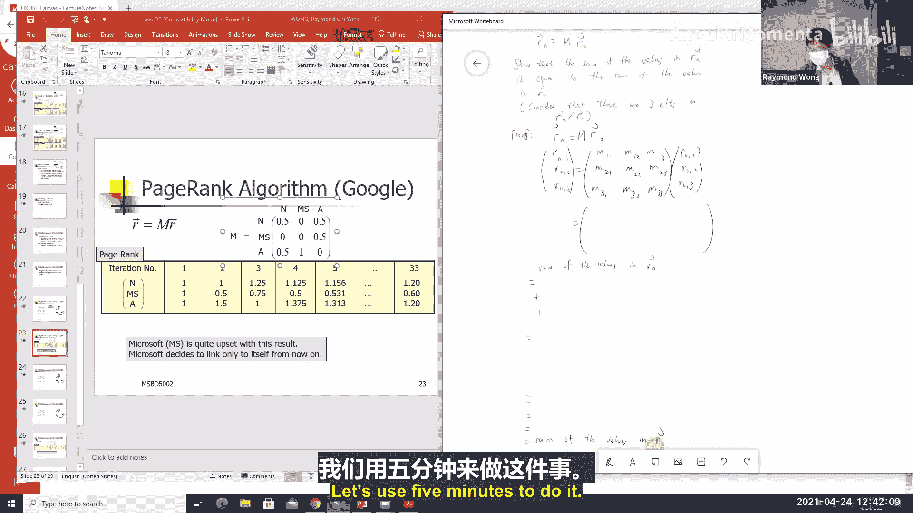
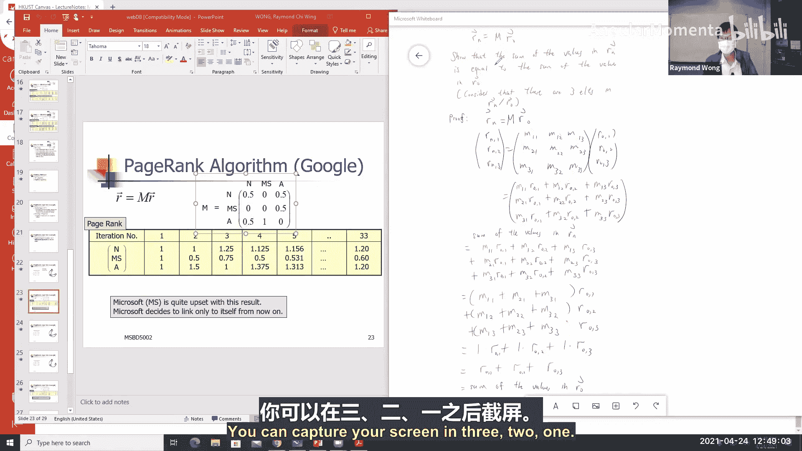
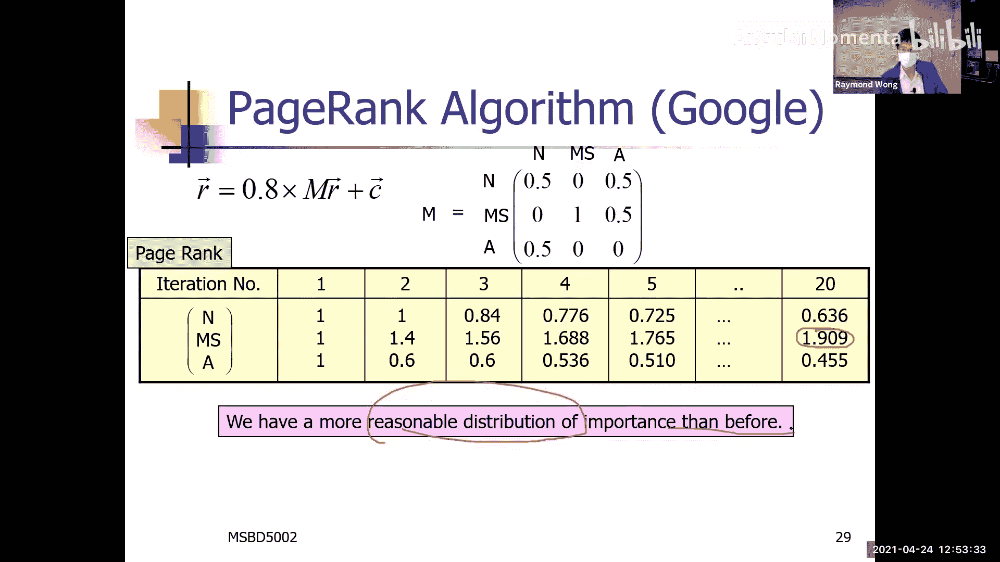

# 021：PageRank算法第一部分


## 概述
在本节课中，我们将要学习PageRank算法的基本原理。PageRank是Google搜索引擎早期用于网页排序的核心算法。我们将了解它如何通过一个单一的“重要性”概念来评估网页，并学习其背后的随机过程思想。

---

## PageRank算法简介
上一节我们介绍了基于“枢纽”和“权威”两个概念的排序算法。本节中我们来看看PageRank算法，它只使用一个概念来对网页进行排名，这使得算法更加简洁。

PageRank算法采用了一种随机方法来评估网页。如果你熟悉数学，你会知道这涉及到随机矩阵和随机过程的概念。如果不熟悉也没关系，可以将其理解为一种概率方法。

让我们看一个例子，假设有三个网页：Na cap、Amazon和Microsoft，它们之间的链接关系如下图所示。


---

## 构建随机矩阵
此时，我们需要定义一个关键矩阵——随机矩阵。这里需要强调，这个矩阵是**按列归一化**的，这与我们之前接触的邻接矩阵（按行）不同，很多学生会在这里犯错。

按列归一化的含义是：矩阵的每一列元素之和为1，每个元素的值表示从该列对应的网页**跳转**到其他网页的概率。

以下是构建步骤：
*   **Na cap列**：Na cap有2条出链（指向Amazon和Microsoft）。因此，跳转到每个目标页面的概率是 `1/2 = 0.5`。
*   **Amazon列**：Amazon有1条出链（指向Na cap）。因此，跳转到Na cap的概率是 `1/1 = 1`，跳转到其他页面的概率为0。
*   **Microsoft列**：Microsoft有1条出链（指向Amazon）。因此，跳转到Amazon的概率是 `1/1 = 1`，跳转到其他页面的概率为0。

由此，我们得到随机矩阵 **M**：

```
M = [ [0.0, 1.0, 0.0],
      [0.5, 0.0, 1.0],
      [0.5, 0.0, 0.0] ]
```
（假设行顺序为 [Na cap, Amazon, Microsoft]）

---

## PageRank迭代计算
PageRank算法非常简单，其核心迭代公式与枢纽权威值算法类似：

**r_new = M * r_old**

其中 **r** 是一个向量，代表每个网页的重要性分数。

让我们开始迭代计算：
1.  **初始化**：假设所有网页初始重要性相等。设初始向量 **r0 = [1, 1, 1]**。
2.  **第一次迭代**：计算 **r1 = M * r0**。
    *   计算过程：`r1 = [0*1 + 1*1 + 0*1, 0.5*1 + 0*1 + 1*1, 0.5*1 + 0*1 + 0*1] = [1, 1.5, 0.5]`
    *   此时，所有网页重要性总和为 `1 + 1.5 + 0.5 = 3`。
3.  **第二次迭代**：计算 **r2 = M * r1 = [1.25, 0.75, 1]**。
    *   重要性总和仍为 `1.25 + 0.75 + 1 = 3`。
4.  继续重复此过程，直到向量 **r** 不再发生显著变化（收敛）。我们会发现，在每次迭代中，所有网页的重要性总和始终保持不变。

---

## 总和不变性的证明
为什么在PageRank迭代中，重要性总和能保持不变？而之前的枢纽值算法却需要手动归一化？这是一个重要的考点。

**口头解释**：因为随机矩阵 **M** 是列归一化的。可以想象，初始时我们有1个单位的“重要性”分布在各个网页。经过矩阵 **M** 的转换，这个单位的“重要性”只是被重新分配，而不会凭空增加或减少。

**数学证明**：
假设我们有n个网页，当前的重要性向量为 **r_old = [r1, r2, ..., rn]**，其总和为 `S_old = r1 + r2 + ... + rn`。
随机矩阵 **M** 满足一个性质：**每一列的元素之和为1**。即对于任意列j，有 `M[1][j] + M[2][j] + ... + M[n][j] = 1`。



计算新的重要性向量 **r_new = M * r_old**。其第i个元素为：
`r_new[i] = M[i][1]*r1 + M[i][2]*r2 + ... + M[i][n]*rn`


那么新的总和 `S_new` 为所有 `r_new[i]` 相加：
`S_new = 所有i的 (M[i][1]*r1 + M[i][2]*r2 + ... + M[i][n]*rn) 之和`

交换求和顺序，先对i求和：
`S_new = r1*(M[1][1]+M[2][1]+...) + r2*(M[1][2]+M[2][2]+...) + ... + rn*(M[1][n]+M[2][n]+...)`

由于矩阵 **M** 每列之和为1，即 `(M[1][j]+M[2][j]+...+M[n][j]) = 1`，代入上式：
`S_new = r1*1 + r2*1 + ... + rn*1 = r1 + r2 + ... + rn = S_old`

**因此，重要性总和在迭代中保持不变。**

---



## 蜘蛛陷阱问题及其影响
根据上述计算，Microsoft的排名可能较低。假设Microsoft公司对此不满，它可以通过修改自己网站的链接结构来操纵排名。

例如，Microsoft可以移除指向Amazon的链接，改为只链接到自己。这样，网络结构就变成了下图所示：


相应的随机矩阵也会改变。如果使用PageRank算法进行迭代，最终会发现Microsoft的重要性分数变得非常高，成为最重要的网页。

这种行为创建了一个**蜘蛛陷阱**。
以下是蜘蛛陷阱的定义：
*   蜘蛛陷阱是指**一个或多个网页组成的群体**，这些网页**没有指向群体外部**的链接。
*   在这个例子中，Microsoft的页面只指向自己，形成了一个只有一页的蜘蛛陷阱。

其影响是：在随机游走模型中，一旦“重要性”或“随机冲浪者”进入这个陷阱，就会永远在里面循环，无法离开。最终，整个网络几乎所有的重要性都会被这个陷阱页面吸收。

---

## 解决方案：引入阻尼因子
Google当然知道这种操纵手法。在实际的PageRank算法中，他们引入了一个修正项来避免这个问题。

基本思想是：在每次跳转时，冲浪者不一定完全按照链接前进。他有一定概率（例如15%）**随机跳转到网络中的任何一个网页**，而只有剩余概率（例如85%）按照当前页面的出链进行跳转。

修正后的PageRank公式通常表示为：
**r_new = β * M * r_old + (1 - β) * e / N**

其中：
*   **β** 是阻尼因子（通常取0.85），表示跟随链接的概率。
*   **M** 是原始的随机矩阵。
*   **e** 是一个所有元素都为1的向量。
*   **N** 是网页总数。
*   **(1 - β) * e / N** 项代表了“随机跳转到任意网页”的部分，这保证了即使存在蜘蛛陷阱，重要性也不会被完全困住。

引入阻尼因子后，即使Microsoft只链接自己，其最终的重要性分数也会被限制在一个更合理的范围内，而不会吸收掉所有重要性。此外，Google的排名算法还结合了关键词匹配、网站权威性等多种因素，使其更加健壮和难以操纵。



---


## 总结
本节课中我们一起学习了PageRank算法的第一部分。我们了解了PageRank如何用单一的“重要性”概念和随机矩阵来对网页排序，学习了其迭代计算过程，并证明了重要性总和的不变性。我们还探讨了算法的一个弱点——蜘蛛陷阱，即网站可以通过特定的链接结构操纵排名。最后，我们简要介绍了Google如何通过引入阻尼因子（随机跳转）来解决这个问题，使算法更加公平和健壮。