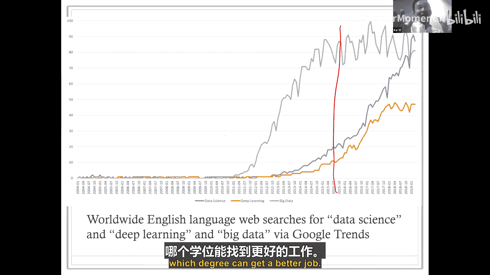

# 001：什么是大数据

在本节课中，我们将要学习大数据的核心概念，包括其定义、关键特性以及不同类型数据的结构。我们将从多个维度理解“大数据”这一术语，并探讨其背后的技术挑战与机遇。


## 概述

“大数据”并没有一个单一的标准定义。例如，维基百科的定义是：任何因其规模、复杂性和速度而需要新的架构、技术、算法和分析来管理并从中提取价值和隐藏知识的数据集。然而，这个定义并不完美，因为它将“大数据”变成了一个不断移动的目标——一旦我们开发出新的技术来处理它，它就不再是“大数据”了。

尽管如此，这个定义确实揭示了大数据的某些特征。业界普遍认同大数据的“3V”特性，即**体量**、**多样性**和**速度**。


## 大数据的“3V”特性

以下是构成大数据核心的三个关键特性。


### 1. 体量

体量指的是数据的规模。在过去的几十年里，数据规模从兆字节、千兆字节增长到了太字节级别，并且其增长速度是指数级的。这不仅带来了绝对数据量的挑战，也带来了处理数据增长速度的挑战。


### 2. 多样性

多样性指的是数据的复杂性，即数据可以具有的各种格式、类型和结构。这包括数值数据、文本、图像、音频、视频序列、时间序列、社交媒体数据和多维数组等。


虽然这些数据类型本身并不新鲜，每种类型都已被研究多年，但新的变化在于：由于技术进步，我们现在能够在单一应用中生成和收集所有这些不同类型的数据，并将它们联系起来服务于一个统一的目标。这种协同效应能够提取出仅凭单一数据类型无法获得的知识。

### 3. 速度

速度指的是数据生成和处理的速率，通常与流式数据相关。流式算法和系统的研究早在20世纪80年代就已开始，并非全新概念。然而，在大数据时代，应用需求正推动着对更高效流式处理系统的进一步研究和投资。

## 数据的结构谱系

上一节我们介绍了数据的多样性，本节中我们来看看这些不同类型的数据如何根据其结构化程度进行分类。数据大体上可以根据其结构化程度分为三类。

### 结构化数据


结构化数据主要指关系型数据库中的数据，这是经典的数据模型。其核心特征是**模式先行**，即必须预先定义好数据的结构（称为“模式”），然后才能填入数据。

一个关键的设计思想是将数据拆分到多个表中，通过**外键约束**进行关联。这减少了数据冗余，降低了维护成本。例如，一个图书数据库可能将作者信息单独存放在作者表中，而在图书主表中只存放作者ID。

然而，查询时需要将多个表连接起来，这使得查询处理变得复杂。**连接**操作是关系型数据库中最重要且计算密集的操作之一。在SQL中，连接查询的示例如下：
```sql
SELECT authors.name
FROM authors, books
WHERE authors.author_id = books.author_id AND books.date > 1980;
```
这段代码查询了所有在1980年后出版过书籍的作者姓名。

### 非结构化数据

非结构化数据位于谱系的另一端，如文本、图像、视频等。这类数据没有预定义的模式，格式灵活，但信息密度通常较低。社交媒体帖子是典型的非结构化数据。

### 半结构化数据

半结构化数据是介于两者之间的折中方案，如JSON或XML文件。它具有一定的结构（例如键值对），但模式可以与数据一起存储，并且不同数据条目可以有不同的结构（模式），这提供了极大的灵活性。

一个JSON对象的例子如下：
```json
{
  "firstName": "John",
  "lastName": "Smith",
  "age": 25,
  "address": {
    "streetAddress": "21 2nd Street",
    "city": "New York",
    "state": "NY",
    "postalCode": "10021"
  },
  "phoneNumbers": [
    { "type": "home", "number": "212 555-1234" },
    { "type": "fax", "number": "646 555-4567" }
  ]
}
```
半结构化数据在灵活性和处理效率之间提供了一个平滑的权衡点，因此在大数据领域越来越受欢迎。

## 总结与课程定位

本节课中我们一起学习了大数据的基本概念。总结来说，“3V”特性（体量、多样性、速度）是大数据的核心。尽管这些概念在“大数据”一词出现前就已存在研究，但该术语的流行推动了技术的整合与创新，使我们能够处理更复杂、规模更大的综合型应用。

最后需要说明的是，“大数据”和近年更流行的“数据科学”在技术内容上区别不大，前者更受计算机科学界青睐，后者则源于统计学界。本课程的重点在于 **“如何”** 实现——即如何使算法能够规模化地运行在海量数据上，并高效利用云计算资源。至于 **“为什么”** 要使用某种算法或模型，这将是数据挖掘、机器学习等其他课程的重点。



---
*注：本教程根据香港科技大学《基于Spark的大数据计算》课程部分内容整理翻译而成，旨在为初学者提供清晰的概念导引。*