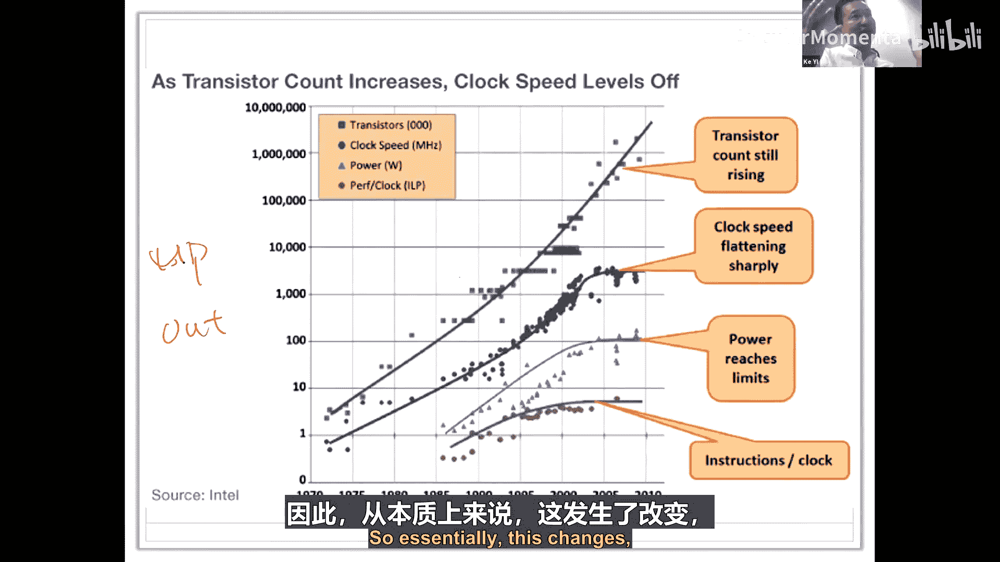
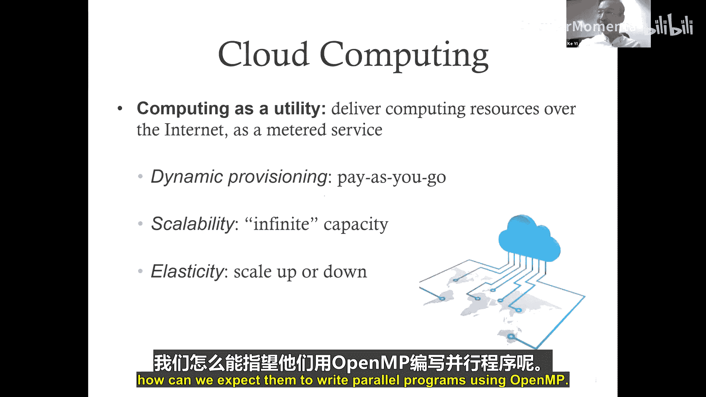
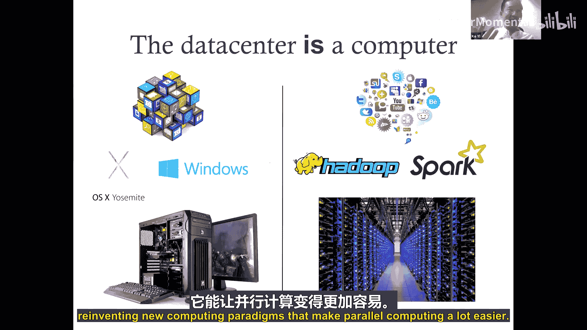

# 002：并行编程的困境 💻

在本节课中，我们将要学习为什么处理大数据会面临技术挑战，特别是为什么传统的并行编程方式如此困难。我们将探讨处理器发展的物理极限、并行计算的基本概念，以及编写并行程序时常见的陷阱。

## 概述 📋

随着数据量的爆炸式增长，传统的单核处理器计算模式已无法满足需求。然而，转向并行计算的道路并非一帆风顺。本节将深入分析并行编程的核心困境，包括其技术根源和实际编程中令人沮丧的挑战。

## 技术背景：从纵向扩展到横向扩展 🔄

上一节我们介绍了大数据的规模挑战，本节中我们来看看技术层面是如何应对的。

一个重要的技术障碍是处理器（CPU）的原始速度已经触及物理极限。这大约从2005年开始发生。观察蓝色曲线，即时钟速度，它在2005年左右开始趋于平缓，尽管晶体管数量仍在增长。本质上，我们达到了提升速度的物理极限。

这并非因为技术上无法实现，而是经济原因。随着处理器速度提高，功耗并非线性增长，而是会消耗更多电力，更重要的是会产生更多热量。散热问题已成为高性能计算的主要难题。讽刺的是，人们需要花费更多能量在散热系统上，而非实际计算。因此，从经济角度讲，将速度提升到例如3GHz以上并不划算。这就是为什么大多数CPU的主频都低于3GHz。

然而，另一方面，我们拥有了多核处理器。你的手机可以轻松拥有4核或8核，台式机可以轻松拥有16核或更多。而单个GPU可能拥有数千个核心。最终，我们可以扩展到计算机集群，由上百台计算机组成，每台计算机又可以拥有多CPU（多核）和多GPU（数千核）。因此，并行计算的能力是巨大的。

所以，本质上，这是一种更经济的扩展计算能力的方式。这里有两个词略有区别：**纵向扩展** 和 **横向扩展**。
*   **纵向扩展** 指的是提升单个CPU的速度。
*   **横向扩展** 指的是保持单个核心的速度不变，但通过使用更多核心来扩展计算能力。

有人提到了摩尔定律。我仍然记得大约2010年时，我们领域旗舰杂志《ACM通讯》的一期封面故事，标题是“摩尔定律已死”，这不幸地基本属实。摩尔定律指的是CPU速度每18个月翻一番的现象。这一规律在2005年之前基本正确。2005年之后，CPU速度的指数级增长不再可持续，因此人们宣告了摩尔定律的终结。

这从根本上改变了人们对计算的看法。当摩尔定律有效时，你可以通过简单地等待18个月，让英特尔发布新CPU，就能轻松地纵向扩展你的计算能力，无需对程序做任何改动。然而，现在情况不同了。即使你再等10年，如果不更新你的代码或算法，你将无法获得任何速度提升。因此，走向并行或分布式计算是扩展计算能力的唯一途径。这意味着我们需要从根本上改变设计算法和系统的方式。

## 并行编程的固有难题 😫

不幸的是，并行计算或并行编程本质上是令人沮丧的。让我用一个简单的例子说明，如果处理不当，事情可能会在哪里出问题。

我们考虑一个只有两个线程并行运行的简单情况。顺便说一下，在并行世界里有一个术语叫 **“易并行”**。这意味着并行化非常容易，如果你不知道怎么做会让人尴尬。如果一个程序由**没有数据共享的独立任务**组成，那么它就是易并行的。这很容易，如果线程间没有通信或协调，并行编程就非常简单。

然而，更重要的任务是如何协调不同的线程，使它们能够协作完成同一个任务。在这种情况下，数据共享是不可避免的。这里有一个最简单的数据共享例子。

假设我们有一个共享变量 `V`，它是一个全局计数器，用于统计某些事件。两个线程都试图给这个计数器加1。如果你使用Python或Java，可以简单地写 `V++`（在C++中也是如此），一行代码就完成了。

然而，这并不是底层实际发生的情况。对于像C这样的高级编程语言，这一行代码实际上被编译成多条指令。因为 `V` 存储在内存中的某个地方，而不是寄存器里。所以CPU必须先从内存中获取这个变量。因此，这一行代码至少会被编译成三条指令（实际可能更多）：
1.  将变量 `V` 从内存加载到本地寄存器。
2.  将寄存器中的值加1。
3.  将结果写回变量 `V`。

预期的结果当然是线程A给 `V` 加1，线程B也给 `V` 加1，当两个线程都完成后，`V` 应该增加了2。

但是，由于线程由两个不同的CPU核心独立执行，它们的执行速度可能不同。这些指令如何交错执行没有任何保证。如果线程A的指令执行在线程B的指令1和指令3之间呢？让我们看看会发生什么。

假设 `V` 的初始值是0。
1.  线程B的指令1先执行，将值0加载到B的本地寄存器。
2.  然后线程A的指令1执行，同样将值0加载到A的本地寄存器。
3.  接着，它们都在本地寄存器中加1。
4.  最后，它们将结果（都是1）写回内存。谁先写回并不重要。

当两个线程终止时，`V` 的值只增加了1，而不是预期的2。这就是所谓的 **竞态条件**。就像两个线程在赛跑。这就是问题可能发生的地方。

更令人沮丧的是，99%的时间它不会发生。因为CPU速度很快，只有当指令恰好在特定时刻交错时（例如A的指令在B的指令1和3之间执行），问题才会出现。所以大多数时候程序运行正常。然而，当你将程序部署给客户后，有时在深夜，他们会打电话说：“嘿，你的代码出错了。”当你赶到现场试图复现时，它又运行正常了。这就是我们所说的令人沮丧之处。这类错误非常容易犯，但极难检测和调试。这就是为什么并行编程非常困难。

据我所知，并行编程并非任何计算机科学项目的必修课。在我们的BDT项目中，我们确实有一门并行计算课程，但那是选修课。如果你感兴趣，当然欢迎选修以了解更多如何处理这些情况。

长话短说，防止这种情况发生的标准方法是通过操作系统和硬件支持来添加**锁**，不能仅靠纯软件实现。锁本质上是放在共享资源上的东西，在修改它之前先加锁。通过使用锁，可以防止竞态条件。

## 死锁：更复杂的困境 🔒

然而，假设有两个共享资源：资源1和资源2。同样有两个线程T0和T1，它们试图执行涉及这两个资源的操作。例如，这是一笔客户和卖家之间的交易，你需要从客户账户扣除10000美元，并将相同金额存入卖家账户。这是一笔涉及两个共享资源（变量）的交易，你需要在修改前锁定两者。

但是，如果发生以下情况：T0先获得了资源2的锁，而T1先获得了资源1的锁。然后T0试图获取资源1的锁，同时T1试图获取资源2的锁。接下来会发生什么？你进入了**死锁**状态。没有线程可以继续执行，因为每个线程都在等待另一个线程释放锁。

更糟糕的是，没有很好的解决方案。令人惊讶的是，尽管人们意识到这个问题多年，但就是没有好的解决办法。只能希望这种事情不常发生。确实，它们不常发生，因为死锁的发生要求线程必须以特定的顺序获取锁。

所以，人们基本上只能这样：解决死锁的最佳方法是，当意识到没有任何进展时，重启所有线程。这本质上是人们拥有的最佳解决方案。还有其他方案，例如强制规定顺序，要求所有线程必须先锁资源1，再锁资源2，通过强制规定锁的获取顺序来防止死锁。

然而，这非常昂贵。因为这个例子只有两个共享资源。如果我们谈论的是涉及百万个账户的交易，那就有百万个资源。在百万甚至十亿个账户上维持一个线性顺序非常昂贵，根本不具备可扩展性。因此，这本质上是一个非常困难且令人沮丧的问题。

## 总结与困境的根源 📝

总结一下，竞态条件和死锁非常难以调试，因为它们本质上是非确定性地发生的。因此，编写正确的并行程序非常困难。

更阻碍并行编程普及的是，存在太多不同的并行架构，为一个架构编写的程序无法轻松移植到另一个。例如，为多核编写的程序无法直接在集群上运行。为集群编写的程序也无法直接在GPU上运行。不同的架构需要不同的代码和库。本质上，你必须为每种不同的并行架构编写程序，这非常繁琐。

因此，如何为这些东西编程？直到今天，并行编程仍然是一项只有最优秀的程序员才能掌握的艰巨任务。事实上，我们稍后将讨论的整个MapReduce范式就是由谷歌发明的。谷歌已经是拥有最多优秀程序员的公司，即使他们也面临这个问题。只有极少数最优秀的程序员能够编写正确且高效的并行程序。这根本不具备可扩展性。他们有海量数据、众多任务和大量客户需要服务，他们确实需要比编写这种底层程序更简单的东西。

然而，我必须同时承认，如果你真的追求效率，效率是第一准则，那么像OpenMP或用于GPU的CUDA这样的工具仍然是最好的选择。如果你有一个非常专门化的任务，并且有优秀的程序员，那么为了追求效率，仍然应该使用这些底层的并行编程工具，你应该选修并行编程课程。

然而，对于大多数程序员，尤其是数据分析师，我们真的需要一种让事情变得更简单的方法。

## 云计算的推动力 ☁️

另一个主要驱动力是云计算。虽然我们会更正式地讨论云计算，但我相信你们都听说过甚至使用过云计算。云计算的核心理念是将计算资源作为公用事业来出售。

因此，拥有大量高性能设备不再是少数人的特权。每个人，无论是否有钱，都可以轻松获取大量计算资源。这也意味着普通用户可能也会感到需要横向扩展他们的程序。当然，普通用户甚至不懂C语言，我们怎么能指望他们用OpenMP编写并行程序呢？

本质上，这正是重新发明新计算范式的动机，旨在让并行计算变得容易得多。

## 本节课总结 🎯

本节课中我们一起学习了并行编程面临的核心困境。我们了解到，由于处理器速度触及物理极限，计算能力的扩展必须从“纵向扩展”转向“横向扩展”，即利用多核与分布式集群。然而，并行编程本身充满挑战，主要包括难以调试的**竞态条件**和**死锁**问题。此外，多样的硬件架构导致程序移植困难，使得编写正确、高效的并行程序门槛极高。正是这些困境催生了像Spark这样旨在简化分布式计算的新范式。