# 003：MapReduce编程模型

在本节课中，我们将要学习MapReduce编程模型。这是一种用于处理海量数据的并行计算框架，由Google提出，旨在解决并行计算中因线程运行速度不一致而导致的竞态条件问题。我们将了解其核心思想、工作原理，并通过具体例子学习如何使用它。

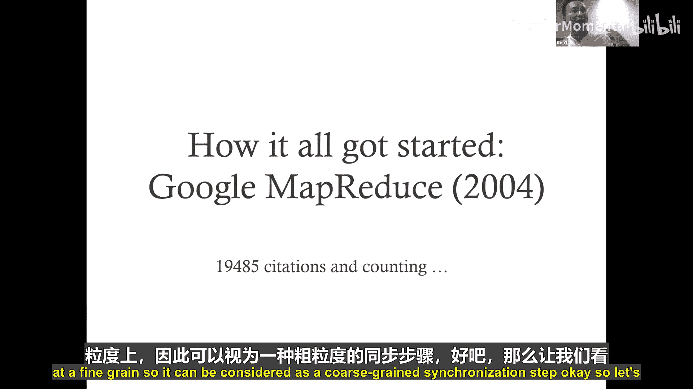

## 并行计算的问题与MapReduce的解决思路

上一节我们介绍了并行计算中存在的竞态条件问题。其根本原因是不同线程以不同速度运行，且彼此之间缺乏协调。

一个自然的想法是增加协调机制，同步所有线程的行为。然而，这种细粒度的同步在技术上实现起来非常困难，且成本高昂。为了效率，不同线程的运行速度必然存在差异，但这又会导致竞态条件。

Google提出的MapReduce框架巧妙地解决了这个问题。它在某种意义上引入了同步协调，但并非细粒度同步，而是一种粗粒度的同步步骤。接下来，我们看看MapReduce框架是如何工作的。

## MapReduce模型概述

MapReduce模型将任何计算任务划分为多个轮次。每个轮次包含两个或三个阶段。

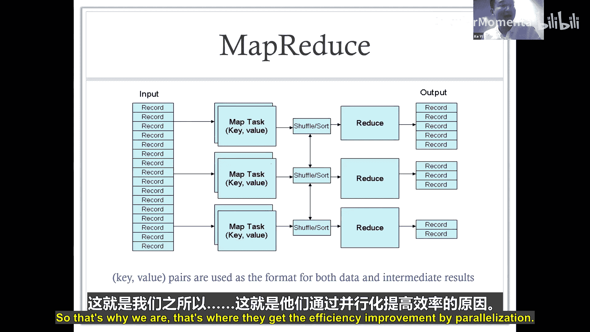

第一个阶段是**Map阶段**。此阶段将输入记录转换为中间键值对。这个阶段的所有任务可以**并行且独立**地执行，因为每个Map任务都独立地应用于每条记录，无需协调。

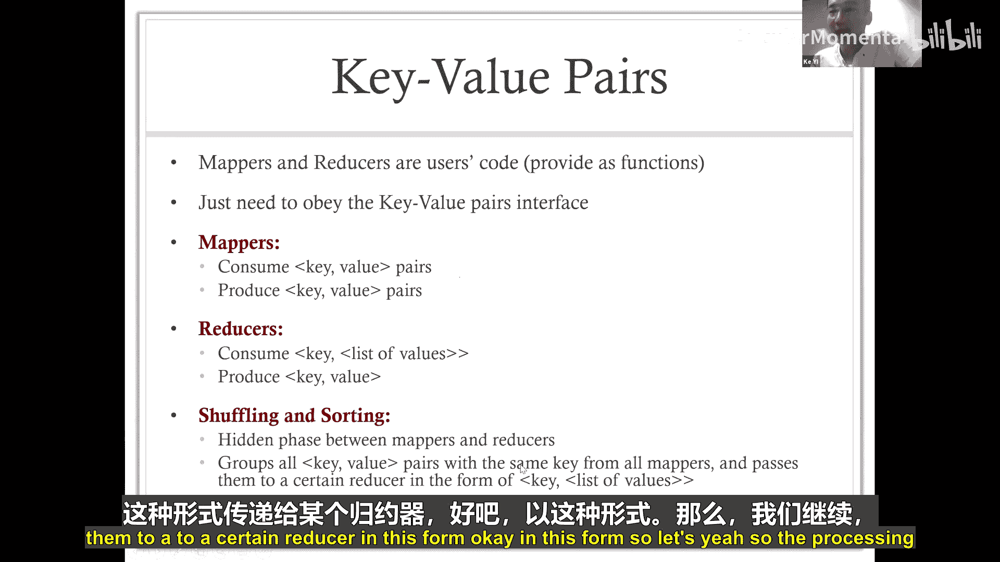

然后，所有中间键值对进入**Shuffle阶段**（或排序阶段）。在此阶段，所有具有相同键的键值对会被转发到同一个Reduce任务。

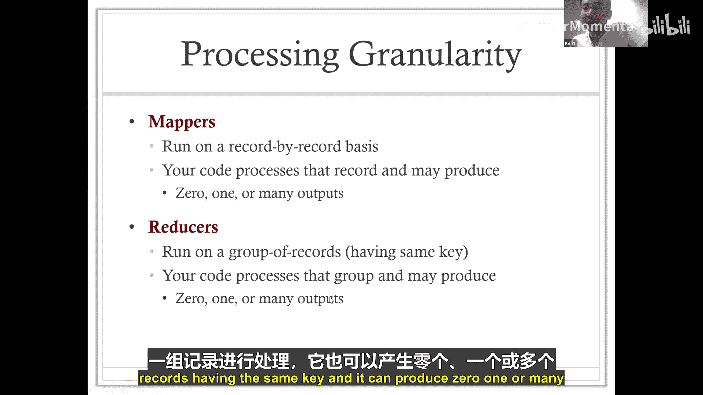

每个**Reduce函数**接收所有具有相同键的键值对，然后产生输出。输出可以是0条、1条或多条记录。这就完成了一轮MapReduce计算，结果可以进入下一轮。

这是一种**粗粒度同步**，因为每一轮只有一个同步点，即Shuffle阶段。Shuffle阶段必须等待所有Map任务完成后才能开始Reduce阶段，因此这是一个同步点。这种同步成本很高，在MapReduce编程中，**最小化需要Shuffle的数据量是衡量程序优劣的首要标准**。然而，MapReduce每一轮只有一个同步点，且通常程序不会运行太多轮次，因此能在保证效率的同时实现并行化。

## Map和Reduce任务的定义

Map任务和Reduce任务都由用户代码定义。用户需要定义在Map和Reduce函数中执行什么操作。

对于**Map函数**，其输入是一个键值对，输出也是一个或多个键值对。本质上，它是一个一对多的转换。

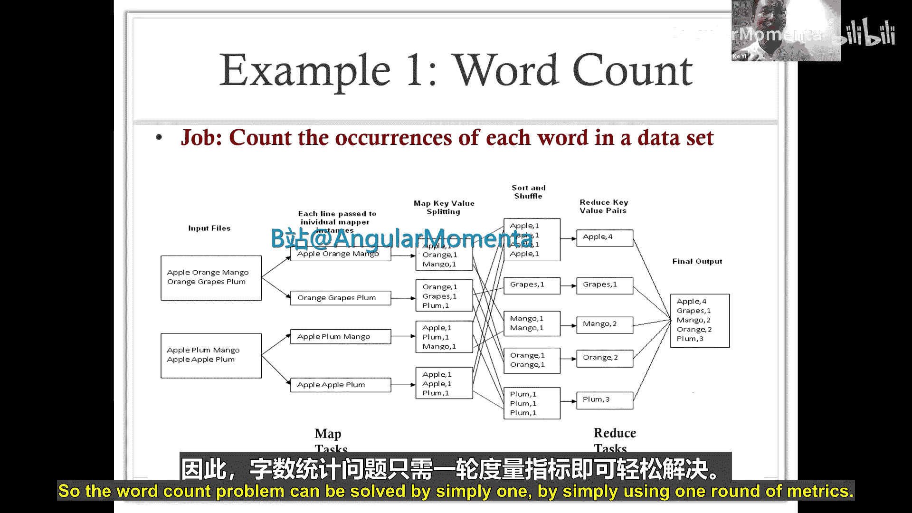

对于**Reduce函数**，其输入是所有具有相同键的键值对。我们可以将其形式化地表示为：`(key, [value1, value2, ...])`。Reduce函数可以产生任意数量的键值对作为输出或下一轮的输入。

程序员无法控制Shuffle阶段的行为，它是固定的：总是将来自所有Map任务的、具有相同键的键值对分组，并以 `(key, [value1, value2, ...])` 的形式传递给某个Reducer。

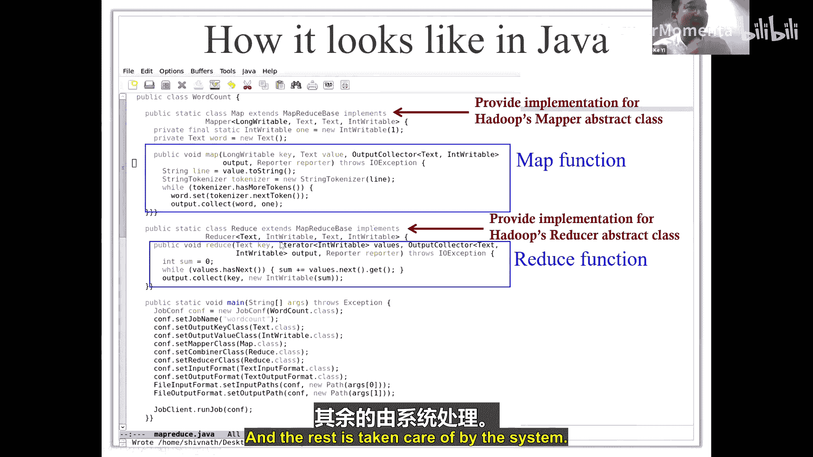

以下是处理粒度的总结：
*   **Map任务**：以记录为单位运行，可能产生0个、1个或多个中间结果。
*   **Reduce任务**：以一组具有相同键的记录为单位运行，可能产生0个、1个或多个输出。

## 实例解析：词频统计

现在让我们看一个具体例子，了解如何使用MapReduce完成任务。这个例子来自Google关于MapReduce的原始论文，是搜索引擎非常关心的任务：**词频统计**，即计算所有文档中每个单词的出现频率。

输入文件是所有从互联网爬取的HTML文件。首先，将每个文件分割成行，每行字符串作为一个输入记录。

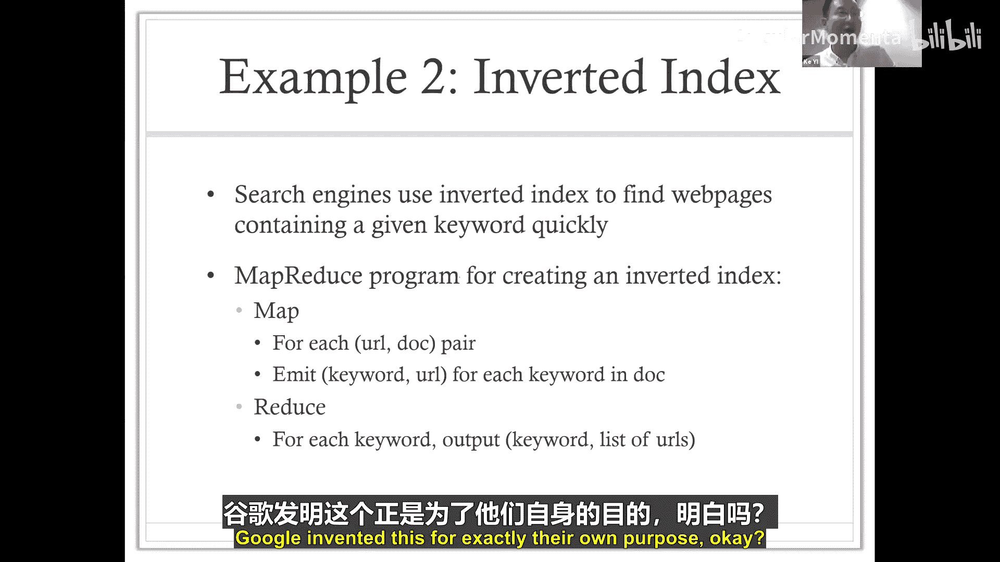

**Map函数**接收一行文本，并产生多个中间键值对。对于这个问题，键就是单词本身，值是该单词在该行中出现的次数（通常为1）。例如，对于一行 `"apple orange mango"`，Map函数会输出 `(apple, 1)`, `(orange, 1)`, `(mango, 1)`。

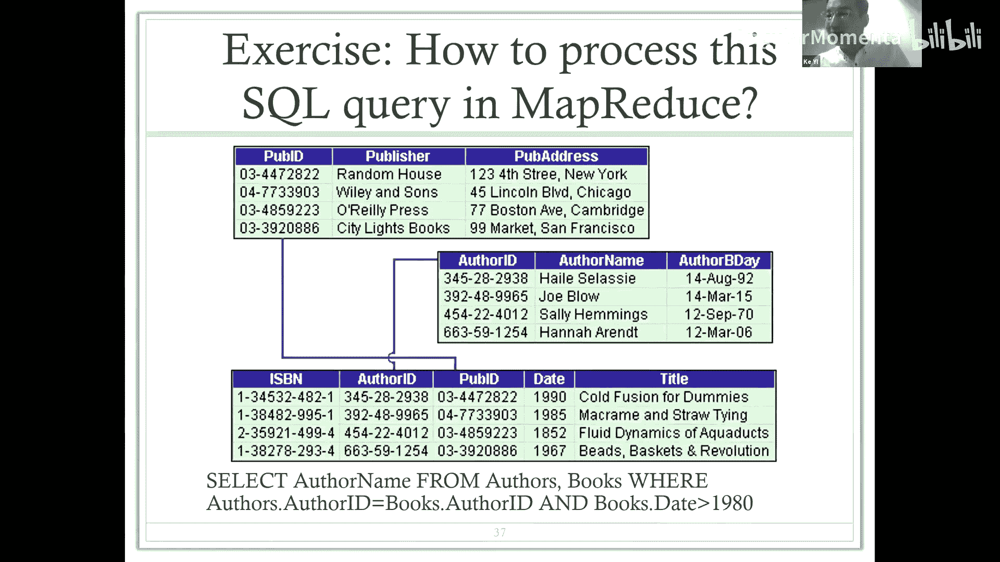

然后，所有键值对进入**Shuffle阶段**。此阶段将所有具有相同键的键值对分组。例如，所有 `(apple, 1)` 会被分到一组。

接着，这些分组后的数据（例如 `(apple, [1, 1, 1, ...])`）被发送到**Reduce函数**。Reduce函数的工作很简单：将列表中的所有值相加，得到该单词的总出现次数，并输出 `(apple, 总数)`。

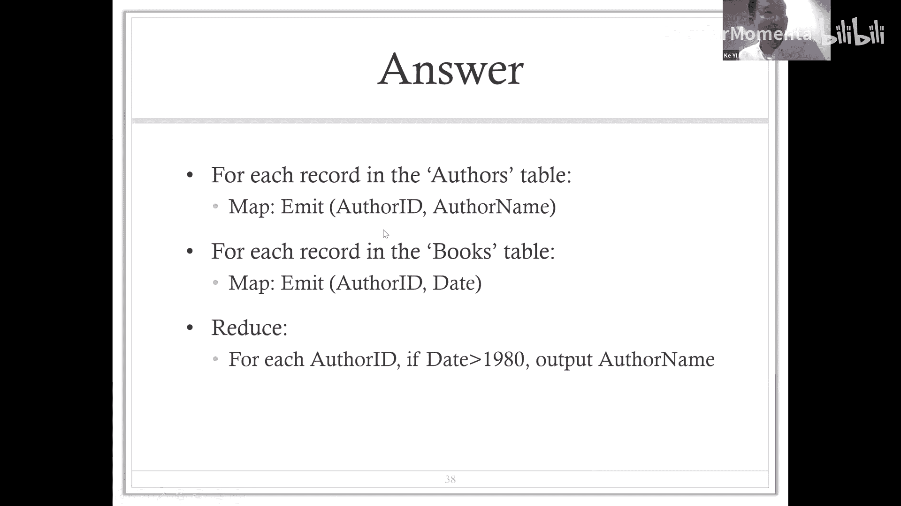

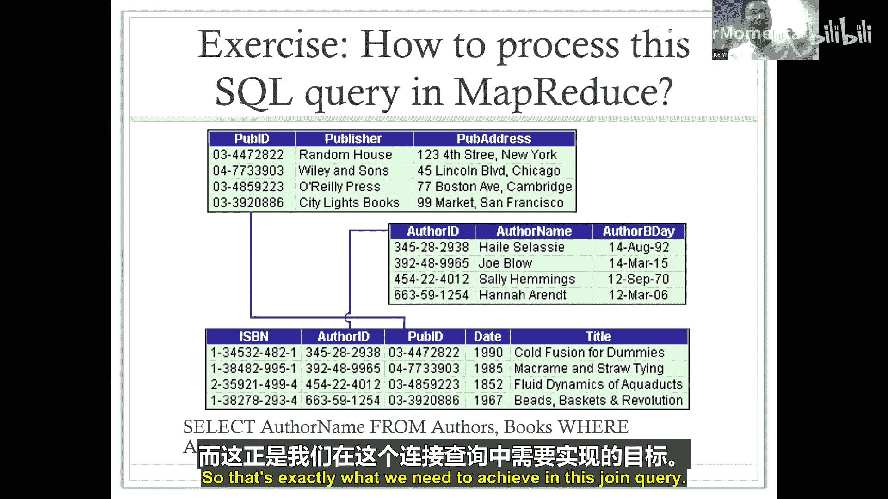

因此，词频统计问题可以通过一轮MapReduce轻松解决。

## 实例解析：倒排索引

第二个例子是**倒排索引**。这是搜索引擎日常执行的另一项重要任务。搜索引擎需要根据搜索关键词，返回所有包含该关键词的网页列表。这需要一种称为倒排索引的数据结构，它将关键词映射到包含它的URL列表。

输入是一个庞大的`(URL, 文档)`对集合，其中文档可以看作字符串（正向索引）。

**Map任务**接收一个`(URL, 文档)`对，并为文档中的每个关键词发射一个`(关键词, URL)`键值对。

然后，所有`(关键词, URL)`对进入**Shuffle阶段**，所有包含相同关键词的URL会被分组到一起。

**Reduce函数**接收一个`(关键词, [URL1, URL2, ...])`，简单地将所有URL连接成一个列表并输出。这样，我们就得到了倒排索引。

## 在MapReduce中处理数据库查询

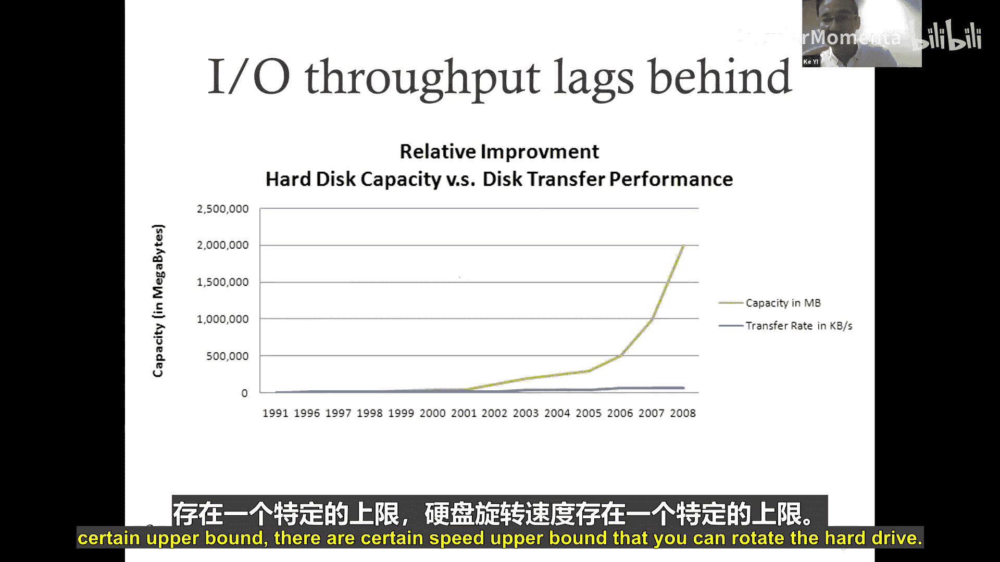

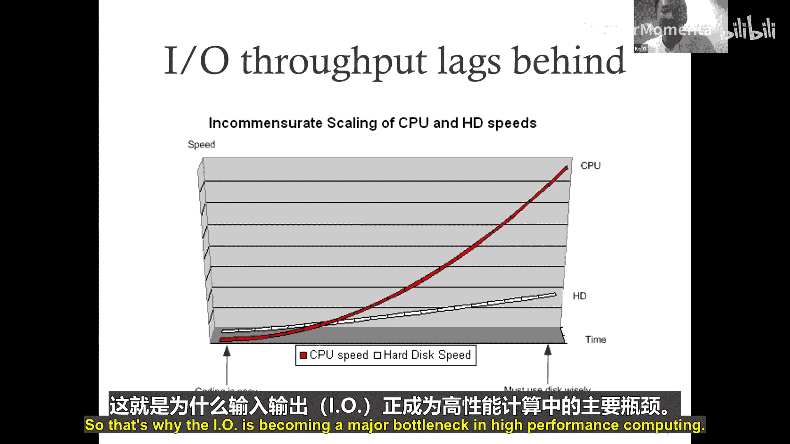

人们很快开始尝试使用MapReduce处理各种任务，包括关系数据库查询。假设数据存储在分布式文件系统中，我们想用MapReduce处理SQL查询，该怎么做？

让我们回顾之前提到的连接查询例子：在作者表和书籍表之间进行连接，找出1980年后出版过书籍的所有作者姓名。

我们需要编写两个Map函数（逻辑上），分别处理作者表和书籍表。实际上，我们可以写在一个函数里，通过判断输入来源来区分。

关键点是：对于作者表中的记录，Map函数以`作者ID`为键，以`作者姓名`为值输出。对于书籍表中的记录，Map函数同样以`作者ID`为键，以`出版日期`为值输出。

这样做的原因是，我们有一个基于作者ID的连接条件。在Shuffle阶段，所有具有相同作者ID的键值对会被分组到一起。因此，如果一个作者写了三本书，我们会得到来自书籍表的三个键值对和来自作者表的一个键值对，它们都会被送到同一个Reduce函数。

**Reduce函数**的工作是检查：在收到的值列表中（包含作者姓名和多个出版日期），是否有任何一个日期晚于1980年。如果是，则输出作者姓名（根据语义可能需要去重）。

然而，这不是最高效的方法，因为每条记录都会产生一个中间键值对，导致Shuffle阶段需要移动大量数据。一个优化方法是：将“出版日期晚于1980年”这个过滤条件从Reduce阶段提前到Map阶段。在Map阶段处理书籍表时，只输出出版日期晚于1980年的记录的键值对。这可以显著减少需要Shuffle的中间数据量，从而提高效率。

## 存储层：Google文件系统

MapReduce只处理计算部分，我们还需要处理存储问题：输入文件、输出结果以及两轮MapReduce之间的中间结果存储在哪里？Google为此提供了自己的解决方案：**Google文件系统**。

其核心思想是构建一个分布式文件系统。由于单个大磁盘在技术和性能上不可行（I/O是瓶颈），GFS使用大量廉价的商用机器，每台机器都有自己的磁盘。通过将数据分布存储在许多机器上，并行读写，从而获得高聚合I/O带宽，并且易于扩展。

但硬件（尤其是硬盘）故障是常态。当拥有成千上万台服务器时，每天都可能发生硬盘故障。因此，GFS的设计目标是在高度不可靠的硬件上构建高度可靠的存储系统。

GFS的设计要点如下：
*   **大文件分块**：文件被分割成固定大小的块（默认为64MB）。
*   **通过复制实现可靠性**：每个数据块会在三个或更多的块服务器上复制。即使丢失两个副本，数据仍然可用。用户还可以指定更高的冗余级别（例如跨不同数据中心）。
*   **元数据管理**：记录每个数据块及其副本位置的信息（即元数据）存储在一个主节点上。
*   **适应的工作负载**：文件通常是一次写入、多次读取，适合大数据批处理任务，其中带宽比延迟更重要。

## 总结

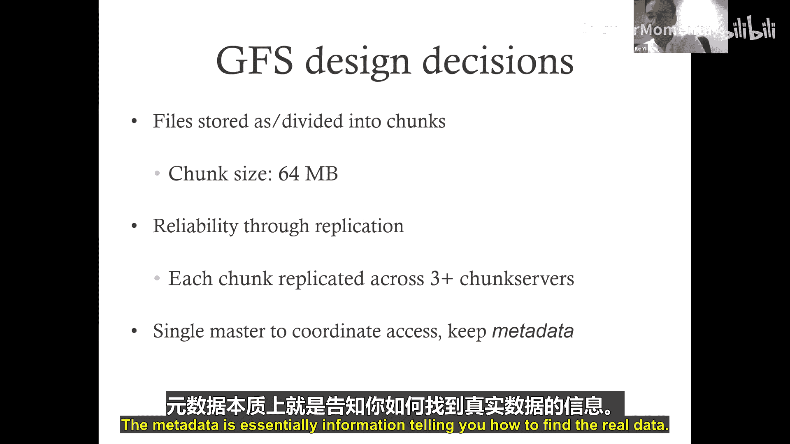

本节课中，我们一起学习了MapReduce编程模型。我们首先了解了它如何通过引入粗粒度的同步（Shuffle阶段）来解决并行计算中的竞态条件问题。然后，我们深入探讨了Map和Reduce阶段的工作原理，并通过词频统计和倒排索引两个经典例子，具体学习了如何编写MapReduce程序。我们还看到了如何将MapReduce思想应用于类似数据库查询的任务，并了解了优化Shuffle数据量的重要性。最后，我们介绍了支撑MapReduce计算的存储层——Google文件系统的基本设计思想，它通过数据分块和复制，在不可靠的硬件上构建了可靠的分布式存储。MapReduce模型为大规模数据批处理提供了一个清晰、强大的编程框架。