# 004：什么是Hadoop 🐘

在本节课中，我们将学习Hadoop，它是Google的MapReduce和GFS（Google文件系统）的开源实现。我们将了解Hadoop的架构、核心组件HDFS（Hadoop分布式文件系统）的工作原理，以及它如何与MapReduce执行引擎协同工作。课程最后，我们还会探讨关于MapReduce范式的一场重要学术辩论。

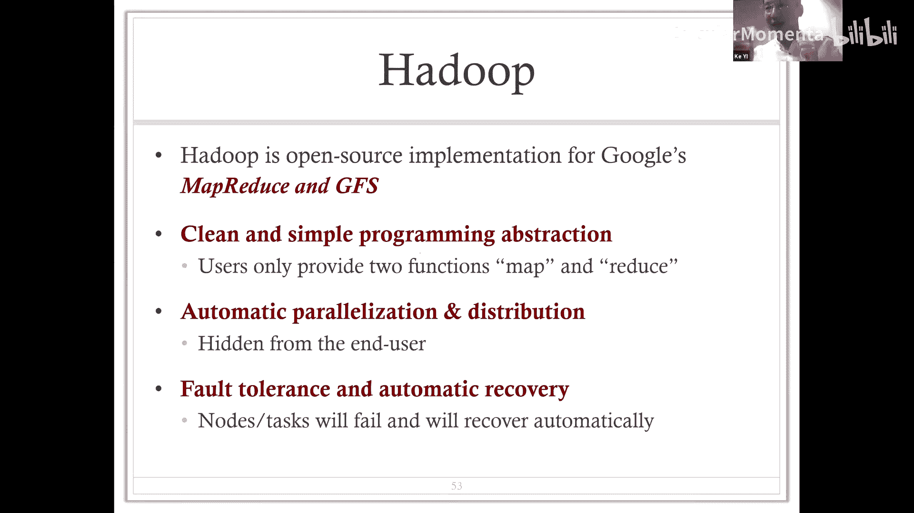

## Hadoop的起源与概述

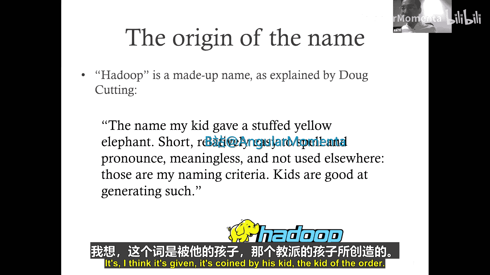

正如之前提到的，Google从未公开其MapReduce和GFS的源代码。因此，Google的具体实现方式至今仍是一个谜。在开源社区中，我们有了Hadoop。

Hadoop是Google的MapReduce和GFS的开源实现。它提供了一个简洁的编程抽象，用户只需提供两个函数：`map`和`reduce`。它同时提供了自动的并行化和分布式处理能力。更重要的是，这些并行化和容错机制对终端用户是透明的。

从终端用户的角度看，他只看到一个逻辑文件，尽管在底层，这个逻辑文件实际上有三个物理副本。节点和任务会自动失败并自动恢复。这回答了聊天中的一个问题：如果三个副本中的两个丢失了，数据块是否会再次复制两次？答案是肯定的。因为当一个节点永久失效时，系统会启动一个新节点来接管。元数据信息存储在**主节点**上，因此系统确切知道丢失的节点中存储了哪些数据块，可以从其他副本中获取数据来重建失效的节点。

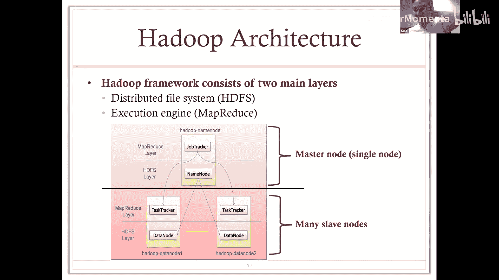

关于主节点失效的问题，简单的解决方案是设置一个**次级主节点**。但这会引入协调问题，需要决定哪个主节点处于控制状态。这种协调通常由**ZooKeeper**这样的系统来处理。

## Hadoop的命名与架构

Hadoop这个名字是一个完全虚构的词。它简短、易拼写、易发音，且没有实际含义，更重要的是之前没有被使用过。

实际上，Hadoop是两部分的结合。Google构建了两个独立的层：MapReduce执行引擎和GFS文件系统。然而，在Hadoop中，它被设计为同时完成这两项工作。

在具体实现中，每个工作节点扮演两个角色。在文件系统层，它们被称为**数据节点**（存储数据）和**名称节点**（存储文件名和元数据）。名称节点存储元数据，特别是数据块的位置信息。

同时，每个工作节点在MapReduce层也扮演角色。对于从节点，它们被称为**任务追踪器**；对于主节点，则被称为**作业追踪器**。一个MapReduce程序被称为一个**作业**，例如“词频统计”就是一个MapReduce作业。每个作业由许多**任务**组成，一个`map`是一个任务，一个`reduce`也是一个任务。任务由从节点（任务追踪器）执行，而主节点（作业追踪器）负责跟踪整个作业的进度，分配任务，并确保任务完成。如果某个任务失败，其他节点会接管。

## HDFS详解

现在让我们更详细地了解Hadoop中这两层是如何构建的，先从文件系统层开始，即**HDFS**。

名称节点存储所有元数据。以下是一个简化的元数据表示示例：

```
文件名: /user/sample/data/part0
块列表:
  - 块1: 副本数=2, 位置=[数据节点1, 数据节点3]
  - 块2: 副本数=3, 位置=[数据节点2, 数据节点4, 数据节点5]
  ...
```

名称节点存储了一个目录，告诉你到哪里可以找到这些数据块的不同副本。数据节点有成百上千个，它们存储实际的数据。文件被分割成块，每个块默认复制三份，这个数量可以根据需求调整。副本越多，可靠性越高，但成本也越高。

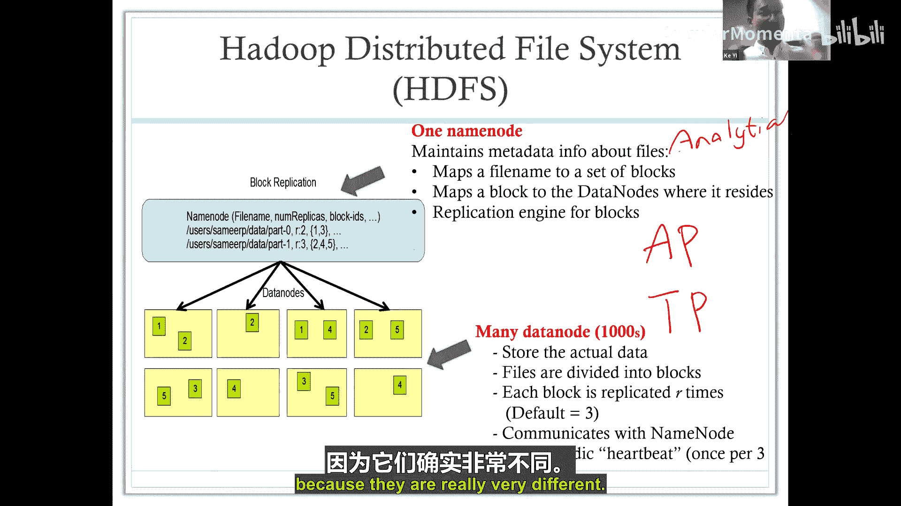

数据节点通过周期性的**心跳**消息与名称节点通信，默认每3秒一次。如果名称节点在一定时间内（例如10秒）没有收到某个数据节点的心跳，就会认为该节点失效。名称节点知道失效节点上存储了哪些数据块，因此可以从其他副本中恢复数据，例如从其他节点获取块2和块5的副本来重建失效的数据节点。系统会维护一个空闲机器池，用于在机器失效时进行替换，这为工程师修复硬件提供了缓冲时间。

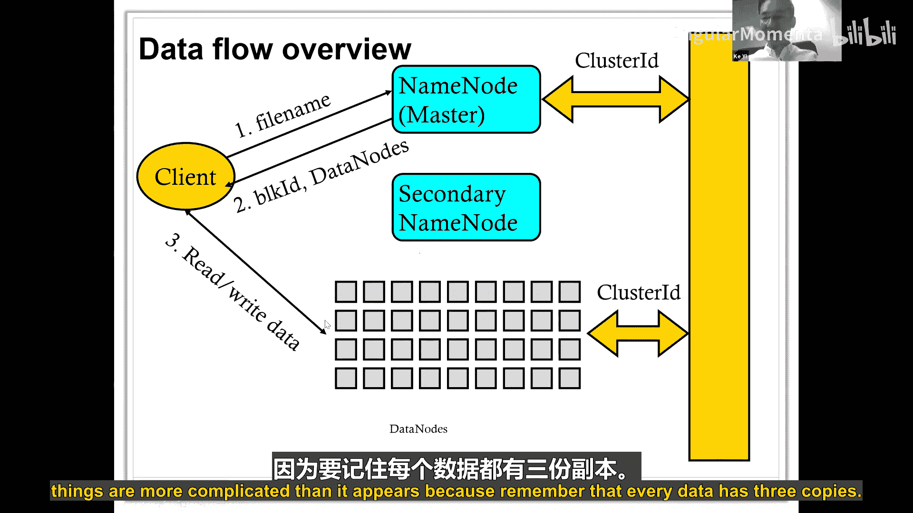

关于数据同步和更新的问题，需要明确HDFS或GFS是为**写入一次、读取多次**的场景设计的。文件很少被修改，通常只能重写整个文件，而不是部分更新。因此，频繁的事务更新（如电商网站）不是HDFS的目标场景。这类**事务处理**（TP）工作负载与HDFS擅长的**分析处理**（AP）工作负载非常不同。现代大规模数据库系统通常将TP和AP分离，例如阿里巴巴的OceanBase（TP）和AnalyticDB（AP）。在开源社区，Spark是流行的AP选择，而MongoDB是TP的例子。目前还没有一个完美的统一系统能同时高效支持两者。

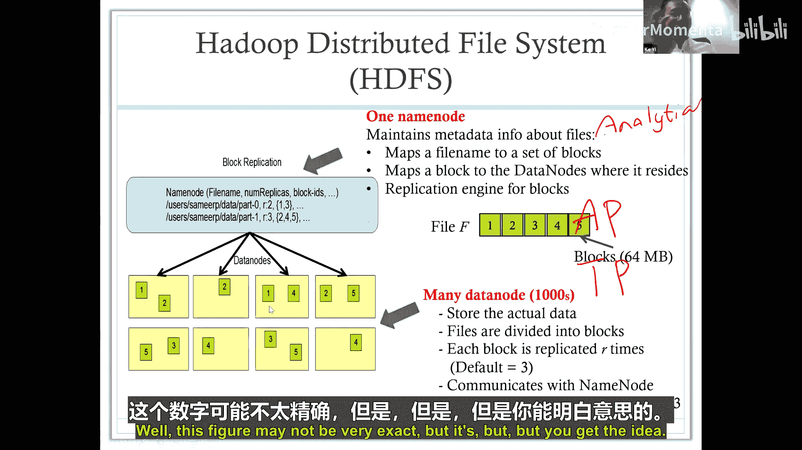

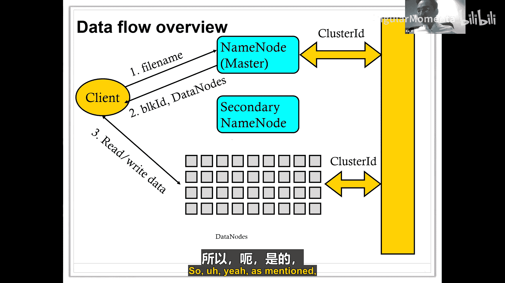

## HDFS数据流与容错

现在让我们看看数据流的概览，即用户程序的读请求是如何被处理的。

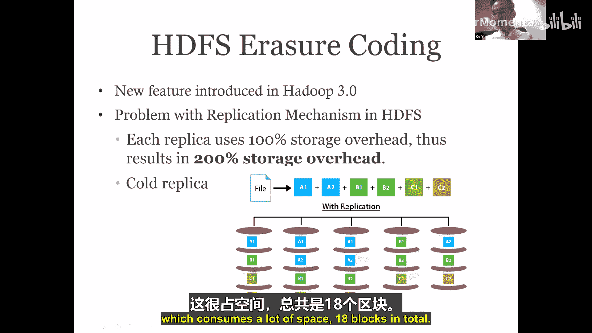

客户端首先访问名称节点，告知要访问哪个文件。名称节点返回文件的块ID列表及其位置信息。然后，客户端直接去这些数据节点获取数据。客户端可以并行读取数据。由于每个数据块有三个副本，协调算法会智能地进行负载均衡。例如，它可能指示客户端从不同节点读取不同的块，以实现平衡的流量分配。

数据节点每3秒发送一次心跳消息给名称节点，名称节点用心跳来检测数据节点失效。无响应超过设定时间即被视为失效。

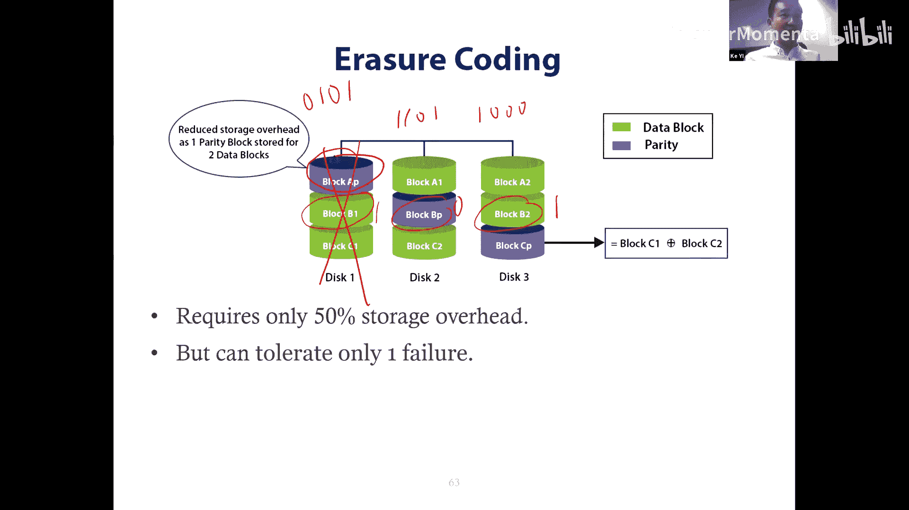

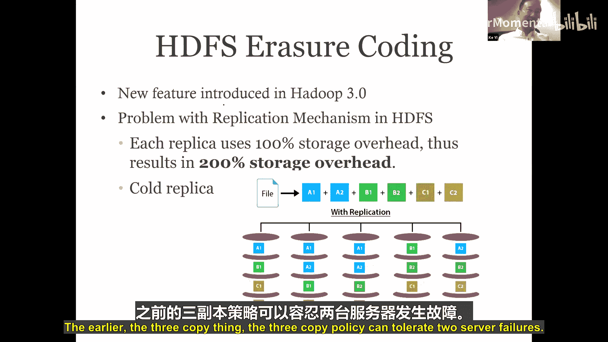

关于数据平衡算法，它相当复杂，需要综合考虑负载均衡、通信成本和流量导向等多个因素。

在Hadoop 2.0中，默认使用三副本机制。从Hadoop 3.0开始，引入了更智能的**纠删码**技术。三副本的存储开销是200%（即只有1/3的存储是有效数据），这很浪费。纠删码，例如简单的奇偶校验码，可以降低开销。

奇偶校验码示例：假设有两个数据块A1=`1101`和A2=`1000`，奇偶校验块AP是这两个块的按位异或（XOR）：`1101 XOR 1000 = 0101`。如果A1或A2中有一个丢失，可以通过另一个数据块和奇偶校验块恢复出来。这只需要50%的存储开销，远低于三副本的200%。但它的容错能力更差：三副本可以容忍两个服务器失效，而简单的奇偶校验只能容忍一个失效。

纠删码是奇偶校验的泛化，使用**里德-所罗门算法**等。它将N个数据单元通过线性变换生成M个校验单元。只要`N+M`个单元中有任意N个可用，就能恢复所有数据。例如，设置`N=6`（数据块），`M=3`（校验块），存储效率为`6/(6+3)=66.7%`，可以容忍最多3个失效。增加M可以提高存储效率，增加N可以提高容错能力，但计算成本也会随之增加。这与某些硬件RAID级别的理念类似，但这是在软件层面（Hadoop）实现的。

最后，名称节点是单点故障，因此需要添加**次级名称节点**以备不时之需。

## Hadoop MapReduce 工作流

现在我们把所有部分结合起来。HDFS是文件系统层，在其之上是Hadoop MapReduce，即MapReduce的开源实现。这两层协同工作来完成一个MapReduce作业。

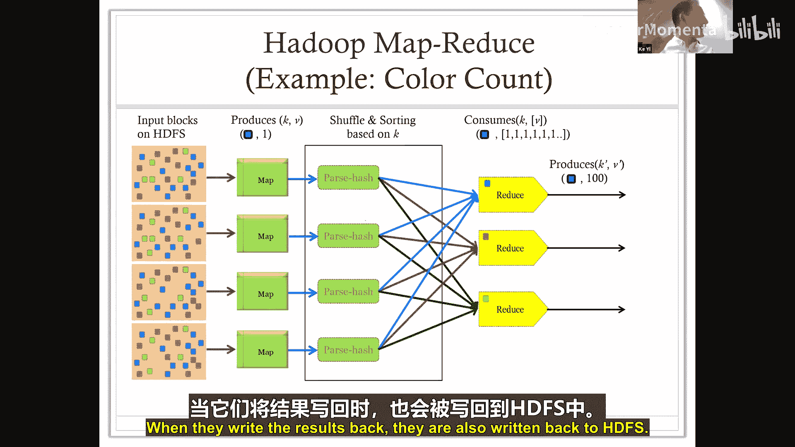

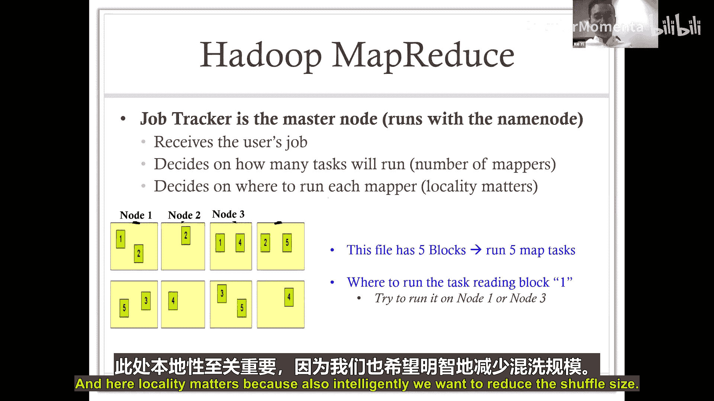

以词频统计为例。Map阶段类似于读取文件，因此可以将Map任务应用到输入数据块上。HDFS的均衡器会智能地将不同的Map任务路由到合适的Worker节点（数据节点），以便以均衡的方式读取数据（因为每个块有三个副本）。数据从HDFS获取后，剩余的处理完全在MapReduce执行引擎内完成。Map函数产生中间结果，然后经过Shuffle阶段将中间结果重新分配。Reducer接收这些中间键值对，执行用户定义的Reduce函数，并将最终结果写回HDFS。

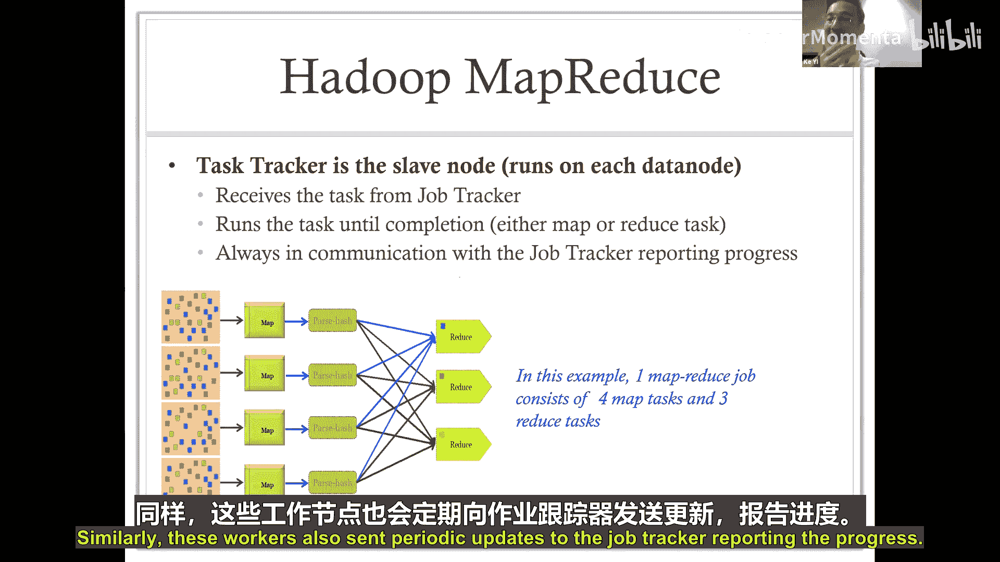

在MapReduce层，作业追踪器是主节点，通常与HDFS的名称节点运行在同一个物理节点上。它接收用户作业，决定运行多少个任务（Map任务数量通常取决于输入数据的分块数），以及运行多少个Reduce任务。分配时会考虑数据本地性，以尽量减少Shuffle的数据量。

在这个例子中，一个MapReduce作业有5个Map任务和3个Reduce任务。这可以配置，也有自动分配过程。

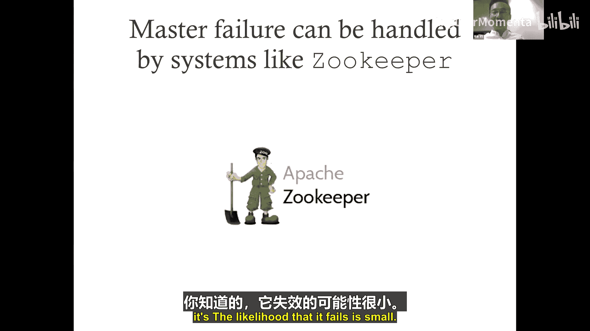

类似于数据节点发送心跳，在执行MapReduce作业时，工作节点也会定期向作业追踪器发送进度报告。因为MapReduce作业可能运行很长时间，期间可能发生故障。如果一个Map任务失败，它会重新执行。如果一个Reduce任务失败，它也会重新执行。如果一个工作节点失败，情况稍复杂，因为Shuffle的中间数据不存储在HDFS中。如果一个Reduce工作节点失败，它可能还需要重新执行一些已完成的Map任务，以重新生成丢失的中间结果并发送给新的Reduce任务。

所有这些进度和完成状态都由主节点跟踪。最后，主节点故障由像ZooKeeper这样的系统处理。通常，除非在数百台机器的集群上运行或运行时间极长，否则主节点故障的几率较小。

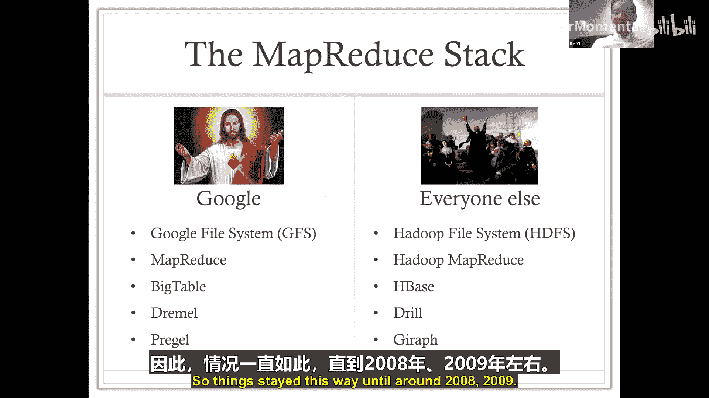

## MapReduce的争议与大数据生态演进

回顾我们讨论的内容，开源社区一直紧密跟随Google的脚步。Google有GFS，我们有HDFS；Google有MapReduce，我们有Hadoop MapReduce。后来Google发布了BigTable，开源社区就有了HBase和Hive（用于在HDFS上运行SQL查询）。还有用于更高效计算的Drill，用于大规模图处理的Pregel，以及开源的Giraph。可以说，Google在这个领域如同引领者。

这种情况一直持续到2008-2009年左右。数据库社区的两位大家——David DeWitt和Michael Stonebraker（后者是图灵奖得主）——在顶级数据库会议SIGMOD的一个讨论小组上，提出了一个颇具争议的观点：MapReduce是一个**巨大的退步**，而不是进步。他们指的是当时所有人都试图用MapReduce做一切事情（包括SQL处理）的现象。

他们提出的观点包括：
1.  **对某些计算是好的**：他们承认MapReduce对于编写词频统计、构建倒排索引等特定类型的计算是个好主意。
2.  **编程范式的退步**：对于大规模数据密集型应用，它是一个巨大的退步。
3.  **次优的实现**：它强制进行全表扫描，而数据库社区花费巨大精力构建的索引（如B树、哈希表）在MapReduce中缺失，导致查找查询效率低下。
4.  **缺失现代DBMS功能**：它缺少当前数据库管理系统（DBMS）中常见的许多功能，特别是事务处理、更新操作以及关系操作（如连接）。
5.  **缺乏新颖性**：最关键的是，他们认为MapReduce并不新颖。早在1990年，图灵奖得主Leslie Valiant就发表了一篇关于**批量同步并行**模型的论文，其思想与MapReduce本质相同。Google在后来发表相关论文时才引用了Valiant的工作。

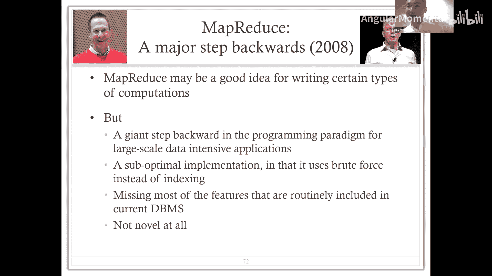

这场辩论实际上引发了革命。可以说，大数据领域的爆发正是在这场辩论之后。人们开始意识到，MapReduce可能不是唯一的方式。同时期出现的“NoSQL”运动最初常与MapReduce等同，但后来被重新诠释为“Not Only SQL”，旨在结合关系数据库40年的研究成果和分布式系统的优点。

在2008年辩论之后的几年里，大数据领域真正呈现爆炸式增长，涌现出许多新产品和新思想，利用不同系统和理念的优势，为我们提供了丰富多样的工具集。

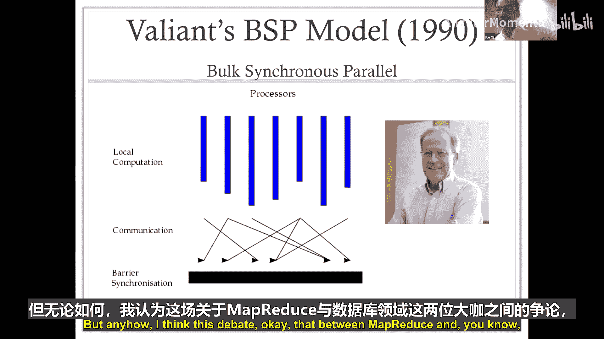

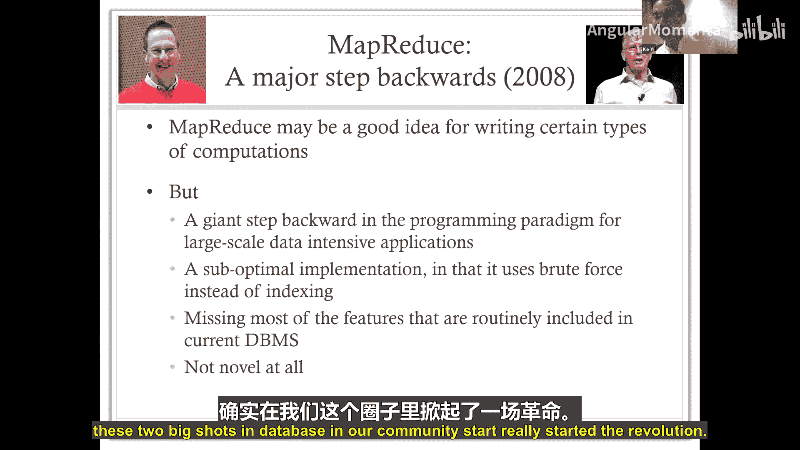

## 总结

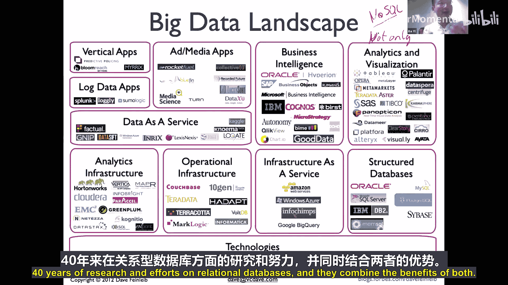

本节课中，我们一起学习了Hadoop，它是Google MapReduce和GFS的开源实现。我们了解了Hadoop的双层架构：底层的HDFS负责可靠的分布式存储，上层的MapReduce提供并行计算框架。我们探讨了HDFS通过副本和心跳机制实现容错，以及Hadoop 3.0引入的纠删码技术。最后，我们回顾了关于MapReduce范式价值的学术辩论，这场辩论促进了大数据生态系统的多元化发展，催生了Spark等更灵活、高效的计算框架。理解Hadoop是理解现代大数据技术栈的重要基石。