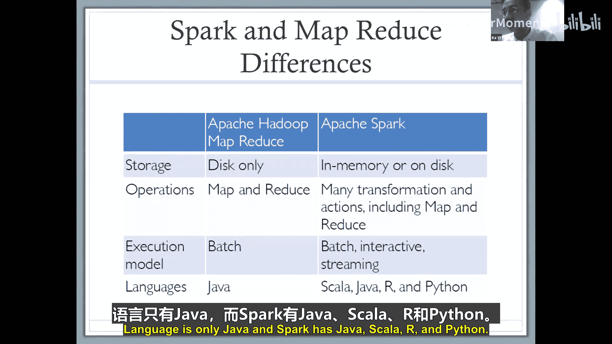

# 005：Hadoop与Spark对比 🆚

在本节课中，我们将要学习Hadoop与Spark这两个重要的大数据框架之间的核心区别。我们将从历史背景出发，分析它们各自的设计哲学、优缺点，并理解Spark如何针对Hadoop的局限性进行改进。

## 历史背景 📜

上一节我们介绍了MapReduce的基本概念。本节中，我们来看看其发展历程以及Spark诞生的背景。

大数据领域的发展似乎遵循着“偶数年定律”。2004年，Google发表了关于MapReduce的论文。2006年，Hadoop项目诞生。2008年，Hadoop成为Apache顶级项目。2010年，Spark项目启动。2012年，Spark成为Apache顶级项目。2014年，Spark开始流行。2016年，Spark持续发展。2020年也不例外，发生了许多重大事件。

## MapReduce的局限性 ⚠️

上一节我们提到了MapReduce的一些优点。本节中，我们来深入探讨它的主要缺点。

MapReduce主要有两个方面的不足。

以下是第一个缺点，即编程模型方面：
*   **编程模型过于受限**。最初这被认为是优点，因为程序员只需定义两个函数。在早期，MapReduce仅用于少数特定的数据密集型任务，如词频统计、构建倒排索引等搜索引擎关心的任务。然而，当大量人群开始追随这一趋势，试图用MapReduce完成所有事情时，人们很快意识到，程序员只能定义两个函数这一点限制性太强。许多复杂任务要么难以实现，要么几乎不可能在MapReduce中实现。这属于编程方面的**可表达性**问题。

以下是第二个缺点，即性能方面：
*   **MapReduce速度慢**。特别是当任务涉及多轮MapReduce时。我们上次看到的词频统计和构建倒排索引的例子，都只需要一轮MapReduce。对于这类任务，MapReduce表现尚可。然而，当人们开始尝试其他任务，特别是机器学习时，问题就出现了。许多机器学习任务本质上是迭代的，涉及多次循环，例如最广泛使用的梯度下降训练方法。当人们尝试使用MapReduce处理这些迭代任务时，它变得非常慢，慢到几乎无法忍受。根本原因在于它必须将中间结果写回磁盘。MapReduce最初被设计为单轮机制。如果想用它进行多轮迭代作业，所有中间结果都必须写回磁盘（如GFS或HDFS，它们本身具有冗余性，例如Hadoop 2.0默认使用3个副本）。这意味着每个中间结果都需要写入磁盘三次，并且在下一次迭代时再被读取回来。磁盘I/O在根本上比内存慢几个数量级，这为MapReduce作业造成了巨大的瓶颈。

## 专用系统的困境与Spark的登场 🚀

上一节我们了解了MapReduce的局限性。本节中，我们来看看为了解决这些问题而出现的专用系统，以及它们如何催生了Spark。

当许多构建在Hadoop之上的专用系统出现后，上述第二个问题（性能问题）变得更加严重。这些系统（如Google的Pregel及其开源版Giraph，用于图计算；Google的Dremel及其开源版Drill，用于交互式查询）主要是为了解决第一个问题（编程模型受限），使编程模型更灵活、更丰富，让人们更容易编写复杂程序。

然而，这些专用系统实际上让第二个问题（性能问题）变得更糟。因为这些系统最终会将用户程序编译成MapReduce作业，所有计算任务仍然由MapReduce引擎执行，并且不可避免地需要多轮运行，这使得性能问题更加突出。

最终，Spark登场了。Spark的设计初衷正是为了解决这两个问题：**可编程性/易用性**和**效率/性能**。

在效率方面，Spark尽可能避免使用磁盘，专注于**内存计算**。只要内存足够，Spark会不惜一切代价避免磁盘I/O。当然，由于容错性的考虑，某些磁盘使用是不可避免的，特别是输入和输出仍需驻留在HDFS这样的容错文件系统中。为了促进内存计算，Spark引入了**有向无环图**执行模型，这与内存计算配合得非常好。

在可编程性方面，Spark也更容易使用。回想一下，Hadoop MapReduce是用Java编写的，用户也只能用Java编写MapReduce作业。虽然Spark核心是用Scala/Java编写的，但在用户接口层面，它支持丰富的API，包括Java、Scala、Python和R这些对用户更友好的语言。此外，Spark还支持交互式Shell和交互式计算（如果使用Python或R）。而MapReduce只支持批处理作业提交。这在程序已经写好、调试完毕并准备在大数据集上运行时是可以接受的。但在开发阶段，当你需要修复错误、尝试不同技巧，或者先在小数据集上运行程序以获得初步想法时，交互性就变得非常重要。对于交互式数据分析，人们通常不会一开始就在非常大的数据集上运行程序，而是先在一些较小的样本数据集上运行，获得大致想法后再回去修改。因此，交互性对于易用性至关重要，而Spark使之成为可能。Spark的一个特别优点是，例如使用Python时，Spark可以被视为一个加载到Python中的额外库。你仍然可以使用Python的所有功能，Spark只是作为一个库引入，提供了将你的程序扩展到大规模数据集的所有功能。

实验结果表明，当内存充足时，Spark可以比MapReduce/Hadoop快**100倍**。即使内存不足，Spark仍然可以比MapReduce快**10倍**。在编程方面，用Spark编写的相同程序，其代码量可比MapReduce少**2到5倍**。代码量减少的另一个原因是Spark提供了更丰富的API。MapReduce只包含两个函数（映射和规约），而Spark除了`map`和`reduce`，还支持更多转换操作。

## Spark的流行与发展趋势 📈

上一节我们看到了Spark的设计优势。本节中，我们来看看它的发展历程和市场接受度。

Spark的简短历史如下：最初于2009年在加州大学伯克利分校开发，2010年成为开源项目，随后成为Apache软件基金会所有大数据开源项目中最活跃的项目。许多公司正从Hadoop转向Spark，包括许多知名大公司。实际上，这些大公司通常构建自己的系统，不一定使用Spark，并且他们的系统通常不开源。然而，对于大多数中小型企业，他们直接使用Spark，或对Spark进行小的调整和修改以更好地满足自身需求。

在流行度方面，绿色曲线代表Hadoop，红色曲线代表Spark。不出所料，2014年之后，Spark的受欢迎程度显著超过了Hadoop。

## 核心技术理念：内存计算 💾

上一节我们了解了Spark的流行。本节中，我们来深入探讨其核心的技术理念。

从高层次的技术理念来看，Spark希望尽可能避免使用磁盘。当然，这对内存提出了更高的要求。然而，内存容量一直在稳步增长。如今，购买一台配备1TB内存的笔记本电脑已经很容易。在内存和磁盘之间，SSD也越来越便宜、容量越来越大。因此，许多人预测磁盘最终会消失。这里需要提到的是**非易失性内存**，它甚至比SSD更快。无论如何，这里的核心信息是，随着技术进步，磁盘正越来越成为一种永久存储介质，将从计算中消失。本质上，未来进行任何计算时，你都会将数据加载到内存中，所有操作都在内存中进行。只有在一天结束时，业务关闭后，才将数据写回磁盘进行归档存储。在早期，人们试图优化磁盘I/O；而在未来几年，磁盘可能会退出舞台，仅作为归档存储的介质。

下图展示了Spark的一般执行过程：我们仍然只从HDFS读取一次数据，然后可以在内存中执行多次迭代，中间结果也只存储在内存中。此外，如果我们在同一数据集上执行不同的任务，也只需要读取一次数据。读取一次后放入内存，内存也可以是分布式的。因此，即使单台机器的内存不足，当你从数百个节点汇集内存（也称为**内存云**）时，容量应该不是问题。一旦数据加载到内存中，你就可以在同一数据集上执行多个查询、运行多个计算作业。

## 关键差异总结 📊

上一节我们探讨了Spark的内存计算理念。本节中，我们通过一个表格来总结Hadoop与Spark的关键差异。

| 对比维度 | Hadoop (MapReduce) | Spark |
| :--- | :--- | :--- |
| **存储** | 中间结果存储在磁盘（HDFS） | 中间结果优先存储在**内存**，不足时溢写到磁盘 |
| **操作/编程性** | 仅支持 **`map`** 和 **`reduce`** 两种操作 | 支持丰富的**转换操作**，`map`和`reduce`是其中特例 |
| **执行模型** | 仅**批处理** | 支持**批处理**、**交互式**和**流处理** |
| **主要语言** | **Java** | **Java**, **Scala**, **Python**, **R** |

## 课程总结 🎯

本节课中，我们一起学习了Hadoop与Spark的对比。我们从MapReduce的局限性（编程模型受限和性能低下）出发，了解了专用系统如何加剧了性能问题，从而引出了Spark的诞生。Spark通过**内存计算**和**有向无环图执行模型**极大地提升了性能，同时通过**丰富的API**和**多语言支持**（特别是交互式Shell）显著改善了易用性和可编程性。最后，我们总结了二者在存储、操作、执行模型和语言支持等方面的关键差异。理解这些差异有助于我们根据具体任务需求选择合适的工具。