# 006：弹性分布式数据集与分区

## 概述
在本节课中，我们将要学习Spark中最核心的数据结构——弹性分布式数据集（RDD）。我们将了解RDD是什么、它是如何工作的、以及Spark如何通过延迟执行和分区等机制实现高效的大数据处理。

## 什么是RDD？
Spark编程的核心是弹性分布式数据集，简称RDD。事实上，描述Spark的第一篇论文标题就是关于RDD的。它是Spark的关键和核心部分。

Spark的理念是避免使用文件系统，因此需要一个数据结构来存储数据，这个数据结构就是RDD。从用户的角度看，RDD就是一个列表。当然，在底层实现上，它与Python列表有很大不同。

更准确地说，在Spark内部，每个RDD都被划分为多个分区。例如，一个巨大的列表RDD可能被划分为三个分区：P1、P2、P3。另一个RDD也可能被划分为三个分区。

## RDD的创建与确定性转换
RDD的创建方式非常重要。RDD通过确定性的转换来创建。一旦一个RDD被定义，Spark就能精确地知道它是如何从源数据或其他RDD派生出来的。

以下是创建RDD的两种主要方法：
1.  从持久化存储（如HDFS或本地文件系统）中的数据转换而来。
2.  通过对其他RDD执行转换操作而来。

例如，可以从RDD1创建RDD2。这种转换是一对一的，即RDD1中的每个记录都会在RDD2中创建一个对应的记录。因此，这种转换可以按分区独立进行。这种转换必须是确定性的，即定义明确，不依赖于随机数或外部因素（如机器运行速度）。一旦源数据固定，转换结果就是固定的。

## RDD的物化与执行模型
下一个要点同样重要：RDD不需要被“物化”。物化是一个术语，简单来说就是物理存在。

程序员可以为每个RDD指定分区数量，虽然如果不指定也会有默认值。通常，分区数量与性能之间存在权衡。分区越多，并行度越高，因为所有分区可以被多个工作节点并行处理。例如，一个转换操作可以在三个工作节点上并行处理三个分区。但如果只有三个分区而有五个工作节点，那么两个工作节点就会空闲。

但分区也不宜过多，因为分区需要由主节点管理。分区过多，管理开销也会增大。因此，这是一个权衡。经验法则是，分区数量应该是工作节点数量的2到4倍。原因在于工作节点的速度可能不同。Spark设计用于异构计算系统，即集群中的计算节点硬件可能不同。如果分区数与工作节点数相同，速度快的节点完成任务后会空闲，等待其他节点。如果有更多分区，主节点就能进行负载均衡，将已完成任务的节点分配新的分区。

## 示例：日志分析
现在让我们看一个例子，这个例子来自加州大学伯克利分校关于Spark的第一篇论文。这个例子也能帮助我们理解“物化”的含义。

在这个例子中，我们对初始数据集执行一系列转换。假设初始数据集是一个存储在HDFS中的日志文件。

以下是转换步骤：
1.  第一步，将原始数据加载到Spark中作为一个RDD。`lines`是我们创建的第一个RDD。从用户角度看，它是一个字符串列表，每个字符串对应日志文件中的一行。
2.  第二步是过滤操作。我们只保留以“error”开头的行。这是一个一对一的转换（或一对零，因为不符合条件的行被过滤掉）。这给了我们第二个RDD，`errors`。
3.  第三步是另一个过滤操作。我们只保留包含“HDFS”子串的错误信息。这产生了第三个RDD（尽管代码中可能没有显式引用它，我们称之为`hdfs_errors`）。
4.  最后，我们可能通过制表符分割字符串并收集结果。`collect`操作将结果以列表形式返回给用户。

这是一个非常简单的Spark作业，包含四个转换操作，涉及四个RDD。第一个转换是从HDFS读取文件。

## 理解“物化”
现在来解释“物化”的含义。在这个例子中，所有四个转换都是一对一的。这意味着不同分区的记录在整个计算任务中没有任何交互，不需要任何同步屏障。这实际上是个好消息，因为工作节点运行速度可能不同，如果强制同步，速度快的节点就需要等待，从而降低效率。

Spark的设计特别适合处理这种情况。实际运行时，文件的每个分区（块）被分配给一个工作节点。该节点会先将数据读入内存，然后立即开始执行后续的过滤和映射步骤。该节点无需等待其他节点，因为所有操作都是独立的。这最大限度地提高了效率，完全没有等待。

其结果是，虽然像`errors`这样的中间RDD在逻辑上存在于这个线性图中，但它可能从未在整个系统中的任何时间点完整地存在过。因为工作节点速度不同，当工作节点1计算完`errors`分区1时，分区2可能已经进入下一阶段，甚至中间结果已经被丢弃。因此，在任何时间点，我们都没有一个完整的`errors` RDD物理存在于系统中。当然，这个RDD的每个片段都会在某个时间点存在于某个工作节点上，但它们从未作为一个整体物理存在。这就是“物化”的含义。默认情况下，所有RDD都不被物化，这是为了最大效率，因为没有必要物化。

对于`errors` RDD的任何部分，一旦被计算出来，就会立即被送入下一阶段，然后这个中间片段就会被丢弃。这不仅提高了内存使用效率，也最小化了存储需求，因为Spark甚至不存储它。

## 执行总结与延迟执行
总结一下，执行是流水线化和并行的，不需要存储中间结果。这本质上就是我们所说的默认不物化RDD。

最后，这一点也非常重要：延迟执行。Spark允许用户与系统交互。用户可能逐行输入代码。当第一行代码提交给Spark时，Spark实际上不会做任何事情，不会去读取文件。

为什么Spark要等待？我们刚刚说过，执行是流水线化的，没有中间RDD被物化。如果Spark在输入第一行时就执行，那么它将不得不物化`lines` RDD并存储它，这就完全违背了不物化中间结果的目的。相反，Spark采取了一种“聪明”或“懒惰”的策略。它只在最终需要结果时才执行操作。

在这个例子中，最终“考试”是`collect`操作。因为`read file`、`filter`、`map`这些转换产生的是RDD，而RDD是内部数据结构，用户不能直接访问。只有当像`collect`这样的“行动”操作需要将结果返回给用户时，Spark才真正开始工作。

因此，输入前两行代码后，Spark实际上什么也不做，它只是构建这个线性执行图。只有在Spark看到`collect`操作后，它才开始流水线执行。这就是延迟执行的含义。

## 延迟执行示例
再举一个例子。假设执行图是一个有向无环图。例如，用户可能改变主意，不想收集包含“HDFS”的错误，而是想收集包含“GFS”的错误。那么代码会进行另一个过滤，产生另一个RDD（`gfs_errors`），然后对这个RDD执行`collect`。

现在这个线性图变成了一个有分支的树。如果只对`gfs_errors`执行`collect`，那么只有关键路径上的部分（即从源数据到`gfs_errors`的路径）会被计算和执行。而`hdfs_errors`和`time_fields`这两个RDD根本不会被计算，它们甚至不会被物化。这又是一个延迟执行的例子：Spark只做满足用户请求所必需的工作。

## 容错机制
现在我们来讨论容错机制。回忆一下，在MapReduce中，容错本质上由HDFS支持，每个中间结果都存储三份。这带来了很大的开销。在Spark中，执行图不仅有助于高效执行，也使容错更加高效。

我们要求每个转换都是确定性的。这意味着只要Spark知道执行图和初始数据，它就拥有推导出每个RDD、每个分区所需的所有信息。因此，它不必将任何中间结果存储到磁盘。

那么，如果一个工作节点失败了呢？如果处理某个RDD（例如`errors`）分区的节点失败，该分区数据丢失，Spark会通过仅对`lines` RDD的相应分区重新应用过滤操作来重建它。如果`lines`的分区也丢失了，就回退到文件系统。这里唯一的假设是输入文件被可靠地存储（可能有副本）。但中间结果只存储一次，数据可能丢失。然而，Spark拥有重新计算每个丢失部分所需的所有信息，所以实际上没有数据丢失。

当然，故障恢复的成本更高。如果执行图很长，Spark可能需要回到最开始重新计算所有丢失的部分。而在MapReduce中，这更便宜，因为它只需回到上一阶段。但MapReduce为此付出了很高的代价，即将每个中间块复制三份。MapReduce在应对工作节点故障方面过于激进。而Spark则秉承了“懒惰”的思想，不为容错主动做任何事情，但拥有所有必要的信息，且这些信息非常廉价（只是一个小的执行图）。只要有这个“配方”，我们总是可以从原始资源重新“制作食物”。

这种机制运行良好，还因为虽然故障时常发生，但在一个拥有数千台机器的集群中，绝对故障数量仍然很小。因此，这种容错机制可以高效得多。你肯定不希望仅仅因为一个节点故障，就让所有一千个节点都做三倍的工作。

## 转换与行动
以下是一些最常用的转换和行动操作列表。我们将在示例中看到它们。转换和行动的区别在于：转换将RDD转换为另一个RDD（输入和输出都是RDD），而行动则是从RDD转换为用户可访问的某种数据类型（如Python列表、整数，或外部存储系统如HDFS）。只有行动才会触发Spark开始工作、启动作业。转换只是构建执行图。

## 执行模型示例
记住，Spark不将任何中间结果存储到磁盘，它也可以通过只从磁盘读取一次数据来对相同数据执行多个任务。

例如，从文件系统读取文件到`lines` RDD。`comments` RDD是通过对`lines`应用过滤得到的。假设我只想要注释行。然后，我对`lines`执行`count`行动（计算行数），再对`comments`执行另一个行动。

执行图是这样的：从文件到`lines`，再从`lines`到`comments`。第一个执行（`lines.count()`）会触发读取文件到内存，然后计数并返回给用户。当Spark看到第二个命令（`comments.count()`）时，它会再次读取数据，因为默认没有物化。它会重新计算`lines`，然后执行转换。注意，这些都是流水线化的，`lines`从未被物化，然后返回计数。

有人可能会问：这和我之前说的“Spark可以读取一次数据然后执行多个操作”不是矛盾吗？这里文件被读取了两次，效率低下，这和MapReduce甚至一样了。是的，这是默认行为。因为默认情况下，Spark不知道你是否要对相同数据执行多个作业。为了节省计算和内存，它不物化中间结果。

然而，这只是默认行为。作为程序员，如果你知道将要执行多个作业，Spark提供了一种方法来实现高效处理：你可以显式地缓存或持久化任何特定的RDD。通过告诉Spark“`lines`这个RDD应该被缓存或物化”。我们经常互换使用缓存、持久化、物化这三个词，它们本质上是同一个意思。

## 持久化
如果Spark知道`lines`被标记为持久化，那么当第一个行动`count`执行时，文件被读入`lines`，并且因为`lines`被标记为持久化，它实际上会被存储在内存中，被物化。即使在第一个作业完成后，它仍然存在。

这样做的好处对用户是显而易见的。当用户执行另一个转换加行动时，第二次触发行动时，Spark就不必再次读取数据，而是直接对内存中的`lines`应用转换。只有从`lines`到`comments`再到`count`这两个步骤会被执行。注意，`comments`没有被缓存，所以在第二个行动完成后，`comments`永远不会被存储，只有`lines`仍然存在于内存中。

默认情况下，Spark不在内存中存储任何东西，不物化任何东西。然而，作为程序员，如果你期望某些数据会被重用，你可以显式地告诉Spark：第一次计算后请不要丢弃它。这就引出了持久化的概念。

当然，有方法可以取消持久化（`unpersist`）。缓存和持久化是同一件事，一个是另一个的别名。但取消持久化没有别名`uncache`，只能使用`unpersist`。

Spark可以物化任意数量的RDD。当然，这会使用更多内存。当内存耗尽时，它会将数据刷新到磁盘，这可能会减慢速度。因此，默认情况下，Spark不缓存任何东西。作为程序员，你应该决定缓存哪些RDD。如果内存大小是个问题，你可能需要选择最重要的RDD来缓存。

你可以使用`persist`或`cache`使RDD持久化，并且实际上可以指定不同的持久化级别。默认是仅内存，如果内存不足，它会被丢弃。还有一个选项是内存和磁盘，如果内存不足，RDD不会被丢弃，而是被刷新到磁盘，当然这会减慢速度。

有些RDD，即使你不缓存它们，Spark本身也会因为其重要性而缓存它们。

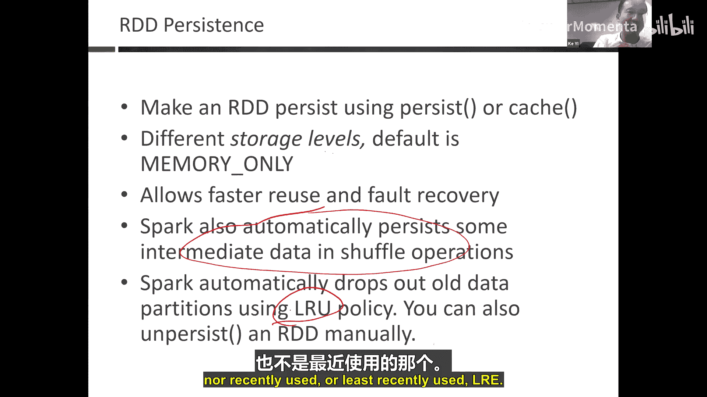

取消持久化的方法是`unpersist`。

如何决定持久化哪个RDD？作为程序员，你必须自己决定。如果你缓存太多，Spark会自动使用LRU（最近最少使用）策略丢弃数据。基本上，它会记住RDD最后一次被使用的时间，然后换出最早被使用的、最近最少使用的那个。

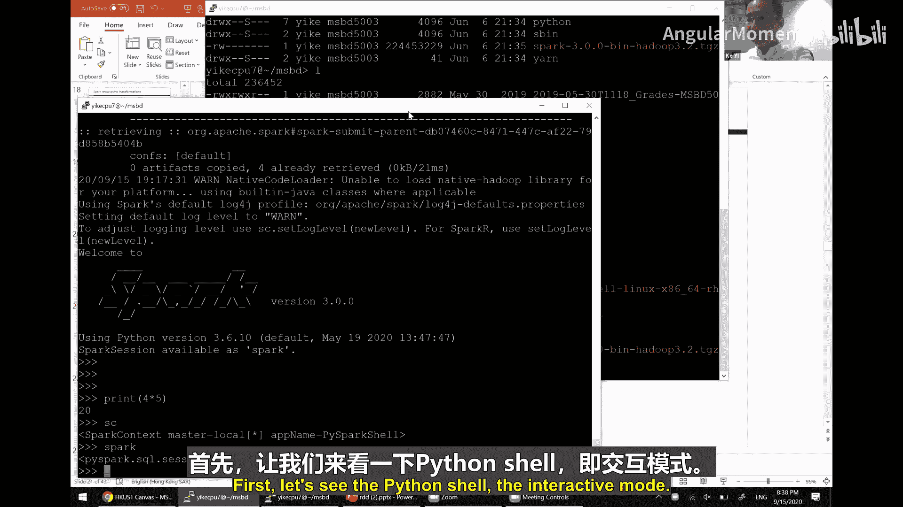

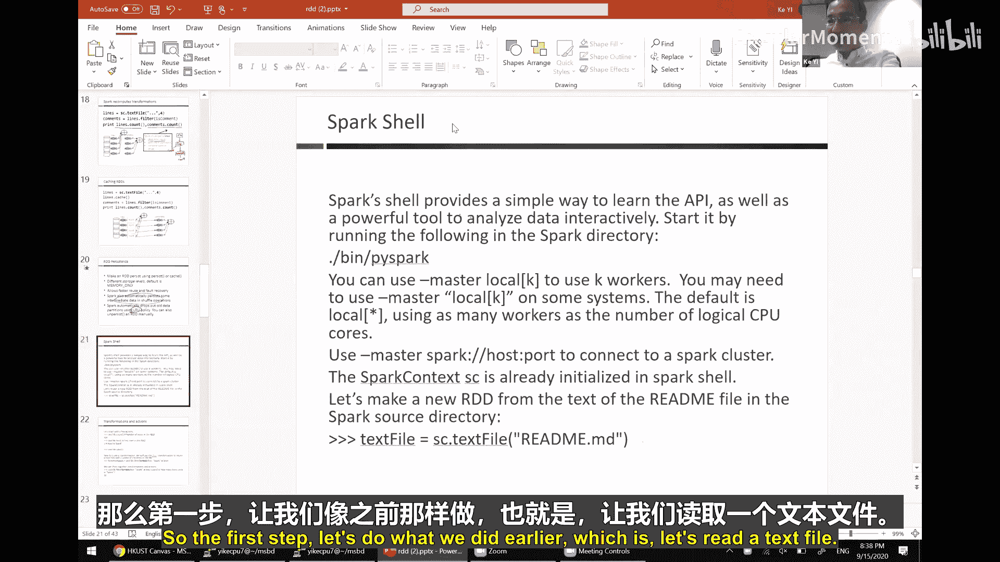

## 交互式Shell示例
这是一个Python Shell。你可以像在普通Python Shell中一样做任何事情。Spark引入的新对象主要是`sc`，即SparkContext。稍后我们会讨论Spark。如果只需要使用RDD，就使用`sc`，否则使用`spark`。目前，我们只使用`sc`。`sc`是进入Spark世界的入口点。

现在让我们做第一个例子。第一步，读取一个文本文件。让我们从本地文件系统读取一个文件。Spark的一个优点是，在笔记本电脑上编写的相同代码可以无需修改地迁移到云端。当然，这有点夸张，有一件事需要修改，那就是源文件的位置。在笔记本电脑上是本地文件，在云端则是文件系统中的某个位置。目前，让我们读取一个本地文件，比如`README.md`。

注意，如果我打错了文件名，比如`readme`，而正确的文件名是`README.md`，Spark似乎没有报告错误，因为这个文件甚至不存在。为什么？没错，就是因为延迟执行。因为每个转换只是构建执行图，它只告诉系统你的执行计划。系统接收你的命令，但直到你执行一个行动操作时，它才会真正执行。

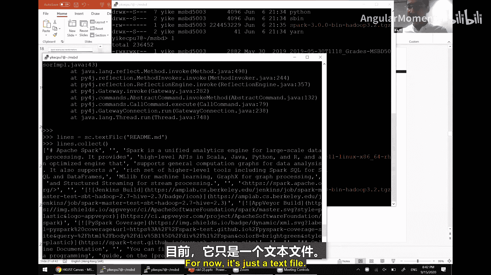

假设我们执行一个行动，比如`collect`。`collect`将RDD转换为Python列表。正如预期的那样，我们收到了一个错误，说输入路径不存在。所以现在Spark意识到你的执行计划实际上是错误的。让我们修正它。

这次它工作了。它是一个字符串列表，每个字符串对应文本文件中的一行。`textFile`转换将文本文件转换为RDD。Spark提供了许多其他读取不同格式文件的方法，比如CSV文件或基于Parquet的文件，我们稍后会看到。目前是`textFile`。

让我们做一些其他的行动。`count`是另一个行动。结果是101。`take`返回RDD中指定数量的前几条记录。

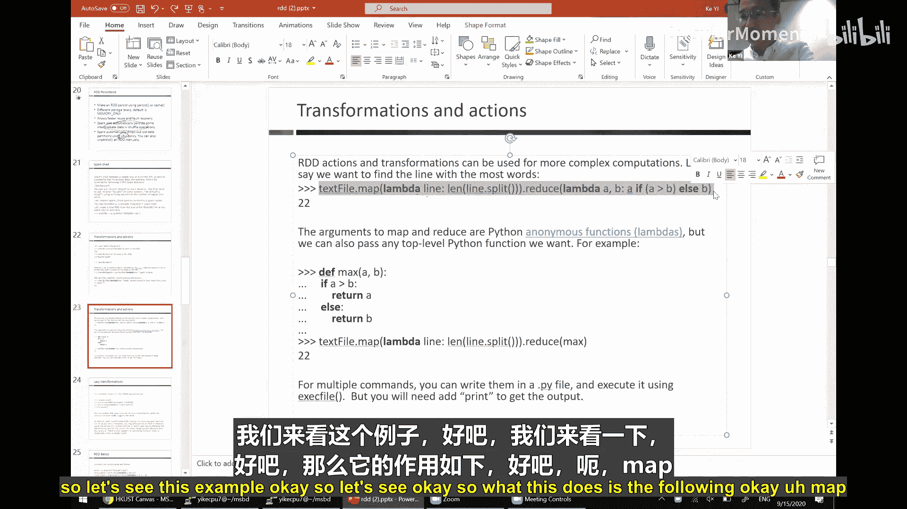

让我们做另一个例子。`lines`包含“spark”的行。这是一个过滤操作。`filter`接受任何函数。因为我们使用Python，所以可以使用lambda函数这种内联方式定义函数。它有一个输入参数，返回一个布尔值。如果为真，则通过过滤；如果为假，则不通过。我们可以对`lines`进行过滤，然后执行`collect`。这将返回所有包含“spark”这个词的行。正如预期，它只包含有“spark”的行。

当然，你可以将它们链式调用在一起。它有19行包含“spark”这个词。

## Map与Reduce操作
接下来要讨论的行动是`map`和`reduce`。Spark中的`map`与MapReduce中的`map`相同，可以执行任何一对一转换。

这个例子中，`map`也接受一个函数作为输入参数。这里我们使用lambda函数。输入是RDD中的每个元素，输出是你想如何转换它。这里，`line`是RDD中的每一行。`split`是Python的分割函数，它将字符串按空格分割成多个部分，形成一个字符串列表。然后我使用`len`函数。所以，这个`map`本质上将`lines` RDD中的每一行转换为其包含的单词数量。

在执行之前，我们先做`collect`。它把所有行转换成单词数量。第二个是`reduce`。然而，这个`reduce`与MapReduce中的`reduce`不同。MapReduce中的`reduce`应用于键值对。这里我们甚至没有键值对，我们只有数字RDD，整数RDD。Spark中的这个`reduce`是一个行动，不是转换。有一个转换叫做`reduceByKey`，它对应于MapReduce中的`reduce`。

这里的`reduce`是一个行动。它通过使用用户定义的函数，将整个RDD组合成一个元素。这个用户定义的函数必须有两个输入，产生一个输出。本质上，这个函数定义了两个元素如何组合成一个元素的规则。

这里，函数是`max`。它有`a`和`b`，返回较大的那个。你可能猜到了结果是什么。最终结果是整个RDD中的最大元素。它会反复地两两合并元素，使用这个用户定义的函数。最终，所有这些整数将被合并成一个，那就是整个RDD中的最大元素。

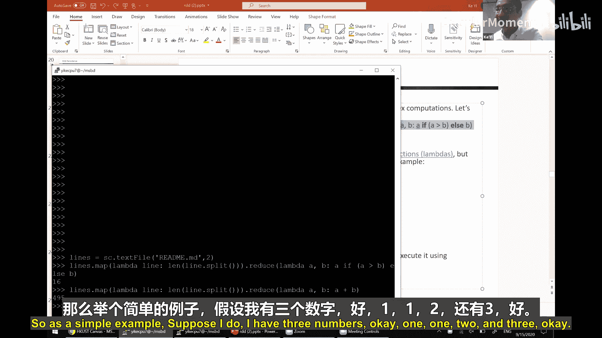

记住，任何不是RDD的东西都是一个行动，它将触发Spark执行操作。

我们讨论了`reduce`。用户应该定义一个函数，该函数本质上是一个二对一的函数，将两个元素组合成一个。在这个例子中，我们使用了`max`。当然，你也可以使用像加法这样的操作。那么这将返回总和。重要的是，你通过这个函数定义的操作符必须是可交换和可结合的。也就是说，操作符执行的顺序不应影响最终结果。`max`和加法都是可交换和可结合的。这是因为作为程序员，你无法控制事物如何组合。Spark只保证最终一切都会被合并，但具体以何种方式合并，你无法控制。如果你定义的东西不是可结合或可交换的，那么最终结果可能无法明确定义，每次运行可能都不同。

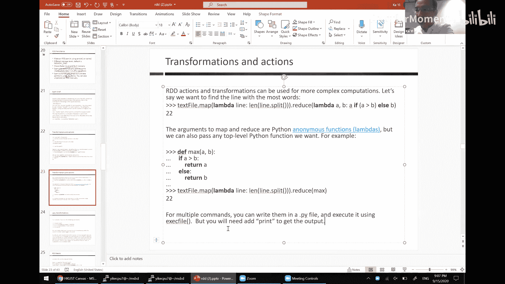

让我举一个例子。这个例子是求平均值。你返回`(a + b) / 2`。这个操作符，如果你仔细想想，它不是可交换的，也不是可结合的。作为一个简单的例子，假设我有三个数字：1, 2, 3。如果我以前两种方式组合，然后组合结果，我得到某个值。然而，如果它们以稍微不同的方式合并，比如先组合第一个和第二个，再与第三个组合，我会得到不同的值。所以这是一个顺序很重要的例子，操作符不是可结合的。

现在让我们看看实际操作。如果我坚持要这样做，这是一个结果。当然，如果我再次运行，结果相同，因为一旦分区固定，顺序也就固定了。我们可以通过指定不同的分区数量来手动改变顺序。之前我没有指定。默认情况下，读取文本文件时，我认为默认分区数是2，除非文件非常大。但我可以手动指定不同的分区数。例如，我告诉Spark这个`lines` RDD应该有3个分区。现在如果我再次执行，你可以看到结果不同了，尽管是同一组转换操作。我唯一改变的是分区数量。这是不好的，因为你的程序不应该依赖于分区数量。分区数量应该是一个只影响性能而不影响程序正确性的参数。这就是为什么我需要强调，对于`reduce`函数，操作符必须是可结合和可交换的。

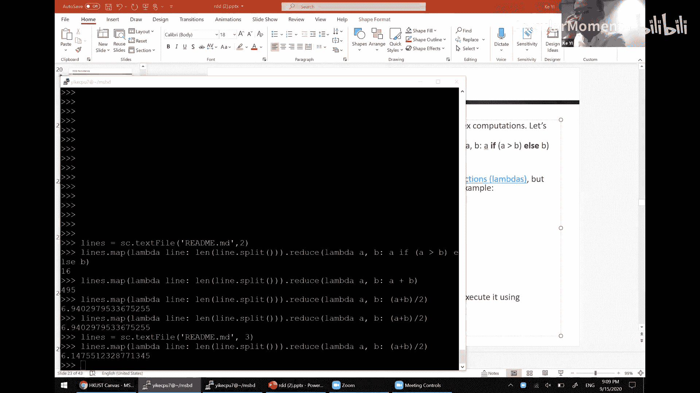

## 另一个例子与缓存
这是另一个例子。这是一个将Python列表转换为RDD的机会。`range`会创建一个Python列表，然后将其转换为RDD。类似地，我想计算RDD中每个数字的平方根。如你所见，它立即返回，因为Spark使用延迟执行。只有当我们有一个行动时，事情才会开始运行。我的服务器相当快，你可能看不到延迟。

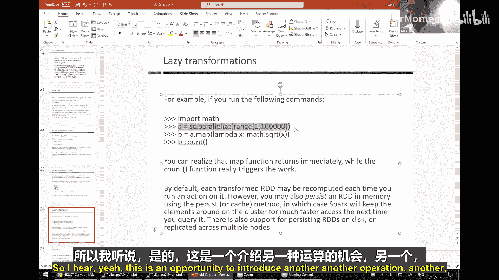

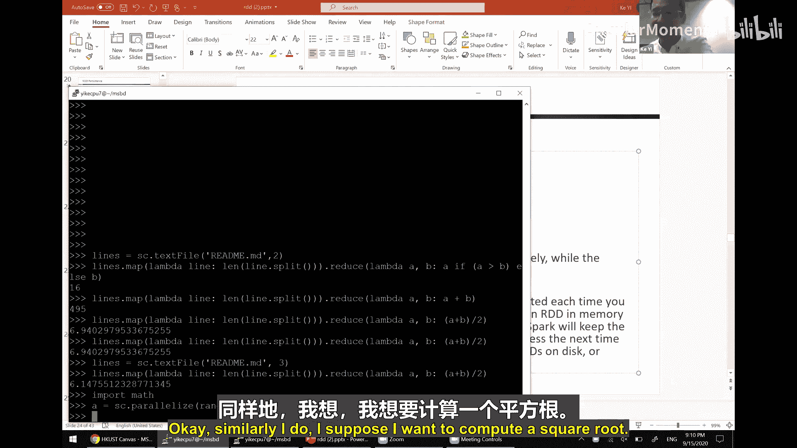

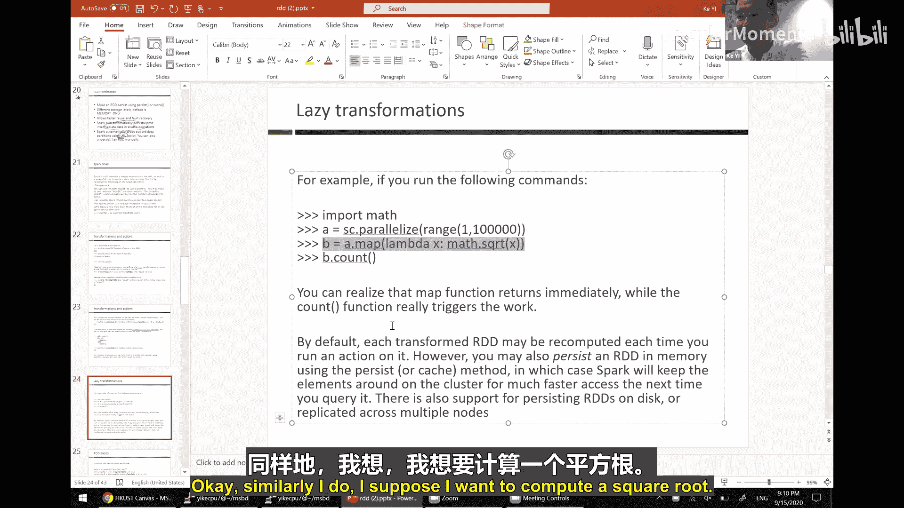

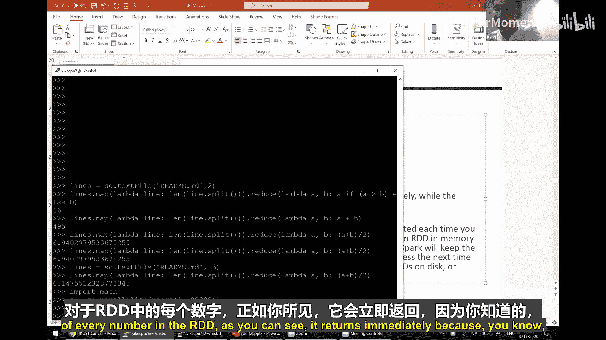

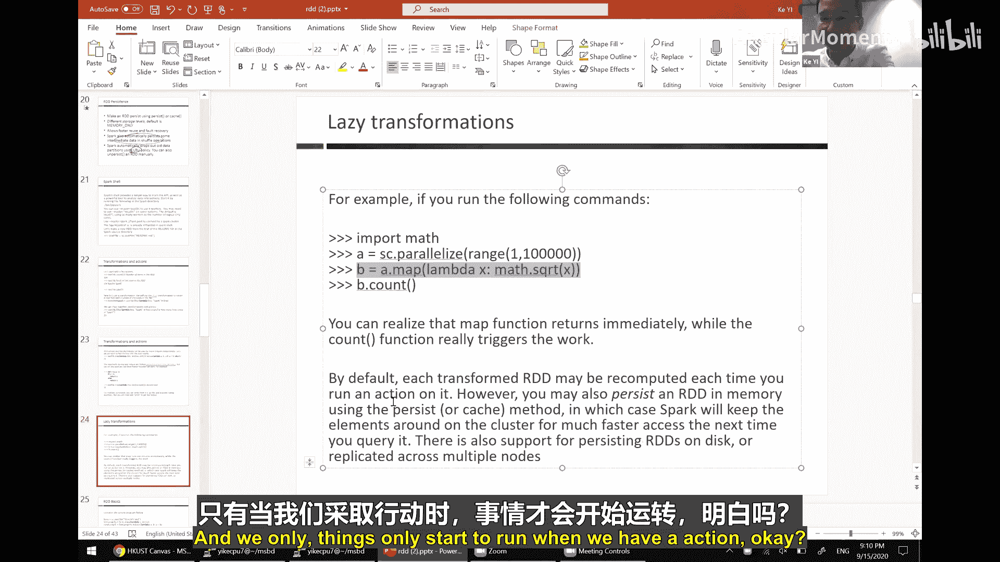

默认情况下，每次你对一个RDD运行行动时，它都会被重新计算。这意味着如果我再次对`b`执行`count`，那么Spark将再次为所有100,000个数字计算平方根，这可能是冗余的。所以，如果你知道一个RDD将被重用，你最好持久化或缓存它。

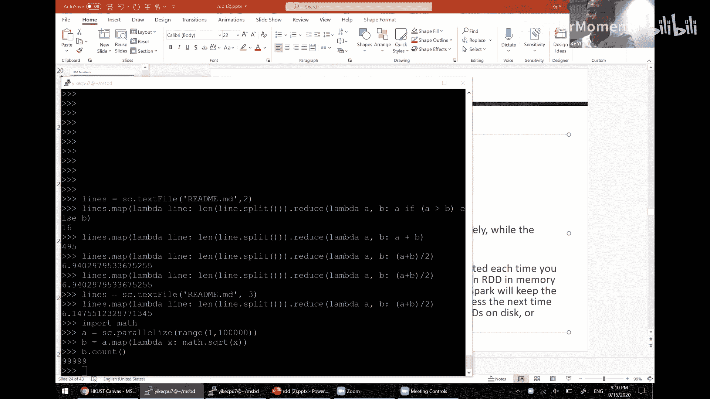

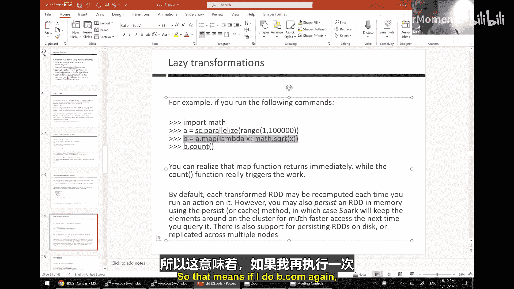

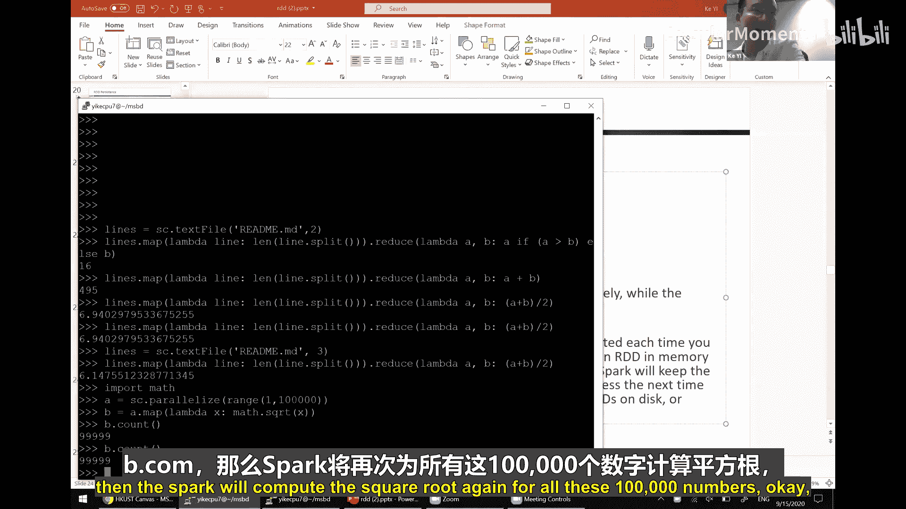

## 交互式Shell与独立提交模式
这是一个使用交互式Shell的例子。这对于交互式数据分析非常好。然而，当你完成程序并想在更大的数据集上运行时，最好使用独立版本。特别是，如果你在课堂上运行Spark集群，可能由许多用户共享，那么运行交互式Shell不是一个好做法，因为它会长时间占用集群资源。在课堂模式下，建议将作业作为批处理作业提交到集群。在这种情况下，我们可以使用`spark-submit`。

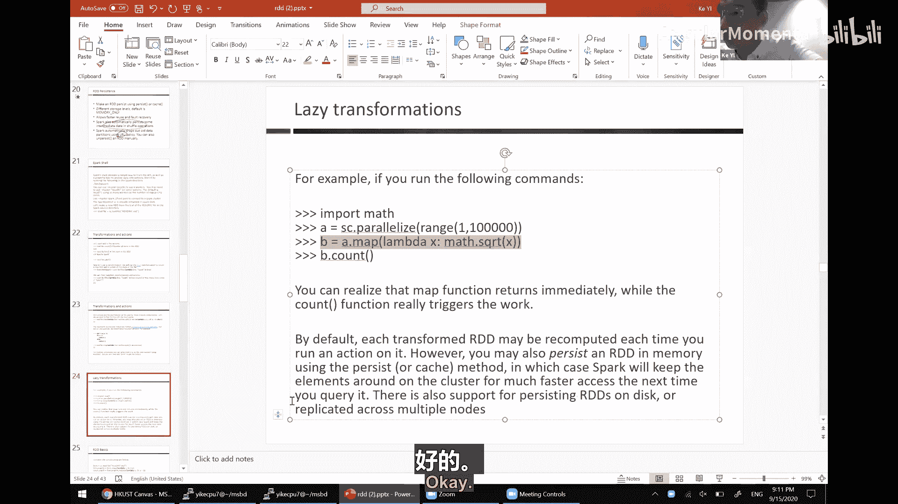

## 理解代码执行位置
现在，理解每行代码在哪里运行非常重要。否则，你将无法利用Spark或集群的计算能力。

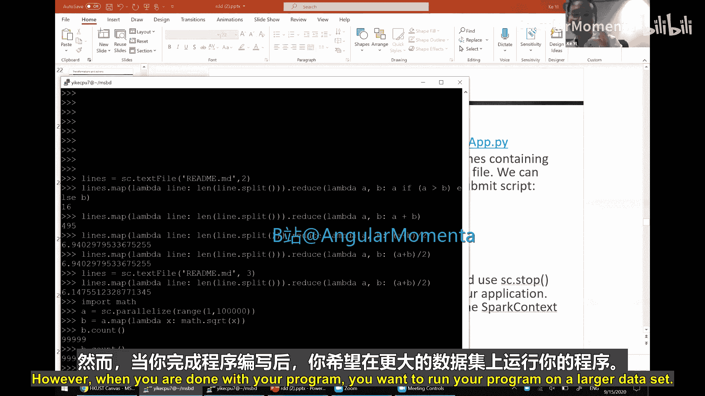

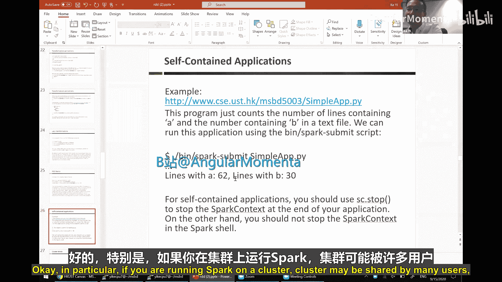

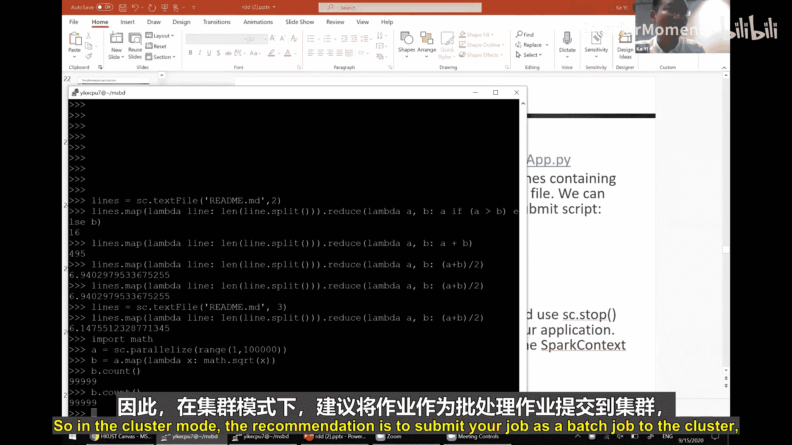

假设我们有一个简单的任务：合并两个RDD。我们想将这两个RDD连接起来形成一个新的RDD。

记住，我们可以使用`collect`将RDD转换为Python列表。Python列表之间有连接操作符`+`。一个简单的实现可能是：首先将每个RDD收集到Python列表中，然后将它们连接起来形成一个新的Python列表，再将其转换回RDD。

当然，这是一种正确的方法。然而，它效率很低。事实上，它完全没有利用Spark的并行能力。因为任何行动都会将结果返回给用户。最终，`collect`会将RDD转换为Python列表，该列表必须存储在用户程序中。

实际上，我需要简要描述一下集群模式。在集群模式中，我们谈论三种不同类型的机器：工作节点（执行计算的计算节点）、集群管理器（主节点，负责将任务分配给工作节点，并在发生故障时负责容错），以及驱动程序或驱动机器。假设你在集群上运行Spark作业，这个驱动程序仍然在你的笔记本电脑上运行。因此，当你提交Spark作业时，你将其提交给集群管理器，集群管理器会将你的作业分配给工作节点，它们将共同存储RDD，每个工作节点可能有一个或多个分区。然而，在Python Shell中，你仍然在运行Python，除了那些RDD，其他所有东西仍然存储在你的本地笔记本电脑上。这也意味着每当你执行一个行动时，结果都会返回到你的驱动程序，这可能是一台性能不强的机器。

回到这个例子，第一个RDD的`collect`操作将收集RDD的所有分区，将它们组合成一个Python列表，返回到你的驱动程序。所以`a`是一个Python列表。除了RDD，所有东西都存储在本地驱动程序中。所以`a`和`b`都是驱动程序中的Python列表。然后你在本地进行连接，可能占用大量本地内存。然后你将其发送回集群形成一个新的RDD。这是一种非常低效的做法。

连接两个RDD的正确方法是使用提供的方法`union`。这将连接两个RDD。注意，这个`union`并不是集合论中的并集，我认为这是一个糟糕的命名，应该叫连接。它按原始顺序组合两个RDD，一个接一个。这将完全在工作节点上运行，不会给驱动程序带来任何负担。

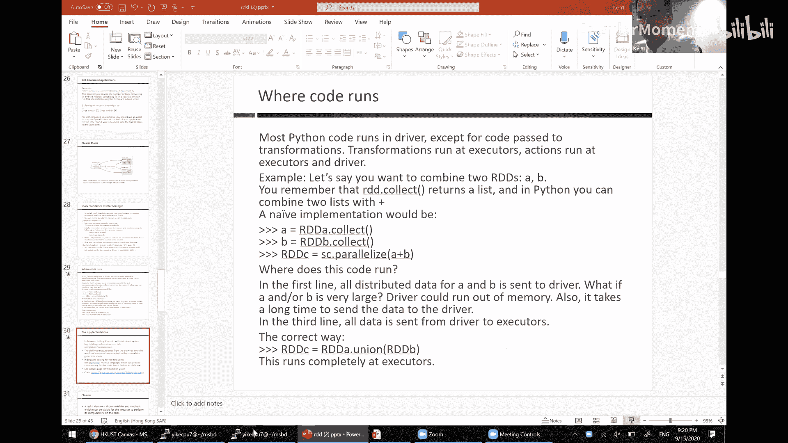

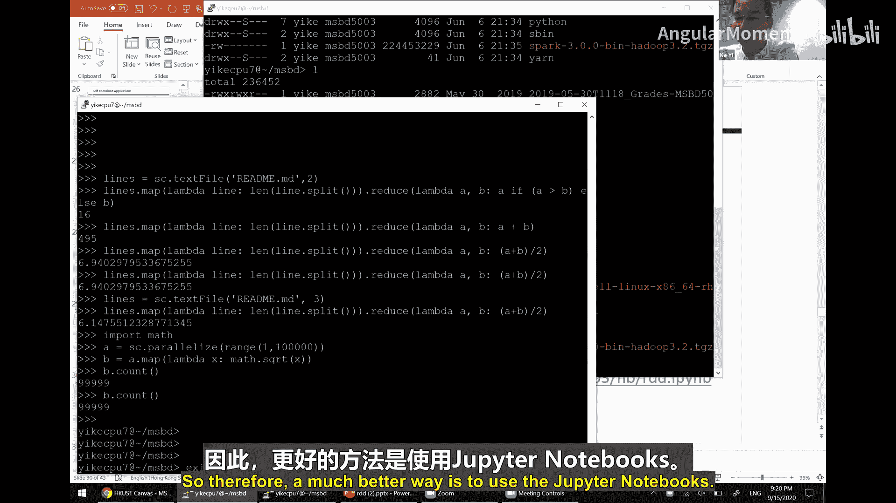

## 回到Jupyter模式
我们已经演示了如何使用Shell，虽然方便，但仍然不够好，因为如果我犯了错误，我需要返回去修复，而且一旦关闭，一切都会丢失。因此，更好的方法是使用Jupyter。我准备了一系列Jupyter笔记本，你可以下载。URL是这个，当我们有其他Jupyter笔记本时，你只需更改此URL中的文件名。第一个示例笔记本是`rdd.ipynb`。

你可以使用Shift+Enter或Control+Enter执行任何单元格。所有示例数据文件，例如我使用的`data/fruits`，都可以在此URL下载。你只需更改文件名。这只是一个文本文件。类似地，`yellow_tripdata.txt`是另一个文本文件。

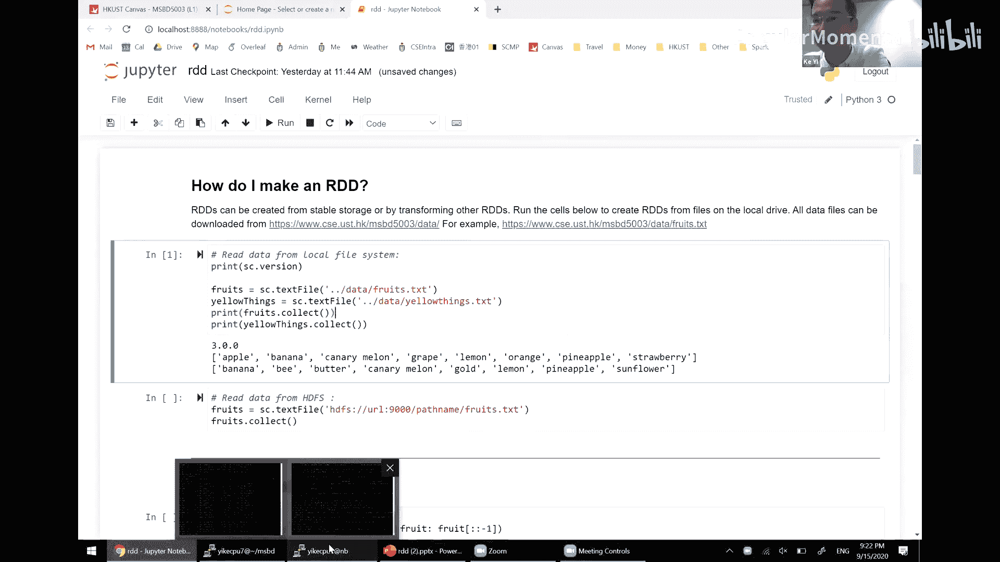

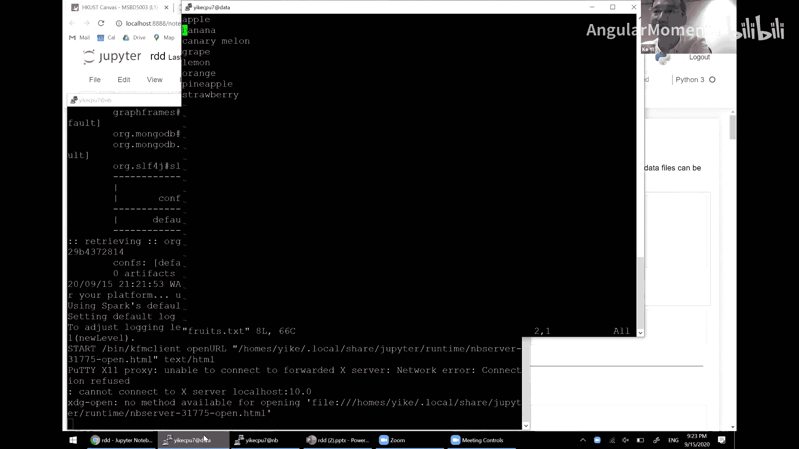

在第一个简单示例中，我只是从本地文件读取。本地文件实际上在这里。所有数据文件都在我的服务器上，`fruits`在这里。现在，稍后当我们在安装了HDFS的云上运行此程序时，你只需进行这一项更改：更改数据文件的URL。Spark已经支持HDFS。这就是为什么下载Spark时，你应该选择与Hadoop匹配的适当版本，以便以后可以从Hadoop安装中读取文件。你应该选择与Hadoop匹配的Spark版本。我们稍后在拥有云资源时会做这件事。

## 更多示例
这是一个`map`的例子。当然，当我运行它时，它不会打印任何东西，因为它只是一个转换。当我们执行`collect`时，它才开始运行。第一次运行时，需要等待一下。在这个转换中，我只是反转字符串，即水果名称。

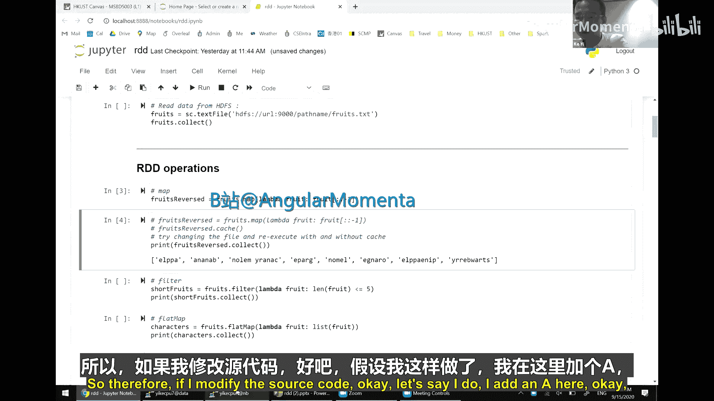

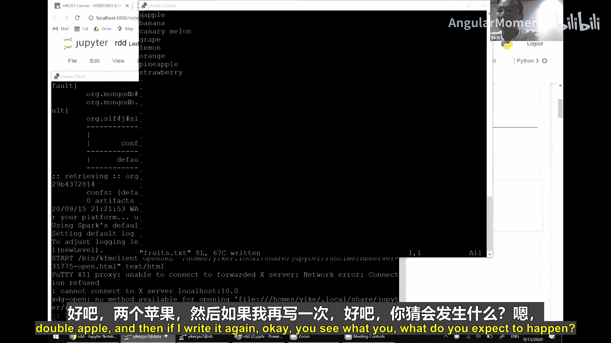

现在是一个查看缓存或持久化如何影响事物的好例子。在这种情况下，`fruits_reversed`没有被缓存。所以这些行都出来了。因此，如果我修改源代码，比如我在这里加上“double apple”，然后如果我再次写入，你预计会发生什么？正如预期，整个东西被重新执行，因为没有缓存任何东西，并且这个更新后的文件被重新读取。

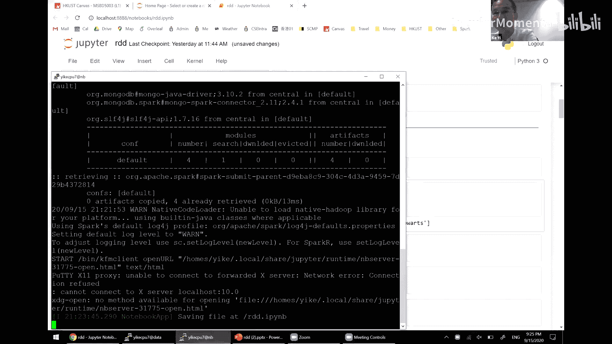

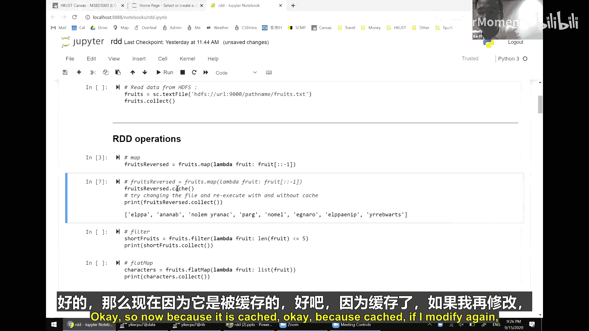

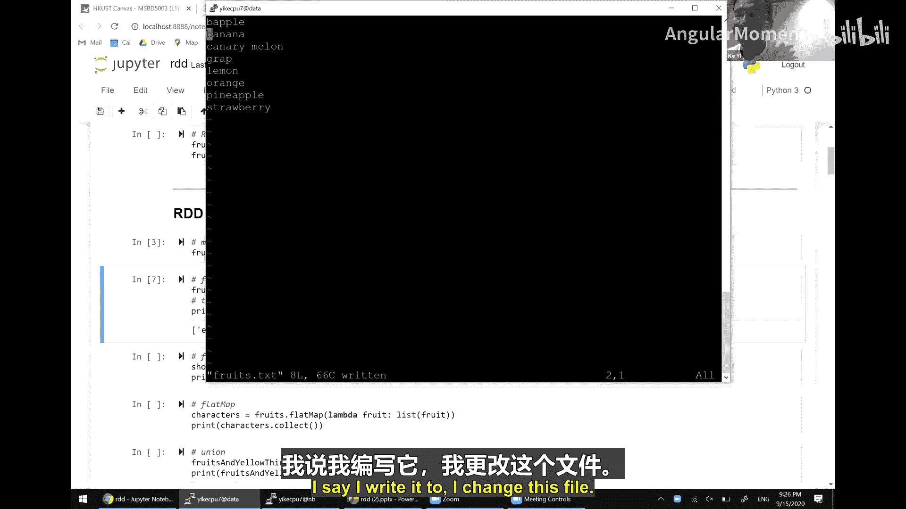

现在让我改回去。现在我将这一行缓存。我运行它。它仍然是“apple”。现在因为它被缓存了，如果我再次修改，比如改成“B apple”，我保存文件。我更改了这个文件。现在，如果我再次运行这个，你可以看到它仍然是“apple”反转。它没有读取我更新的文件。我更新的文件已经包含“B apple”。这意味着缓存确实在起作用。一旦你缓存了一个RDD并且它被计算过，那么它就不会被重新计算。

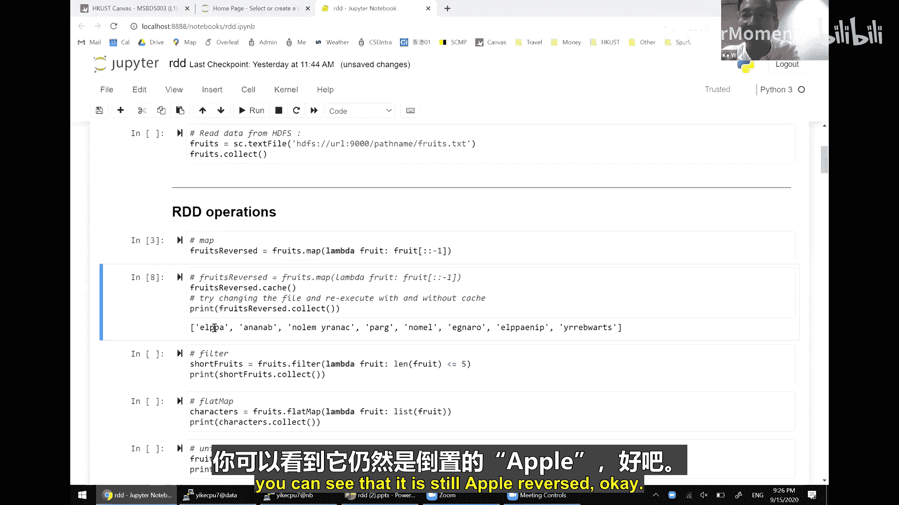

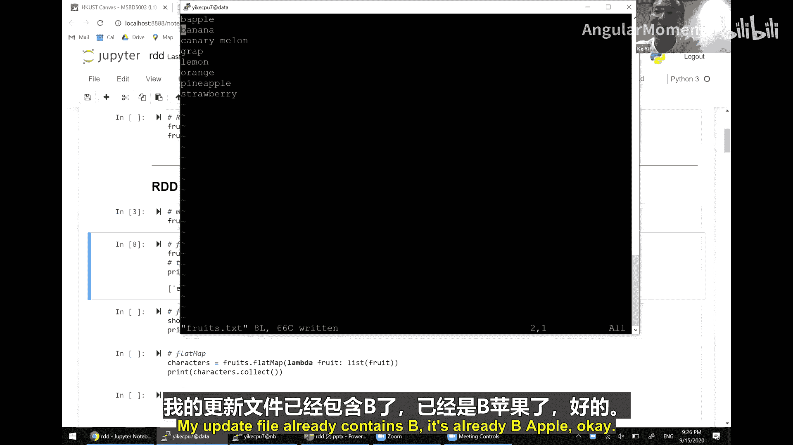

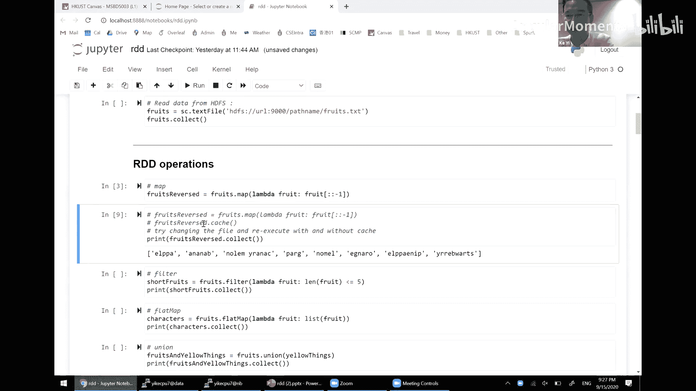

让我们做一些其他实验。如果我再次注释掉它，注释掉，再次注释掉。让我们运行。当然，是“apple”。它仍然是“apple”，对吧？发生了什么？我已经取消了持久化，所以没有缓存任何东西。为什么这样？因为`cache`实际上是一个标记。这个命令、这个方法本身不做任何事情，没有立即效果。它只是给RDD打上一个标记，以便下次Spark看到它时会缓存它或不缓存。因为之前我已经缓存了这个RDD，所以它已经被缓存了。除非你要求它这样做，否则它不会被踢出内存。因此，我必须手动取消持久化。现在我再次写入，现在是“B apple”。现在它没有被缓存。

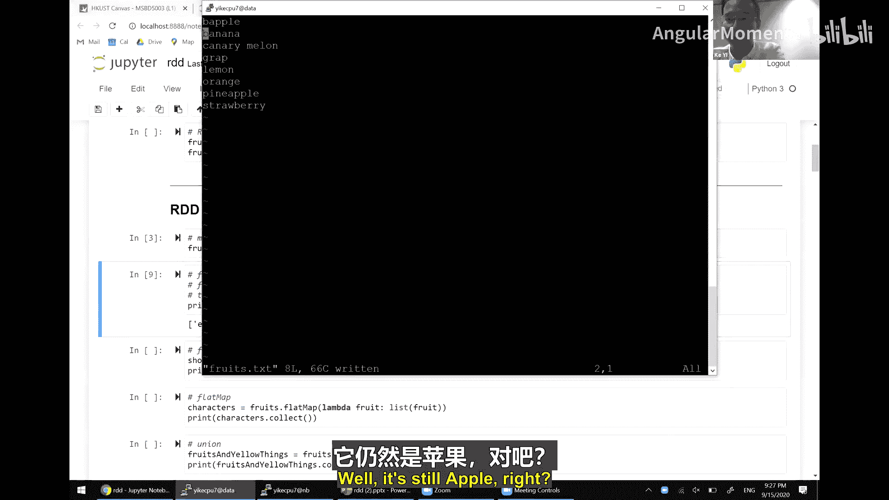

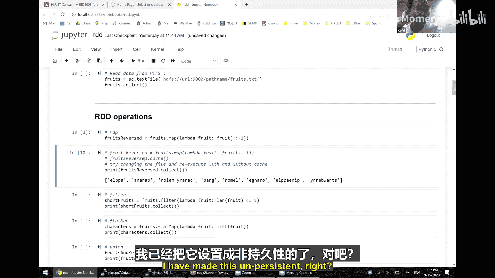

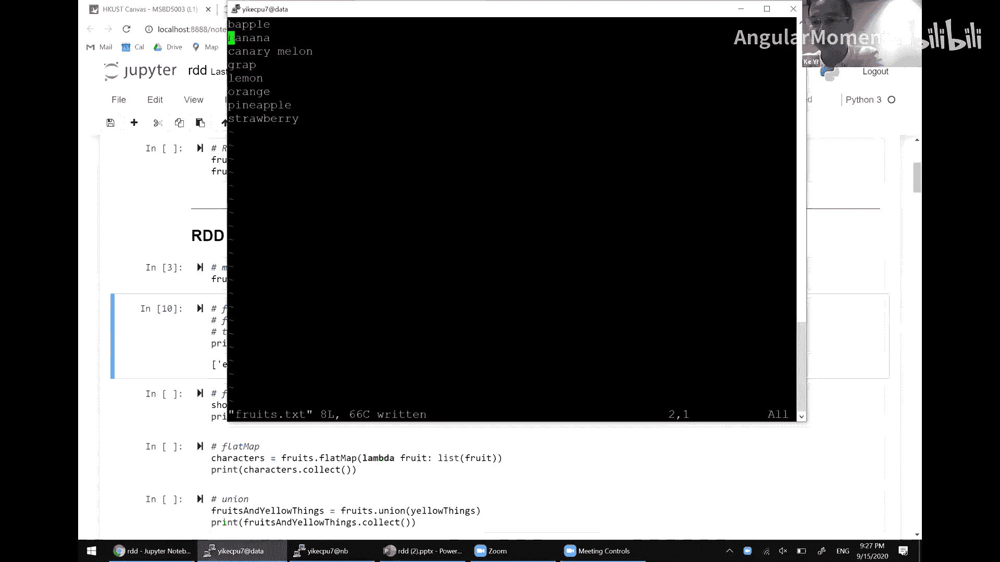

好的，这就是缓存行为。让我们看一些其他例子。这是一个过滤的例子。这是一个lambda函数，如果字符串长度小于5则返回true。所以它将返回所有短的水果名称。

下一个是`flatMap`。这是我们还没有见过的。`map`总是一对一。如果你想做其他转换，可以使用`flatMap`。`flatMap`是一对任意，可以是一对多、一对零。当你想要扩展或收缩列表时，它很有用。这里的lambda函数以RDD中的一个元素作为输入，并产生一个列表作为输出。这个列表可以是空的，也可以包含任意数量的元素。效果是一对多的转换。

我在这里做的是，记住`fruit`是一个字符串，我将其转换为列表。实际上，我将一个字符串转换为一个小字符串列表，每个小字符串只是一个字符。然后这些列表将被连接起来形成新的RDD。在这个`flatMap`之后，我有一个更大的RDD，尽管每个元素只是一个字符。

下一个例子，`union`。如前所述，这是组合两个RDD的正确方法。然而，这不是集合的并集，因为它所做的只是连接两个RDD，不删除重复项。这里的“banana”出现了一次，又出现了第二次。另一方面，Spark中的`intersection`是真正的集合交集，它会删除重复项。所以“banana”只出现一次，尽管它在两个部分中都出现了。这就是为什么我说`union`应该改名为连接，这不是一个好名字。

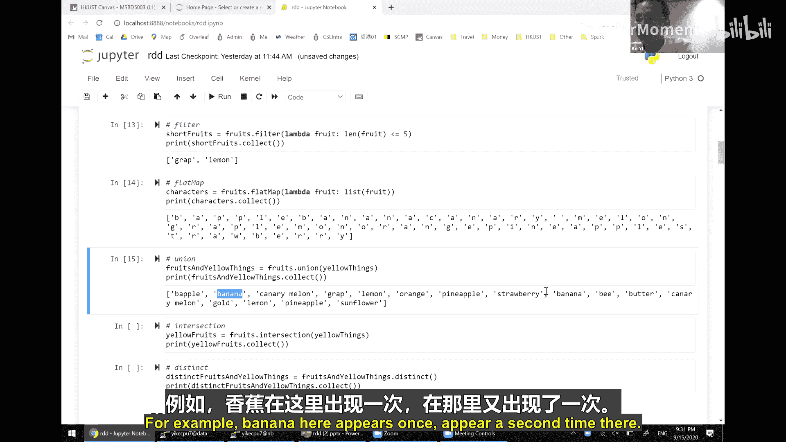

如果你想要集合的并集，你必须先做`union`，然后做`distinct`。在`union`之后，顺序被保留。然而，`distinct`之后，顺序完全被打乱了。原来的顺序中“banana”在这里和那里，但在新列表中，“banana”在这里，顺序完全乱了。在`union`中，两个RDD的顺序都被保留了。然而，`distinct`打乱了顺序。为什么？从根本上说，因为它必须使用洗牌来删除重复项。

## 行动示例
以下是一些行动的例子。`collect`我们已经见过很多次了。`count`是另一个行动的例子。`take`类似于`collect`，但你可以指定数量，它总是返回RDD中的前K项，K是你指定的参数。

`reduce`，这也是我们讨论过的。这个程序做的是返回所有水果名称中使用的唯一字符。我们通过一个`map`加`reduce`来实现。这类似于我们之前寻找字符串RDD中最大单词数的例子。这里我将`fruit`（一个字符串）转换为一个集合。注意这是一个`map`，不是`flatMap`。我们不是将RDD扩展为字符RDD，而是将每个字符串转换为一个字符集合。然后我在这里执行`reduce`。这个`reduce`使用这个函数，即并集函数。注意，这不是我们之前使用的`union`，这是Python自己的集合并集操作。Python对`union`一词的使用在数学上是正确的，它确实是集合的并集，合并两个集合并删除重复项。最终，我们得到了字母集合，即不同的字母集合。

做同样事情的另一种方法是使用`flatMap`。`flatMap`是一对多的转换。我们将每个水果（每个字符串）转换为一个字符列表，所有这些字符将被连接成一个大RDD。在这个`flatMap`之后，我们有一个字符RDD，但有重复项，所以我们需要做`distinct`。然后我们做`collect`。这两种都是找到这个RDD中所有唯一字符的正确方法。

问题是哪种方式更好、更高效。稍后我们会讨论这个问题，因为这涉及到洗牌。一般来说，第二种方式更慢，第一种方式更快。因为`reduce`使用分治算法，比洗牌操作更高效。洗牌本质上需要大量通信，而`reduce`需要很少的通信。所以第一种方式是执行此任务的更好方法。

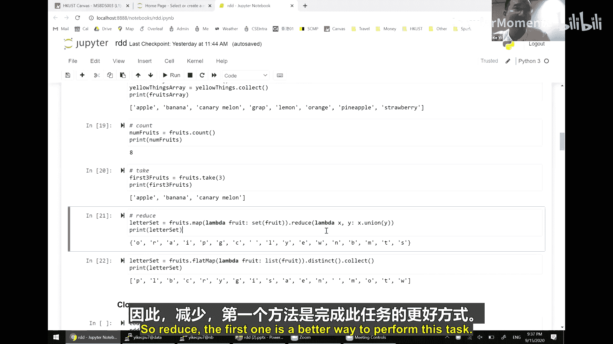

## 总结
在本节课中，我们一起学习了Spark的核心数据结构RDD，了解了它的分区机制、确定性转换、延迟执行、容错原理以及持久化策略。我们还通过多个示例代码，直观地感受了RDD的创建、转换和行动操作，并理解了正确使用`union`、`reduce`以及缓存机制对于编写高效Spark程序的重要性。掌握这些概念是进行大规模分布式数据处理的基础。