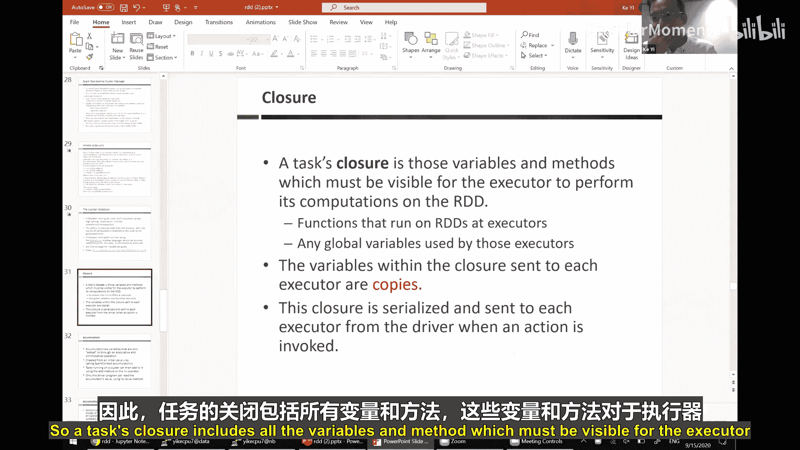
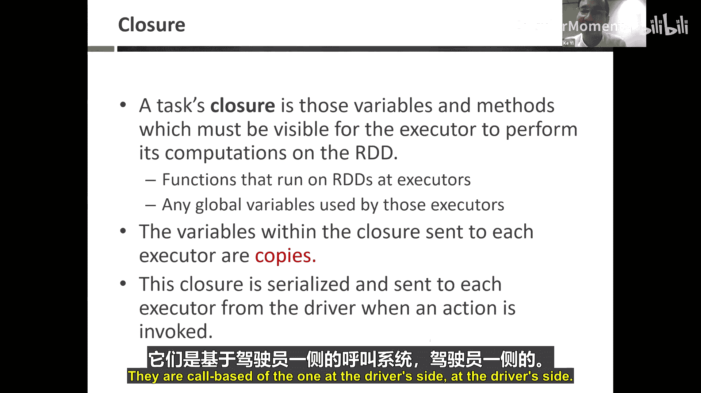
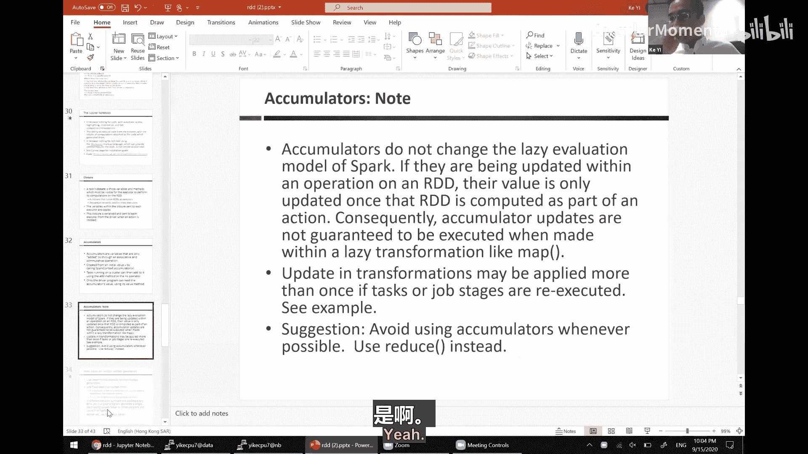
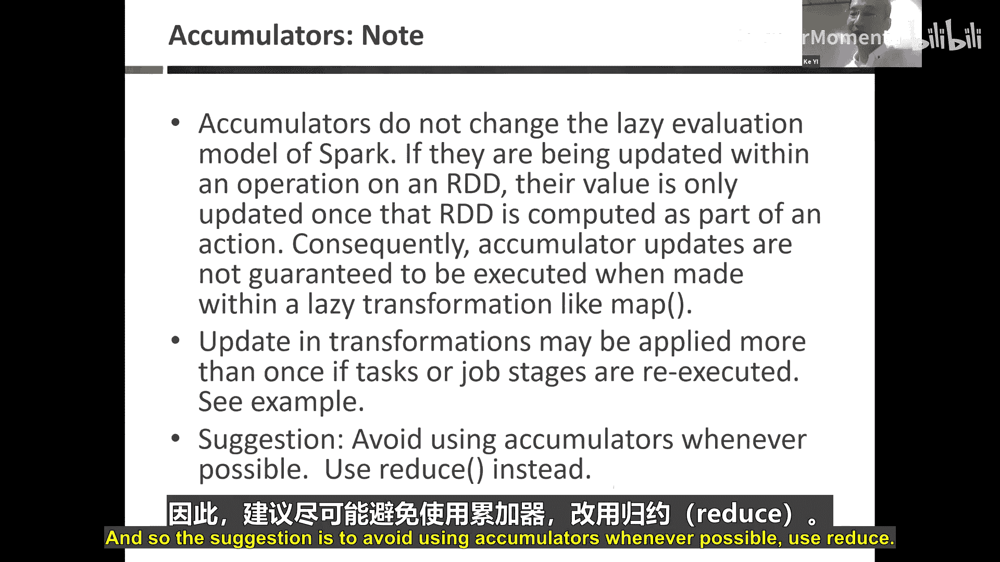
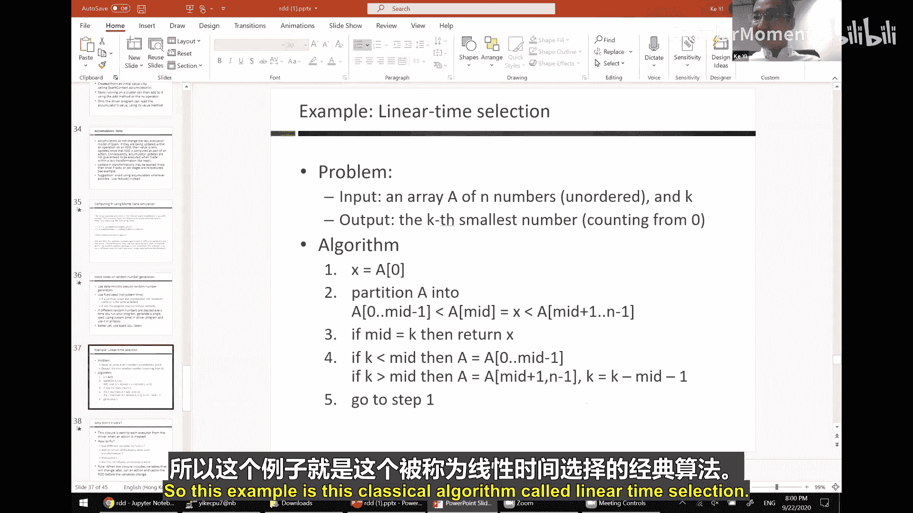
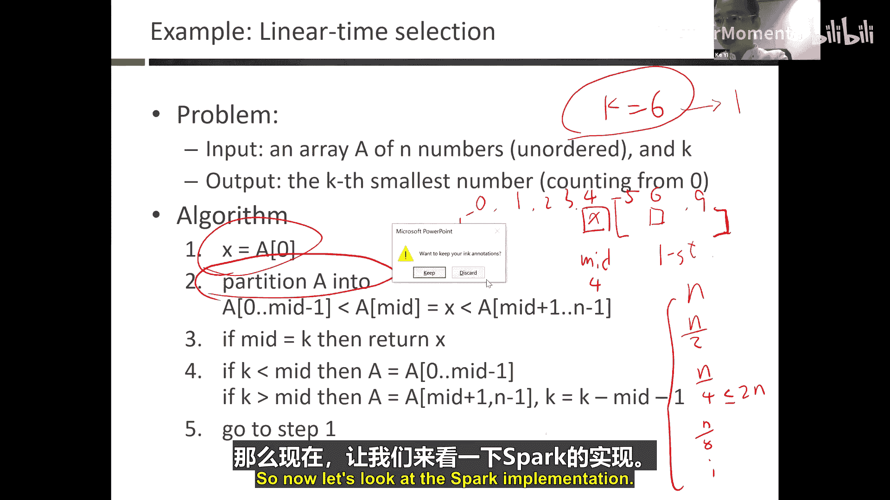
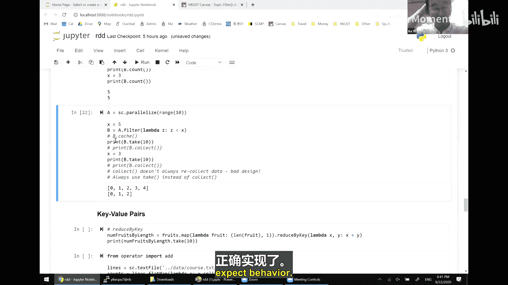

# 007：闭包

在本节课中，我们将要学习Spark编程中一个非常重要的概念——**闭包**。我们将通过具体的例子来理解闭包是什么，为什么它会导致程序行为与预期不符，以及如何正确地处理它。



## 概述



闭包是Spark（以及许多并行编程平台）中的一个核心概念。它指的是在执行分布式计算任务时，需要打包并发送到各个工作节点（Executor）的一组变量和函数。理解闭包对于编写正确、高效的Spark程序至关重要。

## 什么是闭包？

在深入探讨之前，我们先来看一个例子。这个例子试图使用一个全局变量来累加RDD中所有元素的值。

```python
counter = 0
rdd = sc.parallelize(range(10))

def increment_counter(x):
    global counter
    counter += x

rdd.foreach(increment_counter)
print(counter)  # 输出结果仍然是 0，而不是预期的 45
```

上面的代码定义了一个全局变量 `counter` 和一个RDD。`foreach` 是一个**行动操作**，它会将用户定义的函数 `increment_counter` 应用到RDD的每一个元素上。我们的意图是将RDD中每个数字（0到9）累加到全局计数器 `counter` 中。

然而，运行后 `counter` 的值仍然是0。这是为什么呢？这就引出了**闭包**的概念。

一个任务的**闭包**包含了执行器（Executor）为了在其分配的RDD分区上执行计算所必须可见的所有变量和方法。更精确地说，闭包包含两类信息：
1.  **函数**：需要在工作节点端运行的代码。在这个例子中，就是 `increment_counter` 函数的定义。
2.  **数据**：特别是该函数所引用的所有**全局变量**。在这个例子中，就是全局变量 `counter`。

当行动操作（如 `foreach`）被触发时，闭包（包含函数代码和变量值）会被**序列化**并从驱动程序（Driver）发送到每个执行器。

**关键点在于**：发送到工作节点的变量是驱动程序端变量的**副本**。对于函数定义这没有问题，因为它们是只读的。但对于全局变量，每个工作节点获得的是其初始值（0）的副本。当它们执行 `increment_counter(x)` 时，是将自己分区内的数据 `x` 累加到自己的本地副本中。这些本地副本的更新**不会**传回驱动程序。因此，驱动程序打印的仍然是它自己那份原始的、值为0的 `counter` 变量。

## 如何解决？使用累加器

Spark官方文档建议使用**累加器**来解决这类跨节点的共享变量更新问题。

累加器是一种只能通过**关联且可交换**操作进行“累加”的变量。它由驱动程序通过 `SparkContext.accumulator(initialValue)` 创建。这明确告知Spark，这是一个特殊的累加器变量，而不是普通的全局变量。

```python
from pyspark import SparkContext
sc = SparkContext()

counter = sc.accumulator(0)
rdd = sc.parallelize(range(10))



def increment_counter(x):
    global counter
    counter += x  # 这里使用的是Spark重载的 `+=` 操作符



rdd.foreach(increment_counter)
print(counter.value)  # 输出正确的累加结果 45
```

累加器的工作机制：
*   驱动程序创建累加器并设置初始值。
*   在用户自定义函数内部，使用 `+=` 操作符（这是Spark为累加器重载的特殊操作）向累加器添加值。
*   **只有驱动程序**可以通过 `.value` 方法获取累加器的最终值。

**为什么必须用 `+=`，而不能用 `=` 赋值？**
如果允许直接赋值（如 `counter = counter + x`），那么不同工作节点可能会给累加器写入不同的值，最终结果将无法确定。Spark通过限制只能进行“累加”操作，确保了结果的确定性。所有工作节点的本地累加会在后台安全地合并。

**为什么工作节点不能读取累加器的值？**
因为在任务执行过程中，其他节点可能还在向累加器添加值，此时读取的值是未完成的、未定义的。只有所有相关任务完成后，驱动程序读取的值才是完整且确定的。

## 为什么不推荐使用累加器？

尽管累加器解决了问题，但个人并不推荐频繁使用它，因为它与Spark的**惰性求值**模型交互时，容易导致非预期的行为。

考虑以下场景：

```python
accum = sc.accumulator(0)
rdd = sc.parallelize(range(10))

def map_func(x):
    global accum
    accum += x
    return x * x

mapped_rdd = rdd.map(map_func)  # 这是一个转换操作，不会立即执行
print(accum.value)  # 输出 0，因为 map 是惰性的，函数并未执行

# 触发一个行动操作
result = mapped_rdd.reduce(lambda a, b: a + b)
print(accum.value)  # 输出 45，正确
print(result)       # 输出 285 (0^2+1^2+...+9^2的和)

# 现在缓存这个RDD
mapped_rdd.cache()
# 再次触发一个行动操作（由于已缓存，map转换不会重新计算）
result2 = mapped_rdd.count()
print(accum.value)  # 输出仍然是 45，没有变化
```

问题在于：
1.  如果RDD没有持久化（缓存），那么每次在它之上触发新的行动操作时，导致它产生的转换操作（如 `map`）都可能被重新计算。每次重新计算，累加器都会再次被累加，导致其值翻倍或产生其他非预期增长。
2.  如果RDD被持久化了，那么后续行动操作会直接读取缓存结果，而不会重新执行 `map` 中的累加代码，此时累加器的值表现正常。
3.  更复杂的是，即使你缓存了RDD，如果内存不足，Spark可能会将部分缓存数据丢弃或换出到磁盘。当这些数据再次被需要时，它们会被重新计算，这又会再次影响累加器的值。

**因此，累加器的值可能变得不确定**，它依赖于RDD是否被缓存、缓存是否被驱逐、任务是否因失败而重新执行等运行时因素。这对于需要确保确定性的程序来说是非常糟糕的。

**建议**：在几乎所有计算场景中，都可以使用Spark提供的其他确定性的操作来替代累加器，例如 `reduce()`、`sum()`、`count()` 等。只有在需要收集运行时统计信息（如计算某些事件被触发的次数，其本身就依赖于重执行行为）时，才考虑使用累加器。

## 闭包与随机数生成：一个实际案例

闭包问题不仅限于显式的全局变量，也可能隐藏在第三方库中。一个经典的例子是Spark官方示例中的**蒙特卡洛方法计算π**。

**蒙特卡洛方法原理**：在一个边长为1的正方形中，画一个1/4圆。随机向正方形内投点，点落在1/4圆内的概率等于该扇形面积（π/4）。因此，`π ≈ 4 * (落在圆内的点数) / (总投点数)`。

一个看似正确的实现：

```python
import random

def inside(p):
    x, y = random.random(), random.random()
    return x*x + y*y < 1

count = sc.parallelize(range(1, n+1), numSlices) \
           .filter(inside) \
           .count()

pi = 4.0 * count / n
```

**问题**：这个实现的精度不会随着分区数（并行度）的增加而提高。因为 `random.random()` 使用的随机数种子是一个隐藏的全局状态。当闭包被序列化到各个工作节点时，每个节点都获得了相同的随机数种子，从而导致所有分区生成**完全相同**的随机数序列。这完全违背了并行计算增加随机性的初衷。

**解决方案**：使用 `mapPartitionsWithIndex` 为每个分区设置不同的随机数种子。



```python
import random
import time

def inside_partition(idx, iterator):
    # 使用分区索引来生成不同的种子
    random.seed(int(time.time() * 1000) + idx)
    for _ in iterator:
        x, y = random.random(), random.random()
        yield x*x + y*y < 1

n = 1000000
numSlices = 10
# 创建一个占位符RDD，每个分区有 n/numSlices 个元素
data = sc.parallelize(range(1, n+1), numSlices)

count = data.mapPartitionsWithIndex(inside_partition) \
            .sum()  # True会被当作1，False当作0

pi = 4.0 * count / n
```

`mapPartitionsWithIndex(func)` 允许我们在每个分区上执行函数 `func`，并且该函数接收两个参数：分区索引 `idx` 和包含该分区所有数据的迭代器 `iterator`。通过将分区索引加入到种子中，我们确保了不同分区使用不同的随机数流。



**`mapPartitions` 系列函数**：当需要对整个分区进行操作，而非单个元素时，`mapPartitions` 和 `mapPartitionsWithIndex` 非常有用。它们提供了更粗粒度的控制，常用于初始化分区级别的资源（如数据库连接）或执行分区级别的算法。

## 闭包与惰性求值：选择算法示例

最后，我们通过一个**线性时间选择算法**（寻找第K小元素）的例子，综合展示闭包和惰性求值可能带来的陷阱。

算法思路（分治法）：
1.  选取一个基准元素 `x`（例如第一个元素）。
2.  将数组分为两部分：小于 `x` 的 `left` 和大于 `x` 的 `right`。`x` 的位置记为 `mid`（即它是第 `mid` 小的元素）。
3.  如果 `k == mid`，则 `x` 即为所求。
4.  如果 `k < mid`，则在 `left` 中递归寻找第 `k` 小元素。
5.  如果 `k > mid`，则在 `right` 中递归寻找第 `k - mid - 1` 小元素。

一个直接的Spark实现可能如下：

```python
def select(a, k):
    while True:
        x = a.first()  # 行动操作，触发计算并获取基准值
        a1 = a.filter(lambda z: z < x)  # 转换操作
        a2 = a.filter(lambda z: z > x)  # 转换操作
        mid = a1.count()  # 行动操作，触发计算并获取左部分大小
        if mid == k:
            print(x)
            break
        elif k < mid:
            a = a1
        else:
            a = a2
            k -= (mid + 1)
```

**这个实现有Bug！** 问题在于惰性求值和闭包的相互作用。
在第二次循环中，`a` 被重新赋值为 `a2`。当我们计算新的 `a1.count()` 时，Spark需要重新计算从原始RDD到当前 `a1` 的整个血缘图。在计算 `a.filter(lambda z: z < x)` 时，闭包中捕获的 `x` 是**当前循环中** `x = a.first()` 的值，而不是第一次循环时的值。这导致过滤条件错乱，最终得到错误结果。

**修复方法**：在定义新的RDD（`a1`, `a2`）后，**立即**通过行动操作（如 `.count()`）将其**物化**（缓存结果），避免后续因血缘重算而使用错误的闭包变量值。

```python
def select_fixed(a, k):
    while True:
        x = a.first()
        a1 = a.filter(lambda z: z < x).cache()  # 计划缓存
        a2 = a.filter(lambda z: z > x).cache()  # 计划缓存
        mid = a1.count()  # 行动操作，触发计算并物化a1
        # 根据k的值，可能也需要触发a2的计算
        # a2.count() # 如果后续可能走到else分支，这里需要触发
        if mid == k:
            print(x)
            break
        elif k < mid:
            a = a1
        else:
            # 确保在x改变前，a2被物化
            # 如果前面没有a2.count()，这里需要先触发一个行动操作，如 a2.first()
            _ = a2.first()
            a = a2
            k -= (mid + 1)
```

这个例子深刻说明了，在包含循环和条件分支的Spark程序中，理解惰性求值和闭包捕获的时机对于写出正确代码至关重要。

## 总结

本节课我们一起学习了Spark中的核心概念——**闭包**。

*   **闭包的本质**：它是发送到工作节点的一组序列化数据，包含函数代码和其引用的变量值。工作节点操作的是这些变量的副本。
*   **累加器的作用与局限**：作为跨节点安全共享变量的工具，累加器必须通过特定的 `+=` 操作更新，且只有驱动程序能读取最终值。但由于其与惰性求值、缓存、任务重试机制的交互，容易导致非确定性行为，因此应谨慎使用，优先考虑 `reduce`、`sum` 等确定性操作。
*   **闭包的隐蔽性**：问题可能隐藏在使用的库中，如随机数生成器的全局种子。使用 `mapPartitionsWithIndex` 可以为每个分区提供独立的上下文。
*   **惰性求值的陷阱**：在循环或条件逻辑中，RDD的血缘重算可能导致闭包捕获到意外的变量值。通过适时地**缓存**或**物化**中间RDD，可以避免此类问题。



掌握闭包和惰性求值，是编写正确、高效Spark程序的关键一步。在后续课程中，我们将学习更高级的Spark SQL API，它提供了更友好、更少犯错的数据处理方式。