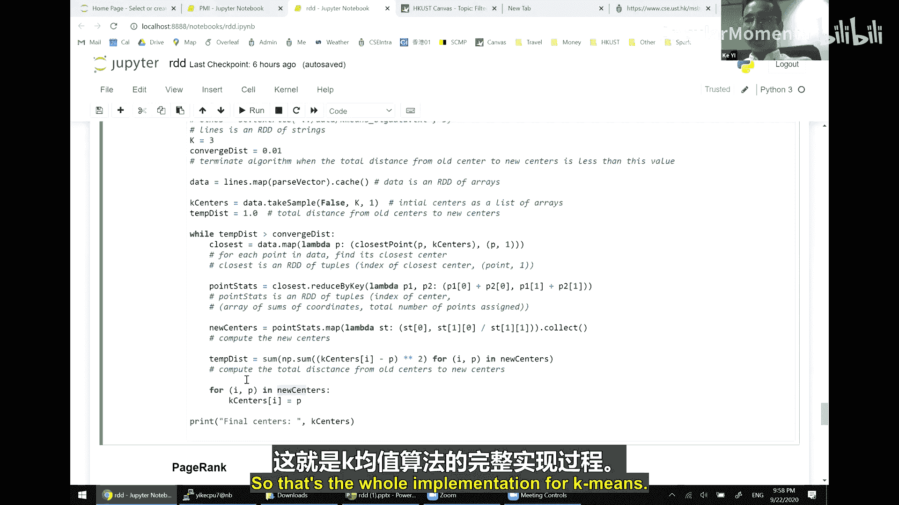
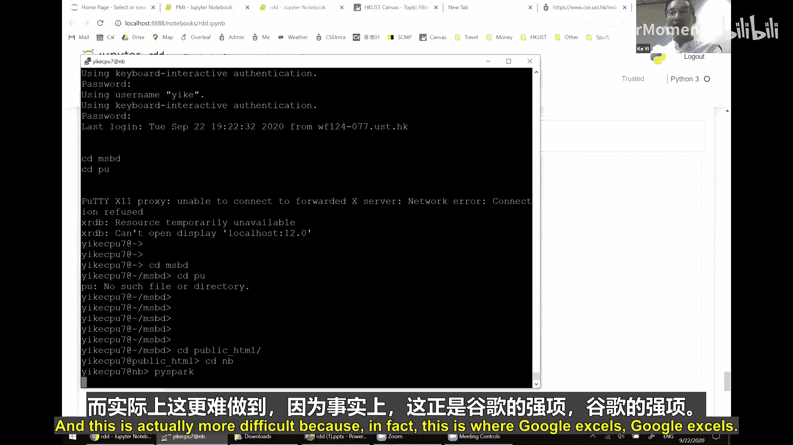
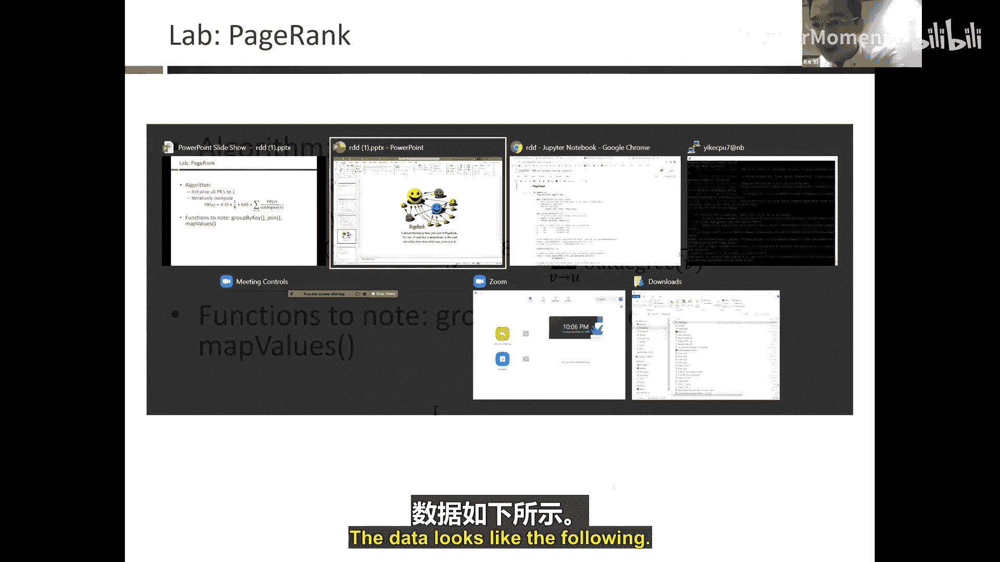
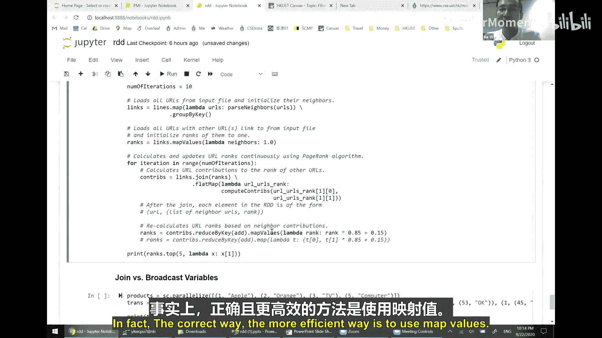
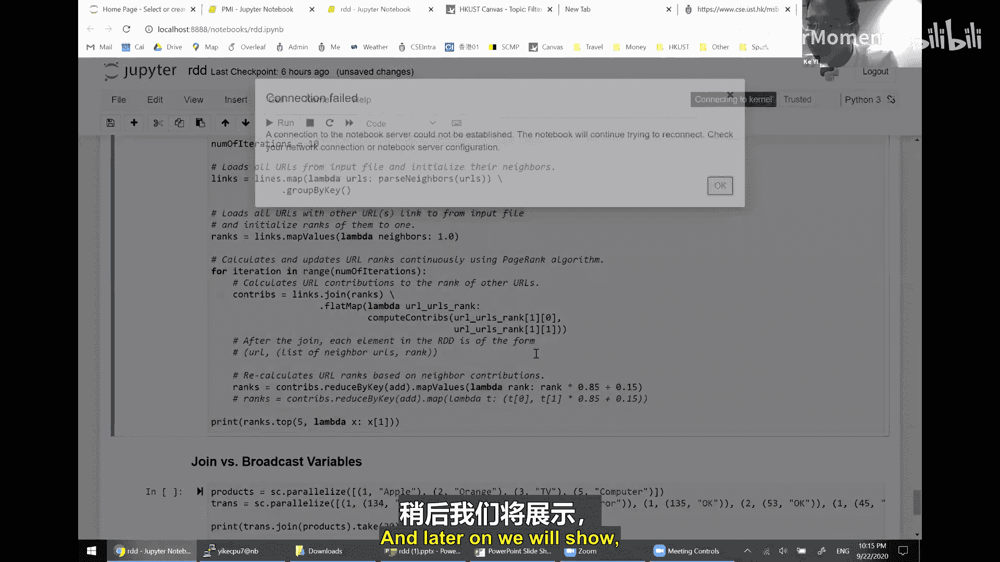
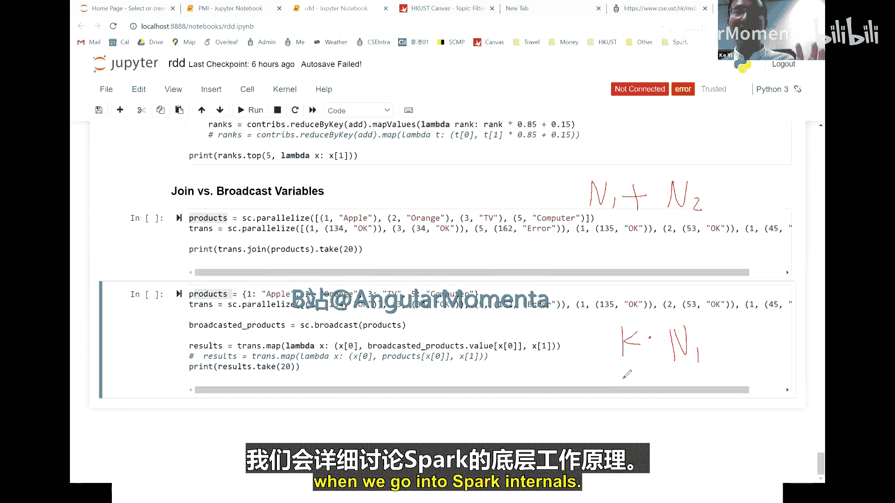

# 008：键值对RDD操作

在本节课中，我们将学习Spark中一个核心概念：键值对RDD。我们将了解如何创建键值对RDD，并探索一系列专门用于处理这类数据的“byKey”转换操作。通过具体的例子，如词频统计、点互信息计算、K-Means聚类和PageRank算法，我们将掌握如何利用键值对RDD来解决复杂的大数据问题。

## 键值对RDD简介

在之前的所有示例中，RDD中的元素都是单一类型的。然而，Spark也支持MapReduce范式，而MapReduce需要处理键值对。因此，Spark必须支持由键值对组成的RDD。在Python中，这很自然地得到了支持，因为Python有元组这种数据类型。

所以，如果你的RDD由包含两个元素的元组组成，那么Spark会自然地将其解释为键值对RDD。随后，就有一系列专门为键值对设计的转换方法可以使用。

## 词频统计示例

词频统计是MapReduce的经典示例。在Spark中，实现起来非常简单。

首先，从一个文本文件创建一个字符串RDD。然后，使用`map`操作将每一行文本转换为一个键值对元组，其中键是单词本身，值是初始计数1。这个元组RDD会被Spark解释为键值对RDD。

接下来，应用`reduceByKey`操作。Spark中的`reduceByKey`对应MapReduce中的Reduce阶段。它接受一个用户定义的函数作为输入，这个函数必须是**结合律**和**交换律**的。Spark会为每个键，使用这个函数将所有值归约成一个。最终结果是一个键值对RDD，其中键是唯一的单词，值是该单词出现的总次数。

以下是核心代码逻辑：
```python
# 创建初始RDD
lines = sc.textFile("data.txt")
# 转换为键值对并归约
word_counts = lines.flatMap(lambda line: line.split(" ")) \
                   .map(lambda word: (word, 1)) \
                   .reduceByKey(lambda a, b: a + b)
```

## 其他ByKey操作

除了`reduceByKey`，Spark还支持许多其他针对键值对的操作。

例如，`sortByKey`操作可以按键对键值对进行排序。如果你想按值（例如词频）排序，可以使用`sortBy`转换操作，并指定一个返回排序依据字段的函数。

另一个重要的操作是`join`，它用于连接两个键值对RDD。`join`操作会基于相同的键，将两个RDD中的元组配对。如果某个键在一个RDD中出现n次，在另一个RDD中出现m次，那么连接结果会产生n*m个元组。

## 点互信息计算示例

点互信息是信息论和统计学中用于衡量两个事件关联性的指标。其公式定义为：
**PMI(x, y) = log( P(x, y) / (P(x) * P(y)) )**
其中，P(x)是事件x发生的概率，P(y)是事件y发生的概率，P(x, y)是它们同时发生的联合概率。

我们的目标是计算数据集中形容词和名词之间的PMI。数据是包含形容词-名词对的文本文件。

计算步骤如下：
1.  **数据准备**：读取数据，过滤脏数据，得到(形容词，名词)对的RDD。
2.  **计算频率**：
    *   计算每个(形容词，名词)对的频率。
    *   计算每个形容词的频率。
    *   计算每个名词的频率。
3.  **计算PMI**：有两种主要方法。
    *   **广播变量法**：将形容词和名词的频率字典作为广播变量发送到所有工作节点。然后，通过`map`操作，每个工作节点都可以查找本地字典来计算每个对的PMI值。
    *   **连接法**：将形容词频率RDD和名词频率RDD分别与词对频率RDD进行`join`操作，在连接后的数据中直接计算PMI。

广播变量法适用于被广播的数据集（如频率字典）较小的情况，因为它避免了数据混洗。连接法则在两个待连接数据集大小相当时更高效。

## K-Means聚类算法示例

K-Means是一种经典的聚类算法，目标是将数据点划分为K个簇。算法步骤如下：
1.  随机选择K个点作为初始簇中心。
2.  迭代直至收敛：
    *   **分配步骤**：对于每个数据点，找到距离其最近的簇中心，并将其分配给该簇。
    *   **更新步骤**：对于每个簇，计算其所有分配点的均值，将该均值作为新的簇中心。

在Spark中实现K-Means：
1.  读取数据，将每行转换为表示坐标的数值数组（向量），并缓存该RDD。
2.  从数据中随机抽取K个点作为初始中心。
3.  进入主循环：
    *   使用`map`操作，为每个数据点计算其最近的中心索引，并输出`(中心索引, (数据点向量, 1))`的键值对。
    *   使用`reduceByKey`操作，对每个中心索引，将其下的所有数据点向量相加，并累加计数。
    *   使用另一个`map`操作，将每个簇的总向量和除以点数，得到新的中心坐标。
    *   计算新旧中心的总移动距离。如果距离小于阈值，则停止迭代。

## PageRank算法示例



PageRank是用于衡量网页重要性的算法。其核心思想是：一个网页的重要性取决于链接到它的其他网页的数量和质量。



算法迭代更新每个网页的Rank值，公式为：
**PR(u) = (1-d)/N + d * Σ (PR(v) / L(v))**
其中：
*   PR(u)是页面u的PageRank值。
*   d是阻尼因子（通常为0.85），表示用户继续点击链接的概率。
*   N是网页总数。
*   Σ 表示对所有链接到u的页面v求和。
*   L(v)是页面v的出链数量。

在Spark中实现PageRank：
1.  读取链接数据（源页面，目标页面），使用`groupByKey`得到每个页面的出链列表RDD（`links`）。
2.  初始化每个页面的Rank值为1.0，得到Rank RDD（`ranks`）。
3.  进行多次迭代：
    *   将`links`和`ranks`基于页面（键）进行`join`。
    *   使用`flatMap`操作，对于每个页面，将其当前的Rank值平均贡献给它的所有出链页面。
    *   使用`reduceByKey`操作，将所有页面收到的贡献值相加，得到新的Rank值（尚未加入阻尼因子）。
    *   使用`mapValues`操作，为每个新Rank值应用PageRank公式（加入阻尼因子和随机跳转项），更新`ranks` RDD。



## 连接与广播变量对比

在需要组合两个数据集的信息时（例如，用产品信息丰富交易记录），有两种常见方法：

1.  **连接**：对两个键值对RDD使用`join`操作。这会引起数据混洗，通信成本大致与两个RDD的大小之和成正比。
2.  **广播变量**：将较小的那个RDD（如产品信息）收集到驱动节点，转换为字典，然后广播到所有工作节点。在`map`操作中，通过查找广播的字典来组合信息。这种方法避免了混洗，但需要广播整个小数据集到每个工作节点。





选择哪种方法取决于两个数据集的相对大小。如果两个数据集大小相近，`join`可能更优。如果一个数据集远小于另一个，广播变量法通常更高效。

## 总结



本节课我们一起学习了Spark中键值对RDD的核心操作。我们了解了如何创建键值对RDD，并深入探讨了`reduceByKey`、`sortByKey`、`join`等关键转换操作。通过词频统计、PMI计算、K-Means聚类和PageRank算法这四个从简到繁的实例，我们掌握了如何设计并实现基于键值对的复杂数据处理流程。最后，我们还对比了连接操作与广播变量在不同场景下的适用性，为优化Spark作业性能提供了思路。键值对RDD是Spark表达力和功能性的重要体现，熟练掌握它是进行高效大数据计算的关键。