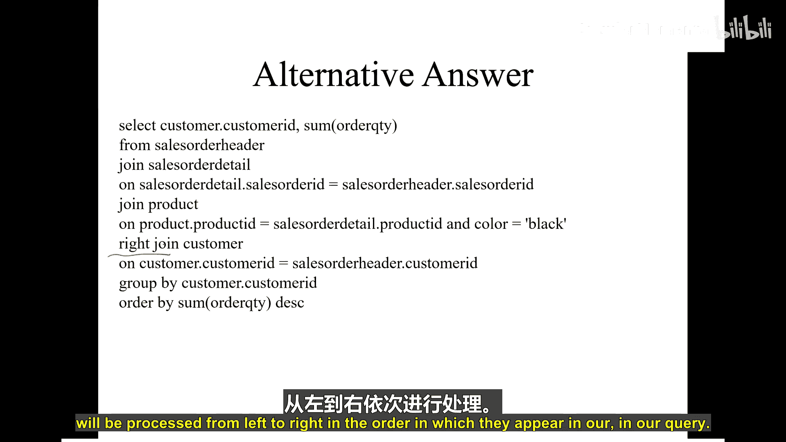

# 009：关系模型回顾 🗄️

在本节课中，我们将要学习关系数据库模型的基础知识，这是理解Spark SQL等现代数据处理框架的重要前提。我们将回顾SQL的核心概念、语法和操作，为后续学习Spark SQL打下坚实的基础。

## 关系数据库基础

上一节我们介绍了RDD是Spark的核心基础。本节中，我们来看看构建在RDD之上的第一个重要组件——Spark SQL。然而，当前的发展趋势是让SQL组件尽可能广泛。这个迁移过程仍在进行中。虽然现阶段你仍需了解RDD和Spark SQL，但趋势正朝着基于SQL的系统发展。因此，了解SQL至关重要。

尽管“大数据”概念提出后，“NoSQL”也随之兴起，但人们很快意识到SQL因其强大的功能而无法被完全抛弃。因此，“NoSQL”后来被重新诠释为“Not Only SQL”。事实上，关系型或结构化数据所承载的价值对于任何公司来说都是最重要的。至今，企业仍主要使用关系数据库作为其数据基础设施的核心组件。

首先，我们需要对SQL进行快速回顾。关系数据库本质上是一系列表格。表格也称为关系。表格有几个关键结构：表名、属性名（也称为列）以及行。本质上，它是一个二维数组。

## 表结构与约束

正如在第一讲中解释的，表的结构（模式）必须预先指定，因此这类数据被称为结构化数据。在关系数据库的情况下，模式包括表名和属性名。除了列名，类型也必须指定。另一个重要特性是主键。主键是可选的，但始终建议指定。主键在确保数据库完整性和提高性能方面都非常有用。

在完整性方面，主键有一个约束，即值必须唯一。数据库系统会自动确保此完整性约束。在性能方面，一旦某列被指定为主键，数据库就会在其上构建一个聚集索引。索引通常是B树或哈希表，其目的是允许数据库处理引擎高效地查找任何特定的元组。例如，如果在学生ID上有一个索引，那么给定任何学生ID，我都可以非常高效地检索该学生的所有其他属性。

但Spark没有索引。这是对Spark的主要批评之一。从这个意义上说，Spark不擅长查找查询。Spark只擅长批处理，即至少需要扫描整个数据库或整个数据的作业。稍后我们将讨论其他系统，如MongoDB，它支持索引。因此，如果你有只查看少量行的点查询，则不应使用Spark，而应使用MongoDB等其他系统。

另一个需要解释的术语是聚集索引。实际上有两种索引：一种是主索引或聚集索引，另一种是二级索引。区别在于索引是否是聚集的。如果索引是聚集的，意味着表是按此索引的顺序物理存储的。例如，如果学生ID是主键，那么数据库将构建一个聚集索引，这意味着在磁盘上，行将按索引顺序存储。这对于执行范围查询非常有效。显然，对于任何表，我们只能有一个聚集索引，因为行只有一种存储顺序。

## 表、行与集合语义

表有几个等效术语：元组、记录、行，它们都是指同一个东西。严格来说，表是元组的集合，但这仅在表有主键时才正确。如果表没有主键，则可能出现两个或多个完全相同的元组。历史上，当关系代数理论首次提出时，其原始模型基于集合语义。然而，当人们开始构建实际系统时，他们意识到维护集合语义可能非常昂贵，因为需要不断移除所有重复项。因此，在实际构建关系系统时，他们决定使用所谓的包语义。包在数学上称为多重集，它允许重复。实际上，重复的次数也会被存储。虽然这在技术上不完全正确，表应该是元组的包，但集合的某些特性（如顺序无关）仍然保留。

## 基本SQL查询：SELECT-FROM-WHERE

SQL查询的基本形式是SELECT-FROM-WHERE结构。SQL如此流行的原因之一是它可能是最容易学习的编程语言，它非常接近自然语言。另一个好处是它是一种声明性语言。用户只表达他们的意图，即他们想要什么，而不是如何实现。找出最优的查询计划是数据库系统的工作。这是SQL最吸引人的特性之一，也是其被广泛使用的原因。

让我们首先看一个简单查询的语法和语义：`SELECT * FROM product WHERE category = ‘gadgets’`。这个查询返回满足选择条件的两行。这也称为选择操作。选择操作总是选择行的子集。

下一个例子同时使用了选择和投影操作。WHERE子句中的条件仍然是选择条件，即选择行。投影则选择列的子集。前一个例子使用了`SELECT *`，意味着保留所有列。而这里只指定了四列中的三列，因此只保留这些列。这称为投影操作。

关系代数之所以称为代数，是因为它将表视为抽象数学域中的元素，并可以应用不同的操作。每个操作符都会返回同一域中的另一个元素。例如，应用选择和投影操作符将返回另一个可能具有不同模式的表。

另一个常用的字符串操作符是`LIKE`。它检查字符串是否匹配包含特殊符号的模式。

## 去除重复与排序

如前所述，默认情况下，关系数据库使用包语义或多重集，即不删除重复项。如果你想删除重复项，可以添加`DISTINCT`关键字。例如，这里只是一个投影，没有选择。投影后，如果不使用`DISTINCT`，则会出现两个“gadgets”，因为在原始表中，类别列有两行是“gadgets”。默认情况下，投影不会改变行数，每行都会在结果表中产生一个结果，但这会导致重复。如果你想删除重复项，可以使用`DISTINCT`关键字。重复项删除是可选的，默认不进行是出于效率考虑。

除了基本的FROM-WHERE子句外，还有两个子句：一个是`ORDER BY`，用于对结果排序。实际上，你可以指定多个列进行排序，首先按第一列排序，如果出现并列，则通过检查第二列来打破并列。

## 连接操作

接下来是最重要的关系操作符——连接。这是简单电子表格应用程序与关系数据库之间的关键区别。数据库的关键思想是将数据划分到不同的关系中。然而，当你想进行查询时，必须连接这些表，以便将来自不同地方的信息重新链接在一起。

虽然SQL中有显式的`JOIN`子句，但你不必使用它。还有一种隐式的方式，实际上更好。这里，我们并没有真正使用`JOIN`关键字，而是简单地将连接条件写在WHERE子句中。假设我们有两个表：`product`和`company`。查询要找到在日本制造且价格低于200美元的所有产品，并返回它们的名称和价格。我们只需从这两个表中选择产品名称和价格。然后，价格低于200美元和制造商在日本是两个选择条件，我们将其写在WHERE子句中。还有一个隐式的连接条件，即产品表中的制造商必须与公司名称匹配。这个隐式连接条件也写在WHERE子句中。这是一个连接查询的例子。

连接查询的结果语义是：来自两个关系的每一对元组都将被比较。如果它们满足所有条件（包括选择条件和连接条件），则这对元组将被输出。在这个例子中，有四对元组满足连接条件，但在这四对中，只有一对还通过了价格和国家这两个选择条件。因此，结果只有这一对。最后，因为我们对产品名称和价格进行了投影，所以只保留这两列。

## 连接查询的细节与歧义处理

这是另一个展示连接微妙之处的例子，仍然是相同的两个表。查询是找出制造某些“gadget”类别产品的所有国家。SQL语句如下：我们对这两个表进行连接，然后有一个选择条件，以及一个连接条件`manufacturer = cname`。然而，当你实际运行它时，连接查询的语义只是简单地比较来自每个表的所有元组对，然后机械地检查它们是否满足条件。在第一个例子中，有四对匹配的元组。这里的选择条件是`category = ‘gadget’`，这意味着这两对都通过了条件。然后我们对国家进行投影。最终结果是美国出现了两次，因为默认情况下没有重复项删除。这可能出乎意料。解决方案是添加`DISTINCT`。实际上，有一个更好的解决方案，我们稍后会看到，无需使用`DISTINCT`。

形式上，语义即用户的意图如下：用户希望系统执行以下操作，即通常可能涉及多个关系。用户的意图是一个看似昂贵且繁琐的循环：遍历每个关系的每个元组，然后对每种组合，检查WHERE子句中的条件（包括连接条件和其他条件）。如果所有条件都通过，则这个组合将被包含在结果中。这也意味着有一个快速检查：假设我删除了WHERE子句，只运行`SELECT country FROM product, company`，会发生什么？是的，将输出12个结果，实际上会有4个“USA”和8个“Japan”。这是因为每一对都会被检查，而且没有条件，所以所有对都会通过条件。当然，这并不一定是数据库执行查询的方式。如果数据库实际使用这种嵌套循环，效率会非常低。不同数据库系统的一大区别在于它们的优化器如何为不同查询找到最优的查询计划。SQL的美妙之处恰恰在于其语义与实际执行方式无关。

## 处理列名歧义

另一个有用的SQL结构是聚合，这对于分析查询非常有用。我们不想检索任何原始元组，而是想要一些简洁的统计信息，因此聚合非常有用。聚合可以通过在SELECT中使用聚合函数来完成。第一个例子是`AVG`，第二个是`COUNT`。这种聚合查询的语义是数据库应首先评估此查询，即执行标准的SELECT-FROM-WHERE（选择加投影），然后计算聚合。同样，这是语义，并不意味着数据库必须按这种方式执行。

通常，必须在聚合函数内指定列名。例如，`AVG`、`SUM`或`MAX`都需要指定列名。唯一的例外是`COUNT`，因为它只计算行数，指定哪一列并不重要。对于`COUNT`，你也可以简单地使用`*`，但也可以使用任何其他列名，这没有区别。除了`COUNT`，所有聚合函数都应用于单个属性。

然而，如果你想删除重复项，然后计算结果中不同元组的数量，则必须指定一个列名。例如，如果我们想找出1995年后制造的所有产品中不同类别的数量，那么我们应该再次添加`DISTINCT`关键字。语义仍然与之前相同：数据库首先运行没有聚合的查询，这将删除所有重复的元组，然后进行计数。

你可以在聚合或投影中进行更复杂的算术运算。在第一个例子中，我们试图在购买表中找出总销售额。语义是：对于每个元组，我们将两个属性相乘，然后将所有结果相加。这与第二个例子相同，只是我们还应用了一个选择，只考虑行的子集。

## 分组聚合

在实践中，我们通常不只想要一个单一的聚合值，而是希望为每个元组组进行计算。这称为`GROUP BY`。这实际上对应于MapReduce中的reduce函数，使用非常广泛。这是一个非常基础的操作。这需要另一个子句`GROUP BY`。这类似于聚合，只是我们有一个`GROUP BY`子句。允许将分组属性放在SELECT中。这种查询的语义如下：在具有四列的购买表中，我想计算每个产品的总销售额。这将为每个不同的产品返回一个总和。这可以很容易地实现为一个reduce程序：我们首先发出中间键值对，其中键是产品（分组属性），值是价格乘以数量。在reduce端，我们聚合所有产品的价格乘以数量，并将它们相加作为每个组的最终值。

这种查询的语义是：首先评估SELECT-FROM-WHERE，即执行连接。然后，根据分组属性进行分组。顺便说一下，分组属性可以有多个。在这种情况下，两行属于同一组当且仅当它们在所有分组属性上具有相同的值。最后，在将连接结果中的元组分到不同的组之后，我们计算聚合。这就是查询的语义。

在这个单表上，如果我们执行这个SELECT-FROM-WHERE-GROUP BY，分组属性是产品，产品中有两个不同的值：bagel和banana。然后我们将计算每个组的总销售额。

这是另一个例子，我们对相同的分组执行两个聚合。分组仅按产品进行，但对于每个组，我们计算两个聚合：一个总和，一个最大值。

## HAVING子句

我想讨论的最后一个子句是`HAVING`。`HAVING`与`WHERE`非常相似。实际上，`HAVING`并不是必需的，因为每个`HAVING`子句都可以通过使用子查询来重写而不使用`HAVING`。但无论如何，让我们看看`HAVING`的用途。`HAVING`只能在有`GROUP BY`时使用，不能单独使用。让我们先看看这个例子，它与之前相同。这将返回一个有两列的表格：产品和总和。现在，假设我想进一步过滤结果，而这个条件是基于这个新列（总和）的。在这种情况下，我们不能使用`WHERE`，因为`WHERE`只应用于原始表。如果选择条件是基于由分组聚合创建的新列，那么我们必须使用`HAVING`。在`HAVING`子句中，你必须复制这个聚合表达式，然后应用任何条件。这表示我们只想保留那些聚合值大于30的组。然而，你可以使用子查询重写它：首先计算分组，然后进行另一个选择。在这种情况下，我们可以将总和重命名为`total_sales`，然后进行另一个选择，在那里可以用`WHERE`替换`HAVING`。这两种写法实际上是等价的。

## SELECT子句的约束

现在我们已经介绍了几乎所有常用的五个子句：SELECT、FROM、WHERE、GROUP BY、HAVING。有一些约束：SELECT子句可以包含任何属性和聚合，但不能包含其他属性。这些属性是分组属性，但不能包含其他属性。例如，产品是一个分组属性，允许在SELECT中包含产品。然而，你不能包含例如日期。这是不允许的。这实际上很直观，因为我们正在进行分组，同一组中的所有元组在产品上具有相同的值，因此在输出时没有歧义。然而，同一组中的元组可能没有相同的日期，那么你想在这里放什么日期呢？因此，系统不允许在SELECT子句中包含任何其他属性。

C1是R1到RN中属性的任何条件。有两种条件：一种称为选择条件，另一种是连接条件，尽管系统并不区分它们。通常，如果一个条件只涉及同一表中的属性，我们称之为选择条件，因为它可以在表的基础上进行检查。如果一个条件涉及来自两个表的属性，则称为连接条件。

更准确地说，实际上有两种连接条件。第一种是我们之前看到的例子，是等值条件。这是最常用的，因为我们想要连接匹配的元组。另一种连接条件不那么常见，例如，假设产品价格小于股票价格。无论如何，这可能没有意义，但这也称为连接条件，但不是等值连接。这有时称为θ连接。θ连接本质上涉及任何不等式。θ连接处理起来更昂贵，因为必须检查所有可能组合。等值连接更常见，实际上，等值连接条件也称为自然连接，因为它们非常自然和直观。

## 复杂查询示例

现在让我们看几个更复杂的例子，将使用这个示例模式。实际上，如果你进入Microsoft Azure并创建数据库，那将是SQL Server。SQL Server是微软的数据库产品，如果你创建一个SQL Server实例，可以有一个遵循此模式的示例数据库。你可以看到，这对于公司的关系数据库来说是一个非常典型的设计，它们将信息组织到几个表中。例如，这是一个产品表，每个表都有一个主键。这实际上遵循了推荐做法：对于产品表，主键是`ProductID`。还有一个销售订单明细表。实际上，他们将销售订单组织成两级结构：销售订单头和销售订单明细。每个订单可能包含多个产品。销售订单头表包含每个订单的信息，明细表包含每个订单中的产品。销售订单明细表有一个外键，引用产品表中的主键。这是另一个约束。我们讨论过主键是唯一约束，即表中的所有值必须唯一。外键是表间约束。在这种情况下，外键约束是从`ProductID`列到产品表的`ProductID`列。这意味着销售订单明细表中任何元组的`ProductID`必须出现在产品表中。这实际上是有意义的，因为引用一个不存在的产品是没有意义的。如果发生这种情况，一定是出了问题。外键约束的好处是数据库将确保此约束得到满足。有两种操作会被阻止：第一种是，如果你想在订单明细表中插入一个引用不存在产品的订单明细元组，则此插入将被拒绝。另一种情况是，如果我们想从产品表中删除一个仍有订单明细引用的产品，即如果某个订单明细仍然需要此产品，则此删除将被拒绝。系统将防止这两种操作。

我想外键约束必须引用主键，不能引用非主键列。这里，所有外键约束都引用主键：`ProductID`此外键引用`ProductID`，`CustomerID`此外键引用客户表的主键，`SalesOrderID`引用销售订单头表的主键。这也是出于效率原因。请记住，系统将防止任何违反约束的操作，为了能够检查操作是否违反约束，它们需要索引。因此，要求外键约束必须引用主键。

## 复杂查询示例解析

让我们看一些基于这个更复杂模式的例子。第一个例子：我想找出每个订单的总价格，返回销售订单ID和总价格，列名应为`total_price`。这不太难，只是一个分组查询。答案在下一张幻灯片上，没有连接，只是一个简单的`GROUP BY`：选择`SalesOrderID`，然后对`UnitPrice * OrderQty * (1 - UnitPriceDiscount)`求和，并将其重命名为`total_price`，并按销售订单分组。为每个订单计算总销售额。

第二个例子：找出总价格大于10000的每个订单的总价格。请注意，这是对聚合值的条件，而不是对原始属性的条件。因此，这需要使用`HAVING`子句。这与第一个例子相同，但加上了`HAVING`子句。

第三个例子：找出每个订单中黑色产品的最终总价格，其中总价格大于10000。这个例子说明了`HAVING`和`WHERE`的区别。“黑色产品”是对原始属性的条件，因此应写在`WHERE`子句中，而总价格大于10000应写在`HAVING`子句中。这还需要连接，因为产品是否为黑色不在销售订单表中，而在产品表中。因此，这需要一个连接加上分组再加上`HAVING`，有点复杂。

我们对这两个表进行连接，连接条件是`ProductID`必须匹配。这里我们必须使用表名作为前缀来消除歧义。对于颜色，不需要，因为只有一个名为`Color`的列。其余部分相同。

## 内连接与外连接

我们讨论过连接。事实上，我们迄今为止看到的所有连接都称为内连接。内连接是默认情况，你不必明确说明它是内连接。但还有外连接。对于外连接，你必须明确指定。在讨论外连接之前，让我们看一个例子来激发为什么我们需要外连接而不是标准的内连接。

首先回顾一下，有两种指定连接的方式。第二种方式是我们迄今为止看到的，不需要显式使用`JOIN`关键字，而是简单地将连接条件写在WHERE子句中。第一种方式也可以，使用`JOIN`关键字显式连接两个表，然后`ON`关键字指定连接条件。这两种方式是等价的。然而，内连接的一个问题如下：这是产品表和购买表之间的连接，连接条件是名称必须匹配。但是，如果有一个产品从未售出，即一个产品根本没有出现在购买表中，那么请记住连接的语义：连接语义将尝试检查每一对。如果这个产品没有出现在一个表中，那么这个产品将不会出现在最终结果中。

当然，这取决于你的意图。在某些情况下，你不想让这个产品出现，那么这没问题。然而，在其他情况下，你想知道它们没有连接的事实，即对于这些产品，它们没有出现在另一侧。在这种情况下，如果你想知道这个事实，那么你不能使用内连接，内连接将无法告诉你这个事实。在这种情况下，我们使用外连接。与内连接不同，外连接是不对称的，因为我们要检查一侧的表是否出现在另一侧。因此，这是一个不对称的操作。所以有左外连接和右外连接的区别，实际上还有全外连接。让我们先看左外连接。在这个例子中，我们需要一个左外连接，因为我们想保留所有产品，即使它们没有出现在另一侧。这是一个左外连接。这里我们不能使用隐式写法，必须显式使用`JOIN`关键字和`LEFT OUTER JOIN`。

在这种情况下，第三个元组“One-click”没有出现在购买表中，“Gizmo”和“Camera”都出现了。如果我们进行内连接，就不会有这一行。然而，如果我们进行左外连接，这一行将被保留，即对于左侧的任何元组，它至少会产生一个结果。即使它不匹配任何东西，例如“One-click”不匹配任何东西，它仍然会出现。然而，另一表中对应的属性将为`NULL`。例如，“Camera”匹配两个，它仍然出现两次。实际上，内连接和外连接之间的唯一区别是，外连接确保左侧的所有内容至少出现一次。

这是一个应用示例：假设我们有两个表，产品和购买，与之前相同。我们想计算每个产品在九月份的总销售额。如果我们进行标准的连接加分组的查询，可能会出错。如果某个产品在九月份从未售出，那么我们将不知道。理想情况下，如果是这种情况，我们应该返回0。在这种情况下，如果我们用外连接替换，我们也会得到那些销售额为0的产品。

另一个例子：对于每个客户，我想找出购买的黑色产品的总数量。报告客户ID、名字、姓氏和总数量。这是一个相当复杂的例子，涉及多个表。对于每个客户，我们想找出所有黑色产品的总数量。有两个注意事项：第一，内连接是可交换的，顺序无关紧要；然而，外连接不是，因为外连接是不对称的，所以我们需要注意，不能交换两侧。连接从左到右处理，并由括号强制执行。对于这个复杂查询，我们可以先写一个查询计划或连接树。

我们首先连接产品表和订单明细表，这样我们就可以得到只包含黑色产品的订单明细，因为查询只对黑色产品感兴趣。然后，我们将订单明细表与订单头表连接，因为订单明细没有客户信息，客户ID在订单头中。最后，我们与客户表连接以报告客户的其他信息。这里我们想对最后一个连接使用外连接，因为如果客户没有购买任何黑色产品，我们想知道这个事实。如果我们使用内连接，那么这些客户根本不会出现，我们甚至无法知道他们存在。

这是遵循我们查询计划的SQL查询，看起来相当复杂。让我们一起阅读：我们首先执行一个连接，这是三个表之间的连接。因为内连接的顺序无关紧要，所以怎么写都可以。然后最后一个连接顺序很重要，我们确保客户在左侧，这个结果在右侧。最后，我们进行分组以计算总和。因为我们还想报告名字和姓氏，请记住，系统只允许你将属性放在这里，如果它也在`GROUP BY`子句中。虽然这看起来有点冗余，但如果两行具有相同的客户ID，它们也必须具有相同的名字，但这是一个要求。如果你想在SELECT子句中写`FirstName`、`LastName`，也必须将它们包含在`GROUP BY`中。这不太优雅，但这是一个要求。最后，我们进行排序。

## 外连接总结

总结一下外连接：外连接是不对称的，有左外连接和右外连接，还有全外连接，它包括两侧的元组，即使没有匹配。全外连接是对称的。

这是使用右外连接的替代答案。在SQL中，如果连接是外连接，那么你不必说`OUTER`，因为当你说`LEFT`或`RIGHT`时，它不可能是内连接。所以你可以省略`OUTER`关键字。这实际上与之前相同，只是我们使用了右连接，这样我们就不需要括号，因为如果没有括号，连接将按照它们在查询中出现的顺序从左到右处理。

---

本节课中我们一起学习了关系数据库模型的核心概念，包括表结构、约束（主键、外键）、SQL基本查询（SELECT-FROM-WHERE）、投影与选择、去除重复（DISTINCT）、排序（ORDER BY）、连接操作（内连接、外连接）、聚合函数（如SUM、AVG、COUNT）以及分组聚合（GROUP BY）和过滤分组结果（HAVING）。这些知识是理解和使用Spark SQL等大数据处理工具的基础。掌握这些SQL操作对于进行有效的数据查询和分析至关重要。