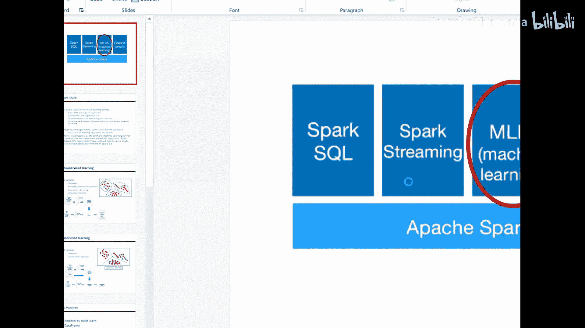
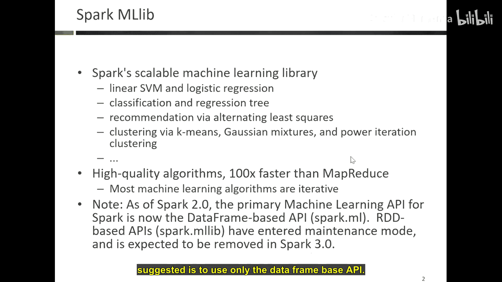
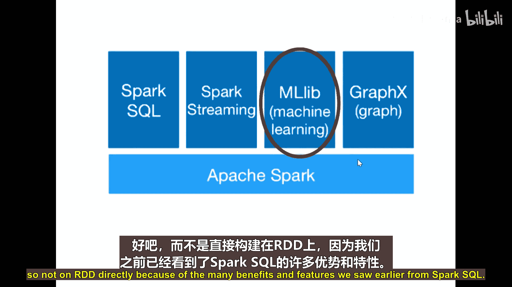
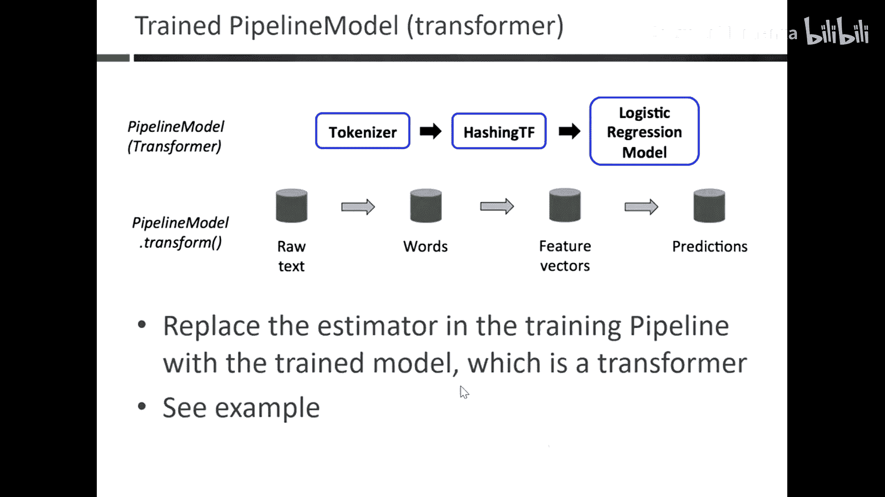
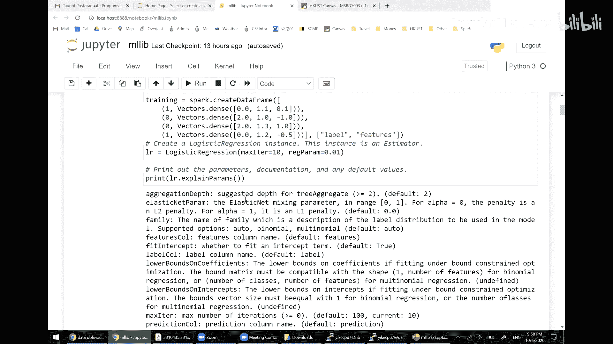

# 011：机器学习与MLlib

## 概述
在本节课中，我们将学习Spark中的机器学习库MLlib。我们将了解其基本概念、核心组件以及如何使用它来构建一个完整的机器学习流程。

## MLlib简介
Spark拥有两个版本的机器学习库。一个叫做MLlib，基于RDD。另一个简称为ML，基于DataFrame。实际上，从Spark 2.0开始，主要的机器学习API已经是基于DataFrame的ML库。基于RDD的API已进入维护模式，并预计在Spark 3.0中被移除。因此，建议仅使用基于DataFrame的API。

ML库构建在Spark SQL之上，而非直接基于RDD，这带来了许多之前从Spark SQL中看到的好处和特性。

## 机器学习流程概述
这不是一门机器学习课程，但为了建立共同的理解，让我们快速浏览一下典型的机器学习流程。

广义上讲，机器学习算法分为两大类：监督学习和无监督学习。

在监督学习中，数据带有标签。监督学习的例子包括预测、分类和回归等。它们通常遵循以下流程：我们有原始数据（如文本文档、图像等）及其标签，需要将它们转换为特征向量。因为所有机器学习算法都不能直接处理不同类型的数据，它们只处理向量，即特征向量。然后通过机器学习算法产生一个模型，这是训练的结果。在测试阶段，我们有一个新的文本、文档或图像，它将经历相同的过程，转换为特征向量，然后输入到模型中，模型会给出预期的标签。

在无监督学习中，流程大体相同，只是我们没有标签。其他步骤保持不变，即原始数据（文本文档）被转换为特征向量，然后通过机器学习算法产生模型，测试阶段的流程也相同。

实际上，Spark中的机器学习库在接口上与Python中流行的机器学习库Scikit-learn非常相似。它借鉴了Scikit-learn的许多特性，例如转换器、估计器等类型。如果你熟悉Scikit-learn，那么使用Spark的ML库会非常直接，同时还能享受到Spark的可扩展性优势。

## MLlib的核心概念
ML库中有两种核心对象：转换器和估计器。

转换器将一个DataFrame转换为另一个DataFrame。这实际上与DataFrame或RDD中的转换操作相同。转换器的例子包括模型。模型将一个DataFrame转换为另一个DataFrame，具体来说，输入DataFrame必须包含ID和特征向量，输出DataFrame将包含一个名为“标签”的列。这用于测试阶段。另一个转换器是特征转换器，用于从原始数据到特征向量的转换步骤。在这种情况下，输入DataFrame可能包含文本等，输出通常是特征向量以及一个ID。

估计器的输入是一个DataFrame，输出是一个模型。例如，训练算法就是一个估计器。估计器的输出不是DataFrame，而是一个模型对象。模型本身主要由系数组成，例如神经网络中的系数或线性模型中的系数等，具体取决于不同的机器学习模型。

一个转换器必须实现一个名为`transform`的方法。通常，ML库已经提供了许多转换器，你可以直接使用。如果你想自己定义一个新的转换器，则必须实现`transform`方法。同样，对于估计器，库已经将许多训练算法实现为估计器。如果你想自己实现一个新的训练算法，则需要实现一个名为`fit`的方法，在其中实现训练算法。

转换器和估计器通常都有很多参数。有些人甚至声称机器学习是调整参数的艺术。为了使参数设置更方便，ML库将参数定义为一个对象，你可以为转换器和估计器设置参数。

## 逻辑回归示例
现在，让我们通过一个逻辑回归训练过程的例子来具体说明。你应该在机器学习课程中学过逻辑回归。为了本课程的目的，我们只需要知道这是一个非线性函数，它将输入数据映射到0到1之间的一个数。我们将任何大于0.5的值解释为概率大于0.5，并返回1，否则返回0。

训练流程如下：原始数据只是一个字符串，存储在DataFrame中，但这个DataFrame只有一个字符串列。第一步是特征提取，将原始数据转换为特征向量。这一步我们使用分词器。分词器将字符串分解为单词列表。这是第一步，实际上与`split`操作类似。在ML库中，分词器被定义为一个转换器，它将一个DataFrame转换为另一个DataFrame。

第二步是哈希转换。它对每个单词应用哈希函数，将每个字符串单词转换为整数。每个唯一的单词对应一个维度，因此这是一个非常高维的特征向量。向量的值是单词的频率，即该单词出现的次数。这也已经实现，称为`HashingTF`，是另一个转换器。

然后，从特征向量到模型，这是训练算法，是一个估计器。

一般来说，任何流水线都采用以下形式：初始数据在DataFrame中，然后经过一系列转换器列表，最后一步是估计器。估计器将返回一个模型。模型本身也是一个转换器。

当你组装整个流程时，整个流水线的输入是DataFrame，输出是一个模型（转换器），因此整个流水线可以被视为一个估计器。一旦模型被训练好，它实际上由相同的流水线步骤组成，只是最后一步被训练好的模型所取代。也就是说，所有的分词器、`HashingTF`都保持不变，它们仍然是转换器。最后一步的训练算法（估计器）将被训练好的模型取代。模型本身仍然是一个转换器，因为它以DataFrame作为输入并产生预测，这是另一个DataFrame。现在，流水线是转换器、转换器、转换器，每一步都是转换器。因此，整个流水线仍然是一个转换器，因为输入是DataFrame，输出也是DataFrame。在训练流水线中用训练模型（一个转换器）替换估计器。

## 分步示例
首先，我们看一个不使用原始数据的简单示例，假设数据已经是向量形式。我们先孤立地看每一步，然后将所有步骤组装在一起形成训练流水线和测试流水线。

向量在库中定义。密集向量就是数组，与NumPy数组相同。稀疏向量则实现为键值对字典。

以下是如何创建一个包含两列（标签和特征）的DataFrame。到目前为止，我们还没有真正使用机器学习库，只是使用了向量类型。

然后，我们创建一个逻辑回归实例。这个实例是一个估计器。任何训练算法以及任何模型都有很多参数。你可以在创建时指定参数，也可以稍后指定。这里展示的是在构造时设置参数的例子。每个参数实际上也有默认值，如果你不指定，它们将采用默认值。当然，不同的模型、不同的训练算法可能有不同的参数。对于逻辑回归，两个最重要的参数是最大迭代次数和正则化参数。

除了这两个，训练算法还有许多其他参数。你可以使用`explainParams`方法打印出所有参数及其默认值和文档。

现在，我们可以通过直接调用`fit`方法来训练模型。每个估计器、每个训练算法都必须实现这个`fit`方法。训练数据是这个DataFrame，它必须至少包含两列：标签和特征。你可以更改这些列的名称，它们在参数列表中。例如，有一个参数叫做`featuresCol`，这是特征列的名称，默认是“features”。如果你使用默认值，那么你的输入DataFrame必须有一个名为“features”的列。它还必须有一个名为“label”的列，除非你告诉训练算法你的数据有不同的列名。

在这个例子中，我们的数据有预期的列名，所以我们可以直接调用`fit`，这将返回一个模型。然后我们可以打印它，看到一些基本信息：我们有三个特征，两个类别（因为是逻辑回归），系数存储在这个`coefficients`成员中。你也可以打印它们，这是一个系数列表，因为我们有三个特征，所以有三个系数。

为了使事情更方便，你也可以使用Python字典来指定参数。这样，如果你经过几天的反复试验，找到了一组非常好的参数，你可以将其保存为Python字典，以后加载它，这样就不必手动记住所有你花费大量时间调整的参数。

你也可以更改输出列名。对于逻辑回归，输出是一个概率，默认情况下，它会在输出中添加一个名为“probability”的列。如果你不喜欢那个列名，可以将其更改为其他名称。这也是训练算法中的一个参数。

现在，你可以通过告诉`fit`方法使用这些新参数来再次训练，结果可能会略有不同，因为迭代次数和正则化参数都不同，你可能会看到不同的训练结果和系数。

接下来是测试阶段。准备一些测试数据，测试数据必须至少有两列：ID和特征。ID必须是唯一的。

现在，你可以在训练好的模型上调用`transform`方法。我们训练了两个模型，它们使用略有不同的参数进行训练。你可以将训练好的模型应用于相同的测试数据，这会给出略有不同的结果。虽然概率略有不同，但预测结果可能相同。

对于逻辑回归，它实际上返回一个具有三个新列的DataFrame：原始预测、概率和预测。原始预测实际上是使用系数进行线性变换的结果。概率是归一化后的值，总和为1。这是通过将原始预测取指数然后归一化得到的，是一个介于0和1之间的数。

这两个模型之间的另一个区别是列名不同，因为模型2是使用不同的参数训练的。模型知道输出列应该叫做“myProbability”而不是“probability”。你也可以更改这些名称。

## 组装完整流水线
这个例子只是一个步骤，我们假设数据已经是特征向量形式，这在实践中并非如此。因此我们需要流水线。流水线可以使事情非常方便。当然，你也不一定非要使用流水线，你总是可以手动逐步执行分词器、`HashingTF`和训练，但将它们组装到流水线中可以使事情变得容易得多，因为正如我们所看到的，训练流水线和训练后的流水线非常相似，只是最后一步不同。

现在让我们组装流水线。首先准备一些训练数据。数据有三列：ID、文本和标签。这里的文本只是字符串。我们需要将这些原始数据转换为特征向量。我们需要做两个步骤：分词器和`HashingTF`。两者都由机器学习库提供。

当你初始化任何转换器的实例时，记得指定输入和输出列。这就是你组装流水线的方式。对于这个分词器，它应该寻找名为“text”的列作为输入列，这确实存在。输出列应该叫做“words”。

我们可以检查每个步骤是否按预期工作。如果我们对训练数据调用`transform`方法，它将读取名为“text”的列并生成一个名为“words”的新列。它的作用只是将每个字符串分割成单词列表。实际上，这也可以通过直接使用DataFrame API来实现，即执行`select`和`split`操作。但使用分词器的好处是它可以被组装到流水线中，而直接使用DataFrame API则不行。

流水线中的第二步是哈希转换器。同样，当你创建这个转换器的实例时，你需要告诉ML库哪一列是输入列，哪一列是输出列。对于输入列，为了使事情更通用，我说输入列是“tokens”。输出列是“features”，因为这将在分词器之后立即调用。

我仍然可以通过手动调用这两个步骤来检查。首先进行分词，然后进行`HashingTF`。结果将有两列：“words”是分词器的结果，“features”是`HashingTF`的结果。`HashingTF`将返回一列，其类型是稀疏向量。稀疏向量具有以下形式：第一个是维度数，然后是非零维度的索引。也就是说，这些维度是非零的，其他所有维度都是零。这是一个非常稀疏的向量。实际上，这些只是这些单词的哈希值。你可以看到A、B、C、D有五个不同的单词，所以我们有五个非零维度。“spark”出现了两次，所以在这个维度上我们有一个值2，其他维度我们只有值1。

我可以获取这个结果的第一行，验证这确实是一个稀疏向量。当你使用`show`时，它会以这种漂亮的形式打印稀疏向量。但在底层，稀疏向量实际上就是一个字典，只是它还有额外的属性，比如维度数。

现在我们已经准备好组装整个流水线了。我们创建一个估计器，即训练算法，这实际上是流水线中的最后一个阶段。

要组装流水线，我们只需通过`stages`参数告诉它各个阶段是什么。这个列表的成员就是你之前创建的实例。需要注意的是，最后一个必须是估计器，而前面的阶段必须是转换器。回想一下，整个流水线仍然可以被视为一个估计器，因为它接受一个DataFrame并最终产生一个模型。事实上，只要最后一个是估计器，整个流水线就是估计器。

Spark ML将按顺序调用这些阶段。为什么这个流水线会按预期工作？正是因为你定义了分词器的输入和输出列。分词器的输入列是“text”，它存在于你的训练数据中。分词器的输出列将是`HashingTF`的输入列，而`HashingTF`的输出列将是训练算法的输入列。这就是它们如何组装以及如何按预期工作的。

然后，我们可以通过调用整个流水线的`fit`方法来训练。在示例中，我使用了两个标准转换，但你也可以创建自定义转换。当你创建自定义转换时，你必须定义自己的`transform`方法。也就是说，流水线将依次调用每个阶段的`transform`方法，然后调用最后一个阶段的`fit`方法。因此，每个阶段都必须有一个定义良好的`transform`方法。同样，如果你想实现自己的训练算法，你必须定义一个新的类，该类实现`fit`方法。

现在准备一些未标记的测试文档，包含ID和文本。

流水线的好处是，你不必显式调用`transform`方法。你只需调用整个流水线的`fit`方法，流水线将代表你调用这些阶段的`transform`方法。同样，在测试阶段，你只需调用整个流水线的`transform`方法。现在这个模型是一个流水线模型。因为这个模型是整个流水线`fit`方法的结果，所以它将继承所有阶段，所有转换阶段。这些阶段也包含在训练模型中。当你调用`model.transform`时，它将经历相同的阶段，除了最后一个。在最后一个阶段，它将调用训练好的逻辑回归模型。这就是我们在这里讨论的内容。

这是训练流水线。之前的阶段都被保留，只有最后一个阶段（训练算法）将被训练好的模型取代。好处很明显，你不必再次编写所有之前的阶段，因为它们在训练流水线和训练后的流水线中都保持不变。

让我们看一些例子。当你调用`model.transform`处理测试数据时，实际上可以看到所有这些列：`words`是分词器添加的列，`features`是`HashingTF`添加的列，其他列是由训练好的模型添加的。

希望这个框架与Scikit-learn包相同。不同之处在于，在这个训练算法内部，Spark ML库有自己的实现，它是高度并行的。也就是说，每次迭代，因为这里我们讨论的是逻辑回归，它使用梯度下降法，并且它们并行计算所有梯度。与Python的机器学习库相比，这具有更高的可扩展性。但无论如何，接口非常相似。

## 总结
在本节课中，我们一起学习了Spark的机器学习库MLlib。我们了解了其基于DataFrame的API是当前的主流。我们介绍了机器学习的基本流程，包括监督学习和无监督学习。我们深入探讨了MLlib的两个核心概念：转换器和估计器，并通过逻辑回归的例子详细说明了它们的使用方法。我们还学习了如何将多个步骤组装成一个流水线，从而简化训练和预测过程。最后，我们看到了Spark ML在保持与Scikit-learn相似接口的同时，通过并行计算提供了更高的可扩展性。