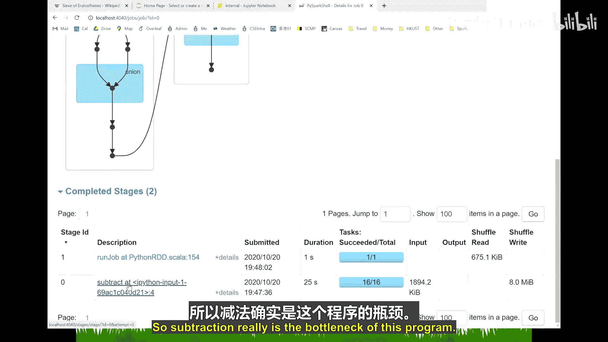
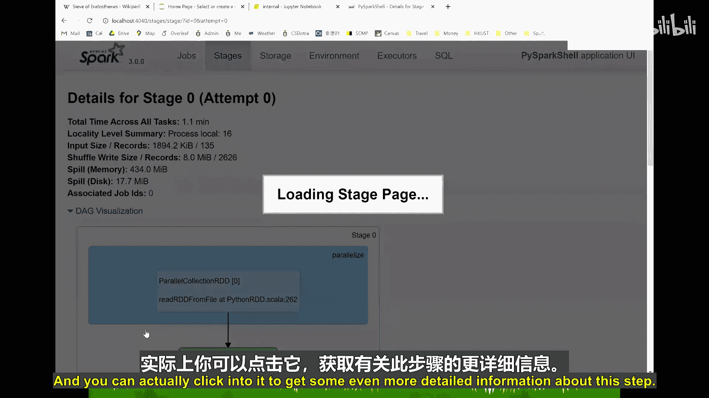
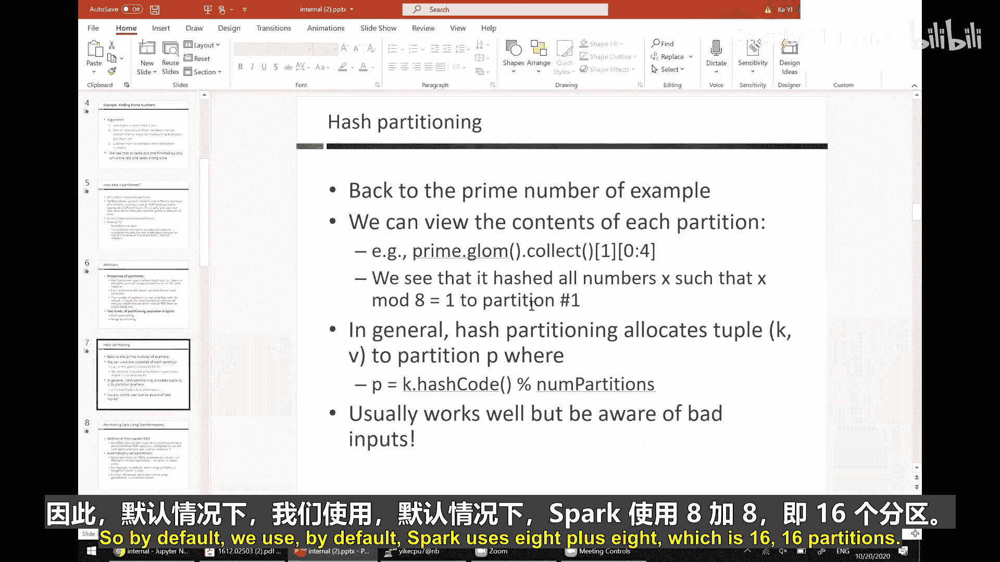
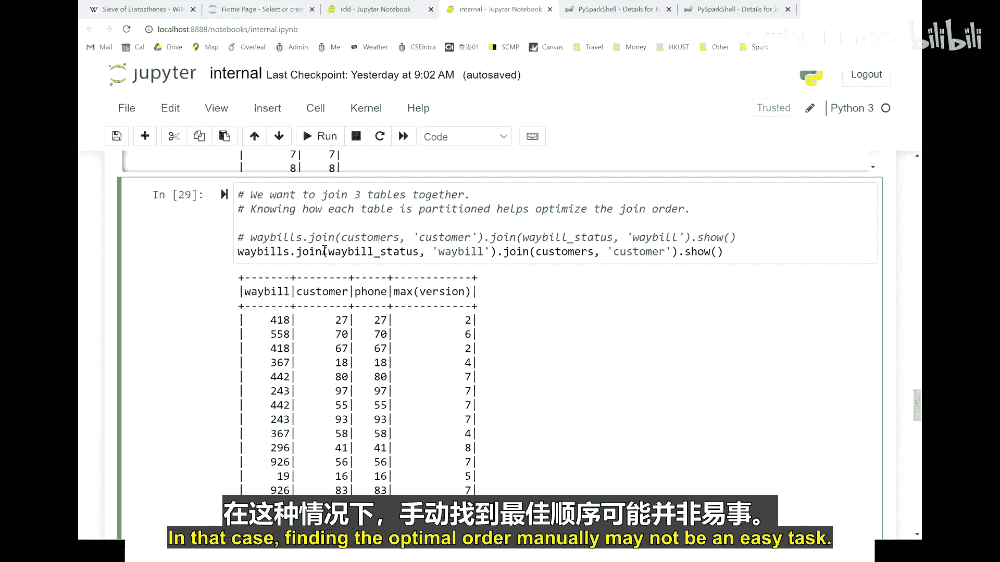

# 012：示例 - 查找素数

## 概述
在本节课中，我们将学习一个经典的数学问题——查找素数，并探索如何使用Spark并行化一个古老的算法（埃拉托斯特尼筛法）。我们将重点关注算法的并行化策略、Spark中数据分区的重要性，以及如何通过优化分区来提升计算性能。

## 算法原理：埃拉托斯特尼筛法
上一节我们介绍了查找素数的问题，本节中我们来看看解决该问题的经典算法。

该算法用于生成小于等于整数N的所有素数。其核心思想是逐步筛选掉合数（非素数）。

以下是算法的基本步骤：
1.  列出从2到N的所有整数。
2.  选取当前列表中最小的数（初始为2），它是一个素数。
3.  从列表中**剔除**这个素数的所有倍数（除了它本身）。
4.  对剩余列表中新的最小数重复步骤2和3，直到处理完所有数。
5.  最终列表中剩下的所有数都是素数。

算法的正确性显而易见：第一个数2是素数，其所有倍数都是合数，应被剔除。接着，剩余列表中最小的数3也是素数，剔除其所有倍数。以此类推，最终剩下的便是所有素数。

本质上，这个算法不是直接“找到”素数，而是通过**剔除所有合数**来间接得到素数。

## 并行化思路
这个算法很容易并行化，因为每个步骤（即剔除某个素数的所有倍数）可以独立进行。

然而，在顺序版本中，我们可以跳过已经被标记为合数的数字（例如4、6、9等），以最小化总工作量。但在并行版本中，为了实现最佳并行时间（即最短的挂钟时间），我们可能允许一些冗余工作。例如，即使4已经被作为2的倍数剔除，我们可能仍然会独立地剔除4的所有倍数。





这引出了并行算法中两个非常重要的概念：**深度**和**工作量**。
*   **深度**：指从输入到输出的最长路径长度，决定了并行计算所需的最短时间（延迟）。
*   **工作量**：指完成计算所需的总操作量。

通常，为了获得更小的深度（更快的并行时间），我们可能需要接受稍大的工作量。这是一种权衡。对于涉及大量数据的计算，我们通常更倾向于优化深度，以最小化并行时间。

## Spark实现：基础版本
现在，让我们看看如何使用Spark实现这个并行化的筛法。假设我们要查找所有小于等于N的素数，这里设N为5,000,000。

首先，我们创建一个包含从2到N所有整数的RDD。参数`8`指定了初始分区数，可以根据你的系统核心数调整。

```python
n = 5000000
all_numbers = sc.parallelize(range(2, n+1), 8).cache()
```

接下来，我们需要找出所有的合数。我们通过一个`flatMap`操作来实现：将每个数`x`映射为其所有倍数（不包括`x`本身）的列表。

```python
composite_numbers = all_numbers.flatMap(lambda x: range(2*x, n+1, x))
```

`flatMap`操作后，我们得到了一个包含大量可能重复的合数的RDD。最后，我们从所有数字的集合中减去合数集合，得到素数。

```python
prime_numbers = all_numbers.subtract(composite_numbers)
prime_numbers.take(10) # 触发计算并打印前10个结果
```

这个实现虽然逻辑正确，但性能存在严重问题。

## 性能分析与问题定位
运行上述代码后，通过Spark UI（通常位于4040端口）可以观察作业执行情况。整个作业耗时约27秒，主要时间（25秒）花在了`subtract`操作阶段。

深入查看`subtract`阶段的任务详情，会发现一个关键问题：**负载极端不均衡**。在16个并行任务中，其中一个任务的处理时间远远超过其他任务，成为了整个计算的瓶颈。这意味着在大部分时间里，可能只有一个CPU核心在忙碌工作，其他核心处于空闲状态，造成了巨大的资源浪费。

为什么会出现这种不平衡呢？我们需要检查各个RDD的分区情况。

以下是检查分区大小的方法：
```python
def partition_size(iterator):
    yield sum(1 for _ in iterator)

print(all_numbers.mapPartitions(partition_size).collect())
print(composite_numbers.mapPartitions(partition_size).collect())
```

检查结果如下：
*   `all_numbers` RDD：分区是完美均衡的。
*   `composite_numbers` RDD：分区严重不均衡。第一个分区包含了绝大多数数据，而最后四个分区甚至没有数据。

**原因分析**：初始的`all_numbers` RDD中的数据是按顺序递增分布的。当进行`flatMap`操作时，每个数字`x`被扩展为从`2*x`到`n`，步长为`x`的序列。对于前半部分分区中的较小数字（如2, 3, 4...），它们生成的倍数序列很长，且大部分小于`n`。而对于后半部分分区中的较大数字，它们生成的倍数序列可能很短，甚至第一个倍数`2*x`就已经大于`n`，导致没有数据输出。因此，`flatMap`转换后，数据分布变得高度倾斜。

虽然`flatMap`本身是窄依赖，各个分区独立工作，不构成瓶颈，但它产生的不均衡RDD严重影响了后续的`subtract`操作。`subtract`是一个宽依赖操作，需要Shuffle。在Shuffle过程中，数据需要根据键的哈希值重新分布到不同的分区进行处理。由于`composite_numbers` RDD中第一个分区的数据量极大，负责处理该分区数据的任务就需要处理海量的Shuffle数据，从而成为整个作业的瓶颈。




## 性能优化：重分区
问题的根源在于`composite_numbers` RDD的分区不均衡。解决方案是在进行昂贵的`subtract`操作之前，对这个RDD进行**重分区**，使其数据分布变得均衡。

优化后的代码如下：
```python
n = 5000000
all_numbers = sc.parallelize(range(2, n+1), 8).cache()

composite_numbers = all_numbers.flatMap(lambda x: range(2*x, n+1, x))
# 关键优化：对合数RDD进行重分区，使其均衡
composite_numbers = composite_numbers.repartition(8)

prime_numbers = all_numbers.subtract(composite_numbers)
prime_numbers.take(10)
```

通过增加一个`repartition(8)`步骤，我们强制Spark将`composite_numbers`的数据打散并均匀分配到8个新分区中。这样，在后续的`subtract` Shuffle阶段，每个任务处理的数据量就大致相同了。

**优化效果**：总运行时间从27秒降低到了约10秒。虽然我们增加了一个额外的重分区阶段（耗时约5秒），但`subtract`阶段的耗时从25秒大幅降至4秒。总体性能得到显著提升。

这再次体现了深度与工作量的权衡：我们做了更多的工作（重分区），但减少了关键路径的深度（均衡了Shuffle负载），从而获得了更短的总体执行时间。

## Spark分区机制深入
上一节我们通过重分区解决了性能问题，本节中我们更深入地理解Spark的分区机制。

### 分区的基本性质
*   RDD中的数据总是被划分为多个分区。
*   一个分区内的数据永远不会跨越多台机器，但一台机器可以持有多个分区。
*   建议设置的分区数量是集群工作节点核心总数的2-3倍。这既有利于动态负载均衡（快的节点可以领取更多任务），又能避免分区过多导致的管理开销。
*   默认分区数由集群配置决定，但从HDFS读取文件时，分区数通常等于文件的块数。

### 分区器
RDD是分区的，但它可能有一个与之关联的**分区器**，也可能没有。
*   **分区器**定义了数据如何被分配到各个分区的规则。
*   当RDD从数据源（如Python列表）创建时，通常没有分区器，数据被任意划分。
*   在执行了某些基于键的转换（如`reduceByKey`, `groupByKey`, `sortByKey`）后，结果RDD会获得一个分区器（分别是哈希分区器或范围分区器）。
*   窄依赖操作（如`map`, `filter`）通常会**丢失**父RDD的分区器，因为Spark无法确定你的转换是否改变了键。
*   特殊的`mapValues`和`flatMapValues`操作会**保留**父RDD的分区器，因为它们明确表示不修改键。

### 哈希分区与Shuffle
默认的分区器是哈希分区器。对于键值对RDD，Spark使用键的哈希码来决定其所属分区。具体公式为：`partition = hash(key) % numPartitions`。

Shuffle操作（如`reduceByKey`, `join`, `repartition`）的核心就是基于分区器对数据进行重新分布。它分为两个阶段：
1.  **Map阶段**：每个任务根据目标分区数构建一个哈希表，将数据放入对应的槽位，然后每个槽位的数据被发送到对应的目标工作节点。
2.  **Reduce阶段**：每个工作节点接收来自所有Map任务的、属于自己负责的分区槽位的数据，然后进行合并、去重或聚合等操作。

### 分区器的重要性：避免不必要的Shuffle
保留正确的分区器可以带来巨大的性能提升，因为它能帮助Spark识别某些操作是否可以避免Shuffle。

一个关键概念是**依赖类型**：
*   **窄依赖**：父RDD的每个分区最多被子RDD的一个分区使用。操作如`map`, `filter`, `union`。这些操作可以流水线化执行，无需等待。
*   **宽依赖**：父RDD的一个分区可能被子RDD的多个分区使用。操作如`groupByKey`, `reduceByKey`（通常）。这些操作需要Shuffle，是所有任务必须同步的屏障。

**协同分区**：如果两个要进行`join`操作的RDD具有**相同数量**的分区，并且使用**相同**的分区器（对范围分区器，边界也必须相同），那么它们的连接就可以作为窄依赖执行，无需Shuffle！因为具有相同键的数据已经通过分区器保证位于相同机器的相同分区序号上。

**示例对比**：
假设`rddA`和`rddB`都是哈希分区，且分区数相同。
*   `rddA.join(rddB)`：这是一个**窄依赖**，无需Shuffle。
*   `rddA.map(...).join(rddB)`：如果`map`可能改变键，分区器丢失，此连接变为**宽依赖**，需要Shuffle。
*   `rddA.mapValues(...).join(rddB)`：使用`mapValues`保留了分区器，此连接仍是**窄依赖**，无需Shuffle。

因此，在编写代码时，应优先使用`mapValues`、`flatMapValues`来保留分区器，这能显著减少作业中的Shuffle阶段数量，从而提升性能。

## 应用示例：优化PageRank
让我们回顾PageRank的例子，看看分区器的影响。

在原始的PageRank实现中，迭代部分使用了普通的`map`：
```python
for i in range(10):
    # ranks 是 (page_id, rank) 的键值对RDD
    contributions = links.join(ranks).flatMap(...) # links 是 (page_id, [neighbors])
    ranks = contributions.reduceByKey(...).map(lambda x: (x[0], 0.15 + 0.85 * x[1]))
```
在这个版本中，`ranks` RDD经过`map`操作后丢失了哈希分区器。因此，在下一轮迭代的`links.join(ranks)`操作中，Spark无法确认两者是协同分区的，会将其视为宽依赖，触发Shuffle。每次迭代因此产生**两个**Shuffle阶段（`join`和`reduceByKey`各一个）。

优化后的版本使用`mapValues`：
```python
for i in range(10):
    contributions = links.join(ranks).flatMap(...)
    ranks = contributions.reduceByKey(...).mapValues(lambda rank: 0.15 + 0.85 * rank)
```
`mapValues`保留了`ranks` RDD的分区器。由于`links` RDD也是通过`groupByKey`获得的哈希分区RDD，且分区数相同，因此`links.join(ranks)`是一个窄依赖，无需Shuffle。每次迭代只剩下`reduceByKey`一个Shuffle阶段。

**效果**：优化后，作业的Stage数量减少近半，运行时间也相应显著缩短。

## 多表连接顺序优化
在涉及多个DataFrame/数据集连接时，连接顺序对性能有巨大影响，因为Spark目前不会自动优化连接顺序。

**场景**：有三个表需要连接。
*   `waybills` (分区键：waybill_id)
*   `customers` (分区键：customer_id)
*   `waybill_status` (分区键：waybill_id)

**目标**：将三张表连接起来。

**方案一（次优）**：
```python
result = waybills.join(customers, "customer_id").join(waybill_status, "waybill_id")
```
1.  `waybills.join(customers)`：`waybills`表需要根据`customer_id`进行Shuffle才能与`customers`表连接。结果表按`customer_id`分区。
2.  结果表再与`waybill_status`连接：两者分区键不同(`customer_id` vs `waybill_id`)，需要再次Shuffle。
**总共需要两次Shuffle。**

**方案二（更优）**：
```python
result = waybills.join(waybill_status, "waybill_id").join(customers, "customer_id")
```
1.  `waybills.join(waybill_status)`：两者都按`waybill_id`分区，是协同分区的，**无需Shuffle**。结果表仍按`waybill_id`分区。
2.  结果表再与`customers`连接：分区键不同(`waybill_id` vs `customer_id`)，需要一次Shuffle。
**总共只需要一次Shuffle。**

因此，在编写多表连接时，应尽量将使用相同分区键的表优先连接，以减少不必要的Shuffle操作。

## 总结
本节课中我们一起学习了以下核心内容：
1.  **算法并行化**：将埃拉托斯特尼筛法并行化，理解了深度与工作量的权衡。
2.  **Spark性能调优**：通过分析Spark UI定位到数据分区不均衡是性能瓶颈，并使用`repartition`解决了问题。
3.  **分区机制**：深入理解了RDD分区、分区器、哈希分区原理以及Shuffle过程。
4.  **依赖类型**：区分了窄依赖和宽依赖，认识到Shuffle是性能关键点。
5.  **保留分区器**：学会了使用`mapValues`等操作保留分区器，从而避免不必要的Shuffle，并通过PageRank示例看到了显著的性能提升。
6.  **连接顺序优化**：在多表连接场景中，通过合理安排连接顺序来最小化Shuffle次数。



掌握数据分区和Shuffle的原理，是编写高效Spark程序的关键。始终关注数据的分布，并利用分区器来优化依赖关系，才能充分发挥分布式计算的威力。