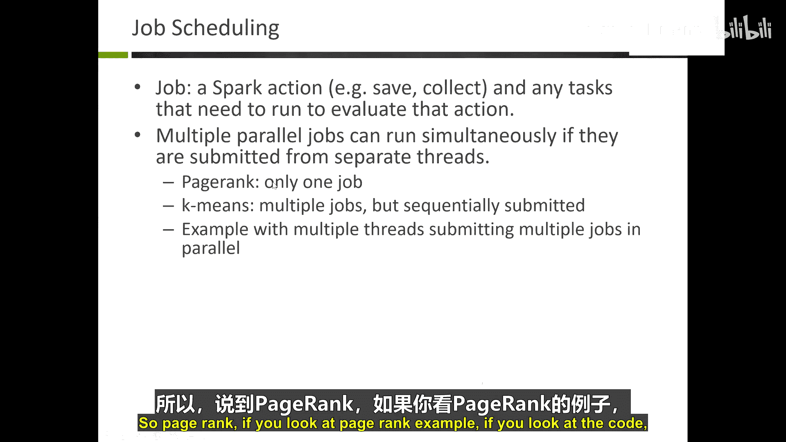
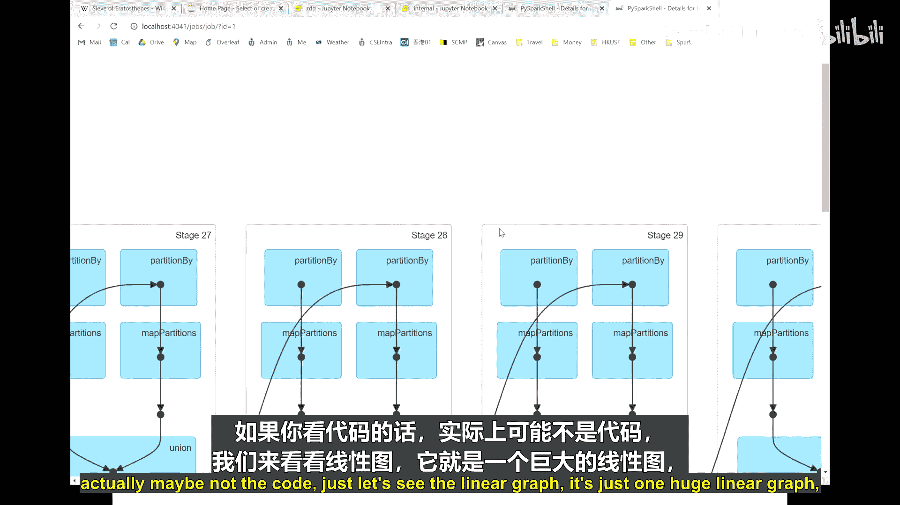
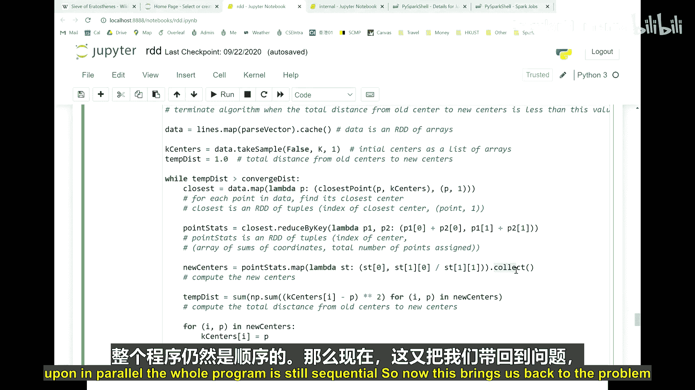
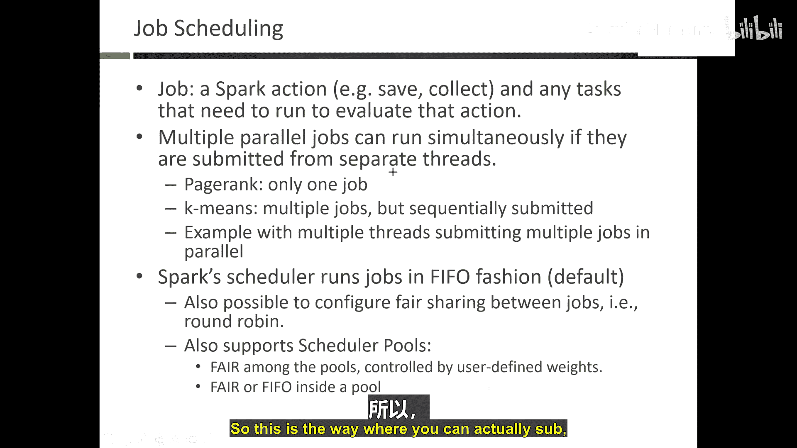
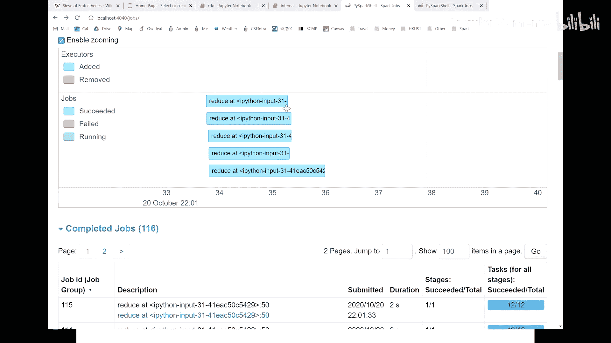
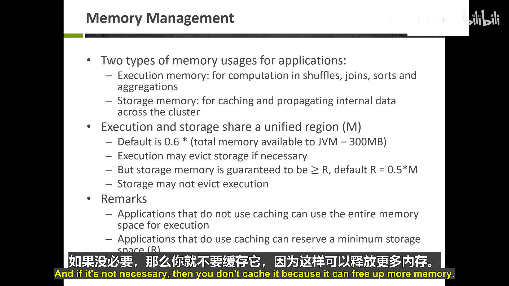

# 013：作业调度

在本节课中，我们将要学习Spark在多用户环境下的作业调度机制。我们将探讨Spark如何管理并发提交的多个作业，以及如何通过用户级线程实现同一应用程序内多个作业的并行执行。此外，我们还将了解Spark在单个作业内的任务调度策略和内存管理的基本原理。

## Spark的多用户环境与作业定义





Spark被设计为多用户环境。在实际工作中，通常是一个集群由所有用户共享。每个用户都可以提交作业，集群资源在这些并发提交的多个作业之间共享。因此，我们需要讨论Spark如何调度这些同时提交的作业。

一个作业是任何需要运行任务以完成的**动作**，例如 `save` 或 `collect`。如果多个并行作业是从独立的线程提交的，它们可以同时运行。

然而，在我们目前看到的所有示例中，由于我们只是单一用户，即使提交了多个作业，这些作业也是按顺序运行的。让我们通过例子来理解这一点。

## 顺序执行与并行执行的对比

上一节我们介绍了作业的定义，本节中我们来看看不同程序结构如何影响作业的执行顺序。

以下是两个典型示例的对比：

*   **PageRank示例**：其代码结构是一个大的线性计算图。循环内部没有动作，仅用于构建计算图。整个程序中唯一的动作是最后的 `top` 操作。因此，PageRank程序**只有一个作业**。
*   **K-Means聚类示例**：在循环内部包含一个动作（如 `collect`）。因此，这个程序包含**多个作业**，但每个作业的计算图相对较小。



关键在于，任何动作在Spark中都是**阻塞**的。一旦Spark遇到一个动作，它会阻塞驱动程序，直到该动作完成并返回结果。这意味着在同一个驱动程序内，作业之间没有并行性，所有作业都是按顺序一个接一个地执行。

驱动程序本身是一个标准的顺序程序（如Python程序），只是在执行每个动作时，其分区会并行计算。

## 默认调度策略与资源利用

既然作业在单用户程序内是顺序执行的，那么Spark默认如何处理多用户并发提交的作业呢？



Spark调度器默认以**先进先出**的方式运行作业。即使多个用户向同一个Spark集群提交作业，这些作业也会按提交顺序依次评估。在前一个作业完成之前，下一个作业无法开始。

默认情况下，一个作业会尝试使用尽可能多的处理器（只要有足够的分区），这意味着一个作业可能会占用所有工作节点。

这引出了下一个问题：如果你是唯一用户，但你有多个作业希望并行运行，而每个作业本身无法充分利用所有集群资源（例如，集群有100台机器，每个作业只能利用10台），该怎么办？这就引入了**用户级线程**的概念。

## 使用用户级线程实现作业并行

上一节我们提到了资源利用的问题，本节中我们来看看如何通过用户级线程让同一用户的多个作业并行执行。

以下是通过Python多线程库实现并行提交作业的示例代码框架：

```python
import threading

def do_job(seed):
    # 这是一个标准的Spark作业，包含一个动作（如reduce）
    rdd = sc.parallelize(range(1000), numSlices=12)
    result = rdd.mapPartitionsWithIndex(your_function(seed)).reduce(...)
    return result

# 创建线程列表
threads = []
for i in range(5):
    t = threading.Thread(target=do_job, args=(i,))
    threads.append(t)
    t.start()  # start() 是非阻塞的，会立即在后台启动线程

# 主程序等待所有线程完成
for t in threads:
    t.join()
```

以下是上述代码的关键点说明：
*   `threading.Thread`：用于创建线程对象，将作业函数 `do_job` 作为目标。
*   `t.start()`：启动线程。此调用是**非阻塞**的，主程序可以继续执行，从而几乎同时启动所有作业线程。
*   `t.join()`：主程序调用此方法等待指定线程完成。这确保了主程序会等待所有并行作业执行完毕。

通过这种方式，多个作业得以几乎同时提交到集群。

## 并行作业的资源调度实践

我们通过一个计算圆周率的示例来观察并行作业的调度效果。我们创建5个相同的作业（仅随机种子不同），每个作业是一个独立的Spark任务。

**场景一：每个作业使用全部48个分区**
*   所有5个作业几乎同时提交。
*   但由于Spark默认的FIFO调度以及每个作业都请求所有资源，实际上只有第一个作业能占用全部48个工作节点并执行。
*   其余作业必须等待前一个作业完成后才能开始。因此，作业是**顺序完成**的。



**场景二：每个作业仅使用12个分区**
*   所有5个作业同样几乎同时提交。
*   由于每个作业只需12个资源，而总资源为48个，因此**前4个作业可以并行执行**。
*   第5个作业需要等待前4个中有作业释放资源后才能开始。
*   由于某些工作节点可能提前完成任务，它们可以更早地开始处理第5个作业，因此第5个作业的持续时间可能略短。

这个实验说明了通过控制每个作业的分区数（即资源需求），可以在同一应用程序内实现多个作业的并行，从而提高集群资源利用率。

## 作业内部的任务调度

现在让我们看看Spark如何在单个作业内部进行任务调度。

一个作业可以包含多个**阶段**。一个阶段只有在它的所有父阶段都完成后才能开始。这就是为什么最小化阶段数量对于减少等待时间很重要。

每个阶段包含多个**任务**，每个分区对应一个任务。每个分区内部可能有一系列转换操作形成的流水线。

Spark基于**数据本地性**将任务分配给机器，其原则是“移动计算而非移动数据”。它考虑不同级别的本地性优先级，包括：
*   `PROCESS_LOCAL`：数据在同一JVM进程中。
*   `NODE_LOCAL`：数据在同一节点上。
*   `RACK_LOCAL`：数据在同一机架内的服务器上。
*   `ANY`：数据可能在网络中的任何位置。

在异构集群中，不同节点速度可能不同。Spark需要决定是否将慢速节点上未完成的任务重新分配给已空闲的快速节点。这涉及到数据通信成本与计算延迟的权衡。Spark会设置一个等待计时器，并依据一套复杂标准来决定是否进行任务重分配。通常，为了最小化通信开销，如果慢速节点只剩少量任务，Spark可能会选择等待而不是立即重分配。这些参数可以进行配置和优化。

## Spark内存管理概述

最后，我们快速概述一下Spark的内存管理，因为内存是非常宝贵的资源。

Spark主要使用两种类型的内存：
1.  **执行内存**：主要用于**Shuffle**操作。Shuffle需要在Map端和Reduce端构建哈希表，这可能消耗大量内存。
2.  **存储内存**：主要用于**缓存**RDD。当你将一个RDD标记为 `persist()` 时，它会被存入存储内存。

两者之间的管理策略是：**执行内存可以驱逐存储内存**（如果需要）。这意味着即使你缓存了一个RDD，它也不能保证始终驻留在内存中，可能会被换出到磁盘。但**存储内存不能驱逐执行内存**。

默认参数保证存储内存至少占用总内存的一半。**不使用缓存的应用可以将全部内存用于执行**，这也是为什么默认情况下缓存是关闭的。作为程序员，你需要明智地决定哪些RDD值得缓存。不必要的缓存会占用本可用于高效执行的内存。

## 总结



本节课中我们一起学习了Spark的作业调度机制。我们了解到：
1.  在单用户顺序程序中，作业是串行执行的。
2.  Spark默认采用FIFO策略调度多用户提交的作业。
3.  通过**用户级线程**（如Python的 `threading`）可以实现在同一应用程序内并行提交多个作业。
4.  通过控制每个作业的分区数，可以影响并行作业对集群资源的利用方式。
5.  在作业内部，Spark基于数据本地性进行任务调度，并在异构环境中权衡计算与通信成本。
6.  Spark的内存分为**执行内存**和**存储内存**，执行内存拥有更高优先级，缓存策略需要根据应用需求谨慎选择。