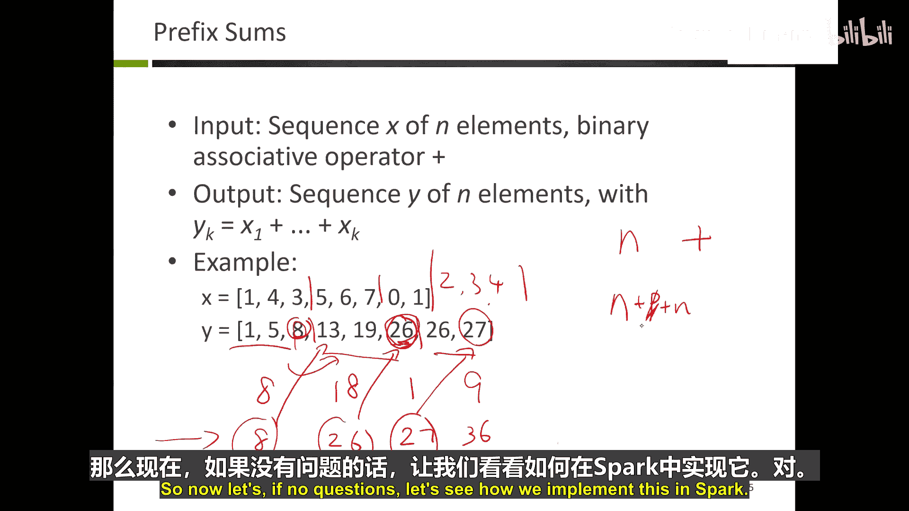
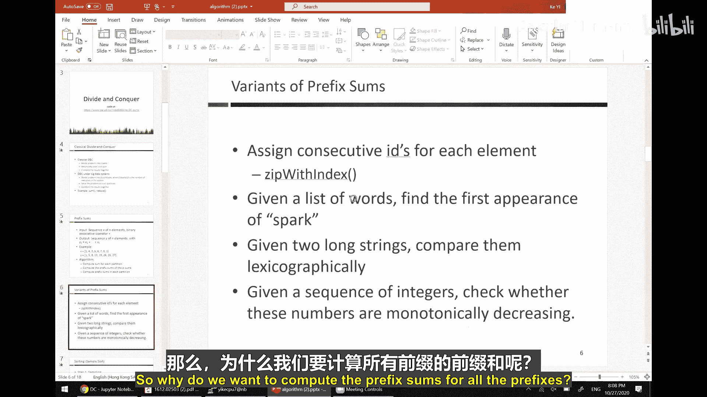
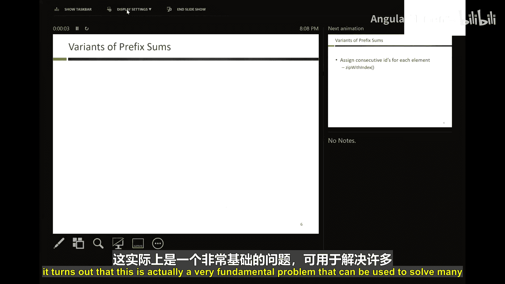
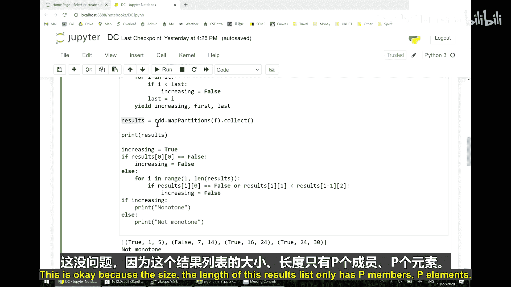

# 014：并行算法设计

在本节课中，我们将要学习如何为Spark这样的分布式系统设计并行算法。我们将探讨三种主要的技术：分治算法、图算法和流式算法。这些技术针对不同类型的数据和处理需求，是解决复杂并行问题的关键。

## 分治算法

上一节我们介绍了并行算法的背景，本节中我们来看看最基础的设计范式之一：分治算法。

分治是一种经典的算法设计技术，其核心思想是将一个大问题递归地分解为多个独立的子问题，分别解决，然后再将结果合并。在单机环境中，经典的例子是归并排序和快速排序。

然而，在像Spark这样拥有众多处理器（P个）的大数据系统中，传统的二分分治（如归并排序）效率不高。因为合并步骤（如合并两个有序序列）通常是顺序执行的，这会导致大量处理器闲置。

为了充分利用所有P个处理器，我们需要采用**多路分治**。这意味着在分解步骤，我们直接将问题划分为P个子问题，让每个处理器处理一个。挑战在于如何高效地合并P个子问题的结果。

以下是一些简单的多路分治例子：

*   **求和与归约**：Spark内部的`sum()`和`reduce()`操作就是多路分治的完美体现。每个分区先计算本地和，然后将所有分区的部分和发送给驱动节点进行最终求和。
    *   **代码示例**：`rdd.sum()` 或 `rdd.reduce(lambda a, b: a + b)`

### 前缀和问题

现在，我们来看一个不那么直观的例子：前缀和问题。给定一个数组 `X = [x1, x2, ..., xn]`，我们需要计算输出数组 `Y`，其中 `yi = x1 + x2 + ... + xi`。

在顺序编程中，这是一个简单的线性时间算法。但在并行环境下，由于每个 `yi` 的计算都依赖于前一个结果，这似乎是一个固有的顺序问题。

我们可以通过一个两阶段的多路分治算法来并行化它：

1.  **阶段一：计算分区和与分区级前缀和**
    *   每个分区独立计算其内部所有元素的和（分区和）。
    *   驱动节点收集所有分区和，并顺序计算这些分区和的前缀和。假设有P个分区，这个计算量很小（O(P)）。
2.  **阶段二：并行计算最终前缀和**
    *   每个分区 `i` 在计算其内部元素的前缀和时，起始值不是0，而是驱动节点传来的、前 `i-1` 个分区的总和（即分区级前缀和）。
    *   这样，所有分区可以同时开始计算，互不依赖。

这个算法虽然总计算量大约是顺序算法的两倍，但通过高度并行化，在大规模集群上能获得显著的加速。

以下是如何在Spark中实现前缀和算法：




```python
# 假设 rdd 是输入的RDD
# 第一阶段：计算每个分区的和
partition_sums = rdd.mapPartitions(lambda iter: [sum(iter)]).collect()

# 在驱动程序中计算分区级前缀和
prefix_sums_at_partition_level = []
current_sum = 0
for s in partition_sums:
    prefix_sums_at_partition_level.append(current_sum)
    current_sum += s
# prefix_sums_at_partition_level 现在存储了每个分区应开始的偏移量
# 第二阶段：并行计算每个分区内的前缀和，并加上偏移量
def add_prefix(iter):
    # 这里需要一个闭包或广播变量来获取 prefix_sums_at_partition_level
    # 为简化，假设 offset 已通过其他方式传入
    pass
# 具体实现需使用 mapPartitionsWithIndex
final_result_rdd = rdd.mapPartitionsWithIndex(lambda idx, iter: compute_local_prefix(idx, iter, prefix_sums_at_partition_level))
```

### 分治思想的应用

前缀和问题看似是人为设计的，但它实际上是许多并行算法的基石。以下是几个应用实例：

*   **分配连续ID（`zipWithIndex`）**：为RDD中的每个元素分配一个连续的、唯一的ID（0, 1, 2...）。这等价于输入全为1的数组进行前缀和计算。
*   **查找首次出现**：在大型数据集中查找某个关键词首次出现的位置。可以在每个分区内并行查找，然后由驱动节点汇总各分区的结果（是否找到及位置），并计算全局位置。
*   **字符串字典序比较**：比较两个超长字符串。先分区并行比较，驱动节点汇总结果，找到第一个不相等的分区即可判定大小。
*   **单调性检查**：检查一个序列是否单调递增或递减。每个分区先检查内部单调性并记录边界值，然后驱动节点检查相邻分区边界值是否满足单调条件。





以单调性检查为例，其Spark实现的核心思路如下：

```python
def check_partition(iter):
    it = list(iter) # 转换为列表以便获取首尾元素
    if not it:
        return (True, None, None) # 空分区
    first = it[0]
    last = it[-1]
    is_monotonic = all(it[i] <= it[i+1] for i in range(len(it)-1)) # 检查递增
    return (is_monotonic, first, last)

# 收集各分区结果
results = rdd.mapPartitions(check_partition).collect()

# 在驱动程序中合并结果
global_is_monotonic = True
for i in range(len(results)):
    local_ok, first, last = results[i]
    if not local_ok:
        global_is_monotonic = False
        break
    if i > 0:
        prev_ok, prev_first, prev_last = results[i-1]
        if prev_last > first: # 检查分区间的边界
            global_is_monotonic = False
            break
```

## 图算法与流式算法

上一节我们深入探讨了分治算法，本节中我们简要介绍另外两类算法。

对于**图数据**，其结构（顶点和边紧密相连）使得简单的数据分区变得困难。因此，需要专门的图计算模型和库，例如Spark的GraphX或更高效的第三方库GraphFrames。这些工具提供了针对图遍历、PageRank等算法的优化抽象。

对于**流式数据**，数据以连续、无界的序列形式到达。我们需要在单次遍历中处理数据，并持续更新结果。Spark Streaming（以及其后的Structured Streaming）是Spark的流处理组件，它采用“微批次”模型，将流数据切成小批次，然后利用Spark核心引擎进行处理。

## 总结



本节课中我们一起学习了为Spark设计并行算法的核心思想。我们首先理解了在大数据环境下并行与分布式算法的混合模型特点。然后，我们重点掌握了**多路分治**这一关键技术，并通过**前缀和**这个经典问题及其多种应用（如分配ID、单调性检查），详细剖析了如何将看似顺序的问题转化为高效的并行计算。最后，我们概述了处理图数据和流式数据所需的特殊算法和工具。掌握这些基础技术，是构建复杂、高效大数据应用的重要一步。