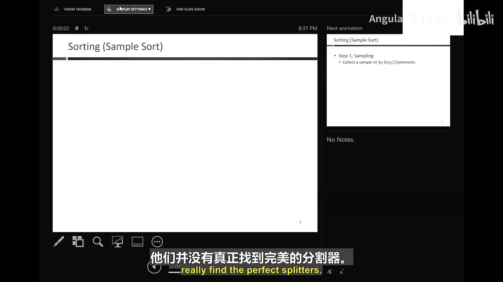
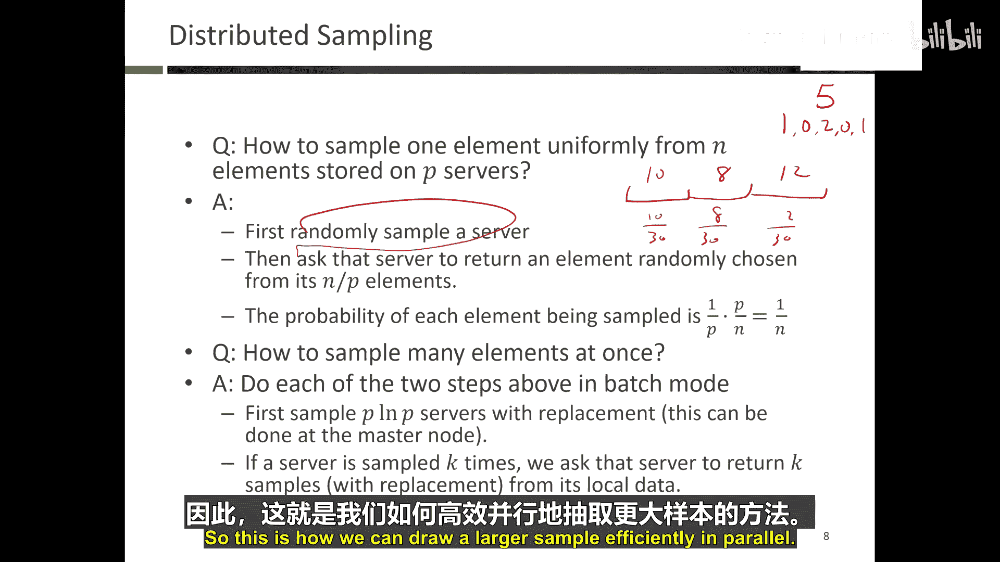

# 015：样本排序算法详解

在本节课中，我们将要学习Spark中用于对RDD进行排序的核心算法——样本排序。这是一种基于采样思想的并行排序算法，旨在高效地处理大规模数据集。

## 排序算法概述

上一节我们介绍了Spark的内部机制，本节中我们来看看如何对一个RDD进行排序。排序是一个非常基础的算法。正如之前提到的，归并排序并不容易并行化，因为它需要使用多路分治策略。然而，我们将看到快速排序更容易并行化。

如果你还记得快速排序的工作原理：我们随机选取一个元素作为**分割点**，然后将每个元素与分割点进行比较，将数组分成两部分。小于分割点的元素放入左子问题，大于分割点的元素放入右子问题。接着，我们递归地对这两个子数组进行排序。这就是快速排序的工作方式。

与归并排序相比，快速排序的划分步骤并不总是完美平衡的。在归并排序中，划分步骤总是完美的，因为我们不关心划分时的顺序，稍后会合并它们。然而，在快速排序中，划分是随机的。如果你运气不好，分割点恰好是最小的元素，那么划分就会非常不平衡：左边没有元素，所有元素都在右边。不过，有很好的分析表明，在平均或期望情况下，算法的总成本仍然是 **O(n log n)**。

直观地说，这意味着如果你的分割点不是太差，即使不是最好的（最好的分割点是中位数，能将数组平分为两半），但也不是太坏，例如将数组按25%-75%的比例划分，这只是一个平均质量的分割点。当然，这不是完美平衡的。然而，当我们继续进行这种划分时，总的递归层数仍然是 **log n**，尽管不是以2为底，而是以4/3为底的对数。因此，你只会比完美平衡多出一些常数倍的层数。这超出了本课程的范围，但这是快速排序在平均情况下仍然表现良好的直观原因，前提是分割点是随机选择的。

然而，快速排序在平均情况下表现良好的事实，关键依赖于我们会多次执行这个过程：我们选取分割点将数组分成两半，然后递归地解决问题，直到只剩下一个元素。这依赖于我们多次执行此操作、选取多个分割点的事实。

## 多路分治与理想分割点

对于多路分治，我们不能简单地只选取一个分割点。理想情况下，假设我们神奇地可以选取 **P-1** 个完美的分割点。这里的“完美分割点”指的是，在使用这 **P-1** 个分割点后，我们可以将RDD分割成，例如，五个大小相等的部分。

假设我们神奇地拥有了这四个分割点。那么我们可以非常容易地对RDD进行排序，方法如下：

1.  首先，我将这四个分割点**广播**给所有工作节点。
2.  每个工作节点将比较其分区中的每个元素与这些分割点。例如，如果一个元素落在第一个和第二个分割点之间，那么工作节点就知道这个元素在排序后的RDD中应该属于**分区1**。如果一个元素大于所有四个分割点，那么它应该属于**分区4**。
3.  本质上，通过将一个元素与分割点进行比较，工作节点就知道了它的目标目的地。
4.  在为每个元素找到目标分区后，就只是一个**洗牌**操作。我们使用洗牌操作将每个元素路由到其目标分区。
5.  因为我们假设这四个神奇的分割点是完美的，即目标RDD中的每个分区大小相等，所以这会得到一个平衡的分区。每个工作节点将拥有相同的工作量。
6.  在洗牌之后，每个工作节点只需在其分区内部对元素进行排序，然后整个RDD就排序完成了。

本质上，这是快速排序的一个非常简化的版本，我们只有一层递归。在快速排序中，我们有多层递归；而在这里，我们假设有这些神奇的分割点，只需一层分治就可以对整个数组进行排序。

## 寻找分割点的挑战

当然，关键问题是如何找到这些神奇的分割点。我们希望它们能将数组R分割成相等的部分。本质上，我们希望第一个分割点是第20百分位数，第二个是第40百分位数，第三个是第60百分位数，第四个是第80百分位数。

我们如何找到这些百分位数？当然，我们可以通过排序来找到，但这又回到了最初的问题，我们并没有取得任何进展。所以，我们必须在不排序的情况下找到这些百分位数。这并不容易，实际上并不比排序本身简单。看起来我们又回到了起点，并没有真正取得进展。

然而，关键的观察是：我们并不需要完美的分割点。分割点稍微偏离一点是可以接受的。例如，第一个是18%，第二个是41%，第三个是61%，第四个是78%，稍微偏离一点。那么，如果它们稍微偏离，会有什么后果呢？没什么太严重的。最终，我们得到的RDD分区不是完美平衡的，但只要不是太不平衡，这也没关系。

这实际上就是我们上次在讨论Spark内部机制时看到的情况。我们讨论了哈希分区和范围分区。对于哈希分区，我们确切知道它是如何工作的：它使用哈希码对K取模。Spark严格遵循这个规则，我们确切知道任何给定分区会包含什么样的数据项。然而，对于范围分区，如果你还记得在`sortByKey`操作之后，你可以看到分区可能并不完美平衡。例如，有10个元素和4个分区，第一个分区有3个元素，第二、三个各有2个，第四个有1个。这并不是完美平衡的，因为完美平衡的分区大小最多相差1。这里不平衡的原因正是Spark使用的排序算法没有找到完美的分割点。

## 采样排序的核心思想

既然我们知道完美平衡不是必需的，这意味着我们可以使用不同的方法来寻找分割点，这就是通过**采样**。这也是为什么这种排序算法被称为**样本排序**的原因。它实际上是快速排序的一种推广。

然而，简单的随机采样效果并不好。考虑一个具体的例子：假设我的RDD中有1000个元素，我想选取9个分割点将其分成10份。如果我简单地随机采样9个分割点，实际上，有很好的分析表明，以高概率，其中两个分割点会非常接近。观察这10个间隔，平均长度应该是100。然而，可以证明，以高概率，最小的间隔会非常小，同时最大的间隔会非常大。实际上有一个公式：假设总共有n个元素，P个分区，平均间隔是 **n / P**，这也是平均分区大小。然而，以高概率，最大间隔的数量级是 **O((n / P) * log P)**，比平均值大一个对数因子。

例如，如果n是一百万，P是100，那么log P大约是7或8。这意味着将有一个工作节点的负载是平均值的8倍，这将成为你计算的瓶颈。当分区数量更多时，情况会更糟。

为什么会有这个结果？这实际上源于一个经典的概率问题，称为**球与箱子问题**。假设我们有n个球和n个箱子。我把这n个球扔进n个箱子。我们知道，平均每个箱子有一个球。然而，以高概率，最大的箱子会有 **log n** 个球。更精确地说是 **log n / log log n**，但log log n非常小，我们通常忽略它。所以，如果你把n个球随机扔进n个箱子，很可能最大的箱子有log n个球，而平均值只有1。这通常被用作一个经典论据，说明在进行负载均衡时，最简单的随机分配策略并不公平。很可能一个工作节点的工作量远大于平均值。这证明了需要更复杂的负载均衡策略，不能简单地随机分配。轮询调度就好得多。

然而，在这里我们不能使用轮询调度，因为我们没有时间去找分割点。因此，随机选取P-1个分割点并不能得到良好的平衡结果。那么，人们怎么做呢？

## 改进的采样策略

这个想法实际上再次受到了快速排序的启发。在快速排序的文献中，最常用的版本是随机选取一个分割点。然而，在一些优化版本的快速排序中，他们不只随机选取一个分割点，而是选取三个，然后选择**中间的那个**作为分割点。这就是“三取一”技术。这会导致数组被更平衡地划分成两半。你可以想象为什么这样更好：生成三个0到1之间的随机数，然后返回中间的那个。中间那个随机数的分布看起来像一个钟形曲线，类似于正态分布，更集中在0.5附近。而如果只选一个，分布是均匀的，可能落在0到1之间的任何地方。本质上，同样的思想也解释了为什么“三取一”技术更好。在快速排序中，他们选取三个元素，使用中间的那个，丢弃最小和最大的。事实上，同样的思想也用在许多评分系统中，例如奥运会跳水比赛：有六名裁判，去掉两个最低分和两个最高分，然后取中间分数的平均值，这被认为更稳定，因为去除了异常值。

最后，回到排序问题。我们如何以更稳定的方式选择这些分割点呢？思路是**采样更多**。类似于快速排序，我们不只采样一个，而是采样三个，然后选中间的那个。在这里，如果你需要P-1个分割点，你就采样更多。这个对数因子实际上源于球与箱子问题：在标准的球与箱子问题中，如果你把n个球扔进n个箱子，最大的箱子会有log n个球，非常不平衡，因为平均值是1。然而，如果你将球的数量从n增加到 **n log n**，那么平均值就是log n。如果你把 **n log n** 个球随机扔进n个箱子，那么可以证明，以高概率，即使最大的箱子也只有大约 **2 log n** 个球。它仍然比平均值大，但只大一个常数因子2。

直观地说，这意味着如果你只有少量球（n个），随机扔到n个箱子里，结果很可能不平衡。然而，如果你有很多球（n log n个，是箱子数量的log n倍），随机分配后，分配结果很可能更平衡。这也回到了统计学中一些非常经典的理论，本质上与**大数定律**有关：当样本量增加时，许多统计特性会变得更稳定。本质上，这就是为什么我们要采样更多元素。

## 样本排序的完整步骤

现在，在采样了这么多元素之后（注意，这仍然是一个小数目，因为P只有几百，P乘以log P再乘以一个常数可能只有几千），我们从RDD中取出这个样本。然后，主节点对这个包含 **P log P** 个随机选取元素的样本进行排序。接着，主节点将样本**完美地**划分成P个分区。更精确地说，这意味着我们将选取样本中第 **i * (样本大小 / P)** 个元素作为分割点。因为我需要P个分区，所以将样本分成P份，每份有 **(4 log P) / 2** 个元素（这里4是一个示例常数）。也就是说，这些分割点将样本完美地平衡划分。我们希望，如果这些分割点能完美划分样本，那么它们也能较好地划分整个RDD（不一定完美，但接近）。

然后，这些被选作分割点，并被广播到所有机器。如前所述，每个工作节点将使用这些分割点对其分区内的元素进行划分，然后通过洗牌步骤将元素路由到目标分区。可以证明，以高概率，分区将是平衡的。更精确地说，每个分区最多包含平均大小的4倍（这只是一个最坏情况的上界，实际分布更平衡）。最后，我们对每个分区进行排序。

## 并行采样技术

最后，另一个技术问题是我们如何实际进行采样。如果我们只是从一个数组中采样，那很容易：如果有一个大小为N的数组，我只需生成一个随机索引然后直接访问。然而，这里我们没有数组，我们有一个已分区的RDD。

如果分区是平衡的，那么我们也可以很容易地进行采样。我们分两步进行：首先随机采样一个分区，然后要求该分区从其元素中随机返回一个元素。这假设每个分区都有大约 **N / P** 个元素。那么每个元素被采样的概率是 **1 / P**（即该分区被选中，并且该特定元素在该分区内被选中），采样将是均匀的。

如果分区不平衡，我们需要做更多工作。例如，如果初始RDD分区不平衡，假设有三个分区，大小分别为10、8和12。我们如何从这个RDD中采样元素？我需要先采样一个分区。然而，分区大小不同。我们应该做的是首先进行**加权采样**：首先计算整个RDD的大小（30），然后以 **10/30** 的概率选择分区0，以 **8/30** 的概率选择分区1，以 **12/30** 的概率选择分区2。我使用分区大小作为权重对分区进行加权采样。在下一步中，假设分区2被选中，那么我以相等的概率从该分区的12个元素中挑选一个。这将给我一个均匀的随机样本。

然而，这只能用于采样一个元素。对于排序，我们需要很多样本，我们需要 **P log P** 个元素的样本。我们不能一个一个地采样，这太慢了。思路是以**批处理模式**执行这两个步骤。我们首先决定需要采样分区 **P log P** 次，即我们需要这么多样本。但我们还不会立即执行第二步。也就是说，我们将所有样本的第一步批量处理在一起。本质上，我们为每个样本模拟第一步。

例如，再次使用这个例子，我有三个分区。假设我需要5个样本。我们不能一个一个地做，这太慢且是顺序的。我这样做：首先，主节点为所有五个样本模拟第一步。对于第一个样本，我需要决定它来自哪个分区，我仍然使用这些权重对分区进行采样。假设对于第一个样本，我决定它应该来自分区1。我记下1，但我还没有获取任何特定元素。然后我再次模拟这个过程：对于第二个样本，我决定它来自分区0；对于第三个，来自分区2；然后是0和1。也就是说，我首先决定我的五个样本应该由哪些分区贡献。在这个例子中，分区0将贡献2个，分区1将贡献2个，分区2将贡献1个。然后在下一步，我将要求我的工作节点为我获取这些样本。也就是说，工作节点0将负责从分区0中抽取2个样本，工作节点1负责从分区1中抽取2个样本，工作节点2负责从分区2中抽取1个样本。所有这些都可以并行完成。这就是我们如何能够高效地并行抽取大量样本。

## 总结

本节课中我们一起学习了Spark中使用的样本排序算法。我们从快速排序的并行化挑战讲起，引出了寻找平衡分割点的问题。通过分析，我们发现完美分割点并非必需，从而引入了采样思想。我们探讨了简单随机采样可能导致负载不平衡的问题，并借助“球与箱子”模型理解了其原因。接着，我们学习了通过增加采样数量（采样 **P log P** 个元素）并选取合适的分割点（如样本中的等分点）来获得近似平衡的分区。最后，我们介绍了在RDD这种分布式数据集上高效进行并行采样的批处理技术。样本排序算法巧妙地结合了采样、广播、洗牌和局部排序，实现了对大规模数据的高效并行排序。