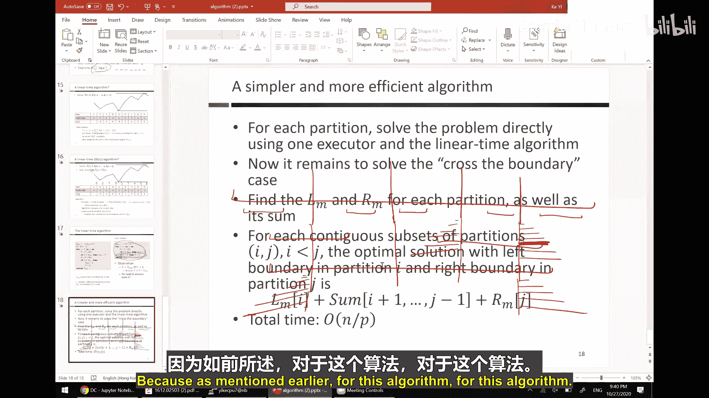
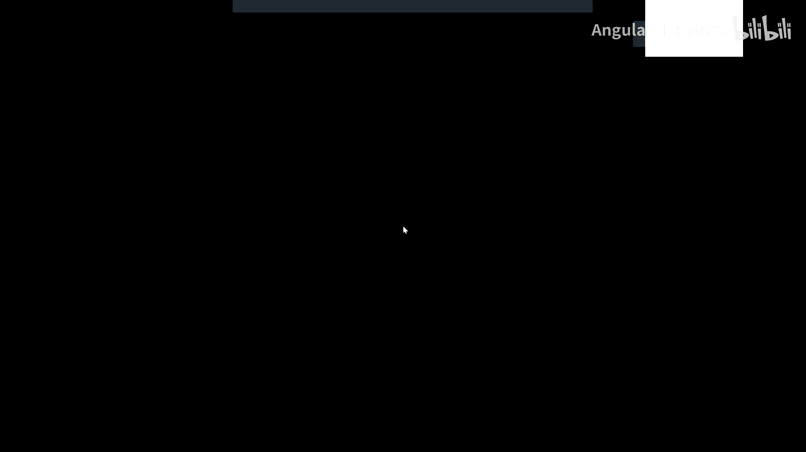
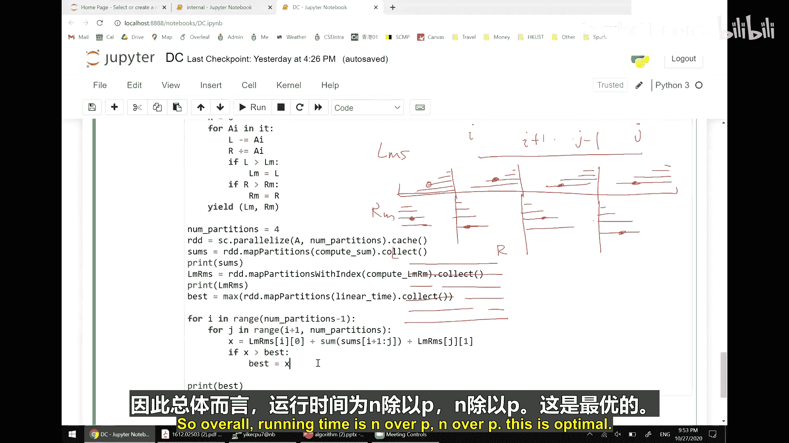

# 016：最大子数组问题

在本节课中，我们将学习一个经典算法问题——最大子数组问题。我们将从暴力解法开始，逐步介绍分治算法，并最终展示如何在Spark上高效地实现一个并行解决方案。

## 概述

最大子数组问题的目标是：给定一个包含正数和负数的数组，找到一个连续子数组，使得其元素之和最大。这个问题在实际中有很多应用，例如分析公司多年来的净利润，以找出盈利最高的年份区间。

## 暴力解法

首先，我们来看最直观的暴力解法。该算法枚举所有可能的子数组区间，计算每个区间的和，然后找出最大值。

以下是暴力解法的核心思路：
*   枚举所有可能的起始索引 `i` 和结束索引 `j`（其中 `i <= j`）。
*   对于每个区间 `[i, j]`，计算其元素之和。
*   记录遇到的最大和。

这个算法的时间复杂度是 **O(n³)**，因为存在 O(n²) 个区间，而计算每个区间的和需要 O(n) 时间。

我们可以通过前缀和进行一个小优化。首先计算所有以索引1开始的区间和（即前缀和），然后计算所有以索引2开始的区间和，依此类推。这样，计算每个新区间的和只需要常数时间，但总区间数仍是 O(n²)，因此时间复杂度优化为 **O(n²)**。

## 二分分治算法

上一节我们介绍了暴力解法，本节中我们来看看如何使用分治策略更高效地解决这个问题。经典的二分分治算法步骤如下：

1.  **分解**：将数组 `A[low...high]` 从中间位置 `mid` 分成两个子数组 `A[low...mid]` 和 `A[mid+1...high]`。
2.  **解决**：递归地求解左右两个子数组中的最大子数组和。我们得到两个局部最优解。
3.  **合并**：最大子数组可能跨越中点。这种情况下的子数组必然由左半部分的一个后缀和右半部分的一个前缀组成。因此，我们只需：
    *   在左半部分 `A[low...mid]` 中找到以 `mid` 结尾的最大后缀和。
    *   在右半部分 `A[mid+1...high]` 中找到以 `mid+1` 开头的最大前缀和。
    *   将这两个和相加，即得到跨越中点的最大子数组和。
4.  **最终解**：比较左半部分解、右半部分解和跨越中点的解，三者中的最大值即为整个数组的最大子数组和。

该算法的递归式为 **T(n) = 2T(n/2) + O(n)**，根据主定理，其时间复杂度为 **O(n log n)**。

以下是该算法的伪代码描述：
```
function FindMaxCrossingSubarray(A, low, mid, high):
    left-sum = -∞
    sum = 0
    for i = mid downto low:
        sum = sum + A[i]
        if sum > left-sum:
            left-sum = sum
            max-left = i

    right-sum = -∞
    sum = 0
    for j = mid+1 to high:
        sum = sum + A[j]
        if sum > right-sum:
            right-sum = sum
            max-right = j
    return (max-left, max-right, left-sum + right-sum)

function FindMaximumSubarray(A, low, high):
    if high == low:
        return (low, high, A[low]) // 只有一个元素
    else:
        mid = floor((low + high)/2)
        (left-low, left-high, left-sum) = FindMaximumSubarray(A, low, mid)
        (right-low, right-high, right-sum) = FindMaximumSubarray(A, mid+1, high)
        (cross-low, cross-high, cross-sum) = FindMaxCrossingSubarray(A, low, mid, high)
        if left-sum >= right-sum and left-sum >= cross-sum:
            return (left-low, left-high, left-sum)
        else if right-sum >= left-sum and right-sum >= cross-sum:
            return (right-low, right-high, right-sum)
        else:
            return (cross-low, cross-high, cross-sum)
```

## Kadane线性时间算法

虽然二分分治法将复杂度降到了 O(n log n)，但存在一个更优的 **O(n)** 线性时间算法，称为Kadane算法。

该算法仅需遍历数组一次，核心思想是维护一个“当前子数组和”。遍历每个元素时，将其加到当前和中。如果当前和变为负数，则将其重置为0（因为一个负数的前缀和不可能对后续的最大子数组做出贡献）。在整个过程中，记录遇到的最大当前和。

以下是Kadane算法的伪代码：
```
function Kadane(A):
    max_so_far = -∞
    max_ending_here = 0
    for i = 0 to n-1:
        max_ending_here = max_ending_here + A[i]
        if max_so_far < max_ending_here:
            max_so_far = max_ending_here
        if max_ending_here < 0:
            max_ending_here = 0
    return max_so_far
```

**直观理解**：将数组的前缀和想象成一条上下波动的曲线。最大子数组和对应的是这条曲线上某个“谷底”到后续某个“峰顶”的最大高度差。算法中“遇到负数则重置为0”的操作，相当于在遇到一个更低的“谷底”时，重新开始计算高度差，从而确保能找到全局最大的那个落差。

然而，Kadane算法是**固有串行**的，其中的重置操作（`if max_ending_here < 0: max_ending_here = 0`）难以直接并行化。

## 基于Spark的多路分治并行算法

上一节我们看到了高效的线性算法，但其串行特性限制了在分布式环境下的应用。本节我们将结合分治思想和Kadane算法，设计一个适合在Spark上运行的并行算法。

我们的目标是利用多路分治来减少递归层数，从而更高效地利用集群资源。假设我们将数据划分为 `P` 个分区（对应 `P` 个工作节点）。

算法步骤如下：

1.  **分区内求解**：在每个分区上，直接运行串行的Kadane算法，找到该分区内的最大子数组和。这一步的时间复杂度为 O(n/P)。





2.  **计算分区辅助信息**：为了处理跨越多个分区的子数组，我们需要为每个分区计算两个额外信息：
    *   `LM[i]`：分区 `i` 中，以分区**左边界**开始的最大前缀和（即分区内的最大后缀和，但从右向左计算时概念上等同于从左开始的最大前缀和）。
    *   `RM[i]`：分区 `i` 中，以分区**右边界**结束的最大后缀和（即分区内的最大前缀和）。
    *   `SUM[i]`：分区 `i` 内所有元素的总和。
    这些信息都可以在对每个分区的一次线性扫描中完成。

3.  **合并跨越分区的解**：最大子数组可能跨越连续的几个分区，例如从分区 `i` 开始，到分区 `j` 结束（`i <= j`）。对于任意一对 `(i, j)`，其候选的最大子数组和为：
    **`LM[i] + SUM[i+1] + SUM[i+2] + ... + SUM[j-1] + RM[j]`**
    其中，`SUM[i+1] ... SUM[j-1]` 代表了被完全包含的中间分区的总和。
    我们需要检查所有可能的 `(i, j)` 组合。虽然组合数量是 O(P²)，但由于分区数 `P` 通常远小于数据总量 `n`，这部分开销是可接受的。

以下是该算法在Spark中的实现框架：
```python
# 假设 rdd 已经被划分为 P 个分区
# 1. 计算每个分区的总和 (SUM)
partition_sums = rdd.mapPartitions(lambda iter: [sum(iter)]).collect()

# 2. 在每个分区上计算内部最大和 (max_inside), LM, RM
def compute_partition_info(iterator):
    # 将迭代器转换为列表以便多次遍历（或使用更高效的单次扫描方法）
    data = list(iterator)
    # 使用Kadane算法计算分区内最大子数组和 max_inside
    max_inside = kadane(data)
    # 计算 LM (本分区内从左边开始的最大前缀和)
    lm = max_prefix_sum(data)
    # 计算 RM (本分区内以右边结束的最大后缀和)
    rm = max_suffix_sum(data)
    return [(max_inside, lm, rm)]

partition_infos = rdd.mapPartitions(compute_partition_info).collect()

# 3. 收集所有分区信息后，在Driver端合并结果
best = max([info[0] for info in partition_infos]) # 先取分区内最优解
P = len(partition_sums)
prefix_sums_of_sums = [0] * (P+1)
for i in range(P):
    prefix_sums_of_sums[i+1] = prefix_sums_of_sums[i] + partition_sums[i]

for i in range(P):
    for j in range(i, P):
        # 计算跨越分区 i 到 j 的子数组和
        # 和 = LM[i] + (SUM[i+1]+...+SUM[j-1]) + RM[j]
        cross_sum = partition_infos[i][1] # LM[i]
        if j > i:
            cross_sum += (prefix_sums_of_sums[j] - prefix_sums_of_sums[i+1]) # 中间分区总和
        if j > i:
            cross_sum += partition_infos[j][2] # RM[j]
        else:
            # 如果 i==j，RM已经包含在LM的计算中或需要特殊处理，这里简化为取LM和RM的较大值
            cross_sum = max(partition_infos[i][1], partition_infos[i][2])
        best = max(best, cross_sum)

print("最大子数组和为:", best)
```

**算法复杂度分析**：
*   步骤1（计算分区和）：O(n/P)
*   步骤2（分区内计算）：O(n/P)
*   步骤3（合并跨越分区解）：O(P²)
由于 `P`（分区数/机器数）通常很小，且 `n/P >> P`，总体时间复杂度近似为 **O(n/P)**，这达到了并行算法的理想加速比。

## 总结



本节课中我们一起学习了最大子数组问题。我们从最基础的 O(n³) 暴力解法出发，了解了 O(n²) 的优化暴力解。接着，我们深入探讨了 O(n log n) 的二分分治算法。然后，我们介绍了最优的 O(n) 线性时间 Kadane 算法，并分析了其串行特性。最后，为了在Spark这样的分布式计算框架上高效解决问题，我们设计了一个基于多路分治的并行算法。该算法先在每个分区上并行运行线性算法，再通过组合分区的局部最优解和边界信息（LM, RM, SUM）来找到全局最优解，实现了近乎线性的并行加速，是处理海量数据下此类问题的有效方法。