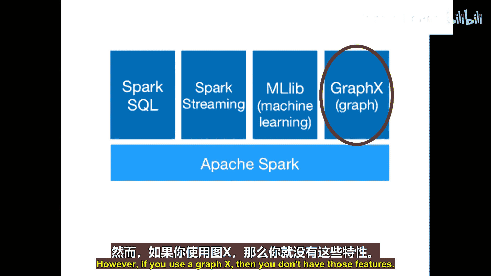
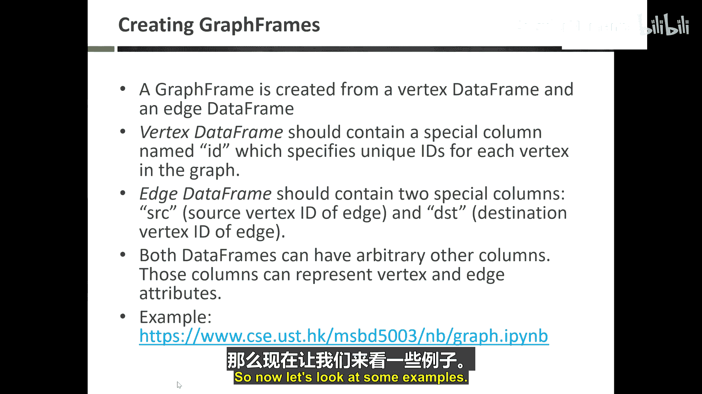
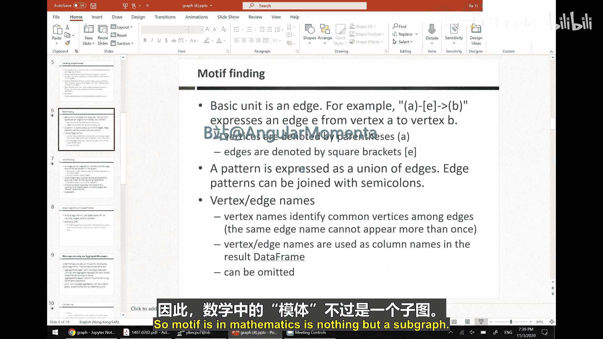
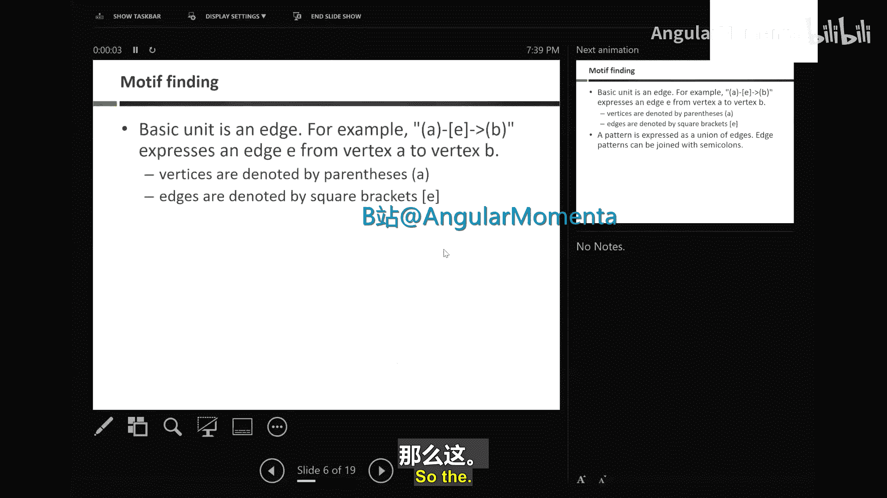
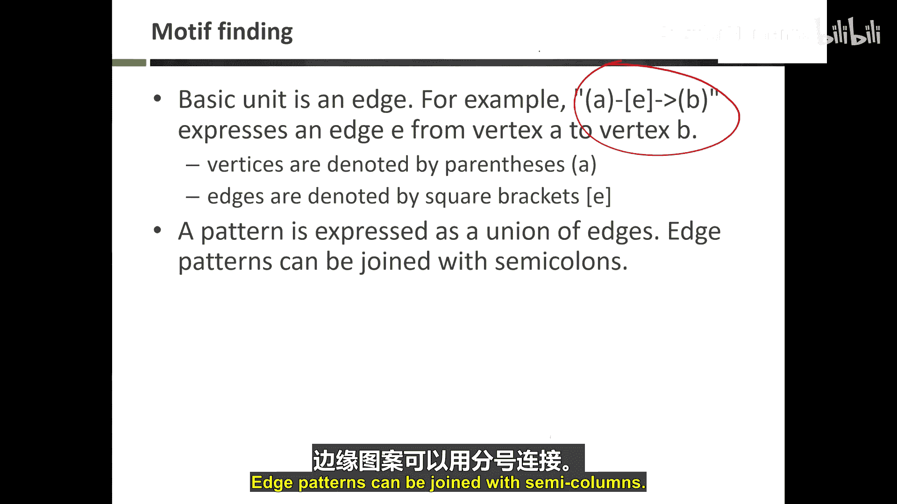
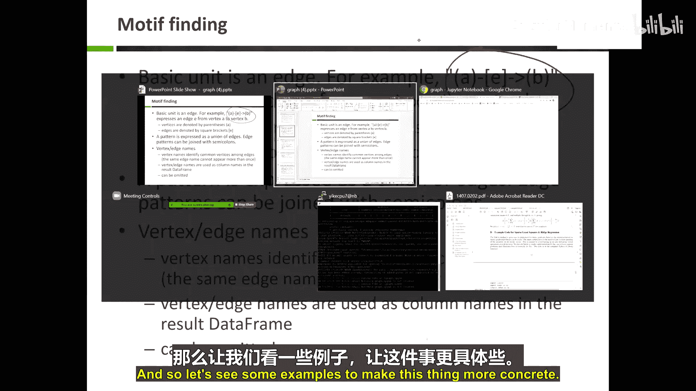
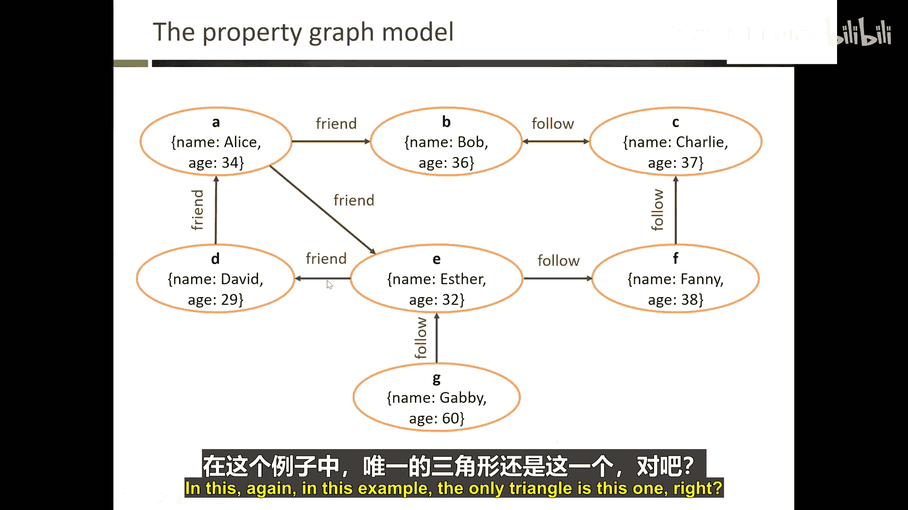
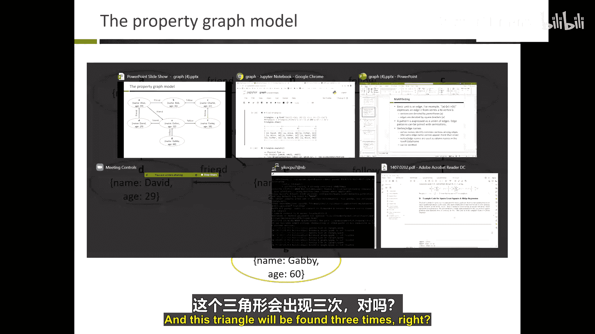
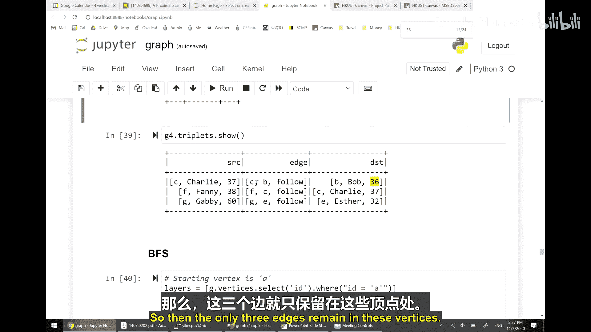

# 017：GraphFrames基础 🚀

在本节课中，我们将要学习一个专门用于图数据处理的重要库——GraphFrames。我们将了解它为何优于Spark内置的GraphX，学习其核心概念和基本操作，并通过一系列示例掌握如何使用它来构建、查询和分析图数据。

## 为何选择GraphFrames？🤔

在讨论图算法之前，我们需要介绍一个专门为图处理设计的库。图数据有其独特的特性，仅使用RDD或DataFrame难以轻松处理。Spark有自己的库叫GraphX。GraphX构建在RDD之上，属于旧模型。这个趋势与MLlib类似，旧版本基于RDD，而新版本基于Spark SQL的DataFrame，因为后者在灵活性和性能方面更具优势。基于Spark SQL的机器学习库要好得多。

实际上，GraphX也面临同样的情况。然而，我不太清楚原因，他们还没有这样做。GraphX仍然是一个直接构建在RDD之上的库，因此在性能和灵活性方面都不是很好。此外，它只支持Scala，没有Python接口。

幸运的是，有一个第三方包叫GraphFrames。GraphFrames构建在DataFrame之上。因此，我们将使用GraphFrames。但GraphFrames没有与Spark捆绑在一起，需要自行安装。安装说明也可以在课程网站上找到。如果安装GraphFrames遇到困难，可以联系助教。实际上，安装并不太难。

阅读文档时，他们提到最终计划是将GraphFrames集成到Spark中。但目前它们仍然是分开的。GraphFrames完全构建在DataFrame之上，没有对Spark内核做任何修改。这意味着，如果升级Spark，GraphFrames仍然可以工作。GraphFrames实际上适用于任何版本的Spark SQL。另一个好处是，当Spark SQL，特别是优化器，有任何进一步的改进时，所有好处都会被GraphFrames继承。然而，如果使用GraphX，则无法获得这些特性。

这就是为什么我们要使用GraphFrames。GraphFrames也有Python接口，这非常好。

## GraphFrames的核心概念与优势 📊

除了性能，GraphFrames由于构建在DataFrame之上，继承了许多灵活性和表达性特性。因为在实际应用中，图数据不仅有结构，通常还有其他属性。

例如，这个例子展示了一个非常小的社交网络。在这个例子中，顶点代表用户，边代表他们的关系。可以想象，顶点和边都可能具有其他属性。例如，用户可能有姓名、年龄、地址、电话号码等。边可以代表不同类型的关係，如友谊、关注、合著关系或买卖关系。因此，顶点和边都可以有额外的属性。这使得DataFrame或关系模型非常适合存储这类图数据。这类图也被称为带标签的图，顶点和边都可以有额外的标签。

另一个例子是知识图谱。在知识图谱中，现实世界中的实体被建模为顶点，它们之间的关系（包括关系和属性）被建模为边。因此，知识图谱也可以存储为带标签的图。

## 创建GraphFrames图 🛠️

在任何使用GraphFrames的Jupyter笔记本中，你需要在第一行添加这个jar文件，以便可以从graphframes导入。

这个例子展示了如何在GraphFrames中创建这个社交网络图。任何GraphFrame都由两个DataFrame组成：一个用于顶点，另一个用于边。

顶点DataFrame本质上是一个特殊的DataFrame，它有一个指定的列叫`id`，以及任意数量的可选列。这些可选列可用于存储顶点的任何其他属性。`id`列是必需的，并且必须是唯一的。

实际上，在创建这个DataFrame时，我们根本没有使用GraphFrame。这只是创建常规DataFrame的标准方法。

类似地，对于边DataFrame，它本质上是一个特殊的DataFrame，有两个必需的列：`src`（源）和`dst`（目标）。这个DataFrame必须有这两列，以及任意数量的可选列，比如这里的`relationship`。

顺便说一下，GraphFrames中的所有图都是有向的。也就是说，源和目标之间有区别。从A到B的边并不意味着必须有从B到A的边。所有边都是有向的。如果你想建模无向图，你需要创建两个方向相反的边。

创建顶点DataFrame和边DataFrame后，你可以通过调用graphframes包的构造函数来创建GraphFrame，向其提供顶点DataFrame和边DataFrame。`g`将是一个GraphFrame。`g.vertices`和`g.edges`是GraphFrame的成员。它们仍然是常规的DataFrame，这意味着你可以在它们上应用任何标准的DataFrame操作。例如，你可以使用`show()`。

`g.vertices`和`g.edges`只是常规的DataFrame，这意味着你可以对它们使用任何DataFrame API。例如，这里我们使用过滤器，条件是`src`等于`'a'`。回想一下，这个条件遵循SQL语法，因此使用单个等号。这将给出从顶点`a`出发的所有出边。这实际上给出了顶点`a`的出度。

因为边也有可选列，你可以做更复杂的查询，比如这个。这将计算`c`的关注者数量。条件是`dst`是`'c'`，并且`relationship`是`'follow'`，然后进行计数。确实，`c`有两个关注者：`b`和`f`。

当然，这只是使用标准的DataFrame API。GraphFrames包有一些额外的特性。例如，它有`outDegrees`方法，可以给出所有顶点的出度。`outDegrees`本身是另一个DataFrame，包含两列：`id`和`outDegree`。类似地，`inDegrees`可以列出所有顶点的入度。

但如前所述，GraphFrames是在DataFrame之上实现的。因此，`outDegrees`和`inDegrees`实际上都被翻译成标准的DataFrame API。更准确地说，它们都没有被物化。当你创建GraphFrame时，这两个表实际上没有被计算。这实际上是有道理的，因为为什么要在你真正需要它们之前计算呢？这仍然遵循Spark通用的惰性计算思想。

当你创建GraphFrame时，这些DataFrame只是被定义，并没有被计算。只有当你对这些DataFrame调用某些操作（如`show()`）时，才会触发`outDegrees`和`inDegrees`的计算。你实际上可以查看物理计划。本质上，它们执行扫描、投影和聚合。GraphFrames所做的，无非是定义`inDegrees`为一系列涉及`groupBy`、`count`和重命名列的DataFrame操作。

通过手动计算`inDegrees`，使用`groupBy` `dst`、`count`，然后重命名列，并通过检查物理计划，你可以看到这与`inDegrees`的物理计划完全相同。这实际上验证了我们的说法：GraphFrames中的`inDegrees`无非是这一系列DataFrame操作的包装器。

它们没有被物化，因为如前所述，它们希望受益于底层Spark SQL的所有优化。类似地，你可以进一步检查它们是否被物化。序列化本质上意味着它没有被缓存或物化。默认情况下，`inDegrees`只是一个DataFrame，没有被物化。你仍然可以缓存`inDegrees`，这只不过是另一个DataFrame，然后这次它被物化了。

当你调用`g.cache()`时，整个GraphFrame可以被物化，然后顶点DataFrame和边DataFrame都将被物化。然而，对于`inDegrees`和`outDegrees`，它们仍然没有被物化。

GraphFrames提供的另一个有用特性是图的`triplets`视图。这给出了图的完整画面，包括所有结构信息以及任何附加属性。它逐一列出所有边，除了ID，还列出所有附加列。现在你可以获得关于每条边的完整信息。

当然，这有很多冗余。例如，`a`出现了两次，这意味着所有其他实际列也被复制了。因此，默认情况下，`triplets`视图最初也没有被物化。当你对这个`triplets`视图调用一个操作时，它会执行一系列连接操作。例如，它将边DataFrame与顶点DataFrame连接，以检索所有这些附加列。你可以查看`g.triplets.explain()`来了解。你可以看到它是一系列连接，至少有两个连接，因为每条边有两个顶点。为了检索源顶点的其他属性，检索目标顶点的其他信息，这需要两次连接。

## 使用Motif进行模式查找 🔍

实际上，他们借用了生物信息学中的这个术语。在数学中，motif无非是一个子图。事实证明，这个应用在生物信息学中非常有用，例如给定一个蛋白质网络（这是一个图，实际上是一个带标签的图），顶点带有标签代表不同的蛋白质。他们希望找到特定的模式，并称之为motif。因此，motif本质上是在一个大图中寻找的特殊模式。这个模式包括结构以及标签，标签可以同时在顶点和边上。

在motif中，基本单位是一条边，边被表示为一个字符串。实际上，在GraphFrames中，他们将整个motif表示为一个大的字符串。他们使用字符串来表示在大图中寻找的模式。模式中的基本单位是边，表示如下：他们使用括号表示顶点，使用方括号表示边。这表示从顶点`a`到顶点`b`的一条边`e`。

模式被表示为一组边。边模式可以用分号连接。让我们看一些例子，使这个概念更具体。

作为第一个例子，假设我们正在寻找一个非常简单的模式：双向边。请记住，在GraphFrames中，图是有向的。从`a`到`b`的边并不意味着有从`b`到`a`的边。因此，如果你想表示双向边，你需要包含两条边，每条边一个方向。

现在假设我们想要找到所有这样的双向边，从`a`到`b`，以及从`b`到`a`。这可以很容易地实现。通过调用`find`方法进行motif查找。`find`是GraphFrames中的motif查找方法，它接受一个参数，即表示模式的字符串。它表示我的motif由两条边组成：一条从`a`到`b`，另一条从`b`到`a`。注意，边的标签被省略了。这意味着我们不关心标签。实际上，当我们在这里省略边或顶点的标签或名称时，意味着在输出或表示模式时不需要它。如果我们为顶点或边写一个名称，那么它将被包含在输出中。同时，我们也可以用它来表示motif的结构属性。

这里，当然，两个`a`表示它们必须代表同一个顶点。我们可以运行它。如果我们使用的图仍然是这个简单的示例图，你可以看到唯一的双向边是`b`到`c`这条。然而，这里返回了两个结果，它们实际上指的是同一个双向边。顺序被交换了。这实际上是有道理的，因为当你写这个模式时，`a`和`b`代表不同的顶点。在一个结果中，`a`是Charlie，另一个结果中`a`是Bob。它们确实可以被视为两个不同的结果，尽管逻辑上是同一个东西。

为了删除重复项或逻辑重复，我们可以添加一个过滤器。例如，这只是其中一个例子，你也可以使用`a.id > b.id`，或者使用`a.name < b.name`，任何打破平局的方法都有效。然而，使用`name`是危险的，因为如果两个人有相同的名字，你就会错过那些边。所以最好使用`id`作为打破平局的条件，因为`id`保证是唯一的。

当我们添加这个打破平局的条件时，我们就可以删除重复项，只留下一条边，其中`a`的`id`必须小于`b`的`id`。这是第一个简单的例子。

在第二个例子中，我们可以使用motif查找来找到所有三角形。更准确地说，因为图是有向的，边是有向的。我们寻找的更准确地说是定向三角形，即有一条从`a`到`b`的边，一条从`b`到`c`的边，以及一条从`c`回到`a`的边。这实际上是一个有向环。类似地，如果我们没有这个打破平局的条件，那么每个三角形将被找到三次，因为你可以旋转三角形三次。在这个例子中，唯一的三角形是`a`、`e`、`b`这个。这个三角形将被找到三次。你可以通过添加这个打破平局的条件来删除重复项：`a`必须小于`d`，并且`a`必须小于`c`，即`a`必须是最小的。这将删除所有重复项。类似地，你也可以要求`a`是最大的，或者`c`是最小的，或者`c`是最大的。任何打破平局的方法都有效。

## Motif查找的实现原理 ⚙️

我之前说过，这是GraphFrames提供的一些新功能。然而，motif查找是如何实现的呢？你可以通过使用`triangles.explain()`来查看它是如何实现的。`triangles`是这个motif查找的结果。它是一个结果DataFrame。你可以看到它实际上只不过是另一个非常复杂的Spark查询。如果你真的深入研究，你可以看到它是由6次连接完成的。为什么是6次连接？本质上，他们实现这个三角形查找的方法是：取这个边关系，将其与自身连接，连接条件是第一条边的目标必须等于第二条边的源，第二条边的目标必须等于第三条边的源，然后第三条边的目标必须等于第一条边的源。对于三角形，他们需要三次连接，这称为自连接，因为它是将边关系与自身连接。

但为什么我们还需要另外三次连接？你可以查看输出。输出不仅告诉你三角形中三个顶点的ID，还告诉你所有其他属性，比如Alice的名字和年龄。这些信息并不存储在边关系中，而是存储在顶点数据中。因此，在找到三个顶点的ID之后，他们需要另外三次连接来检索与顶点相关的其他属性。如果你数一下，你应该能找到三次连接，总共六次连接。

对于三角形，为了形成一个三角形，他们将第一条边DataFrame与第二条边DataFrame连接，然后将结果与第三条边DataFrame连接。最后一次实际上不是通过连接执行的，而是通过一个相等性过滤器。即，第一条边的源必须等于第三条边的目标。因为在两次连接之后，我们已经将三个边关系连接在一起，我们已经找到了所有长度为3的路径。这是通过两次连接完成的。然后它检查这个长度为3的路径是否实际上形成一个环。最后一次不需要连接，它只是一个过滤器，是一个相等性检查。所以实际上是五次连接加上一个过滤条件。然后他们使用另外三次连接来检索其他条件。这就是三角形查找。

## 使用否定和复杂条件 🔧

接下来，他们还支持否定。一条边可以被否定，以表示该边不应出现在图中。他们可以使用这个来找到图中的特定模式。例如，如果我们想找到所有的单向边。即，你有一条从`a`到`b`的边，但没有从`b`回到`a`的边。在这种情况下，你可以找到所有的单向边。引入否定实际上非常重要，因为没有否定，某些模式你无法找到，例如单向边。更根本的是，可以证明，通过允许否定，你实际上可以实现整个关系代数。本质上，SQL中的所有功能都可以通过motif查找来处理。如果你学过数理逻辑，你会知道，通过允许并集、合取以及否定，你可以表达整个一阶逻辑。因此，任何可以用一阶逻辑表示的图模式都可以通过motif查找捕获。这就是为什么引入否定非常重要。

motif查找的强大之处在于，motif查找仍然只返回DataFrame。这意味着你可以在motif查找的结果上应用任何其他DataFrame操作。例如，如果我们想说我们想找到所有的双向边，其中其中一个顶点的年龄大于36。这可以按如下方式完成。首先找到所有的双向边，然后进行过滤，因为这个返回DataFrame，你可以在其上应用任何其他DataFrame操作。

更美妙的是，你实际上不必担心效率。实际上，这是一种非常糟糕的查询执行方式，因为我们可能有很多边，但也许只有少数人满足这个过滤条件。因此，如果我们先执行motif查找，然后再进行过滤，这可能会非常慢。这不是一种非常聪明的方式，因为motif查找，正如我们之前看到的，涉及很多连接。在这个例子中，涉及三次连接。每次连接都非常昂贵。因此，我们希望最小化连接的成本。

然而，因为`find`这个motif查找，无论它涉及多少连接，它仍然只是一个大的转换。它不是动作。过滤是另一个转换。唯一的动作是`show()`。因此，当你执行这一行时，这会将整个查询发送到Spark SQL。在Spark SQL中，接收查询后会解析查询，构建逻辑计划，然后优化它。这是一个谓词，我们知道谓词可以下推，可以下推到连接之上。这个`find`，虽然它不使用连接爆炸，但它只不过是一堆连接。这个谓词可以被下推到连接之上。这意味着优化后，Spark实际上会先运行这个过滤器。更准确地说，我们需要在边的两个副本之间进行连接。在第一个边关系副本上，目标将应用这个条件。在第二个边关系副本上，源将应用这个过滤条件。这个过滤函数实际上会被下推到两个DataFrame、两个关系上。

你可以实际检查这个来验证我们的猜想。过滤器在哪里？是的，过滤条件是`age > 36`。这里有一个，那里有另一个。这意味着你实际上不必担心查询是如何编写的。优化器将能够找到不一定最好但会尽力优化你的查询的方法。

下一个例子相当复杂。这也是一个很好的机会来介绍SQL中另一个有用的函数。在SQL中，有一个叫做`CASE WHEN`的东西。这非常强大，因为在SQL中，没有`if-then`，因为本质上，你只能对表中的所有行做相同的事情。你不能说我对某些行做某些事情，对其他行做不同的事情。那是不可能的。你只能对不同列做不同的事情。然而，所有行必须以相同的方式处理。但是，借助`CASE WHEN`关键字子句，你基本上可以根据行的值对不同行做不同的事情。类似地，这也被迁移到了Spark SQL，即`when`和`otherwise`函数。

这个任务如下：我们仍然给定一个存储在GraphFrames中的图，我们想要找到四个顶点的链。使得三个边中至少有两个是朋友关系。这是一个非常复杂的条件。我们首先要找到所有四个顶点的链`a`、`b`、`c`、`d`。这四个顶点将有三条边。在我们的图中，边有标签。在这个例子中，我们有两种类型的边：`friend`和`follow`。在三条边中，我希望至少两条是`friend`。第三条可以是`friend`或`follow`。这就是我们要寻找的模式。我认为这实际上是一个很好的例子，说明了如何将motif查找与Spark SQL提供的其他功能结合起来。

第一步很简单。第一步就是找到链。这就是motif查找的设计目的。所以我们说`a`到`b`，`b`到`c`，`c`到`d`。在这种情况下，我们还为边添加了变量名。因为稍后，我们的条件需要根据边上的标签进行检查。所以我们需要这些标签。我们需要这些边在motif查找的结果DataFrame中。因此，我们不仅需要这些顶点，还需要边`e1`、`e2`和`e3`的信息。这只是一个链。我们不希望`a`和`d`是同一个东西，否则我们就会找到一个环。所以我们也添加这个条件。实际上，在这个定义中，这并不精确。例如，用户可能还需要`a`和`c`应该不同。如果我们这里没有，我认为我们应该有，因为链的直观含义是你不会重复顶点。所以如果我们想要，我们可以添加`a != c`和`b != d`。`a`和`b`不能是同一个东西，因为`a`和`b`来自同一条边，图不应该有自环。当然，在某些特殊图中，自环也是允许的。但当我们说简单图时，我们不允许自环。因此，如果我们没有自环，那么这三个条件是我们唯一需要检查的。我认为这样可以确保链不会重复同一个顶点。

现在我们已经找到了所有四个顶点的链。下一步是根据这个条件进行检查。三条边中至少两条是朋友。当然，有不止一种方法可以做到这一点。我只是展示其中一种方式。这种方式更通用，可以更容易地扩展到类似的其他条件。

第一步是将边转换为一个指示器0或1，其中1表示这条边是朋友边，0表示这条边是其他边。然后我们将这些指示器相加，这样我们就可以计算三条边中有多少条是朋友边。

为此，我引入了这个函数`friend_to_one`。顾名思义，它将任何朋友边转换为1，否则为0。它被定义为一个lambda函数。当然，你也可以使用显式的`def`方式来定义`friend_to_one`，但这是更简洁的方式。`friend_to_one`是一个指向函数的变量。所以它是一个函数。在Python中，变量可以代表任何东西，甚至函数。这里的`e`将引用DataFrame中的一列。

让我们先忽略这个，看看如何使用`friend_to_one`。我们在`select`内部使用`friend_to_one`。当我们在`select`内部使用一个函数时，输入和输出都必须是一列。因此，输入，例如这个，我们只取`e1`。记住，`chain4`是这个motif查找的结果DataFrame，`e1`是它的列之一。`e2`和`e3`也是。这指的是代表第一条边`e1`的列。这是第二条，这是第三条。对于每一条边，我将其输入到`friend_to_one`函数中。所以这是输入列。输出列由`when`函数指定。实际上，`when`函数定义在`pyspark.sql.functions`包中。事实上，所有标准的SQL函数都已移植到Spark SQL中。

`when`函数有两个参数。第一个是一个条件，实际上是关于列的条件。条件是检查是否为朋友关系。所以`e`是一个列。为了检索子列，我们可以使用点格式。例如，你可以看到`a.id`。如果我想获取其他信息，比如`e.relationship`，那么我得到`follow`。你可以使用点来检索子字段、子列。这就是我们在这里的做法。这里`e`已经是一个列。`e.relationship`检索这个边列下的子列，我们检查它是否等于`friend`。如果这个条件为真，则返回1。这是`when`的第二个参数。然后你可以选择性地附加一个`otherwise`。实际上，`when`可以链式调用。所以如果你有`if-else if-else`，即如果你有三种或更多可能性，你可以使用多个`when`。

现在，这个`friend_to_one`函数将会转换。我提到过，这个函数可以用来对不同行做不同的事情。即，如果那行是朋友关系行，那么它就是1，否则变成0。然后我们将结果列重命名为`f1`、`f2`和`f3`。原因是如果你不重命名，在下一步中你将无法引用它。

在这之后，我们有了三个新列`f1`、`f2`、`f3`，因为我们保留了所有列，然后添加了三个新列。然后我们可以简单地将它们相加，这个和应该至少为2。然后我投影到四列`a`、`b`、`c`、`d`上。如果我们不投影，我们实际上可以查看整个结果。我们可以看到我们有`a`、`e1`、`b`、`e2`、`c`、`e3`、`d`，并且`e1`、`e2`、`e3`已经被转换为`f1`、`f2`、`f3`，它们都是0和1，表示是朋友关系还是关注关系。例如，这里`friend`、`friend`、`follow`，所以是1。

## 构建子图 🌲

Motif查找是构建子图的一种方式。但这并不是非常高效，因为正如我们所见，motif查找涉及大量连接。因此，motif查找只在你寻找特定小模式（如三角形、链或双向边等）时高效。如果你只是希望将图缩小为一个更小的图，那么应该使用子图构建。Motif查找是寻找一个可能出现多次的模式。子图指的是你只想通过关注一个较小的部分来使图变小。它只返回一个子图。在这种情况下，我们可以使用子图构建。

这实际上没有什么特别的。要构建一个子图，我们只需构建一个新的DataFrame，由选定的顶点和边组成。然而，必须小心，因为当你构造一个新的GraphFrame时，GraphFrame不会真正检查任何一致性。这将在以下示例中说明。

假设我只对用户年龄大于30且边类型为`friend`的子图感兴趣。我想找到所有老朋友的小型社交网络。这看起来很容易。首先，我过滤掉所有年龄大于30的顶点。然后我过滤掉所有关系为`friend`的边。然后，我简单地构建一个新的图。这看起来没问题。确实，如果我们看`g2`，`g2`是子图。确实，所有人都是老家伙，所有关系都是朋友。看起来很好。然而，这个图实际上是不一致的。图的不一致有两种方式。第一种不太严重，即一个顶点可能是孤立的。例如，`g`，这个可怜的家伙，没有边连接到他。确实，如果我们看这个，`g`上唯一的边是一条关注边。所以`g`变成了孤立的顶点。这种情况实际上没问题，因为在某些图中，孤立的顶点可能不是很有用，但不能说是不一致。

另一种不一致可能很严重，即一条边可能连接到不存在的顶点。例如，边`e`到`d`。你可以检查`e`到`d`这条边。`d`不存在，因为`d`是一个29岁的年轻人，他没有通过过滤。但GraphFrame在构造GraphFrame时不会检查。实际上，这个构造函数什么都不做。它只告诉GraphFrame，我现在正在构建一个新图，顶点存储在`v2`中，边存储在`e2`中。我不保证一致性。所以GraphFrame不负责检查我的数据是否一致。

这就是为什么必须采取措施确保一致性。如果你不这样做，你仍然可以运行某些操作。例如，你仍然可以计算入度。入度仍然有效，因为记住，入度只不过是对边关系进行`groupBy`。它甚至不看顶点DataFrame。所以入度会告诉你`d`仍然有入度1，即使`d`甚至不存在于顶点中。然而，这种不一致可能会在运行其他更复杂的操作或算法时导致问题。

那么我们如何清理，确保消除所有不一致？我们只关心第二种，即边必须连接到存在的顶点。方法是使用我们现在称为半连接的操作。这是一种我们尚未介绍的新型连接。虽然它被称为半连接，但它实际上是一个过滤器。它被称为连接，但它实际上是一个过滤器，只不过过滤条件是通过连接执行的。

半连接做什么？半连接类似于外连接，它也是不对称的。这就是为什么有左半连接和右半连接的区别。在左半连接中，这实际上是对左侧DataFrame的过滤。当我们执行`e2.join(v2, ...)`时，`e2`在左侧。半连接的结果必须是`e2`的子集。过滤条件表示为连接条件。即，`e2`中任何边的源必须匹配右侧DataFrame中某个顶点的`id`。

半连接与内连接或外连接的区别在于，输出不包括右侧的任何属性或列。例如，这里`v2`也有姓名和年龄，这些列将被忽略。我们唯一需要右侧关系或DataFrame的地方是检查这个连接条件，确保在右侧DataFrame中至少有一行满足这个连接条件。这就是为什么我们说，虽然它被称为连接，但更像一个过滤器。只不过这里的过滤条件更复杂。过滤条件是说，你必须匹配我右侧的至少一行。因此，这本质上确保了每条边的源必须出现在顶点DataFrame中。

然后我们接着进行另一个半连接，确保目标也出现在顶点DataFrame中。然后我们的图就是一致的。实际上，只有两条边通过了这个条件：`a-e`和`a-b`。另一条边涉及`d`，所以被移除了。

聊天中的几个问题：它就像`EXISTS`吗？是的，完全正确。在SQL中，有一个子句叫`EXISTS`。实际上，在SQL中也有半连接。但`EXISTS`也有效。第二个问题：我们可以使用左外连接然后使用过滤器吗？是的，那也有效。你可以使用左外连接，然后删除。实际上，在这种情况下，你可以直接使用内连接。你使用内连接，然后投影左侧的列。本质上，这意味着你也可以使用内连接。实际上，在关系代数中，只有内连接是必要的。外连接和半连接都可以被替换。它们可以被内连接加上其他标准操作（如投影）所替代。它们只是为了方便和性能而引入的，并不是真正必要的。

## 更复杂的子图构建示例 🧩

让我们看另一个更复杂的例子。我们想基于类型为`follow`、从老用户指向年轻用户的边来构建一个子图。当然，有不止一种方法可以做到这一点。这里我展示如何使用motif查找。当然，这里的motif非常简单，只有一条边，你不需要使用motif查找。实际上，当我们做`find("(a)-[e]->(b)")`时，这简单地返回三元组视图。我们也可以使用`triplets`。无论如何，这只是一个例子，展示你可以使用不同的方式达到相同的结果，甚至在性能方面它们都是相同的，因为它们对应于相同的查询计划。因此，我们不必太担心应该使用哪种特定方式，这正是Spark SQL的美妙之处。

我们简单地找到所有边`(a)-[e]->(b)`，然后边类型必须是`follow`，并且源顶点的年龄必须大于目标顶点的年龄，即从老用户到年轻用户。然后我选择`e.*`。这本质上是一种选择列内所有子列的方法。这是所有关注边的结果。

在这个子图构建中，我对顶点没有任何限制。当然，如果顶点被移除，所有关联的边也应该被移除。这是出于一致性原因。这就是为什么我们只需要保留出现在边中的顶点。这是通过半连接加并集完成的。第一个半连接找到所有作为至少一条边的源出现的顶点。即，我找到所有边，与`e4`（所有幸存下来的边）进行连接，并且`id`必须匹配源。这是左半连接。我认为他们支持左半连接和右半连接。他们让这个功能非常用户友好。

第二个半连接做的是，我们还需要保留作为边目标出现的顶点。然后我执行并集，并去重，因为记住，并集不会删除重复项，它只是将两个DataFrame组合在一起。这实际上解决了第一种不一致，这不是必需的。即使我们不这样做，我们也可能有一些孤立的顶点。这不是大问题。但如果你想使数据更整洁，清理数据，那么你可以这样做，只保留出现在边中的顶点。现在我们可以构造图了。

这就是`g4`。然后我们可以查看子图的三元组视图的完整画面。即只有三条边，以及这些顶点。

## 总结 📝

在本节课中，我们一起学习了GraphFrames的基础知识。我们了解了GraphFrames相比GraphX的优势，包括其基于DataFrame的架构带来的灵活性、性能以及对Python的支持。我们学习了如何创建GraphFrame，如何查询顶点和边，以及如何使用`outDegrees`、`inDegrees`和`triplets`等内置方法。我们深入探讨了强大的motif查找功能，它允许我们使用声明性字符串模式在图中查找特定子结构，并支持否定和复杂条件。我们还学习了如何通过过滤顶点和边来构建子图，并确保图的一致性，使用了半连接等技术。最后，我们通过一系列从简单到复杂的示例，实践了如何使用GraphFrames进行实际的数据操作和分析。掌握GraphFrames是进行大规模图处理和分析的重要一步。