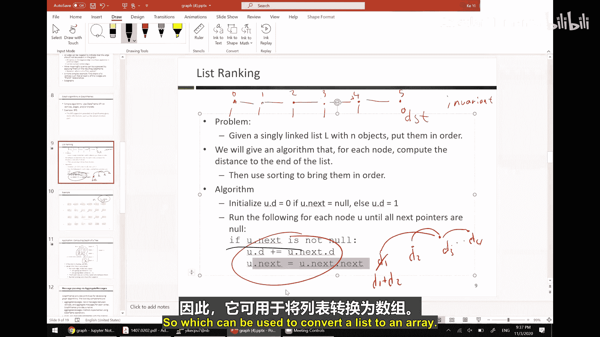
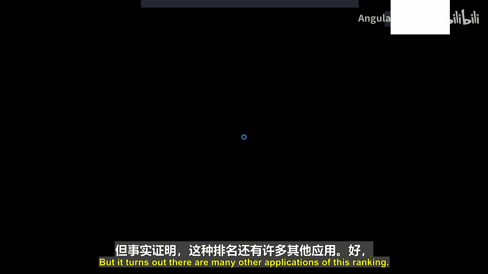
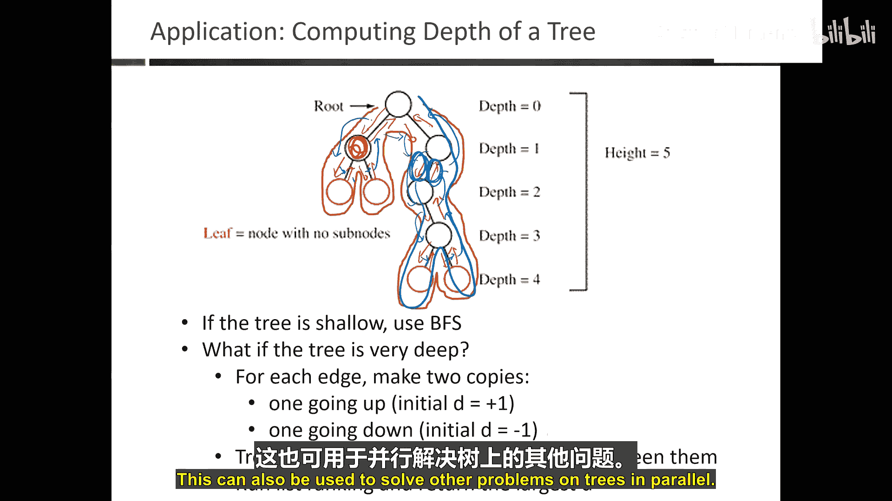

# 018：图算法与并行计算

在本节课中，我们将学习图算法，特别是如何在并行计算环境中处理图数据。我们将从广度优先搜索开始，探讨其实现与局限性，然后介绍一种用于处理长链图（如链表）的高效并行算法——列表排名算法，并了解其在树深度计算等场景中的应用。

## 图算法简介

上一节我们讨论了分治算法。然而，对于图数据，分割图结构非常困难。事实上，将一个图分割成两部分，同时最小化跨越边的数量，是一个已知的NP难问题。

如果随意分割一个图，可能会产生大量跨越边。这对于许多分治算法来说效率不高，因为理想情况下我们希望尽可能少地跨越边。但这个问题被证明是NP难的，因此非常困难。所以，人们必须研究处理图的其他方法。

当然，图算法领域有大量文献，而使其并行化更具挑战性。事实上，存在一个猜想，即某些图问题本质上是顺序执行的。理论家在讨论这种下界或负面结果时，通常指的是最坏情况。也就是说，你不能指望在所有情况下都高效地解决问题，总存在一些难以处理的困难实例。

其中一个被认为是本质上顺序执行的问题，就是广度优先搜索。

## 广度优先搜索

BFS即广度优先搜索。其过程是从一个源顶点开始，逐层探索其邻居。

例如，假设A是源顶点。从A开始执行BFS。A在第0层。然后在第1层，访问A的所有直接邻居（即一跳邻居），在这个例子中只有B和E。接着，从第1层的顶点出发，访问它们的一跳邻居，从而到达第2层。在这个例子中，B和E的邻居包括C、F和D。因此，C、F、D在第2层。然后迭代地进行这个过程，每次探索一层。

这个算法之所以称为“广度优先”，是因为我们希望逐层访问顶点。

BFS算法的性能取决于图的结构。如果图像一个长链，那么BFS可能效率很低。当图比较“浅”（即直径小）时，BFS效果更好。

图的一个重要参数是直径。图的直径定义为最长最短路径的长度。这有点令人困惑，它是最长的“最短路径”的长度。换句话说，你需要最多多少跳才能从图中任意一点到达另一点。

BFS的并行步骤数将等于图的直径。对于许多图，例如社交网络，有一个著名的“六度分隔”理论，声称社交网络的直径为6，意味着你最多通过6个人可以联系到世界上任何人。这表明许多现实世界中的图，尤其是社交网络，直径很小。因此，对于这类图，BFS是好的，并且易于并行化。

然而，也存在图直径非常大的情况，此时BFS会非常低效。但无论如何，让我们先看看低直径的情况。

## 在GraphFrames中实现BFS

BFS也能找到从源顶点出发的、跳数最短的路径。以下是我自己实现的BFS，尽管GraphFrames提供了更高效的内置BFS实现，可以直接调用。但作为一个示例，我将展示如何自己实现类似BFS的算法。假设你的项目是关于实现另一个图算法。

BFS实现起来并不复杂，但也不简单。你不能仅通过一个查询来完成，它必须有一个循环，因为我们需要逐层探索图。

第0层只包含一个顶点，即源顶点。我们通过`select`操作来实现，选择ID等于源顶点（例如‘A’）的顶点。这将返回一个DataFrame（尽管我们知道它只包含一个顶点），并将其放入一个Python列表中。这个列表由DataFrame组成，初始时只包含第0层。

实现BFS的一个重要操作是能够检查一个顶点是否已被访问过。例如，在探索完第2层后，需要进入第3层。当进入第3层时，假设D在第2层，D会尝试访问A，但A是源点，已经被访问过了。类似地，F会尝试访问C，而C也已在第2层被访问。在BFS中，一个顶点只有在第一次被访问时才被视为“已访问”。当你第二次尝试访问一个顶点时，这次尝试应该失败，因为第二次访问时，你不可能通过一条更短的路径到达它。第一次到达一个顶点必定对应着最短路径。

因此，我们需要记住所有已经访问过的顶点。我们使用一个名为`visited`的DataFrame，它只包含一列ID。初始时，只有源点被访问。

现在，我们进入循环。循环的每次迭代将探索一层。终止条件是最后一层为空，即没有更多顶点需要检查。

从当前层，我们想要获取所有一跳邻居。我们通过`join`操作来实现。当前层是最后一层的顶点ID列表。我们将其与所有边进行连接，条件是ID等于边的源点。这将返回一个包含多列的DataFrame，包括ID、目标顶点以及边的其他属性。这里我们不需要其他属性，但不必担心，Spark会通过列剪裁自动优化掉未使用的列。

现在，`D1`包含了所有一跳邻居（实际上是目标列）。我们投影出目标列，并赋予其新名称“ID”。然后，移除所有已经访问过的顶点。最后，执行`distinct`操作。为什么需要去重？因为连接操作中，如果两个不同的顶点试图到达同一个顶点，这个公共顶点会在结果的目标列中出现两次，所以需要去重。

现在，`D2`包含了这一层中新访问的所有顶点（无重复）。我们可以将其作为下一层添加到层列表中。对于已访问集合`visited`，我们执行`union`操作。这里不需要去重，因为我们已经保证了`D2`中的所有顶点都是新的（已减去已访问的顶点），这可以节省一次洗牌操作。

你可以看到，计算第0层非常高效快速，因为它不依赖于任何其他数据，图计算并未真正执行。对于第1层、第2层，需要更多时间。第3层为空，整个过程将停止。

然而，这种编写程序的方式效率不高，因为每一层都会多次重新计算。更好的方式是缓存中间DataFrame，例如缓存`D2`，可能`visited`也应该缓存，以避免多次重新计算同一层数据。

我们已经看到了如何实现BFS。同时我们也提到，如果图的直径小，BFS是高效的。在BFS中，我们逐层探索图，从一层到下一层。如果这是并行的，因为我们通过连接操作探索每一层，连接操作是洗牌操作，可以高效并行实现。然而，从一层到下一层，这是顺序执行的。你必须完成第i层才能进入第i+1层。因此，如果图的直径很大，BFS效率就不高。

事实上，一般来说，如何高效并行地进行BFS，或者更准确地说，如何在大直径图中高效并行地找到最短路径，这是一个非常困难的问题。

## 列表排名算法

然而，在极端情况下，当直径尽可能大时（图退化成一条单链），这个问题实际上可以通过一个相当巧妙的算法解决，称为列表排名。

在极端情况下，图退化成一条单链。源点是第一个节点，目标点是最后一个节点。我们想要找到路径。更准确地说，我们本质上需要遍历这个列表。

这实际上是计算机科学中的一个基本问题。如果你主修CS，你一定上过数据结构课程，我们用于任何程序的两个最基本的数据结构，一个叫链表，另一个叫数组。两者之间的区别在于，在链表中，你可以在列表中间高效插入元素，这可以在常数时间内完成。另一方面，在数组中插入元素成本很高，你必须移动插入元素之后的所有元素。而数组的好处是，你可以非常高效地进行查找。例如，我想去第1012个位置，你可以直接以常数时间到达。但这在链表中效率很低，你必须从头开始，一个一个遍历，直到到达所需位置。所以这两种结构之间存在权衡。

将一个数组转换为链表是简单的。你只需在数组中任意两个相邻元素之间建立指针，这甚至可以并行完成。将链表转换为数组，如果你想要顺序算法，这也很容易。你可以从头开始，逐个遍历列表，然后逐步构建数组。然而，如何并行地做这件事并不容易。如何用并行算法将链表转换为数组，这实际上是并行计算中最经典的算法之一，称为列表排名。

列表排名的问题如下：给定一个单链表和一组对象，我想将它们按顺序排列。本质上，要解决这个问题，足以找到每个元素的位置。也就是说，我需要找到这个位置编号。例如，源点位置为0，下一个是1，然后是2、3、4、5。如果我能够神奇地找到这些标签，那么我就完成了。然后，我可以使用排序将它们按顺序排列。在单机上，一旦有了位置编号，你可以直接将它们放入目标位置。在Spark或集群中，你可能需要进行排序，或者你可以通过洗牌操作将它们放到正确的位置。

但现在关键问题是如何找到这些位置编号。我将换一种方式来做。我不找0,1,2,3,4,5，我找每个顶点到目标点的距离。如果我能找到到目标点的距离，那么我可以很容易地找到位置编号。现在我将这个问题简化为为链表中的每个顶点找到到目标点的距离。

我们将通过迭代算法来完成，但这个迭代算法将是并行的。它会有几次迭代，但每次迭代中，我们可以并行地做很多事情。

更具体地说，我们如何做呢？我们首先初始化距离。如果下一个邻居是空（即目标点），则距离初始化为0。对于其他顶点，我初始化为1。当然，除了目标点外，这些初始距离都是错误的。

现在算法实际上非常简单，只有三行代码。我们在每个顶点上并行运行这三行代码。代码的意思是：如果这个节点有一个下一个邻居，我将做以下两步。第一步，我将把我邻居的距离加到我自己的距离上。然后，我将跳过这个邻居，即更新我的指针，使我的邻居指向我邻居的邻居。

例如，假设我们在第一个节点上运行这段代码。当然，它的下一个邻居不为空。所以，我把邻居的距离加到自己身上，所以这个距离变成2。然后我更新我的指针，使我的邻居指向我邻居的邻居（即下下个节点）。现在，我实际上是在修改我的图。我对每个节点并行地做同样的事情。

经过第一轮迭代后，我的链表看起来不再像链表，而是一个图。我再次运行整个过程，在所有节点上再次运行相同的代码。现在，步长加倍了。初始步长为1，第一轮后步长为2，然后4，然后8。每轮步长加倍。所以我们需要多少轮？log(n)轮。这是一个小数量的并行运行轮数。因此，这被认为是一个高效的算法。

然而，总工作量更大。总工作量是N乘以log(n)，因为每轮我们为每个顶点做一些事情。这比朴素的顺序算法（遍历整个链表）要慢。同样，这并不奇怪，对于任何并行算法，我们总是做更多的工作，但换来的是更短的并行时间。朴素的顺序算法有O(n)的工作量，但运行时间也是O(n)，因为你必须顺序地一个一个做，这在并行世界中效率很低。

这个算法为什么正确？关键观察是算法维持了一个不变式。初始时，我的链表看起来像这样，除了最后一个顶点外，所有距离都是1。我维持的不变式是：对于任何顶点，如果你将从该顶点可达的所有节点的距离加起来，那么它给出该顶点的正确距离。例如，从第一个顶点开始，它可以到达所有人，其距离是5。最后一个顶点不能到达任何人，其距离是0。这个不变式在初始时显然成立。现在只需要论证在每次操作后这个不变式仍然成立。因为代码所做的操作是：更新D1为D1 + D2，同时跳过D2，所以总和保持不变。因此，不变式仍然维持。在算法结束时，没有指针了，所以没有人可以到达任何其他人。再次代入不变式，意味着所有距离必须已经被正确计算出来。

## 在Spark中实现列表排名

在Spark中实现列表排名并不非常困难。首先，我初始化我的链表。为了说明，我使用整数作为元素的ID或标签。本质上，我将链表表示为一个图，尽管它是一个特殊的链。这些是边，意味着0指向5，1指向0，3指向4，等等。我故意省略了连续的标签，这些标签可以是任何整数、字符串等。特别地，我使用-1表示空，表示结束。

现在，我创建一个DataFrame作为边，源点和目标点如上。顶点是所有源点。我需要初始化距离。规则是：如果边的目标点是-1，这意味着这是最后一个顶点，初始距离D为0，否则为1。为了技术原因，我添加了一个额外的虚拟边，从一个标签为-1的虚拟顶点出发，距离也是0。这个虚拟顶点也会出现在顶点列表中。

现在，我进入循环。每次迭代对应一轮。我使用三元组视图，因为它为我们提供了源点和目标点的所有属性（包括D）。虽然在我们描述算法时，我们修改了链表，但DataFrame是不可变的，你无法就地更改DataFrame。更改的唯一方法是创建一个新的DataFrame。

如何创建新的DataFrame？我这样做：我有三元组视图，它包含ID以及其他属性（这里是D）。我选择源点的ID作为新DataFrame的ID。然后，我将源点和目标点的距离相加，作为新的D。这已经实现了算法应该做的事情。这里我没有显式检查“下一个邻居是否为空”的条件，我只是盲目地对每个顶点都这样做。为什么这样可行？因为在边数组中，当目标点是-1时，它的D总是0。所以即使我总是这样做，也没有任何影响。这就是为什么我们需要将虚拟顶点添加到顶点列表中，这样我就不必检查邻居是否为空。

我还需要更新所有指针。我无法更改它们，但可以创建一组新的边。新的边集是什么样的？它只是所有长度为2的路径：A到B，B到C。我保留A作为新源点，使C作为新目标点。当然，如果我只这样做，我可能会遗漏一种情况：从一个顶点到-1的边。所有这些边都会被删除，这不是我们想要的，因为我们需要记住这个顶点没有邻居。然而，如果我们移除这条边，我们将不知道这个顶点是否有邻居。所以我们需要保留所有目标点为-1的边。这样，在迭代中我们就不必检查条件了。

运行算法后，V得到以下结果。例如，顶点0的D值是1，确实，0到5，5是-1，所以0实际上是倒数第二个元素，距离是1。最后一个顶点是5。

## 列表排名的应用

列表排名不仅可以计算跳数距离，它本质上可以计算前缀和或后缀和。在这个算法中，当我初始化初始D时，我设置为0,1,1,1,1,1，但我可以设置为任何值。例如，我可以设置为2, -1, 4, -2, 1。然后如果我运行相同的算法，最终得到的是后缀和。类似地，你也可以计算前缀和。如果你计算了后缀和，你也可以计算总和，然后用总和减去后缀和得到前缀和。这是我们上次通过分治学习的前缀和。这可以被视为前缀和的图版本，其中数据以链表形式给出，而不是数组。如果数据以数组形式给出，我们使用分治；当数据以链表形式给出时，我们可以使用这个算法来计算前缀和。

作为一个应用，我们可以使用这个算法来查找树的深度。树的深度是最深节点的深度。例如，在这个例子中，深度是4。有些人使用树的高度，高度与深度是相同的概念，取决于你如何计算节点或边。在许多应用中，找到树的深度是有用的。如果树比较浅，你可以使用BFS，从根开始逐层遍历树，几轮之后你就完成了。但如果树非常深，BFS将会非常慢。但你可以使用列表排名，列表排名总是可以在log(n)轮内完成，无论树有多深。

我们究竟如何使用列表排名来计算树的深度？列表排名只适用于链表，但这里我们给定一棵树。如何将其转化为链表问题？技巧是使用所谓的欧拉回路技术。树的欧拉回路本质上就是中序遍历。我按中序遍历访问所有边。在这个遍历中，每条边被访问两次：一次向下，一次向上。向下对应第一次访问，向上方向对应整个子树遍历完成后返回。

我将这两次访问视为该边的两个副本。也就是说，每条边有两个副本：一个向下副本，一个向上副本。这是完全并行的，因为每条边独立地创建两个副本。

现在，我将在这些边的副本之间建立链接。规则非常简单且局部。对于一个节点，它有父节点和子节点。规则是：从我父节点来的边的向下副本，在链表中的邻居将是指向我第一个子节点的边的向下副本。这些边的副本将成为我链表中的节点，而它们之间的指针将成为链表中的边。

如果我对每个节点都这样做，我将得到一个大的链表，它精确地遵循我的中序遍历顺序。

最后，我如何为每个边副本分配初始D值？对于每个向下的树边，初始D为+1；对于每个向上的树边，初始D为-1。现在，如果我运行列表排名算法，最终与某条边关联的D值将对应于该边在树中的深度。这是因为在子树中，向下和向上的边会相互抵消，最终剩下的只是那些只被遍历过一次的边，其D值即为深度。

这就是欧拉回路技术，将树问题转化为链表问题。这样我就可以计算深度。这也可以用于并行解决树上的其他问题。

## 总结

本节课我们一起学习了图算法的基础。我们从广度优先搜索开始，了解了其逐层遍历的思想、在GraphFrames中的实现方式，以及其效率受图直径影响的特性。接着，我们探讨了对于长链或大直径图，BFS的局限性，并引入了一种高效的并行算法——列表排名算法。我们详细分析了该算法的原理、正确性证明及其在Spark中的实现。最后，我们看到了列表排名算法的强大之处，它不仅能处理链表排序，还能通过欧拉回路技术应用于树深度计算等问题，展示了将复杂图问题转化为可并行链表问题的巧妙思路。这些算法为在大数据环境下处理图结构提供了重要的工具和思想。