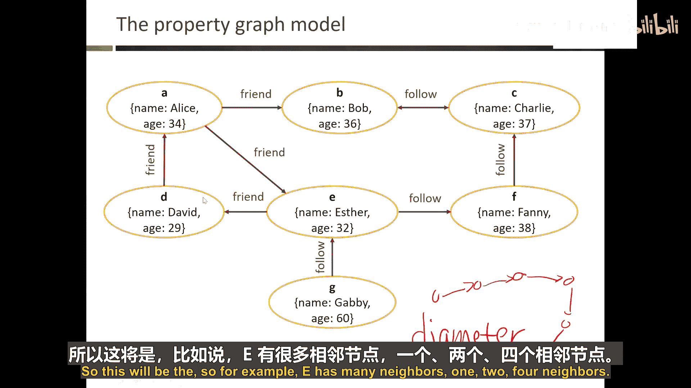
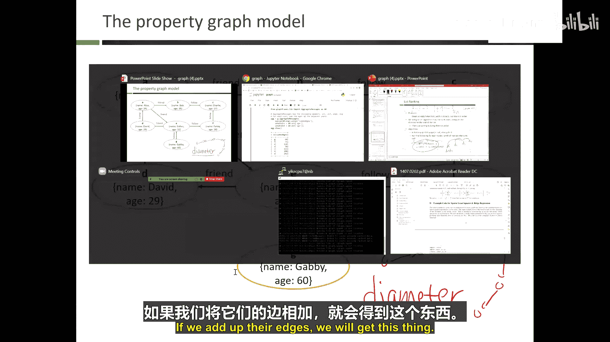
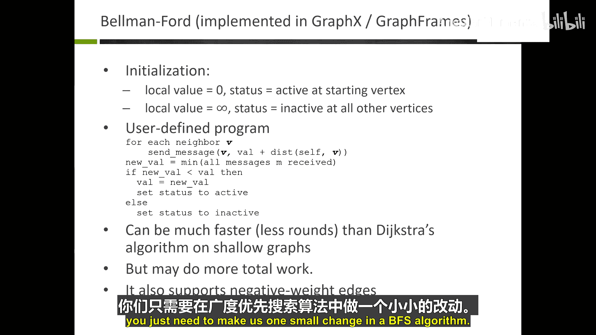

# 019：Pregel模型与图算法实现 🧮

在本节课中，我们将学习图计算中的Pregel模型，这是一种以顶点为中心的并行计算框架。我们将了解其核心概念，并通过GraphFrames库中的`aggregateMessages`操作和Pregel API来实现经典的图算法，如PageRank和广度优先搜索。

---

## 消息传递与聚合

在介绍Pregel模型之前，我们先了解GraphFrames提供的另一个基础操作：`aggregateMessages`。它允许我们沿着图的边在顶点之间传递消息，并对发送到同一顶点的消息进行聚合。





以下是使用`aggregateMessages`的一个示例。假设我们想计算每个顶点的所有邻居的年龄总和。

```python
from pyspark.sql.functions import sum as sql_sum

# 假设 `graph` 是一个GraphFrame对象，顶点有“age”属性
result = graph.aggregateMessages(
    aggCol=sql_sum(AM.msg),  # 聚合函数：求和
    sendToSrc=AM.src["age"], # 向源顶点发送其邻居的年龄
    sendToDst=AM.dst["age"]  # 向目标顶点发送其邻居的年龄
).withColumnRenamed("agg", "sum_ages")

result.show()
```

在这个例子中，对于图中的每一条边，系统会沿着两个方向（从源到目标，从目标到源）发送消息。消息的内容是邻居顶点的“age”属性值。`aggregateMessages`会收集所有发送到同一顶点的消息，并使用指定的聚合函数（这里是求和`sql_sum`）进行计算，最终为每个顶点生成一个名为“sum_ages”的新属性，即其所有邻居年龄的总和。

---

## Pregel计算模型介绍

`aggregateMessages`操作本身不常用，它更多地被用作实现**Pregel模型**的底层工具。Pregel是Google提出的图处理系统，其核心是**顶点中心计算**模型。

在顶点中心计算模型中，程序以顶点为单位编写。调度器会在所有顶点上并行运行你的程序。每个顶点程序可以定义一些局部变量和一个二元状态（活跃或非活跃）。Pregel以**轮次**为单位执行程序，每一轮包含三个步骤：

1.  **聚合消息**：每个顶点首先聚合从前一轮收到的消息。如果顶点处于非活跃状态但收到了消息，它将被激活。
2.  **更新顶点值**：每个活跃顶点根据聚合后的消息更新其局部值。
3.  **发送消息**：每个活跃顶点向其邻居发送新的消息。之后，顶点可以选择将自己设置为非活跃状态。

这个模型与MapReduce有相似之处，但也有两个关键区别：
*   **粒度更细**：Pregel在单个顶点级别进行计算，而MapReduce在任务（Worker）级别。
*   **通信受限**：在Pregel中，消息只能沿着图的边发送；而在MapReduce中，Reducer可以接收来自任意Mapper的数据。

这种设计特别适合图算法，因为图算法通常只需要在相邻顶点间交换信息。

---

## 使用Pregel模型实现PageRank

现在，让我们看一个具体例子：如何使用Pregel模型实现PageRank算法。

在PageRank的Pregel实现中，每个顶点的局部值是其当前的PageRank值。算法流程如下：
*   **初始化**：每个顶点的PageRank值设为1.0，所有顶点标记为活跃。
*   **更新规则**：在每一轮中，顶点将所有来自入边邻居的贡献值（即邻居的PageRank除以其出度）求和，乘以阻尼因子（如0.85），再加上一个常数项（如0.15），得到新的PageRank值。公式为：`new_rank = 0.85 * sum(incoming_messages) + 0.15`。
*   **发送消息**：顶点将其新的PageRank值除以其出度，作为贡献值发送给所有出边邻居。

以下是使用GraphFrames的Pregel API实现PageRank的代码：

```python
from graphframes import GraphFrame
from pyspark.sql.functions import coalesce, lit, sum as sql_sum
from pyspark.sql.functions import col

# 假设已有图g
# 首先为每个顶点计算并添加出度信息
g_out_degree = g.outDegrees
new_vertices = g.vertices.join(g_out_degree, “id”, how=“left_outer”).fillna(0, [“outDegree”])
new_g = GraphFrame(new_vertices, g.edges)

# 使用Pregel模型计算PageRank，迭代5轮
ranks = new_g.pregel \
    .setMaxIter(5) \
    .withVertexColumn(“rank”, # 新增的局部值列名
                      lit(1.0), # 初始值
                      # 更新公式：聚合消息求和后乘0.85，再加0.15。若无消息，则值为0.15。
                      coalesce(sql_sum(Pregel.msg()), lit(0.0)) * lit(0.85) + lit(0.15)) \
    .sendMsgToDst(Pregel.src[“rank”] / Pregel.src[“outDegree”]) \
    .aggMsgs(sql_sum(Pregel.msg())) \
    .run()

# 查看结果
ranks.select(“id”, “rank”).show()
```

**代码解析**：
1.  **构建器模式**：`.pregel` 返回一个构建器，我们可以链式调用方法来设置参数（如`.setMaxIter(5)`设置最大迭代次数）。这是一种灵活的API设计模式。
2.  **定义顶点列**：`.withVertexColumn` 定义了顶点的局部变量。这里我们创建了一个名为“rank”的新列，初始值为1.0，并指定了其更新规则。
3.  **发送消息**：`.sendMsgToDst` 定义了从源顶点发送到目标顶点的消息内容，即源顶点的当前rank除以其出度。
4.  **聚合消息**：`.aggMsgs` 定义了如何聚合发送到同一顶点的多条消息，这里使用求和。
5.  **执行**：`.run()` 启动Pregel计算，并返回最后一轮迭代后的顶点DataFrame。

在每一轮迭代中，系统内部执行三个步骤：
1.  聚合上一轮发送到本顶点的所有消息。
2.  根据聚合结果和更新规则，计算顶点“rank”列的新值。
3.  根据`.sendMsgToDst`规则，从每个顶点向邻居发送新的消息。

---

## 使用Pregel模型实现广度优先搜索

Pregel模型同样适用于其他图算法。让我们看看如何实现广度优先搜索。

在BFS的Pregel实现中，每个顶点维护两个局部变量：到源点的**距离**和**活跃状态**。算法逻辑如下：
*   **初始化**：源点的距离为0，活跃状态为`True`；其他顶点距离为无穷大（可用一个很大的数表示），活跃状态为`False`。
*   **更新规则**：顶点聚合所有收到的距离消息，取最小值。如果这个最小值小于当前存储的距离，则更新距离，并将活跃状态设为`True`；否则，保持原值，并将活跃状态设为`False`。
*   **发送消息**：只有活跃顶点会向其所有邻居发送消息，消息内容为`当前距离 + 1`。
*   **终止条件**：当某一轮中没有顶点发送任何消息（即所有顶点都不活跃）时，算法终止。

以下是GraphFrames中的实现代码框架：

```python
from pyspark.sql.functions import when, min as sql_min

# 假设源顶点ID是“source_id”
initial_distance = when(col(“id”) == lit(“source_id”), lit(0)).otherwise(lit(float(“inf”)))
initial_active = when(col(“id”) == lit(“source_id”), lit(True)).otherwise(lit(False))

bfs_result = g.pregel \
    .withVertexColumn(“distance”, initial_distance, # 距离列及初始值
                      # 更新规则：取收到消息的最小值与当前距离的较小者
                      sql_min(Pregel.msg(), col(“distance”))) \
    .withVertexColumn(“active”, initial_active, # 活跃状态列及初始值
                      # 更新规则：如果新距离小于旧距离，则为True，否则为False
                      when(sql_min(Pregel.msg(), col(“distance”)) < col(“distance”), lit(True)).otherwise(lit(False))) \
    .sendMsgToDst(when(Pregel.src[“active”] == lit(True), Pregel.src[“distance”] + lit(1))) \
    .aggMsgs(sql_min(Pregel.msg())) \
    .run()
```

这个例子展示了如何在Pregel模型中定义**多个局部变量**（`distance`和`active`），并为它们分别指定初始值和更新规则。

---

## 扩展到单源最短路径算法

BFS算法计算的是**边数最少**的路径。如果图中的边带有**权重**（或长度），我们需要找到**总权重最小**的路径，这就是**单源最短路径**问题。

**Dijkstra算法**是解决非负权重图最短路径问题的经典算法，但它本质上是顺序执行的。而**Bellman-Ford算法**的思想与Pregel模型天然契合，它可以处理包含负权边（但不能有负权环）的图，并且易于并行化。

Bellman-Ford算法的Pregel实现与BFS几乎完全相同，只有一个关键区别：
*   在BFS中，顶点发送给邻居的消息是 `当前距离 + 1`。
*   在Bellman-Ford中，顶点发送给邻居的消息是 `当前距离 + 该条边的权重`。

因此，只需将BFS实现中发送消息的部分从 `Pregel.src[“distance”] + lit(1)` 修改为 `Pregel.src[“distance”] + Pregel.edge[“weight”]`，就得到了Bellman-Ford算法。该算法会并行地让所有活跃顶点同时尝试更新其邻居，并迭代运行，直到没有距离更新发生为止。

虽然Bellman-Ford在最坏情况下的迭代次数可能较多，但对于许多实际图数据，它通常能在可接受的轮数内收敛，并且提供了良好的并行性。

---



本节课中我们一起学习了图计算的Pregel模型。我们从基础的`aggregateMessages`操作出发，理解了以顶点为中心的计算思想。然后，我们深入探讨了如何使用GraphFrames的Pregel API来实现PageRank和广度优先搜索算法，并了解了如何将其思路扩展到更复杂的单源最短路径问题。Pregel模型通过将计算限制在顶点局部和边通信之内，为大规模图数据的并行处理提供了强大而灵活的框架。