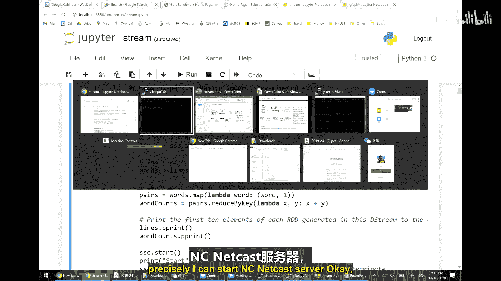
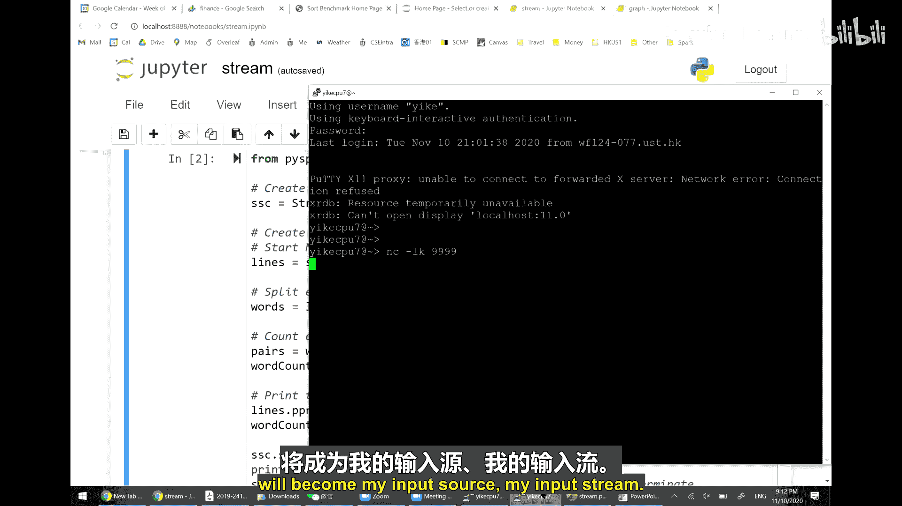
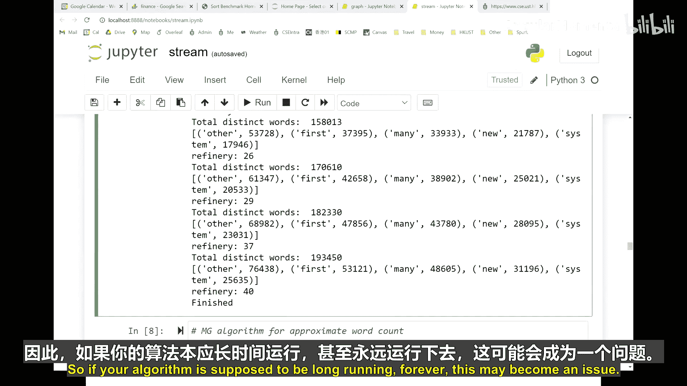

# 020：流处理入门与首个分析示例 🚀

在本节课中，我们将要学习Spark的流处理组件。流处理是处理高速、连续到达数据的关键技术，Spark为此提供了两种主要方式：基于RDD的Spark Streaming和基于Spark SQL的Structured Streaming。我们将重点介绍前者，并通过一个简单的单词计数示例来理解其核心概念和工作流程。

## 概述

Spark Streaming是Spark用于处理实时数据流的组件。与批处理不同，流处理需要在数据到达时立即进行计算，以避免错失业务机会。Spark Streaming采用了一种称为“微批处理”的方法，将连续的数据流切割成一系列小的、离散的RDD批次进行处理。

## 核心概念：离散化流

Spark Streaming的核心思想是将数据流视为一系列连续的RDD，称为**离散化流**。其基本公式可以表示为：


```
DStream = Seq[RDD[T]]
```

其中，每个RDD代表一个特定时间间隔内到达的数据。你可以定义这个时间间隔的长度（例如5秒）。间隔越长，吞吐量越高，但延迟也越大；间隔越短，延迟越低，但吞吐量可能下降。

## 第一个流处理程序：单词计数





下面，我们通过一个具体的例子来演示如何编写一个Spark Streaming应用程序。这个程序将从网络套接字读取文本流，并实时统计每个批次中单词的出现次数。

### 1. 初始化StreamingContext

任何Spark Streaming程序的入口点都是`StreamingContext`。与`SparkContext`不同，你需要手动创建它，并指定批处理的时间间隔。

```python
from pyspark import SparkContext
from pyspark.streaming import StreamingContext

# 创建SparkContext
sc = SparkContext("local[2]", "NetworkWordCount")
# 创建StreamingContext，批处理间隔为5秒
ssc = StreamingContext(sc, 5)
```

**代码解释**：
*   `local[2]`表示在本地运行，并使用2个CPU核心。流处理至少需要一个核心来运行接收器，另一个核心用于驱动程序。
*   第二个参数`5`指定每个批处理间隔为5秒。

### 2. 定义输入源


接下来，我们需要定义数据流的来源。Spark Streaming支持多种输入源，如Kafka、Flume、HDFS以及本例中使用的网络套接字。


```python
# 创建一个DStream，表示从本地主机9999端口接收的数据流
lines = ssc.socketTextStream("localhost", 9999)
```

为了模拟数据输入，我们需要在另一个终端启动一个Netcat服务器：
```bash
nc -lk 9999
```
之后，在这个终端输入的任何文本都将作为流数据发送到我们的Spark程序中。

### 3. 定义流计算逻辑

定义好输入后，我们就可以像操作RDD一样对DStream进行转换。以下代码实现了每个批次内的单词计数：

```python
# 将每行文本拆分成单词
words = lines.flatMap(lambda line: line.split(" "))
# 将每个单词映射为 (word, 1) 的键值对
pairs = words.map(lambda word: (word, 1))
# 按单词聚合，统计每个批次内的数量
word_counts_per_batch = pairs.reduceByKey(lambda x, y: x + y)
```


**重要说明**：这些操作（`flatMap`, `map`, `reduceByKey`）都是**转换**操作。它们定义了计算逻辑，但并不会立即执行。在流处理中，我们称输出操作为“输出操作”而非“动作”，因为它们也不触发计算，只是定义了结果的输出方式。


### 4. 定义输出并启动应用

我们需要指定如何处理计算结果，然后启动流处理应用。

```python
# 输出操作：打印每个批次的前10个元素到控制台
word_counts_per_batch.pprint()

# 启动流计算
ssc.start()
print(“流处理应用已启动”)
# 等待计算终止（这里为了演示，只等待60秒）
ssc.awaitTermination(60)
# 停止StreamingContext（但不停止SparkContext，以便后续重用）
ssc.stop(stopSparkContext=False)
print(“流处理应用已完成”)
```

**关键点总结**：
1.  **启动**：`ssc.start()`是启动后台流处理作业的唯一方法。
2.  **等待与停止**：`awaitTermination()`会阻塞驱动程序，等待流处理作业停止。在实际应用中，作业会长期运行；在开发时，我们设置一个超时时间。停止`StreamingContext`是良好习惯。
3.  **状态管理**：一旦`StreamingContext`启动，就不能再向其添加新的计算逻辑。停止后也不能重启，必须创建新的实例。

## 使用队列流进行测试

在开发时，从终端输入数据并不方便。Spark提供了`queueStream`，允许我们用一系列内存中的RDD来模拟数据流，非常适合测试。

以下是使用队列流的示例步骤：

首先，准备一批数据并将其分割成多个RDD，每个RDD模拟一个时间间隔到达的数据。

```python
# 读取一个文件作为数据源
text_file = sc.textFile(“your_large_text_file.txt”)
# 将数据随机分割成5个RDD，模拟5个批次
rdd_queue = text_file.randomSplit([1,1,1,1,1], seed=123)

# 创建队列流DStream
lines = ssc.queueStream(rdd_queue)
```

然后，可以复用之前的单词计数逻辑。Spark会依次从队列中取出RDD，每隔5秒（或你设定的间隔）将一个RDD注入到`lines`这个DStream中，从而模拟真实的流式输入。

## 有状态计算：累计单词计数

上面的例子是**无状态**的，每个批次的处理与其他批次无关。然而，很多场景需要**有状态**计算，例如累计从流开始至今所有单词的总数。

Spark通过`updateStateByKey`操作支持有状态计算。它允许你定义一个函数，根据新批次的数据和当前的“状态”（也是一个键值对RDD）来更新状态。

以下是如何实现累计单词计数：

```python
# 首先需要设置检查点目录来可靠地存储状态
ssc.checkpoint(“./checkpoint_dir”)

def update_function(new_values, running_count):
    “””
    new_values: 当前批次中，某个单词对应的计数列表（例如 [1, 1, 1]）
    running_count: 该单词之前累计的计数（初始为None）
    “””
    # 如果之前没有该单词的记录，则当前累计值设为0
    current_sum = sum(new_values)
    previous_sum = running_count[0] if running_count is not None else 0
    return current_sum + previous_sum

# 初始的单词映射
pairs = words.map(lambda word: (word, 1))
# 应用updateStateByKey，传入状态更新函数
running_counts = pairs.updateStateByKey(update_function)

# 输出累计结果
running_counts.pprint()
```

**状态更新过程解析**：
假设第一个批次有单词 `(‘a‘, 1), (‘a‘, 1), (‘b‘, 1)`。
*   对于键`’a‘`：`new_values = [1, 1]`，`running_count = None`。函数返回 `2 (1+1) + 0 = 2`。状态中`’a‘`的计数更新为2。
*   对于键`’b‘`：`new_values = [1]`，`running_count = None`。函数返回 `1 + 0 = 1`。状态中`’b‘`的计数更新为1。

第二个批次到来 `(‘a‘, 1), (‘c‘, 1)`。
*   对于键`’a‘`：`new_values = [1]`，`running_count = 2`。函数返回 `1 + 2 = 3`。状态更新为3。
*   对于键`’c‘`：`new_values = [1]`，`running_count = None`。函数返回 `1 + 0 = 1`。状态中新增`’c‘`，计数为1。
*   键`’b‘`未出现在新批次中，状态保持不变。

最终状态为：`{‘a‘: 3, ‘b‘: 1, ‘c‘: 1}`。通过这种方式，我们实现了跨批次的累计计数。

**注意**：有状态计算的状态会持续增长（例如，不重复单词数会越来越多），在长期运行的作业中需要考虑状态管理策略（如超时清除）。

## 总结

本节课我们一起学习了Spark Streaming的基础知识。我们首先了解了流处理的概念和Spark的微批处理模型，即将数据流离散化为DStream。接着，我们动手编写了第一个流处理程序——网络单词计数器，涵盖了从创建`StreamingContext`、定义输入源、进行转换操作到启动和停止作业的完整流程。我们还学习了使用`queueStream`方便地进行程序测试。最后，我们探讨了更高级的**有状态计算**，通过`updateStateByKey`函数实现了跨批次的累计单词计数，这是处理许多实时分析任务的关键。



通过本节的学习，你应该已经掌握了使用Spark Streaming构建基本实时应用程序的能力。记住，对于生产环境，你可能需要探索更稳定的Structured Streaming API以及Kafka等企业级数据源。