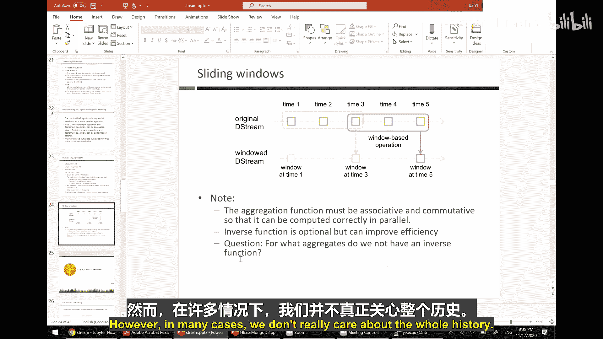
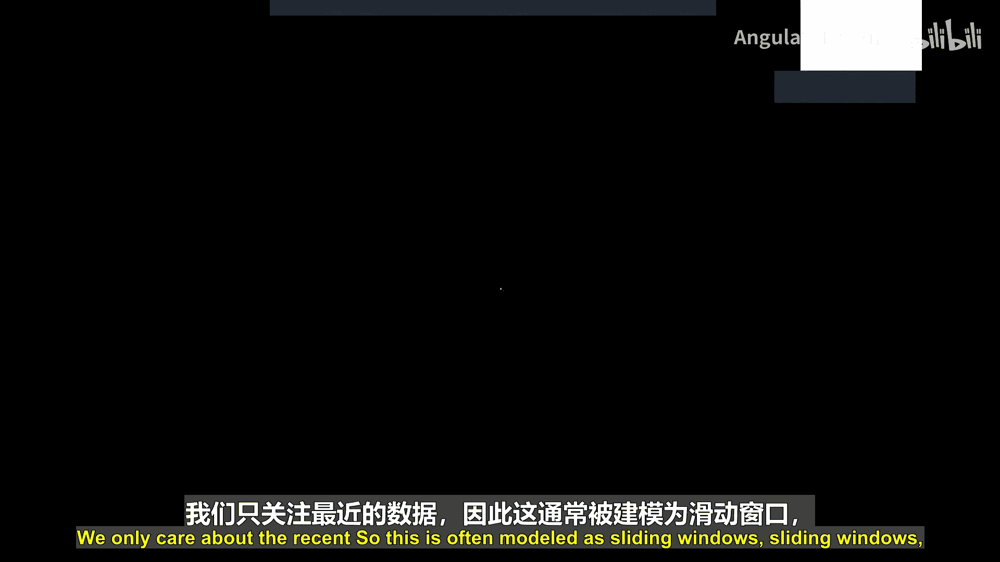
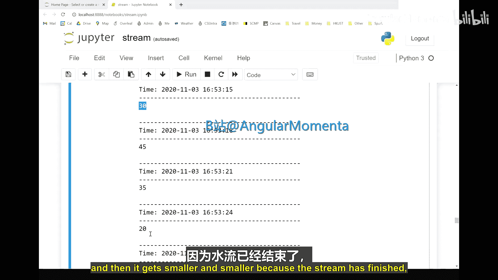

# 021：流式算法与窗口计算

在本节课中，我们将学习流式算法的核心概念，并通过几个经典示例（如缺失卡片谜题、蓄水池抽样和多数投票问题）来理解其工作原理。我们还将探讨如何在Spark Streaming中应用这些算法，并介绍滑动窗口这一重要概念。

## 流式算法概述

上一节我们介绍了流式处理的基本模型。本节中我们来看看什么是流式算法。

流式算法是一种使用有界空间的算法。其空间使用量不会增长，也不依赖于数据流的长度。

为了便于理解，首先给出一个非常简单的流式算法示例，它实际上是一个谜题。

## 缺失卡片谜题 🃏

假设有一副52张的扑克牌。我从中抽出一张，然后将剩下的51张牌交给你。
你只有一个非常基础的计算器，可以进行简单的算术运算，但记忆力很差，无法记住看到的每一张牌。
任务是通过仅一次遍历这51张牌，找出缺失的是哪张牌。

这正是流式模型。如果采用朴素算法，即记住看到的每一张牌，那么该算法所需的空间会随着流长度的增长而增长。因此，朴素算法不是流式算法。

但实际上，存在一种非常巧妙的算法，可以用恒定空间解决这个问题。

具体做法如下：
首先，将牌从1到52编号。每张牌由一个1到52的数字表示。
如果没有牌缺失，正确的总和将是 `1 + 2 + ... + 52`。
有一个众所周知的公式：`总和 = n * (n + 1) / 2`，其中 `n = 52`。
因此，正确总和为 `52 * 53 / 2 = 1378`。
如果缺失一张牌，我无法恢复总和，但可以计算差值。这个差值正好告诉我缺失了哪张牌。
我只需要计算剩余51张牌的总和，然后与正确的总和比较，就能知道缺失了哪张牌。

一个简单的扩展是：如果缺失两张牌怎么办？仅计算总和无法解决，因为只能知道两张缺失牌的数字之和。

另一个想法是：不仅计算总和，还计算乘积。然而，这会导致数字溢出，因为52的阶乘非常大。

技巧是计算平方和。同样有公式：`平方和 = n * (n + 1) * (2n + 1) / 6`。
这样，我维护两个变量：总和与平方和。然后得到两个方程，可以解出两个缺失的数字。
这仍然只需要两个变量，因此也是一个流式算法。

只要算法所需的空间不依赖于流的长度，它就被视为流式算法。

## 蓄水池抽样算法 🎲

第一个被认为是流式算法的著名算法是蓄水池抽样算法。这也是每个数据科学家都应该知道的算法之一。

它的用途是：从迄今为止流中的所有元素中，维护一个固定大小的样本。

该算法非常简单，最早出现在Donald Knuth的《计算机程序设计艺术》中。

算法步骤如下：
1.  首先保留流中的前 `s` 个元素。设 `n = s`，代表当前流长度。
2.  对于任何新元素：
    *   首先递增 `n`。
    *   每个元素应以概率 `s / n` 被抽样。因此，我以这个概率抽样新元素。
    *   如果新元素被抽中，当前样本数会变成 `s + 1`，过多。因此，我需要从当前样本中随机踢出一个元素。
    *   否则，直接丢弃新元素。

这就是蓄水池抽样算法。

举例说明：
假设样本大小 `s = 3`。前三个元素是 A, B, C。初始样本就是 [A, B, C]。
当 D 到达时，`n = 4`。以概率 `3/4` 抽样 D。
如果抽中 D，则需要以各 `1/3` 的概率用 D 替换 A、B 或 C 中的一个。假设 B 被替换，样本变为 [A, D, C]。
下一个元素 E 到达，`n = 5`。以概率 `3/5` 抽样 E。
假设未抽中 E，样本不变。
下一个元素 F 到达，`n = 6`。以概率 `3/6` 抽样 F。
如果抽中 F，则需要从当前样本 [A, D, C] 中随机踢出一个。假设 A 被踢出，样本变为 [F, D, C]。

需要提醒的是，互联网上许多关于蓄水池抽样的证明实际上是错误的。常见的错误证明只证明了每个元素被抽中的概率相同，但这只是随机抽样的必要条件，而非充分条件。
正确的证明依赖于 Fisher-Yates 洗牌算法。幸运的是，维基百科、Stack Overflow 等权威网站有正确的证明。

## 多数投票问题与空间有界计数 🗳️

回到我们的词频统计例子。在词频统计中，我不希望状态无限增长，而是希望限制状态大小。
但不幸的是，有一个负面结果表明这无法精确实现。如果你想记住每个单词的精确计数，状态必须增长。

因此，我们将寻求一个近似解决方案。我们将记住每个单词的近似计数。
这引出了文献中另一个有趣的谜题：多数投票问题。

这里严格来说不是一个流式算法，因为允许对序列进行两次遍历。

问题是：识别是否存在一个多数元素（即出现频率超过 `n/2` 的元素），如果存在则找出它。

例如，给定一个字母序列，询问是否存在多数元素。

这个问题最初由投票计数场景激发。标准算法是为每个候选人保留一个计数。但如果候选人很多，内存有限，无法为每个候选人保留计数。

令人惊讶的是，存在一个非常简洁优雅的算法，只使用一个计数器，通过两次遍历来解决这个问题。

算法描述如下（使用一个计数器）：
1.  第一次遍历：
    *   初始化计数器 `count = 0`，候选元素 `candidate = null`。
    *   遍历每个元素 `x`：
        *   如果 `count == 0`，设 `candidate = x`, `count = 1`。
        *   否则，如果 `x == candidate`，则 `count++`。
        *   否则，`count--`。
2.  第二次遍历：
    *   验证第一步得到的 `candidate` 在序列中出现的次数是否真的超过 `n/2`。

**断言**：如果存在多数元素，那么它一定是在第一次遍历结束后存活下来的那个元素（即 `candidate`）。
但存活下来的元素不一定是多数元素。如果不存在多数元素，算法会在第二次遍历验证后报告“无多数元素”。

这个算法之所以有效，是因为每次 `count--` 操作都相当于消除了两个不同的元素。因此，最多可以进行 `n/2` 次消除操作。如果一个元素出现超过 `n/2` 次，它一定能存活到最后。

然而，负面结果表明，如果只允许一次遍历，则无法用恒定内存空间精确解决多数问题。

## Misra-Gries 近似频数估计算法 📊

虽然无法用一次遍历精确解决，但可以近似解决。这就是 Misra-Gries 算法。

该算法使用最多 `k` 个计数器，可以将误差控制在 `n / (k + 1)` 以内。`k` 越大，误差越小。

算法步骤如下（使用 `k` 个计数器）：
1.  维护一个最多包含 `k` 个条目（元素-计数对）的列表。
2.  对于流中每个新元素 `x`：
    *   如果 `x` 已在列表中，则将其计数加1。
    *   否则，如果列表中的条目数少于 `k`，则将 `(x, 1)` 加入列表。
    *   否则（列表已满，有 `k` 个条目），将列表中所有条目的计数减1，并移除计数变为0的条目。

误差分析：每次“所有计数器减1”操作，相当于消除了 `k + 1` 个不同的元素。因此，最多可以进行 `n / (k + 1)` 次这样的操作。
对于任何元素，其真实计数至少等于计数器中的值，最多等于计数器值加上总的减1操作次数。因此，误差上界为 `n / (k + 1)`。

例如，如果 `k = 100`，误差约为 `1%`，这是一个非常精确的算法，但仍无法保持精确计数。

几点说明：
1.  我们可以轻松跟踪实际的减1操作次数。上界是 `n / (k + 1)`，但实际次数可能更少，取决于数据分布。
2.  在许多真实数据集上，真实计数通常更接近上界（即 `计数器值 + 减1操作次数`）。直觉是，频繁出现的项很少被完全移除，但每次减1操作都会影响它，因此其上界估计更准确。

## 在 Spark Streaming 中实现并行化 ⚡

当我们在 Spark 中实现此算法时，意识到它是一个顺序算法，无法充分利用集群的计算能力。因此，我们需要设计一个并行版本，特别是适用于 Spark Streaming 微批处理模式的版本。

核心思想基于两个观察：
1.  **操作解耦**：增加计数和减少计数操作可以解耦。我们可以先并行处理一批数据中的所有增量操作，然后再统一处理所需的减量操作。
2.  **并行执行**：解耦后，增量和减量操作都可以并行执行。

具体实现思路：
*   **增量阶段**：与标准词频统计类似，对当前批次的数据进行聚合，更新状态中的计数器。
*   **减量阶段**：关键问题是“需要执行多少次减1操作？”。
    *   假设我们有 `m` 个计数器，预算为 `k`。我们需要找到第 `k` 小的计数值（即阈值 `t`）。
    *   所有计数大于 `t` 的计数器，将其计数减去 `t`。
    *   所有计数等于 `t` 的计数器，部分需要减去 `t` 以将总条目数减少到 `k`。
    *   这本质上是一个**选择问题**（找出第 `k` 小的元素），我们在课程开始时就讨论过。
*   结合这两个想法，我们可以在 Spark Streaming 中实现该算法。

在实现中，我们仍然使用状态来存储计数器。增量操作与之前相同。对于减量操作，我们不逐个进行，而是先对计数器RDD排序（或使用更高效的选择算法），找到第 `k` 小的值作为阈值，然后通过一个 `updateStateByKey` 类似的函数并行地对所有超过阈值的计数器进行削减。

这样，在每个批次处理后，状态大小可能会暂时超过 `k`（最多 `k + 批次大小`），但经过减量阶段后，会立即恢复到 `k` 左右。

## 滑动窗口计算 🪟

在许多应用中，我们并不关心整个历史，而只关心最近的数据。这通常通过滑动窗口来建模。

滑动窗口需要定义两个参数：
1.  **窗口长度**：计算所覆盖的时间范围。
2.  **滑动间隔**：每次窗口移动的时间间隔。

在 Spark Streaming 中，这两个参数必须是批次间隔的整数倍，因为批次是处理数据的最小单位。

例如，创建一个批次间隔为3秒的 StreamingContext。然后执行一个 `reduceByWindow` 操作，窗口长度为9秒，滑动间隔为3秒。这意味着每个窗口包含3个批次，并且每处理完一个批次（3秒），窗口就滑动一次，产生一个新的计算结果。

这非常适用于需要实时监控最近一段时间内指标的场景，如最近10分钟的网站访问量、错误率等。

## 总结

本节课中，我们一起学习了流式算法的核心特征——有界空间，并通过缺失卡片谜题理解了其思想。我们探讨了蓄水池抽样这一经典流式抽样算法。针对状态增长问题，我们分析了精确多数投票算法及其局限性，并深入学习了 Misra-Gries 近似频数估计算法，该算法能以可控的误差在恒定空间内估计频率。最后，我们讨论了如何将 Misra-Gries 算法并行化以适应 Spark Streaming 的微批处理模型，并介绍了用于处理近期数据的滑动窗口概念。这些算法和概念是构建高效、可扩展流式处理应用的基础。