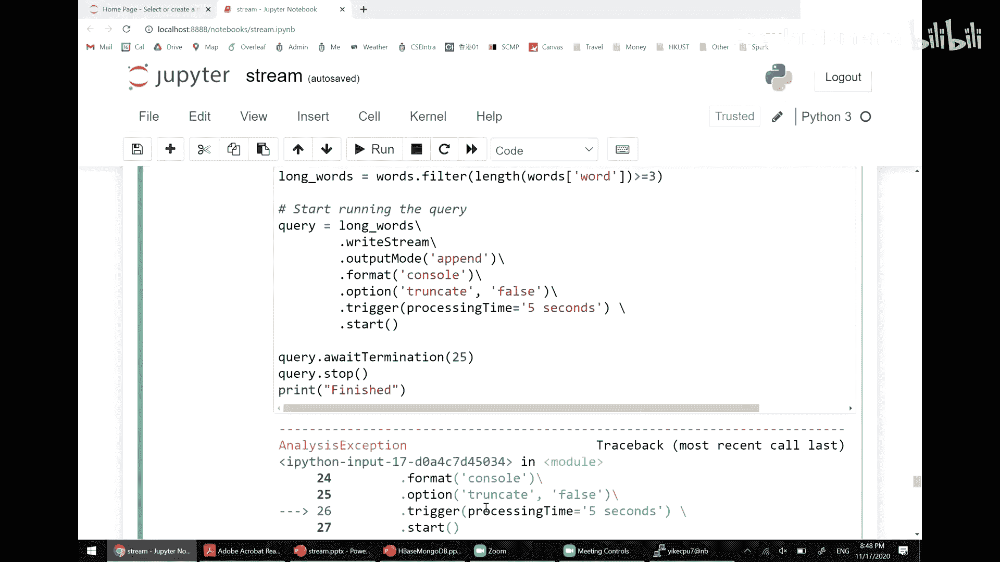
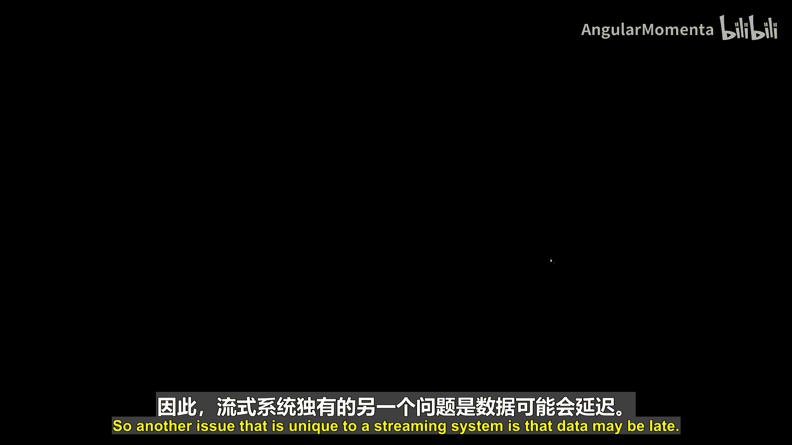
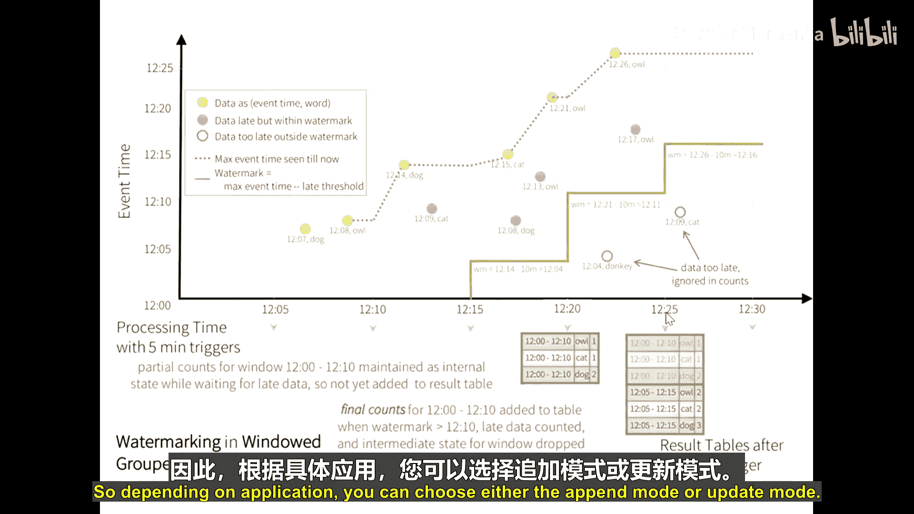

# 022：结构化流处理 🚀

## 概述
在本节课中，我们将要学习Spark中的结构化流处理。我们将了解它如何基于Spark SQL和数据框，将流数据视为无界表，并允许我们使用熟悉的SQL语法来处理流数据。我们还将探讨不同的输出模式以及如何处理流处理中特有的“迟到数据”问题。

## 从RDD API到Spark SQL的迁移
上一节我们介绍了基于RDD的Spark Streaming。本节中我们来看看基于Spark SQL的新组件——结构化流处理。

结构化流处理基于数据框。其核心思想是将一个数据流**建模为一个无界的表**。这样，开发者就可以直接对流数据编写SQL语句。每当一个新的数据批次到达时，SQL查询就会被执行一次。

## 输出模式
以下是结构化流处理中几种不同的输出模式，用于控制查询结果如何更新。

### 完全模式
完全模式是最简单的一种。在每一个批次处理后，系统会执行Spark SQL查询，计算**截至目前接收到的所有数据**的结果，并输出完整的计算结果。

例如，在词频统计中：
*   第一个批次输入：“1 can 3 dogs”， 输出：`{can:1, dogs:3}`
*   第二个批次输入：“2 cats”， 输出：`{can:1, dogs:3, cats:2}`



完全模式等同于包含整个历史的状态化词频统计。



### 代码示例
以下是核心代码示例，展示了结构化流处理的便利性：

```python
lines = spark.readStream.text("source_path") # 读取流数据
words = lines.select(explode(split(lines.value, " ")).alias("word")) # 将一行文本拆分为多个词
wordCounts = words.groupBy("word").count() # 按词分组计数
query = wordCounts.writeStream.outputMode("complete").format("console").start() # 以完全模式输出
```

虽然 `lines` 是一个数据流，但你可以像操作静态数据框一样使用 `select`、`groupBy` 等操作。只要熟悉Spark SQL，就能轻松处理流数据。

### 追加模式
完全模式并非总是最佳选择，因为输出结果会不断增长，且相同的结果会被重复打印。追加模式则**只输出新增的结果**。

追加模式只能用于那些**不会更改旧结果**的查询。例如，一个简单的过滤操作（`filter`）可以使用追加模式，因为每个批次独立处理，新结果不会影响旧结果。

然而，如果查询包含聚合操作（如 `count`、`sum`），则不能使用追加模式，因为新数据到来会改变历史聚合结果。

### 更新模式
更新模式是另一种选择。在此模式下，系统会输出自上次触发后**结果发生更新的行**。这对于聚合查询很有用，你只会看到计数发生变化的词，而不是完整的列表。

## 处理迟到数据：事件时间与水位线
流处理系统一个特有的问题是数据可能**迟到**。这里涉及两个时间概念：
*   **事件时间**：事件实际发生的时间。
*   **处理时间**：系统处理该事件的时间。

迟到可能由多种原因造成，如数据源延迟、系统内部故障恢复等。

### 水位线机制
Spark结构化流处理使用**水位线**机制来优雅地处理迟到数据。水位线定义了系统能容忍的延迟阈值（例如10分钟）。

其保证是：
*   **系统保证处理**延迟小于10分钟的数据。
*   延迟超过10分钟的数据，**不保证会被处理**（系统会尽最大努力，但可能丢弃）。

这是一种单边保证，确保在可控延迟内的数据准确性，同时避免系统为等待可能永远不到的数据而无限期保留状态。

### 输出模式与迟到数据
处理迟到数据时，输出模式的选择至关重要：

*   **更新模式**：系统可以**更新先前已输出的结果**。例如，一个迟到的词会使该词的计数更新并再次输出。这能让你尽快看到结果，但需要意识到这些结果后续可能被更改。
*   **追加模式**：系统**只输出确定不会再被更改的结果**。这意味着必须等待水位线超过某个窗口的结束时间后，该窗口的结果才会被输出。结果一旦输出就是最终正确的，但你需要等待更长时间才能看到它们。

开发者可以根据应用对数据准确性和时效性的要求，在追加模式和更新模式之间进行选择。



## 总结
本节课中我们一起学习了Spark的结构化流处理。我们了解到它通过将流数据抽象为无界表，提供了基于Spark SQL的、声明式的流处理API。我们探讨了完全、追加和更新三种输出模式及其适用场景。最后，我们深入研究了流处理中的核心挑战——迟到数据，并学习了如何通过事件时间和水位线机制来管理它，以及不同输出模式在迟到数据处理上的不同行为。