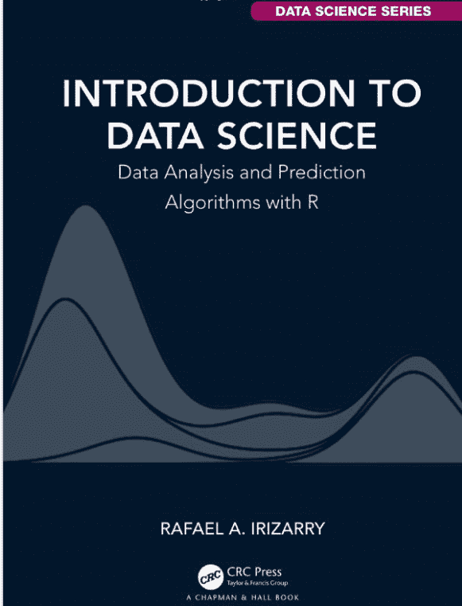

# 数据科学导论

> 原文：[`rafalab.dfci.harvard.edu/dsbook-part-1/`](https://rafalab.dfci.harvard.edu/dsbook-part-1/)

使用 R 进行数据整理和可视化

# 前言

这是**《数据科学导论》**中**《使用 R 进行数据整理和可视化》**部分的网站。

*《通过案例研究学习统计和预测算法》**部分的网站[在此](http://rafalab.dfci.harvard.edu/dsbook-part-2/)¹。

我们在 Twitter 上发布与本书相关的公告。如需更新，请关注[@rafalab](https://twitter.com/rafalab)²。

本书最初是哈佛 X [数据科学系列](https://www.edx.org/professional-certificate/harvardx-data-science)³中使用的课程笔记。

用于生成本书的 Quarto 文件可在[GitHub](https://github.com/rafalab/dsbook-part-1)⁴上找到。注意，本书中用于图表的图形主题可以使用**dslabs**包中的`ds_theme_set()`函数重新创建。

本作品受 Creative Commons Attribution-NonCommercial-ShareAlike 4.0 国际[CC BY-NC-SA 4.0](https://creativecommons.org/licenses/by-nc-sa/4.0)⁵许可。

本书的有售纸质版可在[CRC Press](https://www.routledge.com/Introduction-to-Data-Science-Data-Wrangling-and-Visualization-with-R/Irizarry/p/book/9781032116556)⁶处获得。

可在[Leanpub](https://leanpub.com/datasciencebook)⁷获得 2019 年 10 月 24 日版本本书的免费 PDF。

# 致谢

本书献给所有参与构建和维护 R 及其在本书中使用的 R 包的人们。特别感谢基础 R、tidyverse、data.table 和 caret 包的开发者和维护者。

感谢 Jenna Landy 对本书的仔细编辑和有益的建议；感谢 David Robinson 慷慨回答关于 tidyverse 的许多问题，并帮助我理解它；感谢 Amy Gill 提供的数十条评论、编辑和建议。还要感谢 Stephanie Hicks，她两次担任我的数据科学课程合教，以及耐心回答我关于 markdown 的许多问题的 Yihui Xie。感谢 Karl Broman，我从他那里借鉴了数据可视化和生产力工具部分的想法。感谢 Peter Aldhous，我从他那里借鉴了数据可视化原则部分的想法，以及撰写了*Happy Git and GitHub for the useR*的 Jenny Bryan，这对我们的 Git 章节产生了影响。还要感谢 Jeff Leek、Roger Peng 和 Brian Caffo，他们的在线课程启发了本书的章节划分方式，感谢 Garrett Grolemund 和 Hadley Wickham，他们使他们的 R for Data Science 书的 markdown 代码开源，感谢编辑 John Kimmel 和 Lara Spieker 的支持。最后，感谢 Alex Nones 在本书各个阶段审阅手稿。

本书是在教授多个应用统计学课程的过程中构思的，始于十五年前。多年来与我合作的助教对该书做出了重要的间接贡献。材料在由 Heather Sternshein 和 Zofia Gajdos 协调的 HarvardX 系列课程中得到进一步精炼。我们感谢他们的贡献。我们也感谢所有提出问题和评论的学生，他们的帮助使我们改进了本书。这些课程部分由 NIH 资助的 R25GM114818 号资助。我们非常感谢美国国立卫生研究院的支持。

特别感谢所有通过 GitHub 拉取请求编辑书籍或通过创建*问题*或发送电子邮件提出建议的人：`nickyfoto`（黄强），`desautm`（马克-安德烈·德索特尔斯），`michaschwab`（米哈伊尔·施瓦布），`alvarolarreategui`（阿尔瓦罗·拉雷特圭），`jakevc`（杰克·范坎彭），`omerta`（吉列尔莫·伦格曼），`espinielli`（恩里科·斯皮内利），`asimumba`（阿隆·西姆巴），`braunschweig`（马尔代沃），`gwierzchowski`（格热戈 orz·维赫罗夫斯基），`technocrat`（理查德·卡雷加），`atzakas`，`defeit`（大卫·艾默生·费特），`shiraamitchell`（希拉·米切尔），`Nathalie-S`，`andreashandel`（安德烈亚斯·汉德尔），`berkowitze`（伊利亚斯·伯科维茨），`Dean-Webb`（迪恩·韦伯），`mohayusuf`，`jimrothstein`，`mPloenzke`（马修·普洛恩茨克），`NicholasDowand`（尼古拉斯·道），`kant`（达里奥·赫雷努），`debbieyuster`（黛比·尤斯特），`tuanchauict`（段超），`phzeller`，`BTJ01`（布拉德·J），`glsnow`（格雷格·斯诺），`mberlanda`（马乌罗·贝尔兰达），`wfan9`，`larswestvang`（拉斯·韦斯特万格），`jj999`（扬·安德烈·约德科维奇），`Kriegslustig`（卢卡·尼尔斯·施密德），`odahhani`，`aidanhorn`（艾丹·霍恩），`atraxler`（阿德里安·特拉克斯勒），`alvegorova`，`wycheong`（ Won Young Cheong），`med-hat`（梅哈特·哈利勒），`kengustafson`，`Yowza63`，`ryan-heslin`（瑞安·赫斯林），`raffaem`，`tim8west`，`jooleer`，`pauluhn`（保罗），`tci1`，`beanb2`（布伦南·比恩），`edasdemirlab`（厄迪·达斯德米尔），`jimnicholls`（吉姆·尼科尔），`JimKay1941`（吉姆·凯），`devpowerplatform`（QuantScripter），`carvalhais`（安德烈·卡瓦利亚斯），`hbmaclean`，`GENHEN`，`whatchalookingat`，David D. Kane，El Mustapha El Abbassi，Vadim Zipunnikov，Anna Quaglieri，Chris Dong，Bowen Gu，Rick Schoenberg，以及 Robert Gentleman。

* * *

1.  [`rafalab.dfci.harvard.edu/dsbook-part-2/`](http://rafalab.dfci.harvard.edu/dsbook-part-2/)↩︎

1.  [`twitter.com/rafalab`](https://twitter.com/rafalab)↩︎

1.  [`www.edx.org/professional-certificate/harvardx-data-science`](https://www.edx.org/professional-certificate/harvardx-data-science)↩︎

1.  [`github.com/rafalab/dsbook-part-1`](https://github.com/rafalab/dsbook-part-1)↩︎

1.  [`creativecommons.org/licenses/by-nc-sa/4.0`](https://creativecommons.org/licenses/by-nc-sa/4.0)↩︎

1.  [《数据科学导论：使用 R 进行数据整理和可视化》](https://www.routledge.com/Introduction-to-Data-Science-Data-Wrangling-and-Visualization-with-R/Irizarry/p/book/9781032116556)↩︎

1.  [《数据科学书籍》（Data Science Book）](https://leanpub.com/datasciencebook)↩︎
