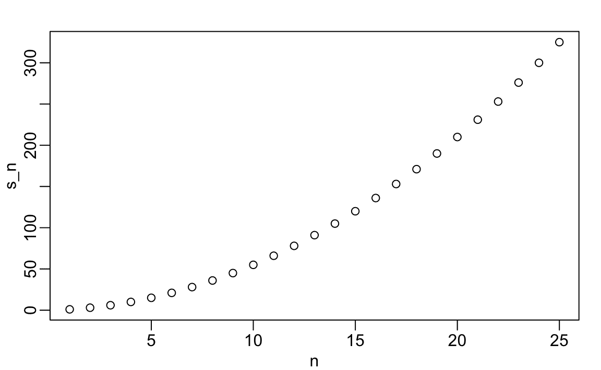

# 3 编程基础

> 原文：[`rafalab.dfci.harvard.edu/dsbook-part-1/R/programming-basics.html`](https://rafalab.dfci.harvard.edu/dsbook-part-1/R/programming-basics.html)

1.  R

1.  3 编程基础

我们教授 R 语言，因为它极大地促进了数据分析，这是本书的主要内容。通过在 R 语言中编码，我们可以高效地进行数据探索分析，构建数据分析管道，并准备数据可视化以传达结果。然而，R 语言不仅仅是一个数据分析环境，它也是一种编程语言。高级 R 语言程序员可以开发复杂的包，甚至可以改进 R 语言本身，但本书不涉及高级编程。尽管如此，在本节中，我们介绍了三个关键编程概念：条件表达式、for 循环和函数。这些不仅是高级编程的关键构建块，有时在数据分析中也非常有用。我们还注意到，有几个在 R 语言编程中广泛使用的函数，但本书不会涉及。这些包括`split`、`cut`、`do.call`和`Reduce`。如果你计划成为一名专家 R 语言程序员，这些是值得学习的。

## 3.1 条件表达式

条件表达式是编程的基本特性之一。它们用于所谓的*流程控制*。最常用的条件表达式是 if-else 语句。在 R 语言中，我们实际上可以在不使用条件语句的情况下进行相当多的数据分析。然而，它们偶尔会出现，一旦你开始编写自己的函数和包，你将需要它们。

这是一个非常简单的例子，展示了 if-else 语句的一般结构。基本思想是打印`a`的倒数，除非`a`为 0：

[PRE0]

让我们再看一个使用美国谋杀数据的例子：

[PRE1]

这是一个非常简单的例子，告诉我们如果谋杀率低于每 10 万人 0.5，那么谋杀率最低的状态。if-else 语句保护我们免受没有州满足条件的情况。

[PRE2]

如果我们再次尝试以 0.25 的比率，我们会得到不同的答案：

[PRE3]

一个相关的非常有用的函数是`ifelse`。该函数接受三个参数：一个逻辑值和两个可能的答案。如果逻辑值为`TRUE`，则返回第二个参数的值，如果为`FALSE`，则返回第三个参数的值。以下是一个例子：

[PRE4]

该函数特别有用，因为它可以在向量上工作。它检查逻辑向量的每个条目，如果条目为`TRUE`，则从第二个参数提供的向量中返回元素，如果条目为`FALSE`，则从第三个参数提供的向量中返回元素。

[PRE5]

这个表格帮助我们了解发生了什么：

| a | is_a_positive | answer1 | answer2 | result |
| --- | --- | --- | --- | --- |
| 0 | FALSE | Inf | NA | NA |
| 1 | TRUE | 1.00 | NA | 1.0 |
| 2 | TRUE | 0.50 | NA | 0.5 |
| -4 | FALSE | -0.25 | NA | NA |
| 5 | TRUE | 0.20 | NA | 0.2 |

以下是一个示例，说明如何使用此函数轻松地将向量中的所有缺失值替换为零：

[PRE6]

另外两个有用的函数是 `any` 和 `all`。`any` 函数接受一个逻辑向量，如果其中任何一项为 `TRUE`，则返回 `TRUE`。`all` 函数接受一个逻辑向量，如果所有项都为 `TRUE`，则返回 `TRUE`。以下是一个例子：

[PRE7]

*你已经准备好做练习 1-3。*********

## ****3.2 定义函数*****

***随着你变得越来越有经验，你将发现自己需要反复执行相同的操作。一个简单的例子是计算平均值。我们可以使用 `sum` 和 `length` 函数计算向量 `x` 的平均值：`sum(x)/length(x)`。因为我们反复这样做，所以编写执行此操作的函数会更高效。这个特定的操作非常常见，因此有人已经编写了 `mean` 函数，它包含在基础 R 中。然而，你将遇到函数尚未存在的情况，因此 R 允许你编写自己的函数。一个计算平均值的函数的简单版本可以定义如下：

[PRE8]

现在 `avg` 是一个计算平均值的函数：

[PRE9]

请注意，在函数内部定义的变量不会保存在工作空间中。因此，当我们调用 `avg` 时使用 `s` 和 `n`，这些值仅在调用期间创建和更改。以下是一个说明性的例子：

[PRE10]

注意，在调用 `avg` 之后，`s` 仍然是 3。

通常，函数是对象，所以我们使用 `<-` 将它们分配给变量名。`function` 函数告诉 R 你即将定义一个函数。函数定义的一般形式如下：

[PRE11]

你定义的函数可以有多个参数以及默认值。例如，我们可以定义一个函数，根据用户定义的变量计算算术平均数或几何平均数，如下所示：

[PRE12]

随着我们面对更复杂的任务，我们将通过经验学习如何创建函数。

你已经准备好做练习 4-7。**********

## *****3.3 命名空间*****

****一旦你开始成为一个更高级的 R 用户，你可能会需要为某些分析加载几个附加包。一旦你开始这样做，很可能两个包会为两个不同的函数使用相同的名称。而且，这些函数通常执行完全不同的操作。实际上，你已经遇到过这种情况，因为 **dplyr** 和 R 基础包的 **stats** 都定义了一个 `filter` 函数。**dplyr** 中还有五个其他例子。我们知道这一点是因为当我们第一次加载 **dplyr** 时，我们会看到以下消息：

[PRE13]

现在我们输入 `filter` 时，它使用的是 **dplyr** 的版本。但如果我们想使用 **stats** 版本怎么办？

这些函数位于不同的 *命名空间* 中。R 在这些 *命名空间* 中搜索函数时会遵循一定的顺序。你可以通过输入以下内容来查看顺序：

[PRE14]

列表中的第一个条目是全局环境，它包括你定义的所有对象。

所以，如果我们想使用 **stats** `filter` 而不是 **dplyr** filter，但 **dplyr** 在搜索列表中排在前面怎么办？你可以通过使用双冒号 (`::`) 来强制使用特定的命名空间，如下所示：

[PRE15]

如果我们想绝对确保使用 **dplyr** `filter`，我们可以使用

[PRE16]

注意，如果我们想在不需要加载整个包的情况下使用包中的函数，我们也可以使用双冒号。

如果你想查看所有具有名为 `filter` 的函数的包，你可以使用双问号：`??filter`。*  *关于这个更高级的话题，我们推荐阅读 R 包书籍¹。*********

## *****3.4 For 循环*****

****数列 $1+2+\dots+n$ 的和的公式是 $S_n = n(n+1)/2$。如果我们不确定这是正确的函数怎么办？我们如何检查？利用我们关于函数的知识，我们可以创建一个计算 $S_n$ 的函数：

[PRE17]

我们如何计算 $S_n$ 的各种值，比如 $n=1,\dots,25$？我们是否需要写 25 行代码调用 `compute_s_n`？不，这就是编程中 for 循环的作用。在这种情况下，我们正在重复执行完全相同的任务，唯一改变的是 $n$ 的值。for 循环允许我们定义变量取值的范围（在我们的例子中 $n=1,\dots,10$），然后改变值并 *循环* 评估表达式。

可能最简单的 for 循环示例就是下面这段无用的代码：

[PRE18]

以下是我们的 $S_n$ 示例中会写的 for 循环：

[PRE19]

在每次迭代 $n=1$，$n=2$ 等…，我们计算 $S_n$ 并将其存储在 `s_n` 的第 $n$ 个条目中。

现在，我们可以创建一个图来寻找模式：

[PRE20]

如果你注意到它似乎是一个二次函数，那么你就在正确的道路上，因为公式是 $n(n+1)/2$。*********

## ****3.5 向量化与函数式编程****

***尽管 for 循环是一个重要的概念，但在 R 中我们很少使用它。随着你对 R 的学习越来越深入，你会意识到 *向量化* 被优先于 for 循环，因为它会产生更短、更清晰的代码。我们已经在向量算术部分看到了例子。一个 *向量化* 的函数是会对每个向量执行相同操作的函数。我们已经在向量算术部分看到了例子。A *向量化* 的函数是会对每个向量执行相同操作的函数。

[PRE21]

为了进行这个计算，不需要使用 for 循环。然而，并非所有函数都以这种方式工作。例如，我们刚才写的函数 `compute_s_n` 并不是逐元素工作的，因为它期望一个标量。这段代码并没有在 `n` 的每个条目上运行函数：

[PRE22]

*函数式**是帮助我们将相同的函数应用于向量、矩阵、数据框或列表中的每个条目的函数。在这里，我们介绍在数值、逻辑和字符向量上操作的函数式：`sapply`。

函数 `sapply` 允许我们对任何函数执行逐元素操作。以下是它是如何工作的：

[PRE23]

每个 `x` 的元素都传递给函数 `sqrt`，并返回结果。这些结果被连接起来。在这种情况下，结果是一个与原始 `x` 长度相同的向量。这意味着上面的 for 循环可以写成以下形式：*

[PRE24]

其他函数包括 `apply`, `lapply`, `tapply`, `mapply`, `vapply`, 和 `replicate`。我们在这本书中主要使用 `sapply`, `apply`, 和 `replicate`，但我们建议您熟悉其他函数，因为它们可能非常有用。

你已经准备好做练习 8-11。*********

## *****3.6 练习题*****

****1. 这个条件表达式将返回什么？*****

[PRE25]

2. 以下哪个表达式在逻辑向量 `x` 至少有一个条目为 TRUE 时总是 `FALSE`？*

1.  `all(x)`

1.  `any(x)`

1.  `any(!x)`

1.  `all(!x)`

3. 函数 `nchar` 告诉你字符向量有多长。编写一行代码，将对象 `new_names` 赋值为当州名长度超过 8 个字符时的州简称。

4. 创建一个名为 `sum_n` 的函数，对于任何给定的值，例如 $n$，计算从 1 到 $n$（包含）的整数之和。使用该函数确定从 1 到 5,000 的整数之和。

5. 创建一个名为 `altman_plot` 的函数，该函数接受两个参数 `x` 和 `y`，并绘制差值与和的关系图。

6. 在运行以下代码后，`x` 的值是多少？

[PRE26]

7. 编写一个名为 `compute_s_n` 的函数，对于任何给定的 $n$，计算和 $S_n = 1² + 2² + 3² + \dots n²$。当 $n=10$ 时，报告和的值。*

8. 使用 `s_n <- vector("numeric", 25)` 定义一个大小为 25 的空数值向量 `s_n`，并使用 for 循环将 $S_1, S_2, \dots S_{25}$ 的结果存储在其中。

9. 重复练习 8，但这次使用 `sapply`。

10. 绘制 $S_n$ 与 $n$ 的关系图。使用 $n=1,\dots,25$ 定义的点。

11. 确认这个和的公式是 $S_n= n(n+1)(2n+1)/6$。*******

* * *

****1. [`r-pkgs.had.co.nz/namespace.html`](http://r-pkgs.had.co.nz/namespace.html)↩︎*****
