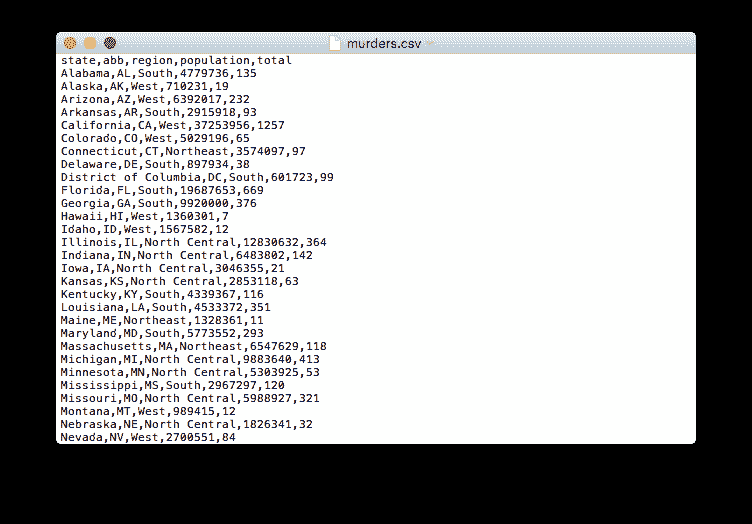

# 6 导入数据

> 原文：[`rafalab.dfci.harvard.edu/dsbook-part-1/R/importing-data.html`](https://rafalab.dfci.harvard.edu/dsbook-part-1/R/importing-data.html)

1.  R

1.  6 导入数据

我们一直在使用已经存储为 R 对象的数据集。在数据分析工作中，我们很少这么幸运，通常需要将数据从文件、数据库或其他来源导入到 R 中。目前，存储和共享数据以供分析最常见的方式是通过电子表格。电子表格以行和列的形式存储数据。它基本上是数据框的文件版本。当将此类表格保存到计算机文件时，需要一种方法来定义何时一行或一列结束，另一行或列开始。这反过来又定义了存储单个值的单元格。以下是一个示例，如果我们用基本的文本编辑器打开逗号分隔的文件，它看起来会是什么样子：



在本章中，我们概述了如何将数据从文件加载到 R 中。首先，确定文件位置至关重要；因此，我们简要介绍了文件路径和工作目录（在第十八章详细描述）。接下来，我们深入探讨文件类型（文本或二进制）和编码（如 ASCII 和 Unicode），这两者对于数据导入都是必不可少的。然后，我们介绍了一些流行的数据导入函数，称为*解析器*。最后，我们提供了一些关于如何在电子表格中存储数据的技巧。关于从网站或 PDF 中提取数据等高级主题将在本书的数据整理部分进行讨论。

## 6.1 导航和管理文件系统

从电子表格导入数据的第一步是找到包含数据的文件。虽然我们不推荐这样做，但你可以使用类似于打开 Microsoft Excel 文件的方法，通过点击 RStudio 的“文件”菜单，然后点击“导入数据集”，接着通过文件夹找到文件。然而，我们更倾向于编写代码而不是使用点击操作。我们需要详细学习的核心概念在第十八章中描述。在这里，我们提供了一些基本概念的概述。

### 6.1.1 文件系统

你可以将你的计算机文件系统想象成一系列嵌套的文件夹，每个文件夹都包含其他文件夹和文件。我们将文件夹称为*目录*。我们将包含所有其他目录的文件夹称为*根目录*。我们将我们当前所在的目录称为*工作目录*。因此，随着你通过文件夹移动，工作目录会发生变化：可以将其视为你的当前位置。

### 6.1.2 相对路径和完整路径

文件 *路径* 是一系列目录名称，可以将其视为点击文件夹的指令，以及找到文件的顺序。如果这些指令是从根目录开始查找文件，我们将其称为 *完整路径*。如果指令是从工作目录开始查找文件，我们将其称为 *相对路径*。第 18.3 节提供了更多关于这个主题的详细信息。

要在你的系统中查看完整路径的示例，请输入以下内容：

```r
[system.file](https://rdrr.io/r/base/system.file.html)(package = "dslabs")
#> [1] "/Library/Frameworks/R.framework/Versions/4.5-arm64/Resources/library/dslabs"
```

*请注意，输出将在不同的计算机上有所不同。`system.file` 函数找到在安装 **dslabs** 包时添加到系统中的文件的完整路径。由斜杠分隔的字符串是目录名称。第一个斜杠代表根目录，我们知道这是一个完整路径，因为它以斜杠开头。

我们可以使用 `list.files` 函数来显示任何目录中的文件和目录名称。例如，以下是 **dslabs** 包目录中的文件：

```r
dir <- [system.file](https://rdrr.io/r/base/system.file.html)(package = "dslabs")
[list.files](https://rdrr.io/r/base/list.files.html)(dir)
#>  [1] "data"        "DESCRIPTION" "extdata"     "help" 
#>  [5] "html"        "INDEX"       "Meta"        "NAMESPACE" 
#>  [9] "R"           "script"
```

*请注意，这些路径不以斜杠开头，这意味着它们是 *相对路径*。这些相对路径给出了如果 `dir` 中存储的路径是我们的工作目录，文件或目录的位置。

*在日常数据分析工作中，你不太可能用到 `system.file` 函数。我们在这个部分介绍它，因为它便于共享用于练习的电子表格。这些电子表格位于 `extdata` 目录中。***

### ***6.1.3 工作目录***

***我们强烈建议在代码中只使用相对路径。原因是完整路径对于你的计算机是唯一的，你希望代码是可移植的。如果你想使用 `getwd` 函数知道工作目录的完整路径。如果你需要更改工作目录，你可以使用 `setwd` 函数，或者你可以通过点击 RStudio 上的“会话”来更改它。***

在开始一个项目时，选择一个目录来存储所有相关文件，并将其设置为分析的工作目录。这种做法确保当你使用相对路径在导入文件的函数中时，R 会自动在当前工作目录中搜索文件。有关在 RStudio 中组织项目的更多详细信息，请参阅第二十章。

### ***6.1.4 生成路径名***

***`file.path` 函数将字符组合成完整的路径，确保与各自的操作系统兼容。Linux 和 Mac 使用正斜杠 `/`，而 Windows 使用反斜杠 `\` 来分隔目录。这个函数很有用，因为通常你希望使用变量来定义路径。以下是一个示例，它构建了一个包含谋杀数据的电子表格的完整路径。在这里，变量 `dir` 包含 **dslabs** 包的完整路径，而 `extdata/murders.csv` 是电子表格的相对路径，如果 `dir` 被视为工作目录的话。***

```r
dir <- [system.file](https://rdrr.io/r/base/system.file.html)(package = "dslabs")
file_path <- [file.path](https://rdrr.io/r/base/file.path.html)(dir, "extdata/murders.csv")
```

*您可以使用`file.copy`函数将包含完整路径的`file_path`文件复制到您的当前工作目录中：

```r
[file.copy](https://rdrr.io/r/base/files.html)(file_path, "murders.csv")
#> [1] TRUE
```

*如果文件复制成功，此函数将返回`TRUE`。请注意，我们使用了相同的文件名作为目标文件，但我们可以给它任何我们想要的名称。如果目标目录中已存在同名文件，复制将失败。您可以使用`overwrite`参数更改此行为。*****

## ****6.2 文件类型****

****对于大多数数据分析应用，文件通常可以分为两大类：文本文件和二进制文件。在本节中，我们描述了这两种类型最广泛使用的格式以及识别它们最佳的方法。在最后一小节中，我们描述了了解文件编码的重要性。

*对于本节以及以下章节，我们假设您已将`murders.csv`文件复制到您的当前工作目录中。您可以使用上一节末尾的代码来完成此操作。*  *### 6.2.1 文本文件

您已经处理过文本文件。例如，所有您的 R 脚本和 Quarto 文件，以及用于创建此书的 Quarto 文件，都是文本文件。这些文件的一个大优点是我们可以轻松地“查看”它们，而无需购买任何特殊软件或遵循复杂的说明。任何文本编辑器都可以用来检查文本文件，包括免费编辑器，如 RStudio 或 nano。为了验证这一点，请尝试使用 RStudio 的“打开文件”工具打开 csv 文件。您应该能够在您的编辑器中看到内容。

当使用文本文件存储电子表格时，行断行符用于分隔行，而一个预定义的字符，称为*分隔符*，用于在行内分隔列。最常见的分隔符是逗号（`,`）、分号（`;`）、空格（``）和制表符（预设的空格数或`\t`）。将这些文件读入 R 时，使用的方法略有不同，因此我们需要知道使用了哪种分隔符。在某些情况下，分隔符可以从文件后缀推断出来。例如，以`csv`结尾的文件预期是逗号分隔的，而以`tsv`结尾的文件预期是制表符分隔的。然而，对于以`txt`结尾的文件，推断分隔符会更困难。因此，我们建议查看文件而不是从后缀推断。您可以使用`readLines`函数在 R 中查看文件中的任意行数：``

```r` ``` [readLines](https://rdrr.io/r/base/readLines.html)("murders.csv", n = 3) #> [1] "state,abb,region,population,total" #> [2] "Alabama,AL,South,4779736,135"  #> [3] "Alaska,AK,West,710231,19" ```r   *This immediately reveals that the file is indeed comma delimited. It also reveals that the file has a header: the first row contains column names rather than data. This is also important to know. Most parsers assume the file starts with a header, but not all files have one.* ````

### `*6.2.2 二进制文件*`

``*在文本编辑器中打开图像文件，如 jpg 或 png，或者在 R 中使用`readLines`，将不会显示可理解的内容，因为这些是*二进制*文件。与为人类可读性设计的文本文件和具有标准化约定的文件不同，二进制文件可以采用多种特定于其数据类型的格式。虽然 R 的`readBin`函数可以处理任何二进制文件，但解释输出需要彻底了解文件的结构。这个复杂的话题本书没有涉及。相反，我们专注于电子表格的常见二进制格式：Microsoft Excel 的 xls 和 xlsx。*``

### `*6.2.3 编码*`

```r`*A frequent issue when importing data, whether text or binary, is incorrectly identifying the file’s *encoding*. At its core, a computer translates everything into sequences of 0s and 1s. ASCII is an *encoding* system that assigns specific numbers to characters. Using 7 bits, ASCII can represent \(2⁷ = 128\) unique symbols, sufficient for all English keyboard characters. However, many global languages contain characters outside ASCII’s range. For instance, the é in “México” isn’t in ASCII’s catalog. To address this, broader encodings, such as Unicode, emerged. Unicode offers variations using 8, 16, or 32 bits, known as UTF-8, UTF-16, and UTF-32\. RStudio typically uses UTF-8 as its default. Notably, ASCII is a subset of UTF-8, meaning that if a file is ASCII-encoded, presuming it’s UTF-8 encoded won’t cause issues. However, there other encodings, such as ISO-8859-1 (also known as Latin-1) developed for the western European languages, Big5 for Traditional Chinese, and ISO-8859-6 for Arabic.    The **dslabs** package includes a file that is not UTF-8 encoded to serve as an example. Notice the strange characters that appear you attempt to read in the first line:    ``` fn <- "calificaciones.csv" [file.copy](https://rdrr.io/r/base/files.html)([file.path](https://rdrr.io/r/base/file.path.html)([system.file](https://rdrr.io/r/base/system.file.html)("extdata", package = "dslabs"), fn), fn) #> [1] TRUE [readLines](https://rdrr.io/r/base/readLines.html)(fn, n = 1) #> [1] "\"nombre\",\"f.n.\",\"estampa\",\"puntuaci\xf3n\"" ```r   *In the following section, we’ll introduce several helpful import functions, some of which allow you to specify the file encoding.**````*****

## ***`**6.3 解析器**`***

***```r`**Importing functions, or parsers, are available from base R. However, more powerful and often faster functions are available in the **readr**, **readxl**, and **data.table** packages. In this section we review some examples. We also describe how data can be downloaded or read directly from the internet.    ### 6.3.1 Base R    Base R provides several file parsers for example `read.csv`, `read.table` and `read.delim`. The first argument can take either a full or relative path. If a relative path is provided, the parser assumes you want to search in the working directory. Therefore, to read the `murders.csv` file previously copied to our working directory, we can simply type:    ``` dat <- [read.csv](https://rdrr.io/r/utils/read.table.html)("murders.csv") ```r   *An often useful R-base importing function is `scan`, as it provides much flexibility. When reading in spreadsheets many things can go wrong. The file might have multiline headers or be missing cells. With experience you will learn how to deal with different challenges. Carefully reading the help files for the functions discussed here will be useful. With scan you can read-in each cell of a file. Here is an example:    ``` x <- [scan](https://rdrr.io/r/base/scan.html)("murders.csv", sep = ",", what = "c") x[1:10] #>  [1] "state"      "abb"        "region"     "population" "total"  #>  [6] "Alabama"    "AL"         "South"      "4779736"    "135" ```r*   ### **6.3.2 readr**   **The **readr** package includes parsers, for reading text file spreadsheets into R. **readr** is part of the **tidyverse**, but you can load it directly using:    ``` [library](https://rdrr.io/r/base/library.html)([readr](https://readr.tidyverse.org)) ```r   *The following functions are available to read-in text file spreadsheets:     | Function | Format | Typical suffix | | --- | --- | --- | | read_table | white space separated values | txt | | read_csv | comma separated values | csv | | read_csv2 | semicolon separated values | csv | | read_tsv | tab delimited separated values | tsv | | read_delim | general text file format, must define delimiter | txt |    It also includes `read_lines` with similar functionality to `readLines`.    We can read in the `murders.csv` file using    ``` dat <- [read_csv](https://readr.tidyverse.org/reference/read_delim.html)("murders.csv") #> Rows: 51 Columns: 5 #> ── Column specification ──────────────────────────────────────────────── #> Delimiter: "," #> chr (3): state, abb, region #> dbl (2): population, total #>  #> ℹ Use `spec()` to retrieve the full column specification for this data. #> ℹ Specify the column types or set `show_col_types = FALSE` to quiet this message. ```r   *Note that we receive a message letting us know what data types were used for each column. Also note that `dat` is a `tibble`, not just a data frame. We can suppress this message using the argument `show_col_types = FALSE`.    The **readr** parsers permit us to specify an encoding. It also includes a function that tries to guess the encoding:    ``` [guess_encoding](https://readr.tidyverse.org/reference/encoding.html)("murders.csv") #> # A tibble: 1 × 2 #>   encoding confidence #>   <chr>         <dbl> #> 1 ASCII             1 ```r   *This function can help us read the file we previously noted was showing strange characters:    ``` [guess_encoding](https://readr.tidyverse.org/reference/encoding.html)("calificaciones.csv") #> # A tibble: 3 × 2 #>   encoding   confidence #>   <chr>           <dbl> #> 1 ISO-8859-1       0.92 #> 2 ISO-8859-2       0.72 #> 3 ISO-8859-9       0.53 ```r   *Once we know the encoding we can specify it through the `locale` argument:    ``` dat <- [read_csv](https://readr.tidyverse.org/reference/read_delim.html)("calificaciones.csv", show_col_types = FALSE,  locale = [locale](https://readr.tidyverse.org/reference/locale.html)(encoding = "ISO-8859-1")) ```r   *We learn about locales in Chapter 14.    We can now see that the characters in the header were read in correctly:    ``` [names](https://rdrr.io/r/base/names.html)(dat) #> [1] "nombre"     "f.n."       "estampa"    "puntuación" ```r*******   ### ***6.3.3 readxl***   ***The **readxl** package provides functions to read-in Microsoft Excel formats.    ``` [library](https://rdrr.io/r/base/library.html)([readxl](https://readxl.tidyverse.org)) ```r   *The main functions are:     | Function | Format | Typical suffix | | --- | --- | --- | | read_excel | auto detect the format | xls, xlsx | | read_xls | original format | xls | | read_xlsx | new format | xlsx |    The Microsoft Excel formats permit you to have more than one spreadsheet in one file. These are referred to as *sheets*. The functions listed above read the first sheet by default, but we can also read the others. The `excel_sheets` function gives us the names of all the sheets in an Excel file. These names can then be passed to the `sheet` argument in the three functions above to read sheets other than the first.****   ### ***6.3.4 data.table***   ***The **data.table** package provides the `fread` function, a powerful and fast utility designed for reading large datasets. `fread` automatically detects the format of the input, whether it’s delimited text or even files compressed in formats like gzip or zip. It offers a significant speed advantage over the other parsers described here, especially for large files.    ``` [library](https://rdrr.io/r/base/library.html)([data.table](https://r-datatable.com)) dat <- [fread](https://rdatatable.gitlab.io/data.table/reference/fread.html)("murders.csv") ```r   *Note `fread` returns a `data.table` object.****   ### ***6.3.5 Downloading files***   ***A common place for data to reside is on the internet. When these data are in files, we can download them and then import them or even read them directly from the web. For example, we note that because our **dslabs** package is on GitHub, the file we downloaded with the package has a url:    ``` url <- [paste0](https://rdrr.io/r/base/paste.html)("https://raw.githubusercontent.com/",  "rafalab/dslabs/master/inst/extdata/murders.csv") ```r   *Most parsers can read these files directly:    ``` dat <- [read.csv](https://rdrr.io/r/utils/read.table.html)(url) ```r   *If you want to have a local copy of the file, you can use the `download.file` function:    ``` [download.file](https://rdrr.io/r/utils/download.file.html)(url, "murders.csv") ```r   *This will download the file and save it on your system with the name `murders.csv`. You can use any name here, not necessarily `murders.csv`.   *The function `download.file` overwrites existing files without warning.*  *Two functions that are sometimes useful when downloading data from the internet are `tempdir` and `tempfile`. The first creates a directory with a random name that is very likely to be unique. Similarly, `tempfile` creates a character string, not a file, that is likely to be a unique filename. So you can run a command like this which erases the temporary file once it imports the data:    ``` tmp_filename <- [tempfile](https://rdrr.io/r/base/tempfile.html)() [download.file](https://rdrr.io/r/utils/download.file.html)(url, tmp_filename) dat <- [read_csv](https://readr.tidyverse.org/reference/read_delim.html)(tmp_filename) [file.remove](https://rdrr.io/r/base/files.html)(tmp_filename) ```r*********````***

## *`****6.4 使用电子表格组织数据****`*

*``****尽管这本书几乎完全专注于数据分析，数据管理也是数据科学操作的重要部分。正如引言中所述，我们不涉及这个主题。然而，数据分析师经常需要以最方便存储在电子表格中的方式收集数据，或者与他人一起收集数据。虽然我们强烈反对手动填写电子表格，并建议尽可能自动化这个过程，但有时你不得不这样做。因此，在本节中，我们提供有关如何在电子表格中组织数据的建议。尽管有 R 包可以读取 Microsoft Excel 电子表格，但我们通常想避免这种格式。相反，我们推荐使用 Google Sheets 作为免费软件工具。以下是我们总结了 Karl Broman 和 Kara Woo 在论文中提出的建议¹。请阅读论文以获取重要细节。    *   **保持一致** - 在开始输入数据之前，制定一个计划。一旦有了计划，就要保持一致并坚持下去。*   **为事物选择好的名称** - 你选择的物体、文件和目录的名称应该是容易记住的、容易拼写的，并且具有描述性。实际上，这是一个很难达到的平衡，确实需要时间和思考。一个重要的规则是**不要使用空格**，使用下划线 `_` 或破折号 `-` 代替。此外，避免使用符号；坚持使用字母和数字。*   **将日期写成 YYYY-MM-DD 格式** - 为了避免混淆，我们强烈建议使用这个全球 ISO 8601 标准。*   **不要有空单元格** - 填充所有单元格，并使用一些常见的代码来表示缺失数据。*   **一个单元格只放一件事情** - 添加列来存储额外信息比一个单元格中放多个信息更好。*   **使其成为矩形** - 电子表格应该是矩形的。*   **创建数据字典** - 如果需要解释事物，例如列是什么，或用于分类变量的标签是什么，请在单独的文件中这样做。*   **在原始数据文件中不要进行计算** - Excel 允许你进行计算。不要将这部分包含在你的电子表格中。计算代码应在脚本中。*   **不要使用字体颜色或突出显示作为数据** - 大多数重要功能都无法导入此信息。将此信息编码为变量。*   **备份** - 定期备份你的数据。*   **使用数据验证来避免错误** - 利用电子表格软件中的工具，使过程尽可能无错误和重复性压力伤害。*   **将数据保存为文本文件** - 以逗号分隔或制表符分隔的格式保存用于共享的文件。****``*

## *``****6.5 练习****``*

*```r`****1\. Use the `read_csv` function to read each of the files that the following code saves in the `files` object:    ``` 路径 <- [system.file](https://rdrr.io/r/base/system.file.html)("extdata", package = "dslabs") 文件列表 <- [list.files](https://rdrr.io/r/base/list.files.html)(路径) 文件 ```r   *2\. Note that the the `olive` file, gives us a warning. This is because the first line of the file is missing the header for the first column.    Read the help file for `read_csv` to figure out how to read in the file without reading this header. If you skip the header, you should not get this warning. Save the result to an object called `dat`.    3\. A problem with the previous approach is that we don’t know what the columns represent. Type:    ``` [names](https://rdrr.io/r/base/names.html)(dat) ```r   *to see that the names are not informative.    Use the `readLines` function to read in just the first line.    4\. Pick a measurement you can take on a regular basis. For example, your daily weight or how long it takes you to run 5 miles. Keep a spreadsheet that includes the date, the hour, the measurement, and any other informative variable you think is worth keeping. Do this for 2 weeks. Then make a plot.******````*

* * *

*`****1.  [`www.tandfonline.com/doi/abs/10.1080/00031305.2017.1375989`](https://www.tandfonline.com/doi/abs/10.1080/00031305.2017.1375989)↩︎****`*
