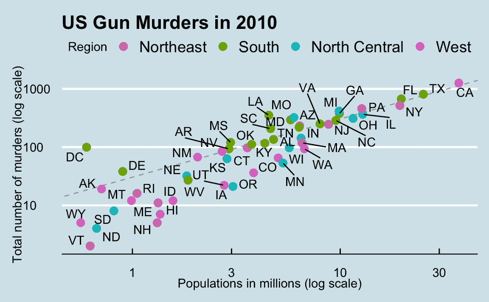
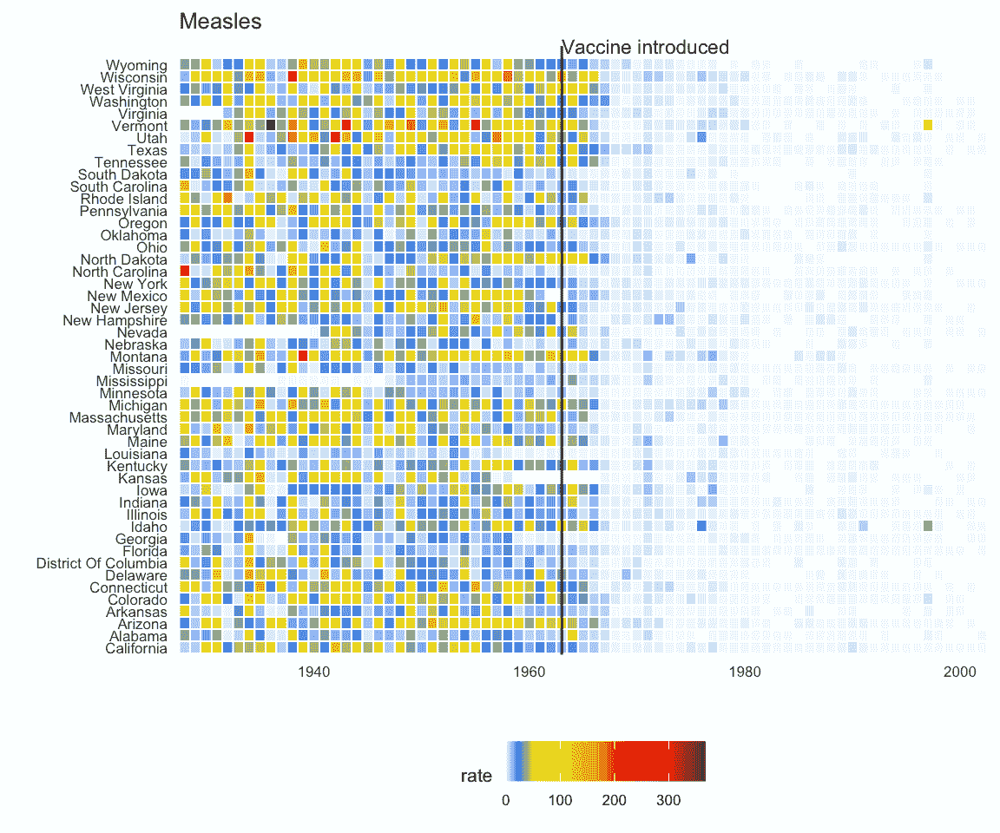
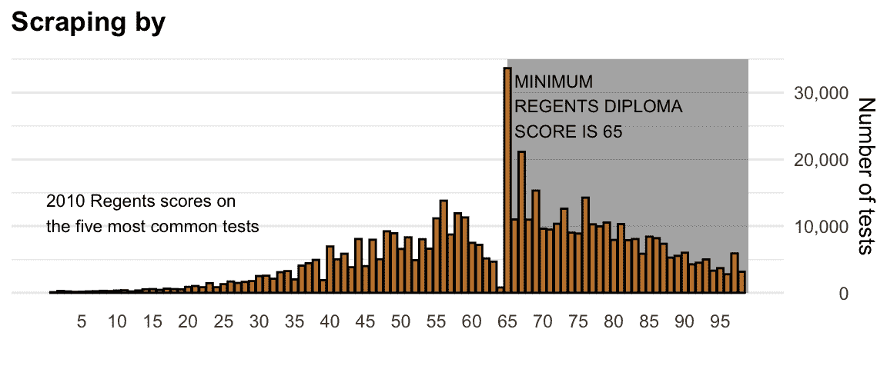
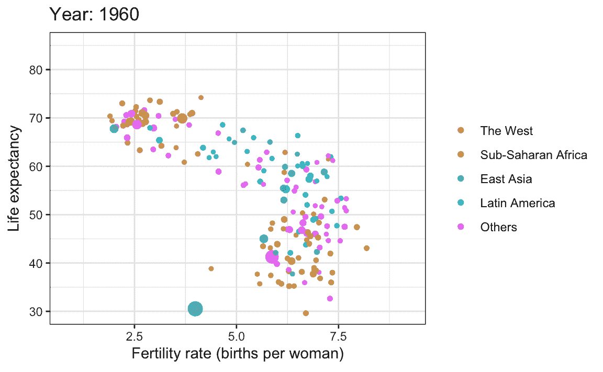

# 数据可视化

> 原文：[`rafalab.dfci.harvard.edu/dsbook-part-1/dataviz/intro-dataviz.html`](https://rafalab.dfci.harvard.edu/dsbook-part-1/dataviz/intro-dataviz.html)

观察定义数据集的数字和字符串通常没有太大用处。为了说服自己，打印并盯着美国谋杀数据表看看：

[PRE0]

你从盯着这张表格中学到了什么？你能多快确定哪个州的人口最多？哪个州的人口最少？一个典型的州有多大？人口规模和谋杀总数之间有关系吗？这个国家的不同地区谋杀率是如何变化的？对于大多数人类大脑来说，仅通过观察数字很难提取这些信息。相比之下，上述所有问题的答案都可以通过查看这个图表轻松获得：*

我们想起了那句俗语“一图胜千言”。数据可视化提供了一种强大的方式来传达基于数据的发现。在某些情况下，可视化如此令人信服，以至于不需要进一步的分析。

信息的数据库和软件工具的日益可用，导致数据可视化在许多行业、学术界和政府中的依赖性增加。一个显著的例子是新闻机构，它们越来越多地采用*数据新闻学*，并将有效的*信息图表*作为其报道的一部分。

一个特别有效的例子是《华尔街日报》的一篇文章¹，展示了疫苗对抗传染病影响的相关数据。其中一张图表显示了多年来美国各州的麻疹病例，并通过一条垂直线展示了疫苗引入的时间。

《纽约时报》的一张图表通过总结纽约市教育委员会考试的成绩²提供了一个令人信服的例子。根据随附的文章³，这些成绩收集用于各种目的，其中之一是确定学生是否有资格高中毕业。在纽约市，65 分是及格的分数线。这些测试分数的模式表明了一些不寻常的情况。

最常见的测试分数是最低及格分数，很少有分数仅低于阈值。这个意外的结果与即将及格的学生分数被提高是一致的。

这就是数据可视化如何导致发现，如果我们仅仅将数据提交给一系列数据分析工具或程序，这些发现可能会被忽视。数据可视化是我们所说的*探索性数据分析*（EDA）中最强大的工具。约翰·W·图基⁴，被认为是 EDA 之父，曾说过：

> > “图片的最大价值在于它迫使我们注意到我们从未预料到看到的东西。”

许多广泛使用的数据分析工具都是由通过 EDA（探索性数据分析）做出的发现所启发的。EDA 可能是数据分析中最重要的部分，但它往往被忽视。

数据可视化现在也普遍应用于慈善和教育组织。在《贫困的新见解⁵》和《你见过的最佳统计数据⁶》的演讲中，汉斯·罗斯林通过一系列与全球健康和经济相关的图表，迫使我们注意到意外之处。在他的视频中，他使用动画图表向我们展示世界是如何变化的，以及旧叙事是如何不再真实的。

还需要注意的是，错误、偏见、系统性错误和其他意外问题往往会导致需要谨慎处理的数据。未能发现这些问题可能导致分析结果有缺陷和错误发现。例如，考虑测量设备有时会失败，以及大多数数据分析程序都没有设计来检测这些情况。然而，这些数据分析程序仍然会给出答案。仅仅从报告的结果中难以或无法察觉错误的事实使得数据可视化尤为重要。

在本书的这一部分，我们将通过三个具有启发性的例子来学习数据可视化和探索性数据分析的基础。我们将使用**ggplot2**包进行编码。为了学习最基本的知识，我们将从一个相对人为的例子开始：学生报告的身高。然后我们将关注两个案例研究：1)世界健康和经济以及 2)美国传染病趋势。请注意，我们不涵盖交互式图形。对于那些有兴趣创建交互式图形的人来说，我们强烈推荐学习使用基于 R 的**plotly**包或 Shiny⁷，两者都建立在 R 的基础上。对于更高级的挑战，考虑学习使用 D3.js⁸进行编程。

* * *

1.  [`graphics.wsj.com/infectious-diseases-and-vaccines/?mc_cid=711ddeb86e`](http://graphics.wsj.com/infectious-diseases-and-vaccines/?mc_cid=711ddeb86e)↩︎

1.  [`graphics8.nytimes.com/images/2011/02/19/nyregion/19schoolsch/19schoolsch-popup.gif`](http://graphics8.nytimes.com/images/2011/02/19/nyregion/19schoolsch/19schoolsch-popup.gif)↩︎

1.  [`www.nytimes.com/2011/02/19/nyregion/19schools.html`](https://www.nytimes.com/2011/02/19/nyregion/19schools.html)↩︎

1.  [`en.wikipedia.org/wiki/John_Tukey`](https://en.wikipedia.org/wiki/John_Tukey)↩︎

1.  [`www.ted.com/talks/hans_rosling_reveals_new_insights_on_poverty?language=en`](https://www.ted.com/talks/hans_rosling_reveals_new_insights_on_poverty?language=en)↩︎

1.  [`www.ted.com/talks/hans_rosling_shows_the_best_stats_you_ve_ever_seen`](https://www.ted.com/talks/hans_rosling_shows_the_best_stats_you_ve_ever_seen)↩︎

1.  [`shiny.rstudio.com/`](https://shiny.rstudio.com/)↩︎
