# 7 可视化数据分布

> 原文：[`rafalab.dfci.harvard.edu/dsbook-part-1/dataviz/distributions.html`](https://rafalab.dfci.harvard.edu/dsbook-part-1/dataviz/distributions.html)

1.  数据可视化

1.  7 可视化数据分布

在数据分析中，总结复杂数据集至关重要，它使我们能够更有效地分享从数据中得出的见解。一种常见的方法是使用*平均值*来总结一系列数字。例如，一所高中的质量可能由标准化考试的平均分数来表示。有时，还会添加一个额外的值，即*标准差*。因此，一份报告可能会说分数是 680 $\pm$ 50，将一整套分数简化为两个数字。但这足够吗？我们是否通过仅仅依赖这些总结而不是完整的数据而忽略了关键信息？

我们数据可视化构建块的第一步是学习总结数字或类别的列表。通常情况下，分享或探索这些总结的最佳方式是通过数据可视化。一组对象或数字的最基本的统计总结是其分布。一旦数据被总结为分布，就有几种数据可视化技术可以有效地传达这些信息。因此，深入了解分布的概念非常重要。

在本章中，我们讨论了各种分布的特性以及如何使用学生身高的激励示例来可视化分布。

## 7.1 变量类型

两种主要的变量类型是*分类*和*数值*。每种类型都可以分为另外两组：分类可以是有序的或无序的，而数值变量可以是离散的或连续的。当数据集中的条目代表一个组而不是一个数字时，我们称这些数据为*分类数据*。两个简单的例子是性别（男或女）和美国地区（东北部、南部、北中部、西部）。一些分类数据即使不是数字本身也可以排序，例如辣度（温和、中等、辣）。在统计学中，有序分类数据被称为*有序数据*。数值数据的例子包括人口规模、谋杀率和身高。我们可以进一步将数值数据分为连续和离散。连续变量是可以取任何值的变量，例如身高，如果测量足够精确的话。例如，一对双胞胎的身高可能分别是 68.12 英寸和 68.11 英寸。计数，如人口规模，是离散的，因为它们必须是整数。

请记住，离散数值数据可以被认为是有序的。虽然这在技术上是真的，但我们通常将有序数据术语保留给属于少数不同组别的变量，每组有多个成员。相比之下，当我们有许多组，每组案例很少时，我们通常将它们称为离散数值变量。因此，例如，一个人每天抽的香烟包数（四舍五入到最接近的包），将被认为是有序的，而实际抽的香烟数量将被认为是数值变量。但确实，在可视化数据时，有一些例子既可以被认为是数值的，也可以是有序的。

在这里，我们专注于数值变量，因为可视化这种数据类型要复杂得多。然而，我们首先描述数据可视化和摘要方法，用于分类数据。

## 7.2 案例研究：描述学生身高

我们介绍一个新的激励性问题。这是一个人为的问题，但它将帮助我们说明理解分布所需的概念。

假设我们必须向 ET 描述我们同学的身高，ET 是一个从未见过人类的地球外生物。作为第一步，我们需要收集数据。为此，我们要求学生报告他们的身高（英寸）。我们要求他们提供性别信息，因为我们知道存在两种不同的性别身高分布。我们收集数据并将其保存在`heights`数据框中：

[PRE0]

一种向 ET 传达高度的方法就是简单地发送这份包含 1,050 个高度的列表。但还有更有效的方法来传达这些信息，而理解分布的概念将是关键。为了简化解释，我们首先关注男性身高。我们将在第 7.6 节中检查女性身高数据。*

## *7.3 分布*

一个对象或数字列表的最基本的统计摘要就是其*分布*。将分布简单地视为对具有许多条目的列表的紧凑描述。这个概念对于本书的读者来说不应该陌生。例如，对于分类数据，分布简单地描述了每个唯一类别的比例。在身高数据集中表示的性别是：

[PRE1]

这个双类别*频率表*是分布的最简单形式。我们实际上不需要可视化它，因为一个数字就描述了我们所需了解的一切：23%是女性，其余是男性。当有更多类别时，简单的条形图就可以描述分布。以下是一个关于美国州区域的例子：

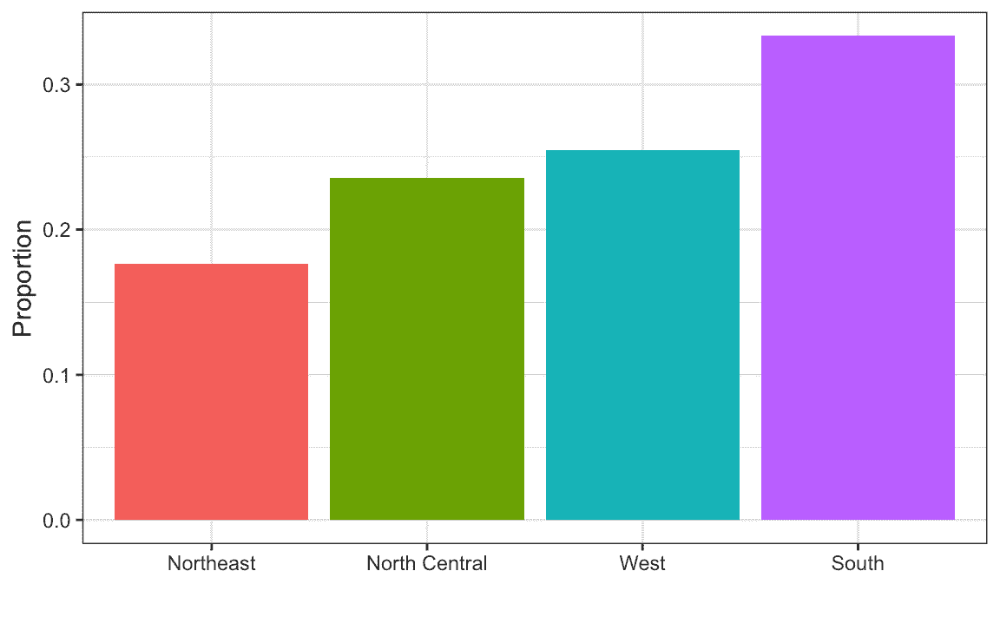

这个特定的图表仅仅显示了四个数字，每个类别一个。我们通常使用条形图来显示几个数字。尽管这个特定的图表本身并不比频率表提供更多的洞察力，但它是我们如何将向量转换为简洁地总结向量中所有信息的图表的第一个例子。当数据是数值时，显示分布的任务更具挑战性。

### 7.3.1 直方图

非分类的数值数据也有分布。然而，通常情况下，当数据不是分类的时，报告每个条目的频率，就像我们对分类数据所做的那样，不是一个有效的总结，因为大多数条目是唯一的。例如，在我们的案例研究中，虽然有几个学生报告身高为 68 英寸，但只有一名学生报告身高为`68.503937007874`英寸，只有一名学生报告身高`68.8976377952756`英寸。我们假设他们分别从 174 厘米和 175 厘米转换而来。

统计学教材教导我们，定义数值数据的分布的一个更有用方法是定义一个函数，该函数报告所有可能的值 $a$ 下数据的比例。这个函数被称为经验累积分布函数（eCDF），它可以绘制出来，并提供了我们数据分布的完整描述。以下是男性学生身高的 eCDF：

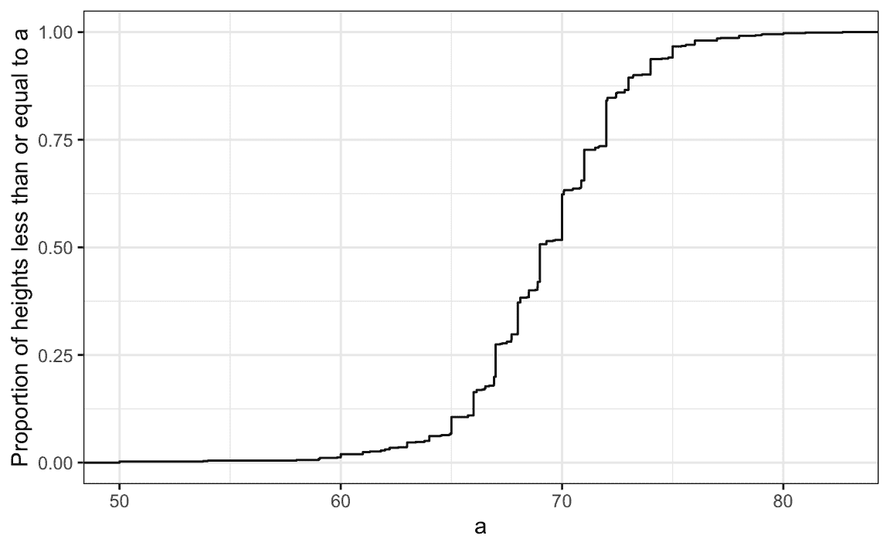

然而，通过绘制经验累积分布函数（eCDF）来总结数据实际上在实践上并不常见。主要原因在于它并不能轻易传达感兴趣的特性，例如：分布的中心值是多少？分布是对称的吗？哪些范围包含 95%的值？

直方图*更受欢迎，因为它们极大地简化了回答此类问题。直方图牺牲了一点点信息，以产生更容易解释的图表。制作直方图的最简单方法是将我们的数据范围划分为相同大小的非重叠区间。然后，对于每个区间，我们计算落在该区间内的值的数量。直方图将这些计数作为条形图绘制出来，条形的底部由区间定义。以下是按一英寸间隔分割值范围的身高直方图：$(49.5, 50.5]$，$(50.5, 51.5]$，$(51.5,52.5]$，$(52.5,53.5]$，$...$，$(82.5,83.5]$。

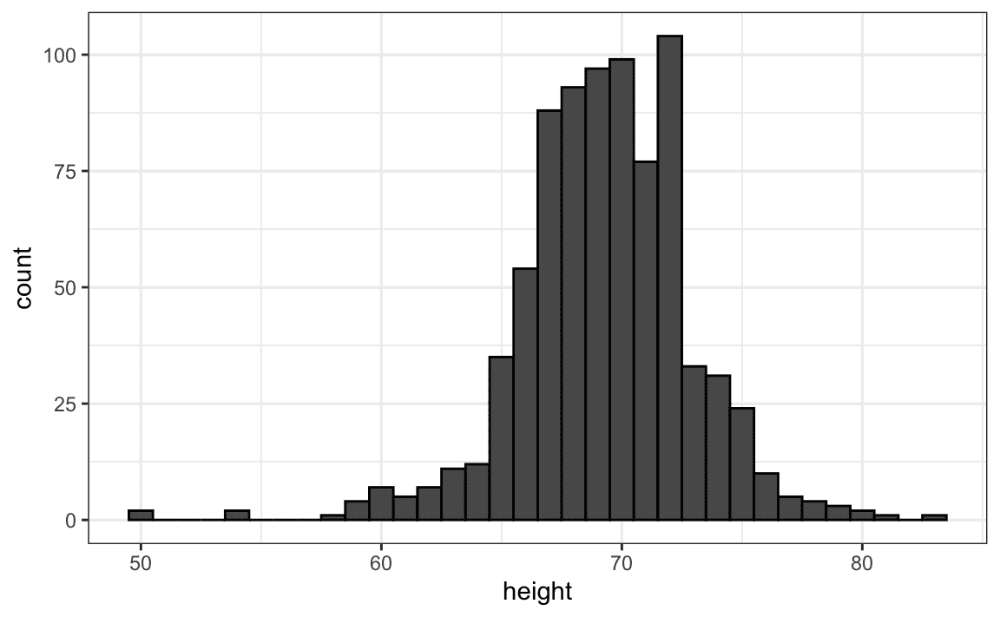

如上图所示，直方图类似于条形图，但不同之处在于 x 轴是数值的，而不是分类的。

如果我们将这个图表发送给 ET，他将会立即了解我们数据的一些重要属性。首先，数据范围从 50 到 84，其中大多数（超过 95%）在 63 到 75 英寸之间。其次，高度在 69 英寸左右对称。此外，通过累计计数，ET 可以非常准确地获得任何区间内数据比例的良好近似。因此，上面的直方图不仅易于解释，而且提供了大约 30 个区间中包含在原始 812 名男性身高列表中的几乎所有信息。

我们失去了哪些信息？请注意，在计算区间高度时，每个区间的所有值都被视为相同。因此，例如，直方图无法区分 64 英寸、64.1 英寸和 64.2 英寸。鉴于这些差异几乎对眼睛不可见，实际影响可以忽略不计，我们能够将数据总结为仅仅 23 个数字。

我们在第 8.14 节中讨论了如何编码直方图。

### 7.3.2 平滑密度

平滑密度*图传达了与直方图相同的信息，但外观更吸引人。以下是我们的男性身高数据的平滑密度图：

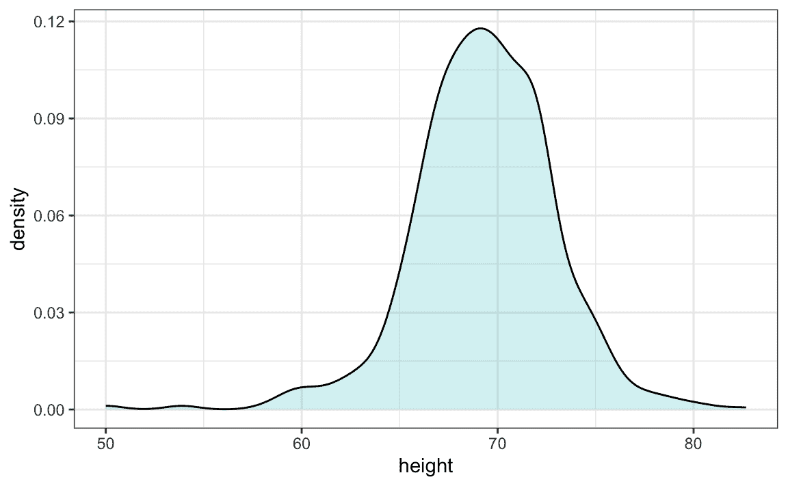

在这个图表中，我们不再在区间边界处有尖锐的边缘，许多局部峰值已经被移除。此外，y 轴的刻度从计数改为*密度*。为了完全理解平滑密度，我们必须了解*估计*，这是我们在高级数据科学教科书中讨论的一个主题。在这里，我们简单地描述它们为通过直方图柱状图的顶部绘制一条曲线，然后移除柱状图。y 轴上显示的值被选择，使得曲线下的面积加起来为 1。这表明，对于任何区间，曲线下该区间的面积为我们提供了数据在该区间内比例的一个近似。

与直方图相比，平滑密度在可视化方面的一个优点是，密度使得比较两个分布更容易。这在很大程度上是因为直方图的锯齿边缘增加了杂乱。以下是一个比较男性和女性身高的例子：

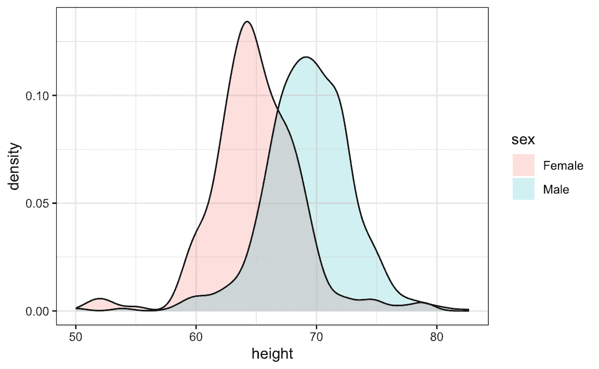

使用正确的参数，`ggplot`会自动用不同的颜色阴影相交的区域。我们将在第十章以及第 8.14 节中展示用于密度的**ggplot2**代码示例。

### 7.3.3 正态分布

直方图和密度图提供了对分布的出色总结。但我们能否进一步总结？我们经常看到平均值和标准差被用作总结统计量：两个数字的总结！为了理解这些总结是什么以及为什么它们被广泛使用，我们需要了解正态分布。

正态分布，也称为钟形曲线和高斯分布。以下是正态分布的形状：

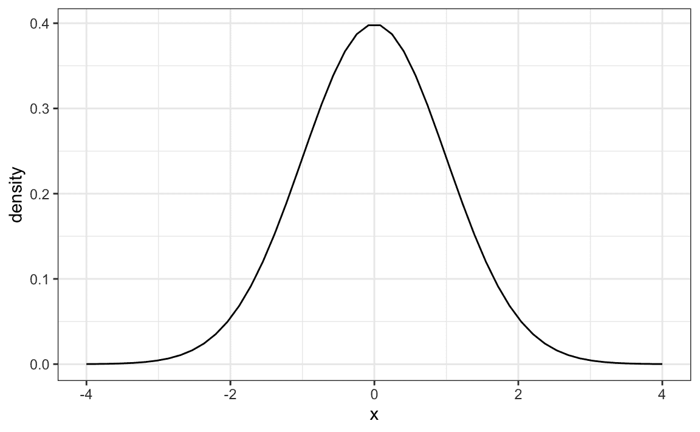

正态分布是历史上最著名的数学概念之一。一个原因是许多数据集的分布可以用正态分布来近似。这包括赌博收益、身高、体重、血压、标准化测试分数和实验测量误差。统计教科书提供了为什么会出现这种情况的解释。但是，同一个分布如何近似具有完全不同值范围的多个数据集，例如身高和体重？正态分布的第二个重要特征是，它可以通过调整两个数字来适应不同的数据集，这两个数字被称为*平均值*或*均值*和*标准差*（SD）。正态分布是对称的，以我们所说的平均值为中心，大多数值（约 95%）都在平均值的 2 个标准差范围内。上图显示了一个平均值为 0，标准差为 1 的正态分布，通常被称为*标准正态分布*。请注意，仅需要两个数字来调整正态分布以适应数据集的事实意味着，如果我们的数据分布被正态分布近似，描述分布所需的所有信息都可以通过仅两个数字来编码。我们现在为任意的一组数字定义这些值。

一旦我们确信我们的数据，比如说存储在向量`x`中，具有*近似正态分布*，我们就可以通过将数据的平均值和标准差分别与正态分布的平均值和标准差相匹配来找到与我们的数据匹配的具体分布。对于一个包含在向量`x`中的数字列表：

[PRE2]

平均值定义为

[PRE3]

标准差定义为

[PRE4]

可以解释为值与其平均值之间的平均距离。

预先构建的函数`mean`和`sd`（请注意，由于统计教科书中解释的原因，`sd`除以`length(x)-1`而不是`length(x)`）可以在这里使用：

[PRE5]

以下是我们的学生身高平滑密度图，以蓝色表示，以及平均值为 69.3 和标准差为 3.6 的正态分布，以黑色线条绘制：

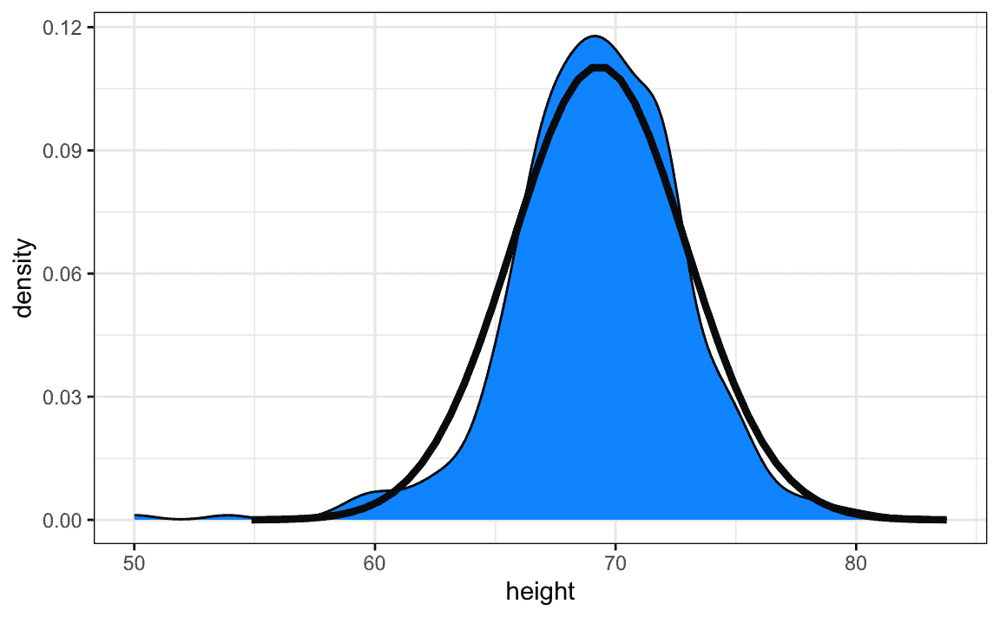*****

## ***7.4 箱线图***

**为了理解箱线图，我们需要定义一些在探索性数据分析中常用的术语。

百分位数*是数据中$p = 0.01, 0.02, ..., 0.99$的值，分别表示数据中小于或等于该值的百分比。例如，$p=0.10$的情况被称为第 10 个百分位数，它给出了 10%的数据低于该数值。最著名的百分位数是第 50 个，也称为*中位数*。另一个被命名的特殊情况是*四分位数*，当设置$p=0.25,0.50$和$0.75$时获得，这些值在箱线图中使用。

为了激发对箱形图的需求，我们将回到美国谋杀数据。假设我们想要总结谋杀率分布。使用我们学到的数据可视化技术，我们可以快速看到这里不适用正态近似：

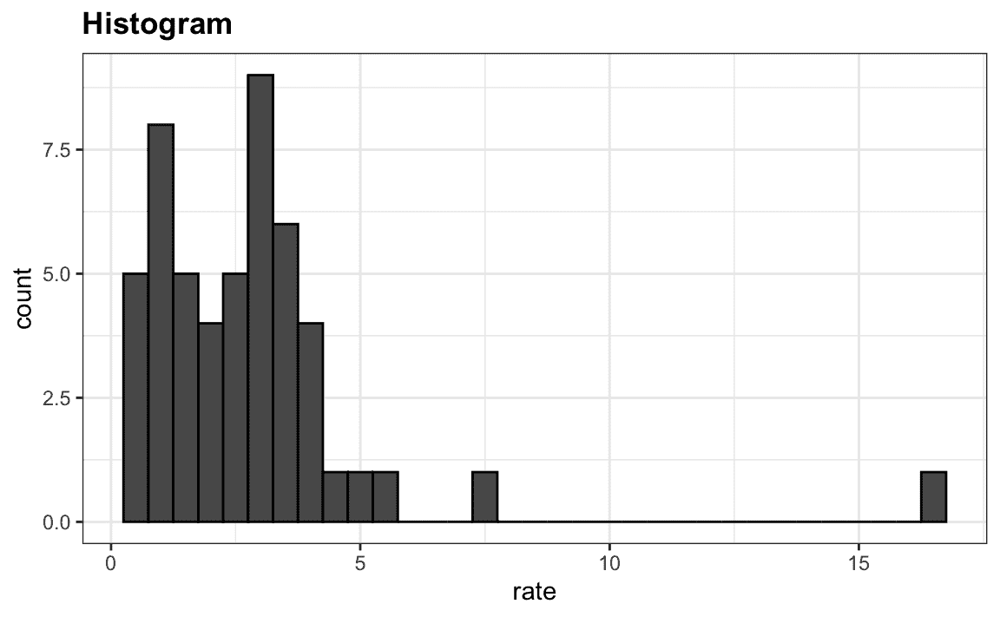

在这种情况下，上面的直方图或平滑密度图可以作为一个相对简洁的总结。

现在假设那些习惯于只接收两个数字作为总结的人要求我们提供一个更紧凑的数值总结。

箱形图*提供了一个由范围（最小值和最大值）以及*四分位数*（第 25、50 和 75 百分位数）组成的五数总结。R 实现中的箱形图在计算范围时忽略*异常值*，并将这些值作为独立点绘制。帮助文件提供了异常值的特定定义。箱形图将这些数字显示为“箱”和“须须”。

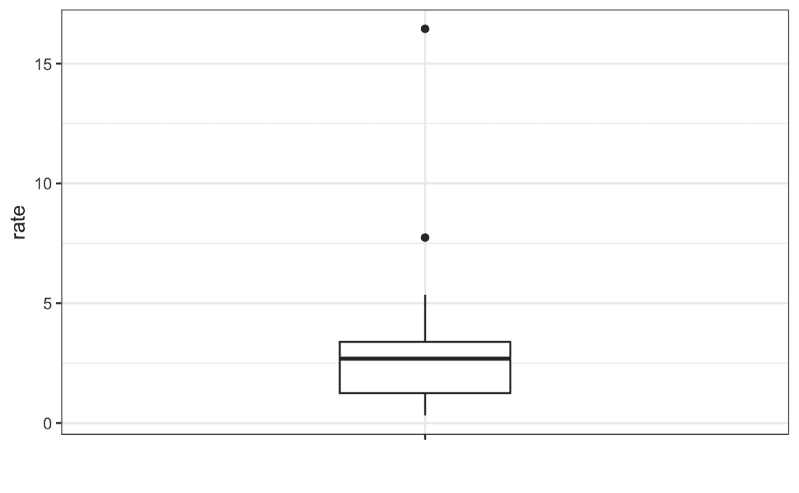

由 25%和 75%分位数定义的箱形和显示范围的须须。25%和 75%分位数之间的距离称为*四分位距*。根据 R 的实现，这两个点是异常值。中位数用水平线表示。

从这张简单的图表中，我们可以知道中位数大约是 2.5，分布不是对称的，以及大多数州的范围是 0 到 5，只有两个例外。

我们在第 8.14 节中讨论了如何制作箱形图。***

## ***7.5 分层***

**在数据分析中，我们通常根据与观察值相关的一个或多个变量的值将观察值分成组。例如，在下一节中，我们将身高值根据性别变量分成组：女性和男性。我们称此过程为*分层*，并将由此产生的组称为*层*。

分层在数据可视化中很常见，因为我们通常对变量在不同子组中的分布差异感兴趣。在本书的这一部分，我们将看到几个例子，从下一节开始。***

## ***7.6 案例研究继续***

**如果我们确信男性身高数据可以用正态分布很好地近似，我们可以向 ET 报告一个非常简洁的总结：男性身高遵循平均为 69.3 英寸，标准差为 3.6 英寸的正态分布。有了这些信息，ET 将对他遇到我们的男性学生时可以期待什么有一个很好的了解。然而，为了提供一个完整的画面，我们还需要提供女性身高的总结。

当我们想要快速比较两个或多个分布时，箱形图很有用。以下是男性和女性的身高：

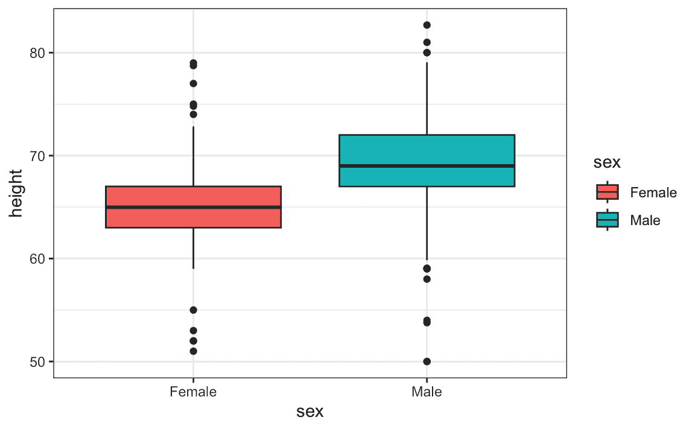

图表立即显示，男性平均身高高于女性。四分位数范围看起来相似。但是，正态近似也适用于调查收集的女性身高数据吗？我们预计它们将遵循正态分布，就像男性一样。然而，探索性图表显示，这种近似并不那么有用：

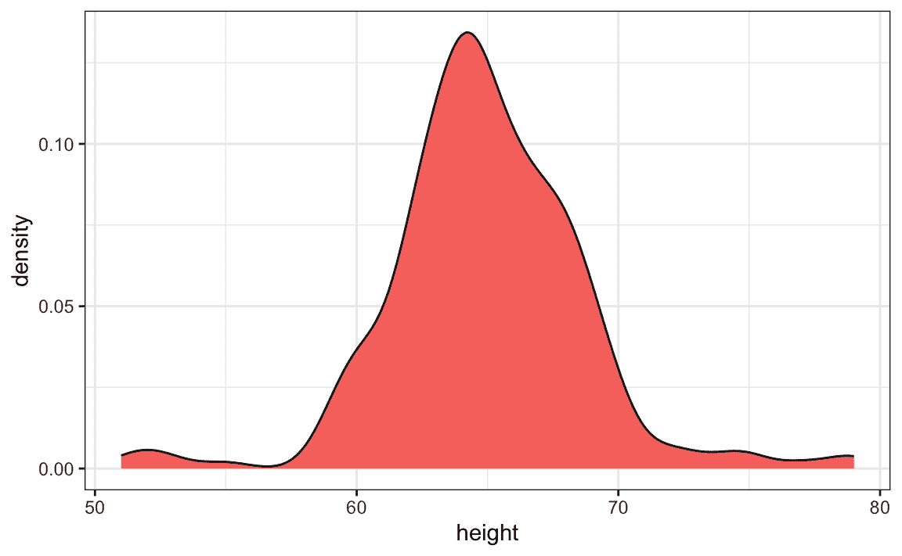

我们看到了在男性身上没有看到的事情：密度图有一个第二个“峰值”。而且，最高点往往比正态分布预期的要高。在向 ET 汇报时，我们可能需要提供一个直方图，而不仅仅是女性身高的平均值和标准差。

然而，回顾一下图克的话。我们已经注意到了我们没有预料到的事情。如果我们查看其他女性的身高分布，我们发现它们很好地被正态分布所近似。那么为什么我们的女学生不同？我们的班级是女性篮球队的必修课吗？是否有小部分女性声称自己的身高高于实际身高？另一个可能更合理的解释是，在学生用来输入身高的形式中，`FEMALE`是默认性别，一些男性输入了他们的身高，但忘记了更改性别变量。无论如何，数据可视化帮助我们发现了数据中可能存在的潜在缺陷。

关于前五个最小值，请注意，这些值是：

[PRE6]

因为这些是报告的身高，一种可能是学生本意是想输入`5'1"`、`5'2"`、`5'3"`或`5'5"`。****

## ***7.7 练习***

**1. 定义包含男性和女性身高的变量，如下所示：

[PRE7]

我们每个国家有多少个测量值？

2. 假设我们无法绘制图表，而想并排比较分布。我们不能只是列出所有数字。相反，我们将查看百分位数。创建一个五行的表格，显示`female_percentiles`和`male_percentiles`，包括每个性别的 10th、30th、50th、70th 和 90th 百分位数。然后创建一个数据框，将这两个作为列。

3. 研究以下按国家显示的人口规模的箱型图：

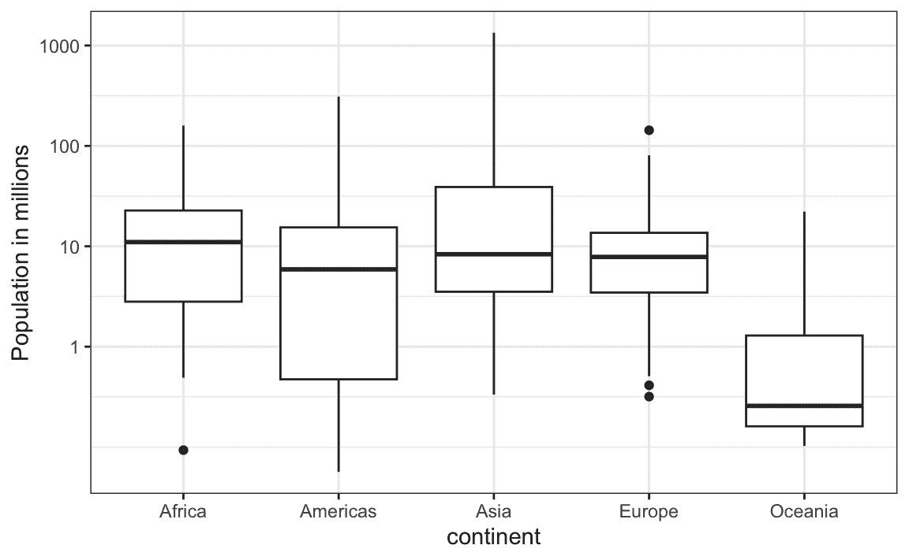

哪个洲的国家人口规模最大？

4. 哪个洲的中位人口规模最大？

5. 非洲的中位人口规模是多少，四舍五入到百万？

6. 欧洲有多少比例的国家人口低于 1400 万？

1.  0.99

1.  0.75

1.  0.50

1.  0.25

7. 如果我们使用对数变换，上面显示的哪个洲的四分位数范围最大？

8. 加载身高数据集，并创建一个只包含男性身高的向量`x`：

[PRE8]

数据中在 69 英寸到 72 英寸（高于 69 英寸，但小于或等于 72 英寸）之间的比例是多少？提示：使用逻辑运算符和`mean`。*****
