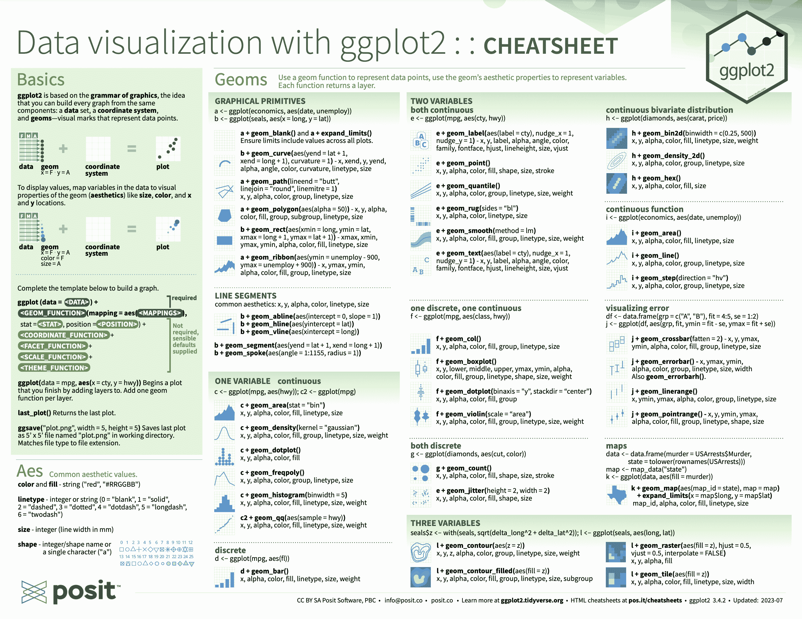
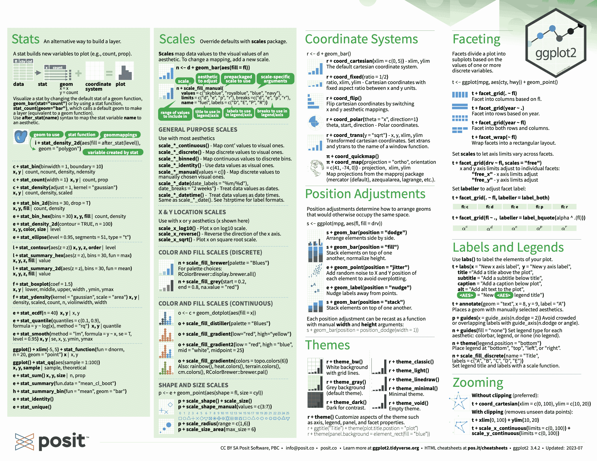
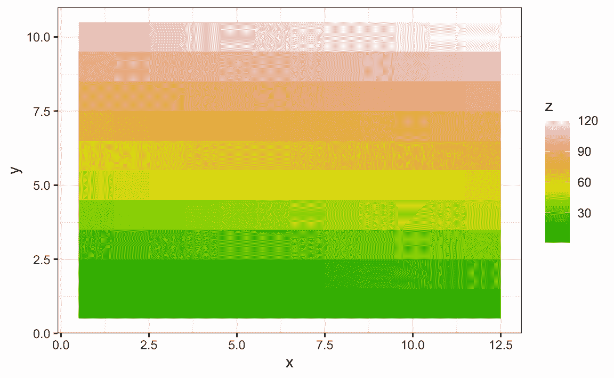
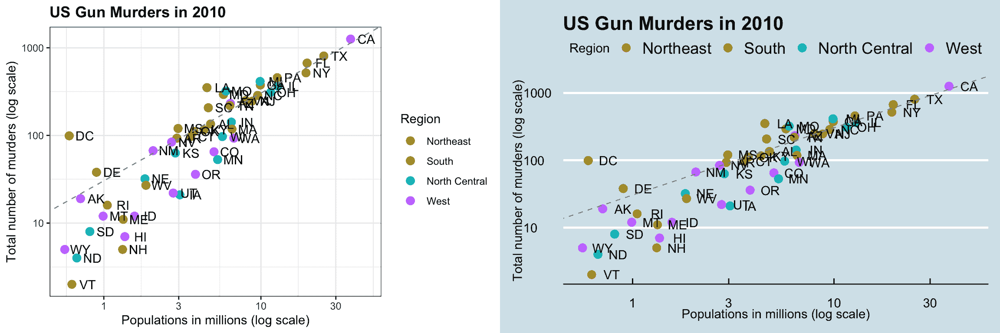

# 8  ggplot2

> 原文：[`rafalab.dfci.harvard.edu/dsbook-part-1/dataviz/ggplot2.html`](https://rafalab.dfci.harvard.edu/dsbook-part-1/dataviz/ggplot2.html)

1.  数据可视化

1.  8  ggplot2

探索性数据可视化可能是 R 的最大优势。人们可以快速从想法到数据再到图表，这种灵活性与易用性的独特平衡。例如，对于某些图表，Excel 可能比 R 更易用，但它的灵活性远远不如 R。D3.js 可能比 R 更灵活和强大，但生成图表需要更长的时间。

在整本书中，我们将使用**ggplot2**¹包来创建图表。

```r
library(dplyr
library(ggplot2
```

在 R 中创建图表的方法还有很多。实际上，R 的基本安装就已经提供了相当强大的绘图功能。还有其他用于创建图形的包，如**grid**和**lattice**。我们选择在这本书中使用**ggplot2**，因为它将图表分解成组件，这种方式允许初学者使用直观且相对容易记忆的语法创建相对复杂且美观的图表。

ggplot2**对初学者来说通常更直观的一个原因是它使用了图形语法²，即**ggplot2**中的*gg*。这类似于学习语法可以帮助初学者通过学习少量动词、名词和形容词来构建成百上千种不同的句子，而不需要记住每个具体的句子。同样，通过学习少量**ggplot2**构建块及其语法，您将能够创建成百上千种不同的图表。

ggplot2**对初学者来说容易的另一个原因是它的默认行为是精心选择的，以满足大多数情况，并且视觉效果令人愉悦。因此，可以使用相对简单且易于阅读的代码创建信息丰富且优雅的图表。

一个限制是**ggplot2**设计为仅与整洁格式的数据表一起工作。然而，初学者处理的大量数据集都在这种格式中，或者可以转换成这种格式。这种方法的一个优点是，假设我们的数据是整洁的，**ggplot2**简化了绘图代码和各种图表语法的学习。

要使用**ggplot2**，您将不得不学习几个函数和参数。这些很难记住，所以我们强烈建议您手头备有 ggplot2 速查表。您可以从 Posit 的网站³获取一份，或者简单地在网上搜索“ggplot2 cheat sheet”。

## 8.1 图表组成部分

我们将构建一个图表，总结美国谋杀数据集，看起来像这样：


我们可以清楚地看到各州在人口规模和谋杀总数上的差异。不出所料，我们还看到谋杀总数与人口规模之间存在明显的关联。位于虚线灰色线上的州具有与美国平均相同的谋杀率。四个地理区域用颜色表示，这描绘了大多数南部州的谋杀率高于平均水平。

这份数据可视化几乎展示了数据框中的所有信息。制作此图表所需的代码相对简单。我们将学习逐步创建图表。

学习**ggplot2**的第一步是能够将图表分解成组件。让我们分解上面的图表并介绍一些**ggplot2**术语。需要注意的主要三个组件是：

+   **数据**：正在汇总的 US 谋杀数据框。我们将其称为**数据**组件。

+   **几何形状**：上面的图表是一个散点图。这被称为**几何**组件。其他可能的几何形状包括条形图、直方图、平滑密度、QQ 图和箱线图。我们将在第 8.14 节中了解更多关于这些内容。

+   **美学映射**：该图表使用几个视觉线索来表示数据集提供的信息。在这个图表中，最重要的两个线索是 x 轴和 y 轴上的点位置，分别代表人口规模和谋杀总数。每个点代表一个不同的观察结果，我们将这些观察结果的数据映射到 x 和 y 刻度等视觉线索上。颜色是另一个映射到区域的视觉线索，我们将其称为**美学映射**组件。我们如何定义映射取决于我们正在使用的**几何形状**。

我们还注意到：

+   点被标记为州缩写。

+   x 轴和 y 轴的范围似乎由数据的范围定义。它们都使用对数刻度。

+   图表中包含标签、标题、图例，我们采用了《经济学人》杂志的风格。

ggplot2**的一般方法是逐步构建图表，通过向由`ggplot`函数创建的`ggplot`对象中添加*层*来实现。层可以定义几何形状、计算汇总统计量、定义要使用的刻度或更改样式。要添加层，我们使用符号`+`。一般来说，一行代码将看起来像这样：

> > DATA |> `ggplot()` + LAYER 1 + LAYER 2 + … + LAYER N

我们现在将通过剖析如何构建上面的图表来展示 ggplot2 的基本原理。

## 8.2 使用数据初始化对象

我们首先加载相关的数据集，该数据集位于**dslabs 包**中：

```r
library(dslabs)
```

创建**ggplot2**图表的第一步是定义一个`ggplot`对象。通常，大多数或所有层都将映射来自同一数据集的变量，因此我们将此对象与相关数据框关联

```r
ggplot(data = murders)
```

或者等价地

```r
murders |> ggplot()
```

*  *这两行代码都生成了一个图表，在这种情况下是一个空白画布，因为没有定义几何形状。我们看到的唯一样式选择是默认的灰色背景。我们看到一个图表，因为创建了一个对象而没有分配给变量，它被自动评估并打印出来。但我们可以像通常一样将我们的图表分配给一个对象：

```r
p <- ggplot(data = murders)
```

要渲染与此对象关联的图表，我们只需打印对象`p`。以下两行代码各自生成了我们上面看到的相同图表：

```r
print(p)
p
```

总结来说，`p`是一个`ggplot`对象，其数据组件是`murders`数据框。

## 8.3 添加几何形状

一个常见的第一步是让**ggplot2**知道要使用哪种几何形状。我们经常添加多个几何形状，但我们至少需要一个。在我们的例子中，我们想要制作一个散点图。几何形状是通过函数添加的。快速查看速查表，我们看到应该使用函数`geom_point`。





(图片由 Posit 提供⁴。CC-BY-4.0 许可⁵。)

注意，几何函数名称遵循以下模式：`geom_X`，其中 X 是几何形状的名称。一些例子包括`geom_histogram`、`geom_boxplot`和`geom_col`。我们将在第 8.14 节中进一步讨论这些内容。

为了使`geom_point`正常运行，我们需要提供数据和映射。我们已将`murders`数据表分配给对象`p`。接下来我们需要添加`geom_point`层来定义几何形状。要找出此函数期望的映射，我们阅读`geom_point`帮助文件的**美学**部分：

> > **美学** `geom_point()`理解以下美学（必需美学以粗体显示）：
> > 
> > +   **x
> > +   
> > +   **y
> > +   
> > +   alpha
> > +   
> > +   colour

我们看到至少需要两个参数：`x`和`y`。接下来我们将解释如何将数据集中的值映射到图表上。

## 8.4 美学映射

美学映射*描述了数据属性如何与图表特征（如轴上的距离、大小或颜色）相关联。`aes`函数通过定义美学映射将数据与我们在图表上看到的内容连接起来，将是你在绘图时最常使用的函数之一。此示例生成了一个总谋杀数与百万人口之间的散点图：

```r
murders |> ggplot() + geom_point(aes(population/10⁶, total))
```


添加此层时，默认定义了刻度和标签。像 **dplyr** 函数一样，`aes` 也使用数据组件中的变量名：我们可以使用 `population` 和 `total`，而无需将它们作为 `murders$population` 和 `murders$total` 调用。从数据组件中识别变量的行为是 `aes` 特有的。对于 `ggplot2` 函数中的 `aes` 之外的函数，如果您尝试访问 `population` 或 `total` 的值，您将收到一个错误。

## 8.5 其他层

为了将图形塑造成最终形式，我们继续添加层。我们希望在图形中添加的第二层涉及为每个点添加标签以标识州。`geom_label` 和 `geom_text` 函数允许我们分别带和不带文本后面的矩形将文本添加到图形中。

因为每个点（在这种情况下是每个州）都有一个标签，我们需要一个美学映射来在点和标签之间建立联系。通过阅读帮助文件，我们了解到我们通过 `aes` 的 `label` 参数提供点与标签之间的映射。因此，代码看起来是这样的：

```r
murders |> ggplot() + 
 geom_point(aes(population/10⁶, total)) +
 geom_text(aes(population/10⁶, total, label = abb))
```


## 8.6 全局美学映射

在之前的代码行中，我们定义了映射 `aes(population/10⁶, total)` 两次，一次在每个层中。我们可以通过使用一个 *全局* 美学映射来避免这种情况。我们可以在定义空白画布 `ggplot` 对象时这样做。记住，`ggplot` 函数的 `mapping` 参数允许我们定义美学映射。如果我们定义了 `ggplot` 中的映射，所有添加为层的几何图形都将默认使用此映射。因此，我们可以简单地编写以下代码来生成之前的图形：

```r
murders |> ggplot(aes(population/10⁶, total)) +
 geom_point() +
 geom_text(aes(label = abb))
```

请注意，`label` 的映射仅在 `geom_text` 中定义，因为 `geom_point` 不使用此参数。

如果需要，我们可以在每个层中定义一个新的映射来覆盖全局映射。这些 *局部* 定义覆盖了 *全局*。以下是一个例子：

```r
murders |> ggplot(aes(population/10⁶, total)) +
 geom_point() +
 geom_text(aes(x = 10, y = 800, label = "Hello there!"))
#> Warning in geom_text(aes(x = 10, y = 800, label = "Hello there!")): All aesthetics have length 1, but the data has 51 rows.
#> ℹ Please consider using `annotate()` or provide this layer with data
#>   containing a single row.
```


## 8.7 非美学参数

每个几何函数都有除 `aes` 和 `data` 之外的参数。它们通常是特定于函数的，并且不会映射到数据中的变量。例如，在我们希望制作的图形中，点的大小大于默认大小。作为另一个例子，为了避免将文本放在点上方，我们可以在 `geom_text` 中使用 `nudge_x` 参数。带有参数的代码如下：

```r
murders |> ggplot(aes(population/10⁶, total)) +
 geom_point(size = 3) +
 geom_text(aes(label = abb), nudge_x = 1.5)
```


## 8.8 将类别作为颜色

对于最终的图形，我们希望每个区域都有不同的颜色。因为这种信息来自数据，所以它是一种美学映射。在我们的例子中，我们可以使用`geom_point`函数中的`color`映射将颜色映射到类别，如下所示：

```r
murders |> ggplot(aes(population/10⁶, total)) +
 geom_point(aes(color = region), size = 3) 
```


注意，`color`也是**ggplot2**函数中的非美学参数，包括`geom_point`。此参数不是用来将颜色映射到类别，而是用来改变所有点的颜色。例如，如果我们想让所有点都是蓝色，我们会将层改为`geom_point(col = "blue", size = 3)`。

```r
murders |> ggplot(aes(population/10⁶, total)) +
 geom_point(color = "blue", size = 3) 
```


## 8.9 更新 ggplot 对象

在**ggplot2**中，我们通过部分构建图形。该包的一个有用特性是我们可以通过添加层级来更新现有的`ggplot`对象。例如，我们可以通过使用数据集和全局美学初始化对象来开始。

```r
p0 <- murders |> ggplot(aes(population/10⁶, total))
```

然后开始添加层级。例如，我们首先添加散点图

```r
p1 <- p0 +  geom_point(aes(color = region), size = 3)
```

以及标签：

```r
p2 <- p1 + geom_text(aes(label = abb), nudge_x = 0.1)
```

在接下来的几节中，我们将使用这种方法在前面几节创建的对象上构建。这有助于改进图形以及测试选项。注意，我们将`nudge_x`从 1.5 改为 0.1，因为在下一节中我们将应用对数变换，较小的值更合适。

## 8.10 刻度

ggplot2**的一个优势是默认行为通常足以实现我们的可视化目标。然而，它也提供了改变这些默认设置的方法。许多这些改变都是通过`scales`函数来实现的。

两个例子是`scale_x_continuous`和`scale_y_continuous`函数，它们允许我们分别调整 x 轴和 y 轴。在最终的图形中，我们试图产生对数刻度的刻度，这可以通过在这些函数中分配参数`trans = "log10"`来实现。然而，因为这个操作非常常见，**ggplot2**包括了`scale_x_log10`和`scale_y_log10`函数。我们可以通过添加这些层级来实现所需的变换：

```r
p3 <- p2 + scale_x_log10() + scale_y_log10() 
p3
```


## 8.11 注释

我们经常想要向不是直接从美学映射派生的图表添加注释。注释函数的例子有 `labs`、`annotate` 和 `geom_abline`。`labs` 函数允许添加标题、副标题、字幕和其他标签。请注意，这些也可以使用 `xlab`、`ylab` 和 `ggtitle` 等函数单独定义。

`labs` 函数还允许进行另一个对我们所需图表所需的更改：更改图例标题。因为这是颜色映射的图例，所以可以通过 `color = "NEW_TITLE"` 参数来实现：

```r
p4 <- p3 + labs(title = "US Gun Murders in 2010",
 x = "Populations in millions (log scale)", 
 y = "Total number of murders (log scale)",
 color = "Region")
p4
```


```r
r <- murders |> 
 summarize(rate = sum(total)/sum(population)*10⁶) |> 
 pull(rate)
```

要添加一条线，我们使用 `geom_abline` 函数。名称中的 `ab` 让我们想起我们正在提供截距（`a`）和斜率（`b`）。默认线具有斜率 1 和截距 0，所以我们只需要定义截距。请注意，最终图表具有虚线类型和灰色，这些可以通过 `lty`（线型）和 `color` 非美学参数进行更改。我们添加层的方式如下：

```r
p5 <- p4 + 
 geom_abline](https://ggplot2.tidyverse.org/reference/geom_abline.html)(intercept = [log10(r), lty = 2, color = "darkgrey") 
p5
```


我们几乎完成了！我们只需添加对样式的可选更改。

## 8.12 扩展包

由于扩展包的可用性，**ggplot2** 的功能进一步增强。为了给我们的图表添加最后的修饰，我们需要 **ggthemes** 和 **ggrepel** 扩展包。

可以使用 `theme` 函数更改 **ggplot2** 图表的风格。**ggplot2** 包包含几个主题。实际上，对于本书中的大多数图表，我们使用 **dslabs** 包中的一个函数来自动设置默认主题：

```r
ds_theme_set()
```

包 **ggthemes** 添加了许多其他主题。其中之一是我们在这里使用的 `theme_economist` 主题。安装包后，您可以通过添加类似这样的层来更改样式：

```r
library(ggthemes)
p6 <- p5 + theme_economist()
```

您可以通过简单地更改函数来查看其他主题的外观。例如，您可能会尝试 `theme_fivethirtyeight()` 主题。

最后的更改是为了更好地定位标签以避免拥挤；目前，一些标签重叠在一起。添加包 **ggrepel** 包含一个几何形状，在添加标签的同时确保它们不会重叠。我们只需将 `geom_text` 更改为 `geom_text_repel`。

## 8.13 整合所有内容

现在我们已经完成了测试，我们可以写一行代码从头开始生成我们想要的图表。

```r
library(ggthemes)
library(ggrepel)
 r <- murders |> 
 summarize(rate = sum(total) /  sum(population) * 10⁶) |>
 pull(rate)
 murders |> 
 ggplot(aes(population/10⁶, total)) + 
 geom_abline](https://ggplot2.tidyverse.org/reference/geom_abline.html)(intercept = [log10(r), lty = 2, color = "darkgrey") +
 geom_point(aes(col = region), size = 3) +
 geom_text_repel(label = abb)) + 
 scale_x_log10() +
 scale_y_log10() +
 labs(title = "US Gun Murders in 2010",
 x = "Populations in millions (log scale)", 
 y = "Total number of murders (log scale)",
 color = "Region") +
 theme_economist()
```


## 8.14 几何形状

在我们的示例中，我们介绍了散点图几何形状 `geom_point`。然而，**ggplot2** 有很多其他形状，在这里我们演示如何生成与分布相关的图表，特别是第七章中显示的图表。

### 8.14.1 条形图

要生成条形图，我们可以使用 `geom_bar` 几何形状。默认情况下，是计算每个类别的数量并绘制一个条形。以下是美国各地区的条形图。

```r
murders |> ggplot(aes(region)) + geom_bar()
```

然而，我们通常已经有一个包含我们想要展示为条形图数字的表格。以下是一个此类表格的例子：

```r
tab <- murders |> 
 count(region) |> 
 mutate(proportion = n/sum(n))
```

在这种情况下，我们使用 `geom_col` 而不是 `geom_bar`：

```r
tab |> ggplot(aes(region, proportion)) + geom_col()
```

### 8.14.2 直方图

要生成直方图，我们使用 `geom_histogram`。通过查看该函数的帮助文件，我们了解到唯一必需的参数是 `x`，这是我们将要构建直方图的变量。我们省略了 `x`，因为我们知道它是第一个参数。代码看起来是这样的：

```r
heights |> filter(sex == "Female") |> 
 ggplot(aes(height)) + 
 geom_histogram(binwidth = 1, fill = "blue", col = "black")
```

请注意，我们使用可选参数 `bandwidth = 1` 来改变条形大小为 1 英寸。默认情况下，创建 30 个条形。我们还使用可选参数 `fill = "blue"` 和 `col = "black"` 来用颜色填充条形，并使用不同的颜色来勾勒条形。

### 8.14.3 密度图

要创建平滑密度，我们使用 `geom_density`。要使用之前显示为直方图的数据创建平滑密度图，我们可以使用以下代码：

```r
heights |> 
 filter(sex == "Female") |>
 ggplot(aes(height)) +
 geom_density(fill = "blue")
```

请注意，我们使用可选参数 `fill` 来改变颜色。为了改变密度的平滑度，我们使用 `adjust` 参数将默认值乘以该 `adjust`。例如，如果我们想带宽是两倍大，我们使用：

```r
heights |> 
 filter(sex == "Female") |>
 ggplot(aes(height)) +
 geom_density(fill="blue", adjust = 2)
```

### 8.14.4 箱线图

箱线图的几何形状是 `geom_boxplot`。如前所述，箱线图用于比较分布。例如，下面是之前显示的女性身高，但与男性相比。对于这个几何形状，我们需要 `x` 作为类别，`y` 作为值。

```r
heights |> ggplot(aes(sex, height)) +
 geom_boxplot()
```

### 8.14.5 图片

本章中描述的概念不需要图像，但我们在 第 10.9 节 中将使用图像，因此我们介绍用于绘制图像的两个几何形状：**geom_tile** 和 **geom_raster**。它们的行为类似；要了解它们之间的区别，请查阅帮助文件。要在 **ggplot2** 中创建图像，我们需要一个包含 x 和 y 坐标以及与每个这些坐标相关联的值的数据框。下面是一个数据框。

```r
x <- expand.grid](https://rdrr.io/r/base/expand.grid.html)(x = 1:12, y = 1:10) |> [mutate(z = 1:120) 
```

注意，这是一个矩阵的整洁版本，`matrix(1:120, 12, 10)`。要绘制图像，我们使用以下代码：

```r
x |> ggplot(aes(x, y, fill = z)) + geom_raster()
```

使用这些图像，你通常会想更改颜色范围。这可以通过 `scale_fill_gradientn` 层来完成。

```r
x |> ggplot(aes(x, y, fill = z)) + 
 geom_raster() + 
 scale_fill_gradientn](https://ggplot2.tidyverse.org/reference/scale_gradient.html)(colors =  [terrain.colors(10, 1))
```



## 8.15 绘图网格

通常，有理由将图形并排放置。**gridExtra** 包允许我们这样做。以下是上一节中创建的图形 `p5` 和 `p6`：

```r
library(gridExtra)
grid.arrange(p5, p6, ncol = 2)
```



## 8.16 练习

首先，加载 **dplyr** 和 **ggplot2** 库以及 `murders` 和 `heights` 数据。

```r
library(dplyr
library(ggplot2
library(dslabs)
```

1\. 使用 **ggplot2**，可以将图形保存为对象。例如，我们可以将数据集与图形对象关联起来，如下所示

```r
p <- ggplot(data = murders)
```

因为 `data` 是第一个参数，所以我们不需要明确写出

```r
p <- ggplot(murders)
```

我们也可以使用管道：

```r
p <- murders |> ggplot()
```

`p` 对象的类别是什么？

2\. 记住，要打印一个对象，你可以使用 `print` 命令或简单地输入对象。打印在练习一中定义的对象 `p` 并描述你所看到的。

1.  没有发生任何事情。

1.  一个空白画布图。

1.  一个散点图。

1.  一个直方图。

3\. 使用管道 `|>` 创建一个对象 `p`，但这次与 `heights` 数据集相关联，而不是 `murders` 数据集。

4\. 你刚刚创建的对象 `p` 的类别是什么？

5\. 现在我们将添加一层，以及相应的美学映射。对于谋杀数据，我们绘制了总谋杀数与人口规模的关系。探索 `murders` 数据框，以提醒自己这两个变量的名称，并选择正确的答案。**提示**：查看 `?murders`。

1.  `state` 和 `abb`。

1.  `total_murders` 和 `population_size`。

1.  `total` 和 `population`。

1.  `murders` 和 `size`。

6\. 要创建散点图，我们添加一个 `geom_point` 层。美学映射要求我们定义 x 轴和 y 轴变量，所以代码看起来像这样：

```r
murders |> ggplot(aes(x = , y = )) +
 geom_point()
```

除了我们必须定义两个变量 `x` 和 `y`。用正确的变量名称填写。

7\. 注意，如果我们不使用参数名称，我们可以通过确保以正确的顺序输入变量名称来获得相同的图形，如下所示：

```r
murders |> ggplot(aes(population, total)) +
 geom_point()
```

重新制作这个图，但现在以总谋杀数作为 x 轴，人口作为 y 轴。

8. 如果我们想添加文本而不是点，我们可以使用`geom_text()`或`geom_label()`几何形状。以下代码

```r
murders |> ggplot(aes(population, total)) + geom_label()
```

将给出错误信息：`Error: geom_label requires the following missing aesthetics: label`

为什么呢？

1.  我们需要通过`aes`中的标签参数将一个字符映射到每个点。

1.  我们需要让`geom_label`知道在图中使用哪个字符。

1.  `geom_label`几何形状不需要 x 轴和 y 轴值。

1.  `geom_label`不是一个 ggplot2 命令。

9. 将上面的代码重写为通过`aes`使用缩写作为标签。

10. 将标签的颜色更改为蓝色。我们将如何做到这一点？

1.  在`murders`中添加一个名为`blue`的列。

1.  因为每个标签都需要不同的颜色，我们通过`aes`映射颜色。

1.  使用`ggplot`中的`color`参数。

1.  因为我们希望所有标签都是蓝色，所以我们不需要映射颜色，只需在`geom_label`中使用颜色参数。

11. 将上面的代码重写为使标签为蓝色。

12. 现在假设我们想用颜色来表示不同的区域。在这种情况下，以下哪个最合适：

1.  在`murders`中添加一个名为`color`的列，并添加我们想要使用的颜色。

1.  因为每个标签都需要不同的颜色，我们通过`aes`的颜色参数映射颜色。

1.  在`ggplot`中使用`color`参数。

1.  因为我们希望所有颜色都是蓝色，所以我们不需要映射颜色，只需在`geom_label`中使用颜色参数。

13. 将上面的代码重写为使标签的颜色由州的区域决定。

14. 现在我们将 x 轴改为对数尺度，以考虑到人口分布是偏斜的。让我们首先定义一个对象`p`，它包含我们到目前为止制作的图表。

```r
p <- murders |> 
 ggplot(aes(population, total, label = abb, color = region)) +
 geom_label() 
```

要改变 y 轴为对数尺度，我们学习了`scale_x_log10()`函数。将此层添加到对象`p`中，以更改尺度并渲染图表。

15. 重复之前的练习，但现在将两个轴都改为对数尺度。

16. 现在编辑上面的代码，向图表添加标题“枪支谋杀数据”。提示：使用`ggtitle`函数。

17. 现在我们将使用`geom_histogram`函数来制作`height`数据框中高度的直方图。当阅读该函数的文档时，我们看到它只需要一个映射，即用于直方图的值。制作所有图表的直方图。

哪个变量包含高度？

1.  `sex`

1.  `heights`

1.  `height`

1.  `heights$height`

18. 现在创建一个 ggplot 对象，使用管道将高度数据分配给 ggplot 对象。通过`aes`函数将`height`分配给 x 值。

19. 现在我们准备添加一个层来实际制作直方图。使用之前练习中创建的对象和`geom_histogram`函数来制作直方图。

20. 注意，当我们运行上一个练习中的代码时，我们会得到警告：`stat_bin()`使用`bins = 30`。使用`binwidth`选择更好的值。

使用`binwidth`参数将上一个练习中制作的直方图更改为使用 1 英寸大小的 bin。

21. 我们将不再使用直方图，而是制作一个平滑密度图。在这种情况下，我们不会创建一个对象，而是用一行代码来渲染图表。将之前用于制作直方图的几何形状更改为制作平滑密度。

22. 现在我们将分别为男性和女性制作密度图。我们可以使用`group`参数来完成这项工作。我们通过美学映射来分配组，因为每个点在执行估计密度的计算之前都需要属于一个组。

23. 我们也可以通过`color`参数来分配组。这个额外的优点是它使用颜色来区分组。将上面的代码更改为使用颜色。

24. 我们也可以通过`fill`参数来分配组。这个额外的优点是它使用颜色来区分组，如下所示：

```r
heights |> 
 ggplot(aes(height, fill = sex)) + 
 geom_density() 
```

然而，在这里，第二密度是覆盖在其他密度之上的。我们可以通过使用 alpha 混合来增加透明度，使曲线更加明显。在`geom_density`函数中将 alpha 参数设置为 0.2 以实现这一变化。

* * *

1.  ggplot2 文档↩︎

1.  [Springer 出版社书籍](http://www.springer.com/us/book/9780387245447)↩︎

1.  [数据可视化速查表](https://posit.co/resources/cheatsheets/)↩︎

1.  [数据可视化速查表](https://rstudio.github.io/cheatsheets/data-visualization.pdf)↩︎

1.  [rstudio 速查表许可](https://github.com/rstudio/cheatsheets/blob/main/LICENSE)↩︎
