# 9 数据可视化原则

> [`rafalab.dfci.harvard.edu/dsbook-part-1/dataviz/dataviz-principles.html`](https://rafalab.dfci.harvard.edu/dsbook-part-1/dataviz/dataviz-principles.html)

1.  数据可视化

1.  9 数据可视化原则

本章的目标是提供一些通用原则，我们可以将其用作有效数据可视化的指南。本节的大部分内容基于 Karl Broman¹的演讲，标题为“创建有效的图表和表格”²，其中包括一些使用 Karl 在 GitHub 存储库³上提供的代码制作的图表，以及 Peter Aldhous 数据可视化导论课程的课堂笔记⁴。遵循 Karl 的方法，我们展示了我们应该避免的绘图风格的一些示例，解释了如何改进它们，并以此作为原则列表的动机。我们比较了遵循这些原则的图表和不遵循的图表。

这些原则主要基于与人类检测模式和进行视觉比较相关的研究。首选的方法是那些最能符合我们大脑处理视觉信息的方式的方法。在决定可视化方法时，也要牢记我们的目标。我们可能是在比较可观察的数量、描述类别或数值的分布、比较两组数据或描述两个变量之间的关系。最后，我们想强调的是，根据受众调整和优化图表非常重要。例如，为我们自己制作的探索性图表将不同于旨在向普通受众传达发现的图表。

在本章中，我们专注于原则，不展示代码（代码可以在 GitHub 上查看⁵）。在第十章 dataviz-in-practice.html 中，我们将这些原则应用于案例研究，并展示了代码。

## 9.1 使用视觉线索编码数据

我们首先描述一些用于编码数据的原则。我们有几个视觉线索可供选择，包括位置、对齐长度、角度、面积、亮度和颜色色调。

为了说明这些视觉线索的一些比较，让我们假设我们想要报告关于浏览器偏好的两个假设性调查的结果，分别在 2000 年和 2015 年进行。对于每一年，我们只是比较五个数量——五个百分比。百分比的一个广泛使用的图形表示方法是饼图，由 Microsoft Excel 普及：

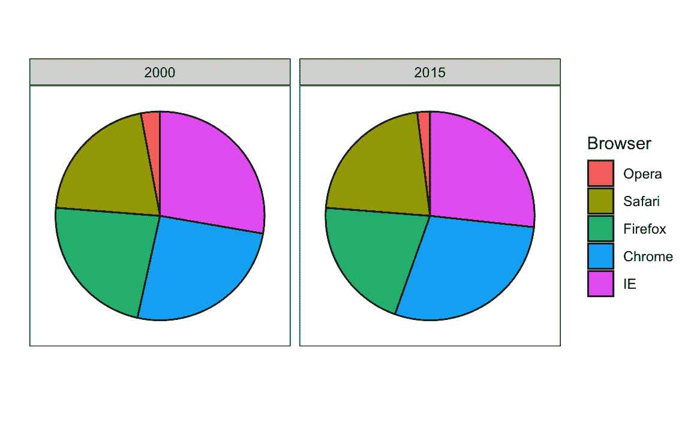

在这里，我们使用面积和角度来表示数量，因为每个饼图的角和面积都与它所代表的数量成比例。事实证明，这是一个次优选择，因为，正如感知研究所示，人类在精确量化角度方面并不擅长，当面积是唯一的可用视觉线索时，情况更糟。饼图是仅使用面积的图表示例：

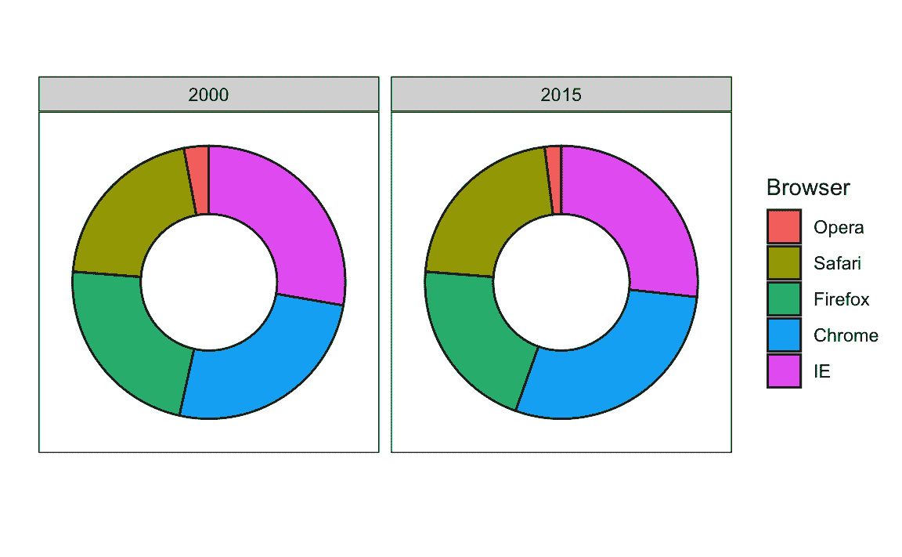

要了解量化角度和面积有多困难，请注意，上述图表中的排名和所有百分比在 2000 年到 2015 年之间发生了变化。你能确定实际的百分比并对浏览器的流行度进行排名吗？你能看到百分比从 2000 年到 2015 年的变化吗？从图表中很难判断。

在这种情况下，仅仅展示数字不仅更清晰，而且如果打印纸质副本，还能节省印刷成本：

| 浏览器 | 2000 | 2015 |
| --- | --- | --- |
| Opera | 3 | 2 |
| Safari | 21 | 22 |
| Firefox | 23 | 21 |
| Chrome | 26 | 29 |
| IE | 28 | 27 |

这些量的最佳绘制方式是使用长度和位置作为视觉线索，因为人类在判断线性度量方面要优越得多。条形图通过使用与感兴趣的数量成比例的条形长度来实现这一方法。通过在战略性地选择的位置添加水平线，在这种情况下，每 10 的倍数，我们减轻了通过条形顶部位置进行量化的视觉负担。比较和对比我们可以从两个图表中提取的信息。

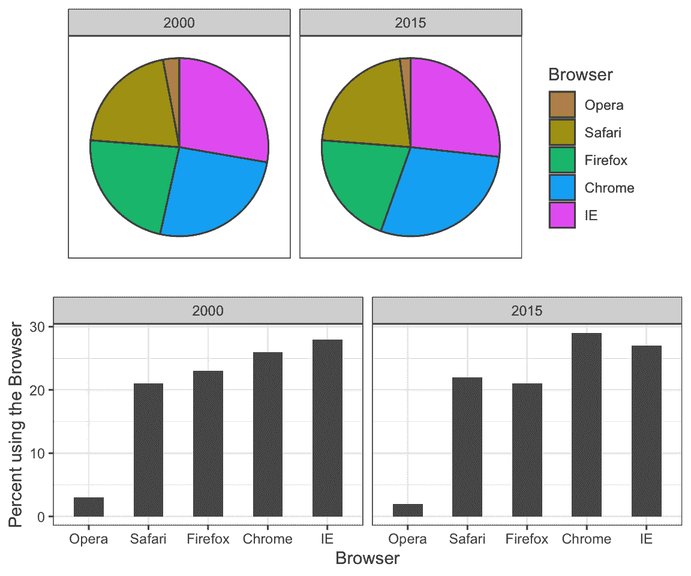

注意条形图中看到差异的难度有多大。实际上，我们现在可以通过跟随水平线到 x 轴来确定实际的百分比。

如果出于某种原因你需要制作饼图，为每个饼图切片标注其相应的百分比，以便观众不必从角度或面积中推断它们：

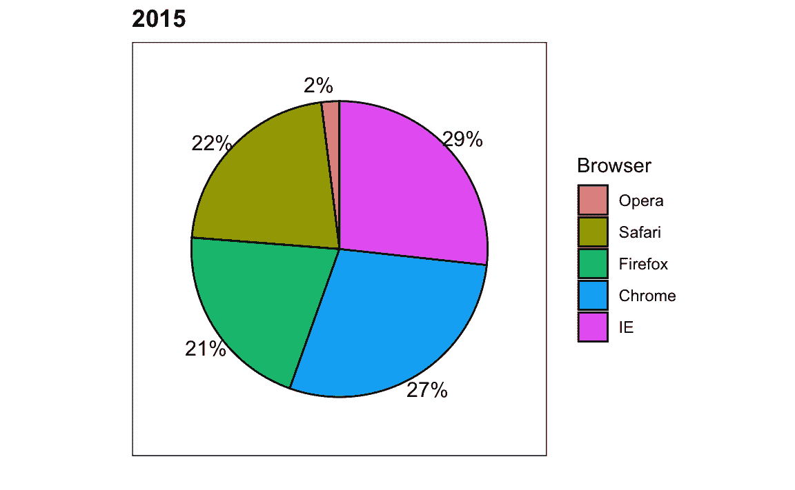

通常，在显示数量时，位置和长度比角度和/或面积更受欢迎。亮度和颜色比角度更难以量化。但，正如我们稍后将会看到的，当必须同时显示超过两个维度时，它们有时是有用的。

## 9.2 知道何时包含 0

当使用长度作为视觉线索时，如果不从 0 开始，就会误导信息。这是因为，当我们使用长度作为视觉线索，比如条形图时，我们暗示长度与显示的数量成比例。通过避免 0，相对较小的差异可以显得比实际上大得多。这种方法通常被政治家或媒体机构用来夸大差异。以下是一个说明性的例子⁶：

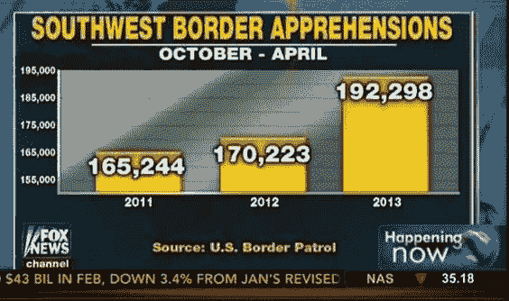

(来源：Fox News，via Media Matters⁷。)

从上面的图表来看，当实际上只增加了大约 16%时，担忧几乎增加了三倍。从 0 开始绘制图表可以清楚地说明这一点：

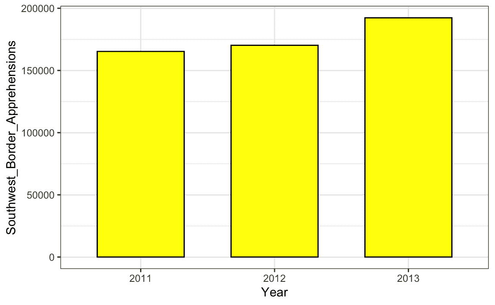

这里是另一个例子：

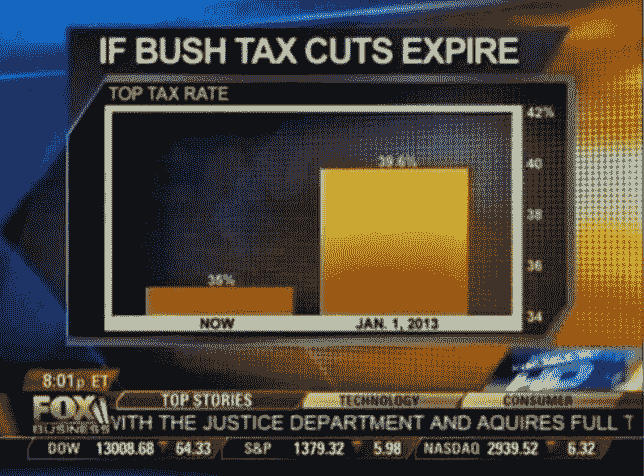

（来源：Fox News，via Flowing Data⁸）

这个图表使 13%的增长看起来像是五倍的变化。以下是适当的图表：

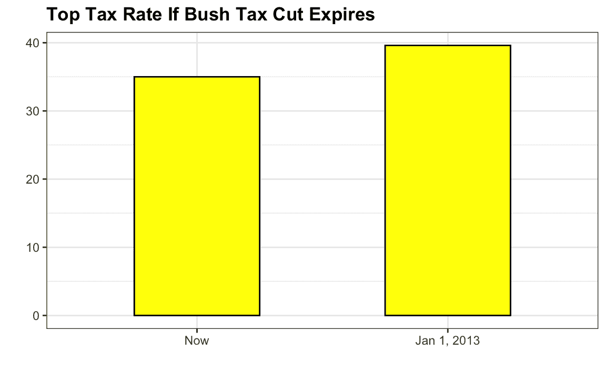

最后，这是一个极端示例，将不到 2%的微小差异看起来像是 10-100 倍的变化：

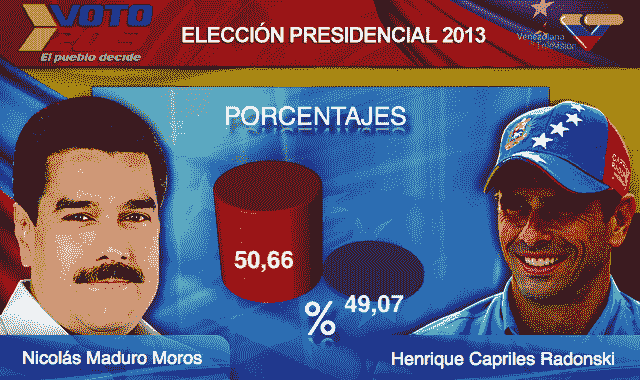

（来源：Venezolana de Televisión via El Mundo⁹）

这里是适当的图表：

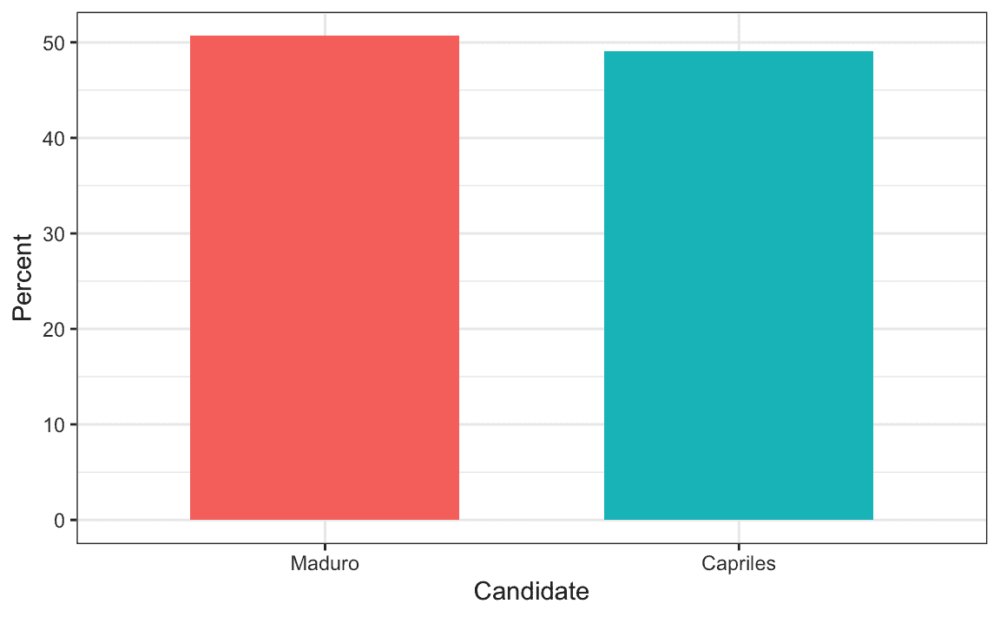

当使用位置而不是长度时，则不需要包含 0。这尤其适用于我们想要比较组内差异相对于组内变异性的情况。以下是一个说明性示例，展示了 2012 年按大洲划分的国家平均预期寿命：

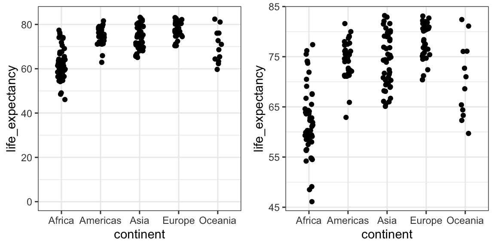

注意，在左侧的图表中，它包括 0，0 和 43 之间的空间没有提供任何信息，并且使得比较组间和组内变异性更加困难。

## 9.3 不要扭曲数量

在巴拉克·奥巴马总统 2011 年的国情咨文中，以下图表被用来比较美国 GDP 与四个竞争国家的 GDP：


（来源：2011 年国情咨文¹⁰）

通过圆的面积来判断，美国似乎拥有比中国大五倍以上的经济，比法国大 30 倍以上。然而，如果我们看实际数字，我们会发现情况并非如此。实际的比率分别比中国和法国大 2.6 倍和 5.8 倍。这种扭曲的原因是半径而不是面积被用来与数量成比例，这意味着面积之间的比例是平方的：2.6 变成了 6.5，5.8 变成了 34.1。以下是我们将值与半径和面积成比例时得到的圆的比较：

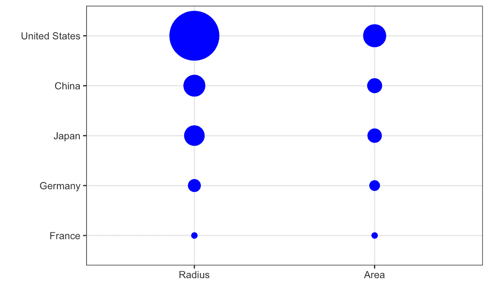

毫不奇怪，**ggplot2**默认使用面积而不是半径。当然，在这种情况下，我们实际上根本不应该使用面积，因为我们可以使用位置和长度：

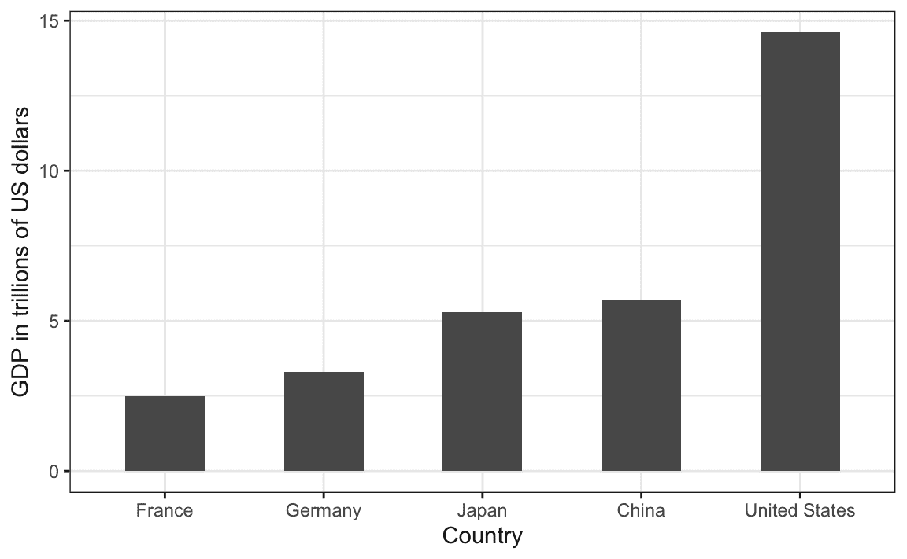

## 9.4 按有意义的值对类别进行排序

当一个轴用于显示类别时，就像在条形图和箱线图中那样，**ggplot2**的默认行为是当它们由字符字符串定义时按字母顺序排列类别。如果它们由因子定义，则按因子水平排列。我们很少想使用字母顺序。相反，我们应该按一个有意义的数量排列。在所有上述情况下，条形图都是按显示的值排列的。例外的是比较浏览器的条形图。在这种情况下，我们保持条形图的顺序不变，以简化比较。具体来说，我们不是在两年中分别按浏览器排序，而是按 2000 年和 2015 年的平均值对两年进行排序。

要欣赏正确的顺序如何有助于传达信息，假设我们想要创建一个比较各州谋杀率的图表。我们特别感兴趣的是最危险和最安全的州。注意当我们按字母顺序（默认）排列时与按实际比率排列时的区别：

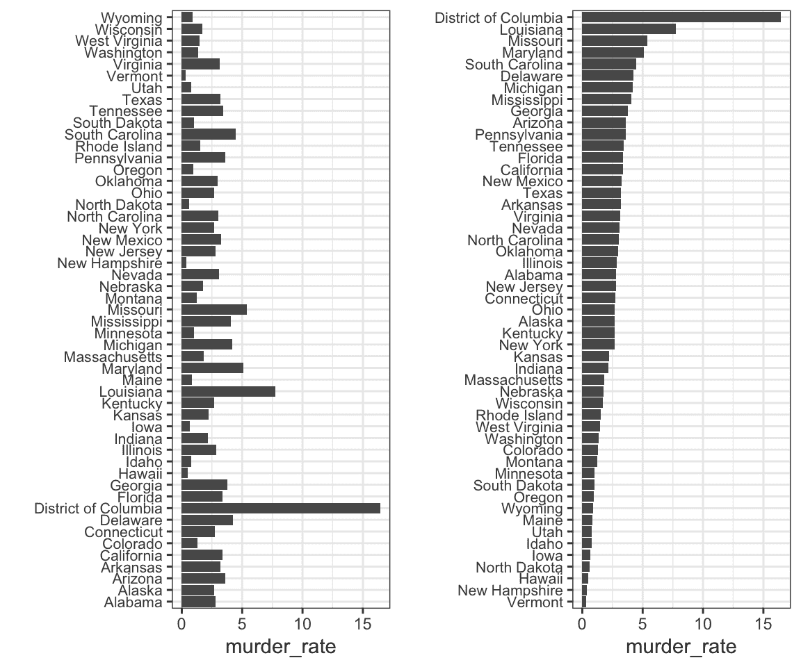

这里有一个例子，展示了各地区收入分布的箱线图。以下是两个版本的对比：

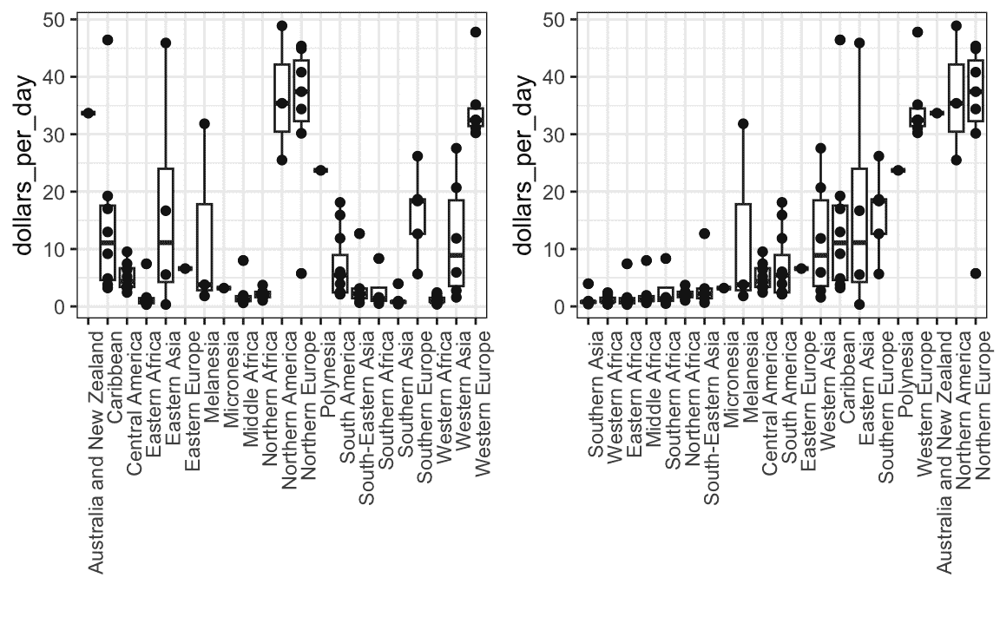

第一条命令按字母顺序排列区域，而第二条命令按该组的中间值排列。

## 9.5 展示数据

我们一直专注于在类别间显示单个数量。我们现在将注意力转向显示数据，重点是比较组。

为了激励“展示数据”这一原则，我们回到我们描述身高给外星人 ET 的例子，这是一个外星人的例子。这次让我们假设 ET 对男性和女性身高差异感兴趣。用于比较组之间的一种常见图表，由 Microsoft Excel 等软件普及，是炸药图，它显示了平均值和标准误差（标准误差将在下一章定义，但不要与数据的标准差混淆）。图表看起来是这样的：

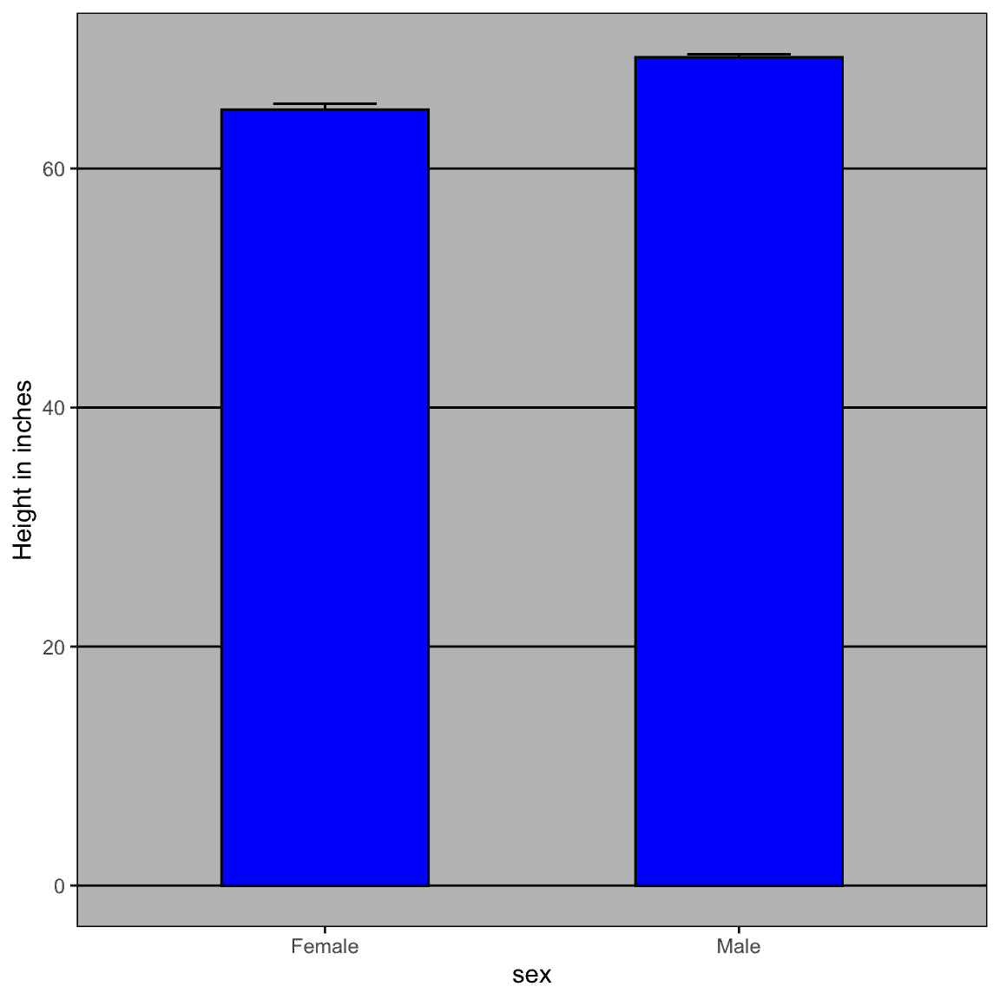

每个组的平均值由每个条形的顶部表示，触角从平均值延伸到平均值加两个标准误差。如果 ET 收到的只是这个图表，他将几乎没有关于遇到一群男性和女性时可以期待什么的信息。条形达到 0：这是否意味着有身高不到一英尺的小人？是否所有男性都比最高的女性高？是否存在身高范围？由于我们没有提供关于身高分布的几乎任何信息，ET 无法回答这些问题。

这就引出了“展示数据”原则。这段简单的**ggplot2**代码仅通过显示所有数据点就生成了一个比条形图更有信息的图表：

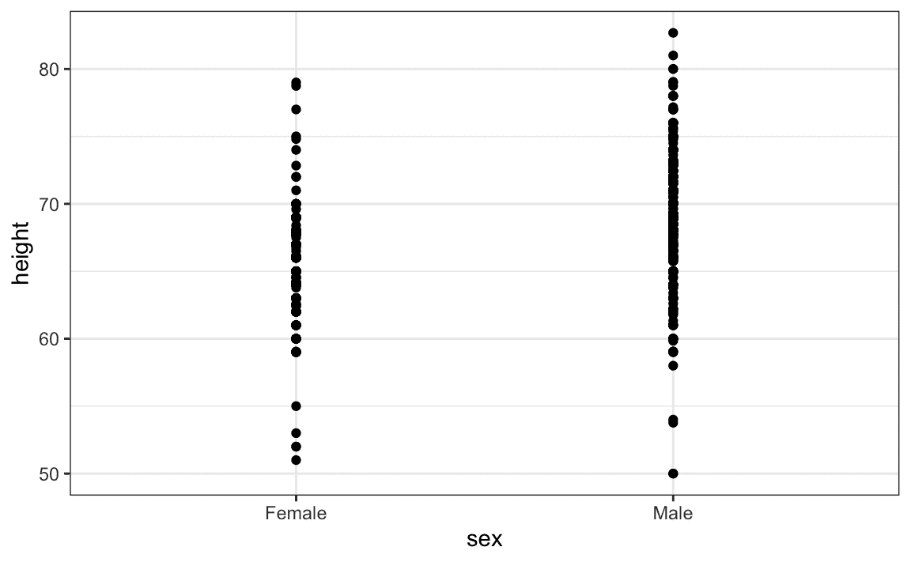

例如，这个图表让我们对数据的范围有一个概念。然而，这个图表也有局限性，因为我们实际上看不到为女性和男性分别绘制的 238 和 812 个点，而且许多点都重叠在一起。正如我们之前所描述的，可视化分布更有信息量。但在这样做之前，我们指出两种可以改进显示所有点的图表的方法。

第一个方法是添加*抖动*，这会给每个点添加一个小随机移动。在这种情况下，添加水平抖动不会改变解释，因为点的高度没有变化，但我们最小化了落在彼此之上的点的数量，因此更好地直观地了解数据的分布。第二个改进来自于使用*alpha 混合*：使点变得半透明。更多的点落在彼此之上，图表就越暗，这也帮助我们了解点的分布。以下是添加抖动和 alpha 混合的相同图表：

```r
heights |> 
 ggplot(aes(sex, height)) +
 geom_jitter(width = 0.05, alpha = 0.2) 
```

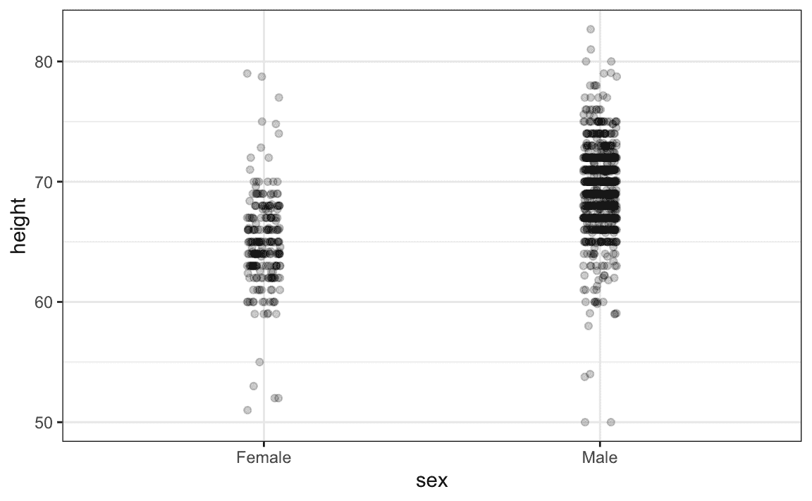*  *现在我们开始感觉到，平均而言，男性的身高比女性高。我们还注意到点的深色水平带，表明许多人报告的值是四舍五入到最接近的整数。

## 9.6 便于比较

### 9.6.1 使用公共坐标轴

由于数据点很多，显示分布比显示单个点更有效。因此，我们为每个组显示直方图：

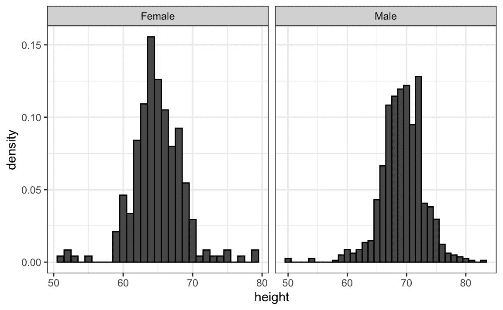

然而，从这个图表中并不立即明显看出男性平均身高比女性高。我们必须仔细观察才能注意到男性直方图的 x 轴有更高的值域。这里的一个重要原则是在比较两个图表中的数据时**保持坐标轴相同**。下面我们看看比较如何变得容易一些：

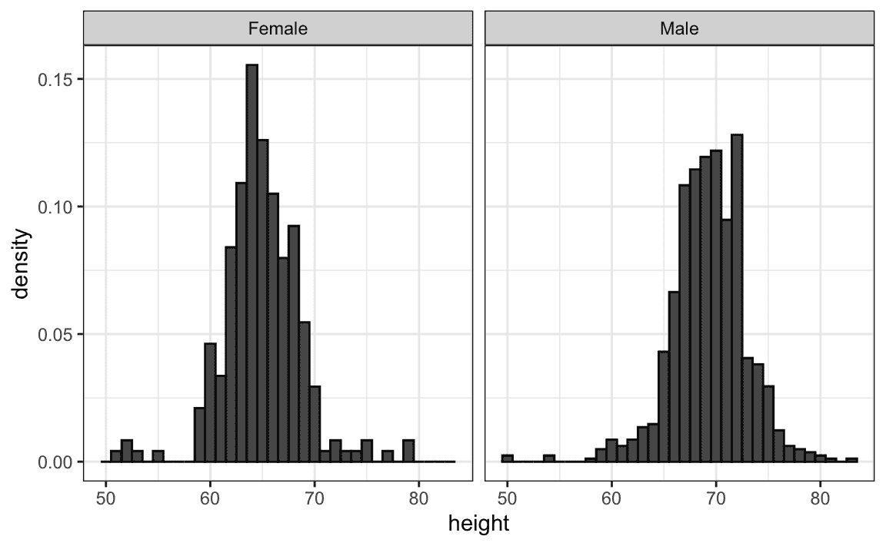

### 9.6.2 对齐图表以进行比较

在这些直方图中，与高度增加或减少相关的视觉线索分别是向左或向右的移动：水平变化。将图表垂直对齐有助于我们在坐标轴固定时看到这种变化：

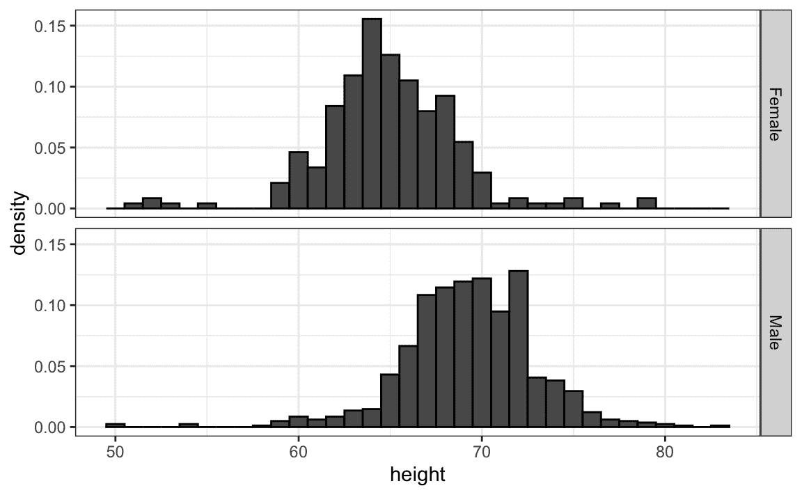

这个图表使得注意到男性平均身高更高变得容易得多。

如果我们想要由箱线图提供的更紧凑的摘要，我们则将它们水平对齐，因为默认情况下，箱线图会随着高度的变化而上下移动。遵循我们的“展示数据”原则，我们随后将所有数据点叠加：

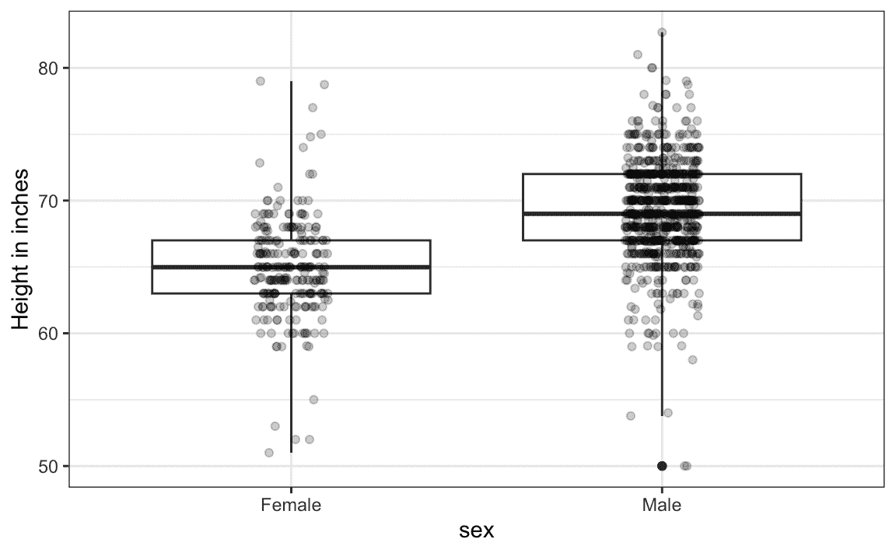

现在对比和比较这三个基于完全相同数据的图表：

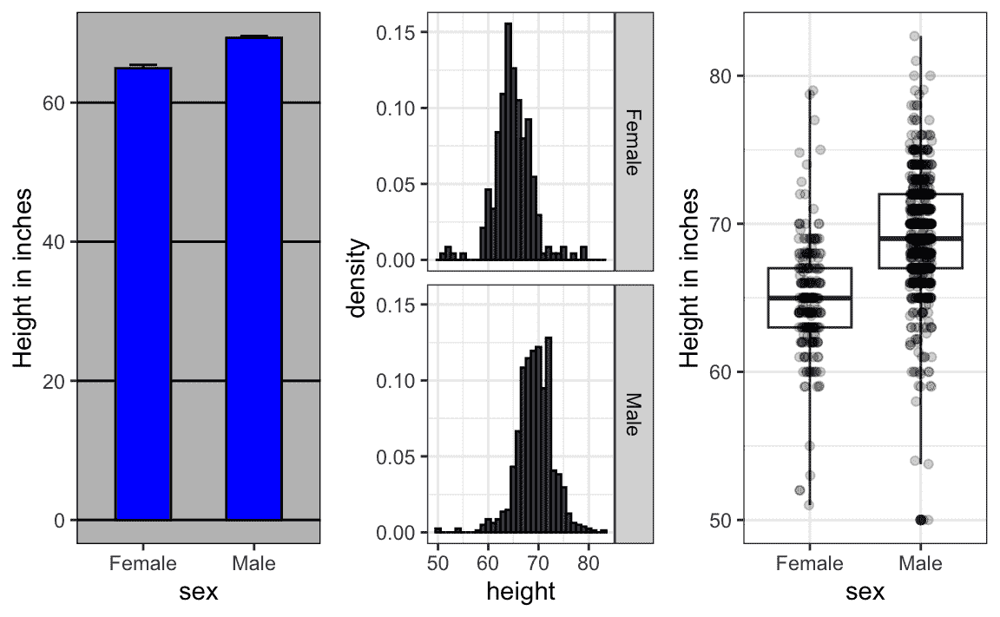

注意从右侧的两个图表中我们学到了多少。条形图适用于显示一个数字，但当我们想要描述分布时并不十分有用.

## 9.7 对数变换

错误选择条形图以及未能使用应有的变换可能会特别扭曲。例如，考虑以下 2015 年每个大洲平均人口规模的条形图：

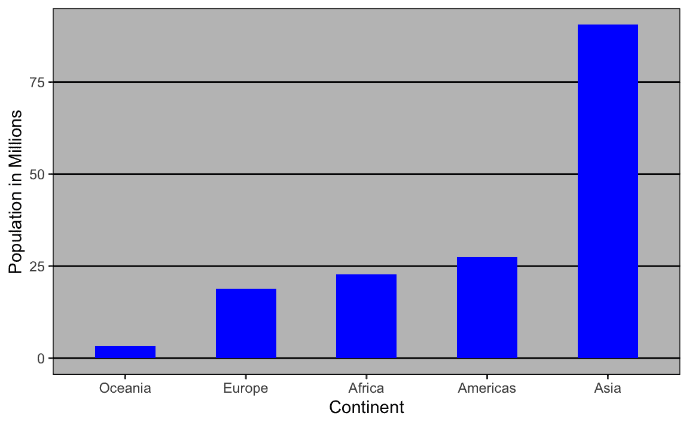

从这个图表中，人们可能会得出结论，亚洲国家的人口比其他大陆多得多。遵循*展示数据*的原则，我们很快就会注意到这是由于两个非常大的国家，我们假设是印度和中国：

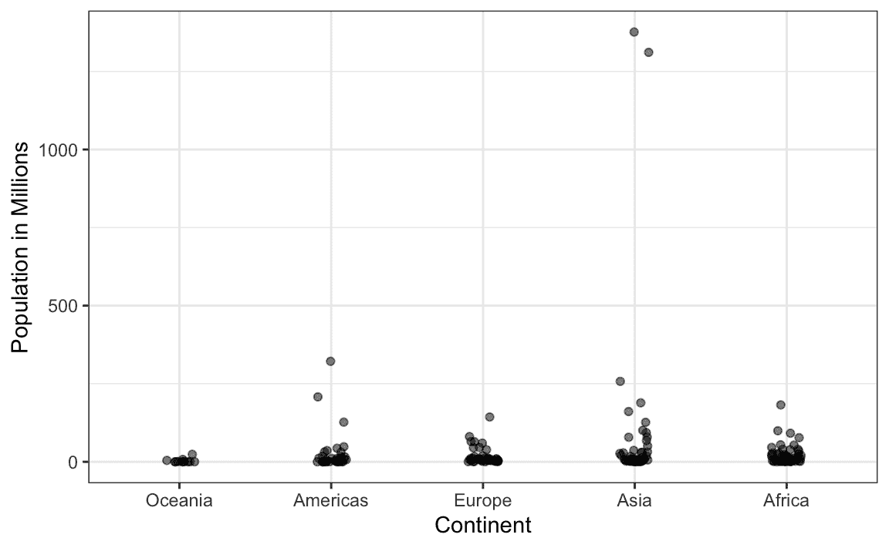

在这里，我们关注的是对数变换如何改善偏斜数据的可视化效果的例子。其他需要了解的常见变换包括对数变换（`logit`），它有助于解释概率变化的倍数，以及平方根变换（`sqrt`），通常应用于稳定计数数据的方差。

### 9.7.1 右偏斜分布

国家人口规模提供了一个清晰的例子，说明*右偏斜*分布：大多数国家人口相对较小，而少数国家人口极其庞大。如上图箱线图所示，这种不平衡导致大多数数据点被压缩到图表的一个小区域内，而大部分绘图空间则留空。这使得很难看到大多数国家之间的有意义差异。

在第 8.10 节中，我们看到了如何通过解决这种偏斜来应用对数变换，从而提高散点图的易读性。同样，将人口规模应用对数变换可以产生更丰富的可视化效果。下面，我们将原始条形图与具有对数变换 y 轴的箱线图进行比较，以说明改进。

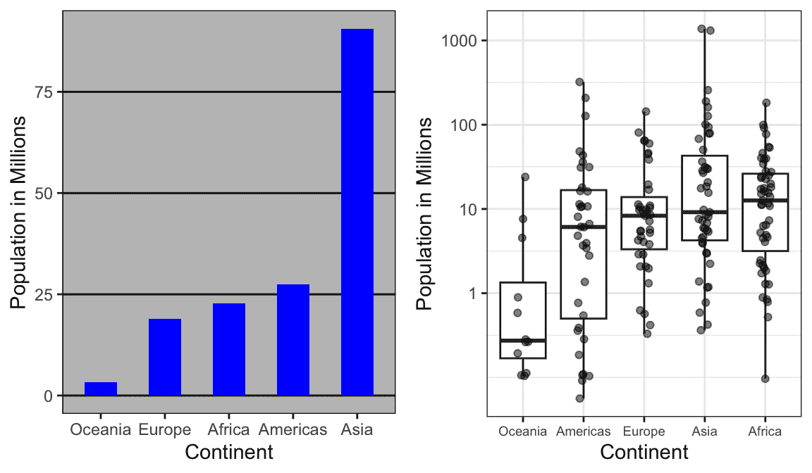

使用新的图表，我们意识到非洲国家实际上具有比亚洲更大的中位人口规模。

### 9.7.2 比率

比率在数据分析中常用以比较两个值。例如，我们经常报告疾病的相对风险，例如指出吸烟者患病的风险比非吸烟者高*三倍*。

从概念上讲，比率围绕 1 中心，比率值为 1 表示两个值之间没有差异。然而，从数学上讲，比率并不围绕 1 对称。例如，如果$A$与$B$的比率为 3，意味着$A$是$B$的三倍大，那么反向比率$B$与$A$的比率为$1/3$。请注意，3 和$1/3$与 1 的距离并不相等，这可能会使以公平方式表示增加和减少的比率可视化变得困难。

因此，在显示比率时，通常使用对数变换。这是因为比率的对数具有对称性质：

$$ \log(A/B) = -\log(B/A) $$

这意味着如果 $A$ 是 $B$ 的三倍大，对数比率与 $B$ 是 $A$ 的三倍大时距离零同样远，但方向相反。这种围绕零的对称性使得差异更容易从视觉上进行解释。

下面是一个展示使用对数尺度显示比率的优点的图表。

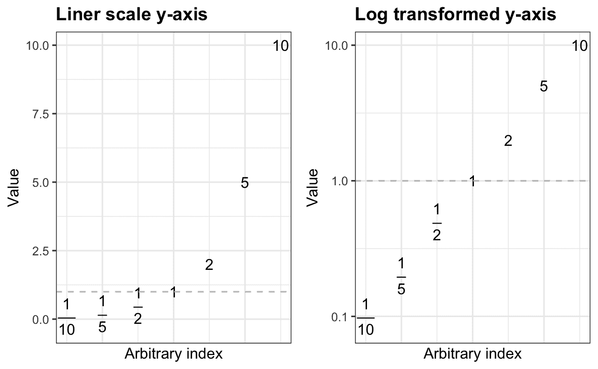

在绘制对数比率时，一个常见的挑战是处理分子或分母中的零，因为 $\log(0)$ 是未定义的。此外，非常小的值可以产生接近正无穷或负无穷的对数比率，使得结果不稳定且难以解释。

解决这两个问题的实际方法是应用一个 *连续性校正*，这涉及到在分子和分母中添加一个小的常数。这防止了零的出现并稳定了极端值。常用的常数是 0.5，导致以下调整后的对数比率：

$$ \log\left( \frac{A + 0.5}{B + 0.5} \right) $$

这个简单的调整有助于确保对数比率保持有限且更具可解释性，尤其是在处理接近 0 的值时。此外，当 $A$ 和 $B$ 都很大时，它接近实际的对数比率 $\log(A/B)$。

## 9.8 要比较的视觉线索应相邻

对于每个大陆，让我们比较 1970 年和 2010 年的收入。当比较 1970 年和 2010 年各地区之间的收入数据时，我们制作了一个类似于下面的图表，但这次我们研究的是大陆而不是地区。

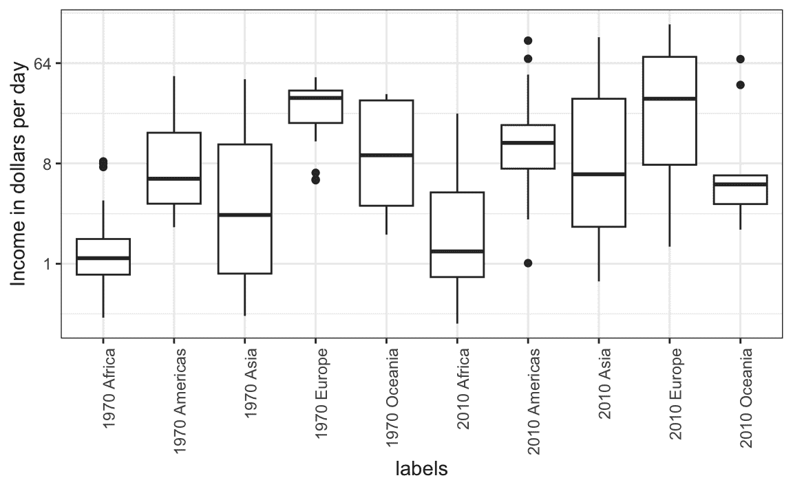

ggplot2** 的默认设置是按字母顺序排列标签，因此带有 1970 的标签会排在带有 2010 的标签之前，这使得比较变得具有挑战性，因为一个大陆在 1970 年的分布与 2010 年的分布视觉上相差甚远。当每个大陆的箱线图相邻时，比较 1970 年和 2010 年的每个大陆就更容易了：

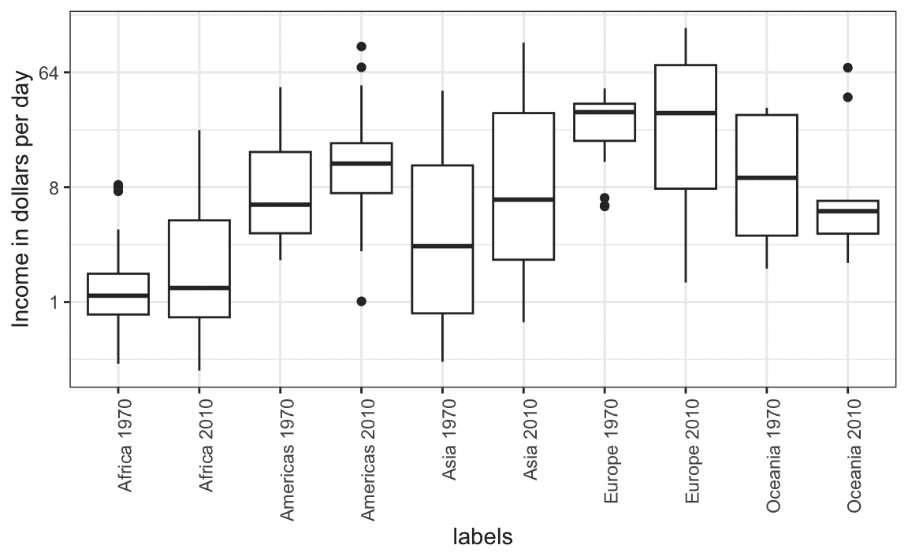

如果我们使用颜色来表示我们想要比较的两个事物，比较就会变得更加容易：

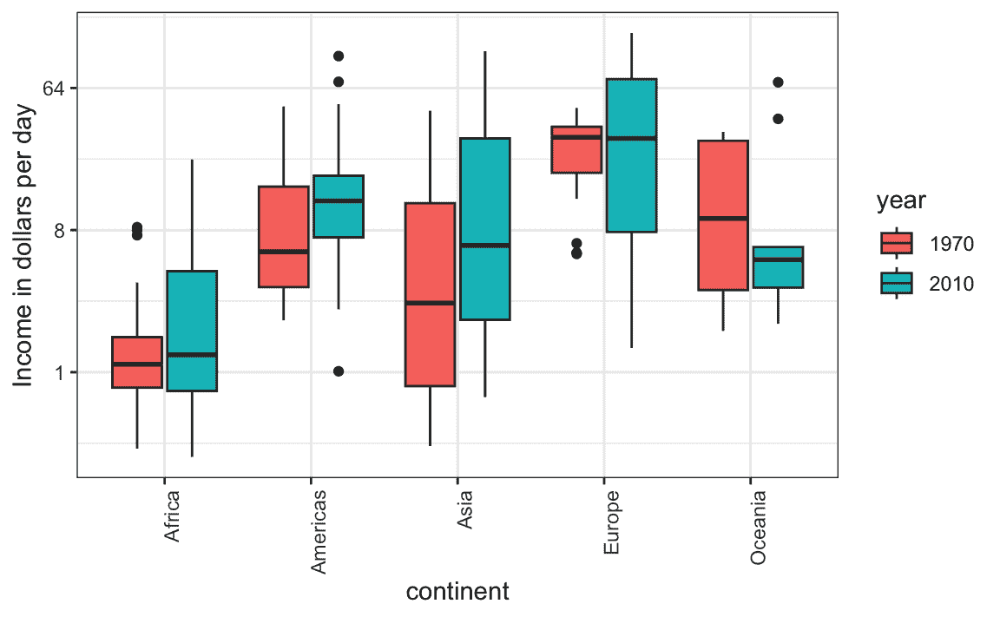

## 9.9 考虑色盲人士

大约 10% 的人口有色盲。不幸的是，**ggplot2** 中使用的默认颜色对这个群体来说并不理想。然而，**ggplot2** 确实使得更改图表中使用的调色板变得容易。我们如何在 R cookbook¹¹ 中使用色盲友好调色板的例子描述如下：

```r
color_blind_friendly_cols <- 
 c("#999999", "#E69F00", "#56B4E9", "#009E73", 
 "#F0E442", "#0072B2", "#D55E00", "#CC79A7")
```

以下是一些颜色

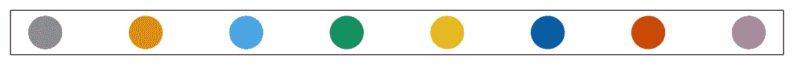

有几个资源可以帮助你选择颜色，例如 R-bloggers 上的教程¹²。

## 9.10 两个变量的图表

一般来说，你应该使用散点图来可视化两个变量之间的关系。在我们考察的两个变量关系的每一个实例中，包括谋杀总数与人口规模以及预期寿命与生育率，我们都使用了散点图。这是我们通常推荐的图表。然而，也有一些例外，我们在这里描述两种替代图表：斜率图和 Bland-Altman 图**。

### 9.10.1 斜率图

有一个例外，在这种情况下，另一种类型的图表可能更有信息量，那就是当你比较同一类型的变量，但在不同时间点和相对较少的比较时。例如，比较 2010 年和 2015 年的预期寿命。在这种情况下，我们可能会推荐一个**斜率图**。

在**ggplot2**中没有斜率图的几何形状，但我们可以使用`geom_line`构建一个。我们需要做一些调整来添加标签。以下是一个比较 2010 年和 2015 年大型西方国家的例子：

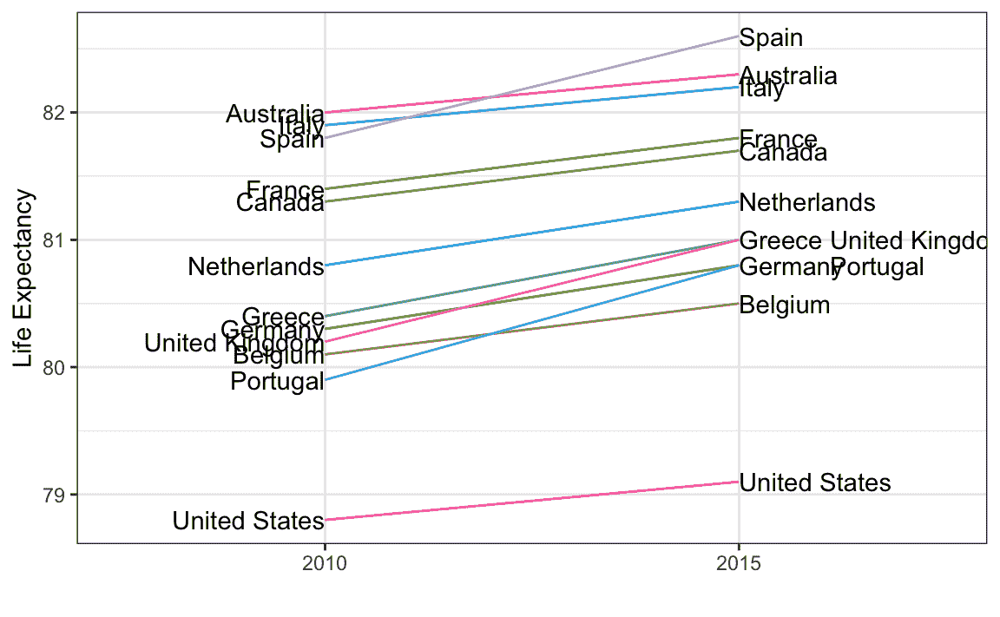

斜率图的一个优点是它允许我们根据线的斜率快速了解变化。虽然我们使用角度作为视觉线索，但我们也有位置来确定确切值。与散点图相比，比较改进要困难一些：

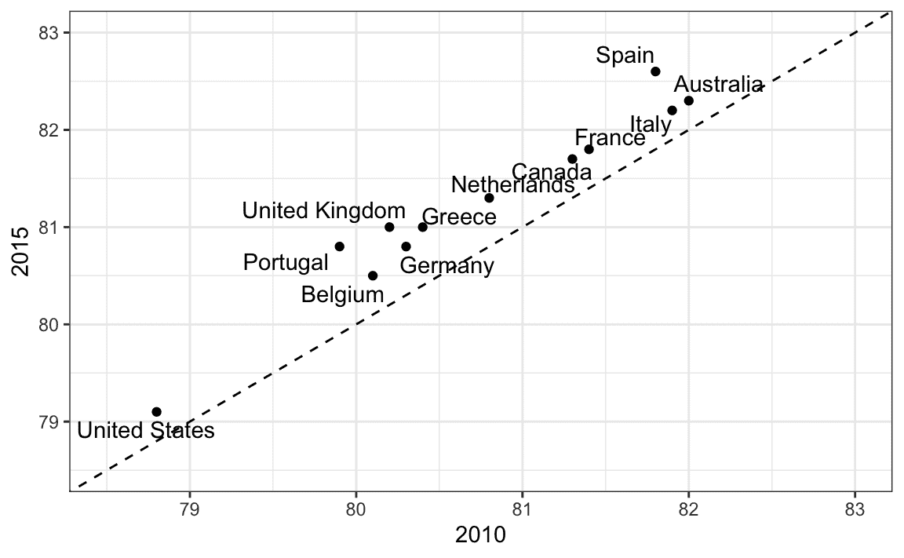

在散点图中，我们遵循了“使用公共坐标轴”的原则，因为我们是在比较这些前后情况。然而，如果我们有很多点，斜率图就不再有用，因为很难看到所有的线。

### 9.10.2 Bland-Altman 图

由于我们主要对差异感兴趣，因此将一个坐标轴专门用于它是合理的。Bland-Altman 图，也称为 Tukey 均值差异图和 MA 图，显示了差异与平均值的关系：

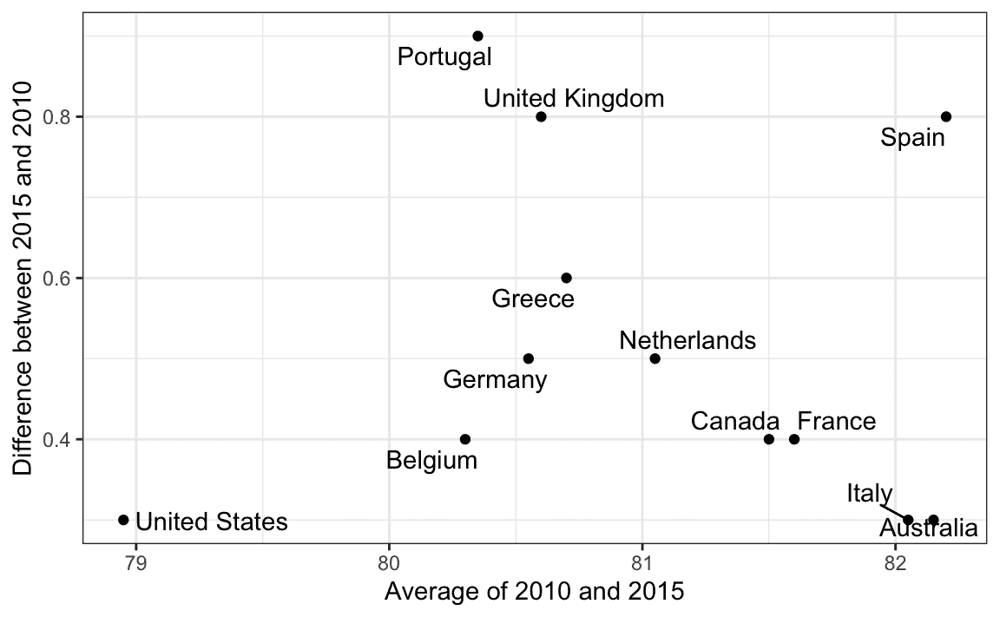

在这里，通过简单地观察 y 轴，我们很快就能看到哪些国家取得了最大的改进。我们还可以从 x 轴中获得整体价值的想法。

## 9.11 编码第三个变量

一个早期的散点图显示了婴儿生存率与平均收入之间的关系。下面是这个图表的版本，它编码了三个额外的变量：OPEC 成员资格、地区和人口**。

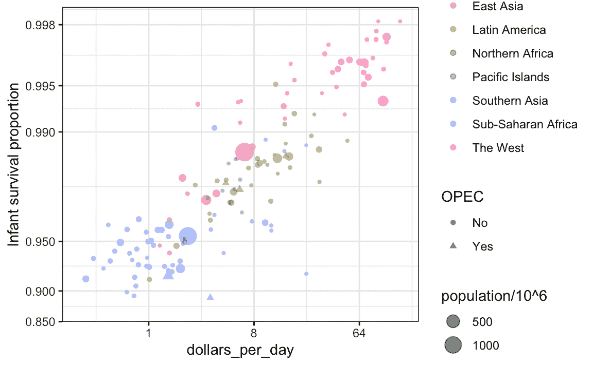

我们用颜色和形状来编码分类变量。这些形状可以用`shape`参数来控制。以下是在 R 中可用的形状。对于最后五个，颜色在内部。

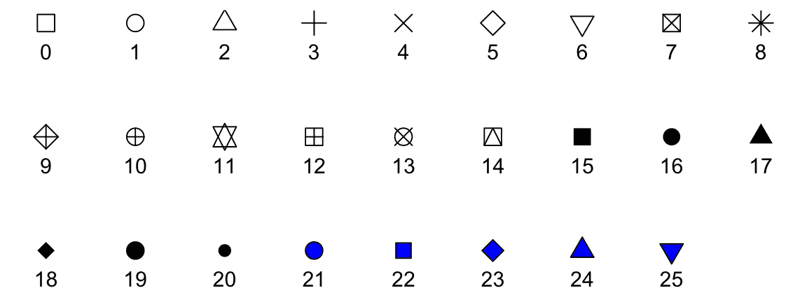

对于连续变量，我们可以使用颜色、强度或大小。现在我们通过一个案例研究来展示我们如何做到这一点。

当选择颜色来量化一个数值变量时，我们有两种选择：顺序和发散。顺序颜色适合从高到低的数据。高值与低值可以清楚地区分。以下是`RColorBrewer`包提供的几个例子：

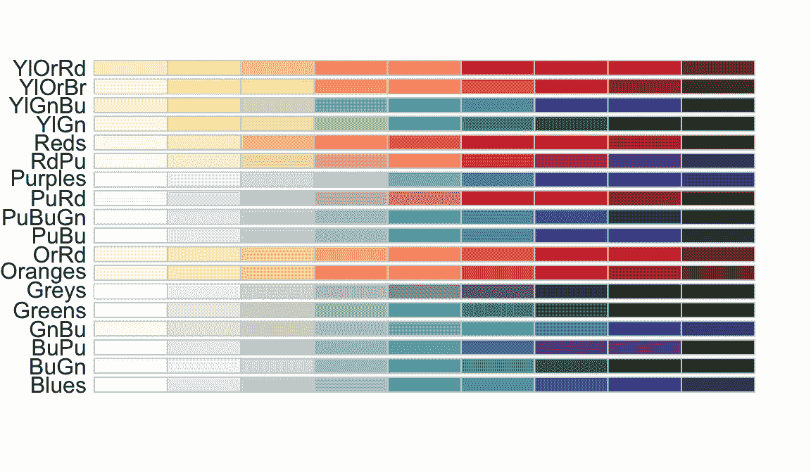

发散颜色用于表示偏离中心的值。我们对数据范围的两端给予同等重视：高于中心值和低于中心值。我们可能会使用发散模式的一个例子是，如果我们想要展示离平均值的标差。以下是发散模式的几个例子：

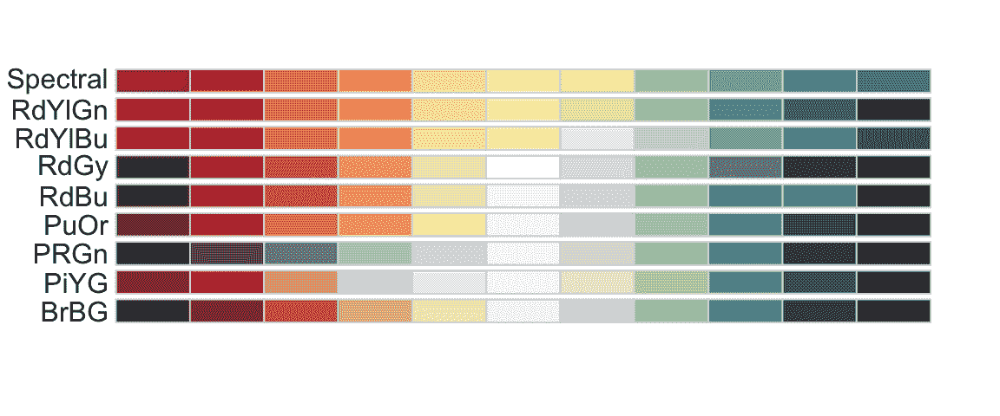

## 9.12 避免伪三维图表

下面的图表，取自科学文献¹³，显示了三个变量：剂量、药物类型和生存。尽管你的屏幕/书页是平面的二维，但图表试图模仿三维，并为每个变量分配一个维度。

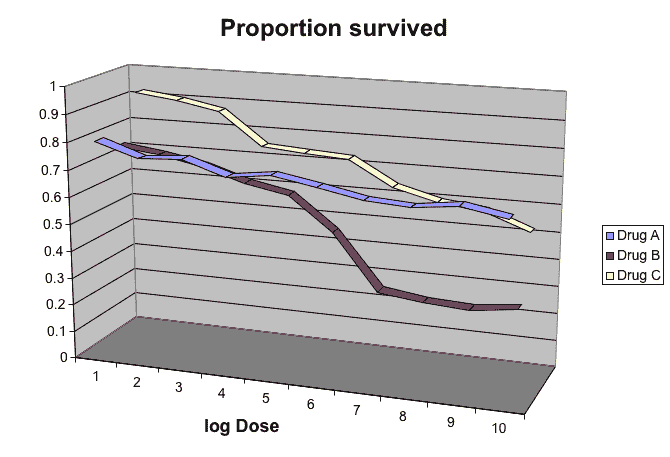

(图片由 Karl Broman 提供)

人类在三维空间中的视觉能力有限（这也解释了为什么平行停车很难），我们对伪三维的限制更为严重。为了看到这一点，尝试确定上图生存变量的值。你能判断紫色带状与红色带状相交的时刻吗？这是一个我们可以轻松使用颜色来表示分类变量而不是使用伪 3D 的例子：

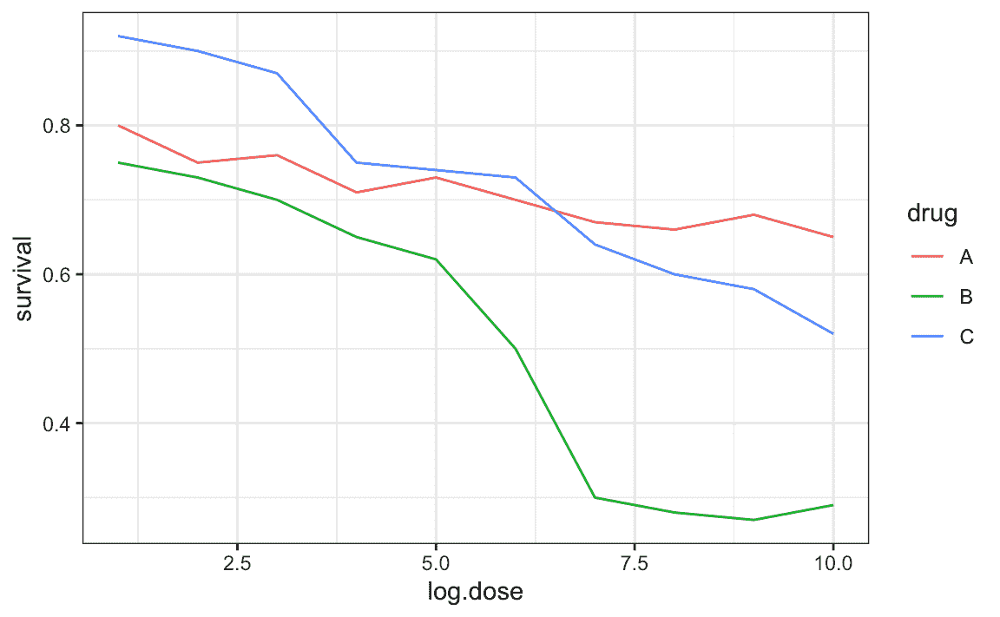

注意确定生存值是如何变得容易多了。

伪三维有时被完全无用地使用：即使第三维度并不代表一个数量，图表也被制作成看起来是三维的。这只会增加混乱，并使得传达信息变得更加困难。以下有两个例子：

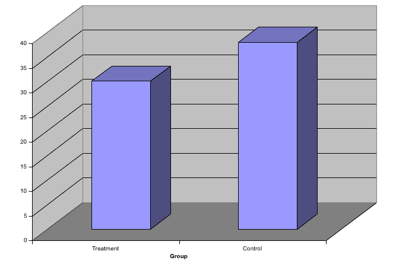

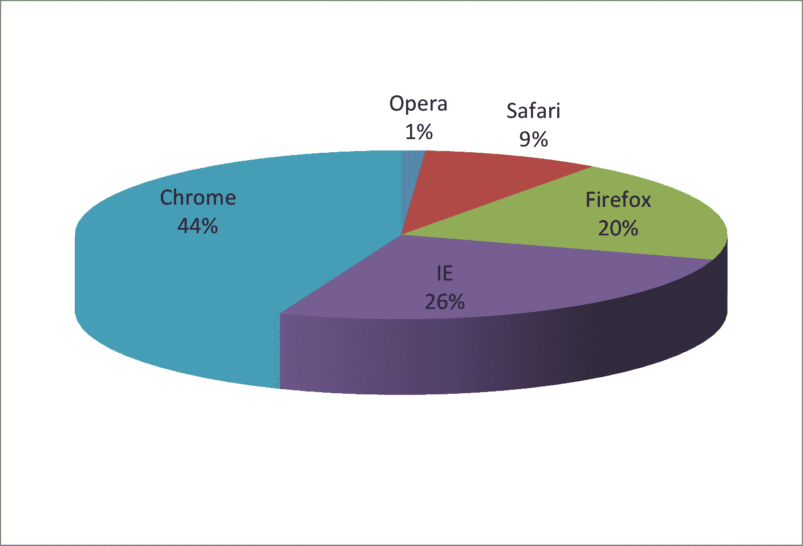

(图片由 Karl Broman 提供)

## 9.13 避免过多的有效数字

默认情况下，像 R 这样的统计软件会返回许多有效数字。R 的默认行为是显示 7 位有效数字。那么多的数字通常不会增加信息，并且增加的视觉杂乱可能会让观看者难以理解信息。作为一个例子，以下是使用 R 从总数和人口中计算出的加利福尼亚在五个十年中的每 10,000 人疾病率：

| 州 | 年份 | 麻疹 | 百日咳 | 脊髓灰质炎 |
| --- | --- | --- | --- | --- |
| 加利福尼亚 | 1940 | 37.8826320 | 18.3397861 | 0.8266512 |
| 加利福尼亚 | 1950 | 13.9124205 | 4.7467350 | 1.9742639 |
| 加利福尼亚 | 1960 | 14.1386471 | NA | 0.2640419 |
| 加利福尼亚 | 1970 | 0.9767889 | NA | NA |
| 加利福尼亚 | 1980 | 0.3743467 | 0.0515466 | NA |

我们报告的精度高达每 10,000 个案例中的 0.00001，在日期变化的大背景下，这是一个非常小的值。在这种情况下，一位有效数字就足够了，并且清楚地表明了比率正在下降：

| state | year | Measles | Pertussis | Polio |
| --- | --- | --- | --- | --- |
| 加利福尼亚 | 1940 | 37.9 | 18.3 | 0.8 |
| 加利福尼亚 | 1950 | 13.9 | 4.7 | 2.0 |
| 加利福尼亚 | 1960 | 14.1 | NA | 0.3 |
| 加利福尼亚 | 1970 | 1.0 | NA | NA |
| 加利福尼亚 | 1980 | 0.4 | 0.1 | NA |

改变有效数字数量或四舍五入数字的有用方法是 `signif` 和 `round`。你可以通过设置如下选项来全局定义有效数字的数量：`options(digits = 3)`。

与显示表格相关的另一个原则是将比较的值放在列而不是行上。注意，我们上面的表格比这个表格更容易阅读：

| 州 | 疾病 | 1940 | 1950 | 1960 | 1970 | 1980 |
| --- | --- | --- | --- | --- | --- |
| 加利福尼亚 | 麻疹 | 37.9 | 13.9 | 14.1 | 1 | 0.4 |
| 加利福尼亚 | 百日咳 | 18.3 | 4.7 | NA | NA | 0.1 |

| 加利福尼亚 | 麻疹 | 0.8 | 2.0 | 0.3 | NA | NA |

## 9.14 了解你的受众

图表可以用于 1）我们自己的探索性数据分析，2）向专家传达信息，或 3）帮助向普通受众传达信息。确保目标受众理解图表的每个元素。

作为简单的例子，考虑一下，对于你自己的探索，可能更有用将数据进行对数转换然后绘图。然而，对于不熟悉将日志值转换回原始测量的普通受众，使用轴的对数刻度而不是对数转换的值将更容易理解。

## 9.15 练习

对于这些练习，我们将使用 **dslabs** 包中的疫苗数据：

```r
library(dslabs)
```

1. 饼图是合适的：

1.  当我们想要显示百分比时。

1.  当 **ggplot2** 不可用。

1.  当我在面包店时。

1.  永远不会。条形图和表格总是更好。

2. 下面的图表有什么问题：

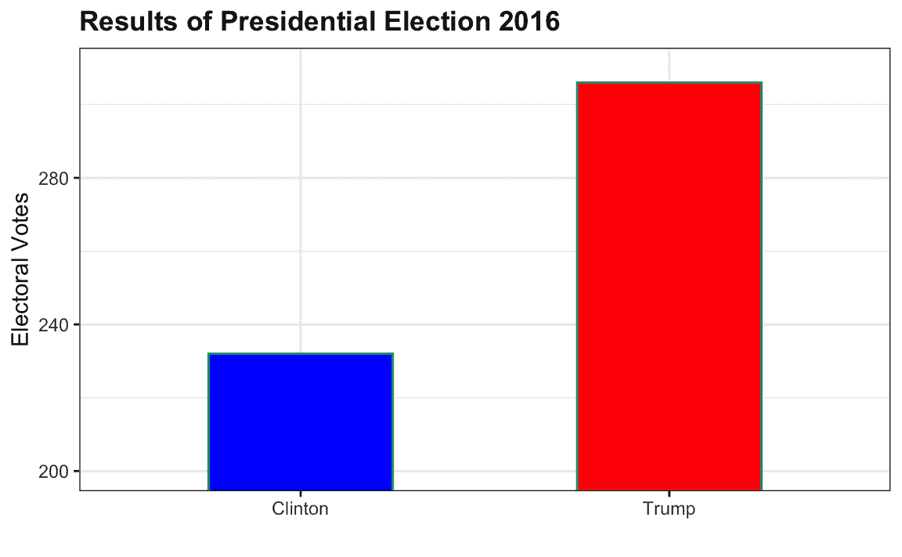

1.  值是错误的。最终投票结果是 306 票对 232 票。

1.  轴没有从 0 开始。根据长度判断，似乎特朗普获得的选票是实际上的 3 倍，而实际上只是多了大约 30%。

1.  颜色应该相同。

1.  百分比应以饼图的形式显示。

3. 查看以下两个图表。它们显示了相同的信息：1928 年 50 个州的麻疹比率。

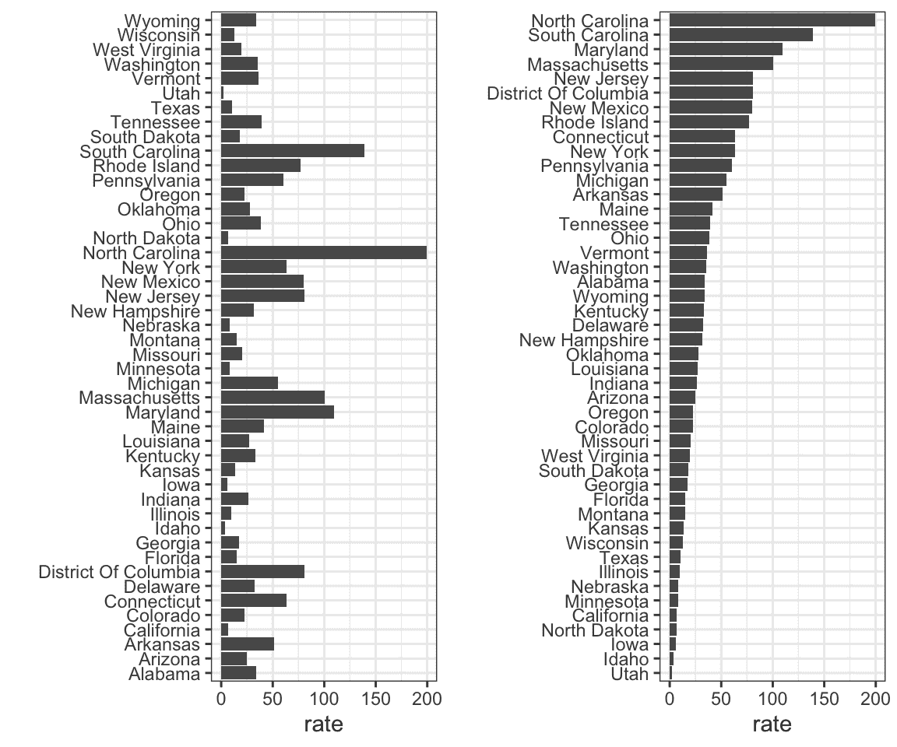

如果你想确定哪些州在比率方面最好和最差，哪个图表更容易阅读？

1.  它们提供了相同的信息，所以它们都是同样好的。

1.  右侧的图表更好，因为它按字母顺序排列了各州。

1.  右侧的图表更好，因为字母顺序与疾病无关，按实际比率排序后，我们可以快速看到谋杀率最高和最低的州。

1.  两个图表都应该是一个饼图。

4. 要在左侧制作图表，我们必须重新排序状态变量的级别。

```r
dat <- us_contagious_diseases |> 
 filter(year == 1967 & disease=="Measles" & !is.na(population)) |>
 mutate(rate = count / population * 10000 * 52 / weeks_reporting)
```

注意当我们制作条形图时会发生什么：

```r
dat |> ggplot(aes(state, rate)) +
 geom_col() +
 coord_flip() 
```

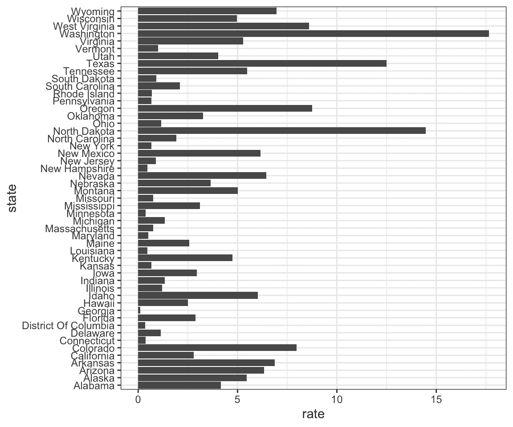*  *定义这些对象：

```r
state <- dat$state
rate <- dat$count/dat$population*10000*52/dat$weeks_reporting
```

重新定义`state`对象，以便按级别重新排序。打印新的`state`对象及其级别，以便您可以查看向量是否未按级别重新排序。

5. 现在用一行代码定义`dat`表，如上所述，但将`mutate`的使用改为创建一个比率变量，并重新排序状态变量，以便按此变量重新排序级别。然后使用上面的代码制作条形图，但针对这个新的`dat`。

6. 假设我们感兴趣的是比较美国各地区的枪支谋杀率。我们看到这个图表：

```r
library(dslabs)
murders |> mutate(rate = total/population*100000) |>
group_by(region) |>
summarize(avg = mean(rate)) |>
mutate(region = factor(region)) |>
ggplot(aes(region, avg)) +
geom_col() + 
ylab("Murder Rate Average")
```

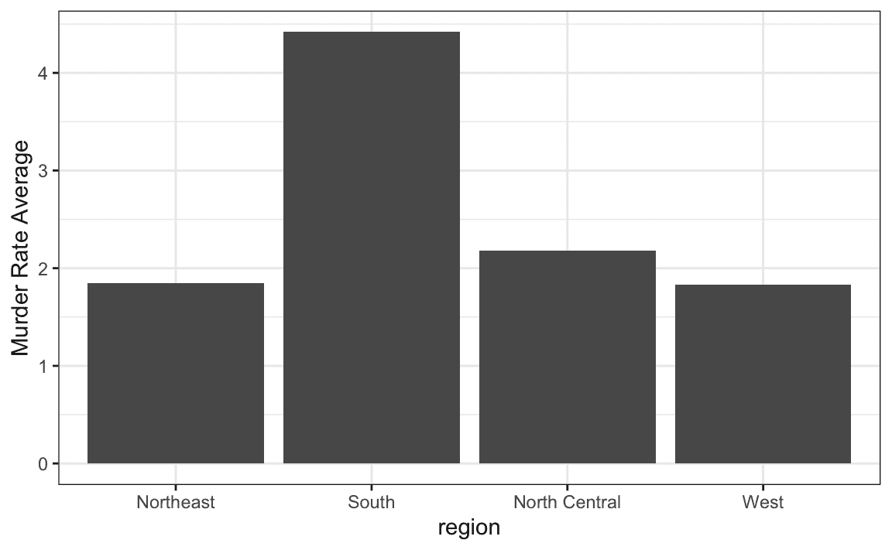*  *并决定搬到西部地区的一个州。这种解释的主要问题是什么？

1.  类别按字母顺序排序。

1.  图表没有显示标准误差。

1.  它没有显示所有数据。我们看不到一个地区内的变异性，而且可能最安全的状态不在西部。

1.  东北部平均最低。

7. 制作谋杀率的箱形图，定义为

```r
murders |> mutate(rate = total/population*100000)
```

按地区显示所有点，并按中位数比率对地区进行排序。

8. 下面的图表显示了三个连续变量。

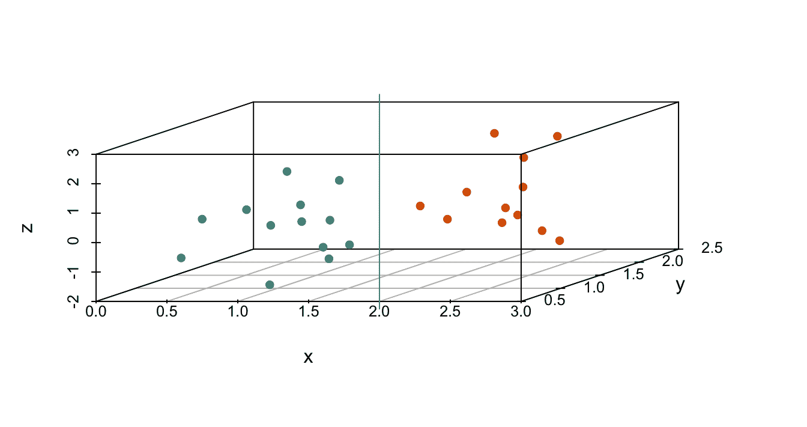

看起来线 $x=2$ 将点分开。但实际上并非如此，我们可以通过绘制几个二维点来看到这一点。

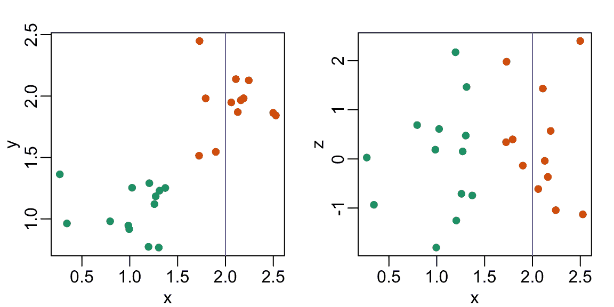

为什么会发生这种情况？

1.  人类不擅长阅读伪 3D 图表。

1.  代码中肯定有错误。

1.  颜色让我们困惑。

1.  当我们有 3 个变量可供比较时，不应使用散点图来比较两个变量。

* * *

1.  [`kbroman.org/`](http://kbroman.org/)↩︎

1.  [`www.biostat.wisc.edu/~kbroman/presentations/graphs2017.pdf`](https://www.biostat.wisc.edu/~kbroman/presentations/graphs2017.pdf)↩︎

1.  [`github.com/kbroman/Talk_Graphs`](https://github.com/kbroman/Talk_Graphs)↩︎

1.  [`www.peteraldhous.com/ucb/2014/dataviz/index.html`](https://www.peteraldhous.com/ucb/2014/dataviz/index.html)↩︎

1.  [`github.com/rafalab/dsbook-part-1/blob/main/dataviz/dataviz-principles.qmd`](https://github.com/rafalab/dsbook-part-1/blob/main/dataviz/dataviz-principles.qmd)↩︎

1.  [`www.peteraldhous.com/ucb/2014/dataviz/week2.html`](https://www.peteraldhous.com/ucb/2014/dataviz/week2.html)↩︎

1.  [`mediamatters.org/blog/2013/04/05/fox-news-newest-dishonest-chart-immigration-enf/193507`](http://mediamatters.org/blog/2013/04/05/fox-news-newest-dishonest-chart-immigration-enf/193507)↩︎

1.  [`flowingdata.com/2012/08/06/fox-news-continues-charting-excellence/`](http://flowingdata.com/2012/08/06/fox-news-continues-charting-excellence/)↩︎

1.  [`www.elmundo.es/america/2013/04/15/venezuela/1366029653.html`](https://www.elmundo.es/america/2013/04/15/venezuela/1366029653.html)↩︎

1.  [`www.youtube.com/watch?v=kl2g40GoRxg`](https://www.youtube.com/watch?v=kl2g40GoRxg)↩︎

1.  [`www.cookbook-r.com/Graphs/Colors_(ggplot2)/#a-colorblind-friendly-palette`](http://www.cookbook-r.com/Graphs/Colors_(ggplot2)/#a-colorblind-friendly-palette)↩︎

1.  [`www.r-bloggers.com/2013/10/creating-colorblind-friendly-figures/`](https://www.r-bloggers.com/2013/10/creating-colorblind-friendly-figures/)↩︎

1.  [`projecteuclid.org/download/pdf_1/euclid.ss/1177010488`](https://projecteuclid.org/download/pdf_1/euclid.ss/1177010488)↩︎
