# 10 数据可视化实践

> 原文：[`rafalab.dfci.harvard.edu/dsbook-part-1/dataviz/dataviz-in-practice.html`](https://rafalab.dfci.harvard.edu/dsbook-part-1/dataviz/dataviz-in-practice.html)

1.  数据可视化

1.  10 数据可视化实践

在本章中，我们将展示相对简单的 **ggplot2** 代码如何创建有洞察力和美观的图表。作为动机，我们将创建帮助我们更好地理解世界健康和经济趋势的图表。我们将实施在第八章(ggplot2.html)和第九章(dataviz-principles.html)中学到的知识，并学习如何增强代码以完善图表。在我们进行案例研究的过程中，我们将描述相关的通用数据可视化原则，并学习诸如 *faceting*、*时间序列图*、*转换* 和 *脊线图* 等概念。

## 10.1 案例研究 1：关于贫困的新见解

Hans Rosling¹ 是 Gapminder Foundation² 的联合创始人，该组织致力于通过使用数据来消除关于所谓发展中世界的常见神话，以教育公众。该组织使用数据来展示实际的健康和经济趋势如何与来自耸人听闻的灾难、悲剧和其他不幸事件的媒体报道中的叙述相矛盾。正如 Gapminder Foundation 网站所述：

> > > 记者和游说者讲述戏剧性的故事。这是他们的工作。他们讲述关于非凡事件和非凡人物的故事。这些戏剧性的故事堆积在人们的脑海中，形成了一个过于戏剧化的世界观和强烈的负面压力感：“世界正在变得更糟！”，“这是我们与他们的对抗！”，“其他人很奇怪！”，“人口一直在增长！”和“没有人关心！”

Hans Rosling 以他独特的方式传达了基于实际数据趋势，使用有效的数据可视化。本节基于两个体现这种教育方法的演讲：关于贫困的新见解³ 和你见过的最佳统计数据⁴。具体来说，在本节中，我们使用数据来尝试回答以下两个问题：

1.  是否可以说，今天的世界被划分为西方富裕国家和非洲、亚洲和拉丁美洲的发展中国家是公平的描述？

1.  在过去 40 年中，国家间的收入不平等是否恶化了？

为了回答这些问题，我们将使用 **dslabs** 中提供的 `gapminder` 数据集。这个数据集是使用来自 Gapminder Foundation 的多个电子表格创建的。你可以这样访问表格：

[PRE0]

正如在 *关于贫困的新见解* 视频中所做的那样，我们首先测试我们对不同国家儿童死亡率差异的知识。对于下面六个国家配对中的每一个，你认为哪个国家在 2015 年的儿童死亡率最高？你认为哪一对最相似？*

1.  斯里兰卡或土耳其

1.  波兰或韩国

1.  马来西亚或俄罗斯

1.  巴基斯坦或越南

1.  泰国或南非

在没有数据的情况下回答这些问题时，通常会选择非欧洲国家具有更高的儿童死亡率：斯里兰卡高于土耳其，韩国高于波兰，马来西亚高于俄罗斯。通常也假设被认为是发展中国家的国家：巴基斯坦、越南、泰国和南非，具有类似的死亡率。

要用数据**回答这些问题**，我们可以使用**dplyr**。例如，对于第一次比较，我们看到：

[PRE1]

土耳其的婴儿死亡率较高。

我们可以在所有比较中使用此代码，并发现以下结果：

| 国家 | 婴儿死亡率 | 国家 | 婴儿死亡率 |
| --- | --- | --- | --- |
| 斯里兰卡 | 8.4 | 土耳其 | 11.6 |
| 波兰 | 4.5 | 韩国首尔 | 2.9 |
| 马来西亚 | 6.0 | 俄罗斯 | 8.2 |
| 巴基斯坦 | 65.8 | 越南 | 17.3 |
| 泰国 | 10.5 | 南非 | 33.6 |

我们看到列表中的欧洲国家儿童死亡率较高：波兰的比率高于韩国，俄罗斯的比率高于马来西亚。我们还看到巴基斯坦的比率远高于越南，南非的比率远高于泰国。结果证明，当汉斯·罗斯林向受过教育的群体提出这个测验时，平均得分不到 2.5 分（满分 5 分），比他们随机猜测的结果还要差。这表明，我们不仅仅是无知，而是被误导了。在本章中，我们将看到数据可视化如何帮助我们获得信息。

## **10.2 散点图**

*前一小节中描述的误解的原因源于一种先入为主的观念，即世界被分为两组：西方世界（西欧和北美），以长寿和家庭成员数量少为特征，与发展中国家（非洲、亚洲和拉丁美洲）相对，以寿命短和家庭规模大为特征。但数据是否支持这种二分法？

回答这个问题的必要数据也存在于我们的`gapminder`表中。利用我们新学的数据可视化技能，我们将能够应对这个挑战。

为了分析这种世界观，我们的第一个图是寿命与生育率（每名女性的平均子女数）的散点图。我们首先查看大约 50 年前的数据，那时这种观点可能首次在我们脑海中根深蒂固。

[PRE2]

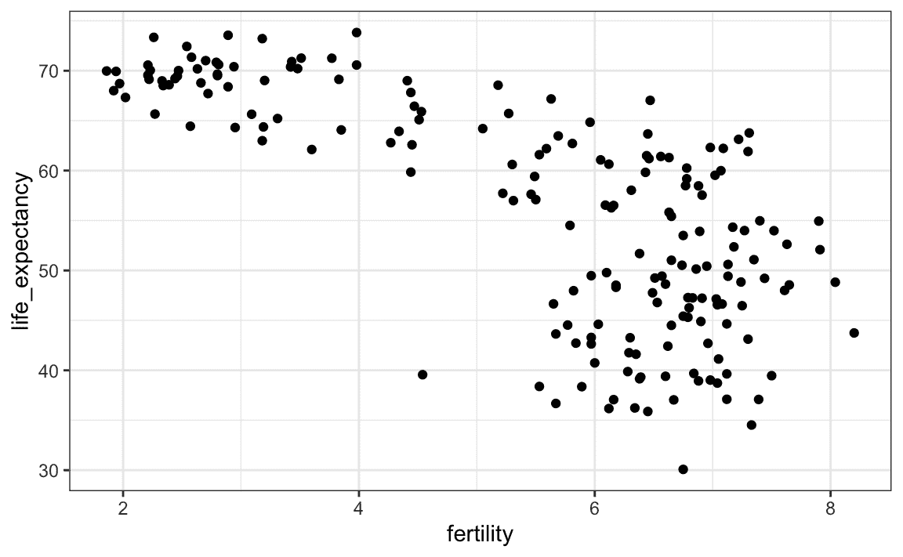*  *大多数观点可以分为两个截然不同的类别：

1.  平均寿命约为 70 岁，每个家庭有 3 个或更少的子女。

1.  平均寿命低于 65 岁，每个家庭有 5 个或更多的子女。

为了确认这些国家确实是我们预期的地区，我们可以用颜色来代表大洲。

[PRE3]

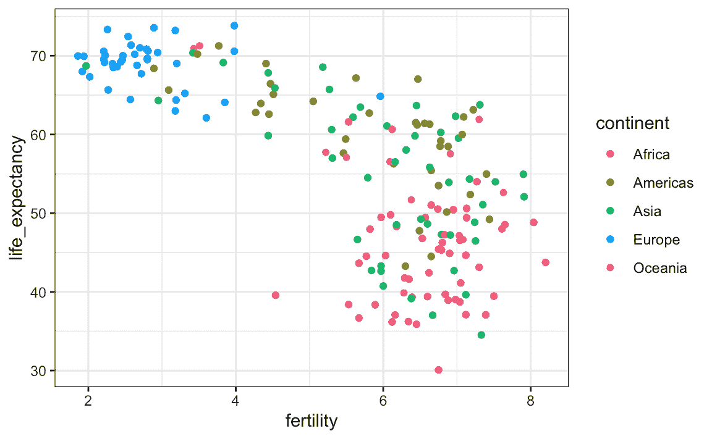*  *1962 年，“西方与发展中国家”的观点在某种程度上是现实的。50 年后，情况是否仍然如此？**** 

## ***10.3 分面分析***

**我们可以很容易地以与 1962 年相同的方式绘制 2012 年的数据。然而，为了进行比较，并排图更可取。在**ggplot2**中，我们可以通过*分面*变量来实现这一点：我们通过某些变量对数据进行分层，并为每个层绘制相同的图。

要实现分面，我们添加一个带有`facet_grid`函数的层，该函数自动分离图表。这个函数允许你通过列表示一个变量和行表示另一个变量，使用最多两个变量进行分面。该函数期望行和列变量由一个`~`分隔。以下是一个添加了`facet_grid`作为最后一层的散点图的示例：

[PRE4]

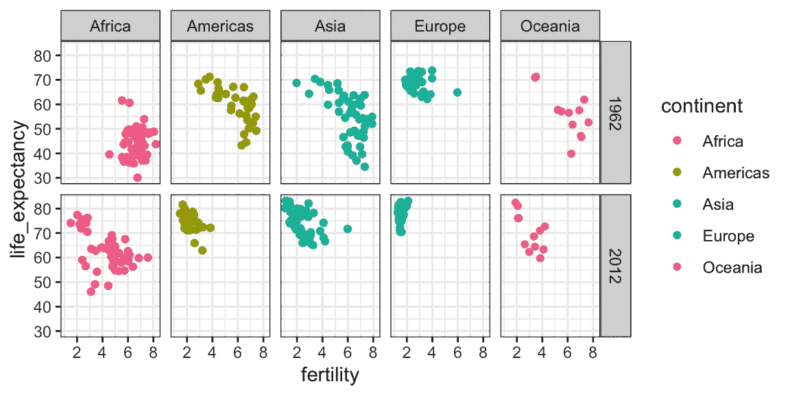*  *我们看到了每个大陆/年份对的图。然而，这只是一个例子，比我们想要的要多，我们想要的只是比较 1962 年和 2012 年。在这种情况下，只有一个变量，我们使用`.`让分面知道我们不是使用第二个变量：

[PRE5]

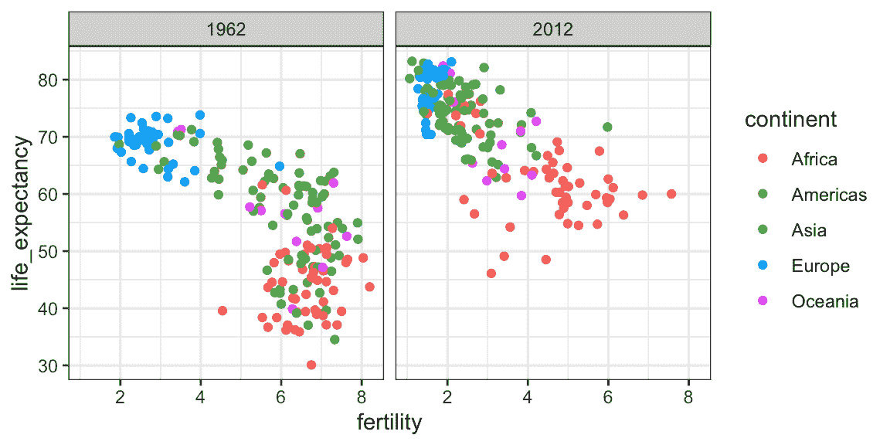*  *这个图清楚地表明，大多数国家已经从*发展中国家*集群移动到*西方国家*集群。到 2012 年，西方与发展中国家的观点已经不再适用。当比较欧洲和亚洲时，这一点尤其明显，后者包括几个取得了巨大进步的国家。

### 10.3.1 `facet_wrap`

为了探索这种转变是如何逐年发生的，我们可以绘制几个年份的图。例如，我们可以添加 1970 年、1980 年、1990 年和 2000 年。如果我们这样做，我们不会希望所有图都在同一行，这是`facet_grid`的默认行为，因为它们会变得太薄而无法显示数据。相反，我们希望使用多行和多列。`facet_wrap`函数允许我们通过自动包装一系列图来实现这一点，以便每个显示都有可查看的维度：

[PRE6]

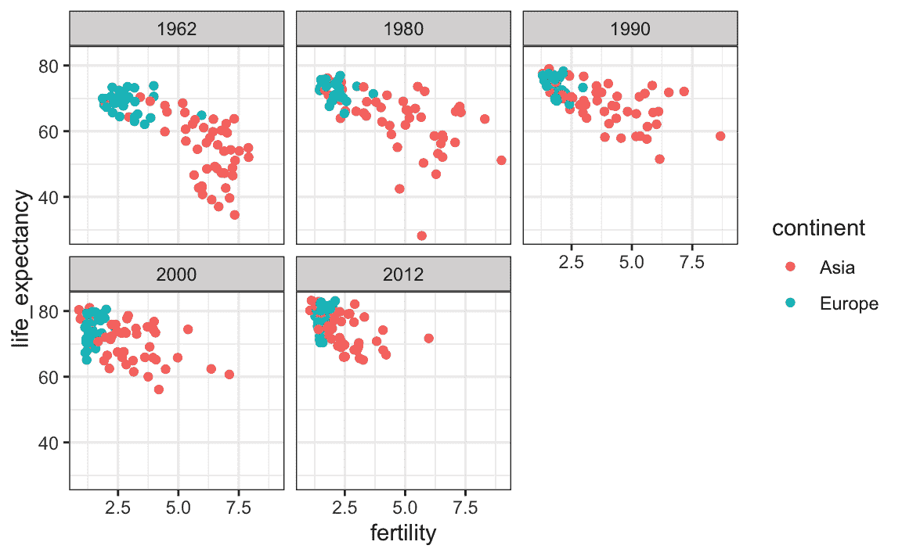*  *这个图清楚地显示了大多数亚洲国家比欧洲国家改善的速度要快得多。*

### *10.3.2 为更好的比较固定刻度*

轴范围的默认选择很重要。当不使用`facet`时，这个范围由图中显示的数据决定。当使用`facet`时，这个范围由所有图中显示的数据决定，因此在整个图中保持固定。这使得跨图比较变得容易。例如，在上面的图中，我们可以看到大多数国家的预期寿命都在增加，而生育率在下降。我们之所以看到这一点，是因为点云在移动。如果我们调整刻度，情况就不同了：

[PRE7]

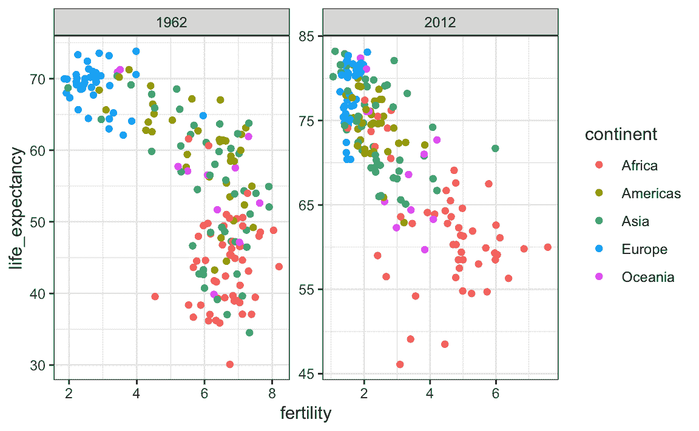*  *在上面的图中，我们必须特别注意范围，以注意到右侧的图具有更长的预期寿命。********

## ***10.4 时间序列图***

*上述可视化有效地说明了数据不再支持西方与发达国家对比的观点。一旦我们看到这些图表，新的问题就会浮现。例如，哪些国家改善得更多，哪些国家改善得更少？在过去 50 年里，改善是持续的吗，还是在某些时期加速了？为了更仔细地观察，这可能有助于回答这些问题，我们引入了*时间序列图***。

时间序列图在 x 轴上有时间，在 y 轴上有感兴趣的输出或测量。例如，这里是美国生育率的趋势图：

[PRE8]

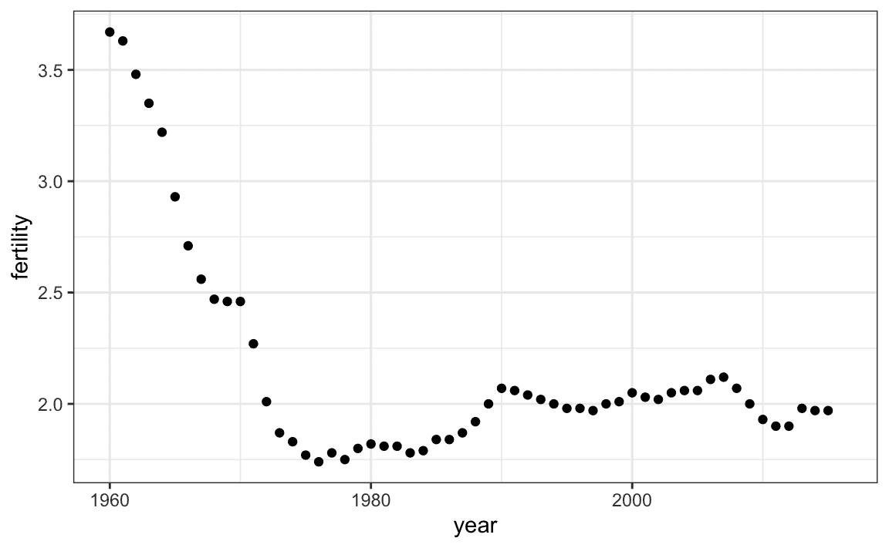*  *我们看到趋势根本不是线性的。相反，在 20 世纪 60 年代和 70 年代有一个急剧下降，降至 2 以下。然后趋势回到 2，并在 20 世纪 90 年代稳定下来。

当点均匀且密集地分布时，就像这里一样，我们通过用线连接点来创建曲线，以传达这些数据来自单一系列，这里是一个国家。为此，我们使用`geom_line`函数而不是`geom_point`。

[PRE9]

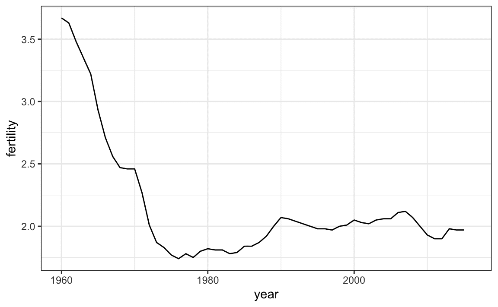*  *当我们查看两个国家时，这尤其有用。我们可以对数据进行子集化，包括两个国家，一个来自欧洲，一个来自亚洲，然后调整上面的代码：

[PRE10]

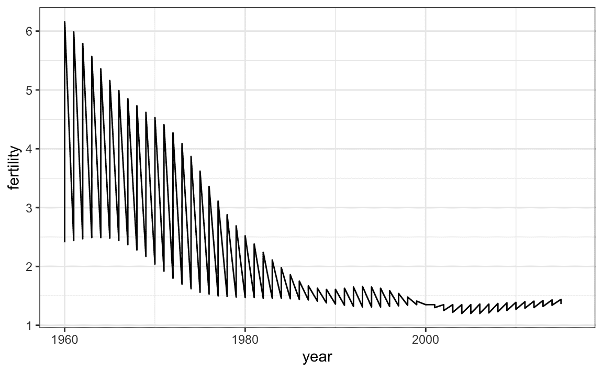*  *不幸的是，这不是我们想要的图表。不是每个国家的线条，而是两个国家的点被连接起来。这实际上是可以预料的，因为我们没有告诉`ggplot`我们想要两条分开的线。为了让`ggplot`知道需要分别制作两条曲线，我们将每个点分配到一个`group`中，一个国家一个：

[PRE11]

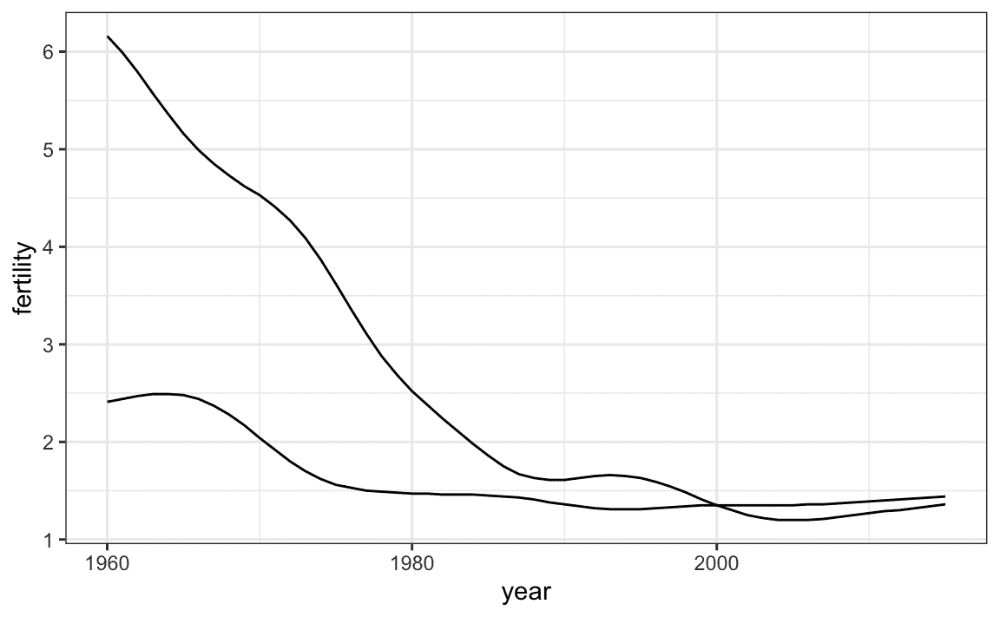*  *但是哪条线对应哪个国家？我们可以分配颜色来区分这一点。使用`color`参数为不同的国家分配不同颜色的一个有用副作用是数据会自动分组：

[PRE12]

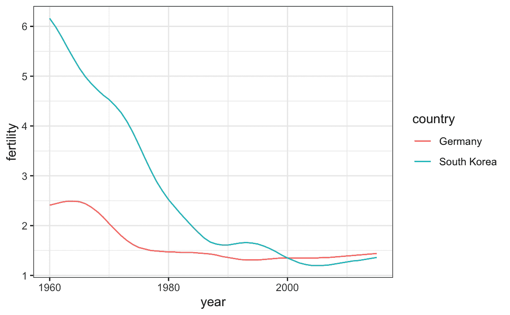*  *该图清楚地显示了韩国的生育率在 20 世纪 60 年代和 70 年代急剧下降，到 1990 年与德国的生育率相似。

对于趋势图，我们建议标注线条而不是使用图例，因为观众可以快速看到哪条线对应哪个国家。这个建议实际上适用于大多数图表：标注通常比图例更受欢迎。

我们演示了如何使用`geomtextpath`包来做这件事。我们定义一个包含标签位置的表格数据，然后使用第二个映射仅用于这些标签：

[PRE13]

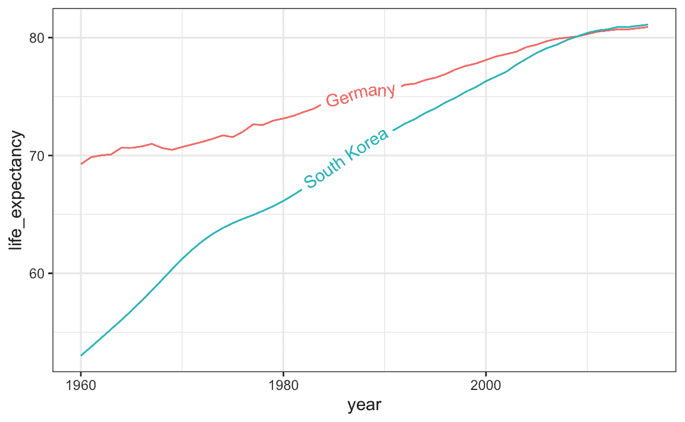*  *这个图清楚地显示了预期寿命的提高是如何随着生育率的下降而发生的。1960 年，德国人的预期寿命比韩国人长 15 年，尽管到 2010 年这个差距完全消失。它展示了在过去 40 年里许多非西方国家所取得的进步。*********

## ***10.5 数据变换***

**我们现在将注意力转向第二个问题，这个问题与普遍认为的过去几十年全球财富分配变得更加不均的观点相关。当问及普通大众是否认为贫穷国家变得更穷，富裕国家变得更富时，大多数人回答是。通过使用分层、直方图、平滑密度和箱线图，我们将能够理解这是否确实如此。首先，我们学习如何变换有时可以帮助提供更丰富的总结和图表。***

`gapminder`数据表包括一个包含各国国内生产总值（GDP）的列。GDP 衡量一个国家在一年内生产的商品和服务的市场价值。人均 GDP 通常被用作一个国家财富的粗略总结。在这里，我们将这个数量除以 365，以获得更可解释的度量——*每日美元*。使用当前的美元作为单位，每天收入低于 2 美元的人被定义为生活在*绝对贫困*中。我们将这个变量添加到数据表中：

[PRE14]

GDP 值已根据通货膨胀进行调整，并代表当前的美元，因此这些值意味着可以跨年进行比较。当然，这些是国家的平均值，并且每个国家内部存在很大的变异性。下面描述的所有图表和洞察都关系到国家平均值，而不是个人。*

### 10.5.1 对数变换

下面是 1970 年的每日收入直方图：

[PRE15]

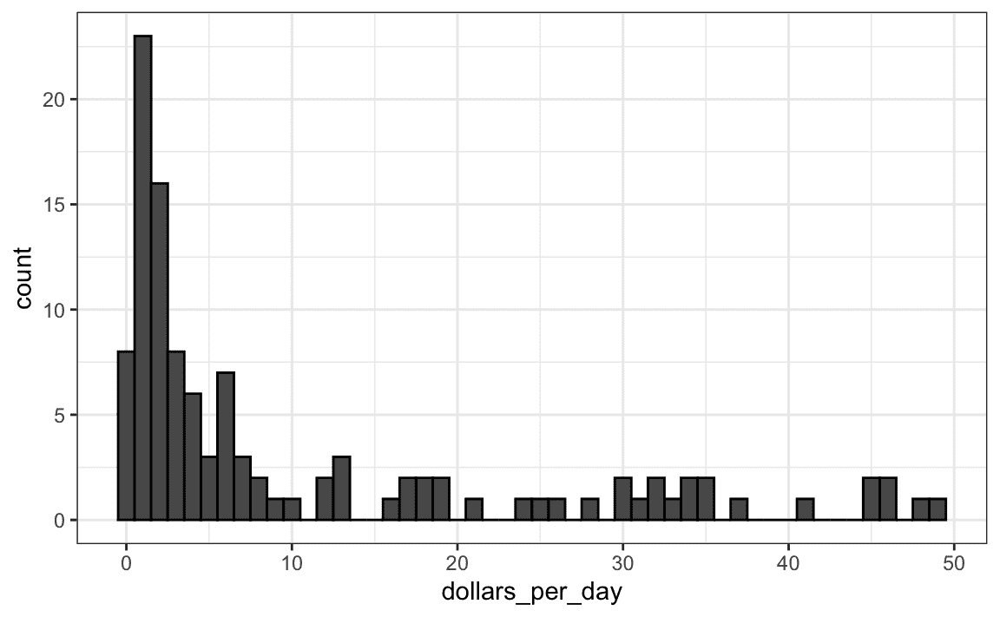*  *我们使用`color = "black"`参数来绘制边界，并清楚地区分各个区间。*

在这个图中，我们看到大多数国家的平均值每天低于 10 美元。然而，x 轴的大部分都用于表示平均每天收入超过 10 美元的 35 个国家。因此，这个图对于每天收入低于 10 美元的国家来说并不很有信息量。

快速看到有多少国家的平均每日收入约为 1 美元（极其贫穷）、2 美元（非常贫穷）、4 美元（贫穷）、8 美元（中等）、16 美元（富裕）、32 美元（富有）、64 美元（极其富有）可能更有信息量。这些变化是乘法的，而对数变换将乘法变化转换为加法变化：当使用 2 为底时，一个值的翻倍变成了增加 1。

如果我们对平均值应用 2 为底的对数变换，分布如下：

[PRE16]

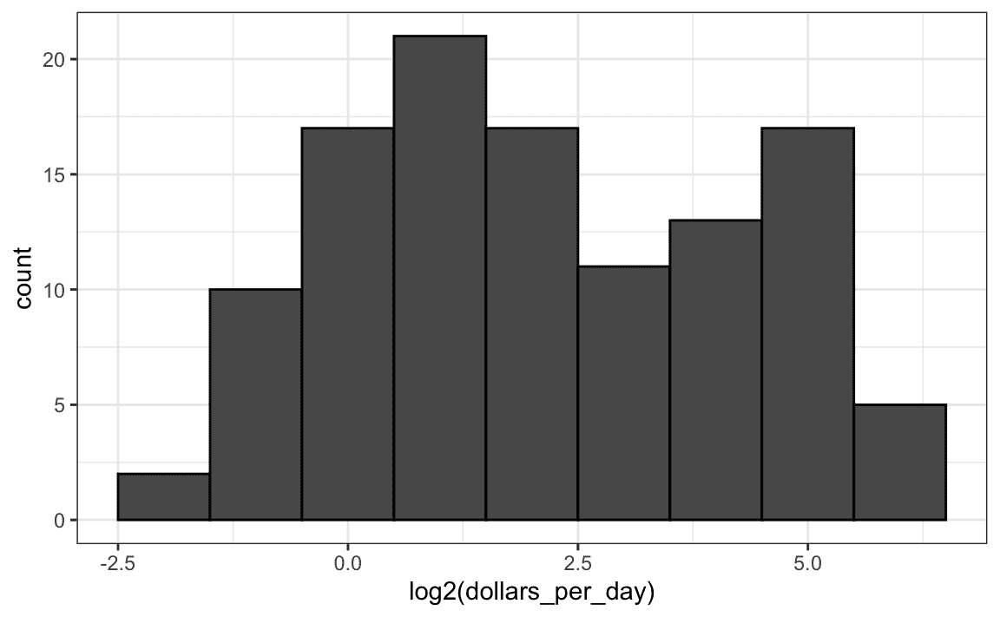*  *从某种意义上说，这提供了对中低收入国家的近距离观察。**

### **10.5.2 哪个底数？**

*在上述情况下，我们在对数转换中使用了 2 为底。其他常见的选择是以$\mathrm{e}$（自然对数）和 10 为底。

通常，我们不推荐使用自然对数进行数据探索和可视化。这是因为虽然$2², 2³, 2⁴, \dots$或$10², 10³, \dots$在心理计算上很容易，但$\mathrm{e}², \mathrm{e}³, \dots$并不容易。自然对数刻度不直观也不容易解释。

在每天美元的例子中，我们使用 2 为底而不是 10 为底，因为结果的范围更容易解释。未转换的值的范围是 0.3269426，48.8852142。

在 10 为底的情况下，这变成了一个包含非常少整数的范围：只有 0 和 1。以 2 为底，我们的范围包括-2, -1, 0, 1, 2, 3, 4 和 5。当$x$是介于-10 和 10 之间的整数时，计算$2^x$和$10^x$更容易，所以我们更喜欢在刻度上使用较小的整数。范围有限的一个后果是选择箱宽更具挑战性。以 2 为底的对数，我们知道箱宽为 1 将转换为范围在$x$到$2x$的箱。

对于一个以 10 为底更有意义的例子，考虑人口规模。以 10 为底的对数更可取，因为这些的范围是：

[PRE17]

以下是转换值的直方图：

[PRE18]

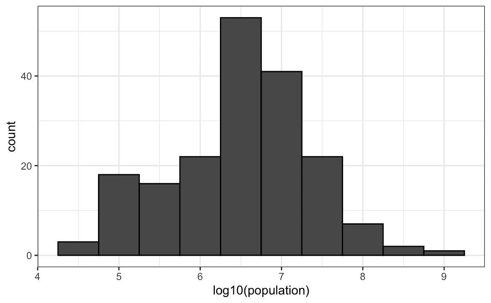*  *在上图中，我们可以快速看到国家人口介于十万和一百亿之间。****

### ***10.5.3 转换值还是刻度？***

**在图中使用对数转换有两种方式。我们可以在绘图之前对数据进行对数转换，或者在轴上使用对数刻度。除了轴上的数字外，图表看起来将是一样的。两种方法都很实用，各有不同的优点。如果我们对数据进行对数转换，我们就可以更容易地解释刻度中的中间值。例如，如果我们看到：

`----1----x----2--------3----`

对于对数转换的数据，我们知道$x$的值大约是 1.5。如果刻度是对数的：

`----10---x---100------1000---`

然后，为了确定`x`，我们需要计算$10^{1.5}$，这在我们的头脑中并不容易做到。然而，显示对数刻度的优点是原始值会在图中显示，这更容易解释。例如，我们会看到“每天 32 美元”而不是“每天 5 以 2 为底的对数美元”。

如我们之前所学，如果我们想使用对数来缩放坐标轴，我们可以使用`scale_x_continuous`函数。我们不需要先对值进行对数转换，而是应用这一层：

[PRE19]

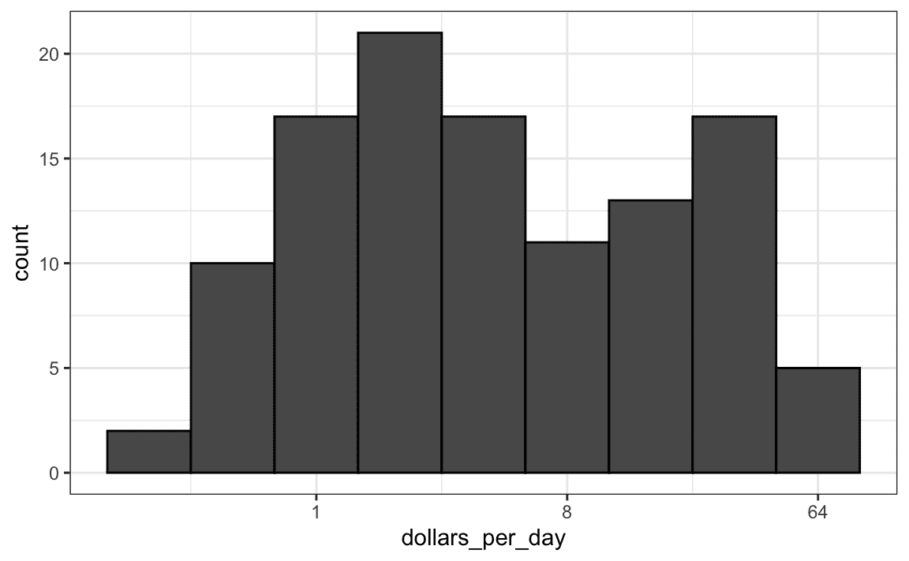*  *请注意，以 10 为底的对数转换有自己的函数：`[scale_x_log10()](https://ggplot2.tidyverse.org/reference/scale_continuous.html)`，但目前以 2 为底没有，尽管我们可以轻松定义自己的。

通过`trans`参数还有其他可用的转换。正如我们稍后将要学习的，平方根(`sqrt`)转换在考虑计数时很有用。对数转换(`logit`)在绘制 0 到 1 之间的比例时很有用。`reverse`转换在我们想要较小的值在右边或顶部时很有用。********

## ***10.6 多众数分布***

**在上面的直方图中，我们看到两个*峰值*：一个大约在 4，另一个大约在 32。在统计学中，这些峰值有时被称为*众数*。分布的众数是频率最高的值。正态分布的众数是平均值。当一个分布，如上面的分布，不是单调地从众数递减时，我们称它再次上升和下降的位置为*局部众数*，并说该分布有*多个众数*。

上面的直方图表明，1970 年国家收入分布有两个众数：一个大约每天 2 美元（对数 2 尺度中的 1），另一个大约每天 32 美元（对数 2 尺度中的 5）。这种*双峰性*与由平均每天收入低于 8 美元（对数 2 尺度中的 3）的国家和高于该收入的国家组成的二分世界一致。

## ***10.7 比较分布***

**直方图显示，1970 年的收入分布值显示出二分性。然而，直方图并没有显示这两组国家是*西方*与*发展中国家*的对立。

让我们先快速查看按地区划分的数据。我们按中位数重新排序地区，并使用对数刻度。

[PRE20]

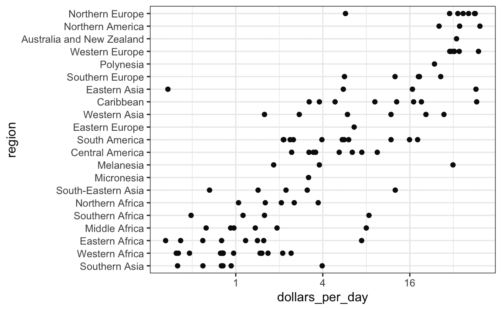*  *我们已经可以看到确实存在“西方与其它”的二分性：我们看到两个清晰的组，富裕组由北美、北欧和西欧以及新西兰和澳大利亚组成。我们根据这个观察结果定义组：

[PRE21]

我们将这个`group`变量转换为因子，以控制级别的顺序：

[PRE22]

在下一节中，我们将展示如何可视化和比较组间的分布。

### 10.7.1 箱线图

上述的探索性数据分析揭示了 1970 年人均收入分布的两个特点。使用直方图，我们发现了一个双峰分布，众数与穷国和富国相关。现在我们想要比较这五个组之间的分布，以确认“西方与其它”的二分性。每个类别中的点数足够多，以至于一个总结图可能是有用的。我们可以生成五个直方图或五个密度图，但将所有视觉总结放在一个图中可能更实用。因此，我们首先将箱线图并排放置。请注意，我们添加了`theme(axis.text.x = element_text(angle = 90, hjust = 1))`层，将组标签垂直，因为如果水平显示它们则不合适，并且我们移除了轴标签以留出空间。

[PRE23]

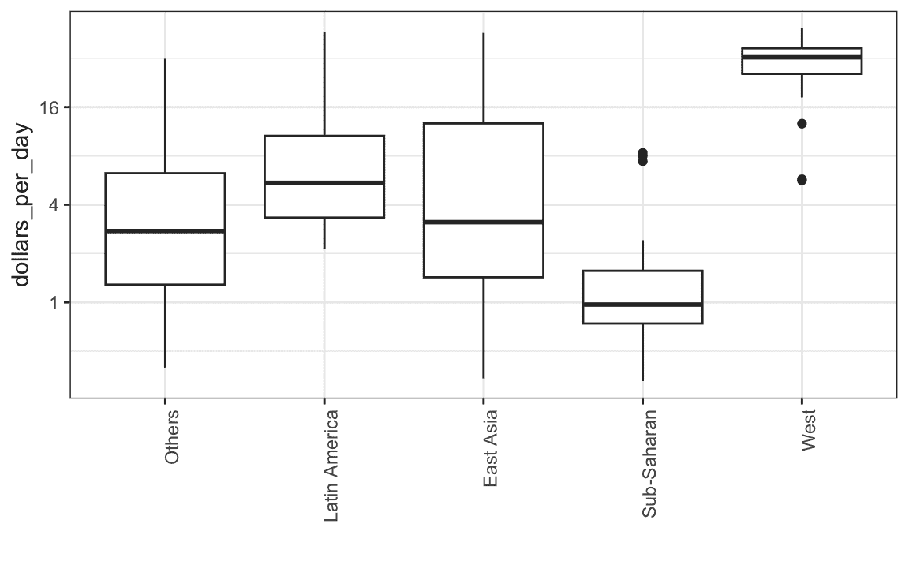*  *箱线图的局限性在于，通过将数据总结为五个数字，我们可能会错过数据的重要特征。避免这种情况的一种方法是通过展示数据。

[PRE24]

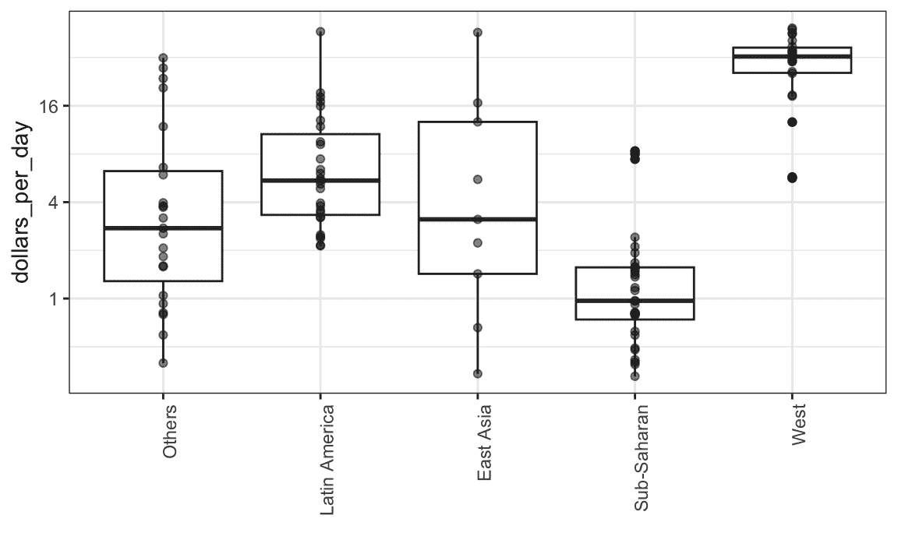**

### **10.7.2 脊线图**

*展示每个单独的点并不总是能揭示分布的重要特征。尽管这里并非如此，但当数据点的数量非常大以至于出现重叠时，展示数据可能会适得其反。箱线图通过提供五个数字的总结来帮助解决这个问题，但这也有其局限性。例如，箱线图不允许我们发现双峰分布。为了看到这一点，请注意下面的两个图表是在总结相同的数据集：**

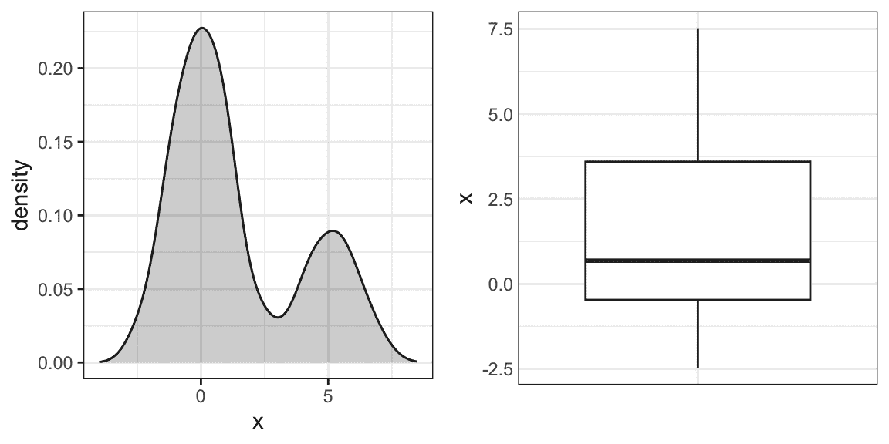

在我们担心箱线图总结过于简单的情况下，我们可以展示堆叠的平滑密度或直方图。我们称这些为*脊线图*。因为我们习惯于使用 x 轴上的值来可视化密度，所以我们垂直堆叠它们。此外，由于这种方法需要更多的空间，因此叠加它们很方便。`ggridges`包提供了一个方便的函数来完成这项工作。以下是上面显示的带有箱线图的收入数据，但使用的是*脊线图*。

[PRE25]

*  *请注意，我们必须反转用于箱线图的`x`和`y`轴。一个有用的`geom_density_ridges`参数是`scale`，它允许你确定重叠的程度，其中`scale = 1`表示没有重叠，更大的值会导致更多的重叠。

如果数据点的数量足够小，我们可以使用以下代码将它们添加到脊线图中：

[PRE26]

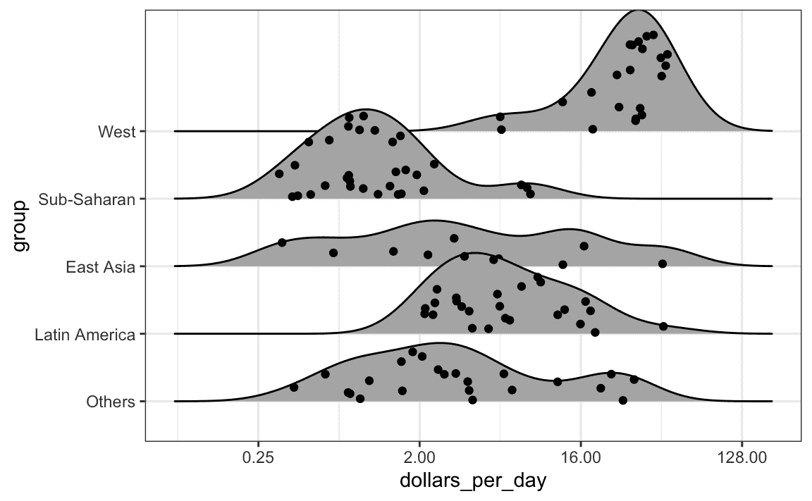*  *默认情况下，点的垂直高度是抖动的，不应以任何方式解释。为了显示数据点，但又不使用抖动，我们可以使用以下代码来添加所谓的数据的*毛刷表示*。

[PRE27]

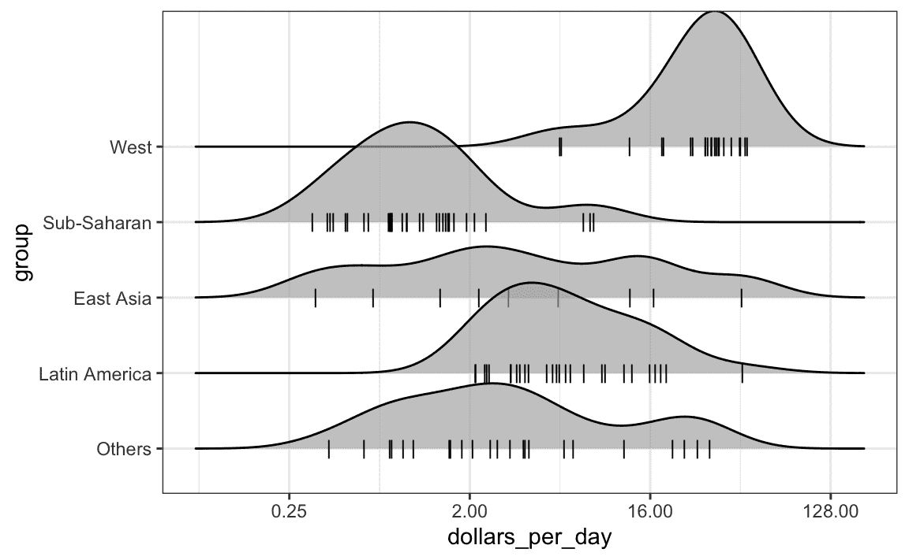*****

### ***10.7.3 示例：1970 年与 2010 年的收入分布***

**数据探索清楚地表明，1970 年存在“西方与其它”的二分法。但这种二分法持续存在吗？让我们使用`facet_grid`来看看分布是如何变化的。首先，我们将关注两组：西方和其它。我们制作四个直方图。我们只为在 1970 年和 2010 年都有数据的国家绘制此图。请注意，一些国家是在 1970 年之后成立的；例如，苏联在 20 世纪 90 年代分裂成几个国家。我们还注意到，2010 年有更多国家的数据可用。

因此，我们只为在两年都有数据的国家绘制图表：

[PRE28]

这些 108 个国家占世界人口的 86%，因此这个子集应该是具有代表性的。我们可以使用此代码比较分布：**

[PRE29]

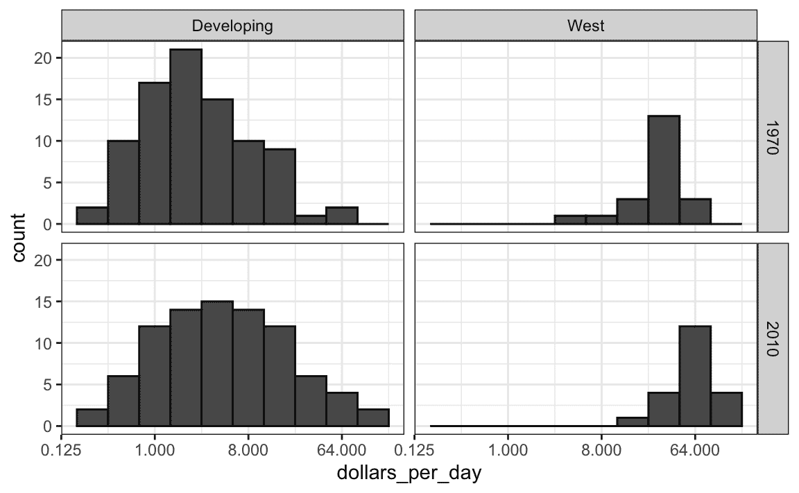*  *现在我们看到富裕国家变得更富裕了，但从百分比来看，贫穷国家似乎改善得更多。特别是，我们看到每天收入超过 16 美元的*发展中国家*的比例显著增加。

为了看到哪些特定地区改善得最多，我们可以重新制作我们上面制作的箱线图，但现在添加 2010 年，然后使用分面来比较两年。

[PRE30]

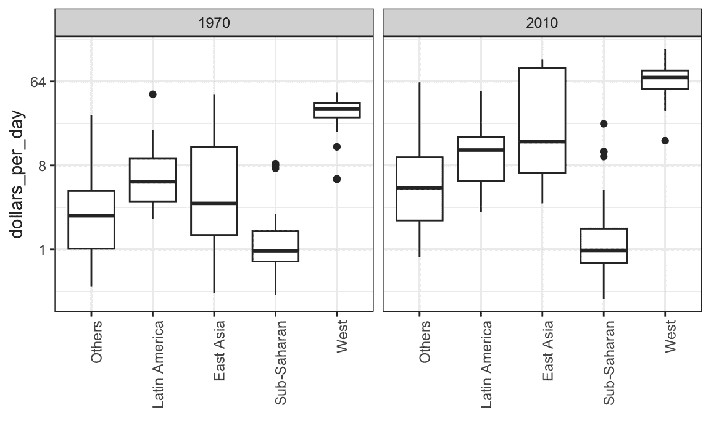*  *在这里，我们暂停一下，介绍另一个强大的**ggplot2**功能。因为我们想比较每个地区在前后的情况，所以对于每个地区，将 1970 年的箱线图放在 2010 年的箱线图旁边会方便很多。一般来说，当数据并排绘制时，比较更容易。

因此，我们不是进行分面处理，而是将每年的数据保留在一起，并根据年份来着色（或填充）它们。请注意，组别会根据年份自动分开，并且每对箱线图都会相邻绘制。因为年份列是一个数字，所以我们必须将其转换为因子，因为**ggplot2**会自动为因子的每个类别分配一个颜色。

[PRE31]

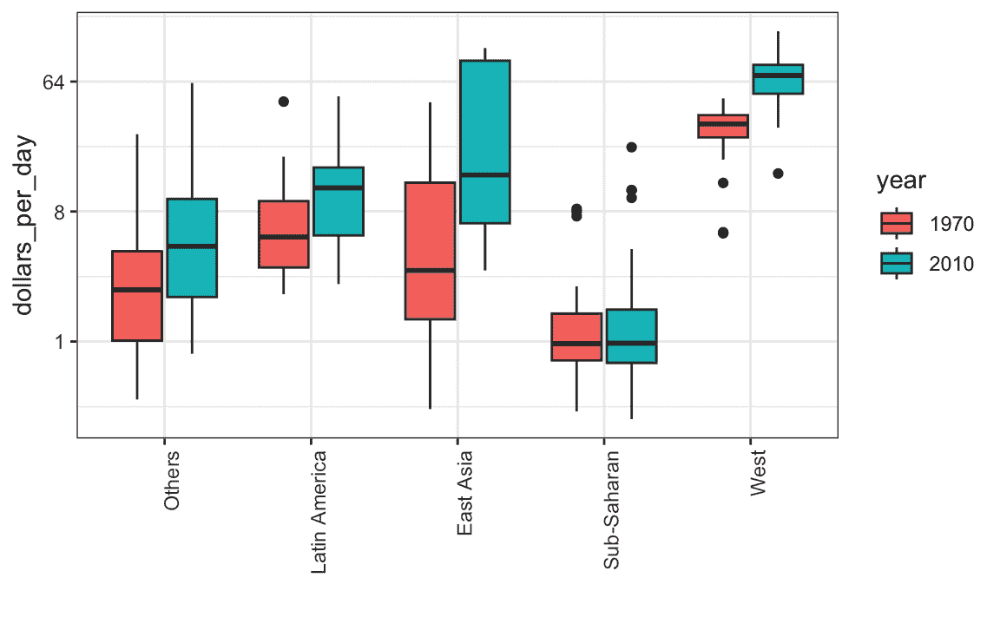*  *之前的数据探索表明，在过去 40 年里，富裕国家和贫穷国家之间的收入差距已经显著缩小。我们使用一系列直方图和箱线图来观察这一点。我们建议用一张图表简洁地传达这一信息。

让我们从注意到 1970 年和 2010 年的收入分布密度图传达了差距正在缩小的信息开始：

[PRE32]

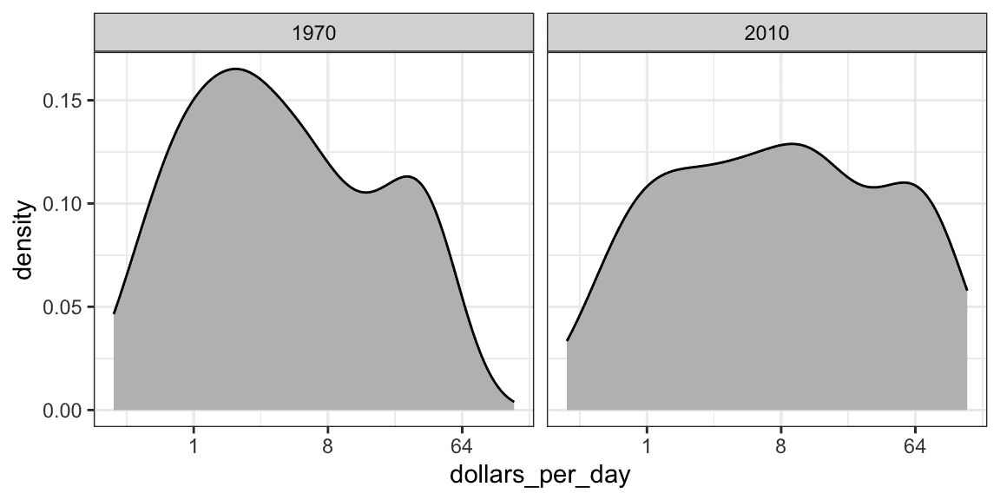*  *在 1970 年的图表中，我们可以看到两个明显的模式：贫穷国家和富裕国家。到了 2010 年，一些贫穷国家似乎向右移动，缩小了差距。

我们需要传达的下一个信息是，这种分布变化的原因是几个贫穷国家变得更富裕，而不是一些富裕国家变得更贫穷。为此，我们可以为我们数据探索期间确定的组分配颜色。

然而，由于当我们叠加两个密度时，默认情况下，无论每个组的大小如何，分布曲线下的面积都会加起来等于 1，因此我们首先需要学习如何以保留每个组国家数量信息的方式制作这些平滑密度。为此，我们需要学习如何使用`geom_density`函数访问计算变量。********

### ***10.7.4 访问计算变量***

**为了使这些密度的面积与组的大小成比例，我们可以简单地乘以 y 轴的值和组的大小。从`geom_density`的帮助文件中，我们看到函数计算一个名为`count`的变量，它正好做这件事。我们希望这个变量在 y 轴上，而不是在密度上。

在 **ggplot2** 中，我们使用函数 `after_stat` 访问这些变量。因此，我们将使用以下映射：

[PRE33]

现在，我们可以通过简单地更改上一段代码块中的映射来创建所需的图表。我们还将扩展 x 轴的极限。

[PRE34]

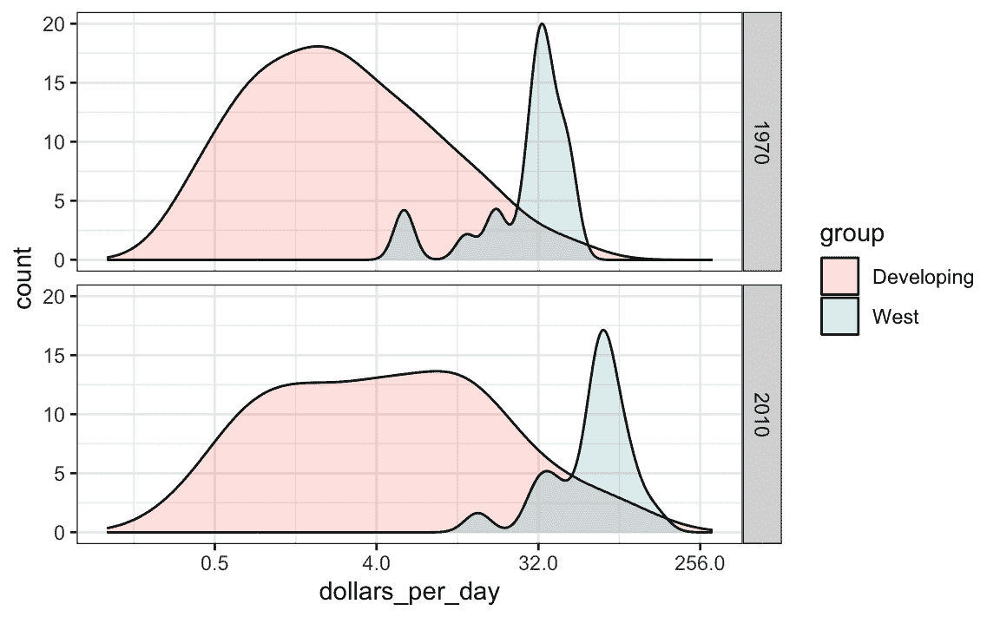*  *如果我们想使密度更平滑，我们使用 `bw` 参数，以便在每种密度中使用相同的带宽。我们在尝试了几个值后选择了 0.75。

[PRE35]

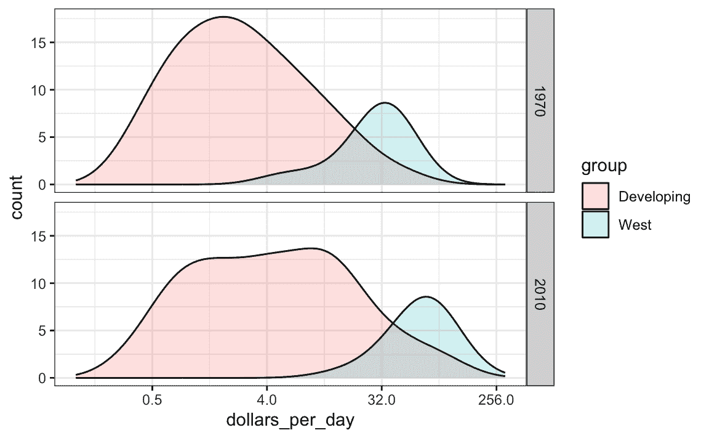*  *这个图表现在非常清楚地显示了正在发生的事情。发展中国家的分布正在变化。出现了一个第三种模式，由那些差距缩小最多的国家组成。

为了可视化是否上述任何组在驱动这一变化，我们可以快速制作一个脊线图：

[PRE36]

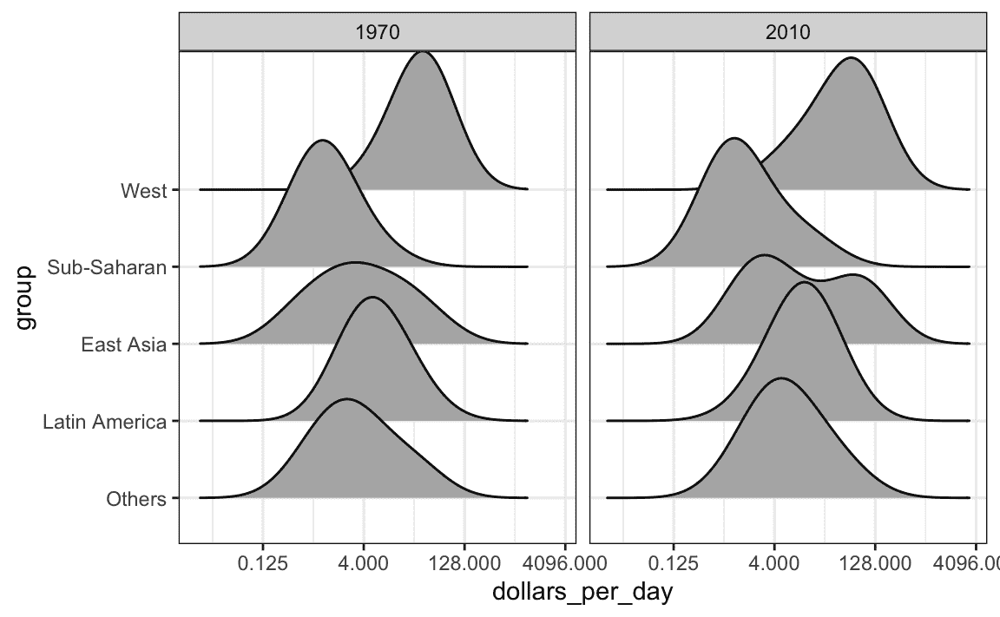*  *另一种实现这一目标的方法是将密度堆叠在一起：

[PRE37]

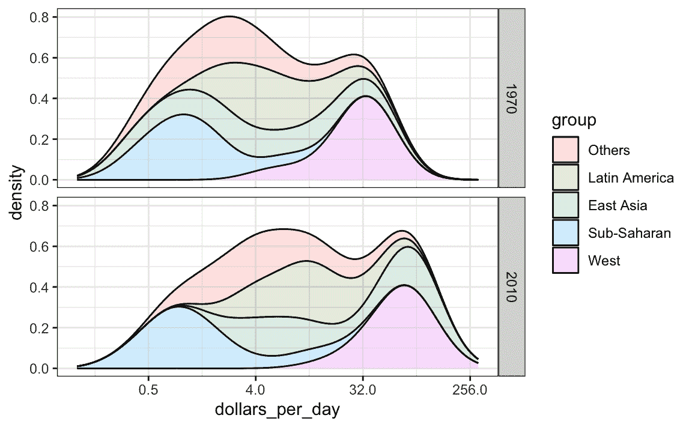*  *在这里，我们可以清楚地看到东亚、拉丁美洲和其他地区的分布如何明显向右移动，而撒哈拉以南非洲保持不变。

注意，我们按组级别的顺序排列，以便首先绘制西方的密度，然后是撒哈拉以南非洲。将两个极端先绘制出来，使我们能更好地看到剩余的双峰性。********

### ***10.7.5 加权密度***

**最后一点，我们注意到这些分布对每个国家都给予相同的权重。所以，如果大多数人口正在改善，但居住在一个非常大的国家，例如中国，我们可能不会重视这一点。实际上，我们可以使用 `weight` 映射参数来对平滑密度进行加权。然后图表看起来是这样的：

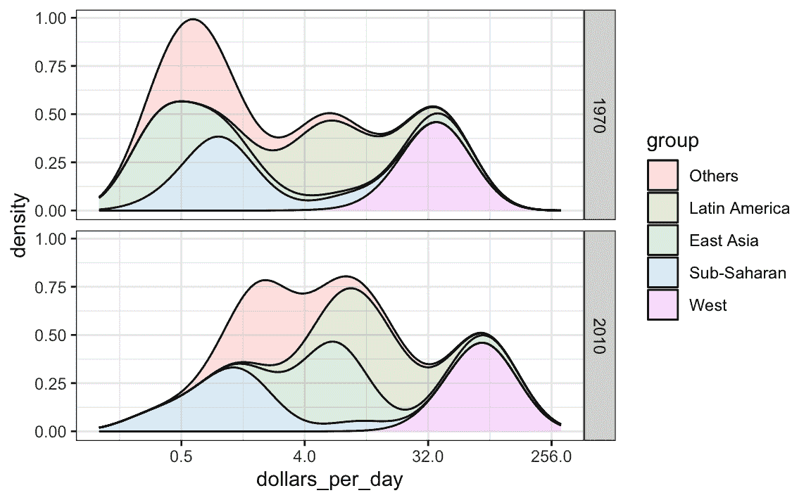

这个特定的图表非常清楚地展示了收入分配差距是如何在撒哈拉以南非洲的大部分贫困人口中缩小的。*********

## ***10.8 案例研究 2：生态谬误***

**在本节中，我们一直在比较世界各地的地区。我们看到了，平均而言，一些地区比其他地区做得更好。在本节中，我们专注于描述在检查一个国家的婴儿死亡率与平均收入之间的关系时，组内变异性的重要性。

我们定义了更多地区，并比较了这些地区的平均值：

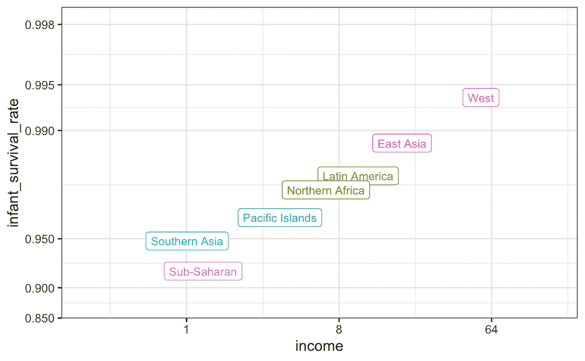

这两个变量之间的关系几乎是完美线性的，选择了轴变换，图表显示了显著差异。在西方，不到 0.5% 的婴儿死亡，而在撒哈拉以南非洲，这个比率超过 6%！

注意，这个图表使用了一种新的转换，即逻辑转换。

### 10.8.1 逻辑转换

比例或率 $p$ 的逻辑或 logit 转换定义为：

$$f(p) = \log \left( \frac{p}{1-p} \right)$$

当 $p$ 是比例或概率时，被取对数的量，$p/(1-p)$，被称为*优势比*。在这种情况下 $p$ 是婴儿存活的比例。优势比告诉我们预期存活婴儿比死亡婴儿多多少。对数转换使这一关系对称。如果比率相同，那么对数优势比为 0。增加或减少的折叠分别转化为正数和负数增量。

这个比例尺在我们要强调接近 0 或 1 的差异时很有用。对于存活率来说，这很重要，因为 90% 的存活率是不可接受的，而 99% 的存活率相对较好。我们更希望存活率接近 99.9%。我们希望我们的比例尺能够突出这些差异，而 logit 就能这样做。请注意，99.9/0.1 大约是 99/1 的 10 倍，而 99/1 大约是 90/10 的 10 倍。通过使用对数，这些折叠变化转化为恒定的增量。

### 10.8.2 展示数据

现在，回到我们的图表。基于上面的图表，我们是否得出结论，一个低收入国家注定会有低存活率？我们是否得出结论，撒哈拉以南非洲的存活率都低于南亚，而南亚又低于太平洋岛屿，依此类推？

基于显示平均值的图表得出这一结论被称为*生态谬误*。仅在地区层面的平均存活率和收入之间观察到几乎完美的关系。一旦我们展示了所有数据，我们就会看到一个更为复杂的故事：

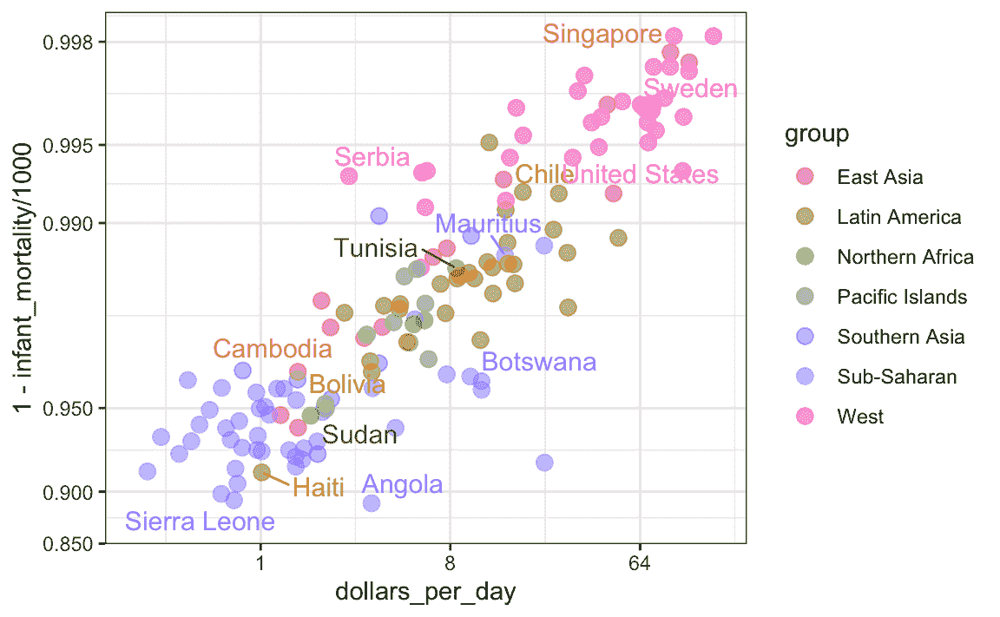

具体来说，我们看到存在大量的变异性。我们看到来自同一地区的国家可以非常不同，而且收入相同的国家可能会有不同的存活率。例如，尽管撒哈拉以南非洲的平均健康状况和经济成果最差，但该群体内部存在很大的变异性。毛里求斯和博茨瓦纳的表现优于安哥拉和塞拉利昂，毛里求斯与西方国家相当。***

## ***10.9 案例研究 3：疫苗和传染病***

**疫苗帮助拯救了数百万人的生命。在 19 世纪，在通过疫苗接种计划实现群体免疫之前，诸如天花和脊髓灰质炎等传染病的死亡是常见的。然而，尽管有科学证据证明其重要性，疫苗接种计划今天却变得有些有争议。***

争议始于 1988 年发表的一篇论文⁵，由安德鲁·韦克菲尔德领导，声称接种麻疹、腮腺炎和风疹（MMR）疫苗与自闭症和肠道疾病的出现之间存在联系。尽管有大量科学证据与此发现相矛盾，但耸人听闻的媒体报道和阴谋论者的恐惧煽动导致公众的一部分人相信疫苗是有害的。因此，许多父母停止了给他们的孩子接种疫苗。鉴于疾病控制中心（CDC）估计，疫苗接种将预防过去 20 年出生的儿童中超过 2100 万次住院和 73.2 万次死亡（参见疫苗接种儿童计划时代的免疫接种益处——美国，1994-2013，MMWR⁶），这种危险的做法可能会带来潜在的灾难性后果。1988 年的论文已被撤回，安德鲁·韦克菲尔德最终被“从英国医学注册名单上除名，声明其发表在《柳叶刀》杂志上的研究存在故意伪造，因此被禁止在英国行医。”（来源：维基百科⁷）。然而，由于自称活动家继续传播关于疫苗的错误信息，误解仍然存在。

数据的有效沟通是针对错误信息和恐惧煽动的强大解毒剂。在本部分书的引言中，我们展示了一个例子，由《华尔街日报》的文章⁸提供，展示了疫苗对抗传染病影响的相关数据。在这里，我们重建了这个例子。

### 10.9.1 疫苗数据

用于这些图表的数据由提科项目⁹收集、整理和分发。它们包括从 1928 年到 2011 年，来自所有五十个州的七种疾病的每周报告计数。我们在**dslabs**包中包括了年度总计：

[PRE38]

我们创建了一个临时对象`dat`，它只存储麻疹数据，包括每 10 万人比率，按疾病平均值排序州，并删除阿拉斯加和夏威夷，因为它们只在 20 世纪 50 年代末成为州。请注意，有一个`weeks_reporting`列告诉我们一年中有多少周的数据被报告。在计算比率时，我们必须调整这个值。

[PRE39]*

### **10.9.2 趋势图**

*我们现在可以轻松地按年份绘制疾病比率。以下是加利福尼亚的麻疹数据：

[PRE40]

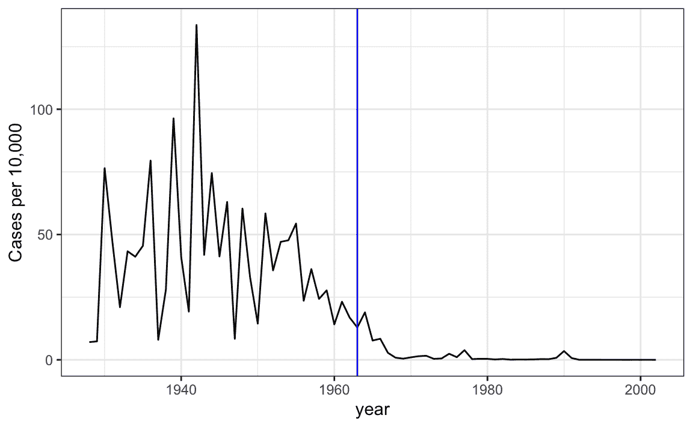*  *我们在 1963 年添加了一条垂直线，因为这是疫苗被引入的时间¹⁰。******

## ***10.10 热图***

**现在我们能否在一个图表中展示所有州的数据？我们需要展示三个变量：年份、州和比率。在《华尔街日报》的图表中，他们使用 x 轴表示年份，y 轴表示州，使用颜色色调来表示比率。然而，他们使用的颜色刻度，从黄色到蓝色到绿色到橙色到红色，可以改进。

在我们的例子中，我们想使用顺序调色板，因为没有有意义的中心，只有低和高比率。

我们使用`geom_tile`几何形状用代表疾病率的颜色填充区域。我们使用平方根变换来避免极高计数主导图表。注意，缺失值以灰色显示。请注意，一旦一种疾病基本被根除，一些州就完全停止报告病例。这就是为什么我们在 1980 年之后看到这么多灰色。

[PRE41]

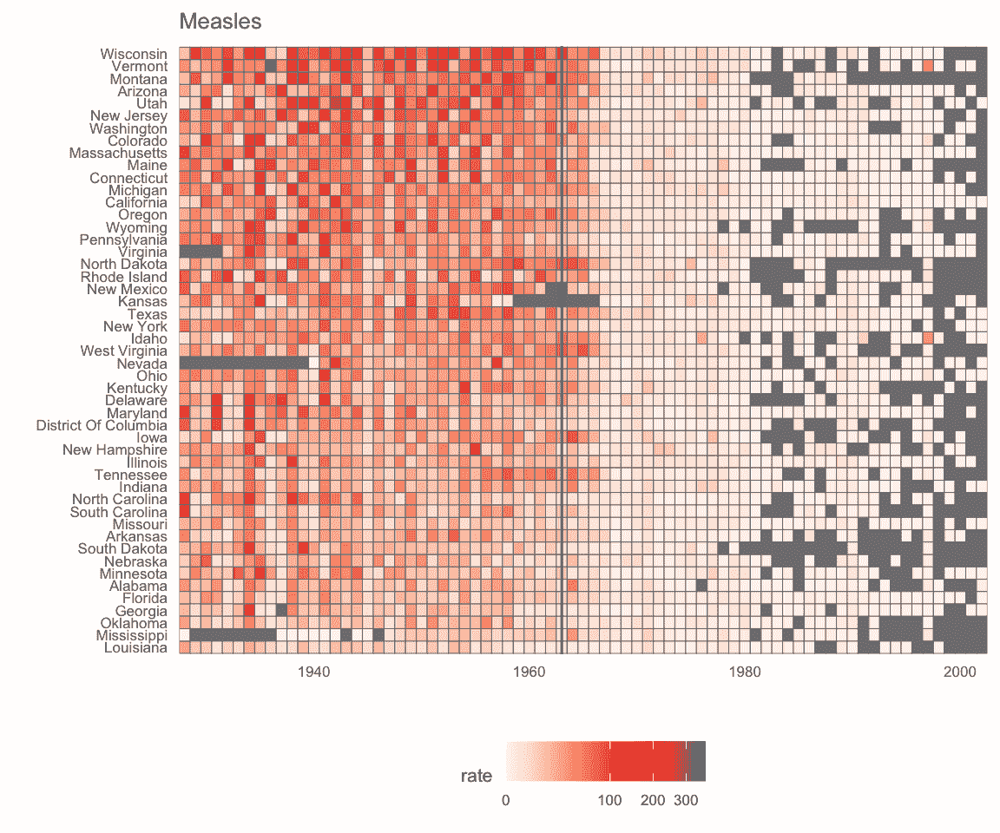*  *这个图表非常有力地证明了疫苗的贡献。然而，这个图表的一个局限性是它使用颜色来表示数量，我们之前解释过这会使我们难以确切知道值有多高。位置和长度是更好的线索。如果我们愿意放弃州信息，我们可以制作一个显示值的图表版本。我们还可以显示美国的平均值，我们像这样计算：

[PRE42]

现在我们来制作图表，我们简单地使用`geom_line`几何形状：

[PRE43]

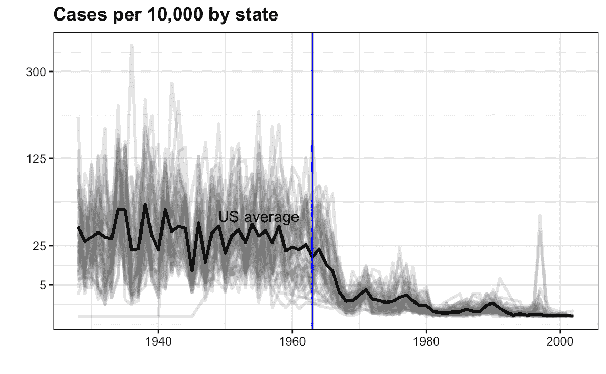*  *理论上，我们可以使用颜色来表示分类值州，但很难挑选出 50 种不同的颜色。******

## ***10.11 练习***

**1.  重现我们之前制作的图像图，但这次是针对天花的。对于这个图表，不要包括在 10 周或以上没有报告病例的年份。

1.  现在重现我们之前制作的时序图，但这次按照之前问题的说明来处理天花。

1.  对于加利福尼亚州，制作一个显示所有疾病率的时序图。只包括有 10 周或以上报告的年份。每种疾病使用不同的颜色。

1.  现在同样为美国的比率做同样的处理。提示：使用`summarize`计算美国比率，即总数除以总人口。

* * *

**1.  [`zh.wikipedia.org/wiki/Hans_Rosling`](https://zh.wikipedia.org/wiki/Hans_Rosling)↩︎

1.  [`www.gapminder.org/`](http://www.gapminder.org/)↩︎

1.  [`www.ted.com/talks/hans_rosling_reveals_new_insights_on_poverty?language=zh`](https://www.ted.com/talks/hans_rosling_reveals_new_insights_on_poverty?language=zh)↩︎

1.  [`www.ted.com/talks/hans_rosling_shows_the_best_stats_you_ve_ever_seen`](https://www.ted.com/talks/hans_rosling_shows_the_best_stats_you_ve_ever_seen)↩︎

1.  [`www.thelancet.com/journals/lancet/article/PIIS0140-6736(97)11096-0/abstract`](http://www.thelancet.com/journals/lancet/article/PIIS0140-6736(97)11096-0/abstract)↩︎

1.  [`www.cdc.gov/mmwr/preview/mmwrhtml/mm6316a4.htm`](https://www.cdc.gov/mmwr/preview/mmwrhtml/mm6316a4.htm)↩︎

1.  [`zh.wikipedia.org/wiki/Andrew_Wakefield`](https://zh.wikipedia.org/wiki/Andrew_Wakefield)↩︎

1.  [`graphics.wsj.com/infectious-diseases-and-vaccines/`](http://graphics.wsj.com/infectious-diseases-and-vaccines/)↩︎

1.  [`www.tycho.pitt.edu/`](http://www.tycho.pitt.edu/)††

1.  疾病控制与预防中心（2014 年）。国际旅行健康信息 2014（黄色手册）。第 250 页。ISBN 9780199948505††*
