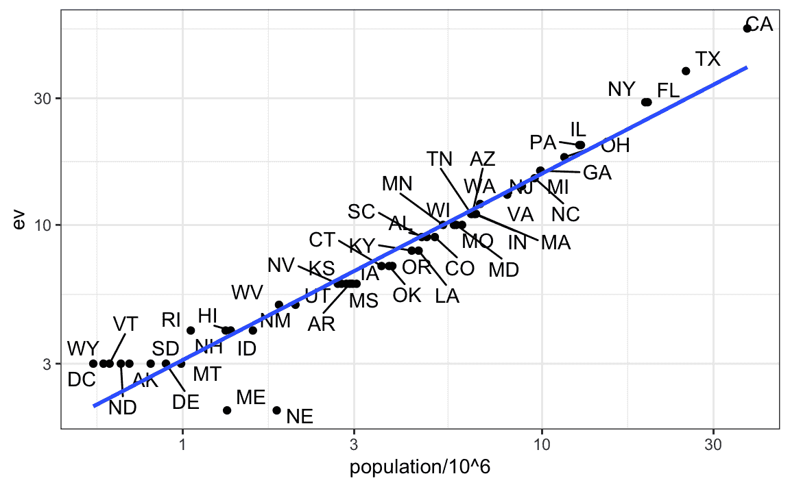
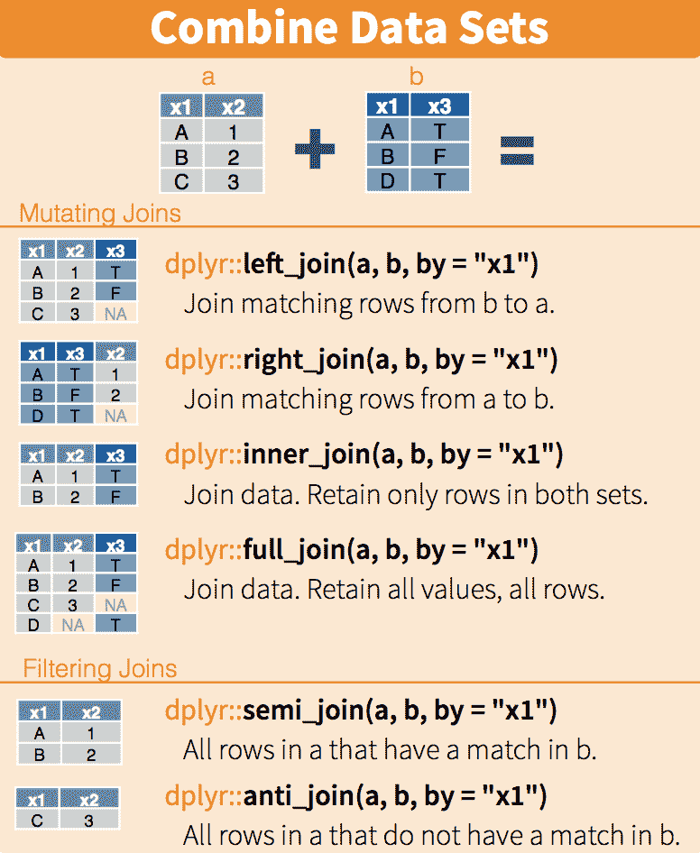

# 12 连接表

> 原文：[`rafalab.dfci.harvard.edu/dsbook-part-1/wrangling/joining-tables.html`](https://rafalab.dfci.harvard.edu/dsbook-part-1/wrangling/joining-tables.html)

1.  数据整理

1.  12 连接表

对于一个特定的分析，所需的信息可能不仅仅在一个表中。在这里，我们用一个简单的例子来说明合并表的一般挑战。

假设我们想探索美国各州人口规模与选举人票数之间的关系。我们在这个表中找到了人口规模：

```r
[library](https://rdrr.io/r/base/library.html)([tidyverse](https://tidyverse.tidyverse.org))
[library](https://rdrr.io/r/base/library.html)(dslabs)
[head](https://rdrr.io/r/utils/head.html)(murders)
#>        state abb region population total
#> 1    Alabama  AL  South    4779736   135
#> 2     Alaska  AK   West     710231    19
#> 3    Arizona  AZ   West    6392017   232
#> 4   Arkansas  AR  South    2915918    93
#> 5 California  CA   West   37253956  1257
#> 6   Colorado  CO   West    5029196    65
```

*以及在这个表中：

```r
[head](https://rdrr.io/r/utils/head.html)(results_us_election_2016)
#>          state electoral_votes clinton trump johnson stein mcmullin
#> 1   California              55    61.7  31.6    3.37 1.965    0.279
#> 2        Texas              38    43.2  52.2    3.16 0.798    0.472
#> 3      Florida              29    47.8  49.0    2.20 0.684    0.000
#> 4     New York              29    59.0  36.5    2.29 1.398    0.134
#> 5     Illinois              20    55.8  38.8    3.79 1.387    0.211
#> 6 Pennsylvania              20    47.5  48.2    2.38 0.810    0.105
#>   others
#> 1 1.0383
#> 2 0.0992
#> 3 0.2732
#> 4 0.6591
#> 5 0.0294
#> 6 1.0571
```

*仅仅将这两个表连接起来是不行的，因为各州的顺序并不相同。

```r
[identical](https://rdrr.io/r/base/identical.html)(results_us_election_2016$state, murders$state)
#> [1] FALSE
```

*下面描述的*连接*函数旨在处理这个挑战。

## 12.1 连接

**dplyr**包中的*连接*函数确保表被合并，使得匹配的行在一起。如果你了解 SQL，你会看到这种方法和语法非常相似。一般思路是，需要确定一个或多个列，这些列将用于匹配两个表。然后返回一个新的包含合并信息的表。注意，如果我们使用`left_join`通过州来连接上面的两个表会发生什么（我们将移除`others`列，并将`electoral_votes`重命名，以便表格适合页面）：

```r
tab <- [left_join](https://dplyr.tidyverse.org/reference/mutate-joins.html)(murders, results_us_election_2016, by = "state") |>
 [select](https://dplyr.tidyverse.org/reference/select.html)(-others) |> [rename](https://dplyr.tidyverse.org/reference/rename.html)(ev = electoral_votes)
[head](https://rdrr.io/r/utils/head.html)(tab)
#>        state abb region population total ev clinton trump johnson stein
#> 1    Alabama  AL  South    4779736   135  9    34.4  62.1    2.09 0.442
#> 2     Alaska  AK   West     710231    19  3    36.6  51.3    5.88 1.800
#> 3    Arizona  AZ   West    6392017   232 11    44.6  48.1    4.08 1.319
#> 4   Arkansas  AR  South    2915918    93  6    33.7  60.6    2.65 0.838
#> 5 California  CA   West   37253956  1257 55    61.7  31.6    3.37 1.965
#> 6   Colorado  CO   West    5029196    65  9    48.2  43.3    5.18 1.383
#>   mcmullin
#> 1    0.000
#> 2    0.000
#> 3    0.670
#> 4    1.165
#> 5    0.279
#> 6    1.040
```

*数据已成功连接，现在我们可以，例如，绘制一个图来探索关系：



我们看到关系接近线性，每百万人口大约有 2 张选举人票，但小州的比率更高。

在实践中，并不是每个表中的每一行都一定在另一个表中有一个匹配的行。因此，我们有了几种不同的连接方式。为了说明这个挑战，我们将从上面的表中取子集。我们创建了`tab1`和`tab2`这两个表，它们有一些共同的状态，但并非全部：

```r
tab_1 <- [slice](https://dplyr.tidyverse.org/reference/slice.html)(murders, 1:6) |> [select](https://dplyr.tidyverse.org/reference/select.html)(state, population)
tab_2 <- results_us_election_2016 |> 
 [filter](https://dplyr.tidyverse.org/reference/filter.html)(state [%in%](https://rdrr.io/r/base/match.html) [c](https://rdrr.io/r/base/c.html)("Alabama", "Alaska", "Arizona", 
 "California", "Connecticut", "Delaware")) |> 
 [select](https://dplyr.tidyverse.org/reference/select.html)(state, electoral_votes) |> [rename](https://dplyr.tidyverse.org/reference/rename.html)(ev = electoral_votes)
```

*我们将在下一节中使用这两个表作为例子。

### 12.1.1 左连接

假设我们想要一个类似于`tab_1`的表，但添加我们可用的任何州的选举人票数。为此，我们使用`left_join`，并将`tab_1`作为第一个参数。我们通过`by`参数指定要匹配的列。

```r
[left_join](https://dplyr.tidyverse.org/reference/mutate-joins.html)(tab_1, tab_2, by = "state")
#>        state population ev
#> 1    Alabama    4779736  9
#> 2     Alaska     710231  3
#> 3    Arizona    6392017 11
#> 4   Arkansas    2915918 NA
#> 5 California   37253956 55
#> 6   Colorado    5029196 NA
```

*注意，`NA`s 被添加到`tab_2`中未出现的两个州。此外，请注意，这个函数以及所有其他连接函数都可以通过管道接收第一个参数：

```r
tab_1 |> [left_join](https://dplyr.tidyverse.org/reference/mutate-joins.html)(tab_2, by = "state")
```*

### **12.1.2 右连接**

**如果我们想要一个与第二个表具有相同行的表，而不是与第一个表具有相同行的表，我们可以使用`right_join`：

```r
tab_1 |> [right_join](https://dplyr.tidyverse.org/reference/mutate-joins.html)(tab_2, by = "state")
#>         state population ev
#> 1     Alabama    4779736  9
#> 2      Alaska     710231  3
#> 3     Arizona    6392017 11
#> 4  California   37253956 55
#> 5 Connecticut         NA  7
#> 6    Delaware         NA  3
```

*现在 NAs 出现在来自`tab_1`的列中。

### ***12.1.3 内连接***

***如果我们只想保留两个表中都有信息的行，我们使用`inner_join`。你可以将其视为一个交集：

```r
[inner_join](https://dplyr.tidyverse.org/reference/mutate-joins.html)(tab_1, tab_2, by = "state")
#>        state population ev
#> 1    Alabama    4779736  9
#> 2     Alaska     710231  3
#> 3    Arizona    6392017 11
#> 4 California   37253956 55
```***

### ***12.1.4 全连接***

***如果我们想保留所有行并用 NAs 填充缺失部分，我们可以使用 `full_join`。你可以将其视为一个并集：

```r
[full_join](https://dplyr.tidyverse.org/reference/mutate-joins.html)(tab_1, tab_2, by = "state")
#>         state population ev
#> 1     Alabama    4779736  9
#> 2      Alaska     710231  3
#> 3     Arizona    6392017 11
#> 4    Arkansas    2915918 NA
#> 5  California   37253956 55
#> 6    Colorado    5029196 NA
#> 7 Connecticut         NA  7
#> 8    Delaware         NA  3
```***

### ***12.1.5 半连接***

***`semi_join` 函数允许我们保留第一表中在第二表中具有信息的部分。它不会添加第二表的列：

```r
[semi_join](https://dplyr.tidyverse.org/reference/filter-joins.html)(tab_1, tab_2, by = "state")
#>        state population
#> 1    Alabama    4779736
#> 2     Alaska     710231
#> 3    Arizona    6392017
#> 4 California   37253956
```***

### ***12.1.6 反连接***

***函数 `anti_join` 是 `semi_join` 的对立面。它保留第一表中在第二表中没有信息的元素：

```r
[anti_join](https://dplyr.tidyverse.org/reference/filter-joins.html)(tab_1, tab_2, by = "state")
#>      state population
#> 1 Arkansas    2915918
#> 2 Colorado    5029196
```

*以下图表总结了上述连接：



(Image courtesy of RStudio¹. CC-BY-4.0 license². Cropped from original.)******

## ***12.2 绑定***

***尽管我们在这本书中还没有使用它，但另一种常见的将数据集合并的方式是通过 *绑定*。与连接函数不同，绑定函数不尝试通过变量进行匹配，而是简单地合并数据集。如果数据集在适当的维度上不匹配，则会得到一个错误。

### 12.2.1 绑定列

`dplyr` 函数 *bind_cols* 通过将它们作为 tibble 的列来绑定两个对象。例如，我们很快就想创建一个由我们可以使用的数字组成的数据框

```r
[bind_cols](https://dplyr.tidyverse.org/reference/bind_cols.html)(a = 1:3, b = 4:6)
#> # A tibble: 3 × 2
#>       a     b
#>   <int> <int>
#> 1     1     4
#> 2     2     5
#> 3     3     6
```

*此函数要求我们为列分配名称。这里我们选择了 `a` 和 `b`。

注意，存在一个具有完全相同功能性的 R-base 函数 `cbind`。一个重要的区别是 `cbind` 可以创建不同类型的对象，而 `bind_cols` 总是产生一个数据框。

`bind_cols` 也可以绑定两个不同的数据框。例如，这里我们拆分了 `tab` 数据框，然后将其重新绑定在一起：

```r
tab_1 <- tab[, 1:3]
tab_2 <- tab[, 4:6]
tab_3 <- tab[, 7:8]
new_tab <- [bind_cols](https://dplyr.tidyverse.org/reference/bind_cols.html)(tab_1, tab_2, tab_3)
[head](https://rdrr.io/r/utils/head.html)(new_tab)
#>        state abb region population total ev clinton trump
#> 1    Alabama  AL  South    4779736   135  9    34.4  62.1
#> 2     Alaska  AK   West     710231    19  3    36.6  51.3
#> 3    Arizona  AZ   West    6392017   232 11    44.6  48.1
#> 4   Arkansas  AR  South    2915918    93  6    33.7  60.6
#> 5 California  CA   West   37253956  1257 55    61.7  31.6
#> 6   Colorado  CO   West    5029196    65  9    48.2  43.3
```*

### **12.2.2 按行绑定**

**`bind_rows` 函数与 `bind_cols` 类似，但绑定的是行而不是列：

```r
tab_1 <- tab[1:2,]
tab_2 <- tab[3:4,]
[bind_rows](https://dplyr.tidyverse.org/reference/bind_rows.html)(tab_1, tab_2)
#>      state abb region population total ev clinton trump johnson stein
#> 1  Alabama  AL  South    4779736   135  9    34.4  62.1    2.09 0.442
#> 2   Alaska  AK   West     710231    19  3    36.6  51.3    5.88 1.800
#> 3  Arizona  AZ   West    6392017   232 11    44.6  48.1    4.08 1.319
#> 4 Arkansas  AR  South    2915918    93  6    33.7  60.6    2.65 0.838
#>   mcmullin
#> 1     0.00
#> 2     0.00
#> 3     0.67
#> 4     1.17
```

*这是基于 R-base 函数 `rbind`。******

## ***12.3 集合运算符***

***另一组用于合并数据集的命令是集合运算符。当应用于向量时，这些运算符的行为正如其名。例如，有 `intersect`、`union`、`setdiff` 和 `setequal`。然而，如果加载了 **tidyverse**，或者更具体地说 **dplyr**，则这些函数可以用于数据框，而不仅仅是向量。

### 12.3.1 交集

你可以对任何类型的向量进行交集，例如数值：

```r
[intersect](https://generics.r-lib.org/reference/setops.html)(1:10, 6:15)
#> [1]  6  7  8  9 10
```

*或者字符：

```r
[intersect](https://generics.r-lib.org/reference/setops.html)([c](https://rdrr.io/r/base/c.html)("a","b","c"), [c](https://rdrr.io/r/base/c.html)("b","c","d"))
#> [1] "b" "c"
```

*`dplyr` 包含一个 `intersect` 函数，可以应用于具有相同列名的表。此函数返回两个表之间的公共行。为了确保我们使用 `dplyr` 版本的 `intersect` 而不是基础 R 版本，我们可以使用 `[dplyr::intersect](https://generics.r-lib.org/reference/setops.html)` 如此：

```r
tab_1 <- tab[1:5,]
tab_2 <- tab[3:7,]
dplyr::[intersect](https://generics.r-lib.org/reference/setops.html)(tab_1, tab_2)
#>        state abb region population total ev clinton trump johnson stein
#> 1    Arizona  AZ   West    6392017   232 11    44.6  48.1    4.08 1.319
#> 2   Arkansas  AR  South    2915918    93  6    33.7  60.6    2.65 0.838
#> 3 California  CA   West   37253956  1257 55    61.7  31.6    3.37 1.965
#>   mcmullin
#> 1    0.670
#> 2    1.165
#> 3    0.279
```**

### ***12.3.2 并集***

***同样，*并集* 取向量的并集。例如：

```r
[union](https://generics.r-lib.org/reference/setops.html)(1:10, 6:15)
#>  [1]  1  2  3  4  5  6  7  8  9 10 11 12 13 14 15
[union](https://generics.r-lib.org/reference/setops.html)([c](https://rdrr.io/r/base/c.html)("a","b","c"), [c](https://rdrr.io/r/base/c.html)("b","c","d"))
#> [1] "a" "b" "c" "d"
```

*`dplyr` 包含了一个 `union` 版本，它可以结合两个具有相同列名的表的全部行。

```r
tab_1 <- tab[1:5,]
tab_2 <- tab[3:7,]
dplyr::[union](https://generics.r-lib.org/reference/setops.html)(tab_1, tab_2) 
#>         state abb    region population total ev clinton trump johnson
#> 1     Alabama  AL     South    4779736   135  9    34.4  62.1    2.09
#> 2      Alaska  AK      West     710231    19  3    36.6  51.3    5.88
#> 3     Arizona  AZ      West    6392017   232 11    44.6  48.1    4.08
#> 4    Arkansas  AR     South    2915918    93  6    33.7  60.6    2.65
#> 5  California  CA      West   37253956  1257 55    61.7  31.6    3.37
#> 6    Colorado  CO      West    5029196    65  9    48.2  43.3    5.18
#> 7 Connecticut  CT Northeast    3574097    97  7    54.6  40.9    2.96
#>   stein mcmullin
#> 1 0.442    0.000
#> 2 1.800    0.000
#> 3 1.319    0.670
#> 4 0.838    1.165
#> 5 1.965    0.279
#> 6 1.383    1.040
#> 7 1.389    0.128
```****

### ***12.3.3 `setdiff`***

***通过 `setdiff` 可以获得第一个和第二个参数的集合差。与 `intersect` 和 `union` 不同，此函数不是对称的：

```r
[setdiff](https://generics.r-lib.org/reference/setops.html)(1:10, 6:15)
#> [1] 1 2 3 4 5
[setdiff](https://generics.r-lib.org/reference/setops.html)(6:15, 1:10)
#> [1] 11 12 13 14 15
```

*与上面显示的函数类似，**dplyr** 也有针对数据框的版本：

```r
tab_1 <- tab[1:5,]
tab_2 <- tab[3:7,]
dplyr::[setdiff](https://generics.r-lib.org/reference/setops.html)(tab_1, tab_2)
#>     state abb region population total ev clinton trump johnson stein
#> 1 Alabama  AL  South    4779736   135  9    34.4  62.1    2.09 0.442
#> 2  Alaska  AK   West     710231    19  3    36.6  51.3    5.88 1.800
#>   mcmullin
#> 1        0
#> 2        0
```****

### ***12.3.4 `setequal`***

***最后，函数 `setequal` 告诉我们两个集合是否相同，无论顺序如何。所以请注意：

```r
[setequal](https://generics.r-lib.org/reference/setops.html)(1:5, 1:6)
#> [1] FALSE
```

*但：

```r
[setequal](https://generics.r-lib.org/reference/setops.html)(1:5, 5:1)
#> [1] TRUE
```

*`dplyr` 版本检查数据框是否相等，无论行或列的顺序*：

```r
dplyr::[setequal](https://generics.r-lib.org/reference/setops.html)(tab_1, tab_2)
#> [1] FALSE
```********

## ***12.4 使用 data.table 进行连接***

***`data.table` 包包括 `merge`，这是一个用于连接表的非常高效的函数。

在 **tidyverse** 中，我们使用 `left_join` 将两个表连接起来：

```r
tab <- [left_join](https://dplyr.tidyverse.org/reference/mutate-joins.html)(murders, results_us_election_2016, by = "state") 
```

*在 **data.table** 中，`merge` 函数的工作方式类似：

```r
[library](https://rdrr.io/r/base/library.html)([data.table](https://r-datatable.com))
tab <- [merge](https://rdrr.io/r/base/merge.html)(murders, results_us_election_2016, by = "state", all.x = TRUE)
```

*`merge` 不为不同类型的连接定义不同的函数，而是使用逻辑参数 `all`（全连接）、`all.x`（左连接）和 `all.y`（右连接）。*****

## ***12.5 练习***

***1. 安装并加载 **Lahman** 库。这个数据库包括与棒球队相关的数据。它包括关于球员在进攻和防守方面多年表现的总结统计数据。它还包括球员的个人资料。

`Batting` 数据框包含了许多年所有球员的进攻统计数据。例如，你可以通过运行以下代码看到前 10 名击球手：

```r
[library](https://rdrr.io/r/base/library.html)([Lahman](https://cdalzell.github.io/Lahman/))
 top <- Batting |> 
 [filter](https://dplyr.tidyverse.org/reference/filter.html)(yearID == 2016) |>
 [arrange](https://dplyr.tidyverse.org/reference/arrange.html)([desc](https://dplyr.tidyverse.org/reference/desc.html)(HR)) |>
 [slice](https://dplyr.tidyverse.org/reference/slice.html)(1:10)
 top |> [as_tibble](https://tibble.tidyverse.org/reference/as_tibble.html)()
```

*但这些人是谁？我们看到一个 ID，但没有名字。球员的名字在这个表中

```r
People |> [as_tibble](https://tibble.tidyverse.org/reference/as_tibble.html)()
```

*我们可以看到列名 `nameFirst` 和 `nameLast`。使用 `left_join` 函数创建一个顶级全垒打手的表格。该表应包含 `playerID`、名字、姓氏和全垒打次数（HR）。用这个新表重写 `top` 对象。

2. 现在使用 `Salaries` 数据框将每位球员的薪水添加到你在练习 1 中创建的表中。注意，薪水每年都不同，所以请确保筛选出 2016 年的数据，然后使用 `right_join`。这次显示姓名、姓氏、球队、HR 和薪水。

3. 在之前的练习中，我们创建了 `co2` 数据集的整洁版本：

```r
co2_wide <- [data.frame](https://rdrr.io/r/base/data.frame.html)([matrix](https://rdrr.io/r/base/matrix.html)(co2, ncol = 12, byrow = TRUE)) |> 
 [setNames](https://rdrr.io/r/stats/setNames.html)(1:12) |>
 [mutate](https://dplyr.tidyverse.org/reference/mutate.html)(year = 1959:1997) |>
 [pivot_longer](https://tidyr.tidyverse.org/reference/pivot_longer.html)(-year, names_to = "month", values_to = "co2") |>
 [mutate](https://dplyr.tidyverse.org/reference/mutate.html)(month = [as.numeric](https://rdrr.io/r/base/numeric.html)(month))
```

*我们想看看月度趋势是否在变化，所以我们将移除年份效应，然后绘制结果。我们首先计算每年的平均值。使用 `group_by` 和 `summarize` 计算每年的平均 CO2。将结果保存在名为 `yearly_avg` 的对象中。

4. 现在使用 `left_join` 函数将年度平均值添加到 `co2_wide` 数据集中。然后计算残差：观察到的 CO2 测量值 - 年度平均值。

5. 在移除年份效应后，绘制季节性趋势的图表。******

* * *

***1.  [`github.com/rstudio/cheatsheets`](https://github.com/rstudio/cheatsheets)↩︎

1.  [`github.com/rstudio/cheatsheets/blob/master/LICENSE`](https://github.com/rstudio/cheatsheets/blob/master/LICENSE)↩︎******
