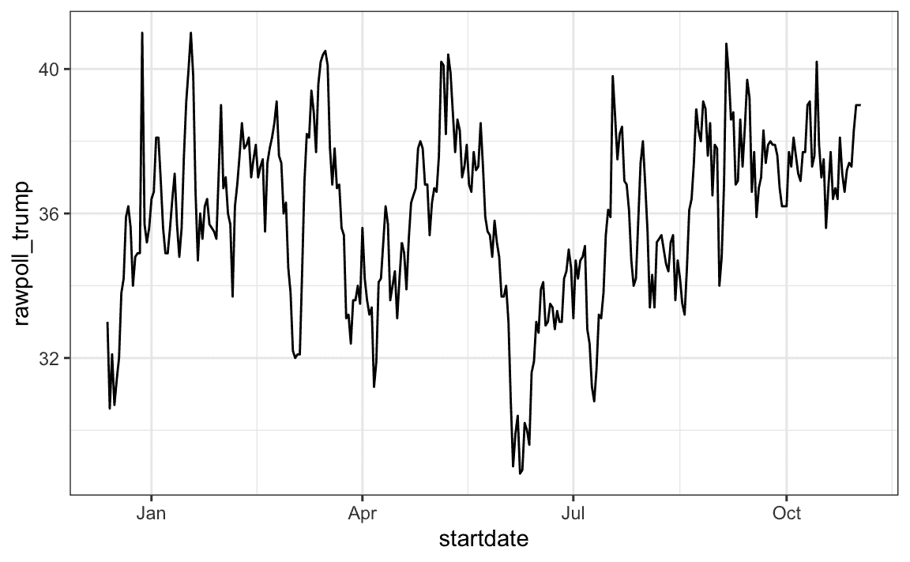
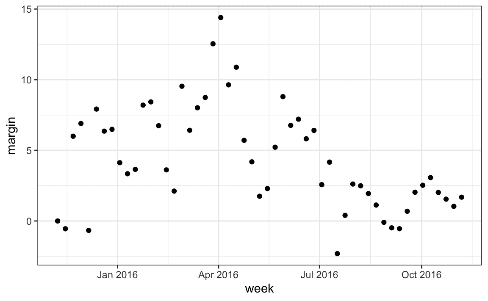

# 13  解析日期和时间

> 原文：[`rafalab.dfci.harvard.edu/dsbook-part-1/wrangling/dates-and-times.html`](https://rafalab.dfci.harvard.edu/dsbook-part-1/wrangling/dates-and-times.html)

1.  数据整理

1.  13  解析日期和时间

我们已经描述了三种主要的向量类型：数值、字符和逻辑。在分析数据时，我们经常遇到日期变量。虽然我们可以用字符串表示日期，例如`2017 年 11 月 2 日`，但一旦我们选择一个参考日，计算机程序员称之为*纪元*，它们就可以通过计算自纪元以来的天数来转换为数字。在 R 和 Unix 中，纪元被定义为 1970 年 1 月 1 日。因此，例如，1970 年 1 月 2 日是第 1 天，1969 年 12 月 31 日是第-1 天，2017 年 11 月 2 日是第 17,204 天。

现在我们如何在 R 中分析数据时表示日期和时间呢？我们本可以使用自纪元以来的天数，但那样几乎无法解释。如果我告诉你今天是 2017 年 11 月 2 日，你会立刻知道这意味着什么。如果我告诉你今天是第 17,204 天，你将会非常困惑。类似的问题也出现在时间上，甚至由于时区的原因可能会出现更多复杂的情况。因此，R 定义了一种专门用于日期和时间的数据类型。

## 13.1 日期数据类型

我们可以在这里看到 R 用于数据的示例数据类型：

```r
library(tidyverse
library(dslabs)
polls_us_election_2016$startdate |> head()
#> [1] "2016-11-03" "2016-11-01" "2016-11-02" "2016-11-04" "2016-11-03"
#> [6] "2016-11-03"
```

日期看起来像字符串，但它们不是：

```r
class(polls_us_election_2016$startdate)
#> [1] "Date"
```

看看当我们将它们转换为数字时会发生什么：

```r
as.numeric(polls_us_election_2016$startdate) |> head()
#> [1] 17108 17106 17107 17109 17108 17108
```

它们将它们转换为自纪元以来的天数。`as.Date`函数可以将字符转换为日期。因此，为了看到纪元是第 0 天，我们可以输入

```r
as.Date("1970-01-01") |> as.numeric()
#> [1] 0
```

绘图函数，如 ggplot 中的函数，了解日期格式。这意味着，例如，散点图可以使用数值表示来决定点的位置，但在标签中包含字符串：

```r
polls_us_election_2016 |> filter(pollster == "Ipsos" & state == "U.S.") |>
 ggplot(aes(startdate, rawpoll_trump)) +
 geom_line()
```

*  *特别注意的是，月份名称被显示出来，这是一个非常方便的功能。

## 13.2 lubridate 包

`lubridate`包提供了处理日期和时间的工具。

```r
library(lubridate
```

我们将随机抽取一些日期样本来展示一些可以做的有用事情：

```r
set.seed(2002)
dates <- sample(polls_us_election_2016$startdate, 10) |> sort()
dates
#>  [1] "2016-05-31" "2016-08-08" "2016-08-19" "2016-09-22" "2016-09-27"
#>  [6] "2016-10-12" "2016-10-24" "2016-10-26" "2016-10-29" "2016-10-30"
```

`year`、`month`和`day`函数提取这些值：

```r
tibble(date = dates, month = month(dates), day = day(dates), year = year(dates))
#> # A tibble: 10 × 4
#>   date       month   day  year
#>   <date>     <dbl> <int> <dbl>
#> 1 2016-05-31     5    31  2016
#> 2 2016-08-08     8     8  2016
#> 3 2016-08-19     8    19  2016
#> 4 2016-09-22     9    22  2016
#> 5 2016-09-27     9    27  2016
#> # ℹ 5 more rows
```

我们还可以提取月份标签：

```r
month(dates, label = TRUE)
```

```r
#>  [1] May Aug Aug Sep Sep Oct Oct Oct Oct Oct
#> 12 Levels: Jan < Feb < Mar < Apr < May < Jun < Jul < Aug < ... < Dec
```

另一组有用的函数是*解析器*，它们将字符串转换为日期。`ymd`函数假设日期格式为 YYYY-MM-DD，并尽可能地进行解析。

```r
x <- c(20090101, "2009-01-02", "2009 01 03", "2009-1-4",
 "2009-1, 5", "Created on 2009 1 6", "200901 !!! 07")
ymd(x)
#> [1] "2009-01-01" "2009-01-02" "2009-01-03" "2009-01-04" "2009-01-05"
#> [6] "2009-01-06" "2009-01-07"
```

进一步复杂化的是，日期通常以不同的格式出现，其中年、月、日的顺序不同。首选的格式是显示年份（四位数字），然后是月份（两位数字），最后是日期，或者称为 ISO 8601 格式。具体来说，我们使用 YYYY-MM-DD 格式，这样如果对字符串进行排序，它将按日期排序。您可以看到`ymd`函数以这种格式返回它们。

但是，如果你遇到像“09/01/02”这样的日期怎么办？这可能是指 2002 年 9 月 1 日、2009 年 1 月 2 日或 2002 年 1 月 9 日。在这些情况下，通过排除法检查整个日期向量将帮助你确定它的格式。一旦你知道了，你就可以使用 **lubridate** 提供的许多解析器。

例如，如果字符串是：

```r
x <- "09/01/02"
```

`ymd` 函数假设第一个条目是年份，第二个是月份，第三个是日期，因此它将其转换为：

```r
ymd(x)
#> [1] "2009-01-02"
```

`mdy` 函数假设第一个条目是月份，然后是日期，最后是年份：

```r
mdy(x)
#> [1] "2002-09-01"
```

lubridate** 包为每个可能性都提供了一个函数。这里还有另一个常见的例子：

```r
dmy(x)
#> [1] "2002-01-09"
```

lubridate** 包在处理时间方面也非常有用。在基础 R 中，你可以通过输入 `Sys.time()` 来获取当前时间。**lubridate** 包提供了一个稍微高级一点的函数 `now`，允许你定义时区：

```r
now()
#> [1] "2025-09-16 20:01:28 EDT"
now("GMT")
#> [1] "2025-09-17 00:01:28 GMT"
```

你可以使用 `OlsonNames()` 函数查看所有可用的时区。

我们还可以提取小时、分钟和秒：

```r
now() |> hour()
#> [1] 20
now() |> minute()
#> [1] 1
now() |> second()
#> [1] 28.1
```

该包还包括将字符串解析为时间的函数以及解析包含日期的时间对象的解析器：

```r
x <- c("12:34:56")
hms(x)
#> [1] "12H 34M 56S"
x <- "Nov/2/2012 12:34:56"
mdy_hms(x)
#> [1] "2012-11-02 12:34:56 UTC"
```

这个包还有许多其他有用的函数。我们在这里描述了其中两个我们认为特别有用的函数。

`make_date` 函数可以用来快速创建日期对象。它可以接受最多七个参数：年、月、日、小时、分钟、秒和时区，默认为 UTC 时间的纪元值。例如，要创建代表 2019 年 7 月 6 日的日期对象，我们写：

```r
make_date(2019, 7, 6)
#> [1] "2019-07-06"
```

要创建一个 80 年代 1 月 1 日的向量，我们写：

```r
make_date(1980:1989)
#>  [1] "1980-01-01" "1981-01-01" "1982-01-01" "1983-01-01" "1984-01-01"
#>  [6] "1985-01-01" "1986-01-01" "1987-01-01" "1988-01-01" "1989-01-01"
```

另一个非常有用的函数是 `round_date`。它可以用来将日期四舍五入到最近的年份、季度、月份、星期、天、小时、分钟或秒。所以如果我们想按年份的星期分组所有民意调查，我们可以这样做：

```r
polls_us_election_2016 |> 
 mutate(week = round_date(startdate, "week")) |>
 group_by(week) |>
 summarize(margin = mean(rawpoll_clinton - rawpoll_trump)) |>
 ggplot(aes(week, margin)) +
 geom_point()
```

*  *最后，你应该知道还有一些有用的函数用于计算时间操作，例如 `difftime`、`time_length` 和 `interval`。

## 13.3 使用 data.table 处理日期和时间

data.table** 包包含与 **lubridate** 相同的一些功能。例如，它包括与 **lubridate** 中相同的 `month` 和 `year` 函数。**lubridate** 的 `day` 等价于 `mday`：

```r
library(data.table)
st <- as.Date("2024-03-04")
day(st)
#> [1] 4
mday(st)
#> [1] 4
```

data.table** 包中还包括其他类似的功能，例如 `second`、`minute`、`hour`、`yday`、`wday`、`week`、`isoweek` 和 `quarter`。

该包还包括 `IDate` 和 `ITime` 类，它们比 `lubridate` 和基础 R 更有效地存储日期和时间。这对于具有日期戳的大文件来说很方便。你可以使用 `as.IDate` 和 `as.ITime` 将日期转换为常规 R 格式。你可以通过使用 `object.size` 函数来查看这一点：

```r
object.size(polls_us_election_2016$startdate)
#> 33936 bytes
object.size](https://rdrr.io/r/utils/object.size.html)([as.IDate(polls_us_election_2016$startdate))
#> 17168 bytes
```

## 13.4 练习

对于这些练习，我们将使用以下数据集：

```r
library(dslabs)
head(pr_death_counts)
```

1. 我们想绘制死亡人数与日期的图表。确认`date`变量实际上是日期而不是字符串。

2. 绘制死亡人数与日期的图表。

3. 这些数据代表了哪个时间段？

4. 注意到 2018 年 5 月 31 日之后，死亡人数都是 0。数据可能尚未输入。我们还看到大约从 5 月 1 日开始有所下降。重新定义`dat`以排除 2018 年 5 月 1 日或之后的观测数据。然后，重新绘制图表。

5. 重复绘制图表，但使用年份中的天数作为 x 轴，而不是日期。

6. 计算每月的每日死亡人数。

7. 显示 7 月和 9 月的每日死亡人数。你注意到了什么？

8. 计算每周的死亡人数并绘制图表。
