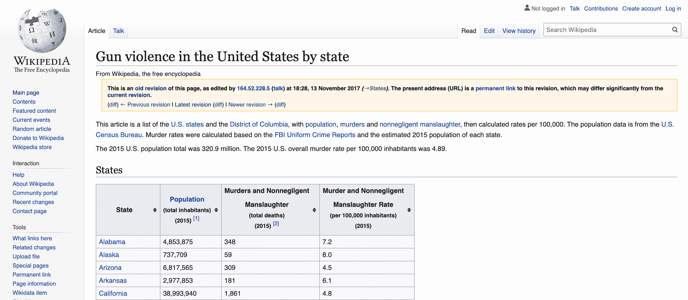
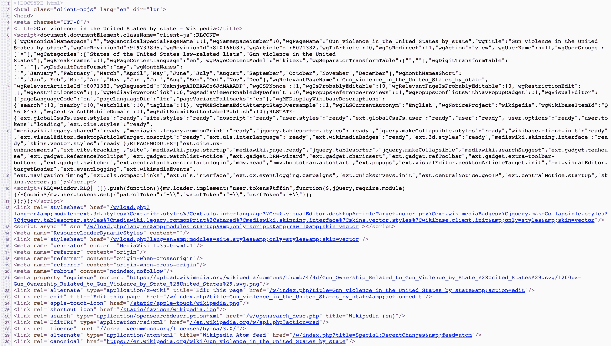

# 15 提取网络数据

> 原文：[`rafalab.dfci.harvard.edu/dsbook-part-1/wrangling/web-scraping.html`](https://rafalab.dfci.harvard.edu/dsbook-part-1/wrangling/web-scraping.html)

1.  数据整理

1.  15 提取网络数据

在当今的数字时代，互联网是一个数据宝库。本章介绍了检索这些数据并为数据分析做准备的方法。我们重点关注两种主要方法：HTML 抓取和 API 集成。HTML 抓取使我们能够以编程方式导航和从网页中提取数据，将 HTML 页面的非结构化内容转换为分析准备好的结构化数据。另一方面，API 提供了对由网络服务提供的数据的直接、高效和结构化访问。本章旨在介绍开始利用互联网庞大数据资源所需的基本知识。

## 15.1 抓取 HTML

我们需要回答问题的数据并不总是以我们可读的电子表格形式存在。例如，我们在 R 基础知识章节中使用的美国谋杀数据集最初来自这个维基百科页面：

```r
url <- paste0("https://en.wikipedia.org/w/index.php?title=",
 "Gun_violence_in_the_United_States_by_state",
 "&direction=prev&oldid=810166167")
```

当您访问网页时，可以看到数据表：



（网页由维基百科提供¹。CC-BY-SA-3.0 许可²。页面部分截图。）

网络抓取*或*网络采集*是我们用来描述从网站中提取数据的过程的术语。我们可以这样做的原因是，浏览器用于渲染网页的信息是以文本文件的形式从服务器接收的。文本是以超文本标记语言（HTML）编写的代码。每个浏览器都有一种显示页面 HTML 源代码的方式，每种方式都不同。在 Chrome 中，您可以在 PC 上使用 Control-U，在 Mac 上使用 command+alt+U。您将看到类似以下内容：



### 15.1.1 HTML

由于此代码是可访问的，我们可以下载 HTML 文件，将其导入 R 中，然后编写程序从页面中提取所需的信息。然而，一旦我们查看 HTML 代码，这可能会显得是一项艰巨的任务。但我们将向您展示一些方便的工具来简化这个过程。为了了解它是如何工作的，以下是来自提供美国谋杀数据维基百科页面的几行代码：

```r
<table class="wikitable sortable">
<tr>
<th>State</th>
<th><a href="/wiki/List_of_U.S._states_and_territories_by_population" 
title="List of U.S. states and territories by population">Population</a><br />
<small>(total inhabitants)</small><br />
<small>(2015)</small> <sup id="cite_ref-1" class="reference">
<a href="#cite_note-1">[1]</a></sup></th>
<th>Murders and Nonnegligent
<p>Manslaughter<br />
<small>(total deaths)</small><br />
<small>(2015)</small> <sup id="cite_ref-2" class="reference">
<a href="#cite_note-2">[2]</a></sup></p>
</th>
<th>Murder and Nonnegligent
<p>Manslaughter Rate<br />
<small>(per 100,000 inhabitants)</small><br />
<small>(2015)</small></p>
</th>
</tr>
<tr>
<td><a href="/wiki/Alabama" title="Alabama">Alabama</a></td>
<td>4,853,875</td>
<td>348</td>
<td>7.2</td>
</tr>
<tr>
<td><a href="/wiki/Alaska" title="Alaska">Alaska</a></td>
<td>737,709</td>
<td>59</td>
<td>8.0</td>
</tr>
<tr>
```

您实际上可以看到数据，但数据值被 HTML 代码如`<td>`包围。我们还可以看到其存储的模式。如果您了解 HTML，您可以编写利用这些模式提取所需内容的程序。我们还利用了一种广泛用于使网页看起来“漂亮”的语言，称为层叠样式表（CSS）。我们将在第 15.1.3 节中详细介绍这一点。

虽然我们提供了无需了解 HTML 即可抓取数据的工具，但学习一些 HTML 和 CSS 仍然很有用。这不仅能够提高你的抓取技能，而且如果你正在创建一个展示你工作的网页，这可能会派上用场。有很多在线课程和教程可以帮助你学习这些。两个例子是 Codeacademy³ 和 W3schools⁴。

### 15.1.2 rvest 包

tidyverse** 提供了一个名为 **rvest** 的网络抓取包。使用此包的第一步是将网页导入 R。该包使这一过程变得非常简单：

```r
library(tidyverse
library(rvest)
h <- read_html(url)
```

请注意，现在整个美国维基百科上的“谋杀案”网页现在都包含在 `h` 中。这个对象的类是：

```r
class(h)
#> [1] "xml_document" "xml_node"
```

实际上，**rvest** 包更加通用；它处理 XML 文档。XML 是一种通用标记语言（ML 代表的就是这个），可以用来表示任何类型的数据。HTML 是 XML 的一种特定类型，专门为表示网页而开发。在这里，我们专注于 HTML 文档。

现在，我们如何从对象 `h` 中提取表格？如果你打印 `h`，我们会看到一些不太有用的对象信息。我们可以使用 `html_text` 函数查看下载的网页的所有代码，如下所示：

```r
html_text(h)
```

我们在这里不展示输出，因为它包含了数千个字符。但如果我们查看它，我们可以看到我们想要的数据都存储在一个 HTML 表格中：你可以在上面的 HTML 代码的这一行中看到 `<table class="wikitable sortable">`。HTML 文档的不同部分，通常用 `<` 和 `>` 之间的消息定义，被称为 *节点*。**rvest** 包包含用于提取 HTML 文档节点的函数：`html_nodes` 提取所有不同类型的节点，`html_node` 提取第一个节点。要从 HTML 代码中提取表格，我们使用：

```r
tab <- h |> html_nodes("table")
```

现在，我们不再拥有整个网页，而是只有页面中表格的 HTML 代码：

```r
tab
#> {xml_nodeset (2)}
#> [1] <table class="wikitable sortable"><tbody>\n<tr>\n<th>State\n</th> ...
#> [2] <table class="nowraplinks hlist mw-collapsible mw-collapsed navbo ...
```

我们感兴趣的表格是第一个：

```r
tab[[1]]
#> {html_node}
#> <table class="wikitable sortable">
#> [1] <tbody>\n<tr>\n<th>State\n</th>\n<th>\n<a href="/wiki/List_of_U.S ...
```

这显然不是一个整洁的数据集，甚至不是一个数据框。在上面的代码中，你可以肯定地看到一个模式，编写代码来提取数据是完全可以实现的。事实上，**rvest** 包包含一个专门用于将 HTML 表格转换为数据框的函数：

```r
tab <- tab[1]] |> [html_table()
class(tab)
#> [1] "tbl_df"     "tbl"        "data.frame"
```

我们现在已经非常接近拥有一个可用的数据表了：

```r
tab <- tab |> setNames(c("state", "population", "total", "murder_rate")) 
head(tab)
#> # A tibble: 6 × 4
#>   state      population total murder_rate
#>   <chr>      <chr>      <chr>       <dbl>
#> 1 Alabama    4,853,875  348           7.2
#> 2 Alaska     737,709    59            8 
#> 3 Arizona    6,817,565  309           4.5
#> 4 Arkansas   2,977,853  181           6.1
#> 5 California 38,993,940 1,861         4.8
#> # ℹ 1 more row
```

我们仍然需要进行一些整理。例如，我们需要删除逗号并将字符转换为数字。在继续之前，我们将学习一种更通用的从网站提取信息的方法。

### 15.1.3 CSS 选择器

使用最基本 HTML 制作的网页默认外观相当不吸引人。我们今天看到的令人愉悦的页面是使用 CSS 来定义网页的外观和样式制作的。公司所有页面都有相同风格的事实通常是由于它们使用相同的 CSS 文件来定义样式。这些 CSS 文件的一般工作方式是定义网页每个元素的外观。例如，标题、标题、项目符号列表、表格和链接等，每个元素都拥有自己的样式，包括字体、颜色、大小和与边距的距离。CSS 通过利用定义这些元素的模式来实现这一点，这些模式被称为 *选择器*。上面我们使用的这样一个模式示例是 `table`，但还有许多许多其他的模式。

如果我们想从网页中抓取数据，并且恰好知道包含这些数据的页面部分所特有的选择器，我们可以使用 `html_nodes` 函数。然而，知道哪个选择器可能相当复杂。实际上，随着网页变得越来越复杂，网页的复杂性也在不断增加。对于一些更高级的网页，似乎几乎不可能找到定义特定数据的节点。然而，选择器工具实际上使这成为可能。

SelectorGadget⁵ 是一款软件，允许你交互式地确定你需要从网页中提取特定组件的 CSS 选择器。如果你计划从 HTML 页面中抓取除表格以外的数据，我们强烈建议你安装它。有一个可用的 Chrome 扩展程序，允许你开启这个工具，然后当你点击页面时，它会突出显示部分内容并显示你需要提取这些部分的选择器。包括 **rvest** 作者 Hadley Wickham 的示例⁶ 和基于示例的其他教程⁷ 在内，有许多演示如何进行这项操作。

## 15.2 JSON

在互联网上共享数据变得越来越普遍。不幸的是，提供者使用不同的格式，这使得数据分析师将数据整理到 R 中变得更加困难。然而，也有一些标准正在变得越来越普遍。目前，一个被广泛采用的格式是 JavaScript 对象表示法或 JSON。因为这个格式非常通用，它不像电子表格。这个 JSON 文件看起来更像是你用来定义列表的代码。以下是一个存储在 JSON 格式的信息示例：

```r
#> [
#>   {
#>     "name": "Miguel",
#>     "student_id": 1,
#>     "exam_1": 85,
#>     "exam_2": 86
#>   },
#>   {
#>     "name": "Sofia",
#>     "student_id": 2,
#>     "exam_1": 94,
#>     "exam_2": 93
#>   },
#>   {
#>     "name": "Aya",
#>     "student_id": 3,
#>     "exam_1": 87,
#>     "exam_2": 88
#>   },
#>   {
#>     "name": "Cheng",
#>     "student_id": 4,
#>     "exam_1": 90,
#>     "exam_2": 91
#>   }
#> ]
```

上面的文件实际上代表一个数据框。要读取它，我们可以使用 **jsonlite** 包中的 `fromJSON` 函数。请注意，JSON 文件通常通过互联网提供。一些组织提供 JSON API 或网络服务，你可以直接连接到它们并获取数据。以下是一个提供诺贝尔奖获得者信息的示例：

```r
library(jsonlite)
nobel <- fromJSON("http://api.nobelprize.org/v1/prize.json")
```

这下载了一个列表。第一个参数，名为“prizes”的表格包含了关于诺贝尔奖获得者信息。每一行对应一个特定的年份和类别。“laureates”列包含一个数据框列表，每个获奖者都有一个包含 id、firstname、surname 和 motivation 列的数据框。

```r
nobel$prizes |>
 filter(category == "literature" & year == "1971") |> 
 pull(laureates) |>
 first() |>
 select(id, firstname, surname)
#>    id firstname surname
#> 1 645     Pablo  Neruda
```

您可以通过检查 **jsonlite** 包的教程和帮助文件来了解更多信息。此包旨在处理相对简单的任务，例如将数据转换为表格。为了获得更多灵活性，我们推荐使用 **rjson** 包。

## 15.3 数据 API

应用程序编程接口（API）是一套规则和协议，允许不同的软件实体之间进行通信。它定义了软件组件在请求和交换信息时应使用的方法和数据格式。API 在实现当今软件如此互联和多功能性方面发挥着至关重要的作用。

### 15.3.1 API 类型和概念

有几种类型的 API。与获取数据相关的主要类型包括：

+   **Web 服务** - 通常使用 HTTP/HTTPS 等协议构建。通常用于使应用程序能够通过网络相互通信。例如，智能手机上的天气应用程序可能使用 Web API 从远程服务器请求天气数据。

+   **数据库 API** - 允许应用程序与数据库之间进行通信，例如基于 SQL 的调用。

与 API 相关的一些关键概念：

+   **端点**：通过 API 可用的特定功能。对于 Web API，端点通常是 API 可以访问的特定 URL。

+   **方法**：可以执行的操作。在 Web API 中，这些通常对应于 HTTP 方法，如 GET、POST、PUT 或 DELETE。

+   **请求和响应**：请求 API 执行其功能的行为是 *请求*。它返回的数据是 *响应*。

+   **速率限制**：限制您调用 API 的频率，通常用于防止滥用或服务过载。

+   **身份验证和授权**：确保只有经过批准的用户或应用程序才能使用 API 的机制。常见的方法包括 *API 密钥*、*OAuth* 或 *JSON Web Tokens* (JWT)。

+   **数据格式**：许多 Web API 以特定的格式交换数据，通常是 JSON 或 CSV。

现在描述一下**httr2**包，它促进了 R 与 HTTP Web 服务之间的交互。

### 15.3.2 httr2 包

HTTP 是通过互联网进行数据共享最广泛使用的协议。**httr2** 包提供了处理 HTTP 请求的函数。该包中的一个核心函数是 `request`，用于向 Web 服务发送请求。`req_perform` 函数用于发送请求。

这个 `request` 函数向指定的 URL 发送一个 HTTP GET 请求。通常，HTTP GET 请求用于根据提供的 URL 从服务器检索信息。

函数返回一个类为 `response` 的对象。该对象包含服务器响应的所有详细信息，包括状态码、头信息和内容。然后你可以使用其他 **httr2** 函数从该响应中提取或解释信息。

假设你想从 CDC 获取按州划分的 COVID-19 死亡数据。通过访问他们的数据目录⁸，你可以搜索数据集并发现数据是通过以下 API 提供的：

```r
url <- "https://data.cdc.gov/resource/muzy-jte6.csv"
```

然后我们可以创建并执行如下请求：

```r
library(httr2
response <- request(url) |> req_perform()
```

我们可以通过查看返回的对象来查看请求的结果。

```r
response
#> <httr2_response>
#> GET https://data.cdc.gov/resource/muzy-jte6.csv
#> Status: 200 OK
#> Content-Type: text/csv
#> Body: In memory (210922 bytes)
```

为了提取主体，即数据所在的位置，我们可以使用 `resp_body_string` 并将结果，一个以逗号分隔的字符串，发送到 `read_csv`

```r
library(readr
tab <- response |> resp_body_string()
```

我们注意到返回的对象只有 1000 条记录。API 通常限制你可以下载的数据量。该 API 的文档⁹ 解释说我们可以通过 `$limit` 参数来更改这个限制。我们可以使用 `req_url_query` 将其添加到我们的请求中：

```r
response <- request(url) |> 
 req_url_query(`$limit` = 100000) |>
 req_perform() 
```

CDC 服务以 csv 格式返回数据，但由网络服务更常使用的格式是 JSON。CDC 还通过以下 URL 提供了 json 格式的数据：

```r
url <- "https://data.cdc.gov/resource/muzy-jte6.json"
```

为了提取数据表，我们使用来自 **jsonlite** 包的 `fromJSON` 函数。

```r
tab <- request(url) |> 
 req_perform() |> 
 resp_body_string() |> 
 fromJSON(flatten = TRUE)
```

在处理 API 时，检查 API 的文档以了解速率限制、所需头信息或认证方法是非常重要的。`httr2` 包提供了处理这些要求的工具，例如设置头信息或认证参数。

## 15.4 练习

1. 访问以下网页：[`web.archive.org/web/20181024132313/http://www.stevetheump.com/Payrolls.htm`](https://web.archive.org/web/20181024132313/http://www.stevetheump.com/Payrolls.htm)

注意有几个表格。假设我们感兴趣的是比较跨年度的团队薪资。接下来的几个练习将引导我们完成这一步骤。

首先应用你所学到的知识，将网站内容读入一个名为 `h` 的对象中。

2. 注意，尽管不太有用，我们实际上可以通过输入以下内容来查看页面内容：

```r
html_text(h)
```

下一步是提取表格。为此，我们可以使用 `html_nodes` 函数。我们了解到 HTML 中的表格与 `table` 节点相关联。使用 `html_nodes` 函数提取所有表格。将其存储在对象 `nodes` 中。

3. `html_nodes` 函数返回一个类为 `xml_node` 的对象列表。我们可以使用例如 `html_text` 函数来查看每个对象的内容。例如，你可以这样查看任意选择组件的内容：

```r
html_text(nodes[[8]])
```

如果该对象的内容是 HTML 表格，我们可以使用 `html_table` 函数将其转换为数据框。使用 `html_table` 函数将 `nodes` 的第 8 个条目转换为表格。

4. 对 `nodes` 的前 4 个组件重复上述操作。以下哪些是薪资表：

1.  所有这些。

1.  1

1.  2

1.  2-4

5. 对 `nodes` 的最后 3 个组件重复上述操作。以下哪个说法是正确的：

1.  `nodes`中的最后一条记录显示的是所有团队随时间推移的平均值，而不是每个团队的工资总额。

1.  所有这三个都是每个团队的工资表。

1.  所有这三者都像第一条记录一样，不是工资表。

1.  所有上述内容。

6. 我们已经了解到`nodes`的第一个和最后一个条目不是工资表。重新定义`nodes`，以便删除这两个条目。

7. 在前面的分析中，我们看到第一个表格节点实际上不是一个表格。这在 HTML 中有时会发生，因为表格被用来使文本看起来有特定的样子，而不是存储数值。移除第一个组件，然后使用`sapply`和`html_table`将`nodes`中的每个节点转换为表格。请注意，在这种情况下，`sapply`将返回一个表格列表。你也可以使用`lapply`来确保列表被应用。

8. 查看生成的表格。它们是否都相同？我们能否只用`bind_rows`将它们连接起来？

9. 创建两个表格，命名为`tab_1`和`tab_2`，使用`nodes`中的第 10 个和第 19 个表格。

10. 使用`full_join`函数合并这两个表格。在这样做之前，你必须解决缺失标题的问题。你还需要确保名称匹配。

11. 在连接表格后，你看到几个`NA`。这是因为一些队伍在一个表格中，而在另一个表格中则没有。使用`anti_join`函数来更好地了解这是为什么。

12. 我们可以看到，问题之一是洋基队被列为*N.Y. Yankees*和*NY Yankees*。在下一节中，我们将学习解决此类问题的有效方法。在这里，我们可以手动这样做如下：

```r
tab_1 <- tab_1 |>
 mutate(Team = ifelse(Team == "N.Y. Yankees", "NY Yankees", Team))
```

现在将表格连接起来，只显示奥克兰和洋基队以及工资列。

13. 高级：从 IMDB¹⁰中提取获得最佳影片奖的电影的标题。

* * *

1. [`en.wikipedia.org/w/index.php?title=Gun_violence_in_the_United_States_by_state&direction=prev&oldid=810166167`](https://en.wikipedia.org/w/index.php?title=Gun_violence_in_the_United_States_by_state&direction=prev&oldid=810166167)↩︎

1.  [`en.wikipedia.org/wiki/Wikipedia:Text_of_Creative_Commons_Attribution-ShareAlike_3.0_Unported_License`](https://en.wikipedia.org/wiki/Wikipedia:Text_of_Creative_Commons_Attribution-ShareAlike_3.0_Unported_License)↩︎

1.  [`www.codecademy.com/learn/learn-html`](https://www.codecademy.com/learn/learn-html)↩︎

1.  [`www.w3schools.com/`](https://www.w3schools.com/)↩︎

1.  [`selectorgadget.com/`](http://selectorgadget.com/)↩︎

1.  `rvest.tidyverse.org/articles/selectorgadget.html`↩︎

1.  [`www.analyticsvidhya.com/blog/2017/03/beginners-guide-on-web-scraping-in-r-using-rvest-with-hands-on-knowledge/`](https://www.analyticsvidhya.com/blog/2017/03/beginners-guide-on-web-scraping-in-r-using-rvest-with-hands-on-knowledge/)↩︎

1.  [`data.cdc.gov`](https://data.cdc.gov)↩︎

1.  [`dev.socrata.com/docs/queries/`](https://dev.socrata.com/docs/queries/)↩︎

1.  [`m.imdb.com/chart/bestpicture/`](https://m.imdb.com/chart/bestpicture/)↩︎
