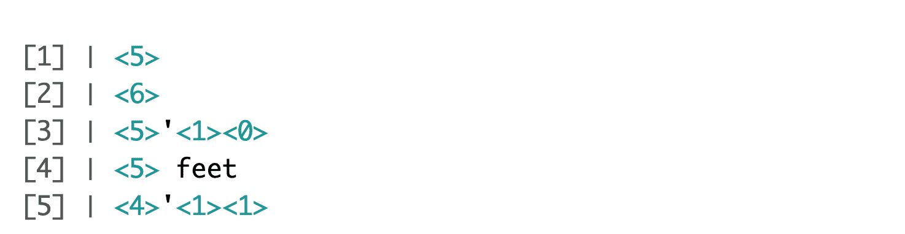
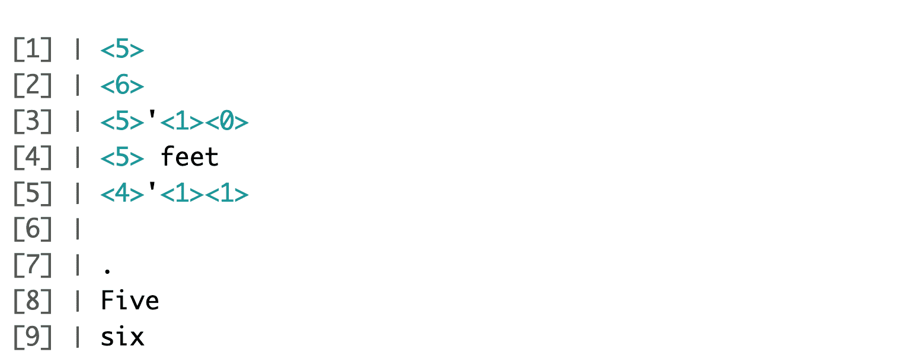
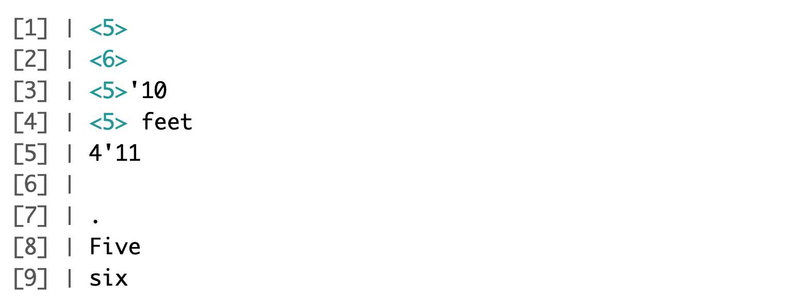
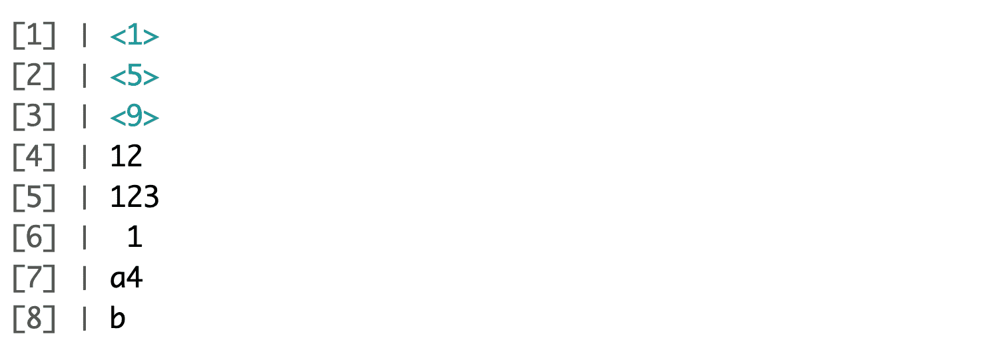
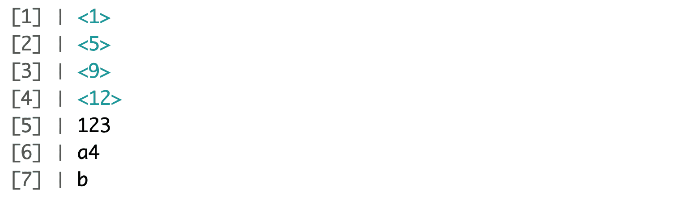
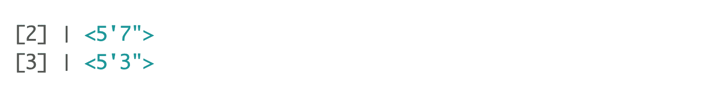
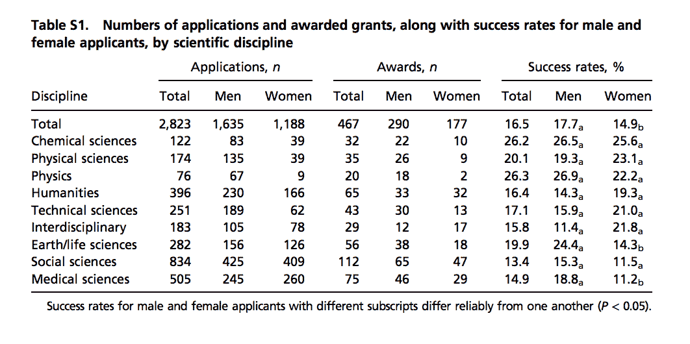
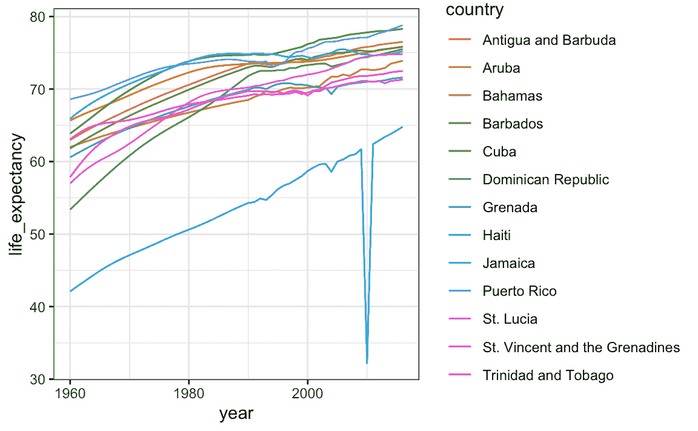
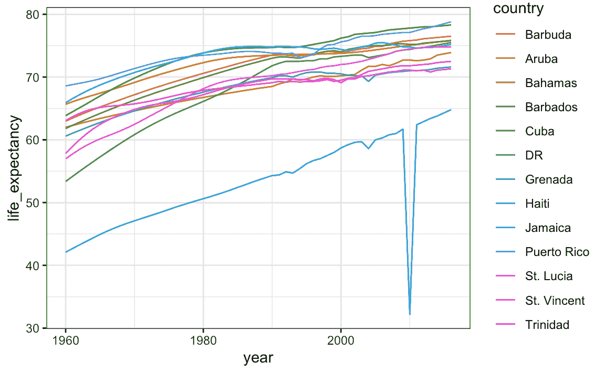

# 16 字符串处理

> 原文：[`rafalab.dfci.harvard.edu/dsbook-part-1/wrangling/string-processing.html`](https://rafalab.dfci.harvard.edu/dsbook-part-1/wrangling/string-processing.html)

1.  数据整理

1.  16 字符串处理

最常见的数据整理挑战之一涉及从字符字符串中提取数值数据，并将它们转换为 R 中制作图表、计算摘要或拟合模型所需的数值表示。同样常见的是将无组织文本处理成有意义的变量名或分类变量。数据科学家面临的大多数字符串处理挑战都是独特的，并且往往出乎意料。因此，撰写一个关于这个主题的全面章节是非常雄心勃勃的。在这里，我们使用一系列案例研究来帮助我们展示字符串处理是如何成为许多数据整理挑战的必要步骤。具体来说，我们描述了将我们从原始数据中提取的`murders`、`heights`和`research_funding_rates`示例转换成我们在本书中研究的数据框的过程。

通过研究这些案例研究，我们将涵盖字符串处理中最常见的任务，包括从字符串中提取数字、从文本中删除不需要的字符、查找和替换字符、提取字符串的特定部分、将自由文本转换为更统一的格式，以及将字符串拆分为多个值。

基础 R 包括执行许多这些任务的功能。**stringi**包在基础 R 中提供了额外的功能，特别是对于复杂和多样化的文本处理需求。**stringr**包为**stringi**包提供了一致、简单且用户友好的包装。例如，在**stringr**中，所有的字符串处理函数都以`str_`开头。这意味着如果你输入`str_`然后按 Tab 键，R 会自动完成并显示所有可用的函数。因此，我们不一定需要记住所有的函数名称。另一个优点是，在这个包中的函数中，被处理的字符串总是第一个参数，这意味着我们可以更轻松地使用管道。因此，我们将首先描述如何使用**stringr**包中的函数。

大多数示例将来自第二个案例研究，该研究涉及学生自我报告的身高，而本章的大部分内容都致力于学习**stringr**包中的正则表达式（regex）和函数。

## 16.1 stringr 包

```r
library(tidyverse
library(stringr
```

一般来说，字符串处理任务可以分为在字符串中**检测**、**定位**、**提取**或**替换**模式。我们将看到几个示例。下表包括了**stringr**包中可用的函数。我们按任务将它们分开。我们还包括了当可用时的基础 R 的等效函数。

所有这些函数都将字符向量作为第一个参数。此外，对于每个函数，操作都是向量化的：操作应用于向量中的每个字符串。

最后，我们在表中提到了 *组*。这些将在第 16.4.9 节中解释。

| stringr | 任务 | 描述 | 基础 R |
| --- | --- | --- | --- |
| `str_detect` | 检测 | 字符串中是否存在模式？ | `grepl` |
| `str_which` | 检测 | 返回包含模式的条目的索引。 | `grep` |
| `str_subset` | 检测 | 返回包含模式的字符串子集。 | `grep` 与 `value = TRUE` |
| `str_locate` | 定位 | 返回模式在字符串中第一次出现的位置。 | `regexpr` |
| `str_locate_all` | 定位 | 返回模式在字符串中所有出现的位置。 | `gregexpr` |
| `str_view` | 定位 | 显示与模式匹配的字符串的第一部分。 |  |
| `str_view_all` | 定位 | 显示与模式匹配的字符串的所有部分。 |  |
| `str_extract` | 提取 | 提取与模式匹配的字符串的第一部分。 |  |
| `str_extract_all` | 提取 | 提取与模式匹配的字符串的所有部分。 |  |
| `str_match` | 提取 | 提取与模式匹配的字符串的第一部分以及由模式定义的组。 |  |
| `str_match_all` | 提取 | 提取与模式匹配的字符串的所有部分以及由模式定义的组。 |  |
| `str_sub` | 提取 | 提取子字符串。 | `substring` |
| `str_split` | 提取 | 将字符串分割成由模式分隔的部分组成的列表。 | `strsplit` |
| `str_split_fixed` | 提取 | 将字符串分割成由模式分隔的固定数量的部分组成的矩阵。 | `strsplit` 与 `fixed = TRUE` |
| `str_count` | 描述 | 计算模式在字符串中出现的次数。 |  |
| `str_length` | 描述 | 字符串中的字符数。 | `nchar` |
| `str_replace` | 替换 | 将匹配模式的字符串的第一部分替换为另一个字符串。 |  |
| `str_replace_all` | 替换 | 将匹配模式的字符串部分替换为另一个字符串。 | `gsub` |
| `str_to_upper` | 替换 | 将所有字符转换为大写。 | `toupper` |
| `str_to_lower` | 替换 | 将所有字符转换为小写。 | `tolower` |
| `str_to_title` | 替换 | 将每个单词的首字母转换为大写，其余字母转换为小写。 |  |
| `str_replace_na` | 替换 | 将所有 `NA` 替换为新的值。 |  |
| `str_trim` | 替换 | 从字符串的开始和结束处移除空白字符。 |  |
| `str_c` | 操作 | 连接多个字符串。 | `paste0` |
| `str_conv` | 操作 | 更改字符串的编码。 |  |
| `str_sort` | 操作 | 按字母顺序排序向量。 | `sort` |
| `str_order` | 操作 | 提供排序向量所需的索引，按字母顺序排序。 | `order` |
| `str_trunc` | 操作 | 截断字符串到固定大小。 |  |
| `str_pad` | 操作 | 向字符串添加空白以使其成为固定大小。 |  |
| `str_dup` | 操作 | 重复字符串。 | `rep`然后`paste` |
| `str_wrap` | 操作 | 将内容包装成格式化的段落。 |  |

| `str_interp` | 操作 | 字符串插值。 | `sprintf` |

## 案例研究 1：自我报告的身高

`dslabs`包包括了从其中获得身高数据集的原始数据。你可以这样加载它：

```r
library(dslabs)
head(reported_heights)
#>            time_stamp    sex height
#> 1 2014-09-02 13:40:36   Male     75
#> 2 2014-09-02 13:46:59   Male     70
#> 3 2014-09-02 13:59:20   Male     68
#> 4 2014-09-02 14:51:53   Male     74
#> 5 2014-09-02 15:16:15   Male     61
#> 6 2014-09-02 15:16:16 Female     65
```

这些高度是通过一个网页表单获得的，学生们被要求输入他们的身高。他们可以输入任何内容，但说明要求输入以英寸为单位的*高度*，一个数字。我们收集了 1,095 份提交，但不幸的是，包含报告的身高列中有几个非数字条目，因此变成了字符向量：

```r
class(reported_heights$height)
#> [1] "character"
```

如果我们尝试将其解析为数字，我们会得到一个警告：

```r
x <- as.numeric(reported_heights$height)
#> Warning: NAs introduced by coercion
```

尽管大多数值看起来像是按照要求输入的英寸高度，但我们最终还是有许多`NA`：

```r
sum(is.na(x))
#> [1] 81
```

以下是未能成功转换的一些条目：

```r
reported_heights |> 
 mutate(new_height = as.numeric(height)) |>
 filter(is.na(new_height)) |> 
 head(n = 10)
#>             time_stamp    sex                 height new_height
#> 1  2014-09-02 15:16:28   Male                  5' 4"         NA
#> 2  2014-09-02 15:16:37 Female                  165cm         NA
#> 3  2014-09-02 15:16:52   Male                    5'7         NA
#> 4  2014-09-02 15:16:56   Male                  >9000         NA
#> 5  2014-09-02 15:16:56   Male                   5'7"         NA
#> 6  2014-09-02 15:17:09 Female                   5'3"         NA
#> 7  2014-09-02 15:18:00   Male 5 feet and 8.11 inches         NA
#> 8  2014-09-02 15:19:48   Male                   5'11         NA
#> 9  2014-09-04 00:46:45   Male                  5'9''         NA
#> 10 2014-09-04 10:29:44   Male                 5'10''         NA
```

我们立即看到了发生了什么。一些学生没有按照要求报告他们的身高。我们可以丢弃这些数据并继续。然而，许多条目遵循的模式，在原则上，我们可以轻松地将它们转换为英寸。例如，在上面的输出中，我们看到各种使用格式`x'y"`或`x'y''`的案例，其中`x`和`y`分别代表英尺和英寸。这些案例中的每一个都可以由人类读取并转换为英寸，例如`5'4"`是`5*12 + 4 = 64`。因此，我们可以手动修复所有有问题的条目。然而，人类容易犯错，所以自动方法更可取。此外，因为我们计划继续收集数据，所以编写自动纠正错误输入的代码将很方便。

在这类任务中，第一步是调查有问题的条目，并尝试定义大量条目遵循的特定模式。这些组越大，我们就能用单一程序方法修复更多的条目。我们希望找到可以用规则准确描述的模式，例如“一个数字，后面跟着英尺符号，然后是一个或两个数字，最后跟着英寸符号”。

为了寻找这样的模式，删除与英寸一致且只查看有问题的条目是有帮助的。因此，我们编写了一个函数来自动完成这项工作。我们保留那些在应用`as.numeric`时产生`NA`或超出合理身高范围的数据条目。我们允许一个范围，该范围覆盖了大约 99.9999%的成年人口。我们还使用`suppressWarnings`来避免我们知道`as.numeric`会给出的警告信息。

我们应用这个函数，并找到有问题的条目数量：

```r
problems <- reported_heights |> 
 mutate(inches = suppressWarnings(as.numeric(height))) |>
 filter(is.na(inches) | inches < 50 | inches > 84) |>
 pull(height)
length(problems)
#> [1] 292
```

现在我们可以通过简单地打印它们来查看所有案例。如果我们这样做，我们会看到可以使用三种模式来定义这些异常中的三个大型组。

1. 形式为`x'y`或`x' y''`或`x'y"`的模式，其中`x`和`y`分别代表英尺和英寸。以下有十个例子：

```r
#> 5' 4" 5'7 5'7" 5'3" 5'11 5'9'' 5'10'' 5' 10 5'5" 5'2"
```

2. 形式为`x.y`或`x,y`的模式，其中`x`代表英尺，`y`代表英寸。以下有十个例子：

```r
#> 5.3 5.5 6.5 5.8 5.6 5,3 5.9 6,8 5.5 6.2
```

3. 报告的条目是以厘米而不是英寸为单位。以下有十个例子：

```r
#> 150 175 177 178 163 175 178 165 165 180
```

一旦我们看到这些大组遵循特定的模式，我们就可以制定一个行动计划。

1.  将符合前两种模式的条目转换为一种标准化的形式。

1.  利用标准化来提取英尺和英寸，并将它们转换为英寸。

1.  定义一个程序来识别以厘米为单位的条目并将它们转换为英寸。

1.  再次检查哪些条目没有被修复，看看我们是否可以调整我们的方法使其更全面。

最后，我们希望有一个脚本，使基于网络的收集方法对最常见的用户错误具有鲁棒性。

记住，完成这些任务通常没有唯一的方法。我们在这里选择了一种帮助我们教授几个有用技术的方法。但肯定还有更有效的方法来完成这项任务。

为了实现我们的目标，我们将使用一种技术，使我们能够准确地检测模式并提取我们想要的各个部分：*正则表达式*（regex）。但首先，我们简要描述如何*转义*某些字符的功能，以便它们可以包含在字符串中。

## 16.3 转义

在 R 中定义字符串，我们可以使用双引号或单引号：

```r
s <- "Hello!"
s <- 'Hello!' 
```

确保你选择正确的单引号，而不是反引号`` ` ``。

现在，如果我们想定义的字符串中包含双引号会怎样？例如，如果我们想写成 10 英寸这样`10"`？在这种情况下，你不能使用：

```r
s <- "10""
```

因为这只是字符串`10`后面跟着一个双引号。如果你在 R 中输入这个，你会得到一个错误，因为你没有关闭双引号。为了避免这种情况，我们可以使用单引号：

```r
s <- '10"'
```

如果我们打印出`s`，我们会看到双引号被反斜杠`\`转义了。

```r
s
#> [1] "10\""
```

实际上，使用反斜杠转义提供了一种在仍然使用双引号定义字符串的同时定义字符串的方法：

```r
s <- "10\""
```

在 R 中，`cat`函数让我们看到字符串实际上看起来是什么样子：

```r
cat(s)
#> 10"
```

现在，如果我们想我们的字符串是 5 英尺，写成这样`5'`？在这种情况下，我们可以使用双引号或转义单引号

```r
s <- "5'"
s <- '5\''
```

所以我们已经学会了如何分别写出 5 英尺和 10 英寸，但如果我们想将它们一起写出来，表示*5 英尺和 10 英寸*，写成这样`5'10"`？在这种情况下，单引号和双引号都不起作用，因为`'5'10"'`在 5 之后关闭了字符串，而`"5'10""`在 10 之后关闭了字符串。记住，如果我们将上述代码片段之一输入 R，它将卡住等待你关闭开头的引号，你将不得不使用*esc*按钮退出执行。

为了达到预期的结果，我们需要用反斜杠`\`转义两个引号。你可以转义任何可能被误认为是关闭引号的字符。这两个选项是：

```r
s <- '5\'10"'
s <- "5'10\""
```

在处理字符串时，转义字符是经常需要使用的东西。另一个经常需要转义的字符是反斜杠字符本身。我们可以用`\\`来做到这一点。当使用正则表达式时，下一节的主题，我们经常需要转义这种方法中使用的*特殊字符*。

## 16.4 正则表达式

正则表达式（regex）是描述文本中特定字符模式的一种方式。它们可以用来确定给定的字符串是否与该模式匹配。已经定义了一套规则来高效且精确地完成这项任务，以下是一些示例。我们可以通过阅读详细的教程¹ ² 来了解更多关于这些规则的信息。RStudio 的**stringr**和正则表达式速查表³也非常有用。

传递给**stringr**函数的模式可以是正则表达式，而不是标准字符串。我们将通过一系列示例来了解这是如何工作的。

在本节中，你会看到我们创建字符串来测试我们的正则表达式。为此，我们定义了我们知道应该匹配的图案和我们也知道不应该匹配的图案。我们将分别称它们为`yes`和`no`。这允许我们检查两种类型的错误：匹配失败和错误匹配。

### 16.4.1 字符串是正则表达式

从技术上讲，任何字符串都是正则表达式，可能最简单的例子是一个单个字符。所以下一个代码示例中使用的逗号`,`就是一个简单的正则表达式搜索示例。

```r
pattern <- ","
str_detect](https://stringr.tidyverse.org/reference/str_detect.html)([c("1", "10", "100", "1,000", "10,000"), pattern) 
#> [1] FALSE FALSE FALSE  TRUE  TRUE
```

在上面，我们提到一个条目包含了`cm`。这也是一个简单的正则表达式示例。我们可以这样显示所有使用了`cm`的条目：

```r
str_subset(reported_heights$height, "cm")
#> [1] "165cm"  "170 cm"
```

### 16.4.2 特殊字符

现在让我们考虑一个稍微复杂一点的例子。以下哪个字符串包含模式`cm`或`inches`？

```r
yes <- c("180 cm", "70 inches")
no <- c("180", "70''")
s <- c(yes, no)
```

我们可以通过两次搜索来完成这个操作：

```r
str_detect(s, "cm") | str_detect(s, "inches")
#> [1]  TRUE  TRUE FALSE FALSE
```

然而，我们不需要这样做。正则表达式*语言*与普通字符串的主要区别在于我们可以使用特殊字符。这些字符具有特定的意义。我们首先介绍`|`，它表示*或*。所以如果我们想知道`cm`或`inches`是否出现在字符串中，我们可以使用正则表达式`cm|inches`：

```r
str_detect(s, "cm|inches")
#> [1]  TRUE  TRUE FALSE FALSE
```

并得到正确答案。

另一个有用的特殊字符是`\d`，它表示任何数字：0，1，2，3，4，5，6，7，8，9。反斜杠用于将其与字符`d`区分开来。在 R 中，我们必须*转义*反斜杠`\`，所以我们实际上必须使用`\\d`来表示数字。以下是一个示例：

```r
yes <- c("5", "6", "5'10", "5 feet", "4'11")
no <- c("", ".", "Five", "six")
s <- c(yes, no)
pattern <- "\\d"
str_detect(s, pattern)
#> [1]  TRUE  TRUE  TRUE  TRUE  TRUE FALSE FALSE FALSE FALSE
```

我们借此机会介绍`str_view`函数，它在故障排除中非常有用，因为它显示了每个匹配字符串的所有匹配项。每个匹配项都被`<`和`>`字符包围。下面，我们可以看到`5`有一个匹配项，而`5'10`有三个匹配项。

```r
str_view(s, pattern)
```



要查看所有字符串，即使没有匹配，我们也可以使用`match = NA`参数。

```r
str_view(s, pattern, match = NA)
```



另一个有用的特殊字符是 `\w`，它代表*单词字符*，可以匹配任何字母、数字或下划线。

还有许多其他的特殊字符。我们将在下面学习一些，但你可以看到大多数或所有这些都在之前提到的作弊单⁴中。

### 16.4.3 字符类

字符类用于定义可以匹配的一系列字符。我们使用方括号`[]`定义字符类。例如，如果我们想要模式只匹配有`5`或`6`的情况，我们使用正则表达式`[56]`：

```r
str_view(s, "[56]", match = NA)
```



假设我们想要匹配介于 4 和 7 之间的值。定义字符类的一种常见方式是使用范围。例如，`[0-9]`等同于`\\d`。因此，我们想要的模式是`[4-7]`。

```r
yes <- as.character(4:7)
no <- as.character(1:3)
s <- c(yes, no)
str_detect(s, "[4-7]")
#> [1]  TRUE  TRUE  TRUE  TRUE FALSE FALSE FALSE
```

然而，重要的是要知道，在正则表达式中，一切都是字符；没有数字。所以`4`是字符`4`，而不是数字 4。例如，注意到`[1-20]`并不表示从 1 到 20，它表示字符 1 到 2 或字符 0。所以`[1-20]`简单地表示由 0、1 和 2 组成的字符类。

请记住，字符确实有顺序，数字也遵循数字顺序。所以`0`在`1`之前，`1`在`2`之前，以此类推。同样地，我们可以将小写字母定义为`[a-z]`，大写字母定义为`[A-Z]`，而`[a-zA-z]`则表示两者。

注意到`\w`等同于`[a-zA-Z0-9_]`。

### 16.4.4 锚点

如果我们想要匹配恰好一个数字的情况会怎样？这在我们的案例研究中很有用，因为英尺的数字永远不会超过一位，所以限制会有所帮助。使用正则表达式实现这一点的其中一种方法是通过使用*锚点*，这允许我们定义必须从特定位置开始或结束的模式。最常用的两个锚点是`^`和`$`，分别代表字符串的开始和结束。因此，模式`^\\d$`可以读作“字符串开始后跟一个数字，然后是字符串结束”。

这个模式现在只检测恰好有一个数字的字符串：

```r
pattern <- "^\\d$"
yes <- c("1", "5", "9")
no <- c("12", "123", " 1", "a4", "b")
s <- c(yes, no)
str_view(s, pattern, match = NA)
```



`1`不匹配，因为它不是以数字开头，而是以空格开头，这不容易看到。

### 16.4.5 有界量词

对于英寸部分，我们可以有一个或两个数字。这可以通过正则表达式中的量词来指定。这是通过在模式后面跟随包含前一个条目可以重复的次数的括号来完成的。我们称之为*有界*，因为量词中的数字受括号中数字的限制。稍后我们将学习关于*无界量词*的内容。

我们用一个例子来说明。一个或两个数字的模式是：

```r
pattern <- "^\\d{1,2}$"
yes <- c("1", "5", "9", "12")
no <- c("123", "a4", "b")
str_view](https://stringr.tidyverse.org/reference/str_view.html)([c(yes, no), pattern, match = NA)
```



在这种情况下，`123`不匹配，但`12`匹配。为了查找我们的英尺和英寸模式，我们可以在数字后面添加英尺的符号`'`和英寸的符号`"`。

使用我们所学的知识，我们现在可以构建一个`x'y"`模式的例子，其中`x`代表英尺，`y`代表英寸。

```r
pattern <- "^[4-7]'\\d{1,2}\"$"
```

模式现在变得越来越复杂，但你可以仔细观察并分解它：

+   `^` = 字符串的开始

+   `[4-7]` = 一个数字，可以是 4、5、6 或 7

+   `'` = 英尺符号

+   `\\d{1,2}` = 一个或两个数字

+   `\"` = 英寸符号

+   `$` = 字符串的结尾

让我们测试一下：

```r
yes <- c("5'7\"", "6'2\"",  "5'12\"")
no <- c("6,2\"", "6.2\"","I am 5'11\"", "3'2\"", "64")
str_detect(yes, pattern)
#> [1] TRUE TRUE TRUE
str_detect(no, pattern)
#> [1] FALSE FALSE FALSE FALSE FALSE
```

目前，我们允许英寸为 12 或更大。稍后我们将添加一个限制，因为对此的正则表达式比我们准备展示的要复杂一些。

### 16.4.6 空白

我们遇到的另一个问题是空格。例如，我们的模式不匹配`5' 4"`，因为在`'`和`4`之间有一个空格，而我们的模式不允许空格。空格是字符，R 不会忽略它们：

```r
identical("Hi", "Hi ")
#> [1] FALSE
```

在正则表达式中，`\s`代表空白。为了找到像`5' 4`这样的模式，我们可以将我们的模式更改为：

```r
pattern_2 <- "^[4-7]'\\s\\d{1,2}\"$"
str_subset(problems, pattern_2)
#> [1] "5' 4\""  "5' 11\"" "5' 7\""
```

然而，这不会匹配没有空格的图案。那么我们是否需要多个正则表达式模式？结果证明，我们也可以用量词来实现这一点。

### 16.4.7 无界量词：``, `?`, `+`

我们希望模式允许空格，但不是必须的。即使有几个空格，比如这个例子中的`5' 4`，我们仍然希望它匹配。有一个量词正是为此目的。在正则表达式中，字符`*`表示前一个字符的零个或多个实例。以下是一个例子：

```r
yes <- c("AB", "A1B", "A11B", "A111B", "A1111B")
no <- c("A2B", "A21B")
str_detect(yes, "A1*B")
#> [1] TRUE TRUE TRUE TRUE TRUE
str_detect(no, "A1*B")
#> [1] FALSE FALSE
```

上面的模式匹配第一个字符串，它没有 1，以及所有包含一个或多个 1 的字符串。然后我们可以通过在空格字符`\s`后面添加`*`来改进我们的模式。

还有另外两个类似的量词。对于零次或一次，我们可以使用`?`，而对于一次或多次，我们可以使用`+`。你可以通过这个例子看到它们的不同：

```r
data.frame(string = c("AB", "A1B", "A11B", "A111B", "A1111B"),
 none_or_more = str_detect(yes, "A1*B"),
 nore_or_once = str_detect(yes, "A1?B"),
 once_or_more = str_detect(yes, "A1+B"))
#>   string none_or_more nore_or_once once_or_more
#> 1     AB         TRUE         TRUE        FALSE
#> 2    A1B         TRUE         TRUE         TRUE
#> 3   A11B         TRUE        FALSE         TRUE
#> 4  A111B         TRUE        FALSE         TRUE
#> 5 A1111B         TRUE        FALSE         TRUE
```

实际上，我们将在报告高度示例中使用这三个量词，但我们将稍后在后续部分看到它们。

### 16.4.8 非

为了指定我们不想检测的模式，我们可以在方括号内使用`^`符号，但只能**在方括号内**。记住，方括号外部的`^`表示字符串的开始。所以，例如，如果我们想检测除了字母之外任何东西前面的数字，我们可以这样做：

```r
pattern <- "[^a-zA-Z]\\d"
yes <- c(".3", "+2", "-0","*4")
no <- c("A3", "B2", "C0", "E4")
str_detect(yes, pattern)
#> [1] TRUE TRUE TRUE TRUE
str_detect(no, pattern)
#> [1] FALSE FALSE FALSE FALSE
```

另一种生成搜索除了之外的所有内容的模式的方法是使用特殊字符的大写形式。例如 `\\D` 表示除了数字之外的所有内容，`\\S` 表示除了空格之外的所有内容，等等。

### 16.4.9 组

组是正则表达式的一个强大方面，允许提取值。组是用括号定义的。它们本身不影响模式匹配。相反，它允许工具识别模式的具体部分，以便我们可以提取它们。

我们想要将像 `5.6` 这样的高度更改为 `5'6`。

为了避免更改像 `70.2` 这样的模式，我们将要求第一个数字在 4 到 7 之间 `[4-7]`，第二个数字是零个或多个数字 `\\d*`。让我们首先定义一个匹配此模式的简单模式：

```r
pattern_without_groups <- "^[4-7],\\d*$"
```

我们想要提取数字，以便然后使用句点形成新的版本。这些是我们的两个组，因此我们用括号将它们封装起来：

```r
pattern_with_groups <-  "^([4-7]),(\\d*)$"
```

我们将与我们要稍后使用的部分匹配的模式部分封装起来。添加组不会影响检测，因为它只是表示我们想要保存由组捕获的内容。请注意，当使用 `str_detect` 时，两种模式返回相同的结果：

```r
yes <- c("5,9", "5,11", "6,", "6,1")
no <- c("5'9", ",", "2,8", "6.1.1")
s <- c(yes, no)
str_detect(s, pattern_without_groups)
#> [1]  TRUE  TRUE  TRUE  TRUE FALSE FALSE FALSE FALSE
str_detect(s, pattern_with_groups)
#> [1]  TRUE  TRUE  TRUE  TRUE FALSE FALSE FALSE FALSE
```

一旦我们定义了组，我们就可以使用 `str_match` 函数来提取这些组定义的值：

```r
str_match(s, pattern_with_groups)
#>      [,1]   [,2] [,3]
#> [1,] "5,9"  "5"  "9" 
#> [2,] "5,11" "5"  "11"
#> [3,] "6,"   "6"  "" 
#> [4,] "6,1"  "6"  "1" 
#> [5,] NA     NA   NA 
#> [6,] NA     NA   NA 
#> [7,] NA     NA   NA 
#> [8,] NA     NA   NA
```

注意，第二列和第三列分别包含英尺和英寸。第一列是字符串匹配模式的部分。如果没有发生匹配，我们看到一个 `NA`。

现在我们可以理解 `str_extract` 和 `str_match` 函数之间的区别。`str_extract` 仅提取与模式匹配的字符串，而不是由组定义的值：

```r
str_extract(s, pattern_with_groups)
#> [1] "5,9"  "5,11" "6,"   "6,1"  NA     NA     NA     NA
```

### 16.4.10 搜索和替换

之前我们定义了包含不像是英寸的字符串的对象 `problems`。我们可以看到，我们的问题字符串中并不太多与该模式匹配：

```r
pattern <- "^[4-7]'\\d{1,2}\"$"
sum(str_detect(problems, pattern))
#> [1] 14
```

为了了解为什么是这样，我们展示了一些例子，以揭示我们没有更多匹配的原因：

```r
problemsc(2, 10, 11, 12, 15)] |> [str_view(pattern)
```



我们立即看到的一个初始问题是，一些学生写出了“feet”和“inches”这两个词。我们可以使用 `str_subset` 函数看到这样做条目的例子：

```r
str_subset(problems, "inches")
#> [1] "5 feet and 8.11 inches" "Five foot eight inches"
#> [3] "5 feet 7inches"         "5ft 9 inches" 
#> [5] "5 ft 9 inches"          "5 feet 6 inches"
```

我们还看到，一些条目使用了两个单引号 `''` 而不是双引号 `"`。

```r
str_subset(problems, "''")
#>  [1] "5'9''"   "5'10''"  "5'10''"  "5'3''"   "5'7''"   "5'6''" 
#>  [7] "5'7.5''" "5'7.5''" "5'10''"  "5'11''"  "5'10''"  "5'5''"
```

为了纠正这一点，我们可以用统一的符号替换表示英寸和英尺的不同方式。我们将使用 `'` 表示英尺，而对于英寸，我们将简单地不使用符号，因为有些条目是 `x'y` 的形式。现在，如果我们不再使用英寸符号，我们必须相应地更改我们的模式：

```r
pattern <- "^[4-7]'\\d{1,2}$"
```

如果我们在这个匹配之前进行替换，我们会得到更多的匹配：

```r
problems |> 
 str_replace("feet|ft|foot", "'") |> # replace feet, ft, foot with ' 
 str_replace("inches|in|''|\"", "") |> # remove all inches symbols
 str_detect(pattern) |> 
 sum()
#> [1] 48
```

然而，我们仍然有很多案例要处理。

注意，在上面的代码中，我们利用了 **stringr** 的一致性并使用了管道符。

目前，我们通过在英尺符号 `'` 前后添加 `\\s*` 来改进我们的模式，以允许英尺符号和数字之间有空间。现在我们可以匹配更多条目：

```r
pattern <- "^[4-7]\\s*'\\s*\\d{1,2}$"
problems |> 
 str_replace("feet|ft|foot", "'") |> # replace feet, ft, foot with ' 
 str_replace("inches|in|''|\"", "") |> # remove all inches symbols
 str_detect(pattern) |> 
 sum()
#> [1] 53
```

我们可能会倾向于通过使用 `str_replace_all` 移除所有空格来避免这样做。然而，在进行此类操作时，我们需要确保它不会产生意外的效果。在我们的报告高度示例中，这将是一个问题，因为一些条目是以 `x y` 的形式出现的，英尺和英寸之间由空格分隔。如果我们移除所有空格，我们将错误地将 `x y` 转换为 `xy`，这意味着 `6 1` 将成为 `61` 英寸而不是 `73` 英寸。

第二大类有问题的条目形式为 `x.y`、`x,y` 和 `x y`。我们希望将这些全部更改为我们的常用格式 `x'y`。但我们不能简单地执行搜索和替换，因为我们将会将像 `70.5` 这样的值更改为 `70'5`。因此，我们的策略将是搜索一个非常具体的模式，以确保提供了英尺和英寸，然后对于匹配的条目，适当地进行替换。

### 16.4.11 使用组进行搜索和替换

组的一个强大方面是，你可以在搜索和替换时引用提取的值。

对于第 `i` 个组的正则表达式特殊字符是 `\\i`。因此，`\\1` 是从第一个组中提取的值，`\\2` 是从第二个组中提取的值，依此类推。作为一个简单的例子，请注意以下代码将替换逗号为句点，但仅当它位于 4 到 7 之间的数字之后，并且后面跟着零个或多个数字时：

```r
pattern_with_groups <-  "^([4-7]),(\\d*)$"
yes <- c("5,9", "5,11", "6,", "6,1")
no <- c("5'9", ",", "2,8", "6.1.1")
s <- c(yes, no)
str_replace(s, pattern_with_groups, "\\1'\\2")
#> [1] "5'9"   "5'11"  "6'"    "6'1"   "5'9"   ","     "2,8"   "6.1.1"
```

我们可以使用这个来转换我们报告的高度中的情况。

我们现在可以定义一个模式，帮助我们将所有 `x.y`、`x,y` 和 `x y` 转换为我们喜欢的格式。我们需要使 `pattern_with_groups` 更灵活一些，以捕获所有情况。

```r
pattern_with_groups <- "^([4-7])\\s*[,\\.\\s+]\\s*(\\d*)$"
```

让我们来分解这个：

+   `^` = 字符串的开始

+   `[4-7]` = 表示英尺的一位数字，可以是 4、5、6 或 7

+   `\\s*` = 零个或多个空白字符

+   `[,\\.\\s+]` = 英尺和英寸由逗号 ``,`、点 `.` 或至少一个空格分隔

+   `\\s*` = 零个或多个空白字符

+   `\\d*` = 零个或多个表示英寸的数字

+   `$` = 字符串的结束

我们可以看到它似乎正在工作：

```r
str_subset](https://stringr.tidyverse.org/reference/str_subset.html)(problems, pattern_with_groups) |> [head()
#> [1] "5.3"  "5.25" "5.5"  "6.5"  "5.8"  "5.6"
```

并且能够执行搜索和替换：

```r
str_subset(problems, pattern_with_groups) |> 
 str_replace](https://stringr.tidyverse.org/reference/str_replace.html)(pattern_with_groups, "\\1'\\2") |> [head()
#> [1] "5'3"  "5'25" "5'5"  "6'5"  "5'8"  "5'6"
```

同样，我们将在稍后处理英寸大于十二的挑战。

### 16.4.12 先行断言

先行断言提供了一种方式，可以在不移动搜索位置或匹配它的情况下要求满足一个或多个条件。例如，你可能想要检查多个条件，如果它们匹配，则返回匹配的模式或模式的某个部分。

有四种类型的先行断言：先行断言 `(?=pattern)`，后行断言 `(?<=pattern)`，负先行断言 `(?!pattern)`，和负后行断言 `(?<!pattern)`。

传统的示例检查密码必须满足几个条件，例如 1) 8-16 个单词字符，2) 以字母开头，3) 至少有一个数字。你可以连接前瞻来检查多个条件。对于我们的示例，我们可以写出

```r
pattern <- "(?=\\w{8,16})(?=^[a-z|A-Z].*)(?=.*\\d+.*)"
```

一个更简单的例子是将所有 `superman` 改为 `supergirl`，而不改变所有男性为女性。我们可以使用类似这样的前瞻：

```r
s <- "Superman saved a man. The man thanked superman."
str_replace_all(s, "(?<=[Ss]uper)man", "girl")
#> [1] "Supergirl saved a man. The man thanked supergirl."
```

### 16.4.13 分离变量

在第 11.3 节 中，我们介绍了可以将列拆分为新列的函数。`separate_wider_regex` 使用正则表达式而不是分隔符来在数据框中分隔变量。它使用类似于正则表达式组的策略，并将每个组转换为一个新的列。

假设我们有一个如下所示的数据框：

```r
tab <- data.frame(x = c("5'10", "6' 1", "5 ' 9", "5'11\""))
```

请注意，使用 `separate_wider_delim` 在这里不会起作用，因为分隔符可能在不同条目中变化。使用 `separate_wider_regex` 我们可以定义灵活的模式，这些模式与每个列匹配。

```r
patterns <- c(feet = "\\d", "\\s*'\\s*", inches = "\\d{1,2}", ".*")
tab |> separate_wider_regex(x, patterns = patterns)
#> # A tibble: 4 × 2
#>   feet  inches
#>   <chr> <chr> 
#> 1 5     10 
#> 2 6     1 
#> 3 5     9 
#> 4 5     11
```

通过不为 `patterns` 的第二个和第四个条目命名，我们告诉函数不要保留与该模式匹配的值。

## 16.5 去除空白

一般来说，字符串开头或结尾的空格是无意义的。这些可能特别具有欺骗性，因为有时它们可能很难看到：

```r
s <- "Hi "
cat(s)
#> Hi
identical(s, "Hi")
#> [1] FALSE
```

这是一个足够普遍的问题，以至于有一个专门的函数用于移除它们：`str_trim`。

```r
str_trim("5 ' 9 ")
#> [1] "5 ' 9"
```

## 16.6 大小写转换

请注意，正则表达式是区分大小写的。我们经常想要匹配一个单词，而不考虑大小写。实现这一目标的一种方法是将所有内容首先转换为小写，然后忽略大小写进行操作。例如，请注意，其中一个条目将数字写成文字 `Five foot eight inches`。虽然效率不高，但我们可以在 `zero` 到 `0`、`one` 到 `1` 等等之间添加 13 个额外的 `str_replace` 调用来转换。为了避免必须为 `Zero` 和 `zero`、`One` 和 `one` 等等分别编写两个单独的操作，我们可以使用 `str_to_lower` 函数首先将所有内容转换为小写：

```r
s <- c("Five feet eight inches")
str_to_lower(s)
#> [1] "five feet eight inches"
```

其他相关函数包括 `str_to_upper` 和 `str_to_title`。我们现在可以定义一个将所有问题案例转换为英寸的程序。

## 16.7 案例研究 1 继续进行：将所有内容组合起来

我们现在可以将其全部组合起来，整理我们的报告身高数据，以尝试恢复尽可能多的身高。代码很复杂，但我们将将其分解为部分。

让我们看看使用我们在 16.4 节 中介绍的方法可以恢复多少问题条目。我们首先定义一个函数，用于检测未报告为英寸或厘米的条目：

```r
not_inches_or_cm <- function(x, smallest = 50, tallest = 84){
 inches <- suppressWarnings(as.numeric(x))
 is.na(inches) |
 !((inches >= smallest & inches <= tallest) |
 (inches/2.54 >= smallest & inches/2.54 <= tallest))
}
```

我们可以看到有多少条目不是英寸或厘米：

```r
problems <- reported_heights |> 
 filter(not_inches_or_cm(height)) |>
 pull(height)
length(problems)
#> [1] 200
```

让我们看看我们可以通过应用第 16.4 节的发现恢复多少英尺英寸格式。具体来说，我们将英尺/foot/ft 替换为`'`，移除单词 inches 及其缩写，然后将类似模式重写为所需的英尺`'`英寸模式。一旦完成，我们就会看到有多少比例不符合所需模式。

```r
converted <- problems |> 
 str_replace("feet|foot|ft", "'") |> 
 str_remove_all("inches|in|''|\"") |> 
 str_replace("^([4-7])\\s*[,\\.\\s+]\\s*(\\d*)$", "\\1'\\2") 
index <- str_detect(converted, "^[4-7]\\s*'\\s*\\d{1,2}$")
mean(!index)
#> [1] 0.385
```

我们看到还有相当一部分尚未修复。试错法是找到满足所有所需条件的正则表达式模式的一种常见方法。我们可以检查剩余的案例，试图解码我们可以用来修复它们的新模式：

```r
converted[!index]
#>  [1] "6"             "165cm"         "511"           "6" 
#>  [5] "2"             ">9000"         "5 ' and 8.11 " "11111" 
#>  [9] "6"             "103.2"         "19"            "5" 
#> [13] "300"           "6'"            "6"             "Five ' eight "
#> [17] "7"             "214"           "6"             "0.7" 
#> [21] "6"             "2'33"          "612"           "1,70" 
#> [25] "87"            "5'7.5"         "5'7.5"         "111" 
#> [29] "5' 7.78"       "12"            "6"             "yyy" 
#> [33] "89"            "34"            "25"            "6" 
#> [37] "6"             "22"            "684"           "6" 
#> [41] "1"             "1"             "6*12"          "87" 
#> [45] "6"             "1.6"           "120"           "120" 
#> [49] "23"            "1.7"           "6"             "5" 
#> [53] "69"            "5' 9 "         "5 ' 9 "        "6" 
#> [57] "6"             "86"            "708,661"       "5 ' 6 " 
#> [61] "6"             "649,606"       "10000"         "1" 
#> [65] "728,346"       "0"             "6"             "6" 
#> [69] "6"             "100"           "88"            "6" 
#> [73] "170 cm"        "7,283,465"     "5"             "5" 
#> [77] "34"
```

我们注意到两名学生添加了`cm`，一些条目末尾有空格，所以我们将其纳入我们的清理阶段。我们还注意到至少有一条记录写出了诸如`Five foot eight inches`之类的数字。我们可以使用**english**包中的`words()`函数将这些转换为实际数字。为了准备我们的最终产品，我们定义了一个函数，用于清理之前注意到的这些问题和新问题：

```r
library(english)
cleanup <- function(s){
 s <- str_remove_all(s, "inches|in|''|\"|cm|and") |> 
 str_trim() |>
 str_to_lower()
 for (i in 0:11) {
 s <- str_replace_all](https://stringr.tidyverse.org/reference/str_replace.html)(s, words(i), [as.character(i))
 }
 return(s)
}
```

许多人也注意到，身高正好为 5 或 6 英尺的学生没有输入任何英寸，例如`6'`，而我们的模式要求必须包含英寸，并且一些条目使用米制，其中一些使用欧洲小数，例如`1.6`和`1,70`。因此，我们创建了一个函数，将这些更正添加到已经识别为需要重新格式化的条目中，以便将其作为英尺`'`英寸格式化：

```r
convert_format <- function(s){
 s |> str_replace("feet|foot|ft", "'") |> 
 str_replace("^([4-7])\\s*[,\\.\\s+]\\s*(\\d*)$", "\\1'\\2") |> 
 str_replace("^([56])'?$", "\\1'0") |> 
 str_replace("^([12])\\s*,\\s*(\\d*)$", "\\1\\.\\2")
}
```

现在我们准备好处理报告的身高数据集。策略如下：

1. 我们首先定义一个变量来保存原始条目的副本，然后使用上述函数清理和转换`height`条目。

2. 我们然后使用`separate_wider_regex_`函数在条目匹配我们的英尺`'`英寸格式时提取英尺和英寸。

3. 我们使用前瞻来确保没有紧跟`'`的数字的条目不匹配并返回`NA`。

4. 一旦完成，我们将英尺和英寸转换为英寸。

5. 最后，我们决定条目是英寸、厘米还是米，并相应地进行转换。

```r
patterns <- c(feet = "4-7", 
 "\\s*'\\s*", 
 inches = "\\d+\\.?\\d*")
smallest <- 50
tallest <- 84
new_heights <- reported_heights |> 
 mutate(original = height, 
 height = convert_format(cleanup(height))) |>
 separate_wider_regex(height, patterns = patterns, 
 too_few = "align_start", 
 cols_remove = FALSE) |> 
 mutate(across(c(height, feet, inches), as.numeric)) |>
 mutate(guess = 12 * feet + inches) |>
 mutate(height = case_when(
 is.na(height) ~ as.numeric(NA),
 between(height, smallest, tallest) ~ height,  #inches
 between(height/2.54, smallest, tallest) ~ height/2.54, #cm
 between(height*100/2.54, smallest, tallest) ~ height*100/2.54, #meters
 TRUE ~ as.numeric(NA))) |>
 mutate(height = ifelse(is.na(height) & 
 inches <= 12 & between(guess, smallest, tallest),
 guess, height)) |>
 select(-feet, -inches, -guess)
```

我们看到我们修复了除 44 条以外的所有条目。你可以看到这些大多是无法修复的：

```r
new_heights |> filter(is.na](https://rdrr.io/r/base/NA.html)(height)) |> [pull(original)
#>  [1] "511"       ">9000"     "5.25"      "11111"     "103.2" 
#>  [6] "19"        "300"       "5.75"      "7"         "214" 
#> [11] "0.7"       "2'33"      "612"       "87"        "111" 
#> [16] "12"        "yyy"       "89"        "34"        "25" 
#> [21] "22"        "684"       "1"         "1"         "6*12" 
#> [26] "87"        "120"       "120"       "23"        "5.51" 
#> [31] "5.69"      "86"        "708,661"   "5.25"      "649,606" 
#> [36] "10000"     "1"         "728,346"   "0"         "100" 
#> [41] "5.57"      "88"        "7,283,465" "34"
```

你可以通过输入以下内容来查看我们修复的条目：

```r
new_heights |>
 filter(not_inches_or_cm(original)) |>
 select(original, height) |> 
 arrange(height) |>
 View()
```

一个最后的观察是，如果我们看看我们课程中最矮的学生：

```r
new_heights |> arrange(height) |> head(n = 6)
#> # A tibble: 6 × 4
#>   time_stamp          sex    height original
#>   <chr>               <chr>   <dbl> <chr> 
#> 1 2017-07-04 01:30:25 Male       50 50 
#> 2 2017-09-07 10:40:35 Male       50 50 
#> 3 2014-09-02 15:18:30 Female     51 51 
#> 4 2016-06-05 14:07:20 Female     52 52 
#> 5 2016-06-05 14:07:38 Female     52 52 
#> # ℹ 1 more row
```

我们看到身高为 50、51、52 等等。这些较矮的身高很少见，学生实际上可能是指 5’0、5’1、5’2 等等。因为我们并不完全确定，所以我们将它们保留为报告的数值。对象 new_heights 包含本案例研究的最终解决方案。

## 16.8 案例研究 2：从 PDF 中提取表格

在**dslabs**提供的某些数据集中，显示了荷兰按性别划分的科学资助率：

```r
library(dslabs)
research_funding_rates |> 
 select("discipline", "success_rates_men", "success_rates_women")
#>            discipline success_rates_men success_rates_women
#> 1   Chemical sciences              26.5                25.6
#> 2   Physical sciences              19.3                23.1
#> 3             Physics              26.9                22.2
#> 4          Humanities              14.3                19.3
#> 5  Technical sciences              15.9                21.0
#> 6   Interdisciplinary              11.4                21.8
#> 7 Earth/life sciences              24.4                14.3
#> 8     Social sciences              15.3                11.5
#> 9    Medical sciences              18.8                11.2
```

数据来自发表在《美国国家科学院院刊》（PNAS）上的一篇论文⁵，这是一本广受欢迎的科学期刊。然而，数据并没有以电子表格的形式提供；它是在 PDF 文档中的一个表格中。以下是表格的截图：



(来源：Romy van der Lee 和 Naomi Ellemers，PNAS 2015 112 (40) 12349-12353⁶.)

我们可以手动提取数字，但这可能导致人为错误。相反，我们可以尝试使用 R 来整理数据。我们首先下载 PDF 文档，然后将其导入 R：

```r
library("pdftools")
temp_file <- tempfile()
url <- paste0("https://web.archive.org/web/20150927033124/",
 "https://www.pnas.org/content/suppl/2015/09/16/",
 "1510159112.DCSupplemental/pnas.201510159SI.pdf")
download.file(url, temp_file, mode = "wb")
txt <- pdf_text(temp_file)
file.remove(temp_file)
```

`mode = "wb"` 参数仅在 Microsoft Windows 中使用时是必要的。在 MacOS 或 Linux 上，默认的 `mode = "w"` 就可以工作。要了解这种差异，请参阅 `download.file` 帮助文件。* 如果我们检查对象文本，我们会注意到它是一个字符向量，每个页面都有一个条目。因此，我们保留我们想要的页面：

```r
raw_data_research_funding_rates <- txt[2]
```

上述步骤实际上可以跳过，因为我们已经将此原始数据包含在 **dslabs** 包中。

检查对象 `raw_data_research_funding_rates`，我们发现它是一个长字符串，页面上的每一行（包括表格行）都由换行符 `\n` 分隔。将此转换为数据框的第一步是将行单独存储，以便它们易于访问。为此，我们使用 `str_split` 函数：

```r
tab <- str_split(raw_data_research_funding_rates, "\n+")
```

在 MacOS 或 Linux 上，您可以直接使用 `\n` 作为分隔符。Microsoft Windows 和基于 Unix 的 macOS 使用不同的约定来处理文本文件中的行结束，因此 `raw_data_research_funding_rates` 在 Windows 上使用时 `\n` 更多。* 因为我们从只有一个字符串开始，所以我们最终得到一个只有一个条目的列表。

```r
tab <- tab[[1]]
```

通过检查 `tab`，我们看到列名信息是第三和第四条记录：

```r
the_names_1 <- tab[3]
the_names_2 <- tab[4]
```

这些行中的第一行看起来像这样：

```r
#>                                                       Applications, n
#>                   Awards, n                      Success rates, %
```

我们想要为每一列创建一个具有单个名称的向量。使用我们刚刚学到的某些函数，我们可以这样做。

让我们从上面的 `the_names_1` 开始。我们想要去除前导空格和逗号后面的任何内容。我们使用正则表达式来处理后者。然后我们可以通过分割由空格分隔的字符串来获取元素。我们只想在有两个或更多空格时进行分割，以避免分割 `Success rates`。因此，我们使用正则表达式 `\\s{2,}`

```r
the_names_1 <- the_names_1 |>
 str_trim() |>
 str_replace_all(",\\s.", "") |>
 str_split("\\s{2,}", simplify = TRUE)
the_names_1 
#>      [,1]           [,2]     [,3] 
#> [1,] "Applications" "Awards" "Success rates"
```

现在我们将查看 `the_names_2`：

```r
#>                         Discipline              Total     Men      Women
#> n         Total    Men       Women          Total    Men      Women
```

在这里，我们想要去除前导空格，然后按照我们为第一行所做的那样通过空格进行分割：

```r
the_names_2 <- the_names_2 |>
 str_trim() |>
 str_split("\\s+", simplify = TRUE)
the_names_2
#>      [,1]         [,2]    [,3]  [,4]    [,5]    [,6]  [,7]    [,8] 
#> [1,] "Discipline" "Total" "Men" "Women" "Total" "Men" "Women" "Total"
#>      [,9]  [,10] 
#> [1,] "Men" "Women"
```

然后我们可以将这些信息连接起来，为每一列生成一个名称：

```r
tmp_names <- paste(rep(the_names_1, each = 3), the_names_2[-1], sep = "_")
the_names <- c(the_names_2[1], tmp_names) |>
 str_to_lower() |>
 str_replace_all("\\s", "_")
the_names
#>  [1] "discipline"          "applications_total"  "applications_men" 
#>  [4] "applications_women"  "awards_total"        "awards_men" 
#>  [7] "awards_women"        "success_rates_total" "success_rates_men" 
#> [10] "success_rates_women"
```

现在我们准备获取实际数据。通过检查 `tab` 对象，我们发现信息位于第 6 到 14 行。我们可以再次使用 `str_split` 来实现我们的目标：

```r
new_research_funding_rates <- tab[6:14] |>
 str_trim() |>
 str_split("\\s{2,}", simplify = TRUE) |>
 data.frame() |>
 setNames(the_names) |>
 mutate(across(-1, parse_number))
new_research_funding_rates |> as_tibble()
#> # A tibble: 9 × 10
#>   discipline      applications_total applications_men applications_women
#>   <chr>                        <dbl>            <dbl>              <dbl>
#> 1 Chemical scien…                122               83                 39
#> 2 Physical scien…                174              135                 39
#> 3 Physics                         76               67                  9
#> 4 Humanities                     396              230                166
#> 5 Technical scie…                251              189                 62
#> # ℹ 4 more rows
#> # ℹ 6 more variables: awards_total <dbl>, awards_men <dbl>,
#> #   awards_women <dbl>, success_rates_total <dbl>,
#> #   success_rates_men <dbl>, success_rates_women <dbl>
```

我们可以看到这些对象是相同的：

```r
identical(research_funding_rates, new_research_funding_rates)
#> [1] TRUE
```

## 16.9 重命名层级

另一个常见的字符串操作是重命名分类变量的级别。假设你的级别名称非常长。如果你将在图形中显示它们，你可能希望使用这些名称的简短版本。例如，在包含国家名称的字符向量中，你可能希望将“United States of America”改为“USA”，将“United Kingdom”改为 UK，等等。

而不是更改每个条目，一个更有效的方法是更改级别。

这里有一个示例，展示了如何重命名具有长名称的国家：

```r
library(dslabs)
```

假设我们想展示加勒比地区按国家划分的预期寿命时间序列。如果我们绘制这个图

```r
gapminder |> 
 filter(region == "Caribbean") |>
 ggplot(aes(year, life_expectancy, color = country)) +
 geom_line()
```

*  *我们可以看到图例占据了大部分的绘图区域，因为我们有四个国家名称超过 12 个字符。我们可以使用`case_when`函数来重命名这些级别：

```r
x <- levels(gapminder$country)
levels](https://rdrr.io/r/base/levels.html)(gapminder$country) <- [case_when(
 x == "Antigua and Barbuda" ~ "Barbuda",
 x == "Dominican Republic" ~ "DR",
 x == "St. Vincent and the Grenadines" ~ "St. Vincent",
 x == "Trinidad and Tobago" ~ "Trinidad",
 .default = x)
gapminder |> 
 filter(region == "Caribbean") |>
 ggplot(aes(year, life_expectancy, color = country)) +
 geom_line()
```

*  *我们可以使用**forcats**包中的`fct_recode`函数来代替：

```r
library(forcats)
gapminder$country <- 
 fct_recode(gapminder$country, 
 "Barbuda" = "Antigua and Barbuda",
 "DR" = "Dominican Republic",
 "St. Vincent" = "St. Vincent and the Grenadines",
 "Trinidad" = "Trinidad and Tobago")
```

## 16.10 练习

1. 在 RegexOne⁷在线交互教程中完成所有课程和练习。

2. 在**dslabs**包的`extdata`目录中，你可以找到一个包含从 2015 年 1 月 1 日到 2018 年 5 月 31 日每天死亡率数据的 PDF 文件。你可以这样找到文件：

```r
fn <- system.file("extdata", "RD-Mortality-Report_2015-18-180531.pdf",
 package="dslabs")
```

找到并打开文件，或者直接从 RStudio 中打开。在 Mac 上，你可以输入以下命令：

```r
system2("open", args = fn)
```

在 Windows 上，你可以输入以下命令：

```r
system("cmd.exe", input = paste("start", fn))
```

以下哪个最能描述这个文件：

1.  这是一个表格。提取数据将会很容易。

1.  这是一个用散文写成的报告。提取数据将是不可能的。

1.  这是一个结合图形和表格的报告。提取数据似乎可行。

1.  它显示了数据的图形。提取数据将会很困难。

3. 我们将创建一个整洁的数据集，其中每一行代表一个观察值。这个数据集中的变量将是年份、月份、日期和死亡人数。首先安装并加载**pdftools**包：

```r
install.packages("pdftools")
library(pdftools)
```

现在使用`pdf_text`函数读取`fn`并将其结果存储在一个名为`txt`的对象中。以下哪个最能描述你在`txt`中看到的内容？

1.  一个包含死亡率数据的表格。

1.  一个长度为 12 的字符字符串。每个条目代表每一页中的文本。死亡率数据就在其中某个地方。

1.  一个包含 PDF 文件中所有信息的条目的字符字符串。

1.  一个 HTML 文档。

4. 从对象`txt`中提取 PDF 文件的第九页，然后使用**stringr**包中的`str_split`，以便每行都在不同的条目中。将这个字符串向量命名为`s`。然后查看结果并选择最能描述你所看到的内容的那个。

1.  它是一个空字符串。

1.  我可以看到第 1 页显示的图形。

1.  这是一个整洁的表格。

1.  我可以看到这个表格！但是还有一大堆其他东西需要去除。

5. `s`是什么类型的对象，它有多少个条目？

6. 我们看到输出是一个只有一个元素的列表。将`s`重新定义为列表的第一个条目。`s`是什么类型的对象，它有多少个条目？

7. 当检查我们获得的字符串时，我们看到一个常见问题：其他字符前后有空格。修剪是字符串处理中的常见第一步。这些额外的空格最终会使字符串分割变得困难，所以我们首先开始移除它们。我们学习了`str_trim`命令，它可以移除字符串开头或结尾的空格。使用此函数来修剪`s`。

8. 我们想要从存储在`s`中的字符串中提取数字。然而，有许多非数字字符会妨碍这个过程。我们可以移除这些字符，但在这样做之前，我们想要保留包含月份缩写的列标题字符串。使用`str_which`函数来找到包含标题的行。将这些结果保存到`header_index`。提示：使用`str_which`函数找到第一个匹配模式`2015`的字符串。

9. 现在我们将定义两个对象：`month`将存储月份，`header`将存储列名。确定哪一行包含表格的标题。将行的内容保存到名为`header`的对象中，然后使用`str_split`来帮助我们定义所需的两个对象。提示：这里的分隔符是一个或多个空格。同时，考虑使用`simplify`参数。

10. 注意到在页面末尾，你看到有一个*totals*行，后面跟着其他摘要统计信息的行。创建一个名为`tail_index`的对象，其中包含*totals*条目的索引。

11. 因为我们的 PDF 页面包含带有数字的图表，所以一些行只有从图表的 y 轴来的一个数字。使用`str_count`函数创建一个对象`n`，其中包含每行中的数字数量。提示：你可以写一个像这样的数字正则表达式`\\d+`。

12. 我们现在准备从我们知道不需要的行中删除条目。`header_index`及其之前的内容应该被删除。`n`为 1 的条目也应该被删除，以及`tail_index`及其之后的内容也应该被删除。

13. 现在我们准备删除所有非数字条目。使用正则表达式和`str_remove_all`函数来完成此操作。提示：记住，在正则表达式中，特殊字符的大写版本通常表示相反的含义。所以`\\D`表示“不是数字”。记住你还需要保留空格。

14. 要将字符串转换为表格，使用`str_split_fixed`函数。将`s`转换为只包含日期和死亡计数数据的矩阵。提示：注意分隔符是一个或多个空格。将参数`n`设置为限制列数为 4 列的值，最后一列捕获所有额外内容。然后只保留前四列。

15. 现在你几乎要完成了。给矩阵添加列名，包括一个名为`day`的列。再添加一个表示月份的列。将结果对象命名为`dat`。最后，确保天数是整数而不是字符。提示：只使用前五行。

16. 现在通过使用`pivot_longer`函数整理`tab`来完成它。

17. 使用颜色表示年份，绘制死亡人数与天数的关系图。由于我们没有整年的数据，排除 2018 年。

18. 现在我们已经逐步整理了这些数据，将它们全部放在一个 R 代码块中，尽可能多地使用管道操作符。提示：首先定义索引，然后写一行代码来完成所有的字符串处理。

19. 高级：让我们回到网络爬取部分中的 MLB 薪资示例。使用你在网络爬取和字符串处理章节中学到的知识来提取纽约洋基队、波士顿红袜队和奥克兰运动家的薪资，并按时间绘制它们。

* * *

1.  [`www.regular-expressions.info/tutorial.html`](https://www.regular-expressions.info/tutorial.html)↩︎

1.  [`r4ds.had.co.nz/strings.html#matching-patterns-with-regular-expressions`](http://r4ds.had.co.nz/strings.html#matching-patterns-with-regular-expressions)↩︎

1.  [`rstudio.github.io/cheatsheets/strings.pdf`](https://rstudio.github.io/cheatsheets/strings.pdf)↩︎

1.  [`rstudio.github.io/cheatsheets/strings.pdf`](https://rstudio.github.io/cheatsheets/strings.pdf)↩︎

1.  [`www.pnas.org/content/112/40/12349.abstract`](http://www.pnas.org/content/112/40/12349.abstract)↩︎

1.  [`www.pnas.org/content/112/40/12349`](http://www.pnas.org/content/112/40/12349)↩︎

1.  [`regexone.com/`](https://regexone.com/)↩︎
