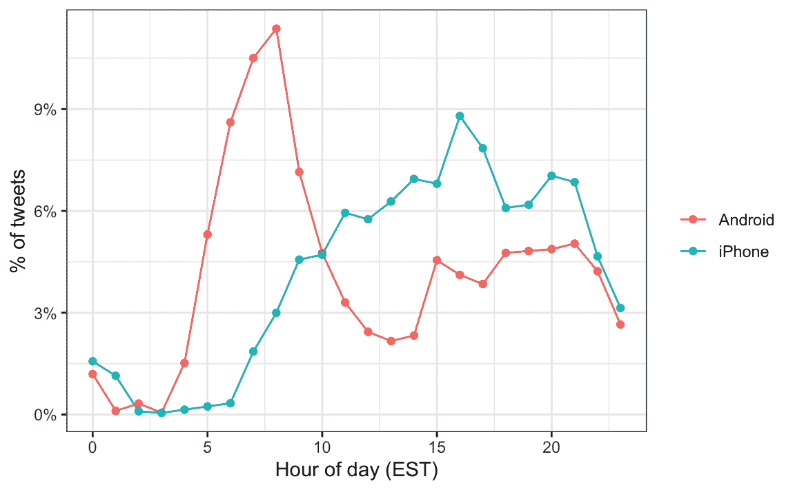
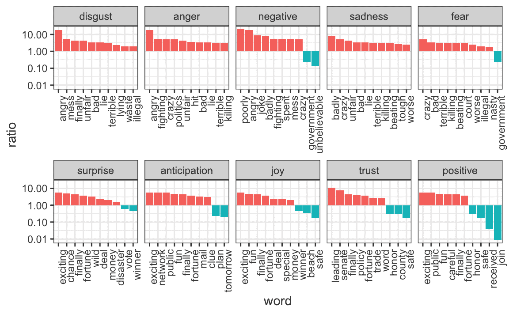

# 17  文本分析

> [`rafalab.dfci.harvard.edu/dsbook-part-1/wrangling/text-analysis.html`](https://rafalab.dfci.harvard.edu/dsbook-part-1/wrangling/text-analysis.html)

1.  数据整理

1.  17  文本分析

除了用于表示分类数据的标签外，我们主要关注数值数据。但在许多应用中，数据最初是以文本形式出现的。众所周知的例子包括垃圾邮件过滤、网络犯罪预防、反恐和情感分析。在这些所有情况下，原始数据都是由自由文本组成的。我们的任务是从中提取洞察。在本节中，我们学习如何从文本数据中生成有用的数值摘要，然后我们可以应用我们已学到的某些强大的数据可视化和分析技术。

## 17.1 案例研究：特朗普推文

在 2016 年美国总统选举期间，当时的候选人唐纳德·J·特朗普使用他的推特账户与潜在选民进行沟通。2016 年 8 月 6 日，托德·瓦齐里¹ 关于特朗普发推说：“每个非夸张的推文都来自 iPhone（他的工作人员）。每个夸张的推文都来自 Android（他本人）。”大卫·罗宾逊² 进行了分析，以确定数据是否支持这一说法。在这里，我们通过大卫的分析来学习文本分析的一些基础知识。要了解更多关于 R 中的文本分析，我们推荐茱莉亚·西尔格和戴维·罗宾逊合著的《Text Mining with R》一书³。

我们将使用以下库：

```r
[library](https://rdrr.io/r/base/library.html)([tidyverse](https://tidyverse.tidyverse.org))
[library](https://rdrr.io/r/base/library.html)([scales](https://scales.r-lib.org))
[library](https://rdrr.io/r/base/library.html)([tidytext](https://juliasilge.github.io/tidytext/))
[library](https://rdrr.io/r/base/library.html)([textdata](https://emilhvitfeldt.github.io/textdata/))
[library](https://rdrr.io/r/base/library.html)(dslabs)
```

*X，以前称为 twitter，提供了一个 API，允许下载推文。布伦丹·布朗运营的 trump archive⁴ 收集了特朗普账户的推文数据。**dslabs** 包含以下范围内的推文：

```r
[range](https://rdrr.io/r/base/range.html)(trump_tweets$created_at)
#> [1] "2009-05-04 13:54:25 EST" "2018-01-01 08:37:52 EST"
```

*数据框包括以下变量：

```r
[names](https://rdrr.io/r/base/names.html)(trump_tweets)
#> [1] "source"                  "id_str" 
#> [3] "text"                    "created_at" 
#> [5] "retweet_count"           "in_reply_to_user_id_str"
#> [7] "favorite_count"          "is_retweet"
```

*帮助文件 `[?trump_tweets](https://rdrr.io/pkg/dslabs/man/trump_tweets.html)` 提供了每个变量代表的详细说明。实际的推文包含在 `text` 变量中：

```r
trump_tweets$text[16413] |> [str_wrap](https://stringr.tidyverse.org/reference/str_wrap.html)(width = [options](https://rdrr.io/r/base/options.html)()$width) |> [cat](https://rdrr.io/r/base/cat.html)()
#> Great to be back in Iowa! #TBT with @JerryJrFalwell joining me in
#> Davenport- this past winter. #MAGA https://t.co/A5IF0QHnic
```

*源变量告诉我们每个推文是用哪种设备编写和上传的：

```r
trump_tweets |> [count](https://dplyr.tidyverse.org/reference/count.html)(source) |> [arrange](https://dplyr.tidyverse.org/reference/arrange.html)([desc](https://dplyr.tidyverse.org/reference/desc.html)(n)) |> [head](https://rdrr.io/r/utils/head.html)(5)
#>                source     n
#> 1  Twitter Web Client 10718
#> 2 Twitter for Android  4652
#> 3  Twitter for iPhone  3962
#> 4           TweetDeck   468
#> 5     TwitLonger Beta   288
```

*我们对 2016 年竞选期间发生的事情感兴趣，因此在本分析中，我们将关注特朗普宣布竞选到选举日之间的推文。我们定义以下表格，仅包含该时间段的推文。我们移除了 `Twitter for` 的部分，只保留来自 Android 或 iPhone 的推文，并过滤掉转发推文。

```r
campaign_tweets <- trump_tweets |> 
 [filter](https://dplyr.tidyverse.org/reference/filter.html)(source [%in%](https://rdrr.io/r/base/match.html) [paste](https://rdrr.io/r/base/paste.html)("Twitter for", [c](https://rdrr.io/r/base/c.html)("Android", "iPhone")) &
 created_at >= [ymd](https://lubridate.tidyverse.org/reference/ymd.html)("2015-06-17") & 
 created_at < [ymd](https://lubridate.tidyverse.org/reference/ymd.html)("2016-11-08")) |>
 [mutate](https://dplyr.tidyverse.org/reference/mutate.html)(source = [str_remove](https://stringr.tidyverse.org/reference/str_remove.html)(source, "Twitter for ")) |>
 [filter](https://dplyr.tidyverse.org/reference/filter.html)(!is_retweet) |>
 [arrange](https://dplyr.tidyverse.org/reference/arrange.html)(created_at) |> 
 [as_tibble](https://tibble.tidyverse.org/reference/as_tibble.html)()
```

*现在我们可以使用数据可视化来探索两个不同的群体是否可能在这些设备上发推。对于每条推文，我们将提取推文的东部标准时间（EST）小时，然后计算每个设备在每个小时推文的比例：

```r
campaign_tweets |>
 [mutate](https://dplyr.tidyverse.org/reference/mutate.html)(hour = [hour](https://lubridate.tidyverse.org/reference/hour.html)([with_tz](https://lubridate.tidyverse.org/reference/with_tz.html)(created_at, "EST"))) |>
 [count](https://dplyr.tidyverse.org/reference/count.html)(source, hour) |>
 [group_by](https://dplyr.tidyverse.org/reference/group_by.html)(source) |>
 [mutate](https://dplyr.tidyverse.org/reference/mutate.html)(percent = n / [sum](https://rdrr.io/r/base/sum.html)(n)) |>
 [ungroup](https://dplyr.tidyverse.org/reference/group_by.html)() |>
 [ggplot](https://ggplot2.tidyverse.org/reference/ggplot.html)([aes](https://ggplot2.tidyverse.org/reference/aes.html)(hour, percent, color = source)) +
 [geom_line](https://ggplot2.tidyverse.org/reference/geom_path.html)() +
 [geom_point](https://ggplot2.tidyverse.org/reference/geom_point.html)() +
 [scale_y_continuous](https://ggplot2.tidyverse.org/reference/scale_continuous.html)(labels = [percent_format](https://scales.r-lib.org/reference/percent_format.html)()) +
 [labs](https://ggplot2.tidyverse.org/reference/labs.html)(x = "Hour of day (EST)", y = "% of tweets", color = "")
```

**  *我们注意到在早上 6 点到 8 点之间，Android 设备有一个很大的峰值。这些模式似乎存在明显的差异。因此，我们将假设两个不同的实体正在使用这两款设备。

现在，我们将研究当我们将 Android 与 iPhone 进行比较时，推文的文本如何不同。为此，我们引入了**tidytext**包。*******

## ***17.2 文本作为数据***

***`tidytext`包帮助我们将自由形式的文本转换为整洁的表格。以这种格式存储数据极大地促进了数据可视化和统计技术的应用。

实现这一目标所需的主要功能是`unnest_tokens`。*token*指的是我们考虑作为数据点的单元。最常见的*token*将是单词，但它们也可以是单个字符、n-grams、句子、行或由正则表达式定义的模式。该函数将接受一个字符串向量，并提取 token，以便每个 token 在新表格中占一行。以下是一个简单的例子：

```r
poem <- [c](https://rdrr.io/r/base/c.html)("Roses are red,", "Violets are blue,", 
 "Sugar is sweet,", "And so are you.")
example <- [tibble](https://tibble.tidyverse.org/reference/tibble.html)(line = [c](https://rdrr.io/r/base/c.html)(1, 2, 3, 4),
 text = poem)
example
#> # A tibble: 4 × 2
#>    line text 
#>   <dbl> <chr> 
#> 1     1 Roses are red, 
#> 2     2 Violets are blue,
#> 3     3 Sugar is sweet, 
#> 4     4 And so are you.
example |> [unnest_tokens](https://juliasilge.github.io/tidytext/reference/unnest_tokens.html)(word, text)
#> # A tibble: 13 × 2
#>    line word 
#>   <dbl> <chr> 
#> 1     1 roses 
#> 2     1 are 
#> 3     1 red 
#> 4     2 violets
#> 5     2 are 
#> # ℹ 8 more rows
```

*现在让我们看看特朗普的推文。我们将查看第 3008 条推文，因为它将允许我们说明几个要点：

```r
i <- 3008
campaign_tweets$text[i] |> [str_wrap](https://stringr.tidyverse.org/reference/str_wrap.html)(width = 65) |> [cat](https://rdrr.io/r/base/cat.html)()
#> Great to be back in Iowa! #TBT with @JerryJrFalwell joining me in
#> Davenport- this past winter. #MAGA https://t.co/A5IF0QHnic
campaign_tweets[i,] |> 
 [unnest_tokens](https://juliasilge.github.io/tidytext/reference/unnest_tokens.html)(word, text) |>
 [pull](https://dplyr.tidyverse.org/reference/pull.html)(word) 
#>  [1] "great"          "to"             "be"             "back" 
#>  [5] "in"             "iowa"           "tbt"            "with" 
#>  [9] "jerryjrfalwell" "joining"        "me"             "in" 
#> [13] "davenport"      "this"           "past"           "winter" 
#> [17] "maga"           "https"          "t.co"           "a5if0qhnic"
```

*请注意，该函数试图将 token 转换为单词。一个小的调整是删除图片链接：

```r
links_to_pics <- "https://t.co/[A-Za-z\\d]+|&amp;"
campaign_tweets[i,] |> 
 [mutate](https://dplyr.tidyverse.org/reference/mutate.html)(text = [str_remove_all](https://stringr.tidyverse.org/reference/str_remove.html)(text, links_to_pics))  |>
 [unnest_tokens](https://juliasilge.github.io/tidytext/reference/unnest_tokens.html)(word, text) |>
 [pull](https://dplyr.tidyverse.org/reference/pull.html)(word)
#>  [1] "great"          "to"             "be"             "back" 
#>  [5] "in"             "iowa"           "tbt"            "with" 
#>  [9] "jerryjrfalwell" "joining"        "me"             "in" 
#> [13] "davenport"      "this"           "past"           "winter" 
#> [17] "maga"
```

*现在我们已经准备好从我们所有的推文中提取单词。

```r
tweet_words <- campaign_tweets |> 
 [mutate](https://dplyr.tidyverse.org/reference/mutate.html)(text = [str_remove_all](https://stringr.tidyverse.org/reference/str_remove.html)(text, links_to_pics))  |>
 [unnest_tokens](https://juliasilge.github.io/tidytext/reference/unnest_tokens.html)(word, text)
```

*我们现在可以回答像“最常见的单词是什么？”这样的问题：

```r
tweet_words |> 
 [count](https://dplyr.tidyverse.org/reference/count.html)(word) |>
 [arrange](https://dplyr.tidyverse.org/reference/arrange.html)([desc](https://dplyr.tidyverse.org/reference/desc.html)(n))
#> # A tibble: 6,264 × 2
#>   word      n
#>   <chr> <int>
#> 1 the    2330
#> 2 to     1413
#> 3 and    1245
#> 4 in     1190
#> 5 i      1151
#> # ℹ 6,259 more rows
```

*这些是顶级单词，它们并不令人惊讶。在文本分析中，`tidytext`包有一个常用单词的数据库，称为*停用词*：

```r
[head](https://rdrr.io/r/utils/head.html)(stop_words)
#> # A tibble: 6 × 2
#>   word  lexicon
#>   <chr> <chr> 
#> 1 a     SMART 
#> 2 a's   SMART 
#> 3 able  SMART 
#> 4 about SMART 
#> 5 above SMART 
#> # ℹ 1 more row
```

*如果我们使用`filter(!word %in% stop_words$word)`过滤掉表示停用词的行：

```r
tweet_words <- campaign_tweets |> 
 [mutate](https://dplyr.tidyverse.org/reference/mutate.html)(text = [str_remove_all](https://stringr.tidyverse.org/reference/str_remove.html)(text, links_to_pics))  |>
 [unnest_tokens](https://juliasilge.github.io/tidytext/reference/unnest_tokens.html)(word, text) |>
 [filter](https://dplyr.tidyverse.org/reference/filter.html)(!word [%in%](https://rdrr.io/r/base/match.html) stop_words$word ) 
```

*我们最终得到了一组更有信息量的前 10 位推文单词：

```r
tweet_words |> 
 [count](https://dplyr.tidyverse.org/reference/count.html)(word) |>
 [slice_max](https://dplyr.tidyverse.org/reference/slice.html)(n, n = 10) |>
 [arrange](https://dplyr.tidyverse.org/reference/arrange.html)([desc](https://dplyr.tidyverse.org/reference/desc.html)(n))
#> # A tibble: 10 × 2
#>   word                      n
#>   <chr>                 <int>
#> 1 trump2016               415
#> 2 hillary                 407
#> 3 people                  304
#> 4 makeamericagreatagain   298
#> 5 america                 255
#> # ℹ 5 more rows
```

*对结果单词的一些探索（此处未显示）揭示了我们的 token 中存在一些不希望的特性。首先，我们的一些 token 只是数字（例如年份）。我们希望删除这些，我们可以使用正则表达式`^\d+$`找到它们。其次，一些 token 来自引号，并且以`'`开头。我们希望在单词的开头删除`'`，所以我们将使用`str_replace`。我们将这两行代码添加到上面的代码中，以生成我们的最终表格：

```r
tweet_words <- campaign_tweets |> 
 [mutate](https://dplyr.tidyverse.org/reference/mutate.html)(text = [str_remove_all](https://stringr.tidyverse.org/reference/str_remove.html)(text, links_to_pics))  |>
 [unnest_tokens](https://juliasilge.github.io/tidytext/reference/unnest_tokens.html)(word, text) |>
 [filter](https://dplyr.tidyverse.org/reference/filter.html)(!word [%in%](https://rdrr.io/r/base/match.html) stop_words$word &
 (word, "^\\d+$")) |>
 [mutate](https://dplyr.tidyverse.org/reference/mutate.html)(word = [str_replace](https://stringr.tidyverse.org/reference/str_replace.html)(word, "^'", ""))
```

*现在我们已经将所有单词以及它们来自哪个设备的信息放入表格中，我们可以开始探索在比较 Android 和 iPhone 时哪些单词更常见。

对于每个单词，我们想知道它更有可能来自 Android 推文还是 iPhone 推文。因此，我们分别计算每个单词在 Android 和 iPhone 推文中的频率，然后推导出这些比例的比率（Android 比例除以 iPhone 比例）。由于一些单词不太常见，我们应用了第 9.7 节中描述的连续性校正：

```r
android_vs_iphone <- tweet_words |>
 [count](https://dplyr.tidyverse.org/reference/count.html)(word, source) |>
 [pivot_wider](https://tidyr.tidyverse.org/reference/pivot_wider.html)(names_from = "source", values_from = "n", values_fill = 0) |>
 [mutate](https://dplyr.tidyverse.org/reference/mutate.html)(p_a = (Android + 0.5)/([sum](https://rdrr.io/r/base/sum.html)(Android) + 0.5), 
 p_i = (iPhone + 0.5)/([sum](https://rdrr.io/r/base/sum.html)(iPhone) + 0.5), 
 ratio = p_a / p_i)
```

**对于总出现至少 100 次的单词，以下是 Android 的最高百分比差异**

```r
android_vs_iphone |> [filter](https://dplyr.tidyverse.org/reference/filter.html)(Android + iPhone >= 100) |> [arrange](https://dplyr.tidyverse.org/reference/arrange.html)([desc](https://dplyr.tidyverse.org/reference/desc.html)(ratio))
#> # A tibble: 30 × 6
#>   word        Android iPhone     p_a     p_i ratio
#>   <chr>         <int>  <int>   <dbl>   <dbl> <dbl>
#> 1 bad             104     26 0.00648 0.00191  3.39
#> 2 crooked         156     49 0.00971 0.00357  2.72
#> 3 cnn             116     37 0.00723 0.00271  2.67
#> 4 ted              86     28 0.00537 0.00206  2.61
#> 5 interviewed      76     25 0.00475 0.00184  2.58
#> # ℹ 25 more rows
```

**以及 iPhone 的前几名**：

```r
android_vs_iphone |> [filter](https://dplyr.tidyverse.org/reference/filter.html)(Android + iPhone >= 100) |>  [arrange](https://dplyr.tidyverse.org/reference/arrange.html)(ratio)
#> # A tibble: 30 × 6
#>   word                  Android iPhone       p_a     p_i   ratio
#>   <chr>                   <int>  <int>     <dbl>   <dbl>   <dbl>
#> 1 makeamericagreatagain       0    298 0.0000310 0.0216  0.00144
#> 2 trump2016                   3    412 0.000217  0.0298  0.00729
#> 3 join                        1    157 0.0000930 0.0114  0.00818
#> 4 tomorrow                   24    101 0.00152   0.00733 0.207 
#> 5 vote                       46     67 0.00288   0.00487 0.592 
#> # ℹ 25 more rows
```

**我们已经看到，在一种设备上比另一种设备上更多地被推特的单词类型中存在某种模式。然而，我们感兴趣的并不是具体的单词，而是语气**。Vaziri 的断言是，Android 的推文更加夸张。那么我们如何用数据来检查这一点呢？**夸张**是一种难以从单词中提取的情感，因为它依赖于对短语的解释。然而，单词可以与更基本的情感相关联，如愤怒、恐惧、喜悦和惊讶。在下一节中，我们将展示基本的情感分析。***************

## **17.3 情感分析**

**在情感分析中，我们将一个词分配给一个或多个“情感”**。尽管这种方法可能会错过依赖于上下文情感，如讽刺，但在处理大量单词时，总结可以提供洞察。

**情感分析的第一步是为每个词分配一个情感**。正如我们所展示的，**tidytext**包包含几个映射或词典。**textdata**包包含这些词典中的几个。

**`bing`词典将单词分为`正面`和`负面`情感。我们可以使用*tidytext*函数`get_sentiments`查看这一点**：

```r
[get_sentiments](https://juliasilge.github.io/tidytext/reference/get_sentiments.html)("bing")
```

**`AFINN`词典将单词分配给介于-5 和 5 之间的分数，其中-5 是最负面的，5 是最正面的**。请注意，此词典在第一次调用`get_sentiment`函数时需要下载：

```r
[get_sentiments](https://juliasilge.github.io/tidytext/reference/get_sentiments.html)("afinn")
```

**`nrc`词典提供几种不同的情感。请注意，这也需要在第一次使用时下载**。

```r
[get_sentiments](https://juliasilge.github.io/tidytext/reference/get_sentiments.html)("nrc") |> [count](https://dplyr.tidyverse.org/reference/count.html)(sentiment)
#> # A tibble: 10 × 2
#>   sentiment        n
#>   <chr>        <int>
#> 1 anger         1245
#> 2 anticipation   837
#> 3 disgust       1056
#> 4 fear          1474
#> 5 joy            687
#> # ℹ 5 more rows
```

**对于我们的分析，我们感兴趣的是探索每条推文的不同情感，因此我们将使用`nrc`词典**：

```r
nrc <- [get_sentiments](https://juliasilge.github.io/tidytext/reference/get_sentiments.html)("nrc") |> [select](https://dplyr.tidyverse.org/reference/select.html)(word, sentiment)
```

**我们可以使用`inner_join`将单词和情感结合起来，这将仅保留与情感相关的单词。以下是来自推文的 5 个随机单词**：

```r
tweet_words |> [inner_join](https://dplyr.tidyverse.org/reference/mutate-joins.html)(nrc, by = "word", relationship = "many-to-many") |> 
 [select](https://dplyr.tidyverse.org/reference/select.html)(source, word, sentiment) |> 
 [sample_n](https://dplyr.tidyverse.org/reference/sample_n.html)(5)
#> # A tibble: 5 × 3
#>   source  word     sentiment 
#>   <chr>   <chr>    <chr> 
#> 1 Android enjoy    joy 
#> 2 iPhone  terrific sadness 
#> 3 iPhone  tactics  trust 
#> 4 Android clue     anticipation
#> 5 iPhone  change   fear
```

**`relationship = "many-to-many"`被添加以解决`left_join`检测到的“意外的多对多关系”警告**。然而，在这个上下文中，这种行为实际上是预期的，因为许多单词与多个情感相关联。**现在我们准备通过比较来自每个设备的推文的情感来执行定量分析。在这里，我们可以进行逐条推文的分析，为每条推文分配一个情感。然而，这将具有挑战性，因为每条推文都将与几个情感相关联，每个词在词典中都有一个。为了说明目的，我们将执行一个更简单的分析：我们将计算并比较每个设备中出现的每个情感的出现频率**。

```r
sentiment_counts <- tweet_words |>
 [left_join](https://dplyr.tidyverse.org/reference/mutate-joins.html)(nrc, by = "word", relationship = "many-to-many") |>
 [count](https://dplyr.tidyverse.org/reference/count.html)(source, sentiment) |>
 [pivot_wider](https://tidyr.tidyverse.org/reference/pivot_wider.html)(names_from = "source", values_from = "n") |>
 [mutate](https://dplyr.tidyverse.org/reference/mutate.html)(sentiment = [replace_na](https://tidyr.tidyverse.org/reference/replace_na.html)(sentiment, replace = "none"))
```

**对于每个情感，我们分别计算其在 Android 和 iPhone 的总回复中的比例，并推导出这些比例的比率（Android 比例除以 iPhone 比例）**。

```r
sentiment_counts <- sentiment_counts |>
 [mutate](https://dplyr.tidyverse.org/reference/mutate.html)(p_a = Android/[sum](https://rdrr.io/r/base/sum.html)(Android), p_i = iPhone/[sum](https://rdrr.io/r/base/sum.html)(iPhone), ratio = p_a/p_i) |> 
 [arrange](https://dplyr.tidyverse.org/reference/arrange.html)([desc](https://dplyr.tidyverse.org/reference/desc.html)(ratio))
sentiment_counts
#> # A tibble: 11 × 6
#>   sentiment Android iPhone    p_a    p_i ratio
#>   <chr>       <int>  <int>  <dbl>  <dbl> <dbl>
#> 1 disgust       639    314 0.0290 0.0178  1.63
#> 2 anger         962    527 0.0437 0.0298  1.47
#> 3 negative     1657    931 0.0753 0.0527  1.43
#> 4 sadness       901    514 0.0409 0.0291  1.41
#> 5 fear          799    486 0.0363 0.0275  1.32
#> # ℹ 6 more rows
```

*所以我们确实看到了一些差异，顺序很有趣：最大的三个情感是厌恶、愤怒和负面！

如果我们感兴趣的是探索哪些特定单词导致了这些差异，我们可以参考我们的`android_vs_iphone`对象。对于每个情感，我们展示了 10 个最大的比率，无论是正向还是负向。我们排除了总出现次数少于 10 次的单词。



这只是 tidytext 可以执行的多项分析中的一个简单示例。要了解更多信息，我们再次推荐阅读《tidytext 挖掘》一书⁵。***********

## ****17.4 练习****

****Project Gutenberg 是一个公共领域书籍的数字档案。R 包**gutenbergr**简化了这些文本导入 R 的过程。

您可以通过输入以下命令进行安装和加载：

```r
[install.packages](https://rdrr.io/r/utils/install.packages.html)("gutenbergr")
[library](https://rdrr.io/r/base/library.html)([gutenbergr](https://docs.ropensci.org/gutenbergr/))
```

*您可以看到如下所示的可用书籍：

```r
gutenberg_metadata
```

*1. 使用`str_detect`查找小说《傲慢与偏见》的 ID。

2. 我们注意到有几个版本。`[gutenberg_works()](https://docs.ropensci.org/gutenbergr/reference/gutenberg_works.html)`函数过滤这个表格以移除重复项并仅包含英语作品。阅读帮助文件并使用此函数查找《傲慢与偏见》的 ID。

3. 使用`gutenberg_download`函数下载《傲慢与偏见》的文本。将其保存到名为`book`的对象中。

4. 使用**tidytext**包创建一个包含文本中所有单词的整洁表格。将表格保存到名为`words`的对象中

5. 我们将在稍后绘制情感与书中位置的关系图。为此，向表格中添加一个包含单词数量的列将很有用。

6. 从`words`对象中移除停用词和数字。提示：使用`anti_join`。

7. 现在使用`AFINN`词典为每个单词分配情感值。

8. 绘制情感得分与书中位置的关系图，并添加一个平滑器。

9. 假设每页有 300 个单词。将位置转换为页码，然后计算每页的平均情感。按页绘制平均得分。添加一个看起来穿过数据的平滑器。

* * *

****1. [`twitter.com/tvaziri/status/762005541388378112/photo/1`](https://twitter.com/tvaziri/status/762005541388378112/photo/1)↩︎

1.  [`varianceexplained.org/r/trump-tweets/`](http://varianceexplained.org/r/trump-tweets/)↩︎

1.  [`www.tidytextmining.com/`](https://www.tidytextmining.com/)↩︎

1.  [`www.thetrumparchive.com/`](https://www.thetrumparchive.com/)↩︎

1.  [`www.tidytextmining.com/`](https://www.tidytextmining.com/)↩︎****
