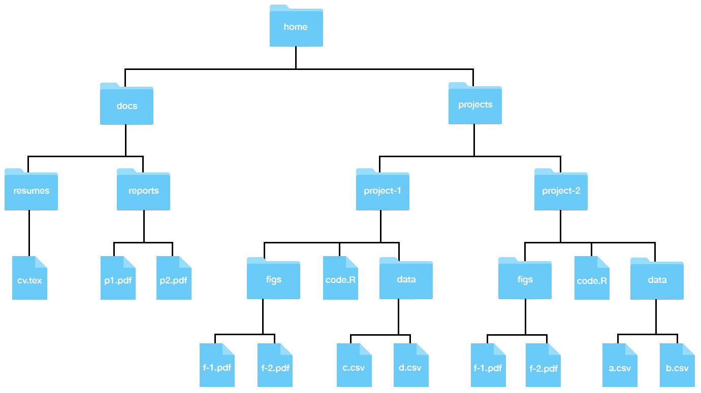
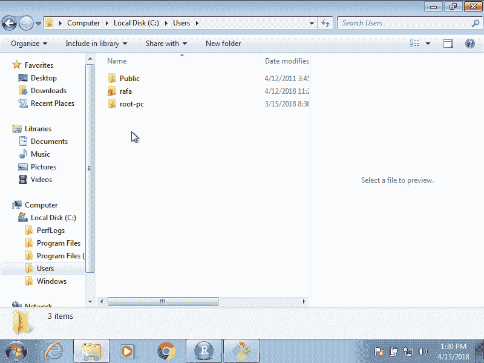
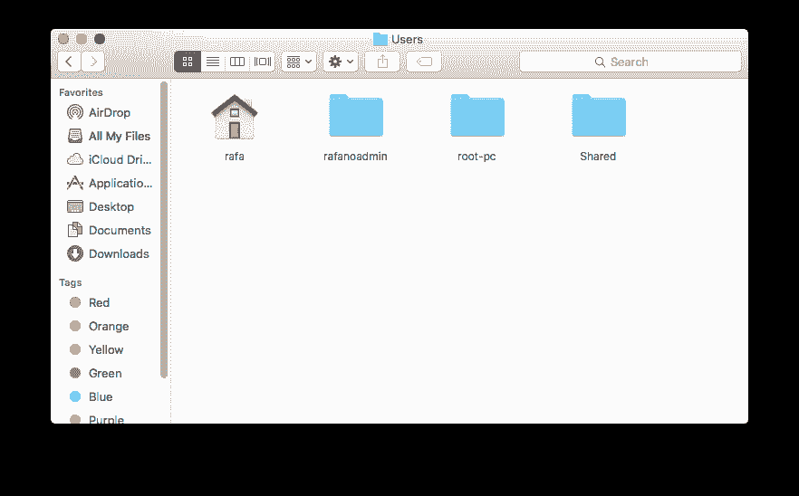
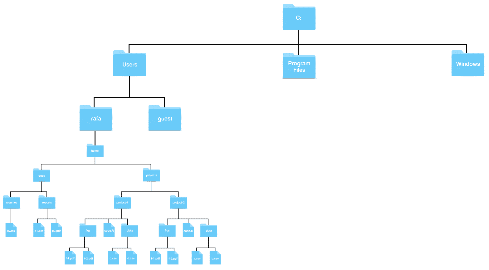
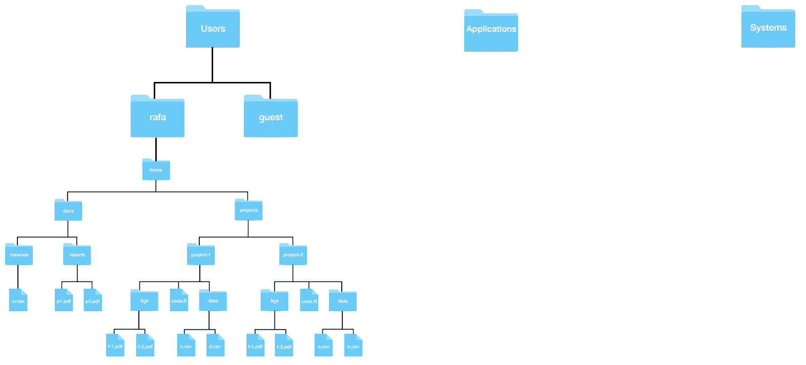
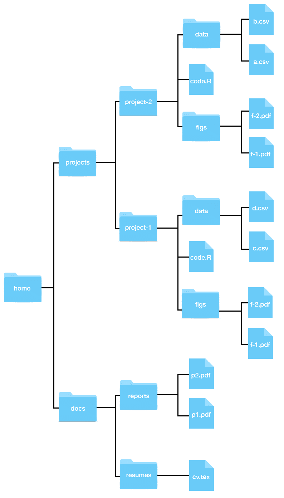

# 18  使用 Unix 组织

> 原文：[`rafalab.dfci.harvard.edu/dsbook-part-1/productivity/unix.html`](https://rafalab.dfci.harvard.edu/dsbook-part-1/productivity/unix.html)

1.  生产力工具

1.  18  使用 Unix 组织

Unix 是数据科学中首选的操作系统。我们将通过一个示例向您介绍 Unix 的思维方式：如何组织数据分析项目。我们将学习一些最常用的命令。然而，我们不会深入探讨高级细节。我们强烈鼓励您进一步学习，尤其是在您发现自己经常使用鼠标或执行重复性任务时。在这些情况下，Unix 中可能有一种更有效的方法来完成它。以下是一些基本的课程，以帮助您入门：

+   “学习命令行”通过 codecademy¹

+   “LinuxFoundationX: Linux 入门”通过 edX²

+   “Unix 工作台”通过 coursera³

此外，还有很多参考书籍⁴。Bite Size Linux⁵ 和 Bite Size Command Line⁶ 是两个特别清晰、简洁且完整的示例。

在搜索 Unix 资源时，请记住，我们在这里将要学习的其他术语还有 *Linux*、*shell* 和 *命令行*。基本上，我们学习的是一系列命令和一种思维方式，它有助于在不使用鼠标的情况下组织文件。

为了提供动力，我们将开始使用 Unix 工具和 RStudio 构建目录。

## 18.1 命名约定

在您开始使用 Unix 组织项目之前，您想要选择一个命名约定，这将用于系统地命名您的文件和目录。这将帮助您找到文件并了解它们的内容。

通常，你希望以与文件内容相关的方式命名文件，并指定它们与其他文件的关系。史密森尼数据管理最佳实践⁷ 提出了“文件命名和组织五原则”，它们是：

> > +   使用一个独特、易于人类阅读的名称，并给出内容的指示。
> > +   
> > +   遵循一致的、对机器友好的模式。
> > +   
> > +   将文件组织到遵循一致模式的目录中（如有必要）。
> > +   
> > +   避免在文件和目录名称中重复语义元素。
> > +   
> > +   文件扩展名与文件格式匹配（不要更改扩展名！）

对于具体的建议，我们强烈建议您遵循 Tidyverse 风格指南⁸。

## 18.2 终端

我们将不再通过点击、拖动和放下来组织我们的文件和文件夹，而是将 Unix 命令输入到终端中。我们这样做的方式类似于我们在 R 控制台中输入命令，但不同的是，我们将不会生成图表和统计摘要，而是将组织系统中的文件。

终端集成在 Mac 和 Linux 系统中，但 Windows 用户将必须安装一个 *模拟器*。一旦打开终端，您就可以开始输入命令。您应该看到一个闪烁的光标，它将显示您输入的内容的位置。这个位置被称为*命令行*。一旦您输入一些内容并在 Windows 上按回车或在 Mac 上按 return，Unix 将尝试执行此命令。如果您想尝试一个示例，请输入以下命令：

[PRE0]

命令 `echo` 与 R 中的 `cat` 类似。执行此行应打印出 `hello world`，然后返回到命令行。

注意，您不能在终端中使用鼠标移动。您必须使用键盘。要返回之前输入的命令，您可以按上箭头键。

注意，上面我们以与之前展示 R 命令相同的方式展示了 Unix 命令的代码块。我们将确保在命令针对 R 和 Unix 时进行区分。

## 18.3 文件系统

我们将您电脑上的所有文件、文件夹和程序统称为*文件系统*。请记住，文件夹和程序也是文件，但这是一种我们很少考虑且在此书中忽略的技术细节。我们现在将专注于文件和文件夹，并在稍后的章节中讨论程序，或称为*可执行文件*。

### 18.3.1 目录和子目录

要成为 Unix 用户，您需要掌握的第一个概念是您的文件系统是如何组织的。您应该将其视为一系列嵌套的文件夹，每个文件夹都包含文件、文件夹和可执行文件。

这里是我们所描述的结构的一个视觉表示：

在 Unix 中，我们将文件夹称为*目录*。位于其他目录内的目录通常被称为*子目录*。例如，在上面的图中，目录 *docs* 有两个子目录：*reports* 和 *resumes*，而 *docs* 是 *home* 的子目录。

### 18.3.2 家目录

家*目录是您所有东西的存放地，与随电脑一起提供的系统文件不同，这些文件存放在其他地方。在上面的图中，名为 *home* 的目录代表您的家目录，但这个名字很少被使用。在您的系统中，您的家目录的名称可能和该系统上的用户名相同。以下是在 Windows 和 Mac 上显示家目录的示例，在这种情况下，名为 *rafa*：

现在，回顾一下显示文件系统的图。假设你正在使用一个点选系统，并且你想删除文件*cv.tex*。想象一下，在你的屏幕上你可以看到*home*目录。为了删除这个文件，你需要双击*home*目录，然后是*docs*，然后是*resumes*，最后将*cv.tex*拖到垃圾桶。在这里，你正在体验系统的层次结构：*cv.tex*是*resumes*目录中的一个文件，而*resumes*目录是*docs*目录的子目录，*docs*目录又是*home*目录的子目录。

现在假设你屏幕上看不到你的主目录。你需要以某种方式让它出现在屏幕上。一种方法是从所谓的*root*目录导航到你的主目录。任何文件系统都会有一个所谓的*root*目录，它是包含所有目录的目录。上图所示的*home*目录通常位于 root 目录的二级或更多级。在 Windows 上，你将有一个类似的结构：

在 Mac 上，情况将如下所示：

在 Windows 上，典型的 R 安装将使你的*Documents*目录成为 R 中的主目录。这可能与 Git Bash 中的主目录不同。通常，当我们讨论主目录时，我们指的是 Unix 主目录，在本书中对于 Windows 来说，是 Git Bash 的 Unix 目录*。

### *18.3.3 工作目录*

“当前位置”的概念是点选体验的一部分：在任何给定时刻，我们都在一个文件夹中，并看到该文件夹的内容。当你搜索文件时，就像我们上面做的那样，你正在体验“当前位置”的概念：一旦你双击一个目录，你改变了位置，现在你就在那个文件夹中，而不是你之前所在的文件夹中*。

在 Unix 中，我们没有相同的视觉提示，但“当前位置”的概念是必不可少的。我们称这个为*工作目录*。你打开的每个终端窗口都有一个与之关联的工作目录。

我们如何知道我们的工作目录是什么？为了回答这个问题，我们学习我们的下一个 Unix 命令：`pwd`，它代表*打印工作目录*。这个命令返回工作目录。

打开一个终端并输入：

[PRE1]

我们不展示运行此命令的结果，因为它在你的系统上与其他系统相比可能会有很大差异。如果你打开一个终端并输入`pwd`作为你的第一个命令，你应该在 Mac 上看到类似`/Users/yourusername`的内容，或者在 Windows 上看到类似`/c/Users/yourusername`的内容。`pwd`命令返回的字符串代表你的工作目录。当我们第一次打开终端时，它将启动在我们的主目录中，因此在这种情况下，工作目录是主目录。

注意到上述字符串中的正斜杠 `/` 用于分隔目录。例如，位置 `/c/Users/rafa` 表示我们的工作目录名为 `rafa`，它是 `Users` 的子目录，而 `Users` 又是 `c` 的子目录，`c` 是根目录的子目录。因此，根目录仅用一个正斜杠 `/` 表示：`/`.*

### *18.3.4 路径*

我们称 `pwd` 返回的字符串为工作目录的 *完整路径*。这个名字来源于这个字符串表示了从根目录到达指定目录所需的 *路径*。每个目录都有一个完整路径。稍后，我们将介绍 *相对路径*，它告诉我们如何从工作目录到达某个目录。

在 Unix 中，我们使用缩写 `~` 作为你的主目录的昵称。例如，如果 `docs` 是你主目录中的一个目录，那么 *docs* 的完整路径可以写成这样 `~/docs`。

大多数终端会在命令行上直接显示工作目录的路径。如果你使用默认设置并在 Mac 上打开终端，你将看到命令行上显示类似 `computername:~ username` 的内容，其中 `~` 代表你的工作目录，在这个例子中是主目录 `~`。Git Bash 终端也是如此，你将看到类似 `username@computername MINGW64 ~` 的内容，工作目录位于末尾。当我们更改目录时，无论是在 Mac 还是 Windows 上，我们都会看到这种变化。

## *18.4 Unix 命令*

现在，我们将学习一系列 Unix 命令，这将使我们能够为数据科学项目准备目录。我们还提供了如果你在终端输入将返回错误的命令示例。这是因为我们假设的是早期图中的文件系统。你的文件系统是不同的。在下一节中，我们将提供你可以输入的示例。*

### 18.4.1 `ls`：列出目录内容

在点对点系统中，我们知道目录中有什么，因为我们能看到它。在终端中，我们看不到图标。相反，我们使用 `ls` 命令来列出目录内容。

要查看你的主目录内容，打开终端并输入：

[PRE2]

我们很快将看到更多示例。

### 18.4.2 `mkdir` 和 `rmdir`：创建和删除目录

当我们准备数据科学项目时，我们需要创建目录。在 Unix 中，我们可以使用 `mkdir` 命令来完成此操作，该命令代表 *创建目录*。

由于你很快将参与多个项目，我们强烈建议在你的主目录中创建一个名为 *projects* 的目录。

你可以在你的系统上尝试这个特定的示例。打开终端并输入：

[PRE3]

如果你正确执行，将不会有任何操作：没有消息就是好消息。如果目录已存在，你将收到错误消息，现有目录将保持不变。

要确认你已创建目录，你可以列出当前工作目录的内容：

[PRE4]

您应该能看到我们刚刚创建的目录被列出。也许您还可以看到许多已经在您计算机上的其他目录。

为了说明目的，让我们再创建几个目录。您可以使用这种方式列出多个目录名：

[PRE5]

您可以检查是否创建了三个目录：

[PRE6]

如果您犯了一个错误并需要删除目录，您可以使用 `rmdir` 命令来删除它。

[PRE7]

这将删除目录，只要它是空的。如果它不为空，您将收到错误消息，并且目录将保持不变。要删除非空目录，我们将在稍后学习 `rm` 命令。

### 18.4.3 `cd`：通过更改目录在文件系统中导航

接下来，我们想在已创建的目录内创建目录。我们还想避免通过指向和点击在文件系统中导航。我们将在 Unix 中解释如何使用命令行来完成此操作。

假设我们打开一个终端，并且我们的工作目录是主目录。我们想要将工作目录更改为 `projects`。我们使用 `cd` 命令来完成此操作，该命令代表 *更改目录*：

[PRE8]

要检查工作目录是否已更改，我们可以使用我们之前学过的命令来查看我们的位置：

[PRE9]

我们的工作目录现在应该是 `~/projects`。请注意，在您的计算机上，主目录 `~` 将展开为类似 `/c/Users/yourusername` 的路径。

在 Unix 中，您可以通过按 Tab 键来自动完成。这意味着我们可以输入 `cd d` 然后按 Tab 键。Unix 会自动完成，如果 `docs` 是以 `d` 开头的唯一目录/文件，或者显示选项。试试看！在不使用自动完成的情况下使用 Unix 可能会让人难以忍受。*当使用 `cd` 时，我们可以输入完整的路径，它将以 `/` 或 `~` 开头，或者输入一个 *相对路径*。在上面的例子中，我们输入了 `cd projects`，我们使用了一个相对路径。如果您输入的路径不以 `/` 或 `~` 开头，Unix 会假设您输入的是一个相对路径，这意味着它会根据您当前的工作目录查找目录。所以类似以下的内容会给出错误信息：

[PRE10]

因为在您的工作目录中没有 `Users` 目录。

现在假设我们想要回到 `projects` 是子目录的目录，即所谓的 *父目录*。我们可以使用父目录的完整路径，但 Unix 提供了一个快捷方式：工作目录的父目录用两个点 `..` 表示，所以为了返回，我们只需输入：

[PRE11]

现在，您应该已经回到了主目录，您可以使用 `pwd` 命令来确认。

由于我们可以使用带有 `cd` 的完整路径，以下命令：

[PRE12]

无论我们在文件系统中的位置如何，都会带我们回到主目录。

工作目录还有一个别名，即单个 `.`，所以如果您输入

[PRE13]

您将不会移动。尽管这种特定用途的`.`并不实用，但这个昵称有时确实很有用。原因与这一节无关，但您仍然应该了解这个事实。

总结来说，我们了解到在使用`cd`时，我们要么保持原位，要么使用所需的目录名移动到新目录，或者使用`..`移动到父目录。

在输入目录名时，我们可以使用正斜杠连接目录。所以如果我们想无论在文件系统的哪个位置都能到达`projects`目录，我们可以输入：

[PRE14]

这与写出整个路径是等价的。例如，在 Windows 中，我们会写类似

[PRE15]

最后两个命令是等价的，在两种情况下我们都在输入完整路径。

我们也可以连接目录名来表示相对路径。例如，如果我们想回到工作目录的父目录的父目录，我们可以输入：

[PRE16]

这里有一些与`cd`命令相关的最终提示。首先，您可以通过输入以下内容返回到您刚刚离开的目录：

[PRE17]

这在您输入一个非常长的路径然后意识到您想回到之前的位置，而且那个位置也有一个非常长的路径时非常有用。

第二，如果您只输入：

[PRE18]

您将被返回到您的家目录。*

### *18.4.4 示例*

让我们探索一些使用`cd`命令的例子。为了帮助可视化，我们将垂直显示我们的文件系统的图形表示：*

假设我们的工作目录是`~/projects`，我们想移动到`project-1`中的`figs`目录。

在这种情况下，使用相对路径会更方便：

[PRE19]

现在假设我们的工作目录是`~/projects`，我们想移动到`docs`中的`reports`目录，我们该如何做？

一种方法是通过相对路径：

[PRE20]

另一种方法是使用完整路径：

[PRE21]

如果您在自己的系统上尝试这个操作，请记住使用自动完成功能。

让我们再考察一个例子。假设我们位于`~/projects/project-1/figs`，并想切换到`~/projects/project-2`。同样有两种方法。

使用相对路径：

[PRE22]

和使用完整路径：

[PRE23]**

## **18.5 更多 Unix 命令**

*### 18.5.1 `mv`: 移动文件**

在点按和点击系统中，我们通过拖放将文件从一个目录移动到另一个目录。在 Unix 中，我们使用`mv`命令。

`mv`命令在移动导致覆盖文件时不会询问“您确定吗？”*  *现在您已经知道如何使用完整和相对路径，使用`mv`命令相对简单。一般形式如下：*

[PRE24]

例如，如果我们想把文件`cv.tex`从`resumes`移动到`reports`，您可以使用完整的路径，如下所示：

[PRE25]

您也可以使用相对路径。您可以这样做：

[PRE26]

或者这样：

[PRE27]

注意到最后一个例子中，我们使用了工作目录快捷方式`.`来提供一个相对路径作为目标目录。

我们还可以使用 `mv` 来更改文件名。为此，第二个参数不再是目标目录，它还包括一个文件名。例如，要将文件名从 `cv.tex` 更改为 `resume.tex`，我们只需输入：

[PRE28]

我们还可以将移动和重命名结合起来。例如：

[PRE29]

我们还可以移动整个目录。要将 `resumes` 目录移动到 `reports`，我们按照以下步骤操作：

[PRE30]

重要的一点是添加最后的 `/`，以明确你不想重命名 `resumes` 目录为 `reports`，而是将其移动到 `reports` 目录中。

### *18.5.2 `cp`：复制文件*

`cp` 命令的行为类似于 `mv`，除了不移动文件，而是复制文件，这意味着原始文件保持不变。

所以在上述所有的 `mv` 示例中，你可以将 `mv` 替换为 `cp`，它们将执行复制操作而不是移动操作，只有一个例外：在不了解参数的情况下，我们无法复制整个目录，这一点我们稍后会学习。*

### *18.5.3 `rm`：删除文件*

在点按式系统中，我们通过将文件拖放到垃圾桶或使用鼠标的特殊点击来删除文件。在 Unix 中，我们使用 `rm` 命令。

与将文件拖入垃圾桶不同，`rm` 是永久删除。请务必小心！*  *它的一般工作方式如下：

[PRE31]

你实际上也可以这样列出文件：

[PRE32]

你可以使用完整路径或相对路径。要删除非空目录，你将需要学习参数，这一点我们稍后会学习。**

### **18.5.4 `less`：查看文件**

*通常你想要快速查看文件的内容。如果这个文件是文本文件，最快的方式是使用 `less` 命令。要查看 `cv.tex` 文件，你可以这样做：

[PRE33]

要退出查看器，你输入 `q`。如果文件很长，你可以使用箭头键上下移动。在 `less` 中，你可以使用许多其他键盘命令，例如搜索或跳转页面。

如果你想知道为什么命令叫做 `less`，那是因为原始命令叫做 `more`，就像“显示这个文件的更多内容”。第二个版本被叫做 `less` 是因为“少即是多”的说法。****

## ***18.6 案例研究：为项目做准备***

**我们现在已经准备好为项目创建一个目录。我们将以美国谋杀案项目⁹ 为例。

你应该首先创建一个目录，用于存放你所有的项目。我们建议在主目录中创建一个名为 *projects* 的目录。为此，你需要输入：

[PRE34]

我们的项目与枪支暴力谋杀案相关，因此我们将我们的项目目录命名为 `murders`。它将成为我们项目目录的子目录。在 `murders` 目录中，我们将创建两个子目录来存储原始数据和中间数据。我们将分别称之为 `data` 和 `rda`。

打开一个终端并确保你处于主目录：

[PRE35]

现在运行以下命令来创建我们想要的目录结构。最后，我们使用 `ls` 和 `pwd` 来确认我们已在正确的当前工作目录中生成了正确的目录：

[PRE36]

注意，我们的 `murders` 数据集的完整路径是 `~/projects/murders`。

因此，如果我们打开一个新的终端并想要进入那个目录，我们输入：

[PRE37]

在 第 20.3 节 中，我们将描述如何使用 RStudio 组织数据分析项目，一旦创建了这些目录。

## ***18.7 高级 Unix***

**大多数 Unix 实现都包含大量强大的工具和实用程序。我们在这里只学习了最基本的内容。我们建议您将 Unix 作为您的主要文件管理工具。熟悉它需要时间，但当你努力适应时，你会发现自己在通过在互联网上查找解决方案的过程中学习。在本节中，我们简要地覆盖了一些更高级的主题。本节的主要目的是让您了解有哪些可用选项，而不是详细解释所有内容。***

### 18.7.1 参数

大多数 Unix 命令都可以带参数运行。参数通常通过使用一个短横线 `-` 或两个短横线 `--`（取决于命令）后跟一个字母或单词来定义。`rm` 命令后面的 `-r` 就是一个参数的例子。`r` 代表递归，结果是文件和目录将被递归删除，这意味着如果你输入：

[PRE38]

所有文件、子目录、子目录中的文件、子目录中的子目录等都将被删除。这相当于将文件夹放入垃圾桶，但你无法恢复它。一旦删除，它将永久删除。通常，当你删除目录时，你会遇到受保护的文件。在这种情况下，你可以使用代表 `force` 的参数 `-f`。

你也可以组合参数。例如，要删除目录而不考虑受保护的文件，你输入：

[PRE39]

请记住，一旦删除，就无法恢复，所以请非常小心地使用此命令。

常常需要带参数的命令是 `ls`。以下是一些示例：

[PRE40]

`a` 代表所有。这个参数使得 `ls` 命令显示目录中的所有文件，包括隐藏文件。在 Unix 中，以 `.` 开头的文件都是隐藏的。许多应用程序创建隐藏目录来存储重要信息，而不会干扰你的工作。例如 `git`（我们将在第十九章中深入探讨 Chapter 19）。一旦你使用 `git init` 将目录初始化为 git 目录，就会创建一个名为 `.git` 的隐藏目录。另一个隐藏文件是 `.gitignore` 文件。

使用参数的另一个例子是：

[PRE41]

`l` 代表长格式，结果是会显示更多关于文件的信息。

有时按时间顺序查看文件很有用。为此，我们使用：

[PRE42]

要反转文件显示的顺序，可以使用：

[PRE43]

我们可以将所有这些参数组合起来，以逆时间顺序显示所有文件的信息：

[PRE44]

每个命令都有不同的参数集。在下一节中，我们将学习如何找出每个参数的作用。

### 18.7.2 获取帮助

如你所注意到的，Unix 使用了极端的缩写。这使得它非常高效，但很难猜测如何调用命令。为了弥补这一弱点，Unix 包含了完整的帮助文件或 *man 页面*（man 是 manual 的缩写）。在大多数系统中，你可以输入 `man` 后跟命令名称来获取帮助。所以对于 `ls`，我们会输入以下内容：

[PRE45]

这个命令在某些 Unix 的紧凑实现中不可用，例如 Git Bash。在 Git Bash 中获取帮助的替代方法是输入命令后跟 `--help`。对于 `ls` 命令，操作如下：

[PRE46]

### 18.7.3 管道

帮助页面通常很长，如果你输入上述命令查看帮助，它会滚动到最后一页。如果我们能将帮助保存到文件中，然后使用 `less` 查看，那就很有用了。管道符号 `|` 就有类似的功能。它将一个命令的结果传递到管道后面的命令。这类似于我们在 R 中使用的管道 `|>`。因此，为了获取更多帮助，我们可以输入以下内容：

[PRE47]

或者在 Git Bash 中：

[PRE48]

当列出具有许多文件的目录时，这也很有用。我们可以输入以下内容：

[PRE49]

### 18.7.4 通配符

Unix 最强大的功能之一是 *通配符*。假设我们想要删除在项目故障排除过程中产生的所有临时 html 文件。想象一下有几十个文件。逐个删除它们会很痛苦。在 Unix 中，我们实际上可以编写一个表达式，表示所有以 `.html` 结尾的文件。为此，我们输入通配符：`*`。正如本书数据处理部分所讨论的，这个字符表示任何数量的任何组合的字符。具体来说，要列出所有 html 文件，我们会输入以下内容：

[PRE50]

要删除目录中的所有 html 文件，我们会输入以下内容：

[PRE51]

另一个有用的通配符是 `?` 符号。这意味着任何单个字符。所以如果我们想要删除的所有文件都符合 `file-001.html` 的形式，数字从 1 到 999，我们可以输入以下内容：

[PRE52]

这将只会删除具有该格式的文件。

我们可以将通配符组合起来。例如，要删除所有形式为 `file-001` 到 `file-999` 的文件，无论后缀如何，我们可以输入以下内容：

[PRE53]

将 `rm` 与 `*` 通配符结合使用可能很危险。这些命令的组合可能会在未询问“你确定吗？”的情况下删除你的整个文件系统。所以在使用这个通配符与 `rm` 命令之前，请确保你理解它是如何工作的。我们建议在使用这个通配符之前，首先使用 `ls` 命令检查哪些文件会匹配通配符。**

### **18.7.5 环境变量**

*Unix 有一些影响你的命令行 *环境* 的设置。这些被称为环境变量。主目录就是其中之一。我们实际上可以更改其中的一些。在 Unix 中，变量通过在前面添加 `$` 来与其他实体区分开来。主目录存储在 `$HOME` 中。**

之前我们看到 `echo` 是 Unix 的打印命令。因此，我们可以通过输入以下内容来查看我们的主目录：

[PRE54]

你可以通过输入以下内容来查看它们：

[PRE55]

你可以更改其中的一些环境变量。但它们的名称在不同的 *shell* 中会有所不同。我们将在下一节中描述 shell。**

### **18.7.6 Shell**

*本章中我们使用的大部分内容是所谓的 *Unix shell* 的一部分。实际上存在不同的 shell，但它们的区别几乎不明显。它们也很重要，尽管我们在这里没有涉及。你可以通过输入以下命令来查看你正在使用的 shell：

[PRE56]

最常见的是 `bash`。

一旦你知道了 shell，你就可以更改环境变量。在 Bash Shell 中，我们使用 `export variable value` 来做这件事。要更改路径，将在稍后更详细地描述，你会输入：

[PRE57]

不过，实际上不要运行这个命令!*  *在每次终端启动之前，有一个程序可以编辑变量，这样每次调用终端时它们都会改变。这在不同实现中会有所不同，但如果你使用 bash，你可以创建一个名为 `.bashrc`、`.bash_profile`、`.bash_login` 或 `.profile` 的文件。你可能已经有了这样一个文件。***

### ***18.7.7 可执行文件***

**在 Unix 中，所有程序都是文件。它们被称为可执行文件。所以 `ls`、`mv` 和 `git` 都是文件。但这些程序文件在哪里？你可以使用 `which` 命令来找出：

[PRE58]

那个目录可能充满了程序文件。通常，`/usr/bin` 目录会存放许多程序文件。如果你输入：

[PRE59]

在你的终端中，你会看到几个可执行文件。

通常还有其他目录会存放程序文件。例如，Mac 中的应用程序目录或 Windows 中的程序文件目录。

当你输入 `ls` 时，Unix 会知道运行一个存储在其他目录中的可执行程序。那么 Unix 是如何知道在哪里找到它的呢？这个信息包含在环境变量 `$PATH` 中。如果你输入：

[PRE60]

你会看到一个由 `:` 分隔的目录列表。`/usr/bin` 目录可能是列表中的第一个。

Unix 会按照这个顺序在这些目录中查找程序文件。虽然我们在这里不教授它，但你实际上可以自己创建可执行文件。然而，如果你将它放在你的工作目录中，而这个目录不在路径上，你只能通过输入完整路径来运行它。你可以通过输入完整路径来解决这个问题。所以如果你的命令叫做 my-ls，你可以输入：

[PRE61]

一旦你掌握了 Unix 的基础知识，你应该考虑学习编写自己的可执行文件，因为它们可以帮助减轻重复性工作。****

### ****18.7.8 权限和文件类型****

***如果你输入：

[PRE62]

在开始时，你会看到一系列这样的符号 `-rw-r--r--`。这个字符串表示文件的类型：普通文件 `-`、目录 `d` 或可执行文件 `x`。这个字符串还表示文件的权限：它是可读的？可写的？可执行的？系统上的其他用户可以读取文件吗？可以编辑文件吗？如果文件是可执行的，其他用户可以执行吗？这比我们在这里讨论的内容更高级，但你可以在 Unix 参考书中学习到更多。****

### **18.7.9 应该学习的命令**

*有许多命令我们没有在这本书中介绍，但我们想让您了解它们以及它们的功能。它们包括：**

+   open/start - 在 Mac 上，`open filename`会尝试确定正确的文件名应用程序，并使用该应用程序打开它。这是一个非常有用的命令。在 Git Bash 中，您可以尝试`start filename`。尝试使用`open`或`start`打开一个`R`或`Rmd`文件：它应该使用 RStudio 打开它们。

+   nano - 打开一个简单的文本编辑器。

+   tar - 将目录中的文件和子目录存档到一个文件中。

+   ssh - 连接到另一台计算机。

+   find - 在您的系统中通过文件名查找文件。

+   `grep` - 在文件中搜索模式。

+   awk/sed - 这两个命令非常强大，允许您在文件中查找特定的字符串并更改它们。

+   ln - 创建符号链接。我们不推荐使用它，但您应该熟悉它。****

### **18.7.10 R 中的文件操作**

*我们还可以在 R 中执行文件管理。要了解的关键函数可以通过查看`[?files](https://rdrr.io/r/base/files.html)`¹⁰的帮助文件来查看。另一个有用的函数是`unlink`。**

虽然通常不推荐，但您可以使用`system`在 R 中运行 Unix 命令。*******

* * *

****1.  [`www.codecademy.com/learn/learn-the-command-line`](https://www.codecademy.com/learn/learn-the-command-line)↩︎

1.  [`www.edx.org/course/introduction-linux-linuxfoundationx-lfs101x-1`](https://www.edx.org/course/introduction-linux-linuxfoundationx-lfs101x-1)↩︎

1.  [`www.coursera.org/learn/unix`](https://www.coursera.org/learn/unix)↩︎

1.  [`www.quora.com/Which-are-the-best-Unix-Linux-reference-books`](https://www.quora.com/Which-are-the-best-Unix-Linux-reference-books)↩︎

1.  [`gumroad.com/l/bite-size-linux`](https://gumroad.com/l/bite-size-linux)↩︎

1.  [`jvns.ca/blog/2018/08/05/new-zine--bite-size-command-line/`](https://jvns.ca/blog/2018/08/05/new-zine--bite-size-command-line/)↩︎

1.  [`library.si.edu/sites/default/files/tutorial/pdf/filenamingorganizing20180227.pdf`](https://library.si.edu/sites/default/files/tutorial/pdf/filenamingorganizing20180227.pdf)↩︎

1.  [`style.tidyverse.org/`](https://style.tidyverse.org/)↩︎

1.  [`github.com/rairizarry/murders`](https://github.com/rairizarry/murders)↩︎

1.  [`rdrr.io/r/base/files.html`](https://rdrr.io/r/base/files.html)↩︎*****
