# 19  Git 和 GitHub

> 原文：[`rafalab.dfci.harvard.edu/dsbook-part-1/productivity/git.html`](https://rafalab.dfci.harvard.edu/dsbook-part-1/productivity/git.html)

1.  生产力工具

1.  19  Git 和 GitHub

在这里，我们简要介绍了 Git 和 GitHub。我们只是触及了表面。要了解更多关于 Git 的信息，我们强烈推荐以下资源：

+   “在 Codecademy 上学习 Git & GitHub”¹

+   “Hello World” 练习 GitHub 指南²

如果你计划经常将 Git 和 GitHub 与 R 一起使用，我们强烈建议阅读《Happy Git and GitHub for the useR³》来了解我们这里没有涵盖的细节。

## 19.1 为什么使用 Git 和 GitHub？

使用 Git 和 GitHub 的三个主要原因是：

1.  **版本控制：** Git 允许你跟踪代码中的更改，回滚到之前的文件版本，并同时在多个分支上工作。一旦更改确定，不同的分支可以合并。

1.  **协作：** GitHub 为项目提供了一个中央存储解决方案，并允许你添加协作者。这些协作者可以做出更改，同时保持所有版本同步。此外，GitHub 上的“pull request”功能允许其他人对你的代码提出修改建议，你可以随后批准或拒绝这些修改。

1.  **共享：** 除了其强大的版本控制和协作工具之外，Git 和 GitHub 还是一个易于与他人共享代码的平台。

我们在这里主要强调共享功能。要深入了解其其他功能，请参阅上面提供的资源。托管代码在 GitHub 上的一个主要优势是，你可以轻松地向潜在的雇主展示你的工作样本。鉴于许多公司和组织使用像 Git 这样的版本控制系统进行项目协作，他们可能会认为你掌握这个工具是值得赞扬的。

## 19.2 Git 概述

为了有效地使用 Git 进行版本控制和协作，我们需要理解“仓库”的概念，通常简称为“repo”。仓库是一个数字存储空间，你可以在这里保存、编辑和跟踪特定项目的文件版本。把它想象成一个项目文件夹加上详细的日志簿。它包含与项目相关的所有文件和目录，以及每次更改的记录、更改者以及更改时间。这允许多个人在不覆盖他人贡献的情况下共同协作。如果需要，你也可以轻松地回滚到之前的版本。

注意，Git 允许在仓库内创建不同的 *分支*。这允许并行处理文件，这在涉及重大更改的测试想法并在稳定版本中合并之前特别有用。在这本书中，我们只提供了只有一个分支的示例。要了解更多关于如何定义和使用多个分支的信息，请参阅上面提供的资源。

一种常见的做法是在 GitHub 仓库上托管中央 *主分支*，所有协作者都可以远程访问。主分支被认为是稳定的官方版本。每个协作者也在他们的电脑上维护一个 *本地仓库*，允许他们在提交到主仓库之前编辑和测试更改。

我们将通过以下步骤来探索 Git 的工作原理：

1. 首先，您将学习如何在所谓的 *工作目录* 中对您的电脑进行更改。

2. 当您对更改满意后，您会将它们移动到 *暂存区*。将其视为准备或打包您的更改。

3. 从那里，您将把这些更改保存到您的 *本地仓库*，这就像您在电脑上的个人保存点，并将在日志中生成仓库的新版本。

4. 在本地保存后，您接下来会将这些更改发送，或 *推送* 到主存储空间，这样每个人都可以看到它们。在我们的示例中，这个主存储空间托管在 GitHub 上，Git 称之为 *上游仓库*。

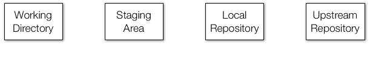

现在，为了使用这种策略，您需要在 GitHub 上有一个账户。在接下来的两个部分中，我们将指导您如何设置账户并在 GitHub 上创建仓库。

## 19.3 GitHub 账户

基本 GitHub 账户是免费的。要创建一个，请访问 GitHub⁴，在那里您将看到一个可以注册的框。

您需要仔细选择名称。它应该简短、易于记忆和拼写，与您的名字有关，并且专业。这一点很重要，因为您可能会向潜在雇主发送您 GitHub 账户的链接。您的首字母和姓氏通常是不错的选择。

## 19.4 GitHub 仓库

一旦您有了账户，您现在就可以创建一个 GitHub 仓库，它将作为项目的主体或上游仓库。您添加到这个项目的协作者将能够管理他们电脑上的本地仓库并推送更改。Git 将帮助您保持所有不同副本的同步。

要创建仓库，首先通过点击 GitHub 上的 *登录* 按钮登录到您的账户。您可能已经登录，在这种情况下，*登录* 按钮将不会显示。如果需要登录，您将需要输入用户名和密码。我们建议您设置浏览器记住这些信息，以避免每次都输入。

一旦登录到您的账户，您就可以点击 *仓库*，然后点击 *新建* 来创建一个新的仓库。系统会提示您输入一个名称：

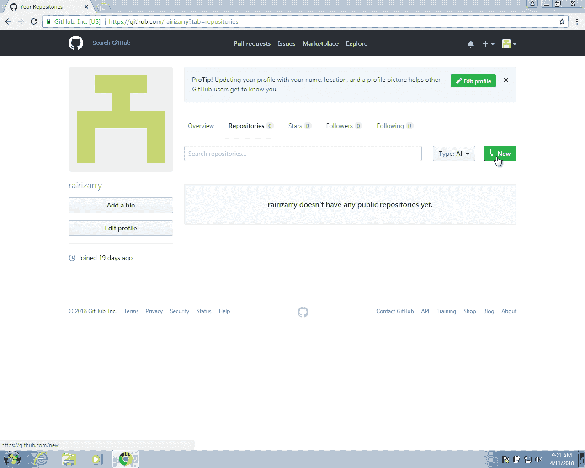

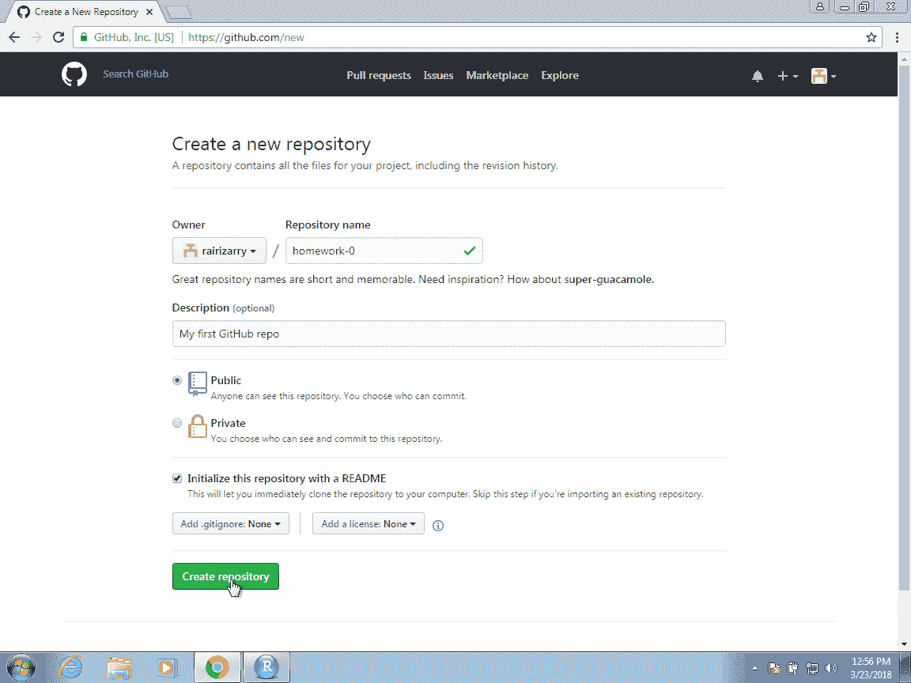

当命名您的项目时，选择一个描述性的名称，清楚地说明项目的内容。请记住，随着您参与更多项目，您将积累许多仓库。为了说明，我们将使用名称 `homework-0`。

您还将被提示决定您的仓库应该是公开的还是私有的。为了做出决定，了解以下区别：

+   **公共仓库**：互联网上的任何人都可以看到这些。只有协作者才能进行更改。

+   **私有仓库**：只有您授权访问的人才能查看它们。

虽然还有其他设置要考虑，但我们通常坚持使用 GitHub 提供的默认选项。

创建您的仓库后，GitHub 将向您展示步骤，将您的本地仓库（您电脑上的那个）链接到您在 GitHub 上设置的新仓库。他们将会提供一些可以直接复制粘贴到您的终端中的代码。我们将分解这些代码，以便您确切地知道每个命令的作用。

## 19.5 连接 Git 和 GitHub

当访问 GitHub 时，您需要凭证来验证您的身份。有两种连接方式：HTTPS 或 SSH，每种都需要不同的凭证。我们建议使用 HTTPS，它使用个人访问令牌（PAT）。请注意，**您的 GitHub 网站密码不是您的访问令牌**。

GitHub 提供了一份详细的指南，说明如何获取访问令牌⁵，您可以在 GitHub 文档网站上通过搜索“管理您的个人访问令牌”找到它⁶。要生成令牌：

1.  仔细遵循 GitHub 提供的说明。

1.  在设置令牌权限时，选择*不失效*，并在*作用域*部分选择*repo*选项。

完成这些步骤后，GitHub 将显示您的令牌——一串长长的字符。然后您应该：

1.  立即复制此令牌到您的剪贴板。请记住，这是 GitHub 唯一一次向您显示它的时候。

1.  为了安全起见，请将此令牌保存在密码管理器中。这确保了您在需要时可以访问它。

在以下一些流程中，您将被提示输入您的密码。相反，请粘贴您已复制的令牌。在此之后，密码提示应不再出现。如果您以后需要令牌，请从密码管理器中检索它。

对于更详细的解释，包括如何使用 SSH 而不是 HTTPS，请参阅 Happy Git and GitHub for the useR⁷。

下一步是让 Git 知道我们是谁。这将使与 GitHub 连接更容易。为此，请在我们的终端窗口中输入以下两个命令：

```r
git config --global user.name "Your Name"
git config --global user.mail "your@email.com"
```

这将更改 Git 配置，以便每次您使用 Git 时，它都会知道这些信息。请注意，**您需要使用您用于打开 GitHub 账户的电子邮件账户**。

## 19.6 初始设置

在终端中，切换到您想要存储本地仓库的目录。我们建议将目录命名为与 GitHub 仓库相同的名称。在我们的示例中，我们会使用：

```r
mkdir homework-0
cd homework-0
```

然后，我们将目录初始化为 Git 仓库，开始版本控制过程。

```r
git init
```

*main 与 master* *GitHub 现在使用`main`作为默认分支名称。在过去，Git 和 GitHub 都使用`master`作为默认。因此，许多较旧的仓库或较旧的 Git 版本可能仍然使用`master`作为其主要分支*。

为了确保您的本地分支与 GitHub 仓库的分支名称一致：

1.  访问 GitHub 仓库页面。

1.  检查左侧的下拉菜单，其中列出了分支。这将显示默认分支名称。

要验证你的本地分支名称，请使用：

```r
git branch
```

如果你看到分支名称不是`main`，但希望它是`main`，可以使用以下命令重命名：

```r
git branch -M main*
```

`-M`代表移动。请注意，这与更改分支不同，它是重命名当前分支。* *要将本地仓库与其在 GitHub 上的对应仓库链接起来，你需要 GitHub 仓库的 URL。要找到这个 URL，请访问仓库的网页。点击绿色的*代码*按钮以快速复制 URL，在我们的例子中是`https://github.com/rairizarry/homework-0.git`。

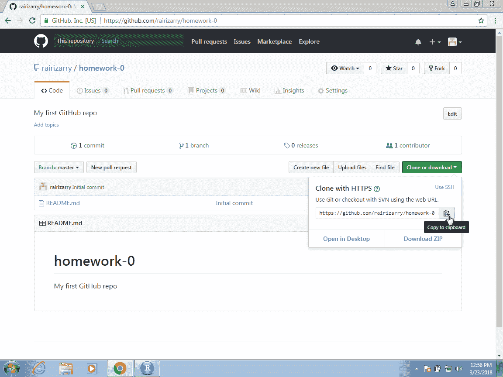

一旦你有了这个，你可以输入：

```r
git remote add origin https://github.com/rairizarry/homework-0.git
```

要理解这个命令，请注意`git remote add`添加了一个新的远程引用。在 Git 中，*远程*指的是你的代码仓库存储的另一个地方，通常在互联网或另一个网络上。`origin`是给远程仓库或其他人将之视为主项目源的中央仓库的常规名称。它基本上是仓库 URL 的简写别名。你可以技术上将其命名为任何你想要的名称，但`origin`是最常用的约定。最后，`https://github.com/rairizarry/homework-0.git`是远程仓库的 URL。它告诉 Git 仓库托管的位置。这些命令共同设置了一个新的本地 Git 仓库，并将其链接到 GitHub 上的远程仓库。* *## 19.7 Git 基础知识

现在你已经初始化了一个目录来存储你的本地仓库，我们可以学习如何将文件从我们的*工作目录*移动到上游仓库。

### 19.7.1 工作目录

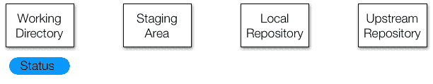

工作目录与你的 Unix 工作目录相同。在我们的例子中，如果我们创建`homework-0`目录中的文件，它被认为是工作目录的一部分。Git 可以使用命令告诉你工作目录中的文件与其他区域中文件版本的关系：

```r
git status
```

因为我们还没有做任何事情，你应该会收到一条类似的消息：

```r
On branch main

No commits yet

nothing to commit (create/copy files and use "git add" to track)
```

如果我们添加一个文件，比如`code.R`，你会看到一条类似的消息：

```r
Untracked files:
  (use "git add <file>..." to include in what will be committed)
    code.R
```

### 19.7.2 添加

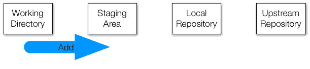

现在我们将对这些文件进行修改。最终，我们希望这些文件的这些新版本被跟踪并与上游仓库同步。但我们不想跟踪每一个小变化：我们不想同步，直到我们确信这些版本足够最终，可以作为一个新版本分享。因此，暂存区的编辑不会被版本控制系统保留。

为了演示，我们将`code.R`添加到暂存区：

```r
git add code.R
```

现在运行`git status`会显示：

```r
Changes to be committed:
  (use "git rm --cached <file>..." to unstage)
    new file:   code.R
```

注意，工作目录中有不在暂存区的其他文件并不是问题。例如，如果我们创建文件`test-1.R`和`test-2.R`，`git status`会提醒我们这些文件尚未暂存：

```r
On branch main

No commits yet

Changes to be committed:
  (use "git rm --cached <file>..." to unstage)
    new file:   code.R

Untracked files:
  (use "git add <file>..." to include in what will be committed)
    test-1.R
    test-2.R
```

### 19.7.3 提交

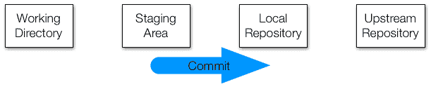

如果我们现在准备好制作仓库的第一个版本，该版本仅包括 `code.R`，我们可以使用以下命令：

```r
git commit -m "Adding a new file." 
```

注意，`commit` 需要我们添加一条消息。使这些消息信息丰富将帮助我们记住为什么做出这个更改。运行 `commit` 后，我们将收到一条消息，告知我们已提交：

```r
[main (root-commit) 1735c25] adding a new file
 1 file changed, 0 insertions(+), 0 deletions(-)
 create mode 100644 code.R
```

注意，如果我们编辑 `code.R`，它只会在工作目录中发生变化。`git status` 会显示给我们

```r
Changes not staged for commit:
 (use "git add <file>..." to update what will be committed)
  (use "git restore <file>..." to discard changes in working directory)
    modified:   code.R
```

要将编辑后的文件添加到本地仓库，我们需要暂存编辑后的文件并提交更改

```r
git add code.R
git commit -m "Added some lines of code."
```

这将给我们一条消息，告知我们已进行更改：

```r
[main 8843673] added some lines of code
 1 file changed, 1 insertion(+)
```

注意，我们可以通过在 `commit` 命令后跟要提交的文件，只用一行命令就达到相同的效果：

```r
git commit -m "Added some lines of code." code.R
```

当文件更改的数量很少，并且我们可以在末尾列出它们时，这很方便。

要查看版本控制的实际操作，请注意当我们输入

```r
git log code.R
```

我们得到存储在我们日志中的版本列表：

```r
commit 88436739dcbd57d8ad27a23663d30fd2c06034ca (HEAD -> main)
Author: Rafael A Irizarry 
Date:   Sun Sep 3 15:32:03 2023 -0400

    Added some lines of code.

commit 1735c25c675d23790df1f9cdb3a215a13c8ae5d6
Author: Rafael A Irizarry 
Date:   Sun Sep 3 15:27:19 2023 -0400

    Adding a new file.
```

### 19.7.4 push

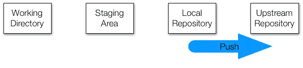

一旦我们准备好将本地仓库与上游 GitHub 仓库同步，我们可以使用

```r
git push -u origin main
```

*如果您是第一次将代码推送到您的 GitHub 账户，您将需要输入密码，并输入我们在第 19.5 节中描述的个人访问令牌。您可能只需要这样做一次。*  *`-u` 标志，代表 `--set-upstream`，将使 Git 记住在这个仓库中，您想要推送到远程仓库 `origin` 中定义的 `main` 分支。这很有益处，因为下次您想要从这个分支推送到或拉取时，您只需简单地使用

```r
git push
```

如果您需要提醒您正在推送到哪里，您可以输入

```r
git remote -v
```

`v` 代表 `verbose`。在我们的例子中，我们将得到

```r
origin  https://github.com/username/homework-0.git (fetch)
origin  https://github.com/username/homework-0.git (push)
```

我们接下来描述 `fetch`。如果您没有收到任何回复，这意味着您还没有定义远程仓库，就像我们在第 19.6 节中所做的那样。*  *### 19.7.5 fetch 和 merge

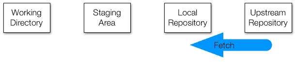

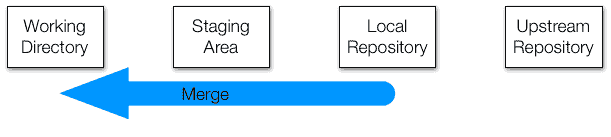

如果这是一个协作项目，上游仓库可能会发生变化，与您的版本不同。为了更新您的本地仓库以与上游仓库一致，我们使用 `fetch` 命令：

```r
git fetch
```

然后为了将这些副本放入我们的工作目录，我们使用以下命令：

```r
git merge
```

### 19.7.6 pull

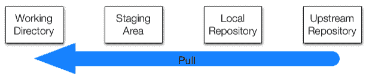

我们经常只想获取和合并，而不进行检查。为此，我们使用：

```r
git pull
```

### 19.7.7 克隆

您可以轻松地从现有的公共仓库使用 `git clone` 下载所有代码和版本控制日志。当您克隆时，您实际上是在制作整个目录的完整副本。例如，您可以使用以下方式下载创建此书所使用的所有代码：

```r
git clone https://github.com/rafalab/dsbook-part-1.git
```

您可以看到一个简单的示例，这是通过克隆此仓库在 Unix 章节中创建的谋杀目录：

```r
git clone https://github.com/rairizarry/murders.git
```

如果你使用 `git clone`，你不需要初始化，因为分支和远程仓库已经定义好了。现在，要推送更改，你需要被添加为合作者。否则，你将不得不遵循更复杂的 *pull request* 流程，这里我们不涉及。*  *## 19.8 .gitignore

当我们使用 `git status` 时，我们获得有关本地仓库中所有文件的信息。但并不一定需要将工作目录中的所有文件添加到 Git 仓库中，只需那些我们想要跟踪或共享的文件。如果我们的工作正在生成我们不希望跟踪的特定类型的文件，我们可以将这些文件定义的后缀添加到 .gitignore 文件中。关于使用 .gitignore 的更多详细信息，请参阅 git-scm 网站⁸。当你输入 `git status` 时，这些文件将不再出现。

## 19.9 Git in RStudio

虽然命令行 Git 是一个强大且灵活的工具，但当我们刚开始时，它可能会有些令人望而生畏。RStudio 提供了一个图形界面，它简化了在数据分析项目中使用 Git 的过程。

要这样做，我们开始一个项目，但不是选择 *New Directory* 或 *Existing Directory*，而是选择 *Version Control*，然后我们将选择 *Git* 作为我们的版本控制系统：

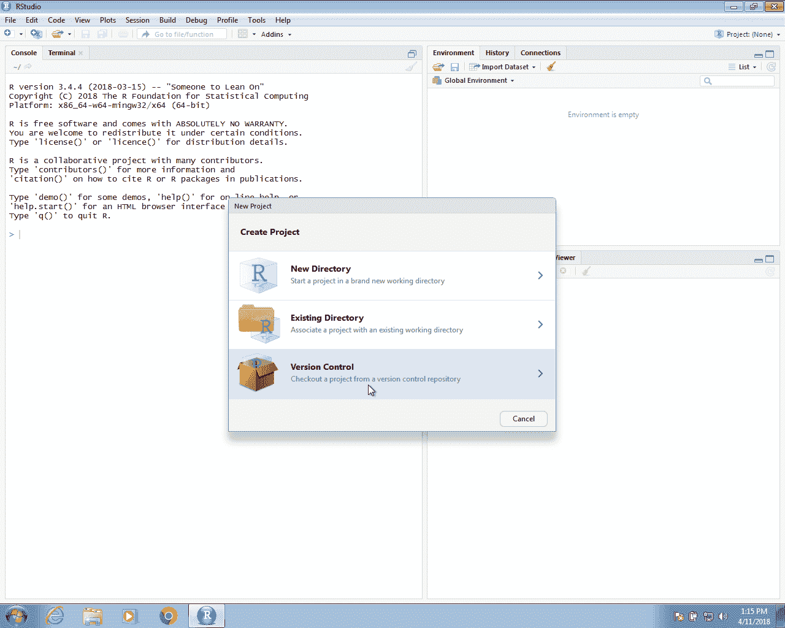

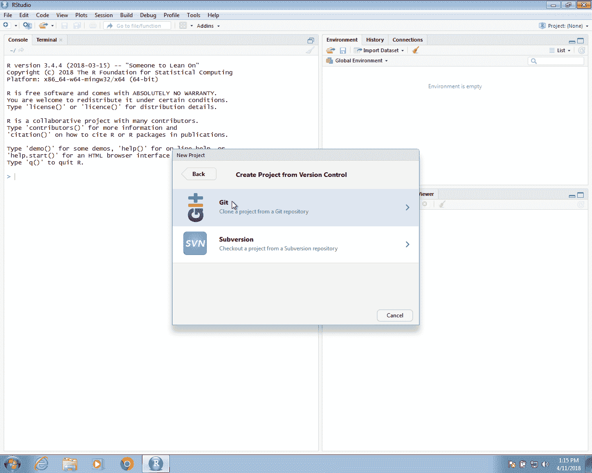

仓库 URL 是你用作 `origin` 或克隆的链接。在 第 19.4 节 中，我们使用了 `https://github.com/username/homework-0.git` 作为示例。在项目目录名称中，你需要放入生成的文件夹名称，在我们的示例中，这将是仓库的名称 `homework-0`。这将在你的本地系统中创建一个名为 `homework-0` 的文件夹。注意，如果你已经存在该文件夹，则需要删除它或选择不同的名称。一旦这样做，项目就创建好了，并且它知道与 GitHub 仓库的连接。你将在右上角看到项目名称和类型，以及右上角的新标签页，标题为 *Git*。

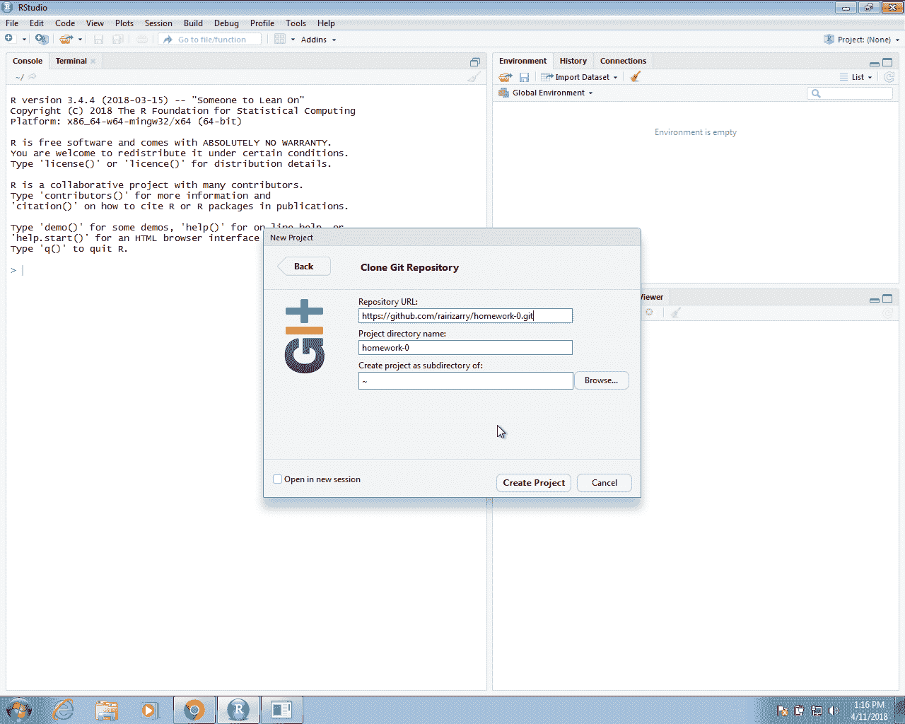

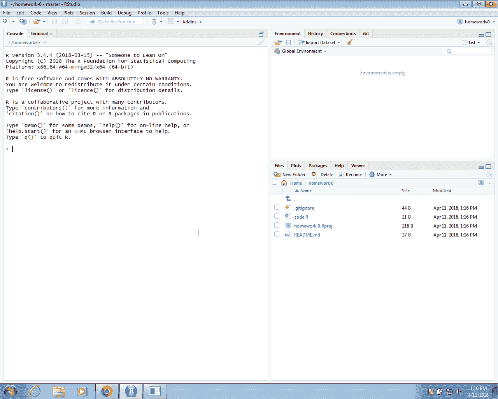

如果你选择这个标签页，它将显示你的项目中的文件，排除 `.gitignore` 中的文件，以及一些图标，这些图标会给你提供关于这些文件及其与仓库关系的详细信息。在下面的示例中，我们已经在文件夹中添加了一个文件，名为 *code.R*，你可以在编辑面板中看到它。

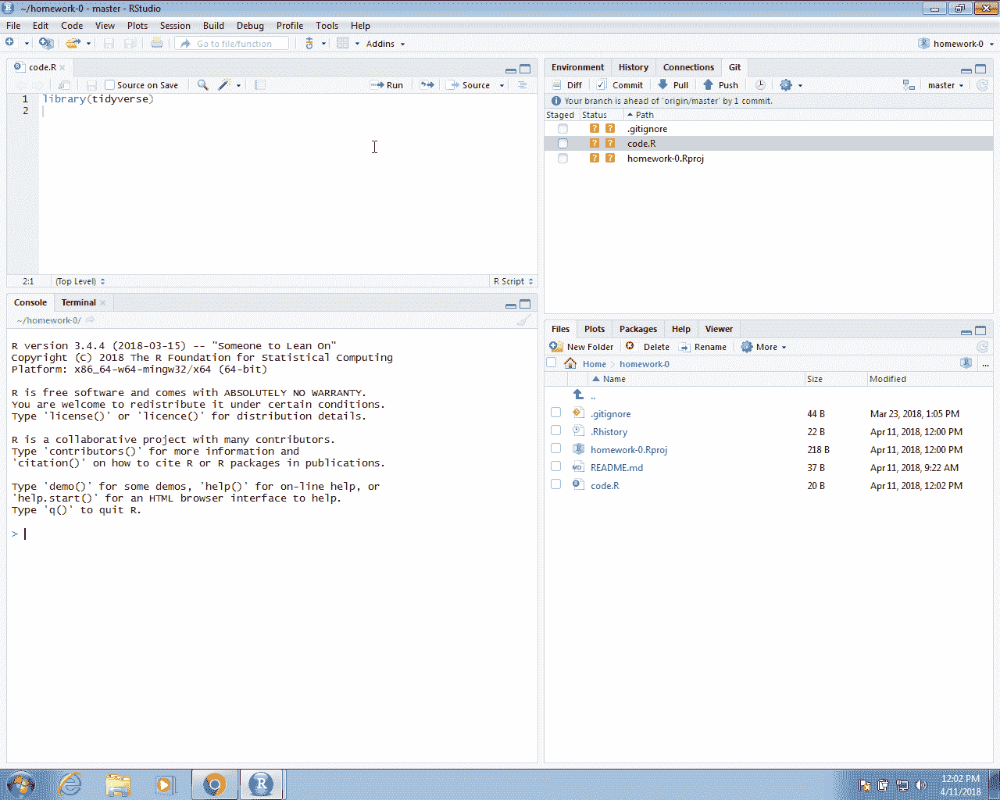

我们现在需要关注 Git 选项卡。重要的是要知道，**你的本地文件和 GitHub 仓库不会自动同步**。如 第 19.2 节 所述，当你准备好时，你必须使用 git push 进行同步。我们将在下面的 RStudio 中而不是在终端中展示如何这样做。

在我们开始协作项目之前，我们通常首先做的事情是从远程仓库*拉取*更改，在我们的例子中是 GitHub 上的那个。然而，对于这里显示的示例，由于我们从一个空的仓库开始，并且我们是唯一进行更改的人，所以我们不需要从拉取开始。

在 RStudio 中，文件相对于远程和本地仓库的状态通过带有颜色的状态符号表示。黄色方块表示 Git 对此文件一无所知。为了与 GitHub 仓库同步，我们需要*添加*该文件，然后*提交*更改到我们的本地 Git 仓库，然后*推送*更改到 GitHub 仓库。目前，该文件仅存在于我们的计算机上。要使用 RStudio 添加文件，我们点击*暂存*框。你会看到状态图标现在变成了绿色 A。

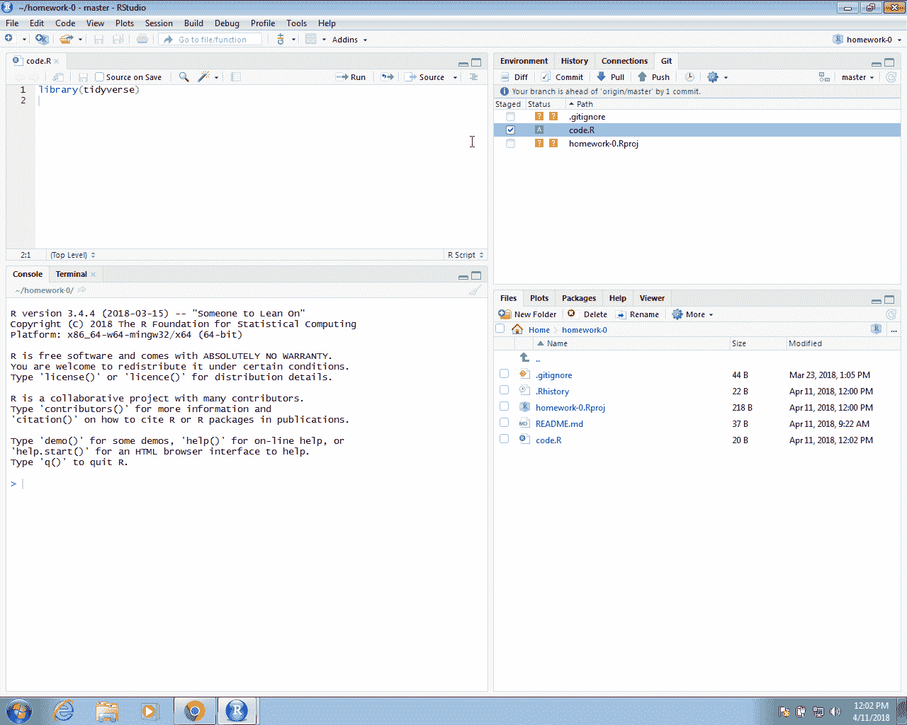

现在我们已准备好将文件提交到我们的本地仓库。在 RStudio 中，我们可以使用*提交*按钮。这将打开一个新的对话框窗口。使用 Git 时，每次我们提交更改，都必须输入一个描述正在*提交*的更改的消息。

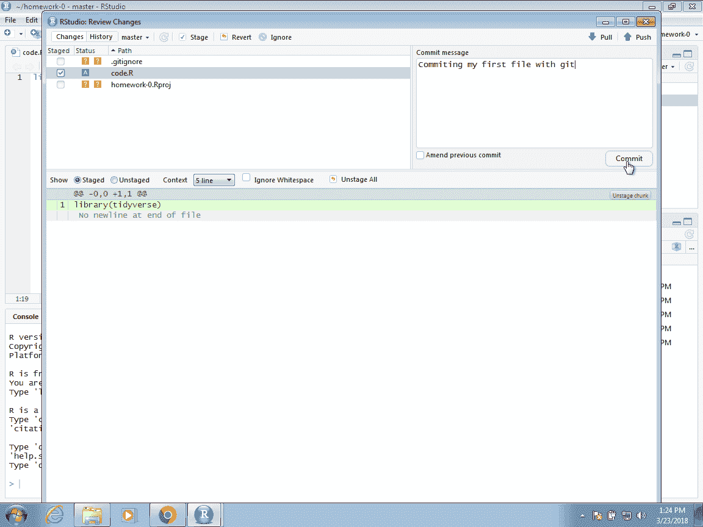

在这种情况下，我们将简单地描述我们正在添加一个新的脚本。在这个对话框中，RStudio 还会给你一个关于你要更改到 GitHub 仓库的内容的摘要。在这种情况下，因为它是一个新文件，整个文件都被高亮显示为绿色，这突出了更改。

一旦我们点击提交按钮，我们应该会看到 Git 发来的一个包含已提交更改摘要的消息。现在我们已准备好将这些更改*推送*到 GitHub 仓库。我们可以通过点击右上角的*推送*按钮来完成此操作：

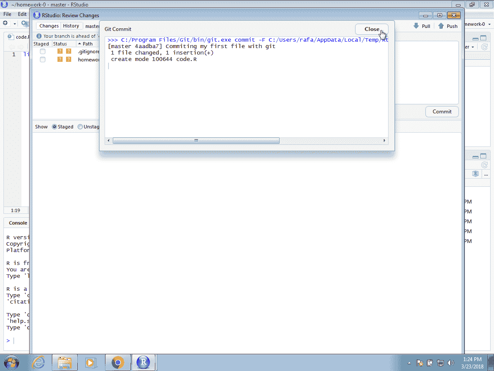

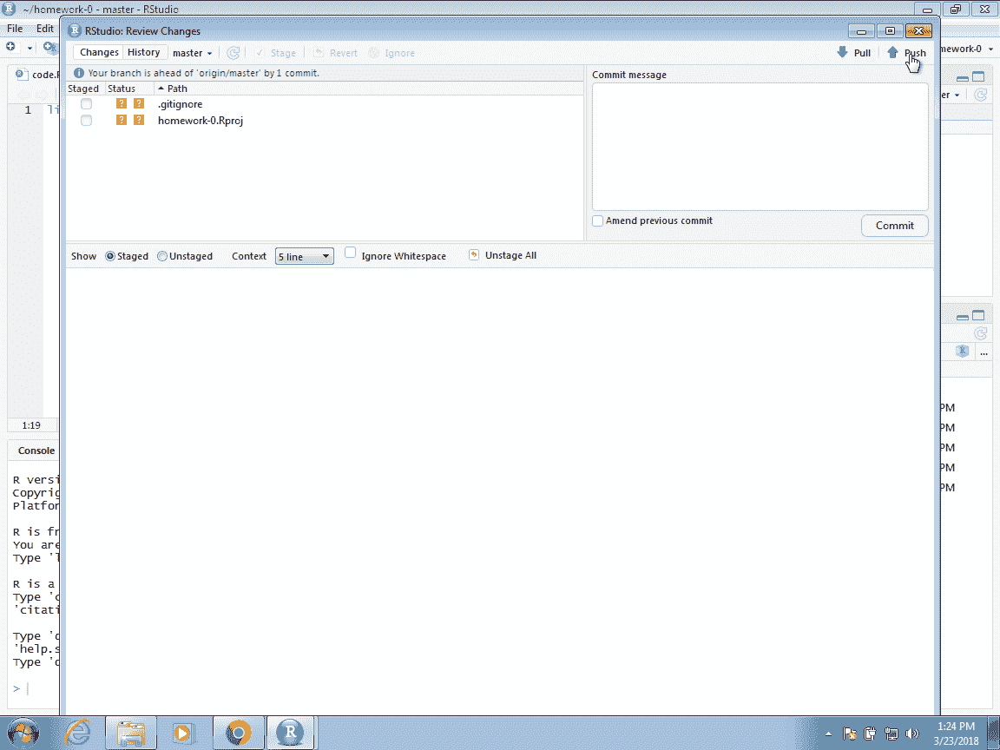

现在，我们看到 Git 发来的消息，告知我们推送已成功。在弹出的窗口中，我们不再看到 `code.R` 文件。这是因为自上次推送以来，我们没有进行任何新的更改。现在我们可以退出这个弹出窗口，继续我们的代码工作。

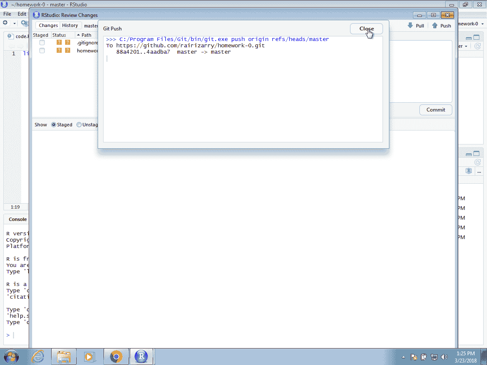

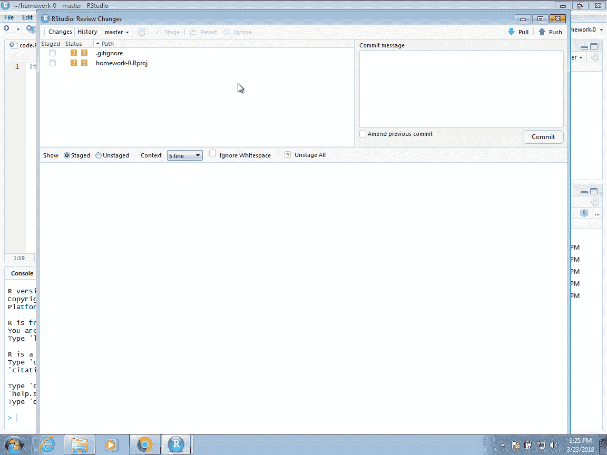

如果我们现在访问我们的仓库在网页上，我们会看到它与我们的本地副本相匹配。

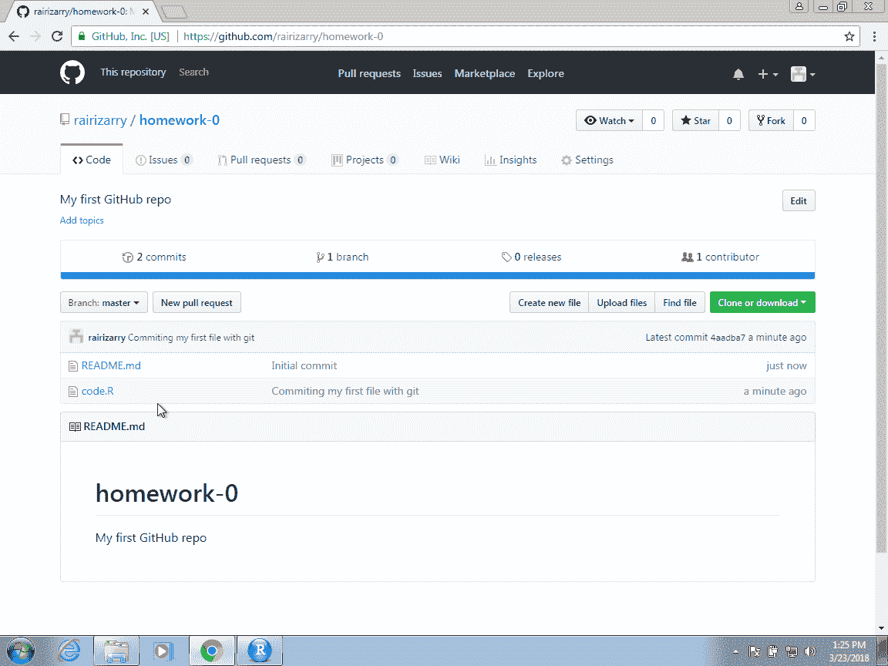

恭喜你，你已经在 GitHub 仓库成功共享了代码！

*对于这里显示的示例，我们只添加了 *code.R*。但，一般来说，对于 RStudio 项目，我们建议添加一个 README.md 文件以及 .gitignore 和 .Rproj 文件。** *

1.  [`www.codecademy.com/learn/learn-git`](https://www.codecademy.com/learn/learn-git)↩︎

1.  [`guides.github.com/activities/hello-world/`](https://guides.github.com/activities/hello-world/)↩︎

1.  [`happygitwithr.com/`](http://happygitwithr.com/)↩︎

1.  [`github.com/`](https://github.com/)↩︎

1.  [`docs.github.com/en/authentication/keeping-your-account-and-data-secure/managing-your-personal-access-tokens`](https://docs.github.com/en/authentication/keeping-your-account-and-data-secure/managing-your-personal-access-tokens)↩︎

1.  [`docs.github.com/en`](https://docs.github.com/en)↩︎

1.  [`happygitwithr.com/https-pat`](https://happygitwithr.com/https-pat)↩︎

1.  [`git-scm.com/docs/gitignore`](https://git-scm.com/docs/gitignore)↩︎***
