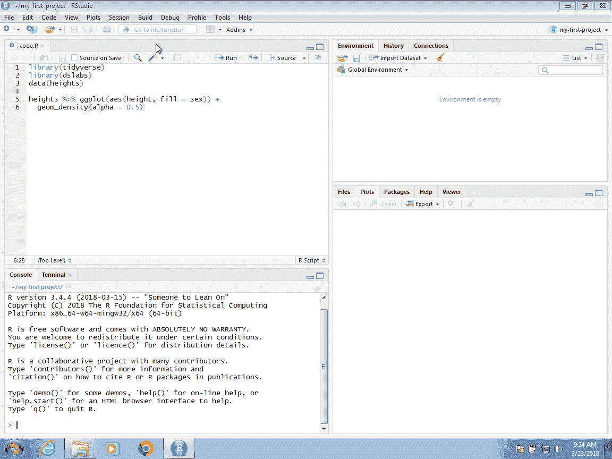
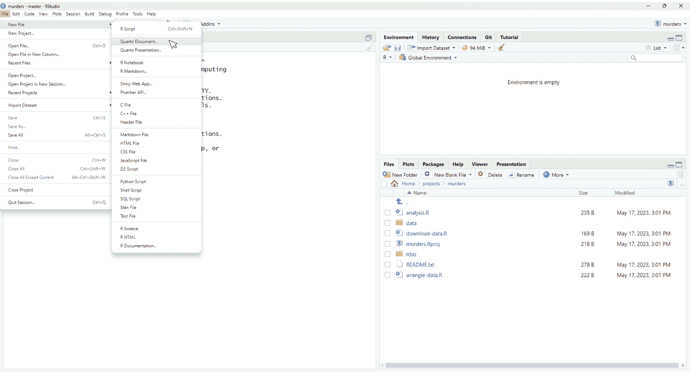
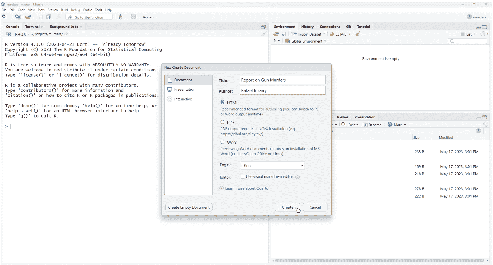
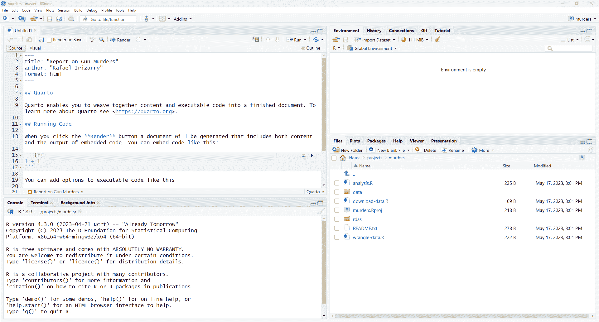
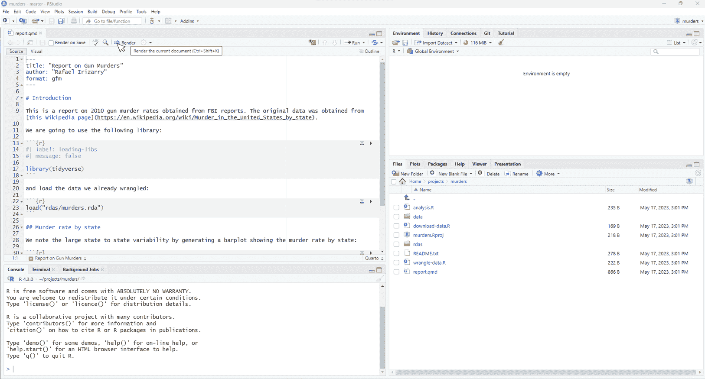
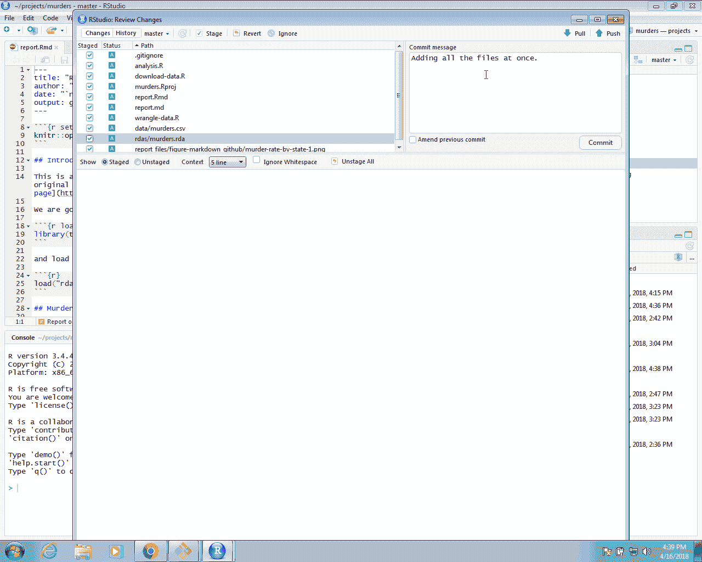

# 20  可重复的项目

> 原文：[`rafalab.dfci.harvard.edu/dsbook-part-1/productivity/reproducible-projects.html`](https://rafalab.dfci.harvard.edu/dsbook-part-1/productivity/reproducible-projects.html)

1.  生产力工具

1.  20  可重复的项目

数据分析项目的最终产品通常是报告。许多科学出版物可以被视为数据分析的最终报告。同样，基于数据的新闻报道、您公司的分析报告或数据分析课程讲义也是如此。这些报告通常是在纸上或在包含分析结果文本描述和一些图表、表格的 PDF 文件中。

想象一下，在你完成分析和报告后，你被告知你得到了错误的数据集，你收到了一个新的数据集，并被要求运行相同的分析。或者，如果你意识到犯了一个错误，你需要重新检查代码，修复错误，并重新运行分析呢？或者想象一下，你正在培训的人想看看你的代码，并能够重现结果来了解你的方法？

就像刚才描述的情况一样，对于数据分析师来说实际上是非常常见的。在这里，我们描述了如何使用 RStudio 来组织您的项目，以便重新运行分析变得简单直接。然后我们演示了如何使用 quarto 或 R markdown 生成可重复的报告。**knitR**包将极大地帮助以最少的工作重新创建报告。这是由于 markdown 文档允许将代码和文本描述组合到同一文档中，并且由代码生成的图表和表格会自动添加到文档中。

## 20.1 RStudio 项目

RStudio 提供了一种方法，可以将数据分析项目的所有组件组织到一个文件夹中，并在一个地方跟踪有关此项目的信息，例如文件的 Git 状态。在第 19.9 节中，我们展示了 RStudio 如何通过 RStudio 项目促进 Git 和 GitHub 的使用。在本节中，我们简要演示了如何启动一个新的项目以及一些关于如何保持项目组织有序的建议。RStudio 项目还允许您同时打开多个 RStudio 会话，并跟踪每个会话是哪一个。

要开始一个项目，点击*文件*然后*新建项目*。通常我们已经在保存工作的地方创建了一个文件夹，就像我们在第 18.6 节中所做的那样，我们选择*现有目录*。在这里，我们展示了一个例子，我们还没有创建文件夹，并选择了*新建目录*选项。


然后，对于数据分析项目，你通常选择*新建项目*选项：


现在，您必须决定与您的项目关联的文件夹的位置以及文件夹的名称。在选择文件夹名称时，就像文件名一样，确保它是一个有意义的名称，这将帮助您记住项目的内容。与文件一样，我们建议使用小写字母，没有空格，并使用连字符来分隔单词。我们将把这个项目的文件夹命名为 `my-first-project`。这将在这个项目关联的文件夹中生成一个名为 `my-first-project.Rproj` 的 *Rproj* 文件。我们将在下面几行中看到这如何有用。


您将获得选项，以确定此文件夹在您的文件系统中的位置。在这个例子中，我们将将其放置在我们的主文件夹中，但这通常不是好的做法。正如我们在 Unix 章节中描述的 第 18.6 节，您希望按照分层方法组织您的文件系统，并使用名为 *projects* 的文件夹来保存每个项目的文件夹。


当您使用项目启动 RStudio 时，您将在右上角看到项目名称。这将提醒您这个特定的 RStudio 会话属于哪个项目。当您在没有项目的情况下打开 RStudio 会话时，它将显示 *项目：无*。

在处理项目时，所有文件都将保存在与项目关联的文件夹中，并在此文件夹中进行搜索。下面，我们展示了一个我们编写的并保存为 `code.R` 命名的脚本示例。因为我们为项目使用了有意义的名称，所以在命名文件时可以稍微不那么详细。尽管我们在这里没有这样做，但您可以同时打开几个脚本。您只需点击 *文件*，然后 *新建文件*，选择您想要编辑的文件类型。


使用项目的主要优点之一是，在关闭 RStudio 后，如果我们希望继续在项目中的工作，我们只需双击或打开我们首次创建 RStudio 项目时保存的文件。在这种情况下，文件名为 `my-first-project.Rproj`。如果我们打开此文件，RStudio 将启动并打开我们正在编辑的脚本。




另一个优点是，如果您点击两个或更多不同的 Rproj 文件，您将为每个文件启动新的 RStudio 和 R 会话。

## 20.2 Markdown

Markdown 是一种用于 *文学编程* 文档的格式，广泛用于生成 html 页面或 pdf 文档。文学编程将指令、文档和详细的注释编织在机器可执行代码之间，生成一个描述程序的文档，这对于人类理解来说是最优的¹。您可以通过在线教程了解更多关于 Markdown 的信息²。

与 Microsoft Word 等文字处理器不同，在 markdown 中，你需要 *编译* 文档以生成最终的报告。markdown 文档看起来与最终产品不同。这种做法一开始可能看起来是一个缺点，但从长远来看可以节省你的时间。例如，你不需要一个接一个地生成图表并将其插入到文字处理文档中，图表在编译文档时会自动添加。如果你需要更改图表，只需在编辑生成图表的代码后重新编译文档即可。

在 R 中，我们可以使用 Quarto 或 R Markdown 生成文献编程文档。我们推荐使用 Quarto，因为它是一个比 R Markdown 更新且更灵活的版本，允许使用除 R 之外的语言。由于 R Markdown 比 Quarto 早几年，许多公共和教育文献编程文档都是用 R Markdown 编写的。然而，由于格式相似，并且两者都使用 **knitr** 包来执行 R 代码（详情见 20.2.4 节），大多数现有的 R Markdown 文件无需修改即可用 Quarto 渲染。

在 RStudio 中，你可以通过点击 *文件*，*新建文件*，然后分别选择 *Quarto 文档* 或 *R Markdown* 来开始一个 Quarto 或 R Markdown 文档。接下来，系统会要求你输入文档的标题和作者。我们将准备一份关于枪支谋杀的报告，所以我们会给它一个合适的名字。你也可以决定最终报告的格式：HTML、PDF 或 Microsoft Word。稍后我们可以轻松更改这个格式，但在这里我们选择 html，因为它是调试目的的首选格式：





这将生成一个模板文件：



作为一个惯例，我们使用 `qmd` 和 `Rmd` 后缀分别代表 Quarto 和 R Markdown 文件。

一旦你熟悉了 markdown，你将能够不使用模板就能做到这一点，可以直接从一个空白模板开始。

在模板中，你会看到一些需要注意的事项。

### 20.2.1 标题

在顶部，你可以看到：

```r
---
title: "Report on Gun Murders"
author: "Rafael Irizarry"
format: html
---
```

`---` 之间的内容是 *YAML* 标题。YAML 是一种广泛使用的语言，主要用于提供配置数据。在 Quarto 和 R Markdown 中，它主要用于定义文档的选项。你可以在标题中定义比模板中包含的更多其他内容。我们在这里不讨论那些内容，但 quartoguide³ 中提供了大量信息。我们将强调的一个参数是 `format`。通过将其更改为，例如，`pdf`，我们可以控制编译时产生的输出类型。标题和作者参数会自动填写，因为我们已经在创建新文档时弹出的 RStudio 对话框中填写了空白。

### 20.2.2 R 代码块

在文档的各个地方，我们会看到类似的东西：

```r
```{r}

1 + 1

```r
```

这些是代码块。当你编译文档时，代码块内的 R 代码，在这个例子中是`1+1`，将被评估，并将结果包含在最终文档的相应位置。

要添加你自己的 R 代码块，你可以在 Mac 上使用快捷键 command-option-I，在 Windows 上使用 Ctrl-Alt-I 快速输入上述字符。

这同样适用于图表；图表将被放置在那个位置。我们可以写如下内容：

```r
```{r}

plot(1)

```r
```

默认情况下，代码也会显示。为了避免代码显示，可以使用一个带有`#|`注释的参数。为了避免在最终文档中显示代码，可以使用参数`echo: FALSE`。例如：

```r
```{r}

#| echo: false

1+1

```r
```

我们建议养成给 R 代码块添加标签的习惯。这在调试和其他情况下将非常有用。你可以通过添加一个描述性的词，如这样：

```r
```{r}

#| 标签：一加一

1+1

```r
```

### 20.2.3 全局执行选项

如果你想要全局应用一个选项，可以在标题下的`execute`部分包含它。例如，在标题中添加以下行可以使代码默认不显示：

```r
execute:
  echo: false
```

我们在这里不会详细说明，但随着你对 R Markdown 的熟悉，你将了解设置编译过程全局选项的优势。

### 20.2.4 knitR

我们使用**knitR**包来编译 Quarto 或 R markdown 文档。用于编译的具体函数是`knit`函数，它接受一个文件名作为输入。RStudio 提供了一个按钮，使得编译文档变得更加容易。对于下面的截图，我们已经编辑了文档，以生成关于枪支谋杀的报告。你可以在 GitHub 上看到这个文件⁴。现在你可以点击`Render`按钮：



注意，当你第一次点击`*Render*`按钮时，可能会弹出一个对话框，询问你是否需要安装所需的包。一旦安装了这些包，点击`Render`将编译你的 Quarto 文件，生成的文档将弹出来。

这个特定的例子生成一个 HTML 文档，你可以在工作目录中看到它。要查看它，打开终端并列出文件。你可以在浏览器中打开文件，并使用它来展示你的分析。你也可以通过将`format: html`改为`format: pdf`或`format: docx`来生成 PDF 或 Microsoft 文档。注意这是 Quarto 和 R markdown 之间的一个区别。在使用 R markdown 时，我们使用`output: html_document`、`output: pdf_document`或`output: word_document`。

我们还可以使用`format: gfm`来生成在 GitHub 上渲染的文档，这代表 GitHub flavored markdown。这将生成一个带有`md`后缀的 markdown 文件，在 GitHub 上渲染得很好。因为我们已经将这些文件上传到 GitHub，所以你可以点击`md`文件，你将看到报告作为一个网页：


这是一种方便的分享报告的方式。

### 20.2.5 学习更多

R markdown 有很多其他用途。我们强烈建议你在撰写 R 报告的过程中继续学习，以获得更多经验。互联网上有许多免费资源，包括：

+   The Quarto Guide⁵

+   Hello, Quarto tutorial⁶

+   Dynamic Documents with R and knitr textbook⁷

## 20.3 组织数据科学项目

在本节中，我们将所有内容整合在一起，创建美国谋杀案项目，并在 GitHub 上分享。

### 20.3.1 在 Unix 中创建目录

在 第 18.6 节 中，我们通过一个示例演示了如何使用 Unix 准备数据科学项目。这里我们继续这个示例，并展示如何使用 RStudio。在 第 18.6 节 中，我们使用 Unix 创建了以下目录：

```r
cd ~
cd projects
mkdir murders
cd murders
mkdir data rdas 
```

### 20.3.2 创建 RStudio 项目

在下一节中，我们将创建一个 RStudio 项目。在 RStudio 中，我们转到 *文件*，然后选择 *新建项目…*，当给出选项时，我们选择 *现有目录*。然后我们写下上面创建的 `murders` 目录的完整路径。


一旦你这样做，你将在 RStudio 的 *文件* 选项卡中看到你创建的 `rdas` 和 `data` 目录。


请记住，当我们在这个项目中时，我们的默认工作目录将是 `~/projects/murders`。你可以通过在 R 会话中输入 `getwd()` 来确认这一点。这很重要，因为它将帮助我们组织代码，当我们需要编写文件路径时。

在数据分析项目中，尽量始终使用相对路径。这些路径应相对于默认工作目录。使用完整路径的问题，包括使用家目录 `~` 作为路径的一部分，是代码可能无法在其他文件系统上工作，因为目录结构将不同。

### 20.3.3 编辑 R 脚本

现在让我们编写一个脚本，将文件下载到数据目录中。我们将把这个文件命名为 `download-data.R`。

此文件的将包含以下内容：

```r
url <- "https://raw.githubusercontent.com/rafalab/dslabs/master/inst/
extdata/murders.csv"
dest_file <- "data/murders.csv"
download.file(url, destfile = dest_file)
```

请注意，我们正在使用相对路径 `data/murders.csv`。

在 R 中运行此代码，你将看到在 `data` 目录中添加了一个文件。

现在我们准备编写一个脚本来读取这些数据，并准备一个我们可以用于分析的表格。将文件命名为 `wrangle-data.R`。此文件的内容将如下：

```r
library(tidyverse
murders <- read_csv("data/murders.csv")
murders <- murders |> mutate(region = factor(region),
 rate = total / population * 10⁵)
save(murders, file = "rdas/murders.rda")
```

再次注意，我们只使用相对路径。

### 20.3.4 保存处理后的数据

在这个文件中，我们介绍了一个我们之前没有见过的 R 命令：`save`。R 中的 `save` 命令将对象保存到称为 *rda 文件* 的东西中：*rda* 是 R 数据的缩写。我们建议在保存 R 对象的文件上使用 `.rda` 后缀。你会看到 `.RData` 也被使用了。

如果您运行上面的代码，处理后的数据对象将被保存在`rda`目录中的一个文件中。然后您可以使用`load`来恢复对象。尽管这里不是这种情况，但这种方法通常很实用，因为生成我们用于最终分析和图表的数据对象可能是一个复杂且耗时的过程。因此，我们只运行此过程一次并保存文件。但我们仍然希望能够从原始数据生成整个分析。

当`save`允许您保存多个对象，然后使用相同的名称加载时，`saveRDS`函数允许您保存一个对象，而不需要名称。要将其恢复，您使用`readRDS`函数。如何使用此函数的一个例子是，您在一个会话中保存它：

```r
saveRDS(murders, file = "rdas/murders.rda")
```

然后在另一个会话中读取它，使用您想要的任何对象名称：

```r
dat <- readRDS("rdas/murders.rda")
```

### 20.3.5 主要分析文件

现在我们准备好编写分析文件了。让我们称它为`analysis.R`。内容应该是以下内容：

```r
library(tidyverse
load("rdas/murders.rda")
 murders |> mutate(abb = reorder(abb, rate)) |>
 ggplot(aes(abb, rate)) +
 geom_bar(width = 0.5, stat = "identity", color = "black") +
 coord_flip()
```

如果您运行此分析，您将看到它生成一个图表。

### 20.3.6 其他目录

现在假设我们想要保存生成的图表以用于报告或演示。我们可以使用**ggplot**命令`ggsave`来完成此操作。但我们应该把图表放在哪里？我们应该有系统地组织，所以我们将把图表保存到名为`figs`的目录中。首先，在终端中输入以下内容来创建一个目录：

```r
mkdir figs
```

然后您可以添加以下行：

```r
ggsave("figs/barplot.png")
```

到您的 R 脚本中。如果您现在运行脚本，一个 png 文件将被保存到`figs`目录中。如果我们想要将此文件复制到我们正在开发演示的其他目录中，我们可以通过在终端中使用`cp`命令来避免使用鼠标。

### 20.3.7 README 文件

您现在在单个目录中拥有一个自包含的分析。最后的建议是创建一个`README.txt`文件，描述每个文件的功能，以便其他人阅读您的代码时受益，包括您未来的自己。这不会是一个脚本，而只是一些笔记。在 RStudio 中打开新文件时提供的选项之一是文本文件。您可以将类似以下内容保存到文本文件中：

```r
We analyze US gun murder data collected by the FBI.

download-data.R - Downloads csv file to data directory

wrangle-data.R - Creates a derived dataset and saves as R object in rdas
directory

analysis.R - A plot is generated and saved in the figs directory.
```

### 20.3.8 初始化 Git 目录

在第 19.6 节中，我们演示了如何初始化 Git 目录并将其连接到 GitHub 上的上游仓库，该仓库我们已经在该节中创建。

我们可以在 Unix 终端中这样做：

```r
cd ~/projects/murders
git init
git add README.txt
git commit -m "First commit. Adding README.txt file just to get started"
git remote add origin `https://github.com/rairizarry/murders.git`
git push -u origin remote
```

### 20.3.9 使用 RStudio 添加、提交和推送文件

我们可以继续添加和提交每个文件，但使用 RStudio 可能更容易。为此，通过打开 Rproj 文件来启动项目。应该会出现 git 图标，您可以使用这些图标添加、提交和推送。




我们现在可以前往 GitHub 确认我们的文件是否已上传。您可以在 GitHub 上看到这个项目的版本，它使用 Unix 目录组织⁸。您可以通过在终端使用`git clone`命令将副本下载到您的计算机上。此命令将在您的当前工作目录中创建一个名为`murders`的目录，所以请小心选择调用它的位置。

```r
git clone https://github.com/rairizarry/murders.git
```

* * *

1.  Knuth, Donald Ervin. “Literate programming.” The computer journal 27.2 (1984): 97-111\. [`academic.oup.com/comjnl/article/27/2/97/343244`](https://academic.oup.com/comjnl/article/27/2/97/343244)↩︎

1.  [`www.markdowntutorial.com/`](https://www.markdowntutorial.com/)↩︎

1.  [`quarto.org/docs/guide/`](https://quarto.org/docs/guide/)↩︎

1.  [`raw.githubusercontent.com/rairizarry/murders/master/report.qmd`](https://raw.githubusercontent.com/rairizarry/murders/master/report.qmd)↩︎

1.  [`quarto.org/docs/guide/`](https://quarto.org/docs/guide/)↩︎

1.  [`quarto.org/docs/get-started/hello/rstudio.html`](https://quarto.org/docs/get-started/hello/rstudio.html)↩︎

1.  [`duhi23.github.io/Analisis-de-datos/Yihue.pdf`](https://duhi23.github.io/Analisis-de-datos/Yihue.pdf)↩︎

1.  [`github.com/rairizarry/murders`](https://github.com/rairizarry/murders)↩︎
