# 1  分布

> 原文：[`rafalab.dfci.harvard.edu/dsbook-part-2/summaries/distributions.html`](https://rafalab.dfci.harvard.edu/dsbook-part-2/summaries/distributions.html)

1.  描述性统计量

1.  1  分布

在我们开始之前，我们明确指出，本章不会涉及概率论中的分布，这是用于建模不确定性的数学框架。我们将这一讨论推迟到本书的下一部分，在那里我们将贯穿使用它。在这里，我们关注*分布*作为描述和总结我们已收集的数据的一种方式。我们的目标是理解数据集中的变异和模式，而不进行概率性陈述或预测。本章引入的概念将作为理解概率分布的基础，在那里使用类似的工具来描述随机过程的可能结果。

为了说明理解分布及其与描述性统计量之间关系所需的概念，我们将假装我们需要向 ET，一个从未见过人类的地球外生物，描述我们同学的身高。作为第一步，我们需要收集数据。为此，我们要求学生报告他们的身高（英寸）。我们要求他们提供性别信息，因为我们知道存在两种不同的性别分布。我们收集数据并将其保存在**dslabs**包中包含的`heights`数据框中。

```r
[library](https://rdrr.io/r/base/library.html)(dslabs)
[str](https://rdrr.io/r/utils/str.html)(heights)
#> 'data.frame':    1050 obs. of  2 variables:
#>  $ sex   : Factor w/ 2 levels "Female","Male": 2 2 2 2 2 1 1 1 1 2 ...
#>  $ height: num  75 70 68 74 61 65 66 62 66 67 ...
```

*向 ET 传达身高的一种方法就是简单地发送一个包含所有身高的列表。然而，还有更有效的方法来传达这些信息，理解分布的概念将有所帮助。为了简化解释，我们首先关注男性的身高。我们将在第 3.3 节中检查女性的身高数据。

在这个阶段，我们纯粹将分布视为总结和描述数据的工具。在本书的下一部分，我们将将这些相同的思想与概率联系起来，在那里分布帮助我们建模不确定性。目前，我们的目标仅仅是探索我们所拥有的数据中存在的模式和变异。

结果表明，在某些情况下，下一章中引入的两个描述性统计量，即平均值和标准差，就足以帮助我们理解数据。我们将学习数据可视化技术，这些技术将帮助我们确定这两个数字的总结是否合适。这些相同的技巧在两个数字不足以描述时也可以作为替代方案。

## 1.1 变量类型

了解我们正在处理哪种变量类型非常重要，因为它将帮助我们确定最有效的方法来总结我们的数据并展示其分布。

我们将处理两种类型的变量：分类和数值。每种类型都可以分为另外两组：分类可以是有序的或无序的，而数值变量可以是离散的或连续的。

当数据值代表组而不是数字时，我们称这些数据为*分类数据*。两个简单的例子是性别（男或女）和美国地区（东北部、南部、北中部、西部）。即使这些数据不是数字，一些分类数据也可以排序，例如辣度（温和、中等、辣）。这些有序分类数据被称为*有序数据*。

数值数据可以是连续的或离散的。一个连续变量可以取一个范围内的任何值。例如，如果测量足够精确，身高是连续的，因为两个个体（即使是同卵双胞胎）之间的差异可以是任意小的分数。然而，如果身高四舍五入到最近的英寸，它就变成了离散的，因为值必须是整数。其他离散数据的例子包括抛掷 10 个硬币时的正面数量、一个人一天抽的香烟数量，或一小时光顾商店的客户数量。在这些情况下，值是可数的，不能取分数值。与可以随着精度增加而测量的连续数据不同，离散数据仅限于不同的、单独的值。

在实践中，有时将离散变量视为连续变量。例如，一个数字测量仪器可能记录数据为 16 位整数。然而，由于很少能获得完全相同的读数超过一次，因此将数据视为连续的是方便的。另一个例子是国家人口规模。尽管人口计数总是整数，但两个司法管辖区人口完全相同的情况很少见。因此，人口规模也通常被视为连续的。

## 1.2 相对频率分布

一组数字或类别的最基本统计摘要是其*分布*。简单来说，分布可以看作是具有许多条目的值的紧凑描述。这个概念对于本书的读者来说不应该陌生。例如，对于分类数据，*相对频率分布*简单地描述了每个唯一类别的比例：

\[ p_k = \frac{\text{类别 } k \text{ 出现在列表中的次数}}{n} \]

其中 \(n\) 是列表的长度。

这里有一个关于美国州区域的例子：

```r
[prop.table](https://rdrr.io/r/base/proportions.html)([table](https://rdrr.io/r/base/table.html)(state.region))
#> state.region
#>     Northeast         South North Central          West 
#>          0.18          0.32          0.24          0.26
```

*当数据是离散数值时，相对频率分布的定义方式相同，但更常见的是使用以下符号，因为频率可以被认为是数值的函数：

\[ f(x) = \frac{\text{值 } x \text{ 出现在列表中的次数}}{n} \]

这里是按最接近百万数四舍五入的美国各州人口分布，这些是离散的数值：

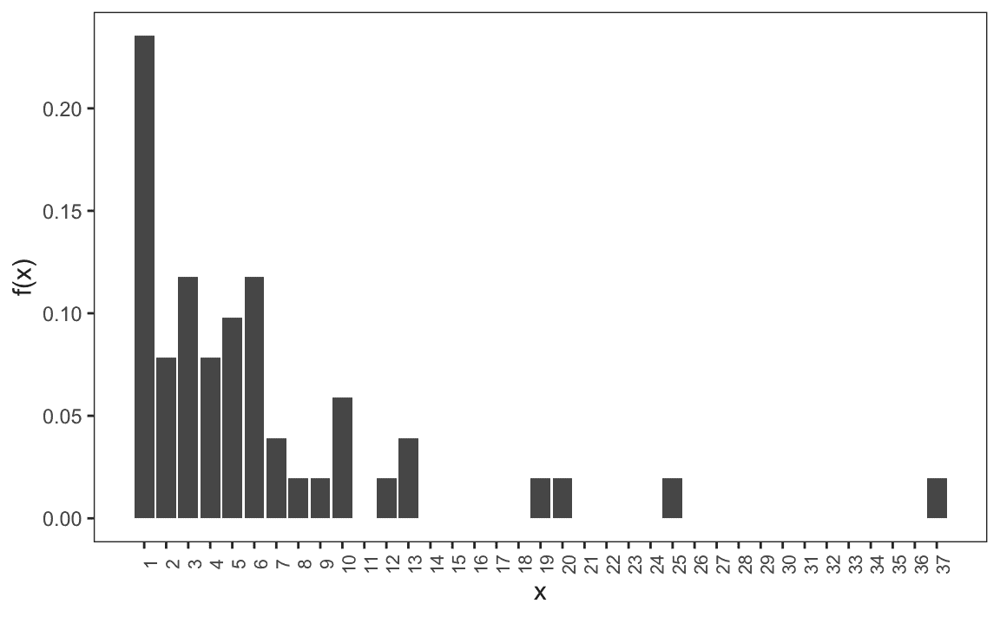*

## *1.3 实验累积分布函数*

*当数据是连续的时，基于分布构建摘要的任务更具挑战性，因为报告每个条目的频率不是一个有效的摘要：大多数条目是唯一的，因此相对频率分布并不能很好地总结。

下面是各州人口的相对频率：

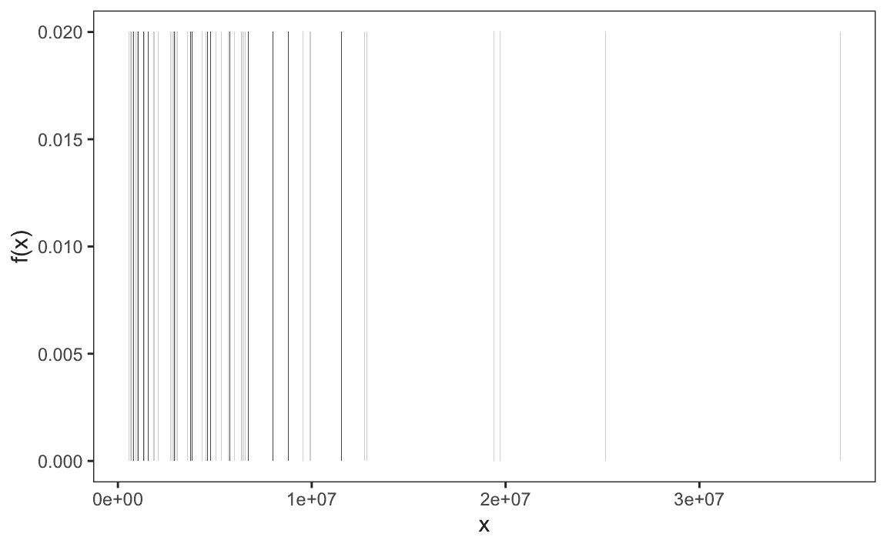

由于有 50 个州，每个州都有一个独特的种群值\(x\)，因此图表显示了每个州的\(f(x) = \frac{1}{50} = 0.02\)。

为了定义连续数值数据的分布，我们定义一个函数，该函数报告所有可能的值\(a\)下数据条目\(x\)的比例。这个函数被称为经验累积分布函数（eCDF），通常用\(F\)表示：

\[ F(a) = \mbox{小于或等于 }a\mbox{ 的数据点的比例} \]

下面是上述州人口数据的 eCDF：

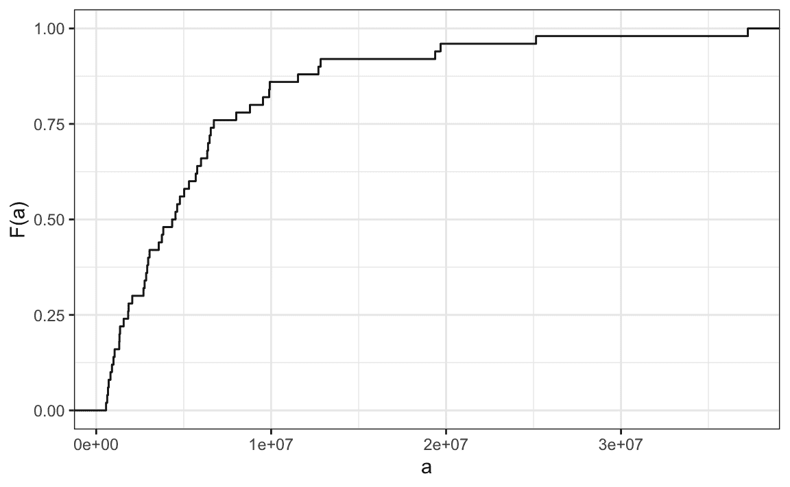

与频率表总结分类数据的方式相似，经验累积分布函数（eCDF）总结了连续数据。eCDF 提供了关于值如何分布的清晰图景，并突出了数据集的关键特征。例如，在人口数据中，我们可以看到大约一半的州的种群超过 500 万，而大多数州的种群低于 2000 万。这种类型的摘要有助于我们快速识别中位数、范围和其他重要的分布特征。

在我们关于身高的案例研究中，大多数学生报告的身高是四舍五入到最接近的英寸。然而，有些人没有这样做。例如，一名学生报告的身高为`68.503937007874`英寸，另一名学生报告的身高为`68.8976377952756`英寸。这些值分别对应于 174 厘米和 175 厘米转换为英寸，这表明一些学生知道自己的身高精确到厘米，并报告了这个数值除以 2.54。

因此，数据是连续的，相对频率分布有些令人困惑：

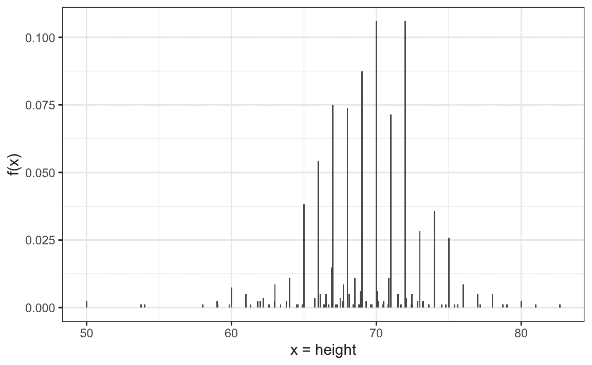

尽管这种方法保留了观察列表中的所有信息，但如果将洞察力外推到更广泛的群体，可能会产生误导性的印象。例如，它可能表明没有人的身高在 74 英寸到 74.5 英寸之间，或者有显著更多的人的身高正好是 72 英寸，而不是 71.5 英寸，这些模式我们知道并不准确。相比之下，经验累积分布图（eCDF）提供了更有用的视觉摘要：

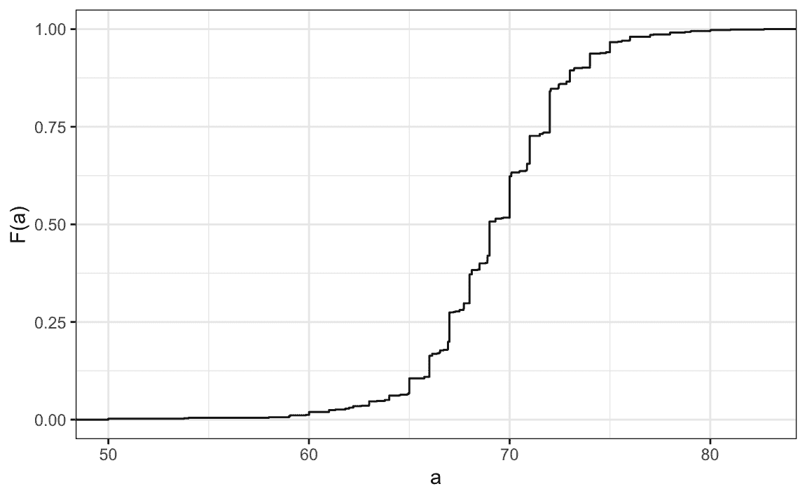

从对图表的快速浏览中，我们已能推断出数据的一些一般特征。例如，大约一半的男性身高低于 69 英寸，因为 \(F(69) \approx 0.5\)，而身高低于 60 英寸或高于 80 英寸是非常罕见的。此外，因为我们可以计算任何两个值 \(a\) 和 \(b\) 之间个体身高的比例 \(F(b) - F(a)\)，上面的图表包含了重建整个数据集所需的所有信息。

将俗语“一图胜千言”进行改写，在这种情况下，一张图的信息量相当于 812 个数字。

*我们添加“经验”这个词的原因是，正如我们将在第 6.1 节中看到的那样，累积分布函数（CDF）可以数学上定义，这意味着无需任何数据。**

## **1.4 直方图**

**尽管经验累积分布函数（eCDF）是统计学中的一个基本概念，但在实践中并不常用。主要原因是不易突出关键分布特征，如中心趋势、对称性或包含 95%值的范围。相比之下，直方图因其使这些特征更容易解释而更受欢迎。虽然直方图牺牲了一小部分信息，但它提供了对数据的更清晰的总结。**

要构建直方图，我们首先将数据的范围划分为非重叠的箱。每个箱作为一个类别，其高度被选择，使得条形的高度（即高度乘以箱宽度）代表该箱内观测值的相对频率。尽管直方图类似于条形图，但它不同之处在于 x 轴代表数值而不是类别。

如果我们将报告的身高四舍五入到最接近的英寸，并创建一个相对频率分布，我们得到一个以一英寸间隔定义的箱的直方图：

\[(49.5, 50.5], (50.5, 51.5], (51.5, 52.5], (52.5, 53.5], \dots, (82.5, 83.5]\]

我们可以使用以下**ggplot2**代码来完成这项工作：

```r
[library](https://rdrr.io/r/base/library.html)([tidyverse](https://tidyverse.tidyverse.org))
heights |> [filter](https://dplyr.tidyverse.org/reference/filter.html)(sex == "Male") |> 
 [mutate](https://dplyr.tidyverse.org/reference/mutate.html)(height = [round](https://rdrr.io/r/base/Round.html)(height)) |>
 [count](https://dplyr.tidyverse.org/reference/count.html)(height) |> [mutate](https://dplyr.tidyverse.org/reference/mutate.html)(f = n / [sum](https://rdrr.io/r/base/sum.html)(n)) |> 
 [ggplot](https://ggplot2.tidyverse.org/reference/ggplot.html)([aes](https://ggplot2.tidyverse.org/reference/aes.html)(height, f)) + [geom_col](https://ggplot2.tidyverse.org/reference/geom_bar.html)()
```

*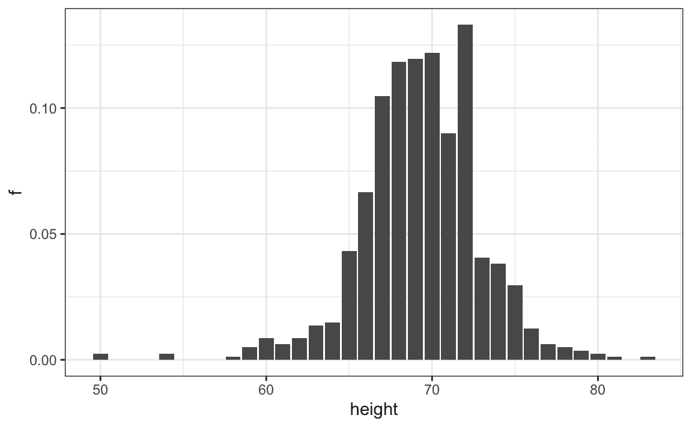*  *R 的基础`hist`函数也允许我们快速构建直方图。我们可以定义自定义的箱间隔，这对于分组极端值和避免空箱特别有用：*

```r
[with](https://rdrr.io/r/base/with.html)(heights, [hist](https://rdrr.io/r/graphics/hist.html)(height[sex == "Male"], breaks = [c](https://rdrr.io/r/base/c.html)(50, 55, 60:80, 85)))
```

*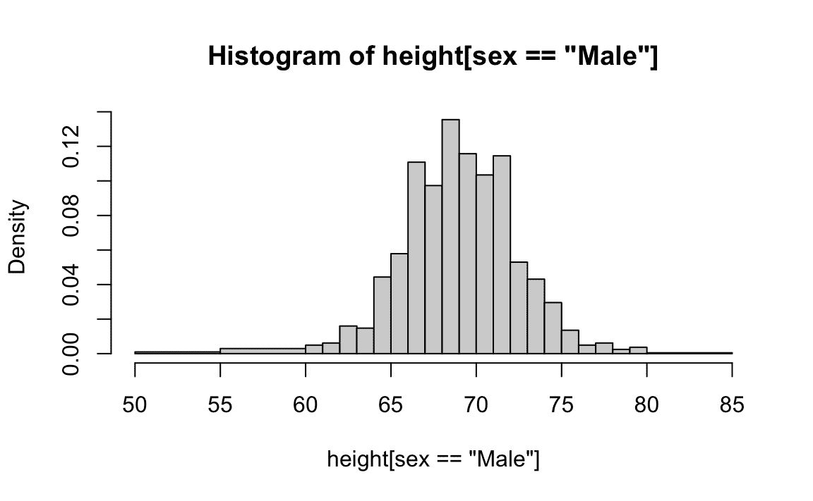*  *如果我们将这些图表之一发送给一个对人类身高分布不熟悉的地球外生物，他们可以立即获得关于数据的关键见解。首先，身高值范围从 50 到 84 英寸，超过 95%的观测值在 63 到 75 英寸之间。其次，分布在大约 69 英寸处近似对称。此外，通过求和箱计数，可以估计任何给定区间内数据所占的比例。因此，直方图提供了一个直观的总结，仅使用大约 30 个箱计数就保留了从原始的 812 个身高测量值中提取的大部分信息。*

失去了哪些信息？直方图在计算条形高度时将分箱内的所有值视为相同的。例如，64.0 英寸、64.1 英寸和 64.2 英寸的值被分组在一起。然而，由于这些差异几乎不可察觉，实际影响可以忽略不计，我们只需使用 23 个数字就能得到有意义的总结。

*默认情况下，直方图通常在 y 轴上显示频率而不是相对频率。**ggplot2**包遵循这一惯例：

```r
heights |> [filter](https://dplyr.tidyverse.org/reference/filter.html)(sex == "Male") |> [ggplot](https://ggplot2.tidyverse.org/reference/ggplot.html)([aes](https://ggplot2.tidyverse.org/reference/aes.html)(x = height)) + 
 [geom_histogram](https://ggplot2.tidyverse.org/reference/geom_histogram.html)(breaks = [c](https://rdrr.io/r/base/c.html)(50, 55, 60:80, 85), fill = "grey", color = "black")
```

*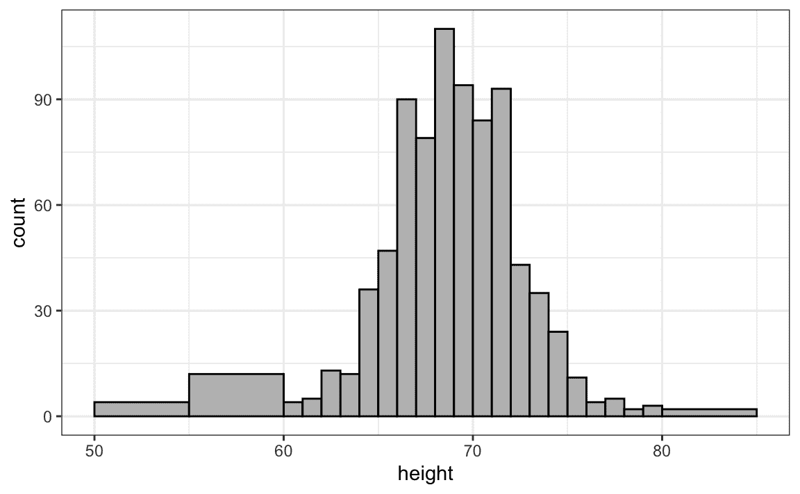*  *注意我们使用`fill`和`color`来模仿`hist`的行为。

当显示频率时，使用等间距的分箱很重要，因为较大的分箱自然会包含更多的观察值，并可能扭曲数据的视觉表示。要显示**相对**频率，可以通过设置`y = after_stat(density)`来修改代码：

```r
heights |> [filter](https://dplyr.tidyverse.org/reference/filter.html)(sex == "Male") |> 
 [ggplot](https://ggplot2.tidyverse.org/reference/ggplot.html)([aes](https://ggplot2.tidyverse.org/reference/aes.html)(x = height, y = [after_stat](https://ggplot2.tidyverse.org/reference/aes_eval.html)(density))) + 
 [geom_histogram](https://ggplot2.tidyverse.org/reference/geom_histogram.html)(breaks = [c](https://rdrr.io/r/base/c.html)(50, 55, 60:80, 85), fill = "grey", color = "black")
```

*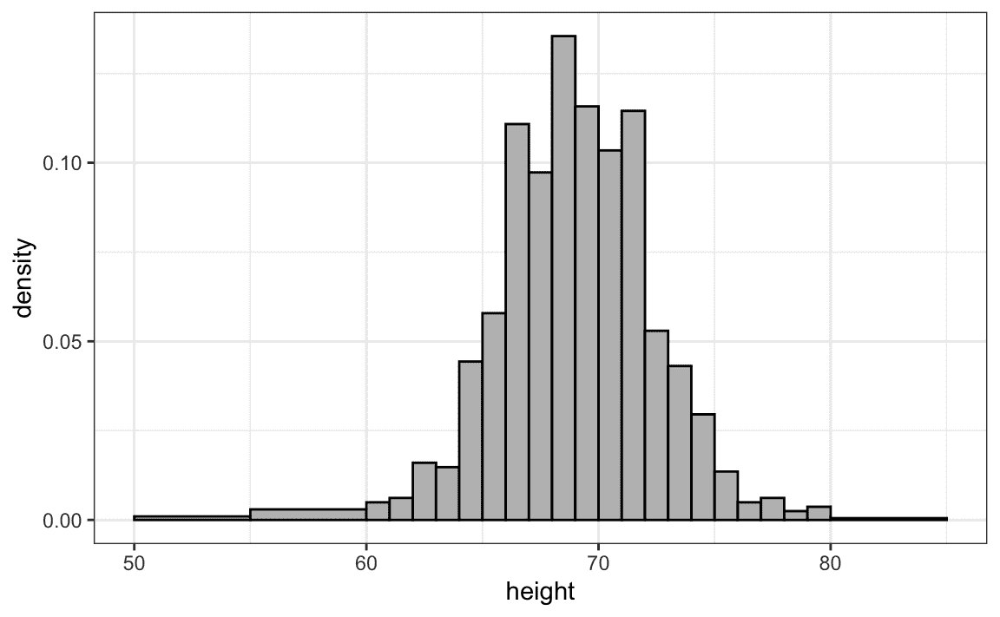***  ***### 选择分箱宽度

直方图的外观和解释取决于分箱的选择，在等宽分箱的情况下，还取决于它们的宽度。不同的分箱宽度可以使相同的数据看起来非常不同，太窄时，直方图可能显得嘈杂或破碎；太宽时，分布的重要特征可能被隐藏。分箱宽度的选择应受数据上下文指导。例如，在身高的情况下，大多数人报告的数值是四舍五入到最近的半英寸，因此使用比这更小的分箱是没有意义的。同时，由于现实生活中超过一英寸的高度差异是可察觉的，因此大于约两英寸的分箱会掩盖有意义的变异。对于分布的极端区域，例如低于 60 英寸或高于 80 英寸的区域，由于观察值很少，使用较宽的分箱来保持总结清晰是合理的。每个数据集都需要一个特定于上下文的决定：目标是选择分箱，以便在不引入噪声的情况下揭示结构，最大化单张图所传达的信息。*******

## *****1.5 平滑密度图*****

*****平滑密度图与直方图类似，但数据没有被分成分箱。以下是我们身高数据的平滑密度图：

```r
heights |> [filter](https://dplyr.tidyverse.org/reference/filter.html)(sex == "Male") |> 
 [ggplot](https://ggplot2.tidyverse.org/reference/ggplot.html)([aes](https://ggplot2.tidyverse.org/reference/aes.html)(height)) + [geom_density](https://ggplot2.tidyverse.org/reference/geom_density.html)(alpha = 0.2, fill = "#00BFC4")
```

*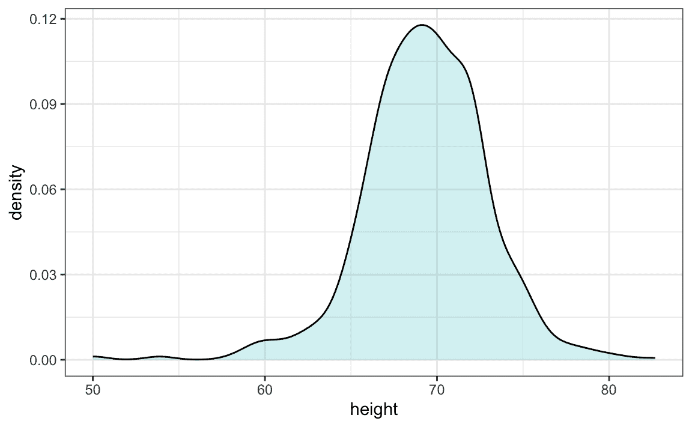*  *在这个图中，我们不再在区间边界处有尖锐的边缘，许多局部峰值也被移除了。

要理解平滑密度，我们必须理解*估计*，这是一个我们稍后才会涉及的话题。然而，我们提供了一个启发式解释来帮助您理解基础知识。

你必须理解的主要新概念是我们假设我们所观察到的值的列表是未观察到的更大列表的一个子集。在身高的例子中，你可以想象我们的 812 名男学生的身高列表来自一个假设的列表，该列表包含所有男性学生的身高，这些身高被非常精确地测量。假设有 1,000,000 个这样的测量值。这个值列表有一个分布，就像任何其他值列表一样，而我们真正想要报告给 ET 的是这个更大的分布，因为它更加普遍。不幸的是，我们看不到它。

然而，我们做出一个假设，这个假设可能帮助我们近似它。如果我们有 1,000,000 个值，这些值被非常精确地测量，我们可以制作具有非常非常小柱子的直方图。这个假设是，如果我们展示这个，连续柱子的高度将相似。这就是我们所说的平滑：连续柱子的高度没有大的跳跃。下面，我们展示了具有大小为 1、0.5 和 0.25 的柱子的这个假设数据的直方图。为了使曲线不依赖于假设列表的假设大小，我们使用频率而不是计数来计算曲线。我们使柱子越小，直方图就越平滑：

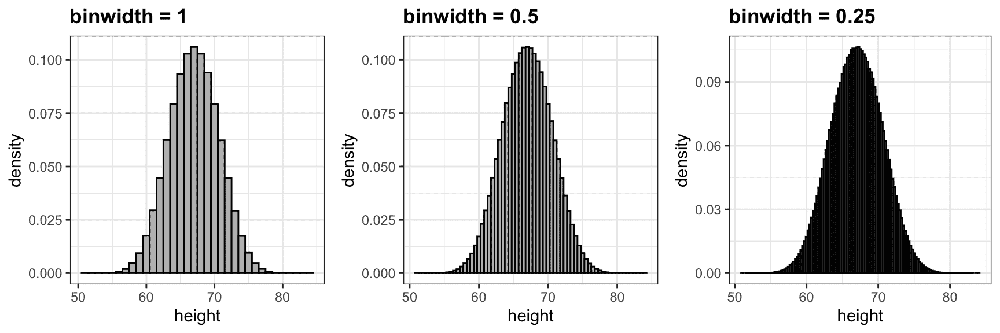

平滑密度基本上是在柱状图柱子顶部通过的曲线，当柱子非常非常小的时候。

现在，回到现实。我们没有数百万的测量值。相反，我们有 812 个，我们无法制作具有非常小柱子的直方图。

因此，我们使用适合我们数据大小的柱子大小制作直方图，计算频率而不是计数。此外，我们绘制一条通过直方图柱子顶部的平滑曲线。以下图表展示了导致平滑密度的步骤：

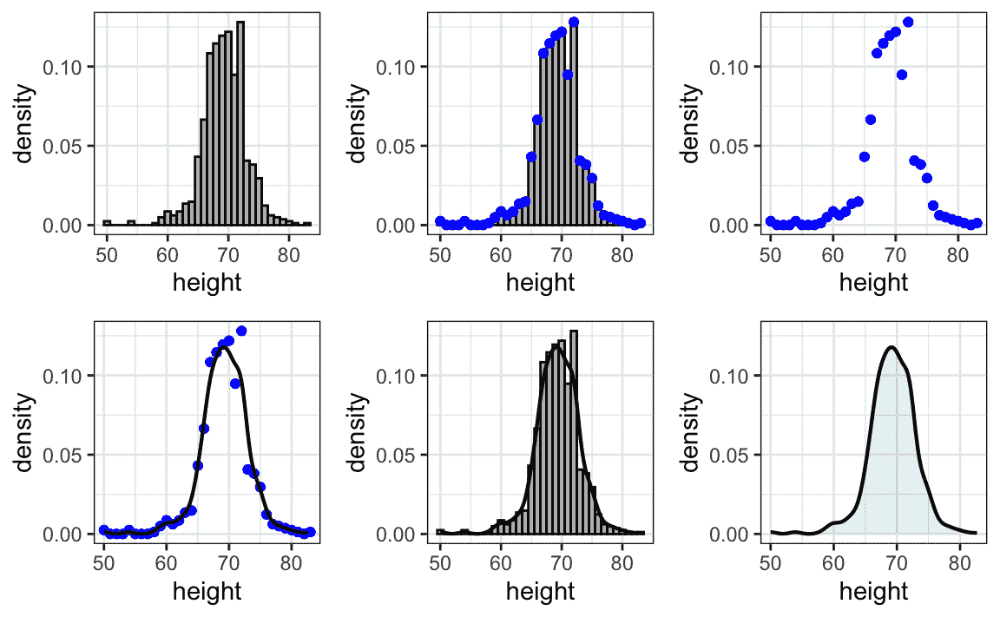

### 选择带宽

*平滑*是一个相对术语。密度曲线的平滑程度不是固定的，它取决于一个参数，通常称为带宽，它控制我们如何平滑曲线。大多数计算平滑密度的函数都包括一个选项来调整这个带宽。下面的例子显示了使用两种不同带宽选择的相同直方图，说明了平滑程度如何改变密度曲线的外观。

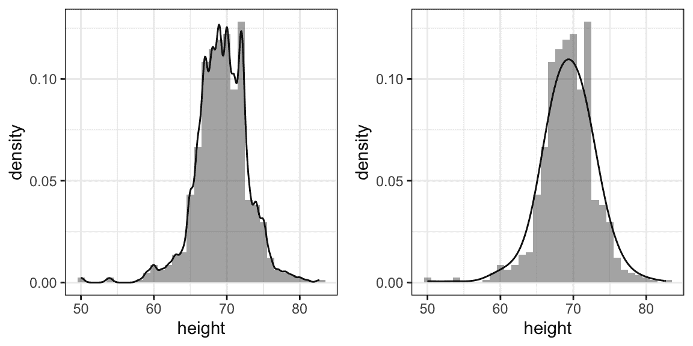

正如直方图的形状取决于选择的桶宽一样，平滑密度取决于带宽，即平滑参数。不同的带宽可以使相同的数据看起来噪声过多（太小）或过度平滑（太大）。我们应该选择一个带宽，以反映上下文以及我们对潜在分布的信念。例如，对于高度来说，合理地预期在一英寸范围内的值会以相似频率发生，72 英寸的比例应该比 71 英寸的比例更接近，比 65 英寸或 78 英寸的比例更接近，因此适度的平滑是合理的。目标是与桶宽相同：揭示结构，而不添加噪声或隐藏有意义的特点。

### 解释 y 轴

解释平滑密度图的 y 轴并不简单。它是按比例缩放的，使得密度曲线下的面积总和为 1。如果你想象我们用一个长度为 1 单位的底部的桶，y 轴的值告诉我们该桶中值的比例。然而，这只适用于大小为 1 的桶。对于其他大小区间，确定该区间中数据比例的最佳方法是通过计算该区间包含的总面积的比例。例如，这里是在 65 英寸和 68 英寸之间的值的比例：

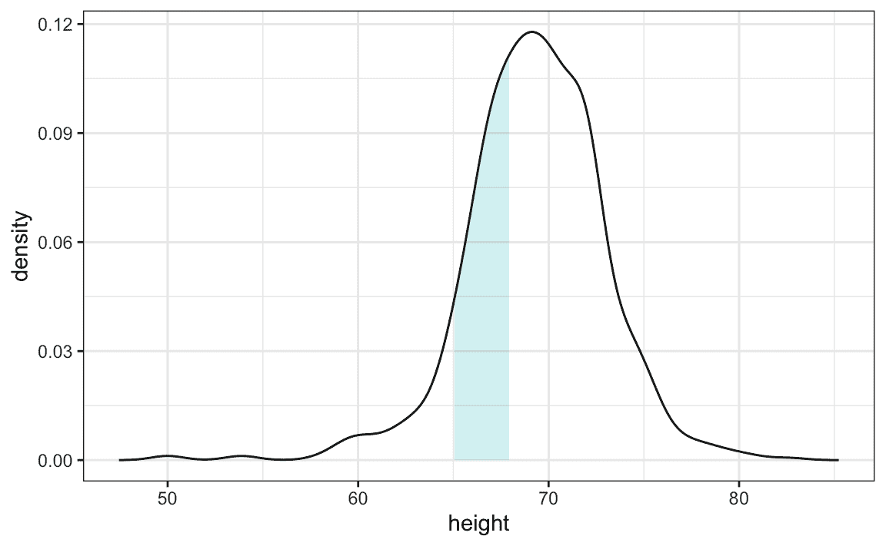

这个区域的占比大约是 0.3，这意味着大约 30%的男性身高在 65 英寸到 68 英寸之间。

通过理解这一点，我们就可以使用平滑密度作为总结。对于这个数据集，我们会非常舒适地接受平滑假设，因此可以与 ET 分享这个美观的图表，他可以用它来理解我们的男性身高数据：


*到目前为止，你可以完成 1 到 10 的练习。*******

## *****1.6 描述分布*****

*****在用直方图或密度图可视化数据时，我们经常使用一些关键术语和概念来描述分布的形状。在本节中，我们的目标是简单地让你熟悉这个词汇，这些词汇你会在大多数数据分析讨论中遇到。

*模式*是数据最集中的值或区域，分布的峰值。一些分布有一个峰值（单峰），而其他分布有两个或更多（双峰或多峰），这可以表明数据中有不同的子组。

对称分布的模态两侧具有相同数量的数据点。如果分布是不对称的，则称为偏斜分布。

分布的*尾部*是指向最小值和最大值延伸的区域。

*右偏斜*（正偏斜）分布具有指向较大值的较长尾部，例如收入，大多数人收入适中，但少数人收入很高。

一个*左偏斜*（负偏斜）的分布具有朝向较小值的更长尾巴，例如在简单考试中，大多数学生得分较高，但少数学生表现不佳的考试成绩。

在下一章中，我们将介绍正态分布，这是一种对称的钟形分布，可以作为有用的参考点。具有重尾的分布包含比正态分布更多的极端观测值，而轻尾分布包含较少的观测值。

下面是一些模拟示例，说明了上述术语：

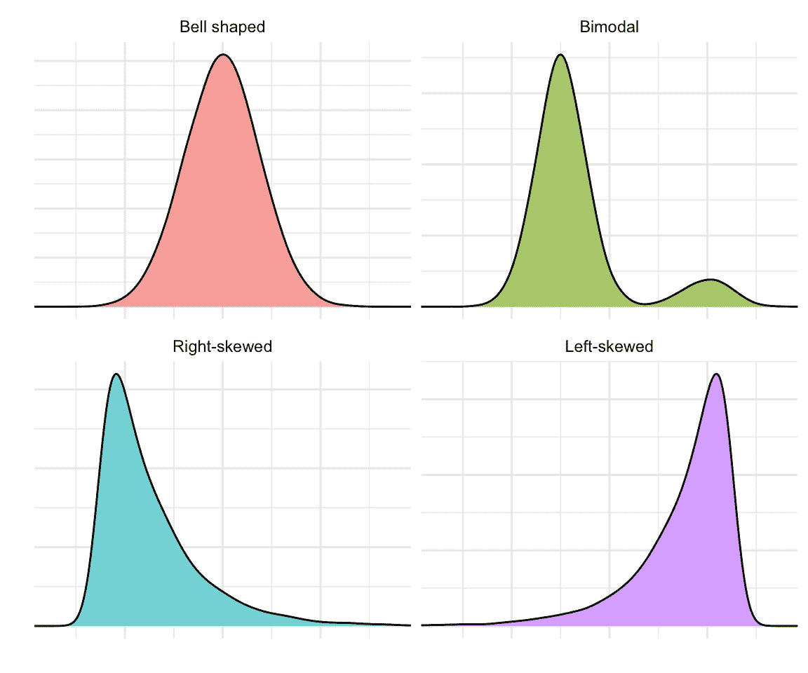*****

## *****1.7 从视觉到数值摘要*****

*****正如我们所见，直方图、密度图和 QQ 图等视觉工具帮助我们了解分布的形状、中心、范围、对称性和尾巴。然而，图形摘要通常需要数值摘要来补充，这些摘要将大量信息浓缩为几个关键数字。在下一章中，我们将介绍两个最有用的数值摘要，即平均值和标准差，当数据近似正态分布时，这些摘要提供了你需要的一切信息。我们还将探讨在分布偏离正态性时更合适的替代度量。这里介绍的可视化技术将指导我们在简单数值摘要足够时以及需要更详细描述时做出决定。*****

## *****1.8 练习*****

*****1. 在`murders`数据集中，地区是一个分类变量，以下是其分布情况：

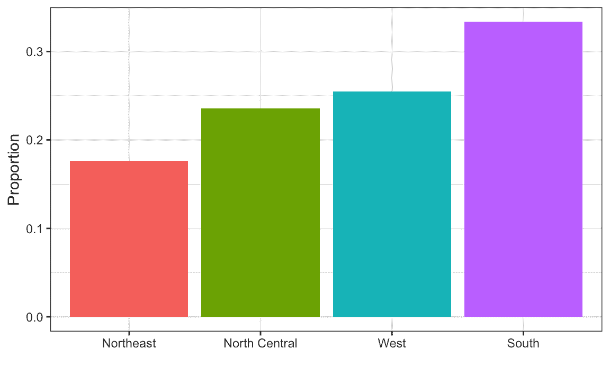

按最接近的 5%计算，有多少比例的州位于中北部地区？

2. 以下哪项是正确的：

1.  上面的图表是一个直方图。

1.  上面的图表仅用条形图显示了四个数字。

1.  类别不是数字，因此绘制分布没有意义。

1.  颜色，而不是条形的高度，描述了分布。

3. 下面的图表显示了男性身高的经验累积分布函数（eCDF）：


根据图表，有多少比例的男性身高低于 75 英寸？

1.  100%

1.  95%

1.  80%

1.  72 英寸

4. 按最接近英寸计算，哪个身高`m`具有以下属性：一半的男性学生身高高于`m`，另一半低于`m`？

1.  61 英寸

1.  64 英寸

1.  69 英寸

1.  74 英寸

5. 下面是 2010 年各州谋杀率（每 10 万人中的谋杀次数）的经验累积分布函数（eCDF）：

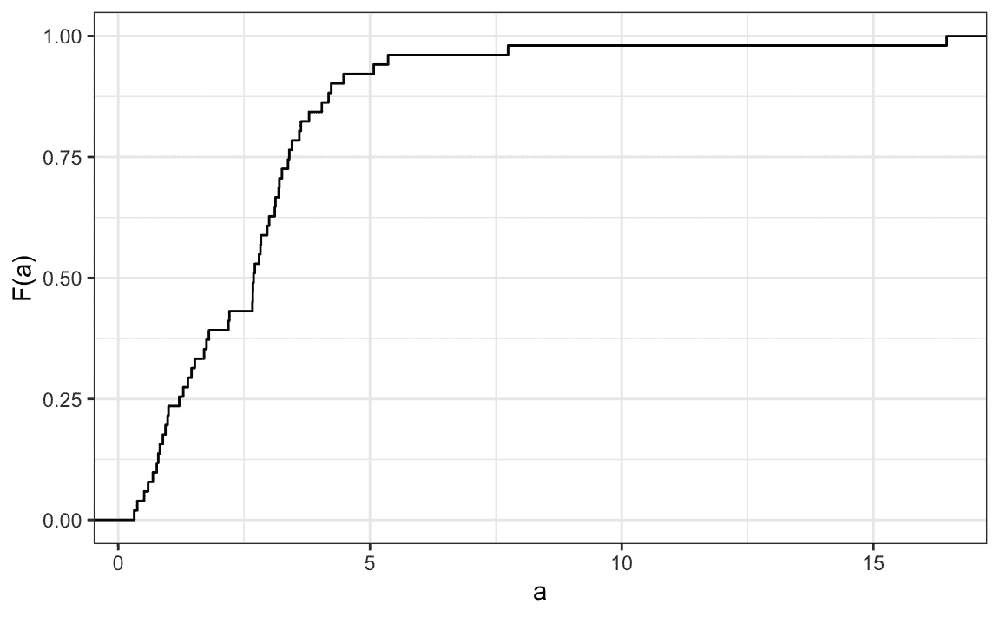

知道有 51 个观测值（50 个州和华盛顿特区）并根据此图表，有多少个州的谋杀率超过每 10 万人 10 次？

1.  1

1.  5

1.  10

1.  50

6. 根据上述经验累积分布函数（eCDF），以下哪些陈述是正确的：

1.  大约一半的州的谋杀率高于每 10 万人 7 次，另一半低于。

1.  大多数州的谋杀率低于每 10 万人 2 次。

1.  所有州的谋杀率都高于每 10 万人 2 次。

1.  除了 4 个州外，谋杀率都低于每 10 万人 5 次。

7. 下面是我们`heights`数据集中男性身高的直方图：

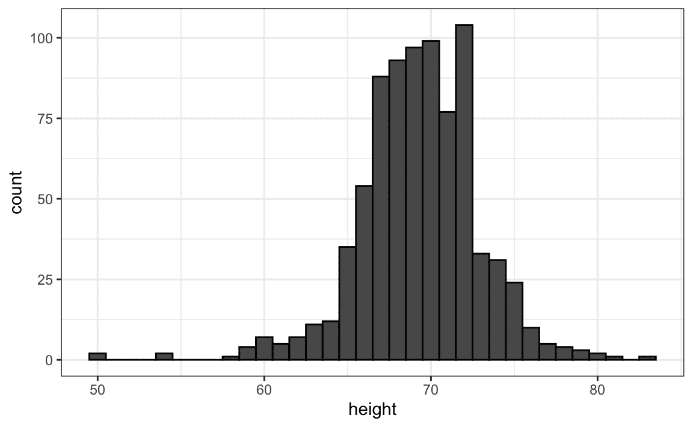

根据这个图，有多少男性身高在 63.5 到 65.5 之间？

1.  10

1.  24

1.  47

1.  100

8. 关于百分比，有多少是小于 60 英寸的？

1.  1%

1.  10%

1.  25%

1.  50%

9. 根据下面的密度图，大约有多少比例的美国州人口超过 1000 万？

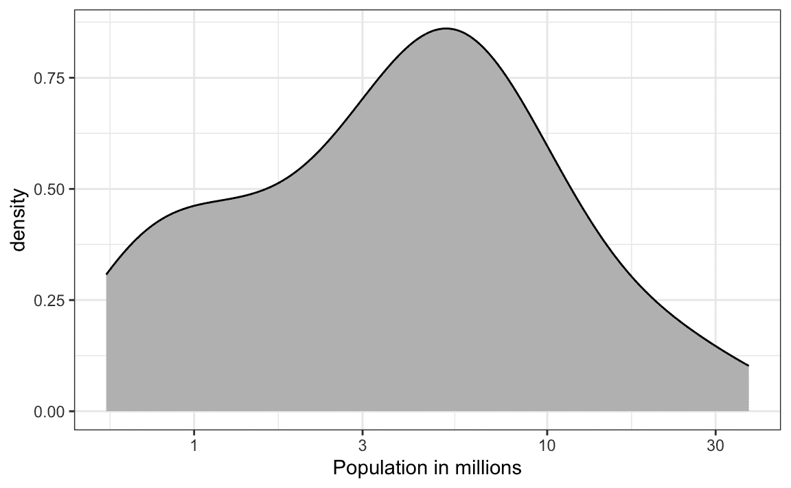

1.  0.02

1.  0.15

1.  0.50

1.  0.55

10. 下面是三个密度图。它们是否可能来自同一个数据集？

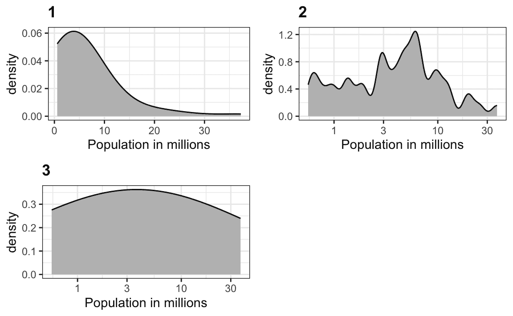

以下哪个陈述是正确的：

1.  它们不可能来自同一个数据集。

1.  它们来自同一个数据集，但图表不同是因为编码错误。

1.  它们是同一个数据集，但前两个图在平滑处理下，第三个图在平滑处理之上。

1.  它们是同一个数据集，但第一个没有使用对数刻度，第二个在平滑处理下，第三个在平滑处理之上。******
