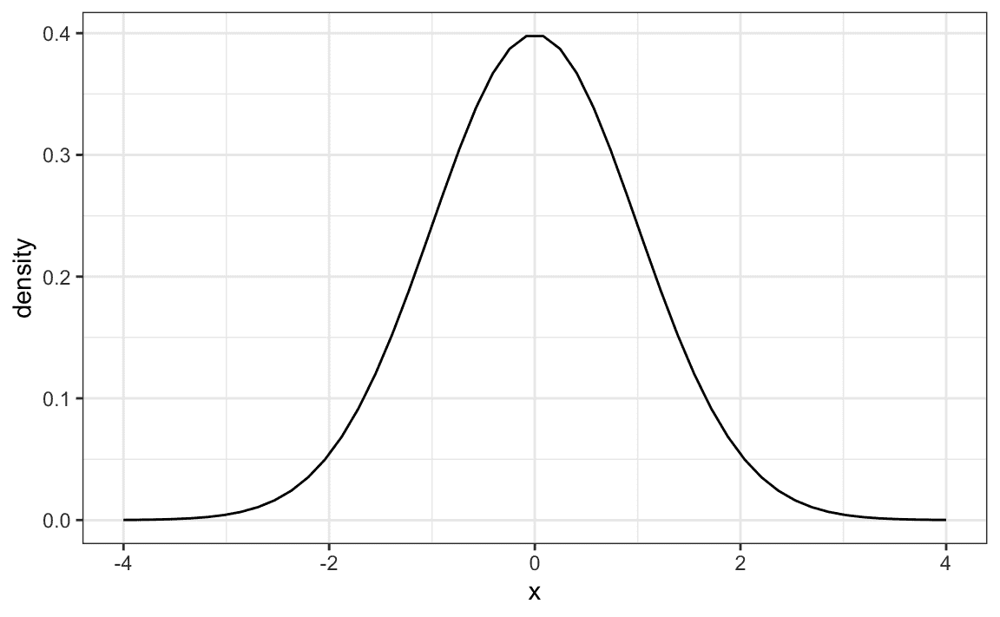
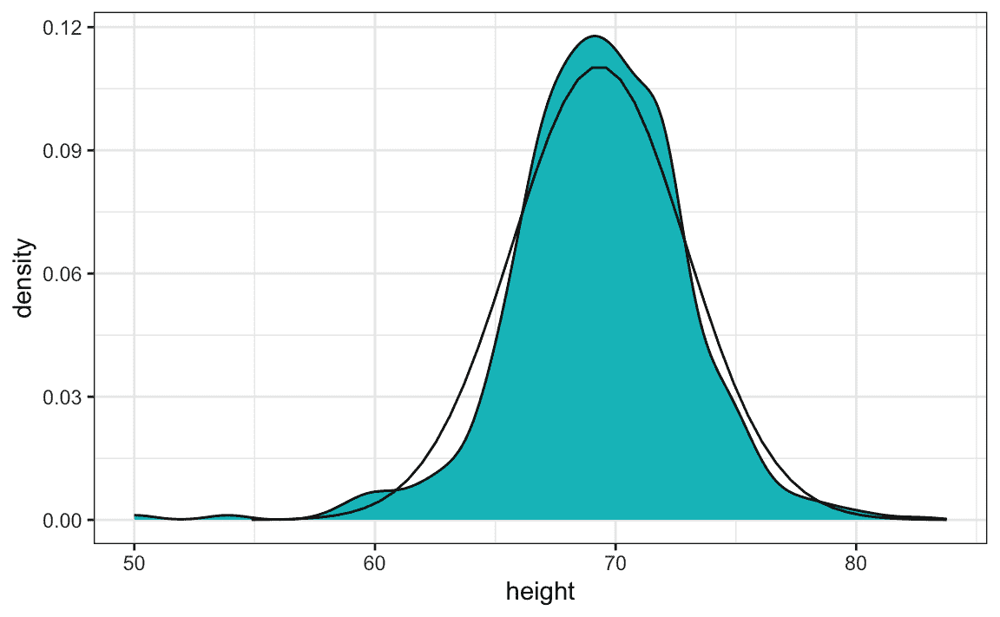
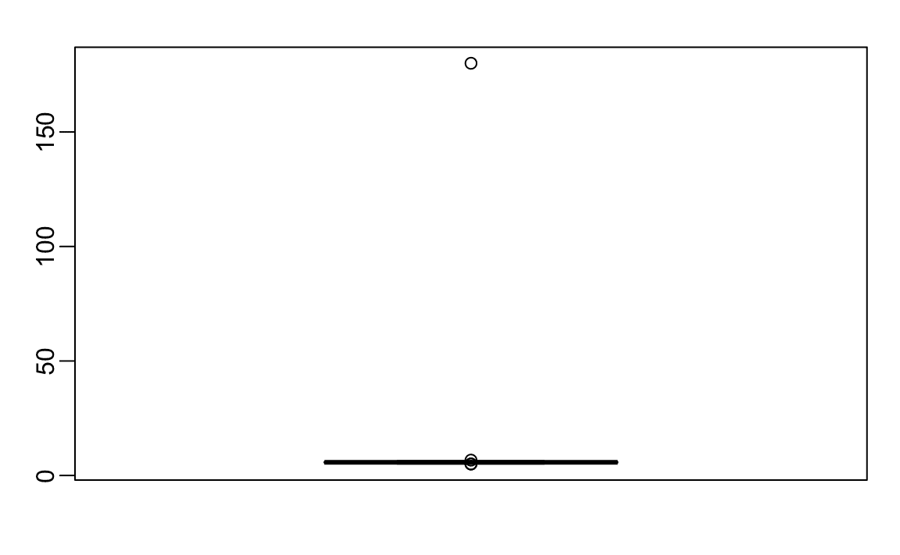
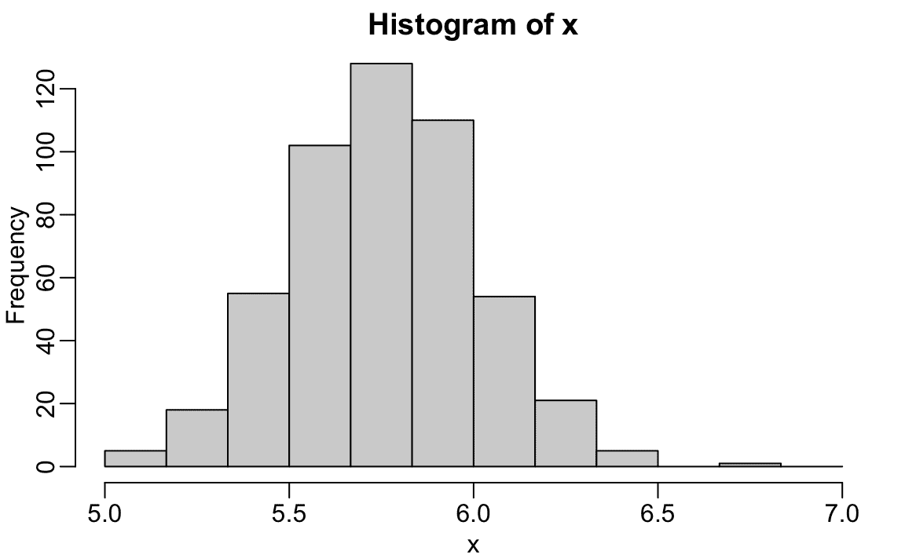
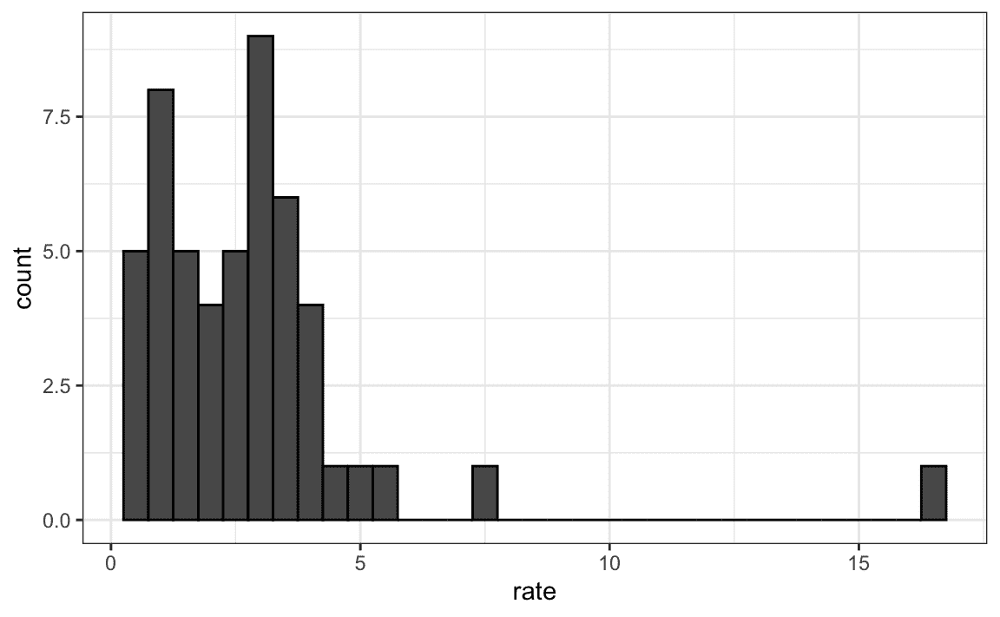
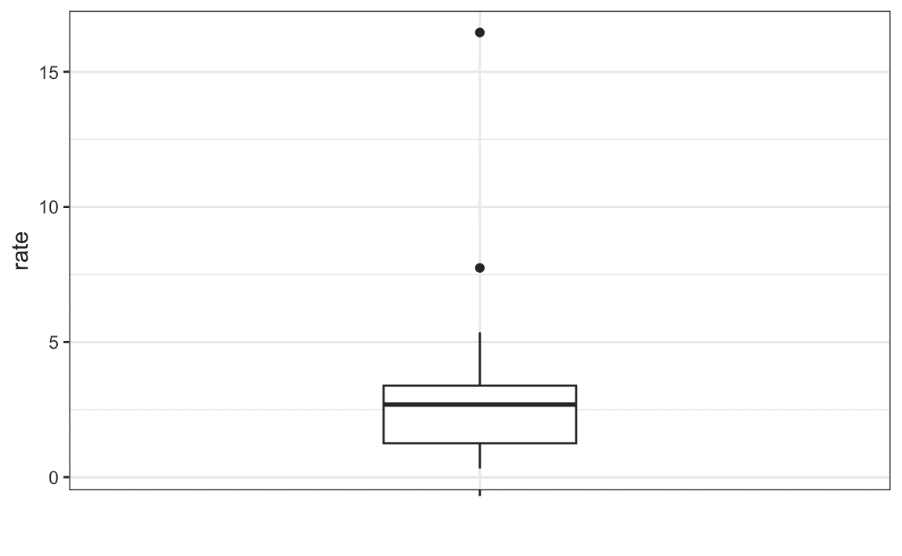

# 2 数值汇总

> 原文：[`rafalab.dfci.harvard.edu/dsbook-part-2/summaries/numerical-summaries.html`](https://rafalab.dfci.harvard.edu/dsbook-part-2/summaries/numerical-summaries.html)

1.  汇总统计

1.  2 数值汇总

直方图和密度图提供了分布的优秀汇总。但我们能否进一步汇总？我们经常看到平均值和标准差被用作汇总统计：一个双数汇总！为了理解这些汇总是什么以及为什么它们被广泛使用，我们需要了解正态分布。

## 2.1 正态分布

正态分布，也称为钟形曲线和高斯分布，是历史上最著名的数学概念之一。其中一个原因是许多情况下的分布大约是正态分布，包括赌博收益、身高、体重、血压、标准化考试成绩和实验测量误差。这些现象有解释，我们将在后面描述。这里我们关注正态分布如何帮助我们汇总数据。

正态分布不是用数据定义的，而是用数学公式定义的。对于任何区间 $(a,b)$，该区间内值的比例可以使用此公式计算：

$$\mathrm{Pr}(a < x \leq b) = \int_a^b \frac{1}{\sqrt{2\pi}\sigma} e^{-\frac{1}{2}\left( \frac{x-\mu}{\sigma} \right)²} \, dx$$

但是，你不需要记住公式就可以在实践中使用正态分布。最重要的特征是它完全由两个参数定义：$\mu$ 和 $\sigma$。公式中的其余符号代表区间的端点 $a$ 和 $b$ 以及已知的数学常数 $\pi$ 和 $e$。这两个参数，$\mu$ 和 $\sigma$，分别被称为分布的 *均值* 和 *标准差*（分别用希腊字母 $m$ 和 $s$ 表示）。在 R 中，函数 `pnorm` 允许我们计算任何 $a,\mu,$ 和 $\sigma$ 的 $\mathrm{Pr}(x \leq a)$：

[PRE0]

分布是对称的，以 $\mu$ 为中心，大部分值（约 95%）都在 $\mu$ 的 $2\sigma$ 范围内。当 $\mu = 0$ 和 $\sigma = 1$ 时，正态分布看起来是这样的：

分布仅由两个参数定义的事实意味着，如果一个数据集的分布近似于正态分布，描述分布所需的所有信息都可以编码在两个数字中：均值和标准差。*

## *2.2 平均值和标准差*

离散分布也有均值和标准差。我们将在第七章中更详细地讨论这些术语。对于值 $x_1, \dots, x_n$ 的均值，称为 $\mu_x$，定义为

$$ \mu_x = \frac{1}{n}\sum_{i=1}^n x_i $$ 注意，这相当于$x$的平均值。

标准差定义为

$$ \sigma_x = \sqrt{\frac{1}{n}\sum_{i=1}^n (x_i - \mu_x)²} $$ 这可以被认为是点$x_i$到均值$\mu_x$的平均距离。

让我们计算男性身高的平均值和标准差：

[PRE1]

预定义的函数`mean`和`sd`可以在这里使用：

[PRE2]

*如第 10.2.1 节中解释的原因，`sd(x)`除以`length(x)-1`而不是`length(x)`。但请注意，当`length(x)`很大时，`sd(x)`和`sqrt(sum((x-mu)²)/length(x))`实际上是相等的。* 如果存储在`x`中的值的分布很好地被正态分布所近似，那么使用具有均值`m <- mean(x)`和标准差`s <- sd(x)`的正态分布是有意义的。这意味着`x`的整个分布可以用这两个数字来概括！

下面的图显示了观测数据的平滑密度（蓝色）以及相应的正态近似（黑色线），均值为 69.3，标准差为 3.6：

正态分布似乎是一个很好的近似。例如，使用`pnorm`计算的概率与直接从数据中估计的概率非常接近。

为了验证这一点，我们可以比较由正态模型预测的落在给定区间（例如$(a, b]$）内的观测值的比例与数据中实际观察到的比例。区间$[a, b]$内的值的比例可以用以下方法计算：

[PRE3]

在这里，逻辑表达式`x >= a & x <= b`对于区间内的所有`x`值返回`TRUE`，否则返回`FALSE`。因为`mean`函数自动将`TRUE`转换为 1，将`FALSE`转换为 0，所以这个逻辑向量的平均值简单地是落在区间内的观测值的比例。我们将在整个书中使用这种方便的方法。

以下示例说明了观测比例与正态分布的理论概率多么接近。

低于平均学生的概率：

[PRE4]

平均数在两个标准差范围内的概率：

[PRE5]

*当使用离散数据的正态近似（例如，当身高四舍五入到最接近的英寸时），请注意`mean(x < a)`和`mean(x <= a)`可能不同。在这种情况下，通常应用*连续性校正*，使用`pnorm(a + delta/2, m, s)`来近似`mean(x <= a)`，其中`delta`是箱宽（在我们的例子中，1 英寸）。然而，在我们的数据集中，一些学生报告了更精确的测量值，因此离散化的程度不同。因此，应该小心地应用正态近似。********

## *****2.3 标准单位*****

****对于近似正态分布的数据，用*标准单位*来思考是方便的。一个值的标准化单位告诉我们它离平均值有多少个标准差。具体来说，对于向量`x`中的值`x`，我们定义其在标准单位中的值为 `z = (x - m)/s`，其中 `m` 和 `s` 分别是 `x` 的平均值和标准差。为什么这很方便？

首先，回顾正态分布的公式，并观察正在指数化的值是 $-z²/2$，其中 $z$ 等同于标准单位中的 $x$。因为 $e^{-z²/2}$ 的最大值在 $z = 0$ 处，这解释了为什么分布的最大值出现在平均值处。这也解释了对称性，因为 $- z²/2$ 在 0 处是对称的。其次，请注意，通过将正态分布的数据转换为标准单位，我们可以快速确定，例如，一个人是否大约是平均值（$z = 0$）、是否是最高的人之一（$z \approx 2$）、是否是最矮的人之一（$z \approx -2$），或者是一个极其罕见的情况（$z > 3$ 或 $z < -3$）。记住，原始单位是什么并不重要，这些规则适用于任何近似正态的数据。

在 R 中，我们可以使用`scale`函数将数据转换为标准单位：

[PRE6]

要查看有多少男性在平均值的 2 个标准差范围内，我们只需输入：

[PRE7]

比例大约是 95%，这正是正态分布所预测的！

在统计学中，字母 $z$ 通常用来表示以标准单位表示的值。当提到随机结果而不是特定观察到的值时，我们使用大写 $Z$。

在整本书中，每当描述经过标准化的数量时，我们都会以这种方式使用 $z$ 和 $Z$。这种符号有助于将不同章节中的例子联系起来。********

## *****2.4 稳健的总结*****

****请注意，我们在第一章中探讨的高度并非学生报告的原高度。第二个挑战在于探索*原始*报告的高度，这些高度也包含在`dslabs`包中的`reported_heights`对象中。我们将看到，由于报告错误，使用*稳健的总结*是必要的，以产生有用的总结。

### 异常值

在现实世界的数据分析中，异常值非常常见。数据记录可能很复杂，观察到的数据点可能由于错误而产生。例如，一个旧的监控设备在完全失效之前可能会读出无意义的测量值。人为错误也是异常值的一个来源，尤其是在手动输入数据时。例如，一个人可能会错误地将他们的身高以厘米为单位输入，而不是英寸，或者将小数点放在错误的位置。

我们如何区分异常值和由于预期变异性太大或太小而产生的测量值？这并不总是容易回答的问题，但我们会尝试提供一些指导。让我们从一个简单的案例开始。

假设一位同事负责收集一组男性的人口统计数据。数据报告身高以英尺为单位，并存储在以下对象中：

[PRE8]

我们的同事利用了身高通常很好地近似正态分布的事实，并用平均值和标准差总结数据：

[PRE9]

我们的同事撰写了一份报告，指出这个男性群体比平常要高得多。平均身高超过六英尺！然而，使用你的数据分析技能，你可能会注意到一些意想不到的事情：标准差超过 7 英尺。

[PRE10]

加减两个标准差，你会注意到 95%的这部分人群的身高将在-9.49 至 21.7 英尺之间，这是没有意义的。一个快速的图表揭示了问题：

[PRE11]

*  *由于我们知道 180 英尺的身高是不可能的，因此似乎至少有一个值是没有意义的。箱线图将这个点检测为异常值。****

### ***中位数***

**异常值可以使平均值任意增大。有 500 个数据点时，增加一个观测值 $\Delta \times$ 500 将使平均值增加 $\Delta$。相比之下，*中位数* 对异常值具有 *稳健性*：无论一个值变得多么极端，只要它不穿过数据的中间，中位数就不会改变。

我们示例数据的中间值是：

[PRE12]

这相当于大约 5 英尺 9 英寸。当数据包含异常值时，中位数通常是衡量 *典型* 值的更好指标。****

### ***中位数绝对偏差***

**与异常值可以扭曲平均值一样，它们也可以使标准差误导性地变大。一个更 *稳健* 的分散度度量是 *中位数绝对偏差（MAD）*。

要计算 MAD，我们首先找到中位数，然后计算每个值与中位数的绝对偏差，最后取这些偏差的中位数。为了使它在数据正态分布时与标准差可比，我们将其乘以 1.4826。 (R 中的 `mad` 函数会自动应用这个修正。)

对于我们的身高数据，MAD 是：

[PRE13]

这相当于大约 3 英寸。

当数据包含异常值时，MAD 提供了对变异性的更稳定的估计。在这种情况下，它提供了对数据集 *典型* 分散的更真实的感觉。****

### ***四分位距（IQR）***

**当数据包含异常值或不符合正态分布时，*四分位距（IQR）* 提供了另一种比标准差更稳健的总结数据分散的方法。IQR 表示包含数据 *中间 50%* 的范围，从第 25 百分位数（第一四分位数）到第 75 百分位数（第三四分位数），并且总是包括中位数。

与中位数和 MAD 一样，IQR 对极端值具有抵抗力：无论异常值变得多大或多小，IQR 都基本不受影响。对于正态分布的数据，将 IQR 除以 1.349 可以得到如果没有异常值存在时预期的标准差估计。

在我们的例子中，这个近似效果很好。基于 IQR 的标准差估计为：

[PRE14]

对应大约 3 英寸。

除了总结范围之外，IQR 还允许我们正式定义我们所说的*异常值*的概念，我们将在下一节介绍这个概念。****

### ***数据驱动的异常值定义***

**约翰·图基（John Tukey）提出了一个精确的数据驱动定义的*异常值*，他也是箱线图的开发者，我们将在下一节介绍这种可视化方法。为了构建箱线图，我们首先需要一种正式的方法来识别哪些数据点算作异常值。

让第一和第三四分位数分别表示为 $Q_1 = Q(0.25)$ 和 $Q_3 = Q(0.75)$，图基定义一个观测值如果落在以下范围之外则为*异常值*：

$$ [Q_1 - 1.5 \times \text{IQR}, ; Q_3 + 1.5 \times \text{IQR}], \quad \text{其中 } \text{IQR} = Q_3 - Q_1 $$

当数据遵循**标准正态分布**时，这个范围是：

[PRE15]

使用`pnorm`，我们可以计算预期落在这个范围内的数据比例：

[PRE16]

因此，对于正态分布，大约 99.302%的数据位于这个区间内。换句话说，我们预计在一个完美的正态数据集中，每 1000 个观测值中大约有 7 个会落在这个范围之外，这不是因为它们是错误的，而是由于随机变化。

为了使定义更严格，图基提出了使用更宽的乘数，例如 3 而不是 1.5，来标记*远端异常值*。对于正态分布的数据，范围

[PRE17]

涵盖了大约 99.9998%的所有值，这意味着大约每百万个观测值中只有两个会落在这个范围之外。在**ggplot** `[geom_boxplot()](https://ggplot2.tidyverse.org/reference/geom_boxplot.html)` 函数中，这个乘数由`coef`参数控制，默认为 1.5。

让我们将图基的规则应用于我们的身高数据。极端的 180 英尺测量值远远超出了由 $Q_3 + 3 \times \text{IQR}$ 定义的范围内：

[PRE18]

如果我们移除这个值，剩余的数据将遵循一个大约正常的分布，正如预期的那样：

[PRE19]

*  *这证明了图基方法的有用性：它提供了一种客观、可重复的方法来检测异常观测值——这种方法能够适应数据的自身分布。*************

## ****2.5 箱线图****

***为了介绍箱线图，我们将使用美国各州谋杀案件的数据集。假设我们想要总结谋杀率的分布情况。直方图迅速显示数据呈右偏态，表明正态近似不适用：

虽然直方图提供了有价值的信息，但人们通常更喜欢一个更简洁的数值摘要，它能突出分布的主要特征，而不显示每个数据点。

箱线图*提供了这样的总结。它将数据集压缩成五个数字：最小值、第一四分位数（$Q_1$）、中位数（$Q_2$）、第三四分位数（$Q_3$）和最大值。异常值，即落在上一节中定义的 Tukey 范围之外的值，不包括在范围计算中，而是作为单独的点绘制。

这里是谋杀率数据的箱线图：

箱线图的范围从$Q_1$到$Q_3$，一条水平线标记了中位数。胡须延伸到不是异常值的最小和最大观测值，而异常值则显示为单独的点。箱的高度对应于四分位距（IQR），代表数据的中间 50%。

箱线图在比较不同组之间的分布时特别有用，例如，比较不同地区的谋杀率或男性和女性身高分布。它们提供了关于中心、离散度和异常值存在的快速视觉摘要。在下一章中，我们将使用箱线图以这种方式比较组之间的分布。****

## ****2.6 练习****

***1. 加载身高数据集并创建一个只包含男性身高的向量`x`：*

[PRE20]

数据中在 69 至 72 英寸（高于 69 英寸，但不超过 72 英寸）之间的比例是多少？提示：使用逻辑运算符和`mean`。*

2. 假设你只知道数据的平均值和标准差。使用正态近似来估计你刚刚计算的比例。提示：首先计算平均值和标准差。然后使用`pnorm`函数来预测比例。

3. 注意到问题 1 中计算的近似值与问题 2 中精确计算的值非常接近。现在对更极端的值执行相同的任务。比较区间（79,81]的精确计算和正常近似。实际比例比近似值大多少倍？

4. 将世界成年男性的分布近似为平均值为 69 英寸、标准差为 3 英寸的正态分布。使用这个近似值，估计成年男性中身高 7 英尺或更高的比例，称为*七英尺高的人*。提示：使用`pnorm`函数。

5. 世界上大约有 10 亿名 18 至 40 岁的男性。使用你之前问题的答案来估计这些男性（18-40 岁）中在世界范围内身高七英尺或更高的有多少人？

6. 大约有 10 名身高 7 英尺或更高的国家篮球协会（NBA）球员。使用之前两个问题的答案，世界范围内 18 至 40 岁的七英尺高球员中有多少比例在 NBA？

7. 重复上一题中进行的计算，针对勒布朗·詹姆斯的身高：6 英尺 8 英寸。大约有 150 名球员身高至少这么高。

8. 在回答上一题时，我们发现七尺高的人成为 NBA 球员并不罕见。对我们计算的一个公平批评可能是什么：

1.  练习和天赋是造就伟大篮球运动员的因素，而不是身高。

1.  正态近似对于身高来说并不合适。

1.  正态近似往往低估极端值。可能七尺高的人比我们预测的多。

1.  正态近似往往高估极端值。可能七尺高的人比我们预测的少。

我们将使用**HistData**包。加载`Galton`数据并创建一个仅包含儿童身高的向量`x`：

[PRE21]

9. 计算这些数据的平均值和标准差。

10. 计算这些数据的均值和中值绝对偏差。

11. 现在假设高尔顿在输入第一个值时犯了一个错误，忘记使用小数点。你可以通过以下方式模仿这个错误：

[PRE22]

这个错误之后平均身高增长了多少英寸？

12. 这个错误之后标准差增长了多少英寸？

13. 这个错误之后中位数增长了多少英寸？

14. 这个错误之后 MAD 增长了多少英寸？

15. 你如何使用探索性数据分析来检测出错误？

1.  由于这只是一个众多值中的一个，我们无法检测到这一点。

1.  我们会看到分布的明显偏移。

1.  箱线图、直方图或 QQ 图会揭示一个明显的异常值。

1.  散点图会显示出高水平的测量误差。

16. 这种错误会导致平均值意外增长多少？编写一个名为`error_avg`的函数，该函数接受一个值`k`，并返回将向量`x`的第一个条目更改为`k`后的平均值。显示`k=10000`和`k=-10000`的结果。

17. 使用**dslabs**包中的`murders`数据集。计算每个州的谋杀率。制作一个比较美国各地区的谋杀率的箱线图。

18. 对于相同的数据库，计算每个地区的中位数和四分位数间距谋杀率。

19. 我们在`heights`数据框中查看的身高不是学生报告的原身高。原始报告的身高也包含在**dslabs**包中的对象`reported_heights`中。注意，这个数据框中的`height`列是字符类型，如果我们尝试创建一个包含数值版本的列：

[PRE23]

我们得到了关于 NAs 的警告。检查导致 NAs 的行并描述为什么会发生这种情况。

20. 在`reported_heights`中添加一个列，表示身高记录的年份。你可以使用**lubridate**包中的`year`函数从`reported_heights$time_stamp`中提取年份。使用`as.numeric`将`height`列从字符转换为数字。一些身高会被转换为`NA`，因为它们被错误地输入并包含字符，例如`165cm`。这些身高本应报告为英寸，但许多显然没有这样做。使用**dplyr**包中的`na_if`函数将任何高度异常的条目（低于 54 或高于 72）转换为`NA`。完成此操作后，按性别和年份分层，并报告错误输入的身高百分比，用`NA`表示。

21. 移除在尝试将身高转换为数字时产生`NA`的条目。按性别计算均值、标准差、中位数和 MAD。你注意到了什么？

22. 生成箱线图来总结男性和女性的身高，并描述你所看到的内容。

23. 查看最高的 10 个身高，并对你认为正在发生的事情提出一个假设。

24. 通过查看 Tukey 认为的“离谱”数据来审查所有不合逻辑的答案，并评论你所看到的错误类型。********
