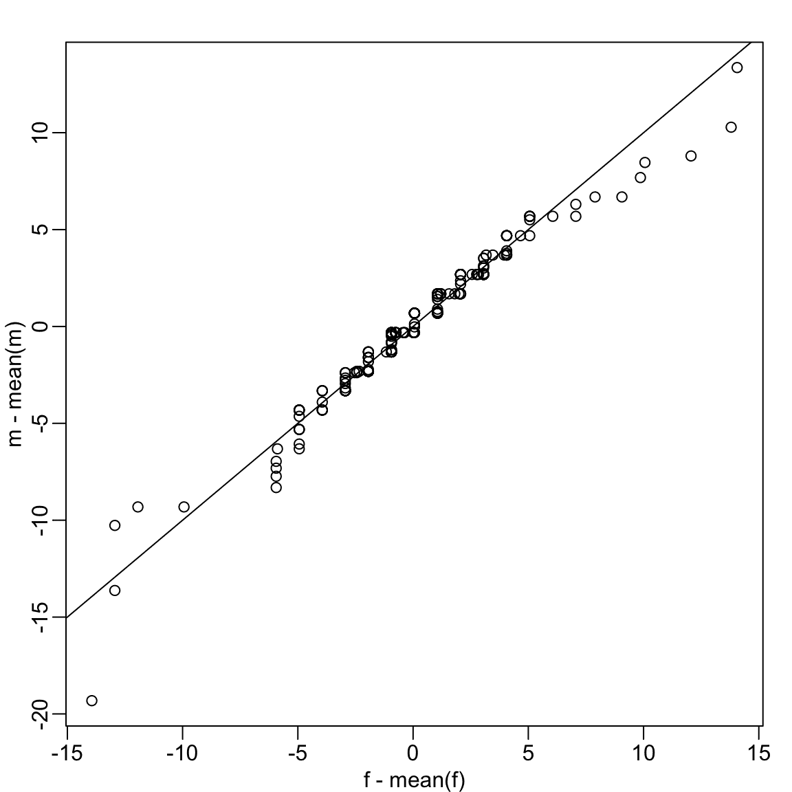
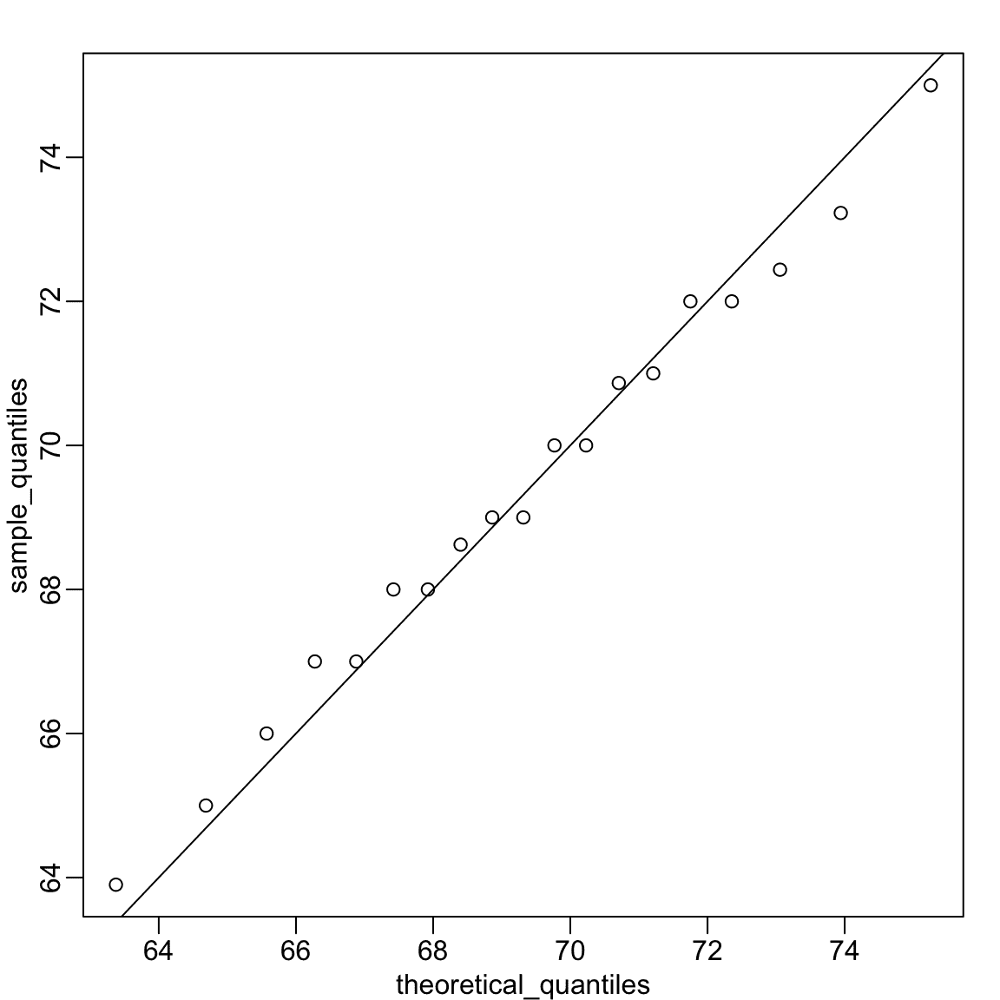
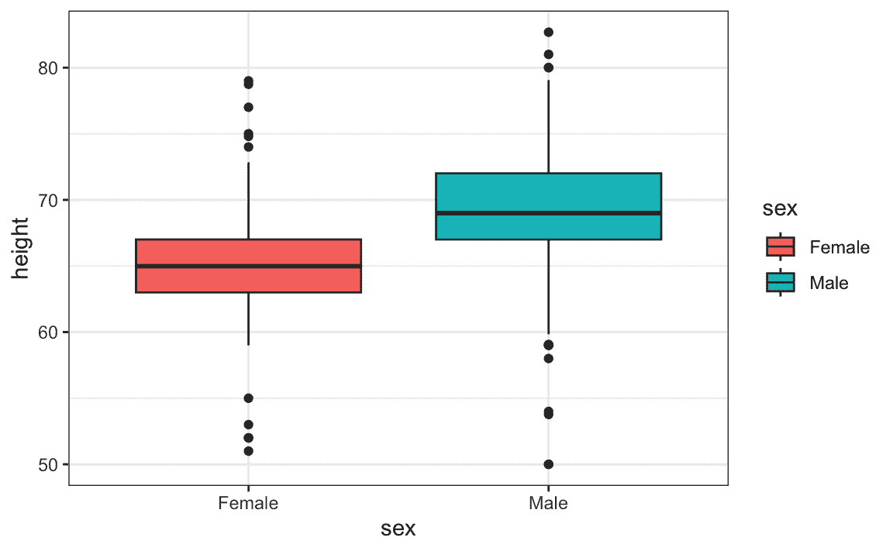
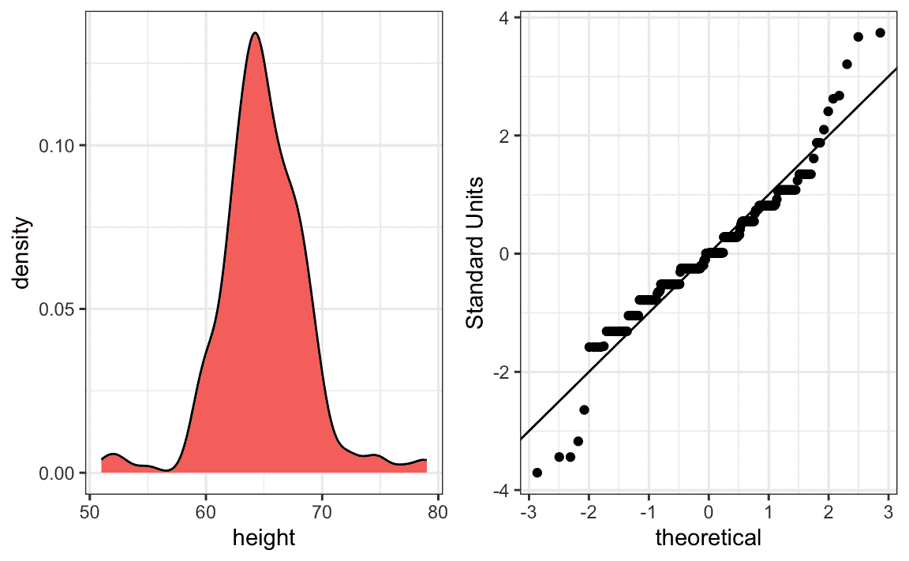
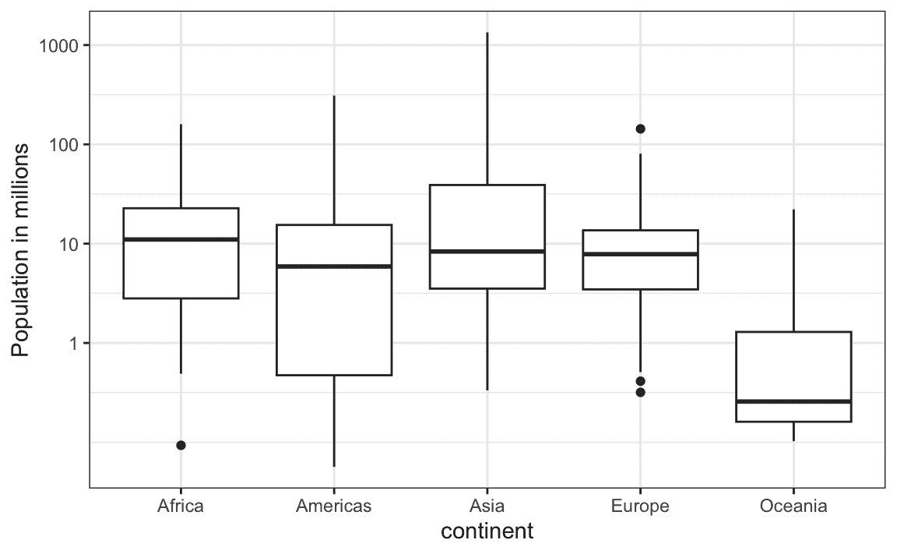

# 3  比较组

> 原文：[`rafalab.dfci.harvard.edu/dsbook-part-2/summaries/comparing-groups.html`](https://rafalab.dfci.harvard.edu/dsbook-part-2/summaries/comparing-groups.html)

1.  汇总统计

1.  3  比较组

到目前为止，我们一直专注于总结单个变量的分布，描述其中心、离散度和形状。然而，在实践中，数据分析的最常见目标之一是**比较**：我们想知道一个组与另一个组有何不同，治疗与对照如何比较，或者结果在不同条件下如何变化。比较组通常是揭示关系和理解变异来源的第一步。

我们为描述分布开发的工具，如直方图、箱线图和数值摘要（如均值和中位数），自然地扩展到比较。通过检查这些摘要**在子组内**或通过比较**分布之间的分位数**，我们可以揭示单个摘要可能隐藏的模式。

在本章中，我们探讨了比较分布的两个关键技术：

+   **分位数-分位数**，提供了一种系统地比较两个分布形状的方法，包括观察数据与理论模型（如正态分布）的差异。

+   **分层**，涉及将数据划分为有意义的子组并分别检查每个分布。

这些方法共同构成了我们的描述性工具集，连接了从探索单个变量到分析变量之间关系的过渡。

## 3.1 分位数-分位数图

比较两个分布的系统方法是比较它们的累积分布函数（CDF）。一种实际的方法是通过它们的*分位数*。

对于一个比例 \(0 \leq p \leq 1\)，分布 \(F(x)\) 的*第 \(p\) 个分位数*是值 \(q\)，使得 \(F(q) = p\)，或者 \(q = F^{-1}(p)\)。例如，\(p = 0\) 给出最小值，\(p = 0.5\) 给出中位数，\(p = 1\) 给出最大值。

符号 \(Q(p) = F^{-1}(p)\) 或等价地 \(q_p = F^{-1}(p)\) 常用于教科书，以表示分布的第 \(p\) 个分位数。

*分位数-分位数图（qqplot）*提供了一种可视化的方法来比较两个分布，例如 \(F_1(x)\) 和 \(F_2(x)\)，通过绘制一个分布的分位数与另一个分布的对应分位数进行比较。具体来说，如果我们定义 \[ Q_1(p_i) = F_1^{-1}(p_i) \quad \text{和} \quad Q_2(p_i) = F_2^{-1}(p_i) \] 对于一组概率 \(p_1, \dots, p_m\)，那么 QQ 图是通过绘制对 \[ \{Q_1(p_i),\, Q_2(p_i)\}, \quad i = 1, \dots, m. \] 的对来创建的。这些概率的常见选择是 \[ p_i = \frac{i - 0.5}{n}, \quad i = 1, \dots, n, \] 其中 \(n\) 是较小数据集的样本大小。减去 \(0.5\) 防止在 \(p = 0\) 或 \(p = 1\) 时评估分位数，对于某些理论分布，如正态分布，这会对应于 \(-\infty\) 或 \(+\infty\)。

QQ 图最常见的使用是评估两个分布 \(F_1(x)\) 和 \(F_2(x)\) 是否相似。如果 QQ 图中的点大致沿身份线分布，这表明两个分布具有相似的形状。

### 示例

到目前为止，我们只考察了男性的身高分布。我们预计女性的分布将与男性相似，但平均身高差异会导致 2-3 英寸的偏移。QQ 图确认了这一点：

```r
[library](https://rdrr.io/r/base/library.html)(dslabs)
f <- [with](https://rdrr.io/r/base/with.html)(heights, height[sex == "Female"])
m <- [with](https://rdrr.io/r/base/with.html)(heights, height[sex == "Male"])
[qqplot](https://rdrr.io/r/stats/qqnorm.html)(f - [mean](https://rdrr.io/r/base/mean.html)(f), m - [mean](https://rdrr.io/r/base/mean.html)(m))
[abline](https://rdrr.io/r/graphics/abline.html)(0,1)
```

**  *我们看到在图的中部，点位于身份线上，确认了分布相似，除了偏移。然而，对于较小的和较大的分位数，我们看到偏离了线。我们将在第 3.3 节中回到这个观察。*

### *百分位数*

**百分位数**是**分位数**的特殊情况，通常被使用。百分位数是在将 \(p\) 设置为 \(0.01, 0.02, ..., 0.99\) 时获得的分位数。例如，我们将 \(p = 0.25\) 的情况称为第 25 个百分位数，表示低于此值的 25% 的数据。最著名的百分位数是第 50 个，也称为**中位数**。另一个获得名称的特殊情况是**四分位数**，当将 \(p\) 设置为 \(0.25,0.50\) 和 \(0.75\) 时获得。*

## *3.2 使用 QQ 图评估正态性*

*QQ 图的常见用途是评估数据是否遵循正态分布。

标准正态分布的累积分布函数（CDF）表示为 \(\Phi(x)\)，表示一个正态随机变量小于 \(x\) 的概率。例如，\(\Phi(-1.96) = 0.025\) 和 \(\Phi(1.96) = 0.975\)。在 R 中，这可以通过 `pnorm` 函数计算：

```r
[pnorm](https://rdrr.io/r/stats/Normal.html)(-1.96)
#> [1] 0.025
```

**\(\Phi\) 的逆，表示为 \(\Phi^{-1}(p)\)，提供了**理论分位数**。例如，\(\Phi^{-1}(0.975) = 1.96\)，我们可以通过 `qnorm` 计算得到：

```r
[qnorm](https://rdrr.io/r/stats/Normal.html)(0.975)
#> [1] 1.96
```

*默认情况下，`pnorm` 和 `qnorm` 假设为**标准正态分布**（均值 0，标准差 1）。您可以使用 `mean` 和 `sd` 参数指定不同的参数：

```r
[qnorm](https://rdrr.io/r/stats/Normal.html)(0.975, mean = 69, sd = 3)
#> [1] 74.9
```

*对于观察数据，我们可以使用 `quantile` 函数计算样本分位数。例如，以下是男性身高的四分位数：

```r
x <- [with](https://rdrr.io/r/base/with.html)(heights, height[sex == "Male"])
[quantile](https://rdrr.io/r/stats/quantile.html)(x, [c](https://rdrr.io/r/base/c.html)(0.25, 0.50, 0.75))
#> 25% 50% 75% 
#>  67  69  72
```

*为了检查这些数据是否近似正态分布，我们可以按照以下步骤构建 QQ 图：

1.  定义一个比例向量 \(p_1, \dots, p_m\)。

1.  从数据中计算样本分位数。

1.  从具有与数据相同均值和标准差的正态分布中计算理论分位数。

1.  将两组分位数相互绘制。

示例：

```r
p <- [seq](https://rdrr.io/r/base/seq.html)(0.05, 0.95, 0.05)
sample_quantiles <- [quantile](https://rdrr.io/r/stats/quantile.html)(x, p)
theoretical_quantiles <- [qnorm](https://rdrr.io/r/stats/Normal.html)(p, mean = [mean](https://rdrr.io/r/base/mean.html)(x), sd = [sd](https://rdrr.io/r/stats/sd.html)(x))
[plot](https://rdrr.io/r/graphics/plot.default.html)(theoretical_quantiles, sample_quantiles)
[abline](https://rdrr.io/r/graphics/abline.html)(0, 1)
```

**  *因为点接近身份线，我们得出结论，正态分布为这个数据集提供了一个很好的近似。

如果我们首先标准化数据，代码就会变得简单：

```r
[plot](https://rdrr.io/r/graphics/plot.default.html)([quantile](https://rdrr.io/r/stats/quantile.html)([scale](https://rdrr.io/r/base/scale.html)(x), p), [qnorm](https://rdrr.io/r/stats/Normal.html)(p))
```

*R 提供了生成与正态分布比较的 q-q 图的内置函数：

```r
[qqnorm](https://rdrr.io/r/stats/qqnorm.html)(x)
[qqline](https://rdrr.io/r/stats/qqnorm.html)(x)
```

*这些函数使用数据 `x` 的平均值和标准差来定义用于 x 轴值的理论正态分布。换句话说，绘制的线代表如果数据具有与观察样本相同的均值和扩散的正态分布，我们会期望看到的情况。

并且与 **ggplot2** 相当：

```r
[library](https://rdrr.io/r/base/library.html)([ggplot2](https://ggplot2.tidyverse.org))
heights |> [filter](https://rdrr.io/r/stats/filter.html)(sex == "Male") |>
 [ggplot](https://ggplot2.tidyverse.org/reference/ggplot.html)([aes](https://ggplot2.tidyverse.org/reference/aes.html)(sample = [scale](https://rdrr.io/r/base/scale.html)(height))) + 
 [geom_qq](https://ggplot2.tidyverse.org/reference/geom_qq.html)() +
 [geom_abline](https://ggplot2.tidyverse.org/reference/geom_abline.html)()
```

**默认情况下，`qqnorm` 和 `geom_qq` 都使用所有 \(n\) 分位数，其中 \(p_i = (i - 0.5)/n\)。由于这种默认行为，大数据集可以产生数千个重叠的点，看起来像一条实线。在这种情况下，手动计算并绘制一个较小的、具有代表性的分位数集，而不是依赖于 `qqplot` 或 `qqnorm` 中的默认设置，会更好。**********

## ****3.3 分层****

****在数据分析中，我们通常根据与这些观察值相关的一个或多个变量的值将观察值分成组。例如，我们可以根据性别变量将身高值分成组：女性和男性。我们称这种程序为*分层*，并将结果组称为*层*。

层次化在数据可视化中很常见，因为我们通常对变量在不同子组中的分布差异感兴趣。

使用直方图、密度图和 q-q 图，我们已经确信男性身高数据很好地近似于正态分布。在这种情况下，我们向 ET 提供一个非常简洁的总结：男性身高遵循平均值为 69.3 英寸，标准差为 3.6 英寸的正态分布。有了这些信息，ET 将对当他遇到我们的男性学生时可以期待什么有一个很好的了解。然而，为了提供一个完整的图景，我们还需要提供女性身高的总结。

我们了解到，当我们想要快速比较两个或多个分布时，箱线图很有用。以下是女性和男性的身高：

```r
[library](https://rdrr.io/r/base/library.html)([tidyverse](https://tidyverse.tidyverse.org))
[library](https://rdrr.io/r/base/library.html)(dslabs)
heights |> [ggplot](https://ggplot2.tidyverse.org/reference/ggplot.html)([aes](https://ggplot2.tidyverse.org/reference/aes.html)(sex, height, fill = sex)) + [geom_boxplot](https://ggplot2.tidyverse.org/reference/geom_boxplot.html)()
```

**  *该图立即显示，男性平均身高高于女性。标准差似乎相似。但是，正态近似也适用于调查收集的女性身高数据吗？我们预计它们将遵循正态分布，就像男性一样。然而，探索性绘图显示，这种近似并不那么有用：



我们看到了对于男性没有看到的东西：密度图有一个第二个*峰值*。此外，qqplot 显示最高点往往比正态分布预期的要高。最后，我们还在 qqplot 中看到了五个点，表明对于正态分布来说，高度比预期的要短。在向 ET 汇报时，我们可能需要提供一个直方图，而不仅仅是女性身高的平均值和标准差。

我们注意到了我们没有预料到看到的事情。如果我们查看其他女性身高分布，我们发现它们很好地被正态分布所近似。那么为什么我们的女学生不同？我们的班级是女性篮球队的必修课吗？是否有小部分女性声称比实际身高更高？另一个，可能更可能的解释是，在学生用来输入他们身高的表格中，`Female`是默认性别，一些男性输入了他们的身高，但忘记了更改性别变量。无论如何，数据可视化帮助我们发现了数据中可能存在的潜在缺陷。

关于前五个最小值，请注意这些是：

```r
heights |> [filter](https://dplyr.tidyverse.org/reference/filter.html)(sex == "Female") |> 
 [top_n](https://dplyr.tidyverse.org/reference/top_n.html)(5, [desc](https://dplyr.tidyverse.org/reference/desc.html)(height)) |>
 [pull](https://dplyr.tidyverse.org/reference/pull.html)(height)
#> [1] 51 53 55 52 52
```

*因为这些是报告的高度，一种可能是学生本意是想输入`5'1"`、`5'2"`、`5'3"`或`5'5"`。******

## ****3.4 练习****

****1. 研究以下按国家显示的人口规模的箱线图：



哪个大洲的国家人口规模最大？

2. 哪个大洲的中位人口数量最大？

3. 非洲的中位人口数量是多少，四舍五入到最近的百万？

4. 欧洲有多少比例的国家人口低于 1400 万？

1.  0.99

1.  0.75

1.  0.50

1.  0.25

5. 如果我们使用对数变换，上面哪个大洲的样本四分位距最大？

6. 定义包含男性和女性身高的变量如下：

```r
[library](https://rdrr.io/r/base/library.html)(dslabs)
male <- heights$height[heights$sex == "Male"]
female <- heights$height[heights$sex == "Female"]
```

*我们有多少个测量值？

7. 假设我们无法绘制图表，而想并排比较分布。我们不能只是列出所有数字。相反，我们将查看百分位数。创建一个包含`female_percentiles`和`male_percentiles`的五行表格，显示每个性别的第 10、30、50、70 和 90 百分位数。然后创建一个包含这两个作为列的数据框。

8. 使用 qqplot 来证明谋杀率

1.  移除哥伦比亚特区，然后生成 qqplot 以查看四个区域中的比率是否遵循正态分布。*****
