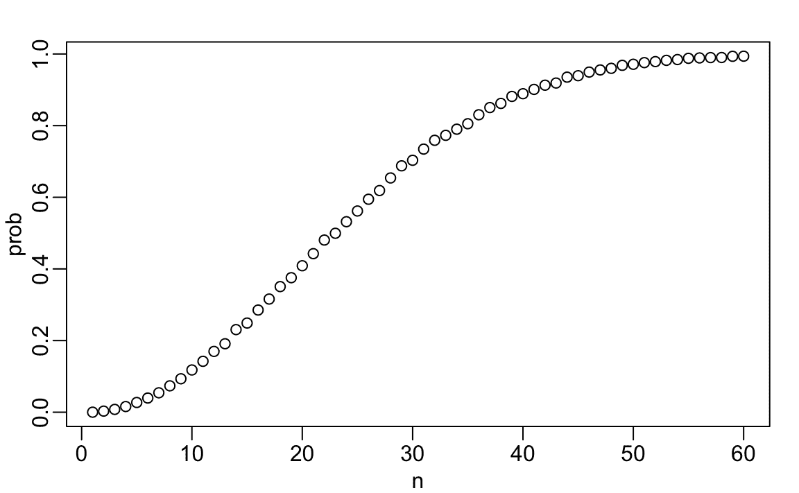
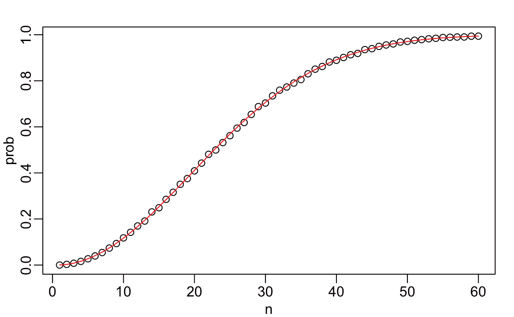
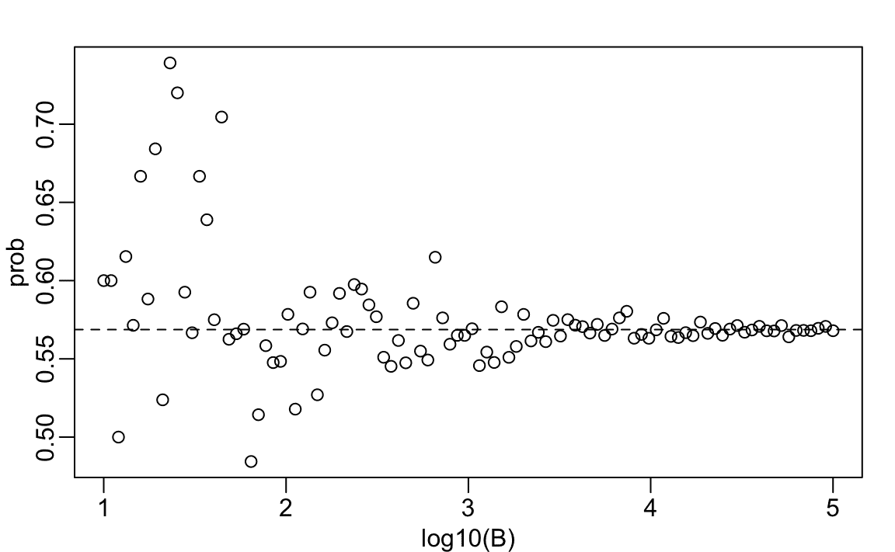

# 5  离散概率

> 原文：[`rafalab.dfci.harvard.edu/dsbook-part-2/prob/discrete-probability.html`](https://rafalab.dfci.harvard.edu/dsbook-part-2/prob/discrete-probability.html)

1.  概率

1.  5  离散概率

我们首先介绍一些与分类数据相关的基本原则。处理分类数据的特定概率领域被称为*离散概率*。理解这个主题将帮助我们理解我们稍后将要介绍的用于数值和连续数据的概率理论，这在数据分析中更为常见。由于离散概率在纸牌游戏中非常有价值，我们将使用这些作为说明性例子。

## 5.1 相对频率

“概率”这个词在日常语言中被广泛使用。然而，回答关于概率的问题往往是困难的，甚至是不可能的。在本节中，我们讨论了*概率*的数学定义，它允许我们给出对某些问题的精确答案。

例如，如果我在一个瓮里¹里有 2 个红珠子和 3 个蓝珠子（大多数概率书籍都使用这个古老的术语，所以我们也不例外）并且随机抽取一个，抽取到红珠子的概率是多少？我们的直觉告诉我们答案是 2/5 或 40%。可以通过指出有五种可能的结果，其中两种满足“抽取红珠子”这一事件的必要条件来给出一个精确的定义。由于这五种结果发生的概率是相等的，我们得出结论，红珠子的概率是 0.4，蓝珠子的概率是 0.6。

考虑事件概率的一个更直观的方法是将它视为在独立且在相同条件下重复实验时，事件发生的长期比例，实验次数无限。这种解释自然地引出了数据科学中最强大的技术之一，蒙特卡洛模拟，我们将在本章后面探讨。

## 5.2 概率分布

概率分布是大多数统计模型的基础。它们描述了不同结果的可能性，提供了不确定性的数学总结。我们在数据分析中使用的每个模型，从简单的民意调查例子到复杂的多变量模型，都是建立在关于潜在概率分布的假设之上的。当我们转向连续和多维设置时，这些分布变得更加复杂和抽象。然而，对于离散情况，这个想法是非常直观的：每个可能的结果或类别都根据其相对频率分配一个概率。

如果我们知道不同类别的相对频率，定义分类结果的分布相对简单。我们只需为每个类别分配一个概率。在类似于瓮中珠子的例子中，对于每种珠子类型，它们的比例定义了分布。

例如，如果我们从由 44%民主党人、44%共和党人、10%未决定和 2%绿党人组成的群体中随机抽取可能投票者，这些比例定义了任何给定电话中每个群体的概率。每个电话的概率分布由四个数字定义：Pr(打电话给共和党人) = 0.44，Pr(打电话给民主党人) = 0.44，Pr(打电话给未决定者) = 10%，以及 Pr(打电话给绿党人) = 0.02。

## 5.3 蒙特卡洛

计算机提供了一种实际执行上述简单随机长期实验的方法：从包含三个蓝色珠子和两个红色珠子的袋子中随机选择一个珠子。随机数生成器允许我们模拟随机选择的过程。

一个例子是 R 中的 `sample` 函数。我们将在下面的代码中演示其用法。首先，我们使用 `rep` 函数生成一个罐子：

```r
beads <- rep(c("red", "blue"), times = c(2,3))
```

然后使用 `sample` 随机选择一个珠子：*

```r
sample(beads, 1)
#> [1] "red"
```

这一行代码产生一个随机结果。我们希望无限次重复这个实验，但这是不可能的。相反，我们重复实验足够多次，以使结果在实际上等同于无限次重复。这是一个 *蒙特卡洛* 模拟的例子。*

数学统计学家和理论统计学家研究的大部分内容，即本书中未涉及的主题，都与提供“实际上等效”的严格定义有关。此外，他们探索大量实验如何接近极限情况。在本章的后面部分，我们将提供一个确定“足够大”的实用方法。

要执行我们的第一次蒙特卡洛模拟，我们使用 `replicate` 函数，它允许我们重复相同的任务任意次数。在这里，我们重复随机事件 10,000 次：

```r
set.seed(1986) 
events <- replicate(10000, sample(beads, 1))
```

*这里我们使用 `replicate` 函数是为了教育目的，但有一个更快的方法来生成这个模拟：*

```r
sample(beads, 10000, replace = TRUE)
```

我们将在下一节中解释。** 我们现在可以验证我们的定义是否与这个蒙特卡洛模拟近似相一致。我们使用 `table` 来计数结果，而 `prop.table` 给出比例：*

```r
prop.table(table(events))
#> events
#>  blue   red 
#> 0.601 0.399
```

上述数字代表通过此蒙特卡洛模拟获得的估计概率。统计学理论告诉我们，随着 $B$ 的增大，估计值将越来越接近 3/5=0.6 和 2/5=0.4。*

这是一个简单且不太有用的例子，因为我们可以很容易地从数学上计算概率。蒙特卡洛模拟在难以或无法从数学上计算精确概率时很有用。在深入研究更复杂的例子之前，我们使用简单的例子来展示 R 中可用的计算工具。

### 设置随机种子

在我们继续之前，我们将简要解释以下重要的一行代码：

```r
set.seed(1986) 
```

在这本书的整个过程中，我们使用随机数生成器。这意味着所呈现的许多结果可能会因偶然性而改变，表明静态版本的书籍可能显示的结果与您按照代码执行时获得的结果不同。实际上，这是完全可以接受的，因为结果是随机的，并且会因偶然性而改变。然而，如果您想确保每次运行的结果都一致，您可以设置 R 的随机数生成种子为一个特定的数字。在上文中，我们将其设置为 1986。我们不想每次都使用相同的种子，所以我们使用了一种流行的选择种子方法，即年份 - 月份 - 日期。例如，我们在 2018 年 12 月 20 日选择了 1986：$2018 - 12 - 20 = 1986$。

您可以通过查看文档来了解更多关于设置随机数种子（seed）的信息：

```r
?set.seed
```

在练习中，我们可能会要求您设置种子以确保您获得的结果与我们期望的完全一致。**

### **有放回和无放回**

*函数 `sample` 有一个参数允许我们从罐中选取多个元素。然而，默认情况下，这种选择是无放回的：选中珠子后不会放回袋中。注意当我们随机选择五颗珠子时会发生什么：

```r
sample(beads, 5)
#> [1] "red"  "blue" "blue" "blue" "red"
sample(beads, 5)
#> [1] "red"  "red"  "blue" "blue" "blue"
```

这导致的结果是一直由三个蓝色珠子和两个红色珠子组成的排列。如果我们要求选择六颗珠子，我们会得到一个错误。

然而，`sample` 函数可以直接使用，无需使用 `replicate`，在相同条件下不断重复抽取 1 个 5 颗珠子的相同实验。为此，我们以放回的方式抽样：在选中珠子后将其放回罐中。我们可以通过更改 `replace` 参数来告诉 `sample` 做这件事，该参数默认为 `FALSE`，将其更改为 `replace = TRUE`：

```r
events <- sample(beads, 10000, replace = TRUE)
```*********

## ****5.4 组合与排列****

***大多数大学水平的统计学课程都是从组合数学开始的，这为许多概率计算提供了基础。这些技术让我们能够计算满足某个条件的结果数量，通常是通过计算 *排列*（当顺序重要时）或 *组合*（当顺序不重要时）的数量。

为了使这些想法具体化，让我们考虑一个熟悉的场景：纸牌游戏。假设我们想要了解从一副牌中抽取特定手牌的概率。这个例子有助于展示组合数学是如何工作的，以及我们如何使用 R 来执行这些计算。

首先，让我们构建一副牌：

```r
numbers <- c("Ace", "Deuce", "Three", "Four", "Five", "Six", "Seven",
 "Eight", "Nine", "Ten", "Jack", "Queen", "King")
suits <- c("Diamonds", "Clubs", "Hearts", "Spades")
deck <- expand.grid(number = numbers, suit = suits)
deck <- paste(deck$number, deck$suit)
```

如果我们随机抽取一张牌，抽到国王的概率是 1/13：

```r
mean(deck %in% paste("King", suits))
#> [1] 0.0769
```

因为牌组包括了所有可能的结果，这个计算给出了确切的概率。由于 `mean` 将逻辑值转换为 0s 和 1s，结果表示了牌组中国王的比例，即四张牌中的五十二张，这正好对应于理论概率 $1/13$。

现在让我们介绍两个关键函数：`permutations()`和`combinations()`，这两个函数来自**gtools**包。这些函数允许我们根据顺序是否重要（`permutations`）或不重要（`combinations`）来枚举从列表中选择物品的所有可能方式。这样的计算在概率论中是基本的，因为它们允许我们在复杂的环境中计算可能结果的数量，例如确定抽取特定扑克牌手或按特定顺序排列牌的几率。纸牌游戏、彩票以及许多其他概率问题都依赖于这些原则来计算精确的概率。对于对数学基础感兴趣的读者，推荐阅读部分列出了探索排列和组合的详细概率教科书的书籍。

这里是一个简单的例子，列举了从三个物品中每次取两个的所有排列：

```r
library(gtools)
permutations(3, 2)
#>      [,1] [,2]
#> [1,]    1    2
#> [2,]    1    3
#> [3,]    2    1
#> [4,]    2    3
#> [5,]    3    1
#> [6,]    3    2
```

这列出了从数字 1、2 和 3 的所有有序对。请注意，(1,2)和(2,1)被视为不同的。如果顺序不重要，我们使用`combinations()`：

```r
combinations(3, 2)
#>      [,1] [,2]
#> [1,]    1    2
#> [2,]    1    3
#> [3,]    2    3
```

现在(1,2)和(2,1)被视为相同的结果。

让我们使用这些工具来计算 21 点游戏中“自然 21”的概率，这发生在玩家的前两张牌是一张 A 和一张面牌（杰克、皇后、国王或 10）。由于顺序不重要，我们使用`combinations()`：

```r
aces <- paste("Ace", suits)
facecard <- expand.grid(number = c("King", "Queen", "Jack", "Ten"), suit = suits)
facecard <- paste(facecard$number, facecard$suit)
hands <- combinations(52, 2, v = deck)
mean((hands,1] [%in% aces & hands,2] [%in% facecard) |
 (hands,2] [%in% aces & hands,1] [%in% facecard))
#> [1] 0.0483
```

### 蒙特卡洛方法

我们可以通过模拟获得相同的结果。我们不是枚举所有组合，而是反复从牌堆中抽取两张牌，并检查我们是否得到了一个“自然 21”。这是对相同概率的蒙特卡洛近似。

```r
blackjack <- function(){
 x <- sample(deck, 2)
 (x1] [%in% aces & x2] [%in% facecard) | (x2] [%in% aces & x1] [%in% facecard)
}
 results <- replicate(10000, blackjack())
mean(results)
#> [1] 0.0453
```

两种方法得到的结果几乎相同。组合函数给出精确的概率，而蒙特卡洛模拟提供了一个近似值，随着重复次数的增加，该近似值收敛到相同的值。**********

## ****5.5 示例****

***在本节中，我们描述了两个离散概率的流行例子：蒙提·霍尔问题和生日问题。我们使用 R 来帮助说明数学概念。

### 蒙提·霍尔问题

在 20 世纪 70 年代，有一个名为“让我们来交易”的游戏节目，由蒙提·霍尔担任主持人。在游戏的某个环节，参赛者被要求从三个门中选择一个。其中一个门后面有奖品，而其他两个门后面有山羊，以表明参赛者已经输了。参赛者选择一个门后，在揭示所选门后面是否有奖品之前，蒙提·霍尔会打开剩下的两个门中的一个，并向参赛者展示那个门后面没有奖品。然后，他会问，“你想换门吗？”你会怎么做？

我们可以使用概率来证明，如果你坚持原始的门选择，你赢得奖品的几率仍然是 1/3。然而，如果你切换到另一扇门，你赢得奖品的几率翻倍到 2/3！这可能会让人感觉反直觉。许多人错误地认为两种机会都是 1/2，因为你是在两个选项之间进行选择。你可以在可汗学院²上观看详细的数学解释，或者在维基百科³上阅读。下面，我们使用蒙特卡洛模拟来查看哪种策略更好。请注意，为了教学目的，这段代码写得比应有的要长。

```r
monty_hall <- function(strategy = c("stick", "switch")) {
 strategy <- match.arg(strategy)
 doors <- c("1", "2", "3")
 prize_door <- sample(doors, 1)
 my_pick <- sample(doors, 1)
 show <- sample(setdiff(doors, c(my_pick, prize_door)), 1)
 final <- if (strategy == "stick") my_pick else setdiff(doors, c(my_pick, show))
 final == prize_door
}
B <- 10000
mean(replicate(B, monty_hall("stick")))
#> [1] 0.326
mean(replicate(B, monty_hall("switch")))
#> [1] 0.669
```

当我们检查代码时，我们注意到以`my_pick`和`show`开头的行在我们坚持原始选择时不会影响最终结果。这证实了在这种情况下我们的获胜概率是预期的 1/3。当我们切换时，蒙特卡洛模拟验证了 2/3 的概率。这说明了为什么切换可以提高我们的机会：`show`行移除了一个肯定不是赢家的门，有效地将其概率转移到了剩余未开启的门上。因此，除非我们的初始选择是正确的，这种情况只发生三分之一的几率，我们通过切换获胜，这种情况发生三分之二的几率。*

### *生日问题*

假设你在一个有 50 人的教室里。如果我们假设这是一个随机选择的群体，那么至少有两个人有相同生日的几率是多少？虽然这有些高级，我们可以通过数学方法推断出来。我们稍后会做。这里，我们使用蒙特卡洛模拟。为了简单起见，我们假设没有人出生在 2 月 29 日，这不会显著改变答案。

首先，请注意，生日可以用 1 到 365 之间的数字来表示，因此 50 个生日的样本可以如下获得：

```r
n <- 50
bdays <- sample(1:365, n, replace = TRUE)
```

为了检查这 50 个人中是否至少有两个人有相同的生日，我们可以使用`duplicated`函数，该函数在向量的元素是重复项时返回`TRUE`：

```r
any(duplicated(bdays))
#> [1] TRUE
```

在这种情况下，我们看到确实发生了这种情况；至少有两个人在同一天出生。

为了估计这个群体中共享生日的概率，我们通过重复采样 50 个生日的集合来重复这个实验：

```r
same_birthday <- function(n) any(duplicated(sample(1:365, n, replace = TRUE)))
results <- replicate(10000, same_birthday(50))
mean(results)
#> [1] 0.969
```

人们往往低估这些概率，所以让我们说我们想利用这个知识来和朋友打赌，一群人中两个人共享生日的可能性。在什么群体规模下，几率会超过 50%？超过 75%？

让我们创建一个查找表。我们可以快速创建一个函数来计算任何群体大小：

```r
compute_prob <- function(n, B = 10000) mean(replicate(B, same_birthday(n)))
n <- seq(1,60)
prob <- sapply(n, compute_prob)
```

现在我们可以绘制一个图表，显示在大小为$n$的群体中两个人有相同生日的估计概率：

```r
plot(n, prob)
```

*  *现在让我们计算确切的概率，而不是依赖于蒙特卡洛近似。使用数学给出精确答案，并且由于我们不需要模拟实验，所以速度更快。我们应用一个常见的概率技巧：不是寻找至少有两个人共享生日的概率，而是计算没有人共享生日的概率。根据乘法规则，第一个人可以拥有任何生日，第二个人必须从剩余的 365 天中的 364 天中选择，以此类推，所有$n$个生日都是独特的概率为：

$$ 1 \times \frac{364}{365}\times\frac{363}{365} \dots \frac{365-n + 1}{365} $$

我们可以编写一个函数来对任何数字进行此操作，并将其作为红色曲线绘制出来：

```r
exact_prob <- function(n) 1 - prod(seq(365, 365 - n + 1)/365)
eprob <- sapply(n, exact_prob)
plot(n, prob)
lines(n, eprob, col = "red")
```

*  *这个图显示蒙特卡洛模拟提供了非常准确的概率估计。如果我们无法计算确切的概率，我们仍然可以准确地估计它们。***********

## ****5.6 实际中的无穷大****

***这里描述的理论需要无限次重复实验。在实践中，我们无法做到这一点。在上面的例子中，我们使用了$B=10,000$次蒙特卡洛实验，得到了准确的估计。这个数字越大，估计就越准确，直到近似如此之好，以至于你的电脑无法分辨出差异。然而，在更复杂的计算中，10,000 可能远远不够。此外，对于某些计算，10,000 次实验可能从计算上不可行。****

虽然在这种情况下我们知道确切的概率是 0.5686997，但在实际场景中，我们事先不知道答案，因此也不知道我们的蒙特卡洛估计是否准确。我们知道$B$越大，近似越好。但我们需要多大呢？这实际上是一个具有挑战性的问题，回答它通常需要高级理论统计学培训。

一种实际的方法是检查估计的稳定性。以下例子说明了 25 人小组的生日问题。

```r
B <- 10^seq(1, 5, len = 100)
compute_prob <- function(B, n = 25) mean(replicate(B, same_birthday(n)))
prob <- sapply(B, compute_prob)
plot(log10(B), prob)
abline(h = eprob[25], lty = 2)
```

*  *在这个图中，我们可以看到值在大约 1,000 时开始稳定下来。*****

## ****5.7 练习****

***1. 一个盒子里有 3 个青色球，5 个品红色球和 7 个黄色球。随机抽取一个球。编写蒙特卡洛模拟来估计并确认抽到青色球的概率。****

2. 对于球不是青色的概率，也进行同样的操作？

3. 而不是只抽取一次，考虑抽取两次。第二次抽取时不将第一次抽取的球放回盒子中。我们称这种抽样为**不替换**。编写蒙特卡洛模拟来估计并确认第一次抽取是青色而第二次不是青色的概率？

4. 现在重复这个实验，但这次，在第一次抽取并记录颜色后，将其放回盒子中并摇动盒子。我们称这种抽样为**带替换**的抽样。编写一个蒙特卡洛模拟来估计和验证第一次抽取是青色而第二次抽取不是青色的概率？

5. 假设你已经从盒子中抽取了 5 个球，并且都是黄色的。下一个球也是黄色的概率是多少？

6. 如果你掷一个六面的骰子六次，编写一个蒙特卡洛模拟来估计和验证没有看到 6 的概率？

7. 两支球队，比如说凯尔特人队和骑士队，正在进行一场七场系列赛。骑士队是一支更强的球队，每场比赛获胜的概率为 60%。凯尔特人队赢得至少一场比赛的概率是多少？

8. 创建一个蒙特卡洛模拟来验证上一个问题的答案。使用 `B <- 10000` 次模拟。提示：使用以下代码生成前四场比赛的结果：

```r
celtic_wins <- sample(c(0,1), 4, replace = TRUE, prob = c(0.6, 0.4))
```

凯尔特人队必须赢得这 4 场比赛中的至少一场。

9. 两支球队，比如说骑士队和勇士队，正在进行一场七场冠军系列赛。因此，首先赢得四场比赛的队伍将赢得系列赛。两支球队实力相当，因此每场比赛获胜的概率都是 50-50。如果骑士队输掉了第一场比赛，那么他们赢得系列赛的概率是多少？

10. 使用蒙特卡洛模拟验证上一个问题的结果。

11. 两支球队，$A$ 和 $B$，正在进行一场七场系列赛。球队 $A$ 比球队 $B$ 更强，每场比赛获胜的概率为 $p>0.5$。给定一个值 $p$，劣势球队 $B$ 赢得系列赛的概率可以使用以下基于蒙特卡洛模拟的函数计算：

```r
prob_win <- function(p, B =10000){
 result <- replicate(B, {
 b_win <- sample(c(1,0), 7, replace = TRUE, prob = c(1 - p, p))
 sum(b_win) >= 4
 })
 mean(result)
}
```

使用函数 `sapply` 计算概率，称为 `ws`，对于 `p <- seq(0.5, 0.95, 0.025)`。然后绘制结果。

12. 重复上述练习，但现在将概率固定在 `p <- 0.75`，并计算不同系列长度的概率：1 局最佳，3 局最佳，5 局最佳，等等。具体来说，`ns <- seq(1, 25, 2)`。提示：使用以下函数。

```r
prob_win <- function(n, p = 0.75, B = 10000){
 result <- replicate(B, {
 b_win <- sample(c(1,0), n, replace = TRUE, prob = c(1 - p, p))
 sum(b_win) >= (n + 1)/2
 })
 mean(result)
}
```******

* * *

***1.  https://en.wikipedia.org/wiki/Urn_problem↩︎

1.  https://www.khanacademy.org/math/precalculus/prob-comb/dependent-events-precalc/v/monty-hall-problem↩︎

1.  https://en.wikipedia.org/wiki/Monty_Hall_problem↩︎****
