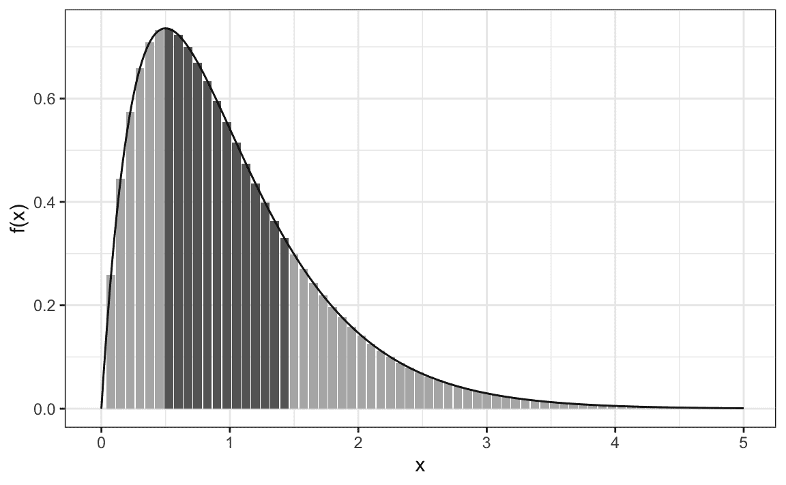
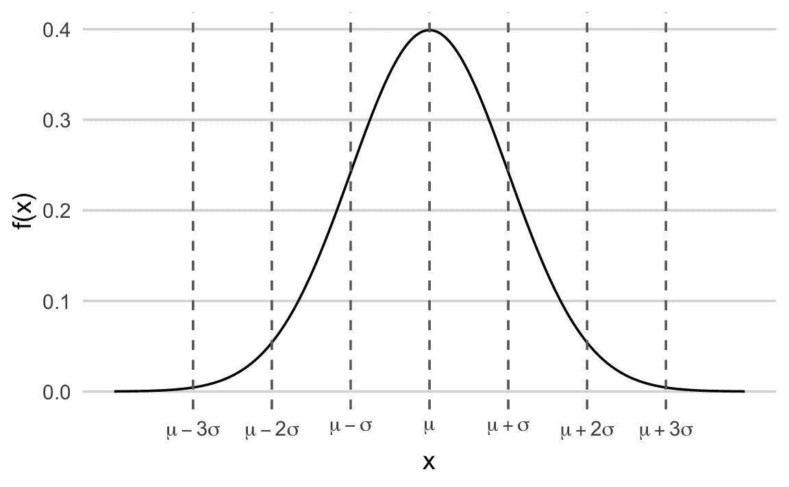
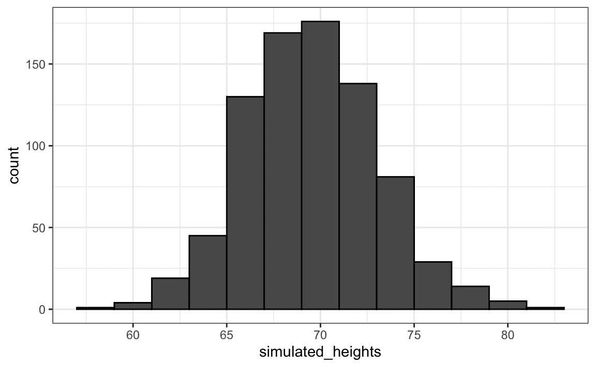
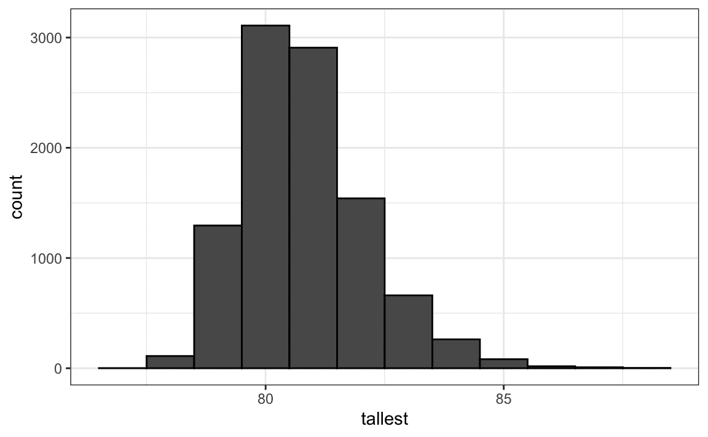

# 6 连续概率

> 原文：[`rafalab.dfci.harvard.edu/dsbook-part-2/prob/continuous-probability.html`](https://rafalab.dfci.harvard.edu/dsbook-part-2/prob/continuous-probability.html)

1.  概率

1.  6 连续概率

在第 1.3 节中，我们讨论了为什么给每个可能的连续结果（如精确身高）分配频率是不切实际的，因为可能存在无限多个值。同样的想法也适用于在连续尺度上取值的随机结果：每个单独的值概率为零。相反，我们通过概率密度函数来描述它们的行为，这使我们能够计算值区间的概率而不是单个点的概率。

在本章中，我们介绍了连续概率分布的数学框架，并展示了在数据分析中经常出现的一些有用的近似。

## 6.1 累积分布函数

我们回到使用成年男性学生身高的例子：

```r
[library](https://rdrr.io/r/base/library.html)([tidyverse](https://tidyverse.tidyverse.org))
[library](https://rdrr.io/r/base/library.html)(dslabs)
x <- heights |> [filter](https://dplyr.tidyverse.org/reference/filter.html)(sex == "Male") |> [pull](https://dplyr.tidyverse.org/reference/pull.html)(height)
```

*我们之前定义了经验累积分布函数（eCDF）为

```r
F <- function(a) [mean](https://rdrr.io/r/base/mean.html)(x <= a)
```

*对于任何值`a`，给出列表`x`中小于或等于`a`的值的比例。

要将经验累积分布函数（eCDF）与概率联系起来，想象随机选择一名男性学生。他身高超过 70.5 英寸的概率是多少？因为每个学生被选中的可能性相同，所以这个概率就是身高超过 70.5 英寸的学生比例。使用 eCDF，我们可以这样计算它：

```r
1 - [F](https://rdrr.io/r/base/logical.html)(70.5)
#> [1] 0.363
```

*累积分布函数（CDF）是 eCDF 的理论对应物。它不是依赖于观察数据，而是为随机结果\(X\)的值范围分配概率。具体来说，CDF 为任何数\(a\)给出了\(X\)小于或等于\(a\)的概率：

\[ F(a) = \Pr(X \leq a) \]

一旦定义了 CDF，我们就可以计算\(X\)落在任何区间内的概率。例如，一个学生身高在\(a\)和\(b\)之间的概率是：

\[ \Pr(a < X \leq b) = F(b) - F(a) \]

因为我们可以从累积分布函数（CDF）中确定任何事件的概率，它完全定义了连续结果的概率分布。***

## ***6.2 概率密度函数***

***对于大多数连续分布，我们可以用另一个函数\(f(x)\)来描述累积分布函数（CDF），使得

\[ F(b) - F(a) = \int_a^b f(x)\,dx \]

这个函数\(f(x)\)被称为*概率密度函数*（PDF）。

PDF 在离散数据中的角色类似于相对频率分布。关键区别在于，对于连续变量，单个值具有零概率，因此不是将概率分配给特定的结果，而是 PDF 显示了概率如何在 \(x\) 的可能值范围内分布。变量落在某个区间（例如 \([a,b]\)）内的概率由曲线在 \(a\) 和 \(b\) 之间的面积给出。因此，PDF 的形状显示了值更可能或不太可能出现的区域，较宽或较高的区域对应于包含更多概率质量的范围。

为了理解为什么我们使用连续函数和积分来描述概率，考虑一个结果可以非常精确测量的情况。在这种情况下，我们可以将相对频率视为与下面图表中柱子的高度成比例：



结果落在某个区间内的概率，例如 \(x \in [0.5, 1.5]\)，可以通过计算该范围内柱子的高度之和，并除以所有柱子的总高度来近似。随着测量的精度提高和柱宽变窄，这个总和趋近于连续函数 \(f(x)\) 曲线下的面积。

在柱宽缩小到零的极限情况下，总和与积分是相同的：\(x\) 落在某个区间的概率正好等于 \(f(x)\) 在该区间下的面积。为了使这一点成立，我们定义 \(f(x)\) 使得曲线下的总面积等于 1：

\[ \int_{-\infty}^{\infty} f(x) \, dx = 1 \]

这确保了 \(f(x)\) 代表一个有效的 PDF。

PDF 的重要例子是正态分布，它在 第 2.1 节 中介绍。它的概率密度函数是

\[ f(x) = \frac{1}{\sqrt{2\pi}\,\sigma} \exp\left(-\frac{1}{2}\left(\frac{x - \mu}{\sigma}\right)²\right) \]

正如我们之前所看到的，它有一个以 \(\mu\) 为中心的钟形曲线，95% 的面积在 \(\mu\) 的 \(2\sigma\) 范围内：



在 R 中，这个函数的 PDF 由 `dnorm` 提供，相应的 CDF 由 `pnorm` 提供。

如果一个随机结果被说成是以均值 `m` 和标准差 `s` 正态分布，那么它的 CDF 是通过以下方式定义的：

```r
[F](https://rdrr.io/r/base/logical.html)(a) <- [pnorm](https://rdrr.io/r/stats/Normal.html)(a, mean = m, sd = s)
```

*这在实践中特别有用。如果我们愿意假设一个变量，例如身高，遵循正态分布，我们可以在不需要完整数据集的情况下回答概率问题。例如，要找到随机选择的学生身高超过 70.5 英寸的概率，我们只需要样本均值和标准差：

```r
m <- [mean](https://rdrr.io/r/base/mean.html)(x)
s <- [sd](https://rdrr.io/r/stats/sd.html)(x)
1 - [pnorm](https://rdrr.io/r/stats/Normal.html)(70.5, m, s)
#> [1] 0.371
```

*很好——你现有的“理论分布作为近似”部分清晰且概念上合理，但它与你在“正态分布”中已经解释的内容重叠严重（尤其是在你讨论使用连续正态曲线近似离散数据的地方）。*****

## **6.3 理论分布作为实际模型**

**理论分布，如正态分布，是数学上定义的，而不是直接从数据中推导出来的。在实践中，我们使用它们来*近似*来自复杂或未知过程的实际数据的行为。我们分析的几乎所有的数据集都由离散观测值组成，但许多这些量，如身高、体重或血压，更好地理解为潜在连续变量的测量。**

例如，我们的身高数据看起来是离散的，因为数值通常会被四舍五入到最接近的英寸。少数人报告了更精确的公制测量值，而大多数人则四舍五入到整数英寸。因此，将身高视为一个连续变量，其明显的离散性来自四舍五入，这更为现实。

当使用正态分布等连续分布时，我们不再为单个点分配概率，每个确切值都有零概率，而是为*区间*分配概率。在第二章中，我们展示了如何近似这些理论分布。

关键思想是理论分布作为*有用的近似*。它们提供了平滑的数学描述，使我们能够计算概率并推理不确定性。尽管实际测量是离散的，但适用的连续近似，如正态分布，使我们能够从分析数据并构建泛化能力强的模型。

## **6.4 蒙特卡洛模拟**

**模拟**是一种强大的理解随机性、近似概率以及探索理论模型在实际中如何表现的方法。在数据分析中使用的许多概率模型都是连续分布，它们描述了可以取任何值的范围内的结果。在 R 中，所有从连续分布生成模拟数据的随机数生成函数，都以字母`r`开头。这些函数构成了一个一致的家族，使我们能够从几乎任何概率分布中进行模拟。在本节中，我们将使用连续分布来展示蒙特卡洛技术，从正态分布开始，扩展到其他常用模型。

### 正态分布

R 提供了`rnorm`函数来生成正态分布的结果。它接受三个参数，样本大小、均值（默认为 0）和标准差（默认为 1），并产生遵循正态分布的随机数。

这里是一个我们可以生成类似于我们报告的身高数据的例子：

```r
n <- [length](https://rdrr.io/r/base/length.html)(x)
m <- [mean](https://rdrr.io/r/base/mean.html)(x)
s <- [sd](https://rdrr.io/r/stats/sd.html)(x)
simulated_heights <- [rnorm](https://rdrr.io/r/stats/Normal.html)(n, m, s)
```

*不出所料，模拟的身高分布看起来是正态的：



这是 R 中最有用的函数之一，因为它允许我们生成模拟自然变异的数据，并通过蒙特卡洛模拟探索可能偶然发生的后果。

### *示例：极值*

*在 800 人中找到一个七英尺高的人有多罕见？假设我们反复随机抽取 800 名男性学生并记录每组中最高的学生。这些最高身高分布看起来像什么？以下蒙特卡洛模拟帮助我们找出答案：

```r
tallest <- [replicate](https://rdrr.io/r/base/lapply.html)(10000, [max](https://rdrr.io/r/base/Extremes.html)([rnorm](https://rdrr.io/r/stats/Normal.html)(800, m, s)))
```

*拥有七英尺高的人相当罕见：

```r
[mean](https://rdrr.io/r/base/mean.html)(tallest >= 7*12)
#> [1] 0.0207
```

*以下是最高身高的人的身高分布：



虽然从理论上推导这个分布是可能的，但并不简单。一旦推导出来，它提供了一种比模拟更快的方法来评估概率。然而，当解析推导过于复杂或不可行时，蒙特卡洛模拟提供了一个实用的替代方案。通过反复生成随机样本，我们可以近似几乎任何统计量的分布，并在理论结果不可用的情况下获得可靠的估计。***

### ***其他连续分布***

***正态分布并非唯一有用的理论模型。在数据分析中经常出现的其他连续分布包括学生`t`分布、卡方分布、指数分布、伽马分布和贝塔分布。它们在 R 中的简称分别是`t`、`chisq`、`exp`、`gamma`和`beta`。

这些分布中的每一个都有一个相关的`r`函数，例如`rt`、`rchisq`、`rexp`、`rgamma`和`rbeta`，允许你为模拟生成随机样本。这种一致性使得将蒙特卡洛方法应用于各种数据生成过程变得容易。

## ***6.5 计算密度、概率和分位数***

***除了模拟之外，R 还提供了评估和总结连续分布的伴随函数。基础 R 中的每个分布都遵循一个简单的命名约定：

+   `d` - 密度函数

+   `p` - 累积分布函数 (CDF)

+   `q` - 分位数函数

+   `r` - 随机数生成

例如，学生`t`分布使用`dt`、`pt`、`qt`和`rt`。基础 R 包括最常见的连续分布，如正态分布、`t`分布、卡方分布、指数分布、伽马分布和贝塔分布，但许多额外的分布可以在专门的包如**extraDistr**和**actuar**中找到。尽管有数十种连续分布被使用，但基础 R 提供的分布涵盖了实践中遇到的大多数应用。

## ***6.6 练习***

***1. 假设女性身高的分布近似为均值为 64 英寸，标准差为 3 英寸的正态分布。如果我们随机选择一个女性，她身高 5 英尺或更矮的概率是多少？

2. 假设女性身高的分布近似为均值为 64 英寸，标准差为 3 英寸的正态分布。如果我们随机选择一个女性，她身高 6 英尺或更高的概率是多少？

3. 假设女性身高的分布近似为均值为 64 英寸，标准差为 3 英寸的正态分布。如果我们随机选择一个女性，她身高在 61 到 67 英寸之间的概率是多少？

4. 重复上述练习，但将所有内容转换为厘米。也就是说，将包括标准差在内的每个身高乘以 2.54。现在答案是什么？

5. 注意，当你改变单位时，问题的答案不会改变。这很有道理，因为列表中一个条目与平均值的偏差不受我们使用的单位影响。实际上，如果你仔细观察，你会发现 61 和 67 都是离平均值 1 个标准差。计算一个随机选择的、正态分布的随机变量在平均值 1 个标准差内的概率。

6. 为了理解解释练习 3、4 和 5 答案的数学原理，假设我们有一个随机变量 \(X\)，其平均值为 \(\mu\)，标准误差为 \(\sigma\)，并且我们询问 \(X\) 小于或等于 \(a\) 的概率。这个概率是：

\[ \mathrm{Pr}(X \leq a) \] 请记住，根据定义，\(a\) 是 \((a - \mu)/\sigma\) 标准差 \(s\) 离平均值 \(\mu\) 的距离。现在我们从两边减去 \(\mu\)，然后将两边都除以 \(\sigma\)：

\[ \mathrm{Pr}\left(\frac{X-\mu}{\sigma} \leq \frac{a-\mu}{\sigma} \right) \]

左边的量是一个标准正态随机变量。它具有平均值为 0，标准误差为 1。我们将它称为 \(Z\)：

\[ \mathrm{Pr}\left(Z \leq \frac{a-\mu}{\sigma} \right) \]

所以，无论单位如何，\(X\leq a\) 的概率与标准正态变量小于 \((a - \mu)/s\) 的概率相同。

如果 `m` 是平均值，`s` 是标准误差，以下哪个 R 代码会在每种情况下给出正确答案？

1.  `mean(X <= a)`

1.  `pnorm((a - m)/s)`

1.  `pnorm((a - m)/s, m, s)`

1.  `pnorm(a)`

7. 想象男性成年人的分布大约是正态分布，期望值为 69，标准差为 3。第 99 百分位的男性身高是多少？提示：使用 `qnorm`。

8. 智商分数大约呈正态分布，均值为 100，标准差为 15。假设我们想知道在一个学区内每年出生 10,000 人的情况下，所有高中毕业班中最高智商的分布情况。使用 `B = 1000` 运行蒙特卡洛模拟，其中每个迭代生成 10,000 个智商分数并记录最高值。然后，创建一个直方图来可视化该地区最高智商的分布。
