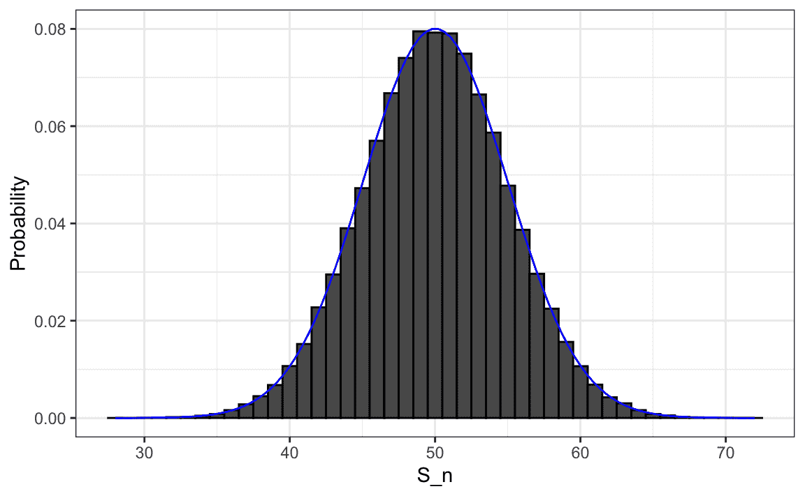

# 7  随机变量

> 原文：[`rafalab.dfci.harvard.edu/dsbook-part-2/prob/random-variables.html`](https://rafalab.dfci.harvard.edu/dsbook-part-2/prob/random-variables.html)

1.  概率

1.  7  随机变量

为了严格研究不确定性，我们需要描述数据在随机性下如何行为的数学工具。本书下一部分的主题**统计推断**，建立在这些工具之上，以量化不确定性并做出预测。在本章中，我们介绍了**随机变量**的概念，并通过简单的例子探讨其主要特性。

## 7.1 定义

统计推断始于**随机变量**的概念，这是一个数值量，其值取决于随机过程的输出。随机变量通过提供一种用数学方式描述不确定性的方法，将概率论与数据分析联系起来。一旦我们定义了一个随机变量，我们就可以研究其分布，计算其期望值和变异性，并利用它对未来或未观察到的结果做出基于概率的陈述。

在本章中，我们关注随机变量的概率分布完全已知的情况。这些是理想化的环境，例如机会游戏，其中概率是由游戏的规则而不是数据决定的。通过处理这些简单、受控的例子，我们可以理解概率、期望值、标准误差和抽样分布的数学基础。

在后面的章节中，我们将转向现实世界的数据问题，其中潜在分布是未知的。在这些情况下，我们使用**统计推断**来估计或近似这些分布。这里引入的概率概念为这些推断方法提供了理论基础。

首先，考虑一个简单的离散例子。假设我们从包含红色和蓝色珠子的罐子中随机抽取一个珠子。定义随机变量：

$$ X = \begin{cases} 1 & \text{if the bead is blue},\\ 0 & \text{if the bead is red.} \end{cases} $$

在 R 中，我们可以使用我们在第 5.3 节中介绍的代码来模拟这个过程：

```r
beads <- rep(c("red", "blue"), times = c(2, 3))
x <- ifelse(sample(beads, 1) == "blue", 1, 0)
```

每次我们抽取一个珠子，$X$的值可能会改变，因为结果是随机的。在统计教科书中，这种只取 0 和 1 值的变量被称为**伯努利随机变量**。伯努利试验是许多统计模型的基础，因为许多结果，如成功/失败、是/否或正面/反面，都可以用这种方式表示。

一个经典的例子是在抛掷$n$个公平硬币时观察到的正面数量，称为$S_n$。我们可以使用模拟生成这个随机变量的一个观测值：

```r
s <- sum(sample(c(0,1), n, replace = TRUE))
```

我们将在后面的章节中使用这个例子。

并非所有随机变量都是离散的。一些可以取连续的值。例如，随机选择的人的身高或物理测量的结果可以被视为 *连续随机变量*。例如，我们使用正态分布模拟这样的变量：

```r
x <- rnorm(10, mean = 70, sd = 3)
```

这里每个 `x` 的值代表从均值为 70、标准差为 3 的正态分布中抽取的随机变量的一个实现。重复模拟每次会产生略微不同的数字，反映了过程的固有随机性。

这些例子，离散的伯努利变量和一个连续的正态变量，说明了我们在本章中将研究的随机变量的主要类型。理解它们的行为和总结它们的分布是引导我们走向期望值、变异性和最终统计推断的关键步骤。

## 7.2 随机变量的符号表示

在统计符号中，大写字母表示随机变量，而小写字母表示观察到的值。有时两者同时出现，例如 $X = x$，其中 $X$ 是随机的，而 $x$ 是一个固定值。例如，$X$ 可能代表掷骰子显示的数字，而 $x$ 是观察到的结果，1、2、3、4、5 或 6：

$$ \mathrm{Pr}(X = x) = 1/6 \quad \text{for } x = 1, \dots, 6. $$

这种符号很方便，因为它让我们可以紧凑地表达概率陈述。一开始可能看起来有些奇怪，因为 $X$ 代表尚未观察到的结果，我们可以讨论其可能值的可能性，但不能讨论其实现值。一旦收集到数据，我们就观察到 $X$ 的一个实现，然后根据已经发生的情况推理可能发生的情况。

## 7.3 随机变量的概率分布

随机变量的概率分布告诉我们每个可能结果的可能性。例如，如果我们掷 $n$ 个公平的硬币，我们可能会询问观察到 40 个或更少头部的概率。这相当于询问 $\mathrm{Pr}(S_n \leq 40)$。

如果我们可以定义累积分布函数（CDF）$F(a) = \mathrm{Pr}(S_n \leq a)$，我们就可以回答任何涉及 $S_n$ 的概率问题，例如落在区间 $(a, b]$ 内的概率。我们称 $F$ 为随机变量的 *分布函数*。

我们可以通过蒙特卡洛模拟来近似这个分布函数。例如，以下代码模拟了 100,000 次掷 100 个公平硬币：

```r
n <- 100
s <- replicate(100000, sum(sample(c(0,1), n, replace = TRUE)))
```

然后我们可以通过计算小于或等于 `a` 的模拟值的比例来估计 $\mathrm{Pr}(S_n \leq a)$：

```r
mean(s <= a)
```

例如，观察到 100 个硬币中有 40 个或更少头部的概率是：

```r
mean(s <= 40)
#> [1] 0.028
```

我们可以通过直方图可视化 $S_n$ 的分布，并叠加相应的正态密度曲线以进行比较：



我们看到分布近似为正态分布。QQ 图将证实正态近似提供了非常好的拟合。在下一章（第 8.3 节）中，我们将学习解释为什么这种近似如此之好的理论。实际上，这个结果远远超出了抛硬币的范畴，它广泛适用于许多类型的随机变量的平均值和总和。

如果分布是正态分布，它完全由其平均值和标准差来表征。这两个量在概率论中有特殊的名称：随机变量的*期望值*和*标准误*。我们将在下面讨论这些内容。

统计理论使我们能够推导出作为从罐子中独立抽取的随机变量的和的随机变量的精确分布。在我们的抛硬币例子中，正面（成功）的数量 $S_n$ 服从**二项分布**。因此，蒙特卡洛模拟仅用于说明。

我们可以直接使用 `dbinom` 或 `pbinom` 来计算概率。例如，要找到 $\mathrm{Pr}(S_n \leq 40)$：

```r
 pbinom(40, size = n, prob = 1/2)
#> [1] 0.0284
```

我们也可以使用 `rbinom` 而不是 `replicate` 和 `sample` 来模拟正面数量：

```r
rbinom(100000, n, 1/2)
```

## 7.4 期望值和标准误

在统计学教科书中，随机变量 $X$ 的期望值通常表示为 $\mu_X$ 或 $\mathrm{E}[X]$，两者都表示“$X$ 的期望值”。

直观地说，期望值代表如果随机过程重复多次，则长期平均结果。重复次数越多，观察值的平均值就越接近 $\mathrm{E}[X]$。

对于具有可能结果 $x_1,\dots,x_n$ 的离散随机变量，期望值定义为：

$$ \mathrm{E}[X] = \sum_{i=1}^n x_i ,\mathrm{Pr}(X = x_i) $$

对于具有概率密度函数 $f(x)$ 和范围 $(a, b)$ 的连续随机变量，求和变为积分：

$$ \mathrm{E}[X] = \int_a^b x f(x), dx $$

如果所有 $x_i$ 都具有相等的概率 $1/n$，例如从罐子中均匀抽取时，期望值就简化为算术平均值：

$$ \mathrm{E}[X] = \frac{1}{n}\sum_{i=1}^n x_i. $$

例如，在抛硬币的情况下，$X = 1$ 代表正面，$0$ 代表反面，

$$ \mathrm{E}[X] = 1 \times \Pr(X=1) + 0 \times \Pr(X=0) = 1/2. $$

虽然 $X$ 只取 0 或 1 的值，但其*期望值*为 0.5 代表如果实验重复多次，则正面的长期比例：

```r
B <- 10⁶
x <- sample(c(0, 1), B, replace = TRUE)
mean(x)
#> [1] 0.5
```

标准误*（SE）描述了 $X$ 与其期望值的典型偏差。它定义为：

$$ \mathrm{SE}[X] = \sqrt{\sum_{i=1}^n (x_i - \mathrm{E}[X])² ,\mathrm{Pr}(X = x_i)}. $$

对于具有密度函数 $f(x)$ 的连续随机变量，这变为：

$$ \mathrm{SE}[X] = \sqrt{\int_a^b (x - \mathrm{E}[X])² f(x), dx}. $$

许多教科书在介绍*标准误*之前先介绍*方差*。方差是标准误的平方：

$$ \mathrm{Var}[X] = \mathrm{SE}[X]². $$

方差在推导中很有用，因为它避免了平方根，但标准误更容易解释，因为它使用与数据相同的单位。*当所有结果 $x_i$ 都等可能时，标准误简化为标准差：

$$ \mathrm{SE}[X] = \sqrt{\frac{1}{n}\sum_{i=1}^n (x_i - \mathrm{E}[X])²}, \quad \mathrm{E}[X] = \frac{1}{n}\sum_{i=1}^n x_i. $$

对于抛硬币：

$$ \mathrm{SE}[X] = \sqrt{(1-0.5)² \times 0.5 + (0-0.5)² \times 0.5} = 0.5. $$

因此，一枚硬币的期望值为 0.5，标准误也为 0.5——这是合理的，因为可能的结果是 0 或 1。

我们使用希腊字母 $\mu$ 和 $\sigma$ 分别表示期望值和标准误。这种约定反映了它们与 *均值* ($m$) 和 *标准差* ($s$) 的联系。然而，我们通常更喜欢使用 $\mathrm{E}[X]$ 和 $\mathrm{SE}[X]$ 符号，因为它更清楚地推广到涉及随机变量之和或变换的数学表达式。

## 7.5 期望值和标准误的关键性质

在处理数据时，我们将频繁使用期望值和标准误的几个数学性质。

1. 随机变量之和的期望值是每个随机变量期望值的和。我们可以这样写：

$$ \mathrm{E}[X_1+X_2+\dots+X_n] = \mathrm{E}[X_1] + \mathrm{E}[X_2]+\dots+\mathrm{E}[X_n] $$

如果 $X$ 代表从罐子中独立抽取的样本，那么它们都具有相同的期望值。让我们用 $\mu_X$ 表示期望值，并重新写下方程：

$$ \mathrm{E}[X_1+X_2+\dots+X_n]= n\mu_X $$

这是以另一种方式写出我们上面对于抽取之和的结果。

2. 非随机常数乘以随机变量的期望值等于非随机常数乘以随机变量的期望值。如果我们移动随机变量，期望值也会相应移动。用符号表示更容易解释：

$$ \mathrm{E}[aX+b] = a\times\mathrm{E}[X] + b $$

要理解为什么这是直观的，考虑改变单位。如果我们改变随机变量的单位，例如从美元到分，期望值应该以相同的方式改变。

上述两个事实的后果是，从同一罐子中独立抽取的平均值的期望值等于罐子的期望值，再次用 $\mu_X$ 表示：

$$ \mathrm{E}[(X_1+X_2+\dots+X_n) / n]= \mathrm{E}[X_1+X_2+\dots+X_n] / n = n\mu_X/n = \mu_X $$

3. 独立随机变量之和的方差是每个随机变量方差的和：

$$ \mathrm{Var}[X_1+X_2+\dots+X_n] =\mathrm{Var}[X_1] + \mathrm{Var}[X_2]+\dots+\mathrm{Var}[X_n] $$ 这意味着以下关于独立随机变量之和的标准误的性质：

$$ \mathrm{SE}[X_1+X_2+\dots+X_n] = \sqrt{\mathrm{SE}[X_1]² + \mathrm{SE}[X_2]²+\dots+\mathrm{SE}[X_n]² } $$

注意，这个特定的属性不像前三个那样直观，更深入的解释可以在统计学教科书中找到。

4\. 非随机常数乘以随机变量的标准误差是非随机常数乘以随机变量标准误差。就像期望一样：

$$ \mathrm{SE}[aX] = a \times \mathrm{SE}[X] $$

要理解为什么这是直观的，再次考虑单位。

如果我们通过一个常数移动随机变量，变异性不会改变。因此，它对标准误差没有影响：

$$ \mathrm{SE}[aX+b] = a \times \mathrm{SE}[X] $$

3 和 4 的后果是，从同一抽屉中独立抽取的平均值的标准误差是抽屉的标准差除以平方根$n$（抽取的数量），称之为$\sigma_X$:

$$ \begin{aligned} \mathrm{SE}[\bar{X}] = \mathrm{SE}[(X_1+X_2+\dots+X_n) / n] &= \mathrm{SE}[X_1+X_2+\dots+X_n]/n \\ &= \sqrt{\mathrm{SE}[X_1]²+\mathrm{SE}[X_2]²+\dots+\mathrm{SE}[X_n]²}/n \\ &= \sqrt{\sigma_X²+\sigma_X²+\dots+\sigma_X²}/n\\ &= \sqrt{n\sigma_X²}/n\\ &= \sigma_X / \sqrt{n} \end{aligned} $$

独立性假设很重要* *给定的方程揭示了实际场景中的关键见解。具体来说，它表明可以通过增加样本大小$n$来最小化标准误差，我们可以量化这种减少。然而，这个原则只有在变量$X_1, X_2, ... X_n$是独立的时才成立。如果它们不是，估计的标准误差可能会显著偏离。

在第 15.2 节中，我们介绍了相关性的概念，它量化了变量相互依赖的程度。如果$X$变量之间的相关系数是$\rho$，它们平均值的标准误差是：

$$ \mathrm{SE}\left[\bar{X}\right] = \sigma_X \sqrt{\frac{1 + (n-1) \rho}{n}} $$

这里的关键观察是，随着$\rho$接近其上限 1，标准误差增加。值得注意的是，在$\rho = 1$的情况下，标准误差$\mathrm{SE}[\bar{X}]$等于$\sigma_X$，并且它不受样本大小$n$的影响。*5\. 如果$X$是一个正态分布的随机变量，那么如果$a$和$b$是非随机常数，$aX + b$也是一个正态分布的随机变量。我们所做的只是通过乘以$a$来改变随机变量的单位，然后通过$b$来移动中心。

## 7.6 大数定律

上述结果 4 的一个重要含义是，随着$n$的增大，平均值的标准误差越来越小。当$n$非常大时，标准误差实际上为 0，抽取的平均值收敛到抽屉的平均值。这在统计学教科书中被称为大数定律或平均定律*****。

平均数法则的误解* 平均数法则有时会被误解。例如，如果你掷硬币 5 次，每次都是正面，你可能会听到有人争论说下一次掷硬币很可能是反面，因为平均数法则：平均来说，我们应该看到 50% 的正面和 50% 的反面。一个类似的论点是，在看到连续五次出现黑色之后，轮盘赌上的红色“应该”出现。然而，这些事件是独立的，所以硬币落在正面的概率是 50%，无论之前 5 次的结果如何。同样的原则也适用于轮盘赌的结果。平均数法则只适用于抽取次数非常多的情况，而不是小样本。在掷一百万次之后，你肯定会看到大约 50% 的正面，无论前五次的结果如何。平均数法则的另一个有趣的误用是在体育比赛中，当电视体育解说员预测一名球员即将成功，因为他们连续几次失败时。

## 7.7 数据分布与概率分布

在继续之前，区分**数据集的分布**和**概率分布**是很重要的。

任何数字列表 $x_1, \dots, x_n$ 或任何数据集，都有一个分布描述了观察到的值的分布情况。我们可以用简单的统计量，如平均值和标准差来总结它：

```r
m <- mean(x)
s <- sd(x)
```

另一方面，**概率分布**是一个理论构造，它描述了随机变量的可能值及其可能性。它不依赖于数据。

当 $X$ 代表从罐子中随机抽取一个数字时，罐子中的数字列表定义了可能的结果，它们的相对频率定义了 $X$ 的概率分布。罐子中数字的平均值和标准差对应于随机变量的**期望值**和**标准误**。

这种联系可能会导致混淆：每个数字列表都有一个标准差，每个随机变量都有一个标准误，但随机变量的标准误是其**概率分布的标准差**，而不是特定数据集的标准差。

## 7.8 练习

1. 在美国轮盘赌中，你可以下注黑色或红色。有 18 个红色，18 个黑色和 2 个绿色（0 和 00）。黑色出现的概率是多少？

2. 在黑色上赢的赔率是 1 美元。这意味着如果你下注 1 美元并且它落在黑色上，你将得到 1 美元，否则你将损失 1 美元。使用 `sample` 函数创建一个模拟随机变量 $X$ 的抽样模型来模拟你的收益。

3. 计算随机变量 $X$ 的期望值。

4. 计算随机变量 $X$ 的标准误。

5. 现在创建一个随机变量 $S_n$，它是你在黑色上投注 n = 100 次后的收益总和。模拟 $S_n$ 的 100,000 个结果。开始你的代码时，使用 `set.seed(1)` 将种子设置为 1。

6. $S_n$ 的期望值是多少？

7. $S_n$ 的标准误是多少？

8. 你最终赢钱的概率是多少？

10. 在美国轮盘赌中，你也可以投注绿色。有 18 个红色，18 个黑色和 2 个绿色（0 和 00）。绿色出现的几率是多少？

11. 赢得绿色的赔付是 17 美元。这意味着如果你下注 1 美元并且它落在绿色上，你将得到 17 美元，否则你将损失 1 美元。使用 `sample` 函数创建一个采样模型来模拟你的收益随机变量 $X$。

12. 计算随机变量 $X$ 的期望值。

13. 计算随机变量 $X$ 的标准误差。

14. 现在创建一个随机变量 $S_n$，它是你在绿色上投注 n = 100 次后的总收益。模拟 $S_n$ 的 100,000 个结果。开始你的代码时，使用 `set.seed(1)` 将种子设置为 1。

15. $S_n$ 的期望值是什么？

16. $S_n$ 的标准误差是什么？

17. 你最终赢钱的概率是多少？
