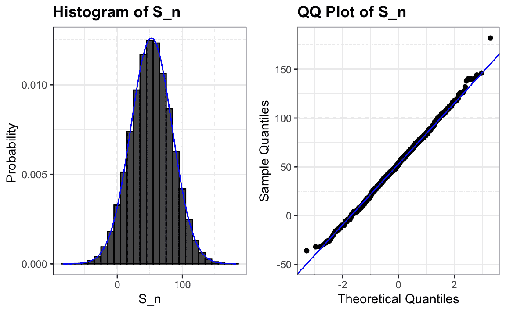

# 8  抽样模型和中心极限定理

> 原文：[`rafalab.dfci.harvard.edu/dsbook-part-2/prob/sampling-models-and-clt.html`](https://rafalab.dfci.harvard.edu/dsbook-part-2/prob/sampling-models-and-clt.html)

1.  概率

1.  8  抽样模型和中心极限定理

在上一章中，我们介绍了随机变量，并看到了它们的分布、期望值和标准误差如何描述不确定性。在本章中，我们通过引入**抽样模型**来构建这些想法，这些模型是数据生成过程的数学抽象。然后我们使用中心极限定理（CLT）来近似独立抽取的总和和平均值的分布。通过基于在赌场玩轮盘赌的具体例子，我们展示了如何使用 CLT 来回答诸如“输钱的可能性有多大？”等实际问题。

## 8.1 抽样模型

许多数据生成过程可以有效地建模为从**抽屉中抽取**。例如，对可能投票者的民意调查可以看作是从包含整个人口偏好的抽屉中抽取 0（共和党人）和 1（民主党人）。在流行病学中，我们通常假设研究中的个体是从更大的群体中随机抽取的，其中每个抽取对应于个体的结果。同样，在实验研究中，我们将受试者（如蠕虫、苍蝇、老鼠或人类，例如）视为从更广泛的群体中随机抽取的。随机实验遵循相同的逻辑：每个参与者分配到治疗或对照组可以看作是从抽屉中随机抽取。

由于随机抽样和随机分配是数据分析的基础，**抽样模型**在统计学中无处不在。为了建立直观感觉，我们从一个**机会游戏**开始，其中随机性是明确的，概率与实际结果之间的联系是完美的。我们现在定义一个具体的例子。

### 轮盘赌例子

假设一家小赌场雇佣你来决定它是否应该安装轮盘赌。为了简化问题，想象 1,000 个人每人下注一次黑。赌场希望你估计它能期望赚多少钱，或者会损失多少钱，最重要的是，输钱的可能性。如果这个可能性太高，他们将放弃安装轮盘赌。

我们定义一个随机变量 \(S_n\) 来表示在 \(n\) 场游戏后赌场的总赢利。一个轮盘有 18 个红色口袋，18 个黑色口袋和 2 个绿色口袋。结果等同于从这个抽屉中抽取一个球：

```r
color <- [rep](https://rdrr.io/r/base/rep.html)([c](https://rdrr.io/r/base/c.html)("Black", "Red", "Green"), times = [c](https://rdrr.io/r/base/c.html)(18, 18, 2))
```

*每个 1,000 个结果都是从这个抽屉中独立抽取的。如果出现黑色，赌徒赢，赌场输 1 美元（记录为-1）。否则，赌场赢 1 美元。

```r
n <- 1000
x <- [sample](https://rdrr.io/r/base/sample.html)([ifelse](https://rdrr.io/r/base/ifelse.html)(color == "Black", -1, 1), n, replace = TRUE)
```

*既然我们已经知道了 1 和-1 的比例，我们可以简化：

```r
x <- [sample](https://rdrr.io/r/base/sample.html)([c](https://rdrr.io/r/base/c.html)(-1, 1), n, replace = TRUE, prob = [c](https://rdrr.io/r/base/c.html)(9/19, 10/19))
```

*我们称之为*采样模型*，因为它通过从容器中重复抽取来表示随机行为。赌场的总赢利，定义为 \(S_n\)，仅仅是这些独立抽取的总和：

```r
s <- [sum](https://rdrr.io/r/base/sum.html)(x)
```

*在推导总赢利分布 \(S_n\) 之前，值得停下来问问我们最初为什么研究像轮盘赌这样的问题。****

### ***将采样模型与实际数据联系起来***

***在不确定性数据分析中，从采样模型的角度思考是至关重要的。它将我们在概率中研究的随机变量与我们实际分析的数据集联系起来。通过将数据想象为从容器、群体或随机化程序中抽取的随机抽取，我们阐明了我们的模型代表什么以及它们依赖于哪些假设。***

这种观点也支撑了现代统计学的大部分内容。像置信区间、假设检验和回归这样的工具都依赖于从采样模型中推导出的假设。理解这些假设有助于我们深思熟虑地应用这些方法，并认识到它们的局限性。

赌场游戏使这些想法变得具体，因为它们的采样模型是完全已知的。例如，红色、黑色和绿色口袋的数量是明确的，并且容易模拟。相比之下，现实世界的数据来自更复杂的“容器”，例如身高、收入或健康结果各不相同的人群。当我们收集数据时，我们实际上是从这样的群体中抽取一个随机样本。

这种思维方式构建了统计直觉：每个数据集代表某个潜在过程的样本，我们结论的有效性取决于我们对该过程的假设有多好。***

## ***8.2 蒙特卡洛模拟***

***为了找到赌场亏损的概率，我们需要估计 \(S_n\) 的分布。在概率的语言中，这是 \(\Pr(S_n < 0)\)。如果我们定义分布函数 \(F(a) = \Pr(S_n \leq a)\)，我们就可以回答任何关于 \(S_n\) 概率的任何问题。***

我们可以通过蒙特卡洛模拟来估计 \(F(a)\)，生成许多 \(S_n\) 的实现。以下代码模拟了 1,000 人玩轮盘赌，并重复了 100,000 次这个过程：

```r
n <- 1000
roulette_winnings <- function(n){
 x <- [sample](https://rdrr.io/r/base/sample.html)([c](https://rdrr.io/r/base/c.html)(-1, 1), n, replace = TRUE, prob = [c](https://rdrr.io/r/base/c.html)(9/19, 10/19))
 [sum](https://rdrr.io/r/base/sum.html)(x)
}
s <- [replicate](https://rdrr.io/r/base/lapply.html)(100000, roulette_winnings(n))
```

*在模拟中，\(S_n \leq a\) 的比例近似于 \(F(a)\)：

```r
[mean](https://rdrr.io/r/base/mean.html)(s <= a)
```

*例如，亏损的概率是：

```r
[mean](https://rdrr.io/r/base/mean.html)(s < 0)
#> [1] 0.0453
```

*\(S_n\) 的直方图和 qqplot 显示分布近似正态分布，这是一个**中心极限定理**很快将解释的观察结果。

******

## ***8.3 中心极限定理***

***中心极限定理（CLT）表明，当抽取次数（样本大小）很大时，独立抽取之和的分布近似正态分布。由于采样模型描述了如此多的数据生成过程，CLT 是统计学中最重要的结果之一。

在轮盘赌的例子中，容器包含 20 美元的收益和 18 美元的损失，期望值为：

\[ \mathrm{E}[X] = (20 -18)/38 = 1/19 \approx 0.05. \]

一般而言，对于两个可能的结果 \(a\) 和 \(b\) 以及概率 \(p\) 和 \((1-p)\)，

\[ \mathrm{E}[X] = ap + b(1-p). \]

根据第 7.5 节中引入的性质，期望总收益为：

\[ \mathrm{E}[S_n] = n\,\mathrm{E}[X]. \]

因此，如果有 1000 人玩，赌场预计平均会赢大约 50 美元。

为了量化不确定性，我们计算标准误差，它衡量 \(S_n\) 围绕其期望值的波动程度。对于一个有两个结果 \(a\) 和 \(b\) 的罐子，标准差可以证明为：

\[ \mathrm{SE}[X] = |b - a|\sqrt{p(1-p)}. \]

在轮盘赌的例子中，我们得到：

```r
2*[sqrt](https://rdrr.io/r/base/MathFun.html)(90)/19
#> [1] 0.999
```

*因此，总和的标准误差为：

\[ \mathrm{SE}[S_n] = \sqrt{n}\,\mathrm{SD}[X], \]

在这种情况下是：

```r
[sqrt](https://rdrr.io/r/base/MathFun.html)(n)*2*[sqrt](https://rdrr.io/r/base/MathFun.html)(90)/19
#> [1] 31.6
```

*这些理论值与蒙特卡洛结果非常吻合：

```r
[mean](https://rdrr.io/r/base/mean.html)(s)
#> [1] 52.5
[sd](https://rdrr.io/r/stats/sd.html)(s)
#> [1] 31.6
```

*使用中心极限定理（CLT），我们现在可以计算赌场不亏损的概率，而无需模拟：

```r
[pnorm](https://rdrr.io/r/stats/Normal.html)(0, n*(20 - 18)/38, [sqrt](https://rdrr.io/r/base/MathFun.html)(n)*2*[sqrt](https://rdrr.io/r/base/MathFun.html)(90)/19)
#> [1] 0.0478
```

*这与我们之前的估计相匹配：

```r
[mean](https://rdrr.io/r/base/mean.html)(s < 0)
#> [1] 0.0453
```

**量 \((S_n + n)/2\) 代表赌场的获胜次数，并遵循**二项分布**。因此，可以直接计算 \(\Pr(S_n < 0)\) 的概率：

```r
[pbinom](https://rdrr.io/r/stats/Binomial.html)(n/2 - 1, size = n, prob = 10/19)
#> [1] 0.0448
```

然而，二项式结果仅适用于伯努利试验。在许多现实世界的场景中，数据并非二项式分布，但我们仍然希望近似总和或平均值的分布。对于这些情况，中心极限定理（CLT）提供了一个超越伯努利试验的通用框架。**********

## ****8.4 多大才算大？****

****中心极限定理（CLT）适用于抽取次数“大”时，但“大”取决于上下文。在许多情况下，30 次抽取就足够得到良好的近似，有时甚至更少。在轮盘赌的例子中，当成功的概率非常小的时候，可能需要更大的样本。

例如，在一个中奖概率小于百万分之一的彩票中，即使有数百万张彩票，也只会产生少数几个赢家。在这种情况下，**泊松分布**比正态分布提供了更好的近似。虽然我们在这里不涉及其理论，但它通常在概率论教科书中以及维基百科[泊松分布](https://en.wikipedia.org/wiki/Poisson_distribution)上讨论。您可以使用 R 中的`dpois`、`ppois`和`rpois`探索泊松分布。

总结来说，中心极限定理（CLT）解释了为什么正态分布在统计学中如此常见，以及为什么许多方法在实践中效果良好。但 CLT 也有局限性：当概率极小或分布高度偏斜时，其他模型，如泊松分布或二项分布，可能更合适。对 CLT 何时适用有直觉是进行原则性、深思熟虑的数据分析的关键。****

## ****8.5 练习****

****1\. 在美国轮盘赌中，你也可以赌绿色。有 18 个红色，18 个黑色和 2 个绿色（0 和 00）。创建一个随机变量 \(S_n\)，表示你赌绿色 1000 次后的总收益。

2\. 计算 \(S_n\) 的期望值？

3. 如何计算 \(S_n\) 的标准误差？

4. 使用 CLT 估计你最终赢钱的概率？提示：使用 CLT。

5. 创建一个生成 10,000 个 \(S_n\) 结果的蒙特卡洛模拟。计算结果列表的平均值和标准差以确认 2 和 3 的结果。开始你的代码时，使用 `set.seed(1)` 将种子设置为 1。

6. 现在用蒙特卡洛结果检查你的 4 的答案。

7. 蒙特卡洛结果和 CLT 近似很接近，但并不那么接近。这可能是怎么回事？

1.  10,000 次模拟还不够。如果我们做得更多，它们就会匹配。

1.  当成功的概率较小时，CLT 工作得不是很好。在这种情况下，它是 1/19。如果我们使轮盘赌的次数更多，它们会更好地匹配。

1.  差异在舍入误差范围内。

1.  CLT 只适用于平均值。

现在创建一个随机变量 \(\bar{X}_n\)，它是每场赌注的平均收益，定义为 \(X_n = S_n/n\)。保持 \(n\) = 1,000。

8. \(\bar{X}_n\) 的期望值是多少？

9. \(\bar{X}_n\) 的标准误差是多少？

10. 你最终每场比赛的收益为正的概率是多少？提示：使用 CLT。

11. 创建一个蒙特卡洛模拟，生成 25,000 个 \(\bar{X}_n\) 的结果，而不是 1,000 个。计算结果列表的平均值和标准差以确认 13 和 14 的结果。开始你的代码时，使用 `set.seed(1)` 将种子设置为 1。

12. 现在将你的答案与 14 使用蒙特卡洛结果进行比较。你能对 \(\mathrm{Pr}(\bar{X}_n>0)\) 与 \(\mathrm{Pr}(S_n>0)\) 的 CLT 近似进行比较吗？

1.  我们现在正在计算平均值而不是总和，所以它们非常不同。

1.  25,000 次蒙特卡洛模拟并不比 10,000 次好，并且提供了更接近的估计。

1.  当样本量较大时，CLT 工作得更好。我们从 10,000 增加到 25,000。

1.  差异在舍入误差范围内。

以下练习受到了 2007-2008 年金融危机周围事件的影响¹。这场金融危机部分是由金融机构出售的某些证券的风险被低估造成的。具体来说，抵押贷款支持证券（MBS）和担保债务凭证（CDO）的风险被严重低估。这些资产以假设大多数房主会按时支付月供的价格出售，而这种情况不会发生的概率被计算为很低。一系列因素导致违约数量远多于预期，这导致了这些证券的价格暴跌。因此，银行损失了大量资金，需要政府救助以避免完全关闭。

13. 我们讨论过的采样模型更复杂版本也被银行用来确定利率，以及保险公司用来确定保费。为了理解这一点，假设你经营一家小银行，该银行有识别出可以信赖支付款项的潜在房主的记录。事实上，从历史数据来看，你只有 2%的客户在特定年份违约，这意味着他们没有偿还你借给他们的钱。假设你的银行今年将发放 \(n\) = 1,000 份贷款，总额为 180,000 美元。此外，在加上所有成本后，假设你的银行每笔房屋查封损失 \(l\) = 200,000 美元。为了简化，我们假设这包括所有运营成本。在这种情况下，你银行的预期利润 \(S_n\) 是多少？

14. 注意，之前练习中定义的总损失是由最终求和得到的，这是一个随机变量。每次你运行采样模型代码时，你都会得到不同数量的违约人数，从而导致不同的损失。编写一个采样模型来表示你在第十三部分描述的场景下银行利润 \(S_n\) 的随机变量。

15. 之前的练习表明，如果你只是无息贷款给每个人，你最终会因为 2%的违约者而亏损。尽管你知道 2%的客户可能会违约，但你不知道是哪些客户，因此你不能将他们剔除。然而，通过向每个人收取一点点额外的利息，你可以弥补由于这 2%造成的损失，并覆盖你的运营成本。你需要向每个借款人收取多少数量 \(x\)，才能使你银行的预期利润为 0？假设你不会从违约的借款人那里得到 \(x\)。此外，请注意 \(x\) 不是利率，而是你额外收取的总金额，即 \(x/180000\) 是*利率*。

16. 将练习 14 中的样本模型重写，以考虑你收取的利息，并运行蒙特卡洛模拟，以了解当你收取不同利率时利润的分布情况。

17. 我们实际上不需要蒙特卡洛模拟。根据我们所学到的，中心极限定理（CLT）告诉我们，由于我们的损失是独立抽取的总和，其分布大约是正态分布。利润 \(S_n\) 的期望值和标准误差是多少？将这些值表示为查封概率 \(p\)、贷款数量 \(n\)、每笔查封损失 \(l\) 以及你向每个借款人收取的数量 \(x\) 的函数。

18. 如果你将 \(x\) 设置为使你的银行收支平衡（预期利润为 0），那么你的银行亏损的概率是多少？

19. 假设如果你的银行有负利润，它就必须关闭。因此，你需要提高 \(x\) 来最小化这种风险。然而，设定过高的利率可能会导致你的客户选择另一家银行。所以，让我们说，我们希望亏损的概率是 1 比 100。现在 \(x\) 的数量需要是多少？提示：我们希望 \(\mathrm{Pr}(S_n<0) = 0.01\)。注意，你可以向不等式的两边添加或减去常数，概率不会改变：\(\mathrm{Pr}(S_n<0) = \mathrm{Pr}(S_n+k<0+k)\)，同样，用正常数的除法：\(\mathrm{Pr}(S_n+k<0+k) = \mathrm{Pr}((S_n+k)/m <k/m)\)。使用这个事实和中心极限定理（CLT）将 \(\mathrm{Pr}(S_n<0)\) 中的不等式左侧转换为标准正态分布。

20. 我们现在的利率提高了。但这仍然是一个非常具有竞争力的利率。对于你在第 20 题中获得的 \(x\)，每笔贷款的预期利润和预期总利润是多少？

21. 运行一个蒙特卡洛模拟来双重检查 19 和 20 中使用的理论近似。

22. 你的一个员工指出，由于银行每笔贷款都在盈利，银行应该发放更多贷款！为什么只限制在 \(n\) 上？你解释说找到那些 \(n\) 个客户是项工作。你需要一个可预测的群体，以保持违约的可能性低。然后员工指出，即使违约的可能性更高，只要我们的预期值是正的，通过增加 \(n\) 并依赖大数定律，你可以最小化亏损的可能性。假设违约概率是两倍高，即 4%，你将利率设定为 5%，即 \(x\) = $9,000，每笔贷款的预期利润是多少？

23. 我们需要将 \(n\) 增加多少才能确保亏损的概率仍然小于 0.01？

24. 使用蒙特卡洛模拟确认第 23 题的结果。

25. 根据这个公式，发放更多贷款会增加你的预期利润并降低亏损的可能性！发放更多贷款似乎是个不言而喻的选择。因此，你的同事决定离开你的银行，自己创办一家高风险的抵押贷款公司。几个月后，你的同事的银行破产了。一本书被写出来，最终，电影《大空头》和《大额交易》被制作出来，回顾了你的朋友以及许多其他人犯下的错误。发生了什么？

你的同事的方案主要基于这个数学公式 \(\mathrm{SE}[\bar{X}]= \sigma_X / \sqrt{n}\)。通过使 \(n\) 变大，我们最小化了每笔贷款利润的标准误差。然而，为了使这个规则成立，\(X\) 必须是独立的抽取：一个人的违约必须与其他人的违约独立。

要构建一个比你的同事运行的原版更现实的模拟，让我们假设有一个全球事件影响所有高风险抵押贷款持有者，并同时改变他们的违约概率。我们将假设有 50-50 的几率，所有违约概率略微增加或减少到 0.03 和 0.05 之间。然而，这种变化是普遍发生的，影响所有人，而不仅仅是某一个人。由于这些抽取不再独立，我们用于随机变量总和标准误差的方程不再适用。使用这个模型为你的总利润编写一个蒙特卡洛模拟。

26. 使用第 25 题的模拟结果来报告预期利润、亏损的概率以及亏损超过 1000 万美元的概率。研究利润的分布，并讨论错误的假设如何导致灾难性的结果。

* * *

****1.  https://en.wikipedia.org/w/index.php?title=Financial_crisis_of_2007%E2%80%932008↩︎

1.  https://en.wikipedia.org/w/index.php?title=Security_(finance)↩︎****
