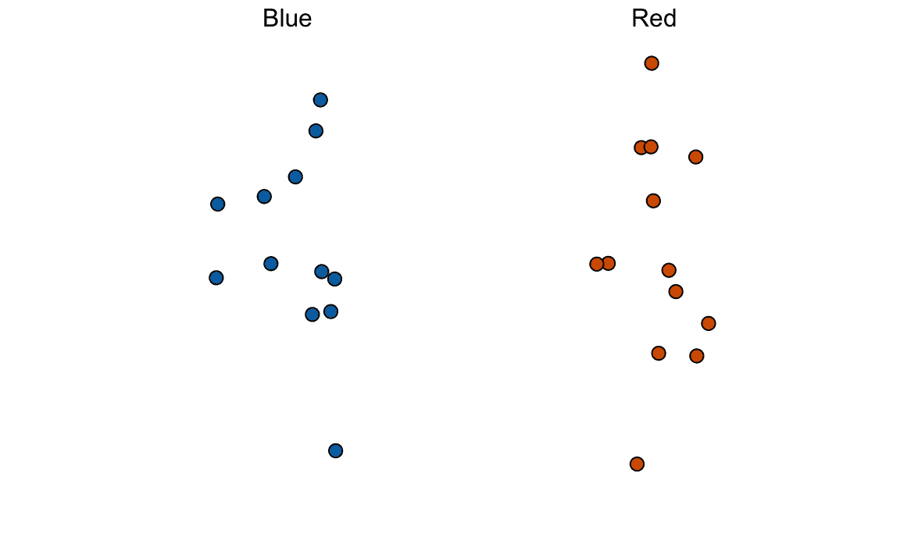
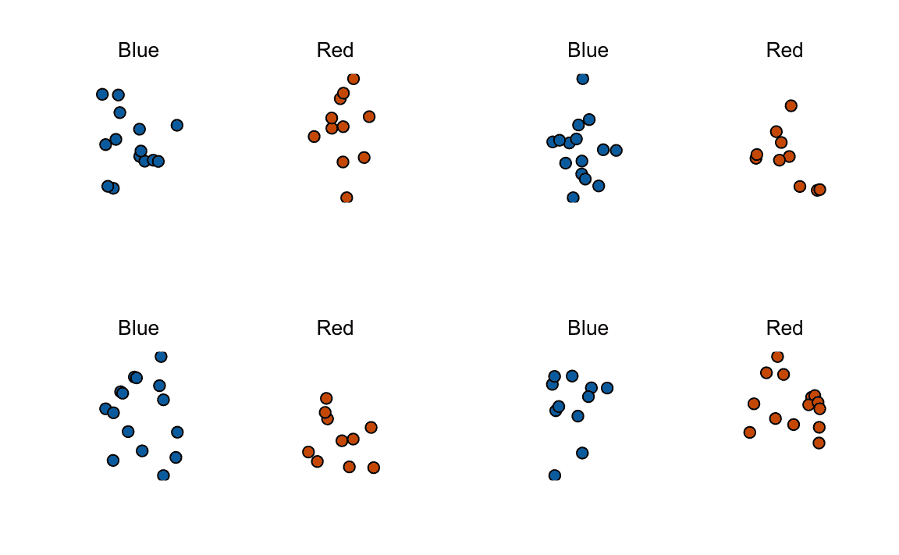
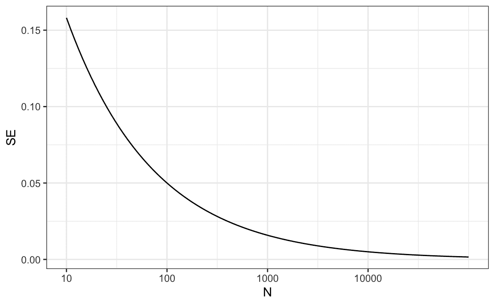
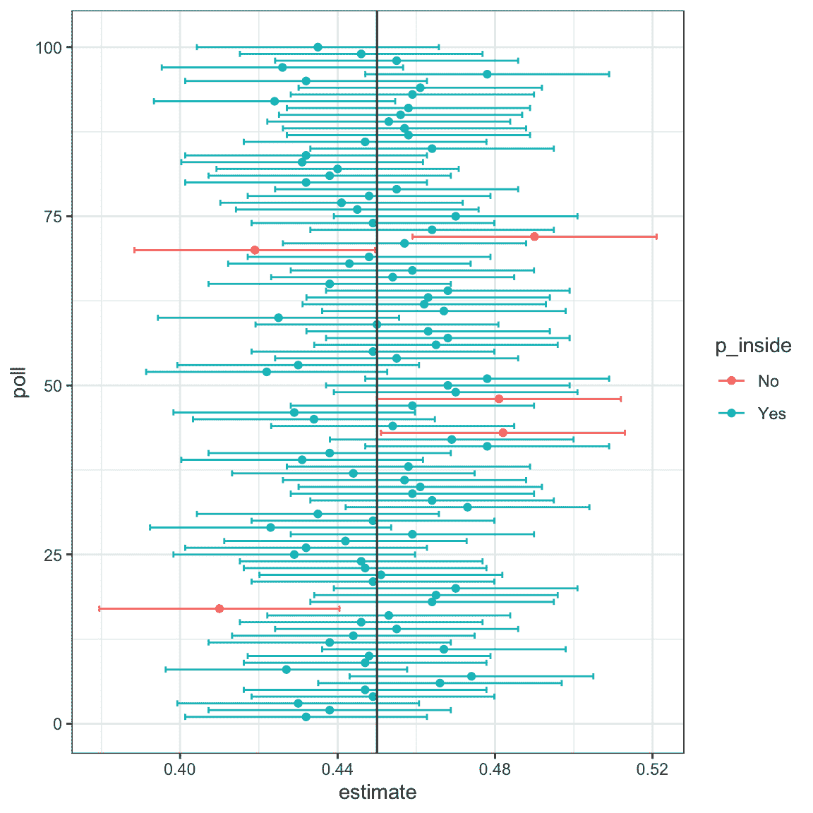

# 9 估计和置信区间

> 原文：[`rafalab.dfci.harvard.edu/dsbook-part-2/inference/estimates-confidence-intervals.html`](https://rafalab.dfci.harvard.edu/dsbook-part-2/inference/estimates-confidence-intervals.html)

1.  统计推断

1.  9 估计和置信区间

民意调查自 19 世纪以来就已经进行。一般目标是在特定主题上描述特定人群持有的观点。在最近的时代，这些调查在美国总统选举期间变得特别普遍。当从逻辑上不可能采访整个群体时，民意调查是有用的。一般策略包括采访一个较小、随机选择的群体，然后从这一子集推断整个群体的观点。

统计理论，也称为推断，为这一过程提供了合理的框架。在本书的这一部分，我们描述了统计推断的基础，并展示了它们如何在民意调查中应用。特别是，我们解释了民意调查员如何使用置信区间和误差范围来量化其估计的不确定性，并报告反映数据所能揭示范围的结果。

也许最著名的民意调查是那些用于确定在特定选举中选民偏好的候选人的调查。政治策略家广泛使用此类调查来决定如何分配资源，例如确定在动员选民的努力中要针对哪些地区。

选举是特别有趣的民意调查例子，因为选举日会揭示整个公众的真实观点。当然，进行真正的选举需要花费数百万美元，这使得民意调查成为那些寻求预测结果的人的一种成本效益高的替代方案。新闻机构也对这些预测投入了巨大的兴趣，鉴于公众对选举结果早期洞察的需求。

## 9.1 民意调查的抽样模型

我们首先将概率论与使用民意调查来了解人口的任务联系起来。

尽管通常政治候选人的民意调查结果被保密，但新闻机构也会进行民意调查，因为结果往往对公众感兴趣并公开。我们最终将查看这些公开数据集。

Real Clear Politics¹ 是一个新闻聚合器，它组织和发布民意调查结果。例如，他们展示了以下民意调查结果，报告了 2016 年总统选举的民调估计²：

| 民调 | 日期 | 样本 | MoE | 克林顿 | 特朗普 | 差距 |
| --- | --- | --- | --- | --- | --- | --- |
| RCP 平均 | 10/31 - 11/7 | -- | -- | 47.2 | 44.3 | 克林顿 +2.9 |
| 彭博社 | 11/4 - 11/6 | 799 LV | 3.5 | 46.0 | 43.0 | 克林顿 +3 |
| 经济学家 | 11/4 - 11/7 | 3669 LV | -- | 49.0 | 45.0 | 克林顿 +4 |
| IBD | 11/3 - 11/6 | 1026 LV | 3.1 | 43.0 | 42.0 | 克林顿 +1 |
| ABC | 11/3 - 11/6 | 2220 LV | 2.5 | 49.0 | 46.0 | 克林顿 +3 |
| FOX 新闻 | 11/3 - 11/6 | 1295 LV | 2.5 | 48.0 | 44.0 | 克林顿 +4 |
| 蒙茅斯 | 11/3 - 11/6 | 748 LV | 3.6 | 50.0 | 44.0 | 克林顿 +6 |
| CBS 新闻 | 11/2 - 11/6 | 1426 LV | 3.0 | 47.0 | 43.0 | 克林顿 +4 |
| 洛杉矶时报 | 10/31 - 11/6 | 2935 LV | 4.5 | 43.0 | 48.0 | 特朗普 +5 |
| NBC 新闻 | 11/3 - 11/5 | 1282 LV | 2.7 | 48.0 | 43.0 | 克林顿 +5 |
| NBC 新闻 | 10/31 - 11/6 | 30145 LV | 1.0 | 51.0 | 44.0 | 克林顿 +7 |
| 麦克拉奇 | 11/1 - 11/3 | 940 LV | 3.2 | 46.0 | 44.0 | 克林顿 +2 |
| 路透社 | 10/31 - 11/4 | 2244 LV | 2.2 | 44.0 | 40.0 | 克林顿 +4 |
| GravisGravis | 10/31 - 10/31 | 5360 RV | 1.3 | 50.0 | 50.0 | 平局 |

让我们对上表进行一些观察。首先，注意不同民意调查，尽管都是在选举前几天进行的，但报告了不同的*差距*：两个候选人支持率的估计差异。注意，报告的差距围绕着最终成为实际结果的情况：克林顿以 2.1% 的优势赢得了普选票。此外，我们看到了一个标题为**MoE**的列，它代表*误差范围*。我们将了解这是什么意思。

### 动机示例：民意调查竞赛

为了帮助我们理解民意调查与我们所学知识之间的联系，让我们构建一个与民意调查者面临的情况类似的情况。为了模拟民意调查者在与其他民意调查者争夺媒体关注时所遇到的挑战，我们将使用一个装满珠子的罐子来代表选民，并假装我们在争夺 25 美元的奖金。挑战是猜测这个罐子（在这种情况下，是一个腌黄瓜罐）中蓝色和红色珠子比例的差距：


在做出预测之前，你可以从罐子中抽取一个样本（有放回）。为了反映进行民意调查的成本，每次抽取珠子你需要支付 0.10 美元。因此，如果你的样本大小是 250，并且你赢了，你将收支平衡，因为你已经支付了 25 美元来收集你的 25 美元奖金。你的参赛方式可以是一个区间。如果你提交的区间包含真实比例，你将获得你支付的一半，并进入比赛的第二阶段。在第二阶段，选择区间最小的参赛者作为获胜者。

*dslabs** 包含一个函数，可以显示从这个罐子中进行的随机抽取：

```r
library(tidyverse
library(dslabs)
take_poll(25)
```

*  *思考一下你将如何根据上述数据构建你的区间。

我们刚刚描述了一个简单的民意调查采样模型。在这个模型中，瓮中的珠子代表将在选举日投票的个人。红色珠子代表投票给共和党候选人的人，而蓝色珠子代表民主党人。为了简化，让我们假设没有其他颜色；也就是说，只有两个政党：共和党和民主党。

## *9.2 总体、样本、参数和估计*

我们想要预测瓮中蓝色珠子的比例。让我们称这个量为 $p$，这样它就告诉我们红色珠子的比例 $1-p$，以及范围 $p - (1-p)$，这简化为 $2p - 1$。

在统计教科书中，瓮中的珠子被称为 *总体*。总体中蓝色珠子的比例 $p$ 被称为 *参数*。我们在前面的图中看到的 25 个珠子被称为 *样本*。统计推断的目标是根据样本中的观察数据预测参数 $p$。

我们能否用上面的 25 个观察结果来做这件事？这当然是有信息的。例如，鉴于我们看到 13 个红色珠子和 12 个蓝色珠子，$p$ > .9 或 $p$ < .1 的可能性似乎不大。但我们是否准备好确信罐子里红色珠子比蓝色珠子多？

我们希望仅使用我们观察到的信息来构建对 $p$ 的估计。估计应该被视为观察数据的总结，我们认为它对感兴趣的参数具有信息性。直观地认为，样本中蓝色珠子的比例 $0.48$ 必须至少与实际比例 $p$ 有关。但我们是否简单地预测 $p$ 为 0.48？首先，记住样本比例是一个随机变量。如果我们运行命令 `take_poll(25)` 四次，每次都会得到不同的答案，因为样本比例是一个随机变量。



注意到在上述四个随机样本中，样本比例的范围从 0.44 到 0.60。通过描述这个随机变量的分布，我们将能够了解这个估计有多好，以及我们如何改进它。

### 样本平均作为估计值

民意调查的进行被建模为从瓮中抽取随机样本。我们建议使用样本中蓝色珠子的比例作为参数 $p$ 的 *估计值*。一旦我们有了这个估计值，我们就可以轻松地报告范围 $2p-1$ 的估计值。然而，为了简化，我们将说明估计 $p$ 的概念。我们将使用我们对概率的了解来证明我们使用样本比例的合理性，并量化其与总体比例 $p$ 的接近程度。

我们首先定义随机变量 $X$ 为 $X=1$，如果我们随机抽取一个蓝色珠子，如果它是红色，则 $X=0$。这意味着总体是一个由 0 和 1 组成的列表。如果我们抽取 $N$ 个珠子，那么抽取的平均值 $X_1, \dots, X_N$ 等价于样本中蓝色珠子的比例。这是因为将 $X$ 相加等价于计数蓝色珠子，将这个计数除以总数 $N$ 等价于计算比例。我们用符号 $\bar{X}$ 来表示这个平均值。在统计学教科书中，符号上方的横线通常表示平均值。

我们刚刚讨论的关于抽取总和的理论变得有用，因为平均值是抽取总和乘以常数 $1/N$：

$$ \bar{X} = \frac{1}{N} \sum_{i=1}^N X_i $$

为了简化，让我们假设抽取是独立的；在看到每个抽取的珠子后，我们将其放回罐子中。在这种情况下，我们知道抽取总和的分布是什么？首先，我们知道抽取总和的期望值是罐中数值平均值的 $N$ 倍。我们知道罐中 0 和 1 的平均值必须是 $p$，即蓝色珠子的比例。

在这里，我们遇到了与书中概率部分所做不同的重要区别：我们不知道罐子的组成。虽然我们知道有蓝色和红色珠子，但我们不知道每种颜色的数量。这正是我们想要找到的：我们正在尝试*估计* $p$。

### 参数

正如我们使用变量来定义方程组中的未知数一样，在统计推断中，我们定义*参数*来表示我们模型中的未知部分。在我们用来模拟民意调查的罐子模型中，我们不知道罐中蓝色珠子的比例。我们定义参数 $p$ 来表示这个数量。由于我们的主要目标是确定 $p$，我们将*估计这个参数*。

这里介绍的是如何估计参数的概念，以及如何评估这些估计的好坏，这些概念可以扩展到许多数据分析任务中。例如，我们可能想要确定接受治疗的患者与对照组之间健康改善的差异，调查吸烟对人群的健康影响，分析警察致命射击中种族群体之间的差异，或者评估过去 10 年美国预期寿命变化率。所有这些问题都可以被构建为从样本中估计参数的任务。

入门统计学教材通常首先介绍总体平均数作为参数的第一个例子。在我们的情况下，感兴趣的参数 $p$ 被定义为罐中 1（蓝色）的比例。请注意，这个比例也等于罐中所有数字的平均值，因为 1 和 0 可以被视为数值。*

这意味着我们的参数 $p$ 可以被解释为**总体平均数**。因此，我们将使用 $\bar{X}$ 来表示其**估计值**，这是从抽屉中抽取样本计算出的平均值。尽管许多教科书使用 $\hat{p}$ 来表示这个估计值，但符号 $\bar{X}$ 更好地强调了样本平均值与总体均值之间的联系，这个概念可以自然地扩展到二元数据以外的情形。**

## **9.3 估计属性：期望值和标准误差**

*为了了解我们的估计有多好，我们将描述上面定义的随机变量的统计特性：样本比例 $\bar{X}$。记住，$\bar{X}$ 是独立抽取的总和除以一个非随机常数，因此我们之前讨论的规则第 7.4 节适用。

应用我们学到的概念，我们可以证明：

$$ \mathrm{E}[\bar{X}] = p $$

我们还可以使用我们学到的知识来确定标准误差：$$ \mathrm{SE}[\bar{X}] = \sqrt{p(1-p)/N} $$

这个结果揭示了调查的力量。样本比例的期望值 $\bar{X}$ 是我们感兴趣的参数 $p$，我们可以通过增加 $N$ 来使标准误差尽可能小。大数定律告诉我们，随着样本量的增大，我们的估计会收敛到 $p$。

如果我们抽取足够大的样本，使标准误差大约为 1%，我们将非常确信谁会获胜。但是，调查需要多大才能使标准误差如此之小？

一个问题是，我们不知道 $p$，因此我们实际上无法计算标准误差。然而，为了说明目的，让我们假设 $p=0.51$ 并绘制标准误差与样本量 $N$ 的关系图：



图表显示，我们需要一个超过 10,000 人的调查才能达到如此低的标准误差。我们很少看到这么大规模的调查，部分原因是相关的成本。根据 Real Clear Politics 表格，民意调查的样本量范围在 500-3,500 人之间。对于样本量为 1,000 且 $p=0.51$ 的情况，标准误差是：

```r
sqrt(p*(1 - p))/sqrt(1000)
#> [1] 0.0158
```

或者 1.5 个百分点。因此，即使在大规模调查中，对于竞争激烈的选举，如果我们没有意识到 $\bar{X}$ 是一个随机变量，它也可能误导我们。然而，我们实际上可以更多地了解我们接近 $p$ 的程度，我们将在第 9.4.1 节中这样做。

*民意调查与预测** 在我们继续之前，重要的是要澄清一个与预测选举相关的实际问题。如果在选举前四个月进行民意调查，它是在估计那个时刻的 $p$，而不是选举日的 $p$。选举之夜的 $p$ 可能会不同，因为人们的观点往往会随时间波动。通常，选举前一晚进行的民意调查最准确，因为观点在一天内不会发生显著变化。然而，预报员试图开发工具来模拟观点随时间的变化，并试图通过考虑这些波动来预测选举之夜的结果。我们将在第十二章中探讨一些实现这一目标的方法。

## **9.4 置信区间**

*民意调查员使用一个简单易懂的数字来总结不确定性，这个数字被称为**误差范围**。误差范围与参数的估计值一起定义了一个区间，他们对此区间**有信心**地认为它包含了真实值。但“有信心”实际上意味着什么呢？

为了将这个想法与一个熟悉的问题联系起来，回想一下第 9.1 节中描述的竞赛，其中你被要求报告一个真实比例 $p$ 的区间。如果你的区间包含了实际的 $p$，你就能收回一半的民意调查成本并进入下一轮。一种保证进入下一轮的方法是报告一个非常宽的区间，比如 $[0,1]$，这肯定包含 $p$。但这样的区间是没有用的，因为它没有传达任何信息，你可能会输给提交更窄区间的人。同样，一个预测选举范围在 -100% 到 100% 之间的选举预报员是不会被认真对待的。即使范围在 -10% 到 10% 之间也会过于模糊而失去意义。

另一方面，一个非常窄的区间是有风险的。一个报告非常紧密区间但经常错过真实值的民意调查员会很快失去信誉。目标是找到一个平衡点：区间足够窄以提供信息，但足够宽以可靠。

统计理论提供了一种方法，使用之前开发的概率框架来精确量化我们所说的**置信度**。具体来说，我们可以构建一个区间，我们可以计算包含真实参数 $p$ 的概率。当一个民意调查员报告一个估计值以及一个**误差范围**时，他们实际上是在报告一个有 95% 概率包含真实参数的区间，这被称为**95% 置信区间**。

### **中心极限定理**

在第九章中，我们介绍了样本平均值 $\bar{X}$ 作为参数 $p$ 的估计值，并展示了如何计算其标准误差。然而，为了计算概率，我们需要 $\bar{X}$ 的**分布**。

在书的 *概率* 部分（第 8.3 节），我们学习了当样本量很大时，从总体中独立抽取的平均值近似正态分布，无论总体的形状如何。这是 **中心极限定理 (CLT)**。因为 $\bar{X}$ 是独立抽取的平均值，CLT 直接适用于这里，并且它是构建置信区间的主要工具。

让我们用它来回答一个具体问题：

> 我们的样本估计值 $\bar{X}$ 在真实总体比例 $p$ 的 2% 以内有多大的可能性？

我们可以表示为：

$$ \Pr(|\bar{X} - p| \leq 0.02) = \Pr(\bar{X} \leq p + 0.02) - \Pr(\bar{X} \leq p - 0.02). $$

如果我们对 $\bar{X}$ 进行标准化，即减去其期望值并除以其标准误差，我们得到一个标准正态随机变量 $Z$：

$$ Z = \frac{\bar{X} - \mathrm{E}[\bar{X}]}{\mathrm{SE}[\bar{X}]}. $$

由于 $\mathrm{E}[\bar{X}] = p$ 且 $\mathrm{SE}[\bar{X}] = \sqrt{p(1-p)/N}$，上面的概率变为：

$$ \Pr\left(Z \leq \frac{0.02}{\sqrt{p(1-p)/N}}\right) - \Pr\left(Z \leq -\frac{0.02}{\sqrt{p(1-p)/N}}\right). $$

为了计算这个，我们需要 $\sqrt{p(1-p)/N}$，但 $p$ 是未知的。幸运的是，如果我们使用 *插值估计*，用观察到的 $\bar{X}$ 替换 $p$，CLT 仍然成立：

$$ \widehat{\mathrm{SE}}[\bar{X}] = \sqrt{\bar{X}(1 - \bar{X})/N}. $$

在统计学中，帽子符号表示估计值。例如，$\hat{p}$ 通常用来代替 $\bar{X}$ 表示 $p$ 的估计值。同样，$\widehat{\mathrm{SE}}$ 表示我们正在估计标准误差而不是精确计算它。* 使用我们之前的民意调查，其中 $\bar{X} = 0.48$ 和 $N = 25$，我们得到：

```r
x_hat <- 0.48
se <- sqrt(x_hat*(1 - x_hat)/25)
se
#> [1] 0.0999
```

现在我们可以计算我们的估计值在真实值 2% 以内的概率：

```r
pnorm(0.02/se) - pnorm(-0.02/se)
#> [1] 0.159
```

当 $N = 25$ 时，这种情况发生的可能性很小。

对于任何期望的误差，上述推理同样适用。为了找到使 $\bar{X}$ 在 $p$ 的给定范围内有 95% 概率的误差 $\epsilon$，我们解：

$$ \Pr(|\bar{X} - p| \leq \epsilon) = 0.95. $$

从标准正态分布中，我们知道

$$ \Pr(-1.96 \leq Z \leq 1.96) = 0.95. $$

因此，$\epsilon = 1.96 \times \widehat{\mathrm{SE}}[\bar{X}]$。

这个结果给我们提供了一种构建 **置信区间** 的方法，在重复的样本中，有 95% 的时间包含真实的参数。

### ***构建置信区间***

**使用这个结果，我们可以写出 $p$ 的 95% 置信区间如下：***

$$ \left[\bar{X} - 1.96,\widehat{\mathrm{SE}}[\bar{X}], , \bar{X} + 1.96,\widehat{\mathrm{SE}}[\bar{X}]\right]. $$

该区间的端点不是固定的数字——它们取决于数据。每次我们取一个新的样本，我们就会得到一个新的 $\bar{X}$ 和一个新的置信区间。为了看到这一点，我们可以使用之前相同的参数重复抽样过程：

```r
p <- 0.45
N <- 1000
x <- sample(c(0, 1), size = N, replace = TRUE, prob = c(1 - p, p))
x_hat <- mean(x)
se_hat <- sqrt(x_hat*(1 - x_hat)/N)
c(x_hat - 1.96*se_hat, x_hat + 1.96*se_hat)
#> [1] 0.400 0.462
```

如果你多次运行此代码，你会看到由于随机抽样变化，区间会从一次运行到下一次运行而变化。

95% 置信区间的定义是，在多次重复此过程的情况下，大约 95% 的以这种方式构建的区间将包含 $p$ 的真实值。从数学上讲：

$$ \Pr\left(p \in \left[\bar{X} - 1.96 ,\widehat{\mathrm{SE}}[\bar{X}], \bar{X} + 1.96,\widehat{\mathrm{SE}}[\bar{X}]\right]\right) = 0.95. $$

置信区间不是唯一的。我们可以构建其他也有 95% 覆盖率的 $p$ 的区间。例如，当 $\bar{X}$ 接近 0 或 1 时，避免超过 0 或 1 的方法。

我们推导出的 95% 置信区间在 $\bar{X}$ 两侧是对称的，并且在标准假设下，是包含 $p$ 的概率为 95% 的最短区间。关于替代区间及其属性的讨论，请参阅推荐阅读部分。* *如果我们想得到不同的置信水平，例如 99%，我们调整乘数。值 $z$ 由

$$ \Pr(-z \leq Z \leq z) = 1 - \alpha, $$

在 R 中，这可以计算为：

```r
alpha <- 0.01
z <- qnorm(1 - alpha/2)
```

例如，`qnorm(0.975)` 对于 95% 的置信区间给出 1.96，而 `qnorm(0.995)` 对于 99% 的区间给出 2.58。******

### *****蒙特卡洛模拟*****

****我们可以通过蒙特卡洛模拟验证我们构建的区间具有包含 $p$ 的所需概率。通过反复抽取样本并构建置信区间，我们可以检查区间实际上包含 $p$ 的真实值的频率。

```r
set.seed(1)
N <- 1000
B <- 10000
p <- 0.45
inside <- replicate(B, {
 x <- sample(c(0,1), size = N, replace = TRUE, prob = c(1 - p, p))
 x_hat <- mean(x)
 se_hat <- sqrt(x_hat*(1 - x_hat)/N)
 p >= x_hat - 1.96*se_hat & p <= x_hat + 1.96*se_hat
})
mean(inside)
#> [1] 0.948
```

正如预期的那样，区间大约有 95% 的时间覆盖 $p$。

下面的图显示了前 100 个模拟的置信区间。每一条水平线代表一个区间，黑色垂直线标记的是真实比例 $p$。大约 95% 的区间与这条线重叠，而大约 5% 的区间没有重叠，正如预测的那样。



在应用此理论时，请记住，*区间*是随机的，不是 $p$。置信水平指的是程序，而不是关于 $p$ 本身的概率。*******

### *****误差范围*****

****误差范围与置信区间密切相关。联系很简单：*误差范围*是加到和从估计值中减去的量，以形成置信区间。

对于民意调查，误差范围由

$$ z \times \sqrt{\bar{X}(1-\bar{X}) / N}. $$

对于 95% 的置信区间，这相当于使用 $z = 1.96$。提高置信水平或减少样本量都会使误差范围更大，而较大的样本会产生更小的误差范围。

在实践中，民意调查员几乎总是报告 95%的置信区间。除非另有说明，否则应假定报告的误差范围基于此置信水平。结果通常以“估计 ± 误差范围”的形式呈现。例如，如果$\bar{X} = 0.52$，误差范围为$0.03$，结果将报告为“52% ± 3%”*****

### *****为什么不只进行一次大规模民意调查？*****

****如果我们调查了 10 万人，误差范围将缩小到小于 0.3%。原则上，我们可以通过增加$N$来使误差范围尽可能小。

然而，在实践中，民意调查不仅受成本限制，还受*偏差*的影响。现实世界的民意调查很少是简单的随机样本。有些人不回应，其他人错误地报告了他们的偏好，而定义人口（例如，注册选民与可能选民）并不简单。

这些不完美之处引入了系统误差，而误差范围无法捕捉到。历史上，美国民调显示偏差约为 2-3%。理解和模拟这些偏差是现代选举预测的重要组成部分，我们将在第十章中再次回到这个话题。*********

## *****9.5 练习题*****

****1\. 假设你在调查一个选民群体，其中比例$p$的选民是民主党人，$1-p$是共和党人。你的样本大小是$N=25$。考虑随机变量$S$，它是你样本中民主党人的总数。这个随机变量的期望值是多少？提示：它是$p$的函数。

2\. $S$的标准误差是多少？提示：它是$p$的函数。

3\. 考虑随机变量$S/N$。这相当于样本平均值，我们一直用$\bar{X}$表示。$\bar{X}$的期望值是多少？提示：它是$p$的函数。

4\. $\bar{X}$的标准误差是多少？提示：它是$p$的函数。

5\. 编写一行代码，给出问题 4 中对于$p <- seq(0, 1, length = 100)$的几个值的$\mathrm{SE}[\bar{X}]$，并绘制$\mathrm{SE}[\bar{X}]$与$p$的图表。

6\. 将问题 5 中的代码复制到 for 循环中，制作三个图表，分别对应$N=25$、$N=100$和$N=1,000$。

7\. 如果我们关注比例的差异，$\theta = p - (1-p)$，我们的估计是$\hat{\theta} = \bar{X} - (1-\bar{X}) = 2\bar{X}-1$。使用我们关于缩放随机变量的规则来推导$\hat{\theta}$的期望值。

8\. $\hat{\theta}$的标准误差是多少？

9\. 如果$p=0.45$，这意味着共和党人以相对较大的优势获胜，因为$\theta = -0.1$，这是一个 10%的胜利范围。在这种情况下，如果我们抽取$N=25$的样本，$\hat{\theta} = 2\bar{X}-1$的标准误差是多少？

10\. 基于练习 9 的答案，以下哪个选项最能描述你使用样本大小$N=25$的策略？

1.  我们估计 $2\bar{X}-1$ 的期望值是 $\theta$，因此我们的预测将是准确的。

1.  我们的标准误差几乎与观察到的差异一样大，所以即使 $p=0.5$，$2\bar{X}-1$ 代表一个大的差距的可能性也不小。我们应该使用更大的样本量。

1.  差异是 10%，标准误差大约是 0.1，因此远小于差异。

1.  由于我们不知道 $p$，我们无法知道增加 $N$ 的数量实际上是否会改善我们的标准误差。

11. 编写一个*抽屉模型*函数，该函数接受比例 $p$ 和样本量 $N$ 作为参数，并返回民主党为 1 和共和党为 0 的样本平均值。调用该函数为 `take_sample`。

12. 现在假设 `p <- 0.45` 并且你的样本量是 $N=100$。进行 10,000 次抽样，并将 `mean(X) - p` 的向量保存到名为 `errors` 的对象中。提示：使用你为练习 11 编写的函数，用一行代码来完成这个操作。

13. 向量 `errors` 包含了对于每个模拟样本，我们的估计 $\bar{X}$ 与实际 $p$ 之间的差异。我们称这个差异为*误差*。计算误差的平均值，并绘制蒙特卡洛模拟中生成的误差的直方图。

```r
mean(errors)
hist(errors)
```

并选择以下哪个最能描述它们的分布：

1.  误差都在大约 0.05。

1.  误差都在大约 -0.05。

1.  误差在 0 的周围对称分布。

1.  误差的范围从 -1 到 1。

14. 注意，误差 $\bar{X}-p$ 是一个随机变量。在实践中，由于我们不知道 $p$，我们无法观察到误差。在这里，我们观察到它，因为我们构建了模拟。如果我们通过取绝对值 $\mid \bar{X} - p \mid$ 来定义大小，误差的平均大小是多少？

15. 标准误差与我们在预测时犯错的典型**大小**相关。由于与中心极限定理相关的数学原因，我们实际上使用`errors`的标准差，而不是绝对值的平均值，来量化典型大小。这个误差的标准差是多少？

16. 我们刚刚学到的理论告诉我们这个标准差将会是多少，因为 $\mathrm{SE}[\bar{X}-p]=\mathrm{SE}[\bar{X}]$，我们也展示了如何计算这个值。理论告诉我们对于样本量为 100 的标准误差 $\mathrm{SE}[\bar{X}-p]$ 是多少？

17. 在实践中，我们不知道 $p$，所以我们通过将 $\bar{X}$ 代入 $p$ 来构建理论预测的估计。计算这个估计。使用 `set.seed(1)` 将种子设置为 1。

18. 注意从蒙特卡洛模拟（练习 15）、理论预测（练习 16）和理论预测估计（练习 17）中获得的标准误差估计是多么接近。理论是有效的，它为我们提供了一个了解如果我们用 $\bar{X}$ 预测 $p$ 时将犯的典型误差的实际方法。理论结果提供的另一个优点是，它给出了一个关于需要多大样本量才能获得所需精度的概念。早些时候，我们了解到最大的标准误差发生在 $p=0.5$ 时。创建一个从 100 到 5,000 的 $N$ 范围内最大标准误差的图表。根据这个图表，样本量需要多大才能使标准误差约为 1%？

1.  100

1.  500

1.  2,500

1.  4,000

19. 对于样本量 $N=100$，中心极限定理告诉我们 $\bar{X}$ 的分布是：

1.  实际上等于 $p$。

1.  大约呈正态分布，期望值为 $p$，标准误差为 $\sqrt{p(1-p)/N}$。

1.  大约呈正态分布，期望值为 $\bar{X}$，标准误差为 $\sqrt{\bar{X}(1-\bar{X})/N}$。

1.  不是一个随机变量。

20. 根据练习 18 的答案，误差 $\bar{X} - p$ 是：

1.  实际上等于 0。

1.  大约呈正态分布，期望值为 $0$，标准误差为 $\sqrt{p(1-p)/N}$。

1.  大约呈正态分布，期望值为 $p$，标准误差为 $\sqrt{p(1-p)/N}$。

1.  不是一个随机变量。

21. 为验证你对练习 19 的答案，绘制你在练习 12 中生成的 `errors` 的 qqplot，以查看它们是否遵循正态分布。

22. 定义 $p=0.45$ 和 $N=100$，如练习 12 中所述。然后使用 CLT 估计 $\bar{X}>0.5$ 的概率。假设你为此计算知道 $p=0.45$。

23. 假设你处于实际情况下，你不知道 $p$。取一个样本量 $N=100$ 的样本，并得到样本平均数 $\bar{X} = 0.51$。你的误差等于或大于 0.01 的概率的 CLT 近似值是多少？

在接下来的练习中，我们将使用包含在 **dslabs** 包中的 2016 年选举的实际民调。具体来说，我们将使用选举前一周结束的所有全国民调。

```r
library(dslabs)
library(tidyverse
polls <- polls_us_election_2016 |> 
 filter(enddate >= "2016-10-31" & state == "U.S.") 
```

24. 对于第一份民调，你可以获得样本量和估计的克林顿百分比：

```r
N <- polls$samplesize[1]
x_hat <- polls$rawpoll_clinton[1]/100
```

假设只有两位候选人，构建选举之夜克林顿选民比例 $p$ 的 95% 置信区间。

25. 在 `polls` 对象中添加置信区间作为两列，分别称为 `lower` 和 `upper`，然后展示 `pollster`、`enddate`、`x_hat`、`lower`、`upper` 变量。提示：定义临时列 `x_hat` 和 `se_hat`。

26. 选举人票的最终计票结果是克林顿 48.2%，特朗普 46.1%。在之前的表格中添加一列，称为 `hit`，说明置信区间是否包含真实比例 $p=0.482$。

27. 对于你刚刚创建的表格，有多少比例的置信区间包含了 $p$？

28. 如果这些置信区间构建正确，并且理论成立，那么应该有多少比例包含$p$？

29. 与预期相比，只有极少数的民调产生了包含$p$的置信区间。如果你仔细查看表格，你会看到大多数未能包含$p$的民调都是低估的。主要原因是不确定的选民，即那些尚未决定他们将投票给谁或不想说的人。因为，从历史上看，不确定的选民在选举日几乎平均分配在两个主要候选人之间，因此估计两个候选人比例的差距或差异更有信息量，我们将用$\theta$表示它，在本届选举中为$0.482 - 0.461 = 0.021$。假设只有两个政党，且$\theta = 2p - 1$。重新定义`polls`如下，并重新做练习 15，但针对差异。

```r
polls <- polls_us_election_2016 |> 
 filter(enddate >= "2016-10-31" & state == "U.S.")  |>
 mutate(theta_hat = rawpoll_clinton/100 - rawpoll_trump/100)
```

30. 现在重复练习 26，但针对差异进行。

31. 现在重复练习 27，但针对差异进行。

32. 尽管置信区间的比例大幅增加，但仍然低于 0.95。在下一章中，我们将学习这种差异的原因。为了激发这一思考，绘制一个误差图，展示每个民调估计值与实际$\theta=0.021$之间的差异。按民调机构进行分层。

33. 重新绘制你在练习 32 中制作的图表，但仅针对进行了五次或更多民调的民调机构。

* * *

***1.  http://www.realclearpolitics.com↩︎

1.  http://www.realclearpolitics.com/epolls/2016/president/us/general_election_trump_vs_clinton-5491.html↩︎****
