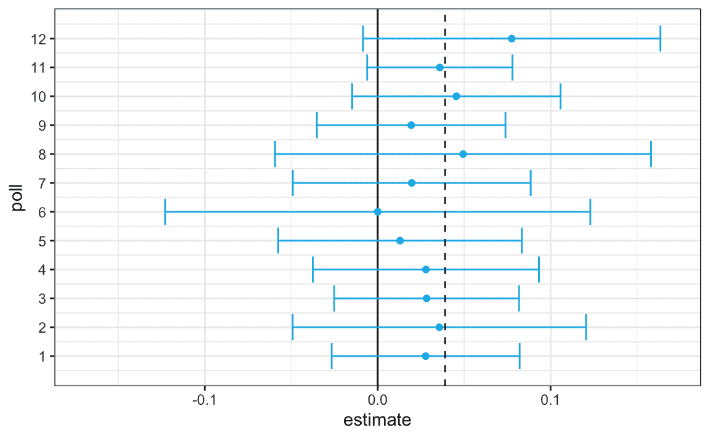
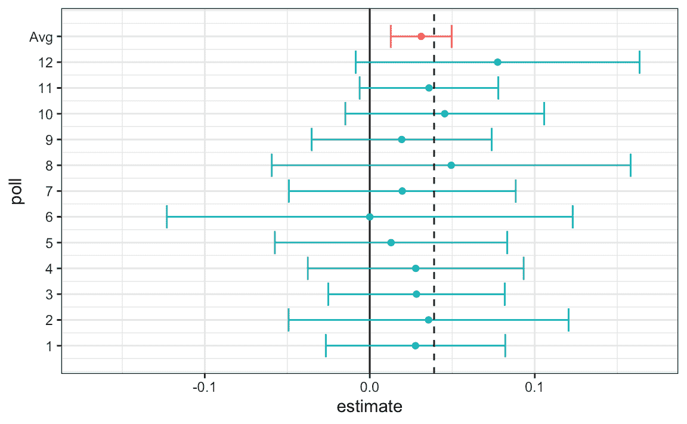
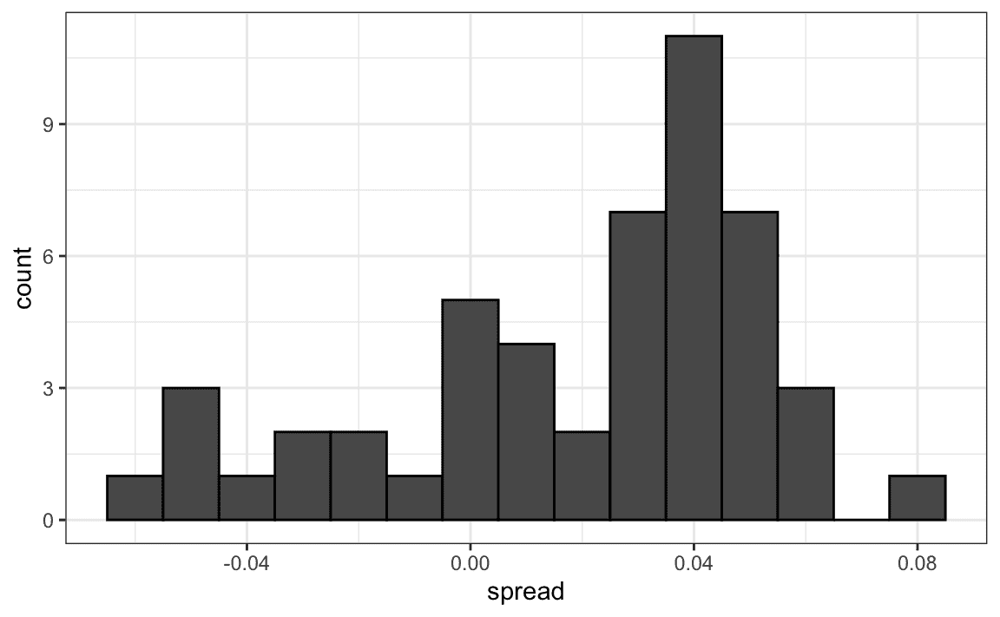
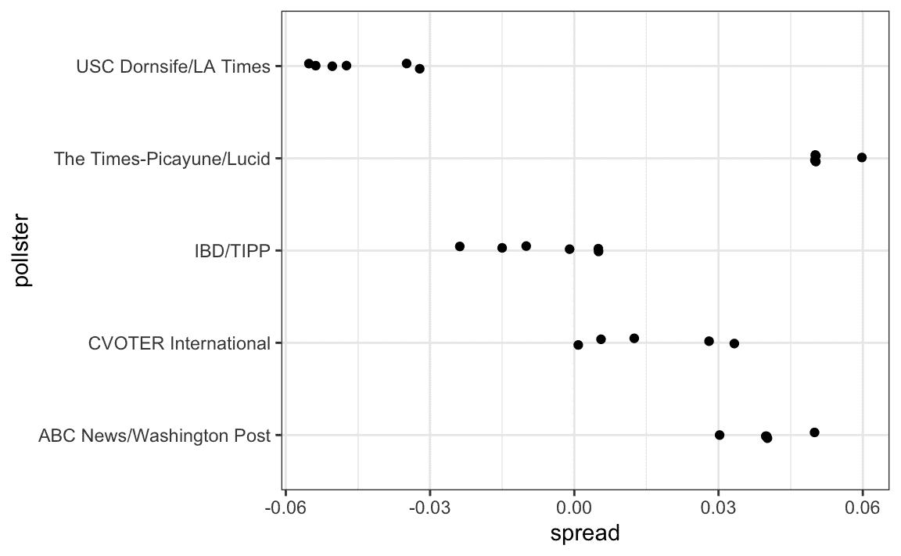
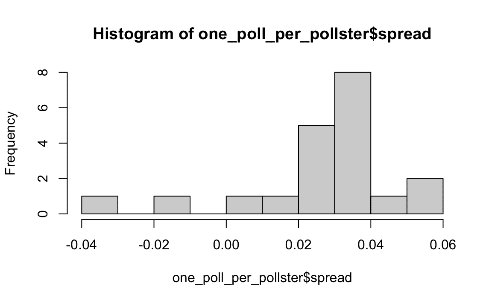
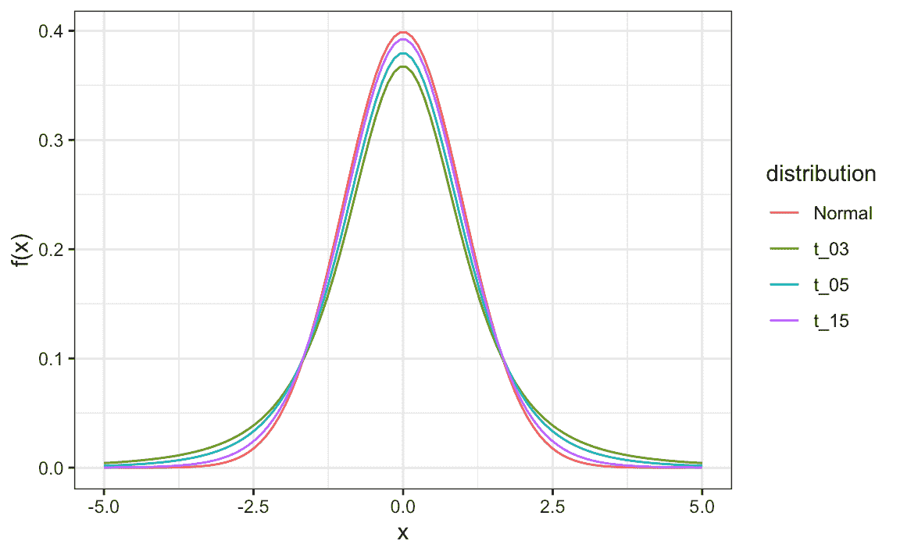
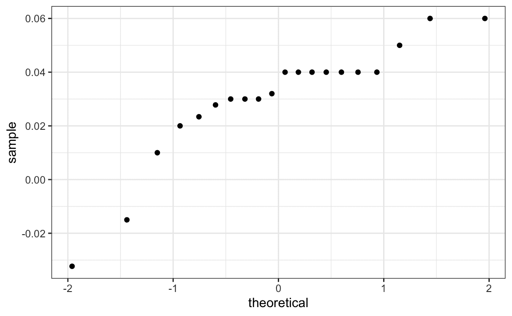

# 10 数据驱动模型

> 原文：[`rafalab.dfci.harvard.edu/dsbook-part-2/inference/models.html`](https://rafalab.dfci.harvard.edu/dsbook-part-2/inference/models.html)

1.  统计推断

1.  10 数据驱动模型

> > “所有模型都是错误的，但有些是有用的。” ——乔治·E·P·博克斯

到目前为止，我们对与民意调查相关的结果的分析是基于一个简单的抽样模型。该模型假设每个选民被选入民意调查的机会均等，类似于从有两个颜色的罐子中挑选珠子。然而，在本节中，我们探索现实世界的数据，并发现这个模型过于简化。相反，我们提出了一种更有效的方法，其中我们直接模拟民意调查的结果，而不是单个民意调查。

自意见调查原始发明以来，一个更近的发展是使用计算机从不同来源汇总公开数据，并开发数据驱动预测模型。在这里，我们探讨民意调查聚合器如何收集和结合不同专家报告的数据，以产生改进的预测。我们将介绍用于改进选举预测的统计模型背后的思想，这些模型超越了单个民意调查的能力。具体来说，我们介绍了一个用于构建普选票差置信区间的有用模型。

强调这一点很重要，即本章仅对统计建模这一广阔领域提供了一个简要的介绍。例如，这里提出的模型不允许我们像 FiveThirtyEight 这样的民意调查聚合器那样，对特定候选人赢得普选等结果进行概率分配。在下一章中，我们将介绍贝叶斯模型，它为这样的概率陈述提供了数学框架。稍后，在本书的线性模型部分，我们将探讨实际数据分析中广泛使用的方法。然而，这个介绍只是触及了表面。对统计建模感兴趣的读者应鼓励查阅推荐阅读部分，以获取提供更深更广视角的额外参考文献。

## 10.1 案例研究：民意调查聚合器

在 2012 年选举前的几周，Nate Silver 给奥巴马赢得选举的概率是 90%。Silver 先生是如何如此自信的？我们将使用蒙特卡洛模拟来展示 Silver 先生所具有的洞察力，以及其他人所忽视的。

### 蒙特卡洛模拟

为了做到这一点，我们模拟了选举前一周进行的 12 次民意调查的结果。我们模仿了实际民意调查的样本量，为 12 次民意调查中的每一次都构建并报告了 95%置信区间：

毫不奇怪，所有 12 个民调都报告了包含我们在选举之夜最终看到的结果的置信区间（垂直虚线）。然而，所有 12 个民调也包括 0（垂直实线）。因此，如果单独要求预测，民意调查员必须说：这是一个平局。

民调聚合者认识到，合并多个民调的结果可以大大提高精度。一种直接的方法是使用报告的估计和样本大小来*逆向工程*每个民调的原始数据。从这些数据中，我们可以重建所有民调的*成功*和*失败*总数，有效地将它们合并成一个更大的数据集。然后，我们使用合并的样本大小（这比任何单个民调都要大得多）计算新的总体估计及其对应的标准误差。

当我们这样做时，结果误差范围是 0.018。

我们的合并估计预测传播为 3.1 个百分点，加减 1.8。这个区间不仅包括选举之夜观察到的实际结果，而且远未包括零。通过汇总十二个民调，假设没有系统性偏差，我们获得了一个更精确的估计，并且可以相当自信地认为奥巴马将赢得普选票。

然而，这个例子只是一个简化的模拟，用以说明基本思想。在现实世界的设置中，将多个民调数据合并比将其视为一个大型随机样本要复杂得多。方法、时间、问题措辞以及甚至抽样偏差都可能影响结果。我们将在以后探讨这些因素如何使实际民调汇总更具挑战性，以及统计模型如何考虑这些因素。

### 2016 年总统选举的实时数据

*dslabs** 中的 `polls_us_election_2016` 数据集的以下子集包括选举前一年内进行的全国民调和州民调的结果，并按 FiveThirtyEight 组织。在这个第一个例子中，我们将筛选数据以包括选举前一周内对可能选民（lv）进行的全国民调，并考虑他们对传播的估计：

[PRE0]

请注意，我们将专注于预测传播，而不是比例 $p$。由于我们假设只有两个党派，我们知道传播是 $\theta = p - (1-p) = 2p - 1$。因此，我们所做的一切都可以很容易地适应对 $\theta$ 的估计。一旦我们有了我们的估计 $\bar{X}$ 和 $\widehat{\mathrm{SE}}[\bar{X}]$，我们用 $2\bar{X} - 1$ 来估计传播，由于我们乘以了 2，标准误差是 $2\widehat{\mathrm{SE}}[\bar{X}]$。记住，减去 1 不会增加任何变异性，因此它不会影响标准误差。此外，中心极限定理（CLT）也适用于此处，因为我们的估计是样本平均值的线性组合，而样本平均值本身近似服从正态分布。*

在这里我们用 $\theta$ 来表示范围，因为这是统计教科书中用于 *感兴趣参数* 的常用符号。* 我们有 50 个关于范围的估计值。我们从抽样模型中学到的理论告诉我们，这些估计值是一个具有近似正态分布的随机变量。期望值是选举之夜的范围 $\theta$，标准误差是 $2\sqrt{p (1 - p) / N}$。

假设我们之前描述的抽屉模型是好的，我们可以使用这些信息根据汇总数据构建一个置信区间。估计的范围是：

[PRE1]

并且标准误差是：

[PRE2]

因此，我们报告的范围是 3.59%，误差范围为 0.4%。在选举之夜，我们发现实际百分比是 2.1%，这超出了 95% 的置信区间。发生了什么？

报告范围的直方图揭示了一个问题：

[PRE3]

* *这些估计值似乎不是正态分布的，标准误差似乎大于 0.0038。理论在这里不起作用。*****

## ****10.2 超越简单的抽样模型****

***请注意，数据来自不同的民意调查机构，其中一些每周进行几次民调：

[PRE4]

让我们可视化一下那些定期进行民调的民意调查机构的数据：

这个图揭示了一个意外的结果。首先，考虑理论预测的每个民调的标准误差在 0.018 到 0.033 之间：

[PRE5]

这与我们看到的所有民调中的内部变化一致。然而，似乎存在 *跨民调的差异*。例如，观察 USC Dornsife/LA Times 民调机构预测特朗普领先 4%，而 Ipsos 预测克林顿领先超过 5%。我们学到的理论对不同的民意调查机构产生具有不同期望值的民调没有任何说明，相反，它假设所有民调都有相同的期望值。FiveThirtyEight 将这些差异称为 *house effects*。我们也将它们称为 *民意调查偏差*。我们的简单抽屉模型中没有任何东西可以解释这些民意调查机构之间的差异。

这种模型设定错误导致了一个过于自信的区间，最终没有包括选举之夜的结果。因此，我们不是用抽屉模型来模拟生成这些值的流程，而是直接模拟民意调查结果。为此，我们收集数据。具体来说，对于每个民意调查机构，我们查看选举前的最后报告结果：

[PRE6]

以下是这 20 个民意调查机构最终民调计算范围的直方图：

[PRE7]

*  *尽管我们不再使用罐子中红色（共和党）和蓝色（民主党）珠子的模型，但我们的新模型也可以被视为罐子模型，但包含所有可能民意调查者的投票结果。将我们的 $N=$ 20 数据点 $Y_1,\dots Y_N$ 视为从这个罐子中抽取的随机样本。为了开发一个有用的模型，我们 *假设* 罐子的期望值是实际的分布 $\theta = 2p - 1$，这意味着样本平均有期望值 $\theta$。

现在，我们的罐子中不再是 0 和 1，而是代表投票结果的连续数字。因此，这个罐子的标准差不再是 $2\sqrt{p(1-p)}$。在这种设置下，我们观察到的变异性不仅来自对选民的随机抽样，还来自不同民意调查者的差异。我们的新罐子捕捉了这两种变异来源。这个分布的整体标准差是未知的，我们用 $\sigma$ 表示。

因此，我们新的统计模型是 $Y_1, \dots, Y_N$ 是一个具有期望值 $\theta$ 和标准差 $\sigma$ 的随机样本。目前，分布是不指定的。但我们认为 $N$ 足够大，可以假设样本平均 $\bar{Y} = \sum_{i=1}^N Y_i$ 符合期望值为 $\theta$ 和标准误 $\sigma / \sqrt{N}$ 的正态分布。我们写：

$$ \bar{Y} \sim \mbox{N}(\theta, \sigma / \sqrt{N}) $$

这里，符号左侧的 $\sim$ 表示符号左侧的随机变量遵循右侧的分布。我们使用 $N(a,b)$ 表示均值为 $a$ 和标准差为 $b$ 的正态分布。

这个用于样本平均的模型将在下一章再次使用。*  *### 估计标准差

我们指定的模型有两个未知参数：期望值 $\theta$ 和标准差 $\sigma$。我们知道样本平均 $\bar{Y}$ 将是我们的 $\theta$ 估计。但 $\sigma$ 呢？

我们的任务是估计 $\theta$。鉴于我们将观察到的值 $Y_1,\dots Y_N$ 模型化为来自罐子的随机样本，对于足够大的样本量 $N$，样本平均 $\bar{Y}$ 的概率分布近似为期望值为 $\theta$ 和标准误 $\sigma/\sqrt{N}$ 的正态分布。如果我们愿意考虑 $N=$ 20 足够大，我们可以使用它来构建置信区间。

理论告诉我们，我们可以用定义为样本标准差的 *样本标准差* 来估计罐子模型 $\sigma$：

$$ s = \sqrt{ \frac{1}{N-1} \sum_{i=1}^N (Y_i - \bar{Y})² } $$

请记住，与人口标准差定义不同，我们现在除以 $N-1$。这使得 $s$ 成为 $\sigma$ 的更好估计。对此有一个数学解释，这在大多数统计学教科书中都有解释，但我们在这里不涉及。

R 中的 `sd` 函数计算样本标准差：

[PRE8]

### *计算置信区间*

*我们现在可以根据我们的新数据驱动模型形成一个新的置信区间：**

[PRE9]

*我们的置信区间现在更宽了，因为它包含了民意调查者的变异性。它确实包括了选举之夜的 2.1%的结果。此外，请注意，它足够小，以至于不包括 0，这意味着我们相信克林顿将赢得普选票。**

### **t 分布**

*以上，我们使用了样本大小为 20 的 CLT（中心极限定理）。因为我们正在估计第二个参数$\sigma$，这引入了额外的变异性到我们的置信区间中，导致区间过小。对于非常大的样本量，这种额外的变异性可以忽略不计，但一般来说，特别是对于$N$小于 30 的情况，我们需要在使用 CLT 时保持谨慎。**

*请注意，30 是一个非常一般的经验法则，基于数据来自正态分布的情况。有些情况下需要大样本量，有些情况下小样本量就足够了。*然而，如果已知尿壶中的数据遵循正态分布，那么我们实际上有数学理论告诉我们需要将区间扩大多少来考虑$\sigma$的估计。应用这一理论，我们可以为任何$N$构建置信区间。但再次强调，这**仅在尿壶中的数据已知遵循正态分布时才有效。所以对于我们之前尿壶模型中的 0, 1 数据，这个理论肯定不适用。**

*用于置信区间和假设检验的 t 分布近似仅在数据正态分布时才精确。然而，在实践中，它相当广泛地工作得很好。当数据的分布是*单峰*和**近似对称**时，基于 t 的方法即使在数据不是完全正态的情况下也能给出准确的结果。**

*此指南故意不够精确。随着经验的积累，你将发展出一种感觉，知道何时近似是可靠的。当数据形状不清楚时，非蒙特卡洛模拟提供了一个实用的检查：你可以在一个提议的模型下模拟重复样本，并检查结果置信区间或测试是否按预期表现。**

*简而言之：不需要正态分布，但强烈的偏斜或重尾可以破坏近似，所以总是查看数据。*基于$\theta$的置信区间的统计量是：**

$$ Z = \frac{\bar{Y} - \theta}{\sigma/\sqrt{N}} $$ 这里，$\theta$是真实总体分布，$\sigma$是民意调查级别尿壶的标准差。

*CLT 告诉我们 Z 大约服从正态分布，期望值为 0，标准误为 1。但在实践中，我们不知道$\sigma$，所以我们使用：**

$$ t = \frac{\bar{Y} - \theta}{s/\sqrt{N}} $$

这被称为 *t 统计量*。通过将 $\sigma$ 替换为 $s$，我们引入了一些变异性。理论告诉我们 $t$ 遵循具有 $N-1$ 个 *自由度* 的 *学生 t 分布*。自由度是一个参数，通过较宽的尾部来控制变异性。以下是三个具有不同自由度的 t 分布的例子：

如果我们愿意假设民意调查效应数据是正态分布的，基于样本数据 $Y_1, \dots, Y_N$，

[PRE10]

*  *然后 $t$ 遵循具有 $N-1$ 个自由度的 t 分布。为了构建 95% 的置信区间，我们只需使用 `qt` 而不是 `qnorm`：这导致比之前得到的置信区间略大：

[PRE11]

这个区间比使用正态分布的区间要大，因为 t 分布的尾部较宽，如密度图所示。具体来说，t 分布的 97.5 分位数值

[PRE12]

比正态分布的值要大

[PRE13]

*使用 t 分布和 t 统计量是 *t 检验* 的基础，这是一种广泛用于计算 p 值的方法。要了解更多关于 t 检验的信息，您可以查阅任何统计学教科书。*  *t 分布还可以用来模拟比正态分布更可能出现的较大偏差。在他们的蒙特卡洛模拟中，FiveThirtyEight 使用 t 分布来生成更好地模拟选举数据中偏差的错误。例如，在威斯康星州，六个高质量民调的平均值为支持克林顿 7%，标准差为 3%，但特朗普以 0.8% 的优势获胜。即使考虑到整体偏差，这个 7.7% 的残差比正态分布更符合 t 分布数据。

[PRE14]******************

## *****10.3 练习题*****

****我们一直在使用抽屉模型来激发概率模型的使用。然而，大多数数据科学应用与来自抽屉的数据无关。更常见的是来自个人的数据。概率在这里发挥作用的原因是因为数据来自随机样本。随机样本是从总体中抽取的，抽屉作为总体的类比。

将回答身高调查的男性定义为总体

[PRE15]

来回答以下问题。

1. 从数学角度来说，`x` 代表我们的总体。使用抽屉类比，我们有一个包含 `x` 值的抽屉。我们总体的均值和标准差是多少？

2. 将上面计算出的总体均值称为 $\mu$，标准差称为 $\sigma$。现在取一个大小为 50 的样本，进行有放回抽样，并构建对 $\mu$ 和 $\sigma$ 的估计。

3. 理论告诉我们样本平均值 $\bar{X}$ 是什么，以及它与 $\mu$ 之间的关系？

1.  它实际上与 $\mu$ 完全相同。

1.  它是一个期望值为 $\mu$、标准误差为 $\sigma/\sqrt{N}$ 的随机变量。

1.  它是一个具有期望值$\mu$和标准误差$\sigma$的随机变量。

1.  不包含任何信息。

4. 那么，这有什么用呢？我们将使用一个过于简化但具有说明性的例子。假设我们想知道我们男性学生的平均身高，但我们只能测量 708 人中的 50 人。我们将使用$\bar{X}$作为我们的估计值。根据练习 3 的答案，我们知道我们的误差$\bar{X}-\mu$的标准误差是$\sigma/\sqrt{N}$。我们想要计算这个值，但我们不知道$\sigma$。根据本章所描述的内容，展示你对$\sigma$的估计值。

5. 使用我们对$\sigma$的估计值，为$\mu$构建一个 95%的置信区间。

6. 现在运行一个蒙特卡洛模拟，就像在练习 5 中做的那样，计算 10,000 个置信区间。这些区间中有多少比例包含了$\mu$？

7. 使用`qnorm`和`qt`函数生成分位数。比较不同自由度的 t 分布的分位数。利用这一点来解释 30 个样本大小的经验法则。******
